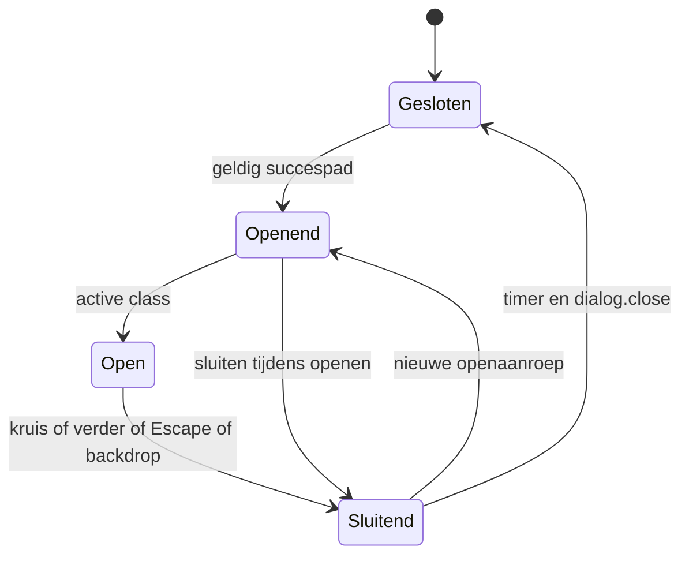
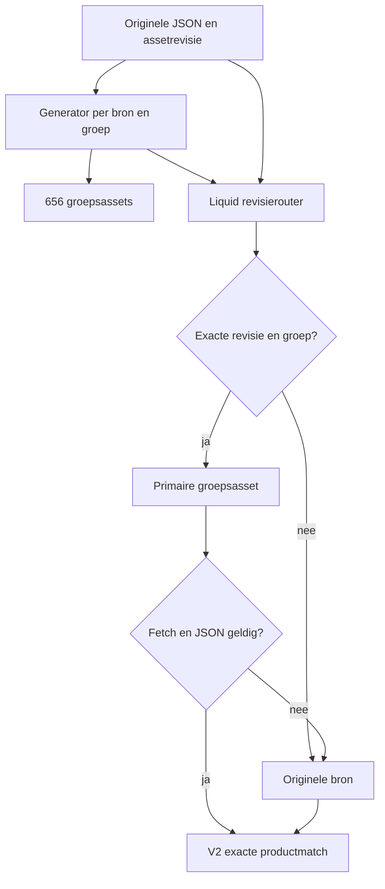
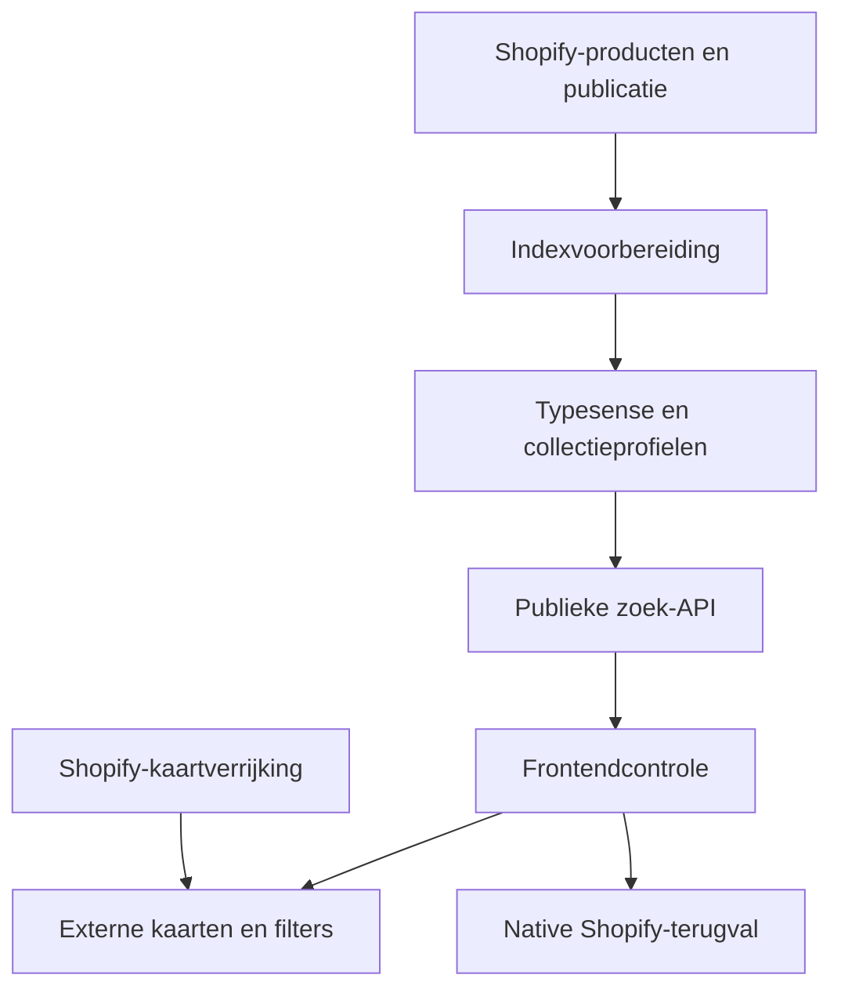
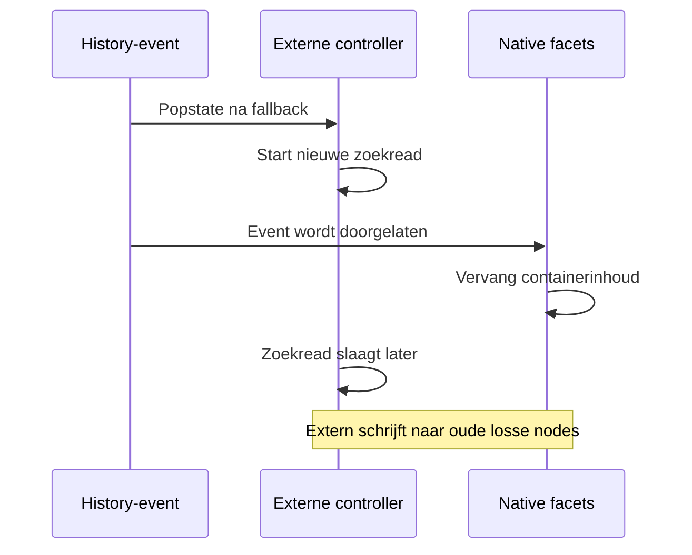
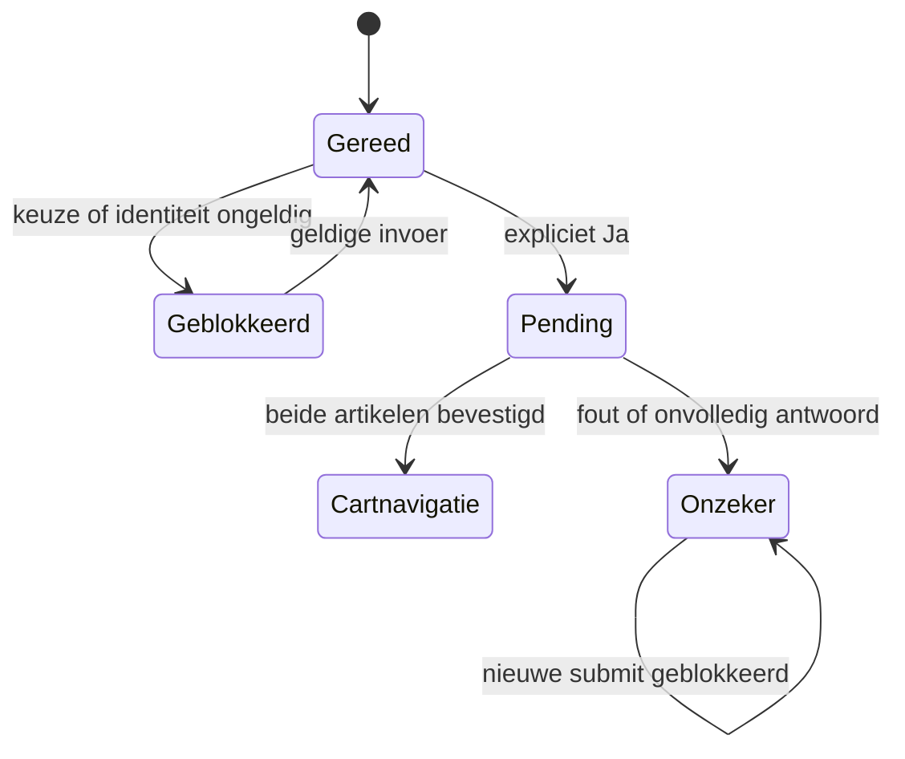
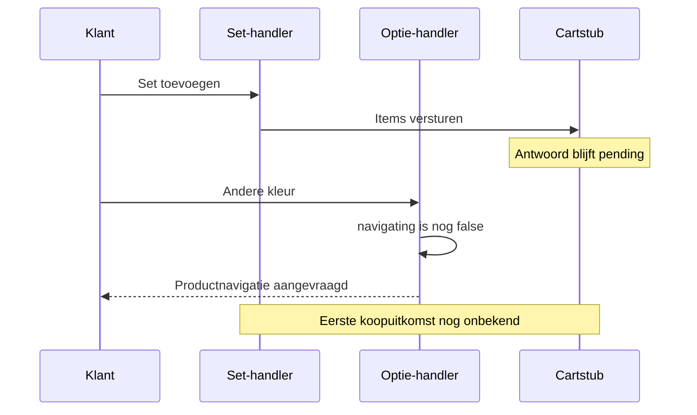

# Badkamercity volledig naslagwerk

Versie 1.0 · 30 oktober 2026 · website, bediening, techniek, data en beheer.

Badkamercity is een Shopify-winkel met verschillende gespecialiseerde verkooproutes boven op een Dawn-basis. De gewone productpagina, Sunshower-configurator, tegelcalculator, externe productlijst en twee footers hebben elk hun eigen verantwoordelijkheden. Dit naslagwerk legt die samenhang vast, inclusief de verschillen tussen telefoon, tablet en desktop. De registers achterin maken de concrete pagina’s, templates, instellingen, bestanden en productroutes terugvindbaar.

De actuele meting hieronder gaat vóór oude themanummers, aantallen en statussen in de overgenomen technische brondossiers. Een beschreven mogelijkheid is alleen klantactief wanneer ook de toewijzing, instellingen en publicatie dat toestaan.

## 1 Actuele winkelstand en bewijs

| Onderwerp | Stand op 30 oktober 2026 |
| --- | --- |
| Winkel | Badkamercity, badkamercity.nl, Shopify Basic, EUR |
| Shopify-winkel | fpa9hu-i3.myshopify.com |
| Actueel MAIN-thema | 195915448586 — BadkamerCity - Tegelkleuren juiste uitvoering |
| Offerteconcept | 195916628234 — BadkamerCity - Offerte vergelijken, UNPUBLISHED |
| Centrale repository | jlamping1997/badkamercity |
| Onderzochte main-commit | 8a9f0684f25aba145d78830c49ab724c3395d677 |
| Onderzochte uitvoeringsbranch | fix/product-cards-2026-10-14 |
| Onderzocht codecheckpoint | 379a0e2c2e1aa682a479b2a3c26fca3fc0145881 |
| Productrecords | 11.680; 11.679 ACTIVE en één DRAFT |
| Online Store-URL | 11.679 producten hebben een Online Store-URL |
| Collecties | 226 Admin-records; 225 collectie-URL’s in de sitemap |
| Pages | 120 records; 118 gepubliceerd, twee ongepubliceerd |
| Menu’s | Negen, inclusief het gebruikte main-menu |
| Blog | Eén blog met één artikel |
| Productmetafielddefinities | 258 definities in zeven namespaces |
| Themabestanden | 1.350 paden volledig geïnventariseerd |
| Opgehaalde bronbestanden | 405 relevante tekstbestanden; 404 exact gelijk aan hun controlesom |
| Open bronuitzondering | config/settings_data.json wijkt nog af van de metadata |

**Volledige inventarisatie betekent hier niet dat iedere denkbare klantactie is uitgevoerd.** De inventaris omvat alle genoemde records en themapaden. De HTML-controle omvat alle collectieroutes, alle gepubliceerde Pages en representatieve product- en systeemroutes. Browsergedrag is gericht op desktop gecontroleerd. Mobiel is beschreven vanuit de actuele code en de afzonderlijk gedateerde componentcontroles; een volledige nieuwe iPhone/Safari-koopronde is geen onderdeel van deze meting.

| Bewijslabel | Betekenis |
| --- | --- |
| ACTUEEL ADMIN | Op 30 oktober uit de winkel gelezen; niet hetzelfde als een geslaagde klanttaak |
| ACTUELE BRON | Uit het huidige MAIN opgehaalde code; controlesom vermeld in het bronregister |
| ACTUEEL HTML | De serverresponse is opgehaald en geanalyseerd; JavaScript kan daarna de pagina wijzigen |
| ACTUEEL DESKTOP | De genoemde staat is zichtbaar of interactief in de browser gecontroleerd |
| EERDER COMPONENTBEWIJS | Gedateerde, begrensde component-/fixturecontrole uit een bestaand dossier |
| HISTORISCH | Eerdere bron of test; opnieuw toetsen wanneer bron of context is veranderd |
| OPEN | Benodigde bron, test, bedrijfsafspraak of eigenaarsbesluit ontbreekt nog |

De technische bijlagen houden de oorspronkelijke datum en bewijsgrens. Een oude P1-kandidaat is geen nieuwe vaststelling dat bezoekers dat probleem nu ondervinden. Een nieuwe themakopie bewijst op zichzelf ook geen volledige regressietest.

## 2 Systeemopbouw en verantwoordelijkheden

De route wordt bepaald door Shopify en een toegewezen template. De template kiest secties; secties gebruiken snippets, instellingen, productvelden en assets. JavaScript kan de serverweergave daarna verrijken of vervangen. De externe filterdienst, Jotform en de privétool voor productcontrole staan buiten de gewone themacode.

| Laag | Verantwoordelijkheid | Waar beheren |
| --- | --- | --- |
| Domein en platform | Bereikbaarheid, winkel, gehoste checkout, verkoopkanalen | Shopify-instellingen en domeinbeheer |
| Thema | Paginaopbouw, presentatie, navigatie, productbediening | Theme Editor en gecontroleerde themacode |
| Catalogus | Artikelidentiteit, variant, verkoopprijs, publicatie, productrelaties | Shopify Producten, Collecties en metafields |
| Content | Uitleg, categorieomschrijving, begrip, blog en beleidsinhoud | Shopify-content en relevante templateblocks |
| Zoekindex | Productselectie, facetten, ranges en sortering | Afzonderlijke externe dienst en synchronisatie |
| Uploadaanvragen | Offerteformulier, bestanden en meldingen | Jotform plus gated Shopify-pagina |
| Kwaliteitscontrole | Beoordelingen, notities, checkpoints en aanleverlijst | Afzonderlijke privétool; schrijft niet automatisch naar Shopify |
| Metingen | Indexering, gedrag, aankoopmeting en productfeeds | Search Console, Analytics, Merchant Center en kanaalconfiguratie |

Shopify blijft de bron voor een echte winkelwagen en verkoopprijs. Een zoekindexkaart, opgeslagen verlanglijst of oude offerte-export is geen actuele voorraad- of prijsbevestiging. Een productfoto kan technisch laden en inhoudelijk toch bij de verkeerde uitvoering horen; die controles zijn afzonderlijk nodig.

## 3 Paginatypen en echte templatekeuze

| Familie | Routevoorbeeld | Actieve opbouw |
| --- | --- | --- |
| Homepage | / | index.json → bc-homepage; oude homepage-secties bewaard maar uitgeschakeld |
| Assortimentoverzicht | /collections | list-collections.json → bc-assortment |
| Merkenoverzicht | /collections?view=merken | list-collections.merken.json → bc-brand-directory |
| Gewone collectie | /collections/wastafelkranen | collection.json → banner, productgrid en advies |
| Categoriehub | /collections/kranen | collection.category-landing.json → main-category-landing en advies |
| Meubelhub | /collections/badkamermeubels | collection.bc-meubelhub.json → bc-meubelhub |
| Zoekresultaten | /search?q=porcelanosa | main-search; eerst native, daarna eventueel externe lijst |
| Gewone productpagina | /products/… | product.json → main-product en related-products |
| Hotbath-pilot | Toegewezen pilotproduct | product.bc-hotbath-pilot.json; één productrecord |
| Sunshower-hoofdproduct | /products/sunshower-round-one-medium-inbouw-white | product.sunshower.json → main-sunshower |
| Porcelanosa-tegel | /products/porcelanosa-verona-marfil-cubik-mat-150-x-59-6-cm | product.tegels.json → main-product met tegelkoopblok |
| Sunshower-landing | /pages/sunshower | page.bc-sunshower.json → eigen landing en winkelkaarten |
| Verlanglijst | /pages/verlanglijst | page.bc-wishlist.json → browseropslag en kaartcontroller |
| Begrippenoverzicht | /pages/begrippenlijst | page.begrippenlijst.json → main-glossary |
| Begrip | /pages/rimless | page.begrip.json → main-glossary-page |
| Contact | /pages/contact | page.contact.json → hoofdinhoud en contactformulier |
| Offerte vergelijken | Ongepubliceerde Page offerte-vergelijken | page.offerte-vergelijken.json → bc-quote; klantactivatie uit |
| Blog en adviesartikel | /blogs/nieuws en artikel daaronder | main-blog en bc-advice-article |
| Winkelwagen | /cart | main-cart-items en main-cart-footer |
| Account en systeem | /account/login, onbekende URL, password, gift card | Platformroute of beschikbare systeemtemplate; toepasselijkheid apart vaststellen |

De verse producttoewijzing is 11.270 standaard, één Hotbath-pilot, 72 Sunshower en 337 tegels. Beschikbare alternatieven zoals product.porcelanosa.json, reviewtemplates en oudere varianten zijn geen bewijs dat producten ze gebruiken. De collectie-indeling is 209 standaard, 16 category-landing en één bc-meubelhub. Het volledige register koppelt iedere collectie en Page aan de juiste familie.

## 4 Desktop mobiel en tablet

De winkel heeft meerdere doelgerichte omslagpunten. “Mobiel” is niet overal dezelfde breedte. Vooral 750px voor compacte inhoud en 990px voor header/filterdrawer moeten afzonderlijk worden behandeld.

| Onderdeel | Klein scherm | Groter scherm | Grens en aandachtspunt |
| --- | --- | --- | --- |
| Header | Hamburger en mobiele drawer; compactere zoekopbouw | Logo, breed zoekveld, iconen en horizontale categorierail | Desktopnavigatie vanaf 990px |
| Mobiel menu | Eerste categorie opent paneel; vervolggroepen klappen inline open | Eigen desktopcategoriepanelen en horizontaal scrollen | Paneelstack is geen browsergeschiedenis |
| Homepagebanners | Twee campagnes onder elkaar met eigen uitsnede | Twee banners naast elkaar, verhouding 1,6 : 1 | Vanaf 750px tweekoloms |
| Homepagecategorieën | Negen cirkels in 3 × 3 | Negen naast elkaar | Vanaf 750px negen kolommen |
| Homepage advies | Compacte tekst/beeldopbouw | Ruimere tekst-/beeldkolommen | Extra vereenvoudiging onder 360px |
| Assortiment | Eén uitklapbare lijst vóór de merkblokken; foto 56 × 56px | Categoriekaarten, promoties en daarna directory | Onder 750px echte DOM-verplaatsing |
| Assortimentdirectory | Afdelingen te openen; eerdere openstaat bewaren bij zoeken | Vaste afdelingen open en summaries uit tabvolgorde | 990px is aparte directorygrens |
| Productlijst | Compacte lijst, afbeelding links en informatie rechts | Productraster met meer ruimte per kaart | Compacte kaartregels tot 749px; externe CSS kan aanvullen |
| Filters | Drawer tot 989px | Zijbalk vanaf 990px | Zwevende shortcut alleen tot 749px en onder aanvullende zichtbaarheidsguards |
| Algemene PDP | Media en koopinformatie compacter; eigen titel-/thumbnailregels | Media en informatie naast elkaar; sticky informatie mogelijk | Algemene hoofdlayout rond 990px; details ook rond 750px |
| Tegelkleuren | Horizontale rail, gedeeltelijk volgende kleur zichtbaar | Zelfde keuzecontract; meer ruimte voor stalen | Ook containerquery tot 440px, niet alleen viewport |
| Grote footer | Linkkolommen als accordion | Drie open kolommen plus contact | 749/750px, met aanvullende gridgrenzen |
| Compacte homepagefooter | Native uitklappers | Drie kolommen met native uitklappers | Blijft in desktopwaarneming gesloten; ander contract dan grote footer |
| Cartpopup | Onderaan, rekening met veilige schermranden | Rechtsboven met begrensde breedte | Tot 749px andere positionering |
| Offerteformulier | Eén kolom, hogere iframecontainer | Gecentreerde uploadkaart | Koppeling alleen zichtbaar wanneer activeringsvoorwaarden passen |

Op desktop is een browserbreedte van 1.348 CSS-pixels gebruikt. De homepage paste binnen die breedte. Bestaande dossiers bevatten componentcontroles op 320, 390 en 1.024px voor homepage, assortiment en offerte. Dat bewijs geldt per component en gedateerde bron; het certificeert niet de volledige mobiele winkel, Safari, touch, de betaalroute of alle overlaycombinaties.

## 5 Header en globale navigatie

De actuele headergroep bevat één headersectie, gebruikt main-menu, heeft menu_type_desktop=dropdown en sticky_header_type=on-scroll-up. De naam dropdown is een instelling uit de basis; de zichtbare categorienavigatie wordt door maatwerkcontrollers gemaakt.

De desktopheader bevat het logo, de zoekinvoer, de verlanglijst en de winkelwagen. De categorierail bevat Kranen, Douche, Badkamermeubels, Wastafels, Toiletten en fonteinen, Baden, Tegels, Spiegels en verlichting, Accessoires, Verwarming en ventilatie en Merken. Previous/next-knoppen scrollen deze rail. Een klik op een categorie kan gewoon naar de collectie navigeren; de categoriepanelen hebben daarnaast hun eigen open-/focus-/pointergedrag.

De mobiele drawer gebruikt een rootpaneel, categoriepanelen, terugknoppen, overlay, een panelstack en focusherstel. Vervolggroepen gebruiken native details/summary. De huidige renderer bevat de na 29 oktober ingevoerde inline uitklappers en rechte vervolgrijen. Accountlinks zijn in die wijziging verwijderd. Bekijk alle blijft een echte link naar de scope, zodat een bezoeker niet eerst een diepere categorie hoeft te kiezen.

Belangrijke beheerscheiding: menu-inhoud hoort bij Shopify-menu’s; presentatie en gekozen menu horen bij de headersectie. Een verkeerde bestemming los je bij de menudata op. Een verkeerd sluitgedrag los je in de betreffende controller op. Een globale CSS-aanpassing mag niet de focus, aria-expanded, inert-status of paneelstack ontregelen.

De offerteknop is voorbereid als desktopoptie. Actueel staat quote_cta_enabled=false en quote_cta_preview=true. In MAIN is deze knop daardoor niet klantactief. Er is op eigenaarsverzoek geen extra mobiele offertebalk.

## 6 Zoeken en de drie verschillende zoekfuncties

| Zoekfunctie | Bron | Resultaat |
| --- | --- | --- |
| Header met suggesties | Shopify predictive search | Suggesties bij typen; eigen loading/open/closed-staat |
| Productresultatenpagina | Native Shopify-zoekresultaat, eventueel overgenomen door externe engine | Productkaarten, aantallen, filters en sortering |
| Categoriezoeker of begrippenzoeker | Reeds gerenderde lokale categorie-/termstructuur | Alleen relevante bestaande links tonen; geen productindexrequest |

In de desktopcontrole gaf porcelanosa tien predictive productsuggesties. Enter opende de resultatenpagina. De native pagina meldde 606 resultaten; na externe overname stond er 337 producten met onder meer Soort en Kleur. Dat is een daadwerkelijk waargenomen renderovergang. Het native resultaattotaal en de externe productscope zijn verschillende tellingen; de paginatitel bleef het native aantal dragen. Dit verdient een expliciet contract voor teltitel, paginaresultaat en terugval.

De externe renderer begint pas na DOM- en contextguards. Een expliciete type-query zonder product sluit hem uit. Zonder type-parameter mag hij wel proberen over te nemen. Een historische bcfilters=1-proefbeschrijving is geen activeringsvoorwaarde van de huidige code.

FLASH-01 heeft zoekstyles naar de head verplaatst en gesloten suggesties vóór volledige opmaak begrensd. Dit voorkomt een deel van de eerder besproken opstartflits, maar is geen nieuwe snelheidsmeting. Controleer bij verdere wijzigingen predictive suggesties en volledige zoekresultaten afzonderlijk, inclusief lege zoekterm, nulresultaat, Enter, Escape, focus en snelle tweede invoer.

## 7 Homepage en adviesaanvraag

Het huidige index.json schakelt alleen bc-homepage in. De offerte-teaser en alle oudere homepage-secties zijn disabled. Daardoor zijn de oude home-sunshower/home-hero- en populaire-productbeschrijvingen achterin historische mogelijkheden, niet de actuele homepagevolgorde.

De zichtbare homepage heeft een verzendbalk boven de campagnes, twee volledige bannerlinks, een compacte service-/adviesregel, negen categoriecirkelblokken, vier favoriete merken, een tegelinspiratiebanner, advies op afspraak en afhaal-/retourdetails. De eerste campagne linkt naar Kranen; de tweede naar Badkamermeubels. De vier merklinks gebruiken de bestaande vendorroutes van Hotbath, Wiesbaden, JEE-O en Sunshower.

De negen categorieën zijn Kranen, Douche, Badkamermeubels, Tegels, Toiletten, Spiegels, Wastafels, Baden en Accessoires. Bekijk alle categorieën bewaart toegang tot de overige afdelingen. De cirkels zijn ingangen naar categorieën, geen exacte productfoto’s of verkoopbare artikelkaarten.

De adviessectie positioneert Badkamercity als webshop met een showroomafspraak bij partner Harry Suiker in Den Haag. Vraag een 3D-afspraak aan opent een Shopify-contactformulier. Het formulier vraagt naam/e-mail en aanvullende wensen; telefoon en voorkeursmoment zijn optioneel. De afspraak staat pas vast na bevestiging. Een later ingevulde echte booking_link kan de aanvraagroute vervangen; er is nu geen bewezen boekingsagenda.

De knop en formulierstructuur zijn eerder in preview gecontroleerd; er is in deze documentatieronde geen aanvraag verzonden. Mailontvangst blijft een bedrijfscontrole. Afhaal- en retourinformatie gebruikt Zichtenburglaan 150, 2544 EB Den Haag. De getoonde verzendbelofte is Gratis verzending boven €100; de effectieve checkouttariefgrens is hiermee niet opnieuw gecontroleerd.

Beheer: Theme Editor → Homepage → Homepage acties & rondjes. De sectie heeft 30 instellingen en drie blocktypen. Foto, tekst, bestemming en categoriecollectie kunnen per block worden beheerd. De image-picker heeft voorrang op de meegeleverde fallbackbeelden. De 13 campagne-/categoriebeelden uit HOME-01 zijn illustratieve beelden; gebruik ze niet als bewijs van een exacte merkuitvoering of daadwerkelijke showroomfoto.

## 8 Assortimentoverzicht en merken

/collections is een eigen assortimentoverzicht. Het gebruikt dezelfde menustructuur en collectie-identiteiten als de navigatie. Op mobiel staat de directory direct na intro/zoeker en vóór de promoties. Het desktopraster wordt daar verborgen. De directory wordt werkelijk verplaatst, zodat leesvolgorde en zichtbare volgorde overeenkomen.

De mobiele hoofdrij heeft een vierkante foto, korte naam, maximaal twee primaire submenuvoorbeelden en een plus/min. Openen toont Bekijk alle, bestaande subcategorieën en apart gegroepeerde aanvullende ingangen. Meerdere afdelingen mogen tegelijk open. De aanvullende groep Maak het compleet mag een klant naar bijvoorbeeld kranen sturen zonder die kranen administratief tot wastafels te maken.

De categoriezoeker normaliseert accenten, hoofdletters, meervoud kranen, wc/toilet, wasbak/wastafel en enkele leestekens. Alle zoekwoorden moeten in de relevante titel-/oudercontext voorkomen. Tijdens zoeken verdwijnen overzicht/promoties, passende afdelingen openen en een status meldt het aantal. Escape en Toon alle categorieën herstellen de selectie. Dit is lokale filtering, geen zoekopdracht door productomschrijvingen.

De merkenroute /collections?view=merken gebruikt een afzonderlijke template. De ongepubliceerde Page /pages/merken is niet die ingang. Een gecureerde merkenlijst kan achterlopen op nieuwe leveranciers: Porcelanosa heeft inmiddels 337 producten. De feitelijke merkselectie staat in de bron- en routetabellen; een productvendor toevoegen aan Shopify maakt niet automatisch iedere gecureerde merkkaart zichtbaar.

## 9 Categoriehubs collecties en interne links

Een categoriehub helpt eerst een productgroep kiezen. Een gewone collectie toont producten met filters. Badkamermeubels heeft een derde opbouw met eigen menu-/merk-/maat-/stijlselectie. De collectiehiërarchie komt uit menu’s en eigen instellingen; Shopify-collecties hebben hier niet één universeel parentveld dat alle navigatie bepaalt.

bc-category-children zoekt de huidige collectie in de gekoppelde menustructuur, kan een expliciet children_menu gebruiken, dedupliceert op identiteit/URL en slaat zelflinks over. Afbeeldingen kunnen uit collectiebeeld, eerste product of overrideblock komen. Een zoekfallback is een technische bestemming, geen inhoudelijke garantie dat een categorie volledig gevuld is.

Sommige content wordt met [SPLIT] in boven- en ondertekst verdeeld. De meubelhub stript styleblokken via bc-content-without-styles voordat hij de tekst verwerkt. De oudere drie CSS-blokken in de Admin-omschrijving van Badkamermeubels blijven daarom een aparte beheerafhankelijkheid; alleen hun aanwezigheid bewijst niet dat ze via iedere huidige renderer uitgevoerd worden.

De actuele inventaris bevat 226 collecties en 225 sitemaproutes. tegeltoebehoren geeft 404 en staat niet in de sitemap. Dat verschil vraagt controle van publicatie en werkelijke interne ingangen; een ongepubliceerde collectie is niet automatisch een defecte openbare pagina. De linkinventaris achterin maakt de context zichtbaar.

## 10 Productlijsten kaarten en externe filters

Er zijn meerdere kaartimplementaties: native collectiekaart, native zoekkaart, externe JavaScriptkaart, Sunshower-shopkaart en oudere homepage-productkaart. Dezelfde producttitel of classnaam maakt die renderers niet identiek. Callerinstellingen bepalen onder meer of quick-add actief is.

De externe lijst gebruikt eerst indexvelden en verrijkt daarna via Shopify-sectie bc-card-data. De verrijking bepaalt onder meer de exacte variant, titel, foto, leverinformatie en of direct toevoegen mag. Direct toevoegen vereist in de onderzochte bron één geschikte variant, een normale quantity-rule en geen verplicht selling plan. Bij een complexe configuratie hoort de route naar de productpagina te blijven bestaan.

Kleurwissel op een kaart moet foto, prijs, URL, variant en verlanglijstidentiteit samen bijwerken. Een nieuwere kleurintentie mag niet door een oude response worden teruggedraaid. De huidige code heeft daarvoor versies en requestguards; de eerdere geïsoleerde tests zijn opgenomen in de methodedossiers.

De filterquery gebruikt collection, q, page, per_page, sort, filters en ranges. URL-status gebruikt bcf_, bcr_*_min/max, bcsort en bcpage. Een geldige collectie-response moet met de verwachte collectieomvang passen. Een gelijke telling controleert niet ieder individueel product of iedere prijs.

Timeout/fout moet de native lijst herstellen. De eerdere FILTER-F01-reproductie beschrijft een race tussen native gridvervanging na fallback en latere externe rendering naar oude nodes. Dat blijft een geïsoleerde bevinding, geen in deze ronde vastgesteld bezoekersincident. Backendbron, volledige indexactualiteit, CORS-preflight, synchronisatie, verwijderbeleid en herstel blijven afzonderlijke systeemcontroles.

### Tegelprijzen op kaarten

De desktopzoeklijst voor Porcelanosa toonde onder meer €294,89 incl. btw. Op de bijbehorende Cubik-PDP staat €109,95/m² en €294,89 per doos van 2,682m². De kaartprijs en PDP-prijs gebruiken dus niet vanzelf dezelfde benoemde eenheid. Het lijstcontract moet expliciet maken of de klant een doosprijs of m²-prijs ziet en wat een directe toevoeging betekent. Dit document verandert die werking niet.

## 11 Algemene productpagina

main-product is de gedeelde hoofdsectie voor de gewone en tegel-PDP. Hij rendert identiteit, media, koopinformatie, beschrijving, documenten, specificaties, setinhoud en accessoires. Welke blocks werkelijk aanwezig zijn wordt door de toegewezen template bepaald; het schema registreert meer mogelijkheden dan iedere pagina gebruikt.

De pagina begint bij het Shopify-product en de geselecteerde of eerste beschikbare variant. De native variantcontroller haalt sectie-HTML op en werkt onder meer formulier-ID, prijs, URL en media bij. Een native variantwissel gebruikt replaceState; een keuze naar een ander product gebruikt een echte productnavigatie. Die contracten mogen niet worden samengevoegd tot één algemene dropdown zonder identiteitscontrole.

De specificatierouter kiest Sunshower-data, beoordeelde Hotbath-data, beoordeelde Wiesbaden/JEE-O-data of een bestaande mapping/legacyterugval. custom.*, specs.*, bc_data.* en bc_sunshower.* zijn geen uitwisselbare namespaces. Een definitie bewijst geen gevuld veld; een gevuld veld bewijst geen zichtbare rij. Scopeguards kunnen informatie bewust onderdrukken.

Documenten worden alleen onder de passende scope getoond. De gewone documentenrenderer gebruikt onder meer custom.technische_documenten als list.url, dedupliceert en laat https-links toe. Sunshower heeft een afzonderlijke documentenroute. Bij een ontbrekende PDF moeten veldtype, scope, renderer en bronbereikbaarheid worden gevolgd.

Beschrijving en specificaties hebben eigen uitklapgedrag. De algemene beschrijving wordt na vier berekende regels ingeklapt; mobiele specificaties kunnen na tien rijen worden begrensd. Verborgen links moeten buiten de tabvolgorde blijven en bij openen worden hersteld. Afzonderlijke animatie- en contentdossiers verklaren dat contract.

## 12 Porcelanosa tegels dozen en m²

De 337 Porcelanosa-producten gebruiken product.tegels.json. De bestaande main-product wordt aangevuld met bc-porcelanosa-buybox, bc-porcelanosa-core.js, bc-porcelanosa-buybox.js en eigen CSS. De Shopify-variantprijs is de doosprijs. De m²-prijs, doosinhoud, verkoopeenheid en technische tegeldata worden apart weergegeven.

| Invoer of uitvoer | Regel |
| --- | --- |
| Oppervlakte | Positief getal met komma of punt; maximaal vier decimalen |
| Snijverlies | 0, 5, 10, 15 of 20%; standaard 10% |
| Benodigde oppervlakte | Ingevoerde m² × (1 + snijverlies/100) |
| Dozen | Naar boven afronden op hele dozen |
| Geleverde oppervlakte | Dozen × m² per doos |
| Totaal | Dozen × exacte Shopify-doosprijs in centen |
| Handmatig dozen kiezen | Positief geheel aantal; oppervlakte volgt de geleverde hoeveelheid en snijverlies wordt 0 |
| Grote hoeveelheid | Meer dan 50m² geleverd activeert aanvullende contact-/leverinformatie; dit is geen automatische blokkade |
| Winkelwagenhoeveelheid | Aantal dozen, met _bc_m2_per_box als verborgen regelproperty |

De berekening gebruikt gehele schaalwaarden van 1/10.000m² en centen om drijvende-kommafouten te beperken. Het hoogste toegestane doosaantal is ook begrensd; ongeldige invoer blokkeert de koopknop. Zonder JavaScript blijft een handmatig doosaantal beschikbaar.

**Actuele desktopproef:** Verona Marfil Cubik, doosinhoud 2,682m², doosprijs €294,89. Bij 10m² en 10% snijverlies wordt 11m² benodigd, vijf dozen, 13,41m² geleverd en €1.474,45 totaal. De verborgen quantity werd vijf. Er is niet op In winkelwagen geklikt.

De beginwaarde van het m²-veld is in dit product 2,682. Met de standaard 10% resulteert dat direct in twee dozen en 5,364m². Dit is de huidige rekenregel; de gewenste beginervaring verdient een expliciete UX-keuze als klanten de startwaarde als één doos opvatten.

### Keuzevolgorde en juiste kleurfoto

Het tegelmodel heeft vijf opeenvolgende velden: type, kleur, uitvoering, formaat en dikte. Een keuze behoudt de eerdere velden en probeert de latere velden zo goed mogelijk te behouden. Waar nodig kiest de code een passende vervolguitvoering op score, oppervlaktemaat, dikte en SKU. Dit verschilt van de V2-switcher die precies één volledige match eist.

De kleurthumbnail wordt in de actuele code afgeleid van de daadwerkelijk gekozen doeluitvoering. Daardoor gebruikt een Cubik-/Lineal-keuze het passende doelproduct in plaats van blind een willekeurig eerste kleurartikel. bc-tile-choice-data levert daarbij de featured_image van dat doelartikel. Dit verklaart de route van de recente Line/Cubik-correctie, maar bevestigt nog niet inhoudelijk iedere foto van alle 337 producten.

De desktopcontrole van Verona Marfil Cubik toonde drie geladen kleurafbeeldingen en de reliëfuitvoering in de hoofdafbeelding. Niet-actieve grote sfeerbeelden waren nog niet geladen terwijl hun thumbnails wel geladen waren; dat is bij lazy media op zichzelf geen fout. De kwaliteit van sfeerbeeld → serie → kleur → uitvoering blijft daarnaast onderdeel van de fotocontrole.

Bij productnavigatie blijven m²/dozenkeuze en een korte positiehandoff via sessionStorage behouden. De positiehandoff is 30 seconden geldig. De kleurrail heeft horizontale bediening en een eigen scrollbar met pijltjestoetsen/Home/End. Containerqueries passen de stalen aan de beschikbare koopblokbreedte aan.

## 13 Hotbath Wiesbaden en JEE O

Hotbath gebruikt productgroepen, expliciete menu-/bronrouters en waar mogelijk kleinere revisiegebonden keuzeassets. SPOM-/uitgesloten routes en __NO_MENU__ hebben eigen guards. Een grote originele dataset blijft een fallback. Een correcte controlesom van groepsdata bewijst niet dat de publieke assetrevisie de kleinere route werkelijk activeert.

Wiesbaden-kleuren worden met custom.color_variants als productreferenties aangeleverd en gevalideerd op merk, wederzijds groepsanker en huidige productidentiteit. De adapter gebruikt daarna de gedeelde V2-engine. JEE-O kan andere specificatievelden en reviewguards gebruiken. Een veldnaam of kleurrelatie mag niet op titelgelijkenis worden gegokt.

Het optionele Hotbath-inbouwdeel is een betaalde toevoeging met exacte parent-/bodyvariant, SKU, hoeveelheid en compatibiliteitsguards. De compacte checkbox staat standaard uit. Expliciete keuze kan kort tussen passende groepsproducten worden doorgegeven. Een inbegrepen onderdeel mag niet nogmaals betaald worden toegevoegd.

De eerdere mappingcontrole beschreef 715 unieke productcases naar 44 bodies. Dat is gedateerd structureel bewijs, geen nieuwe commerciële goedkeuring van ieder onderdeel. De verse globale catalogustelling in dit naslagwerk bevat 8.237 Hotbath-, 2.451 Wiesbaden- en 273 JEE-O-records; het aantal zichtbare kleurmenus of koopbare sets volgt daar niet rechtstreeks uit.

## 14 Sunshower landing configurator en accessoires

Er zijn 104 Sunshower-productrecords, waarvan 72 de speciale producttemplate gebruiken. De overige records omvatten andere rollen zoals accessoires. De configurator werkt met bc_sunshower.configuration en een catalogusasset waarin een volledige selectie aan een concreet product en variant is gekoppeld.

De Sunshower-PDP heeft een eigen galerij, thumbnails, pijlen, viewer en keuzecontroller. De selectie bewaart de overige velden en zoekt een passende cataloguscombinatie. De code gebruikt de eerste volledige match; unieke configuraties moeten daarom in de bron bewaakt blijven. V2 heeft juist een expliciete unieke-match-eis.

De landing bevat licht-/configuratieingangen en shopkaarten. Een shopkaartkleur wisselt lokaal; een hoofdconfiguratie wisselt naar een ander product. Een lifestylebeeld of algemene kleuroverzichtsnotitie is geen exact finishbeeld van iedere keuze. Accessoires, onderdelen die inbegrepen zijn en extra betaalde producten moeten gescheiden blijven.

Sunshower heeft verschillende koopingangen: hoofdartikel, set met extras en landingskaart. Ze gebruiken niet automatisch dezelfde cartpopup. De eerdere SS-F01-reproductie betreft actieblokkering tijdens een lopende set-add; de eerdere WISH-F02-reproductie betreft een achterblijvende hartjesstatus na een kaartkleurwissel. Beide zijn begrensde codebevindingen, niet in deze ronde uitgevoerde kooptests.

## 15 Afbeeldingen galerijen en productcontrole

| Beeldsoort | Functie | Controle |
| --- | --- | --- |
| Exacte productfoto | Het verkoopbare artikel tonen | Merk/SKU, kleur, afwerking, vorm en uitvoering passen |
| Kleurthumbnail | Een daadwerkelijke doelkeuze herkennen | Dezelfde doeluitvoering als de knop en volgende productroute |
| Sfeerfoto | Toepassing of stijl tonen | Niet presenteren als gegarandeerde exacte kleur/inhoud van het artikel |
| Seriefoto | Serie illustreren | Serieherkomst vastleggen; geen automatische match met iedere serievariant |
| Technische tekening | Maat/technische informatie | Niet als gewone hoofdfoto goedkeuren |
| Categorie-/campagnebeeld | Navigatie en inspiratie | Herkenbaar producttype, geen onbewezen merkidentiteit of leverbelofte |

De algemene media-gallery en Sunshower-viewer zijn verschillende implementaties. De latere gedeelde galerijpijlen behouden de native media-ID’s, thumbnailselectie en modalroute. Een productlinkpijl is een andere functie dan een fotopijl. Bij nul/één/meerdere foto’s, variantmedia, video/3D en lazy loading zijn aparte staten nodig.

De privétool Productcontrole staat los van de winkel. De actuele overdracht beschrijft 11.034 hoofdfotokaarten, Ja/Nee/Twijfel/Technische tekening, optionele notities, alle merken/willekeurig, checkpoints en dag/nacht. Beoordelingen zijn globaal per eigenaar; een checkpoint bewaart selectie/plek en draait nieuwe beoordelingen niet terug. Een afkeuring past Shopify niet automatisch aan.

De oudere sfeerfototool koppelt Porcelanosa-seriebeelden aan kleuren en bewaart keuzes op het toestel met export. Dat opslagmodel is anders dan de afgeschermde online productcontrole. Verwar een oude lokale export, een named checkpoint en de daadwerkelijke actuele beoordeling niet met elkaar.

## 16 Winkelwagen popup en bewaren

De gewone PDP kan na een geslaagde add de cartnotification openen. De externe kaart kan hetzelfde component gebruiken. Inbouwsets, Sunshower-sets en wishlist-add kunnen rechtstreeks naar de cart navigeren. De Sunshower-landingskaart kan inline succes en alleen een badge tonen. Eén mooie popup in het thema betekent dus niet dat ieder kooppad die bereikt.

| Ingang | Huidig broncontract |
| --- | --- |
| Algemene PDP | product-form → sectionresponse → notification/drawer indien aanwezig |
| Optioneel inbouwdeel uit | Gewone PDP-handler |
| Optioneel inbouwdeel aan | Multi-item add, response-identiteit controleren, naar cart |
| Externe productkaart | Exacte variant en sections; kaartfeedback plus beschikbare cartcomponent |
| Sunshower-set | Eigen multi-item handler, naar cart |
| Sunshower-shopkaart | Eigen inline feedback; notification wordt niet vanzelf geopend |
| Verlanglijst | Exact toegestane variant of eerst PDP; bij add naar cart |

De notification is een native dialog met kruis, Verder winkelen, Escape en backdrop-sluiting. Hij bewaart de opener, vergrendelt de achtergrond en herstelt scroll-/focusstaat. Mobiel wordt hij onderaan geplaatst. De sluiting gebruikt een korte timer en vereenvoudigt bij reduced motion. Een tweede openaanroep moet een lopende sluiting correct annuleren.

De eerdere CART-F01-reproductie laat zien dat ontbrekende productsectiondata oude bevestigingsinhoud kan laten staan. De passende correctie is een betrouwbaar onvolledig-responsecontract; een automatische tweede add is daarvoor ongeschikt. Een transportfout kan betekenen dat de server al heeft toegevoegd terwijl de browser geen bevestiging heeft ontvangen.

Bewaar winkelwagen gebruikt browseropslag met versie, tijd, variant, hoeveelheid, properties en eventueel selling_plan. De bewaartermijn in de bron is maximaal 30 dagen. Herstellen is een echte add-operatie en kan een bestaande cart aanvullen. Het reserveert geen voorraad en bevriest geen prijs. In deze documentatieronde is geen cart gewijzigd of geleegd en geen checkout gestart.

## 17 Verlanglijst en browseropslag

bc_wishlist_v1 bewaart maximaal 100 genormaliseerde entries op dezelfde browser/origin. Identiteit is handle plus variant-ID. Titel en afbeelding zijn opgeslagen presentatiesnapshots. De wishlist is niet automatisch accountgebonden en synchroniseert niet vanzelf tussen telefoon en computer.

Bij toevoegen vanuit de verlanglijst controleert de controller product-/variantgeschiktheid. Complexe, onbeschikbare of niet-passende gevallen gaan naar de PDP. De productcache heeft in de beschreven bron geen TTL; een helpercall betekent niet dat bij iedere klik opnieuw actuele productdata is opgehaald.

De geïsoleerde WISH-F01-reproductie beschrijft overschrijven tussen twee tabbladen met oude geheugenstaat. WISH-F02 beschrijft het Sunshower-hartje na kleurcommit. Die bevindingen vragen gerichte browserregressie bij een toekomstige fix. Onbeschikbare opslag moet een fout melden en mag geen succes veinzen.

Naast wishlist/cart bestaan kortlevende sessionStorage-handoffs voor productkeuze, open kleuren, Sunshower-positie, inbouwkeuze en tegeloppervlakte. Het technische register legt de concrete sleutelconsumenten vast. Een andere sleutel introduceren om oude data te omzeilen is geen veilige migratie.

## 18 Offerte vergelijken en laagsteprijsgarantie

De eigenaar heeft de laagsteprijsgarantie en offertevergelijking goedgekeurd. De huidige inrichting bestaat uit één gedeelde aanvraagroute voor een volledige offerte of één product. Het formulier staat bij Jotform; Shopify bevat presentatie, contactfallback en afzonderlijke activeringsgates.

| Onderdeel | Actuele status of gedateerd bewijs |
| --- | --- |
| Page offerte-vergelijken | Admin-record bestaat, ongepubliceerd |
| Formulier-ID | 263018521531044; publieke providerroute, geen API-key |
| integration_enabled | false |
| integration_preview | true; alleen effectief in een ongepubliceerd thema |
| show_preview | false |
| Headerknop | enabled=false; preview alleen in concept; geen mobiele balk |
| Footerlink | enabled=false; preview alleen buiten MAIN |
| Homepage-teaser | disabled |
| Bestandinstellingen | Eerder gelezen: PDF/JPG/JPEG/PNG, maximaal drie bestanden van 10MB elk |
| Velden | Type aanvraag, voor-/achternaam, e-mail en bestand verplicht; toelichting optioneel |
| Melding | Naar info@badkamercity.nl; mailboxontvangst nog te bevestigen |
| Klantmail | Disabled tot verificatie/inrichting is afgerond |
| Bewaartermijn en anonieme toegang | Nog af te sluiten controles |

De eerdere fictieve test bewees upload, opslag, bevoegde download en blokkering van een .txt-bestand. Dat is geen test met echte klantgegevens en geen bewijs dat een anonieme bezoeker het bestand niet kan downloaden. Die laatste controle bleef open. De brandingcontainer is met gerichte CSS verborgen; dat is geen betaalde abonnementswijziging en kan na providerwijzigingen hercontrole vragen.

Het recente design heeft één uploadkaart, compacte velden, korte uitleg en uitklapbare garantie-informatie. In MAIN blijft de provider door de huidige gates uit; de klantlinks zijn niet actief. “Formulier gemaakt” mag daarom niet als “offerte-upload live” worden geregistreerd.

Voor activering moeten de verificatie-/testmail, ontvangst, klantbevestiging, bestandstoegang, bewaartermijn, verwijderen en echte telefoonupload worden afgerond. Geen automatische korting, massale prijswijziging of directe klantbelofte afleiden uit het bestaan van het formulier. Een aanvraag vraagt handmatige beoordeling op dezelfde artikelen, uitvoering, compleetheid en relevante kosten/voorwaarden.

## 19 Beide footers en serviceinformatie

De compacte homepagefooter wordt alleen gekozen bij homepage plus compact_homepage=true. Andere pagina’s gebruiken de grote footer. Het zijn twee bewuste renderpaden, met dezelfde zakelijke contactcontext maar verschillende linkbronnen en interactie.

| Onderwerp | Homepagefooter | Grote footer |
| --- | --- | --- |
| Bron | bc-home-footer snippet | footer.liquid en geordende sectieblocks |
| Linkgroepen | Vast samengestelde service-/over-links en main-menu | service-, category- en info-blocks |
| Desktop | Drie native uitklappers; in actuele waarneming gesloten | Kolommen geforceerd open, summary buiten tabvolgorde |
| Mobiel | Native uitklappen | Controller sluit kolommen bij kleine breedte en beheert resize |
| Afhalen/retour | Homepageankers naar bestaande informatie | Sommige labels hebben nog geen bestemming |
| Adres | Sectieadres, benoemd als afhaal-/retouradres | Zelfde actuele adresconfiguratie |
| Policies | Bestaande Shopify-policies | Bestaande Shopify-policies wanneer ingeschakeld |
| Offerte | Gedeeld gated quote-snippet | Hetzelfde gated quote-snippet |

In de grote footer zijn nog tien labels zonder URL: Veelgestelde vragen, Bezorgen & afhalen, Retourneren, Garantie & service, Over ons, Badkamerinspiratie, Badkameradvies, Onze merken, Showroom en Zakelijk. De actuele desktopcontrole op de categorie en tegel-PDP bevestigt dat dit tekst is en geen werkende link. De code gebruikt spans in plaats van een misleidende lege href. Het blijft wel een onvolledige navigatiekeuze.

De grote footer gebruikt geen willekeurig Shopify-footermenu voor deze drie kolommen. De links worden beheerd in de footersectieblocks van het juiste thema. Logo/socials, contactvelden, policies en echte betaalmethoden hebben afzonderlijke beheerbronnen. Betaaliconen zijn geen bewijs dat een specifieke betaalroute nu succesvol werkt.

## 20 Begrippen content blog en formulieren

Er zijn 109 Pages met begrip-template en één begrippenoverzicht. De overzichtstermen komen uit templateblocks en verwijzen via begrippenlijst-routes naar Pages. Een nieuw begrip vraagt daarom samenhang tussen termblock, gepubliceerd Page-record en de juiste redirect.

De begrippenpagina bouwt bij passende directe H2-koppen inhoudskaarten en een inhoudsopgave. De adviesartikelrenderer splitst inhoud op zijn eigen H2-contract en berekent leestijd uit woordenaantal. Afwijkende HTML-structuur kan de presentatie veranderen zonder dat de Page onbereikbaar wordt. De oorspronkelijke inhoud moet ook zonder JavaScript leesbaar blijven.

Hygro(meter) heeft een bestaande bekende verkeerde/missende doelroute naar /pages/hygrometer. De verse extra GET geeft nog steeds 404. Dat is een concrete inhoudelijke navigatiebevinding. Het volledige redirectregister achterin vermeldt welke overzichtsverbindingen opnieuw zijn gevolgd.

Contact gebruikt Shopify form 'contact'. Nieuwsbriefmogelijkheden gebruiken andere formtypes en zijn niet automatisch actief op de homepage. Naam/e-mailvelden, een verzendknop en zelfs een bedankmelding bewijzen geen mailboxbezorging. Formulierontvangst, spamafhandeling en foutfocus hebben een eigen acceptatie nodig.

Zes algemene Pages dragen nog suffix page terwijl page.page.json niet in de actuele templatecatalogus staat. De gepubliceerde routes kunnen toch op een standaardtemplate terugvallen; de uitgevoerde HTTP-controle bewijst hun bereikbaarheid, geen correcte alternatieve toewijzing. Normaliseer dit niet massaal zonder de bedoelde paginaweergave te bepalen.

## 21 URL structuur sitemap robots en SEO

Shopify genereert al een werkende XML-sitemap. Een tweede sitemapgenerator is voor de basisdekking niet nodig. De verse index bevat 17 subsitemaps en 12.026 entries: 11.679 producten, 225 collecties, 118 Pages, twee blog-/artikelroutes, de homepage en agents.md. Alle 17 submaps zijn gelezen; aanwezigheid in de sitemap is geen indexeringsbewijs.

| Route | Functie en beleid |
| --- | --- |
| /collections/handle | Vaste collectie of categoriehub |
| /products/handle | Productvoorkeursroute; producttoewijzing bepaalt de renderer |
| /pages/handle | Contact, uitleg, Sunshower, wishlist of andere inhoud |
| /blogs/blog/artikel | Redactionele inhoud |
| /collections/vendors?q=… | Dynamische merkingang; andere rol dan een eigen merklanding |
| ?view=merken | Alternatieve overzichtstemplate |
| ?variant=… | Selectie binnen één product |
| bcf_, bcr_, bcsort, bcpage | Externe filter-/sorteer-/paginastaat |
| Native filter-/sort-parameters | Afzonderlijk Shopify-contract; niet stil gelijk aan externe parameters |
| ?preview_theme_id=… en QA-view | Test-/previewcontext; niet als gewone organische landingspagina behandelen |
| /begrippenlijst/term | Redirectingang naar de gepubliceerde Page |

De gewone head gebruikt canonical_url. De verlanglijst heeft expliciet noindex,follow. Robots.txt is op 30 oktober bereikbaar en noemt de Shopify-sitemap. Het bestand bevat toegang voor product-/collectie-/contentroutes en uitsluitingen voor onder meer checkout, orders, accountdelen, interne/AJAX-routes en bepaalde filter-/previewpatronen. Een robotsregel, noindex, canonical en een redirect hebben verschillende effecten; geen algemene combinatie toepassen zonder het concrete doel.

HTTP en www zijn in de extra controle naar https://badkamercity.nl/ doorgestuurd. /account/login levert een platform-logincontext; het ontbreken van een gewone winkelcanonical daar is geen zelfstandig collectie-SEO-probleem.

De hoofdcontrole vond 663 parsebare JSON-LD-blokken op de 397 responses en geen syntactisch ongeldige blokken. Dat zegt niets over de juistheid van iedere prijs, beschikbaarheid, review of productidentiteit en vervangt geen Rich Results Test of Search Console-controle.

Bij 213 van de 225 bereikbare collectieroutes ontbrak in deze meting een niet-lege name=description-tag. De homepage had een generieke titel en generieke Open Graph-beschrijving. Drie Porcelanosa-proeven misten ook een gewone metadescription. Dit zijn concrete inhouds-/metadatawerkpunten, geen bewijs van een penalty of oorzaak van alle vindbaarheidsproblemen. De volledige headinventaris achterin maakt gerichte verbetering mogelijk.

agents.md en de aangeboden commerce-tools behoren tot de platform-/agentlaag. Hun aanwezigheid bewijst niet dat iedere koop-, beleids- of accountoperatie daarmee is getest. De documentatie van de eigen site mag geen instructies uit zo’n pagina als nieuwe eigenaarsopdracht behandelen.

## 22 Prestaties afbeeldingen en opstarten

Het vorige door de eigenaar gedeelde mobiele PageSpeed-resultaat was een laboratoriummeting met onder meer een LCP van 5,3 seconden. Dat blijft een eerdere meting; in deze ronde is geen nieuwe Lighthouse-score gemaakt. Responsegrootte en bestandsgrootte zijn evenmin een vervangende snelheidsmeting.

De actuele technische naslag registreert CSS/JS, bestanden, servermarkup en responsgroottes. Belangrijke aandachtspunten zijn het eerste grote beeld, eager/high versus lazy, gereserveerde afbeeldingafmetingen, routegebonden CSS, brondatafallbacks en de native→externe lijstovergang. Bestaande grote JSON-backups in de themamap worden niet automatisch allemaal gedownload door bezoekers; alleen bestaan in het manifest is onvoldoende om downloadkosten te claimen.

HOME-01 leverde 13 geoptimaliseerde WebP-beelden van samen ongeveer 513KB volgens het gedateerde dossier. De eerste campagne is eager/high, overige beelden lazy. Productmedia en thumbnails hebben eigen afmetingen en laadroutes. Een niet-actief lazy beeld met naturalWidth=0 is niet zonder interactie als kapot te classificeren.

Verdere prestatietests horen per paginatype te worden gedaan: homepage, gewone lijst in native én externe staat, generieke PDP, Sunshower en tegel-PDP. Leg apparaat, viewport, verbinding, testdatum en meerdere runs vast. Kies verbeteringen op de gemeten oorzaak in plaats van op een universele score of een blinde samenvoeging van alle CSS.

## 23 Toegankelijkheid focus en beweging

De code gebruikt onder meer skiplinks, landmarks, echte labels, native details/dialog, live status, aria-expanded en focusherstel. Deze voorzieningen zijn per component nodig; hun aanwezigheid is geen volledige toegankelijkheidsvrijgave.

Belangrijke taakcontroles zijn een menu openen/sluiten met toetsenbord, niet in verborgen panelen tabben, een filterdrawer verlaten, een foto bekijken en sluiten, fouten bij m²-invoer vinden en terugkeren naar de opener van een popup. Bij een layoutwissel moeten zichtbaarheid, tabindex en openstaat samen wijzigen.

De grote footer en compacte footer hebben verschillende desktopinteractie. De tegelrail heeft eigen scrollbar-keyboardbediening. De header kan op de homepage een logo-H1 naast de campagne-H1 leveren; de structuur is in de actuele DOM aangetroffen en verdient semantische review, zonder een automatische SEO-foutclaim.

Beweging is verspreid over verschillende controllers: algemene disclosures, Sunshower, cartnotification, headerdrawer en gedeelde scrollpositie. Reduced motion, herhaald klikken en annuleren moeten per controller passen. De bronwaarden achterin registreren duur/easing; ze meten geen ervaren soepelheid op een telefoon.

## 24 Externe systemen privacy checkout en bedrijfsvoering

De externe filterbackend, eigen beheerapps, Jotform, Google-metingen en de gehoste checkout hebben bronnen buiten de themamap. Een complete themasnapshot is daarom geen complete winkelbackup. Klant-/orderdata, wachtwoorden, tokens, offertes en inkoopafspraken horen niet in de publieke Git-documentatie.

De oudere appinventaris noemt onder meer Messaging, Metafields Guru, eigen Glossary Upload/Collection Images-apps en Mollie-in3. Dat is gedateerde installatiemetadata; geen verse bevestiging van actieve embeds, abonnementen, iDEAL, betaalacceptatie of aankoopmeting. In deze ronde zijn geen betaalinstellingen gewijzigd en is geen order geplaatst.

De Basic-checkout is een apart gehost platformonderdeel. De aanwezigheid van cart.json of een thema-PDF zegt niets over een vrij aanpasbare betaalpagina. De eerder vastgelegde grens voor checkout/accountconfiguratie blijft open; er is geen geblokkeerde bron langs een andere route omzeild. Operationele acceptatie vraagt een afgesproken testorder, effectieve tarieven, betaling, ordermail, refund-/serviceprocedure en controle van de meting.

Consent, analytics en marketing moeten op werkelijk gedrag worden beoordeeld: vóór keuze, weigeren, accepteren en intrekken. Een ingevulde platformpolicy of aanwezige app bewijst niet dat ieder script daarop correct reageert. Dit naslagwerk beschrijft de huidige bronverdeling en technische open punten; het bevat geen juridische goedkeuring van het beleid.

## 25 Datawoordenboek en onderhoud

De verse definities zijn custom 50, specs 126, shopify 2, bc_filters 62, bc_data 4, bc_sunshower 6 en tiles 8. Het register achterin geeft naam, key, type en gevonden letterlijke consumers. Dynamische consumers en inhoud van JSON-velden vragen aanvullend volgen van de renderer.

| Gegevensfamilie | Gebruik |
| --- | --- |
| Product/variant | Verkoopidentiteit, prijs, hoeveelheid, beschikbaarheid en echte cart-ID |
| custom | Historische/importvelden, kleurreferenties, complete specificaties, documenten en brontoelichtingen |
| specs | Technische velden, onder meer merkafhankelijke mapping |
| bc_filters | Getypeerde filterwaarden; niet afleiden uit alleen titeltekst |
| bc_data | Review-/publicatieguards voor bepaalde content |
| bc_sunshower | Sunshower-bron, configuratie, specificaties, documenten, componenten en accessoires |
| tiles | Tegelgroep, relaties, kleur, toepassing, uitvoering en formaat |

Voor een nieuwe import: eerst bestaande categorie-ID’s, vocabulaire en bronregisters gebruiken. Een nieuw merk vraagt niet automatisch nieuwe productcategorieën. Een aanvullende menulink verandert geen producttype. Een SEO-landing wordt pas een uitvoeringsopdracht na beoordeling van zoekintentie, overlap, echt aanbod en onderhoud.

De bestaande productverrijkingsresultaten blijven behouden. Een oudere indexblokkade betekent niet dat de Shopify-verrijking opnieuw moet worden uitgevoerd. Werk alleen gewijzigde of onzekere records bij, met exacte identiteit, bronversie, voor-/na-waarden en herstelpad.

## 26 Concrete bevindingen en vervolgkeuzes

| ID | Bevinding | Bewijs en gevolg | Status |
| --- | --- | --- | --- |
| DOC30-01 | Centrale oude status noemt een andere MAIN | Verse Admin-read: 195915448586 MAIN; oude themarollen blijven geschiedenis | Actueel vastgesteld; nieuwe documentatie-ingang nodig |
| DOC30-02 | Globale settingsbody niet checksumgelijk | 404/405 bronbestanden exact, settings_data uitzondering | Open broncontrole; geen volledige snapshotpariteit claimen |
| FOOTER-F01 | Tien labels in grote footer zonder URL | Actuele bron plus desktopcategorie/PDP | Bevestigd; bestemming kiezen of label weglaten |
| GLOSS-F01 | Hygro(meter) eindigt op 404 | Verse extra GET naar /pages/hygrometer | Bevestigd; bedoelde bestaande inhoud bepalen en redirect herstellen |
| DOC30-03 | Groot deel collecties mist name=description | 213 van 225 bereikbare collecties in de HTTP-set | Metadatawerk; geen rankingdiagnose |
| DOC30-04 | Native zoekfallback heeft andere verzendclaims | Bron/HTML toont €75 en vandaag-verzonden; homepage zegt boven €100 | Bevestigd in fallback; effectieve bedrijfsbelofte eerst vastleggen |
| DOC30-05 | Native en externe zoektelling verschillen | Desktop porcelanosa: 606 resultaten → 337 producten; titel blijft native | Scope-/telcontract afstemmen |
| DOC30-06 | Tegelkaartprijs heeft geen even expliciete verkoopeenheid | Desktopkaart €294,89; PDP €109,95/m² en €294,89/doos | Presentatie-/koopcontract verduidelijken |
| DOC30-07 | Standaard tegelm² plus 10% kan direct twee dozen geven | Actuele Cubik-PDP: 2,682m² invoer → 5,364m² geleverd | UX-keuze; huidige formule rekent consequent |
| BC-QUOTE-001 | Offerte-upload nog niet klantactief | Page ongepubliceerd en alle klantgates uit | Mail-/toegang-/bewaar-/telefooncontrole afronden |
| DOC30-08 | tegeltoebehoren bestaat alleen als Admin-route in deze set | 404, ontbreekt in sitemap | Publicatie-/ingangencontrole; niet automatisch een live linkfout |
| CART-F01 / SS-F01 / FILTER-F01 / WISH-F01/F02 | Eerder geïsoleerd gereproduceerde randgevallen | Methodedossiers met eigen bron en testgrens | Niet stil gesloten; geen nieuwe live incidentclaim |

Praktische volgorde na deze documentatie: eerst de bestaande open offerteontvangst afronden als die functie nu gebruikt moet worden. Daarna de commerciële tekst-/eenheidsverschillen en concrete dode inhoudslink aanpakken. Brede stijlveranderingen en nieuwe contentprojecten volgen met een eigen afgebakende opdracht. Deze documentatieronde voert geen van die winkelwijzigingen uit.

## 27 Beheerkaart en veilige wijzigingsroute

| Gewenste wijziging | Eerste beheerplek | Vervolgens controleren |
| --- | --- | --- |
| Menuvolgorde of bestemming | Shopify-menu main-menu | Header desktop/mobiel, assortiment en hubs die dezelfde boom lezen |
| Homepagefoto of campagne | Homepage acties & rondjes in Theme Editor | Mobiele uitsnede, alt/context, bestemming en laadprioriteit |
| Footerlabel of URL | Footersectieblocks; compacte footer heeft eigen bron | Beide footers, voorwaarden en bestaande ankerroutes |
| Productfeit of document | Exact product, juiste metafieldnamespace/type | Scopeguard, renderer, zichtbare rij en eventueel index |
| Kleurfoto | Exact doelproduct en featured_image plus relatiebron | Kaart, PDP-keuze, galerij en wishlistidentiteit |
| Tegeldoosinhoud of prijs | Artikelbron/metafields plus echte variantprijs | m², dozen, totaal, cartquantity en lijstprijs |
| Filterwaarde | Getypeerde productdata en externe index | Facet, combinatie, nulresultaat, URL en terugval |
| Nieuwe begripspagina | Page plus termblock en redirect | Publicatie, H2-contract, TOC en lijstzoeker |
| Offerte activeren | Huidige conceptconfiguratie en formulierbeheer | Ontvangst/toegang/bewaren, klantmail en beide linkgates |
| Analytics of betaling | Platform-/kanaalinstellingen | Werkelijke toestemming, events, orderwaarde en effectieve betaalroute |

Begin iedere codewijziging met de actuele themarol en bronvergelijking. Gebruik een passend ongepubliceerd concept, wijzig alleen de bedoelde bestanden, test de geraakte routes en laat de eigenaar publiceren volgens de bestaande projectafspraak. De Git-root is geen complete actuele MAIN-kopie. De bronregistratie van dit naslagwerk is geen toestemming om die root blind te uploaden.

## 28 Acceptatie en onderzoek dat open blijft

| Taakfamilie | Minimale scenario’s |
| --- | --- |
| Navigatie | Eerste/laatste categorie, lange naam, root/terug, Escape, buitenklik, zoekoverlay en 989↔990px |
| Lijst en filters | Native/externe succes en fout, nulresultaat, snelle tweede keuze, ranges, sortering, paginering en browser Terug |
| Productfoto | Nul/één/meerdere beelden, juiste kleur/uitvoering, lazy laden, pijlen, zoom, sluiten en focus |
| Productkeuze | Exacte bestemming, onmogelijke combinatie, bronfout, bfcache en lopende koopactie |
| Tegelcalculator | Komma/punt, nul/negatief/te veel decimalen, 0/10/20%, afronding, dozenmodus, >50m² en ongeldige broninhoud |
| Kopen | Juiste variant/aantal, inbegrepen versus betaalde extras, pending, fout/uncertain, één bevestiging en geen blinde retry |
| Opslag | Geblokkeerd/vol/ongeldige inhoud, twee tabs, verlopen handoff, ontbrekende variant en herstellen naast gevulde cart |
| Formulieren | Vereiste velden, verkeerd/groot bestand, foutfocus, telefoonupload, afgeschermde download en echte mailboxontvangst |
| SEO | Head/canonical/robots, echte interne links, inhoudelijke Product/Offer, redirects, sitemap en Search Console |
| Mobiel | Fysieke telefoon/Safari, touch, schermranden, toetsenbord, meerdere overlays en reduced motion |

Deze tabel is een herbruikbare acceptatieset. Alleen de expliciet als uitgevoerd geregistreerde scenario’s zijn geslaagd. Voor backendbron/backups, Google-accountmetingen, fysieke telefoon, volledige aankoop en offerte-mailbezorging zijn nog aanvullende bronnen of tests nodig.

## 29 Bronnen en actualiseren

De primaire bron is het verse MAIN-manifest met de opgehaalde tekstbestanden en Admin-routeinventaris. De actuele HTTP- en browserwaarnemingen staan daarvan apart. De volgende bijlagen voegen alle concrete records en bestaande inhoudelijke functie-/methodedossiers toe. Daarin blijven data en meetgrenzen behouden.

Officiële technische achtergrond: [Shopify theme architecture](https://shopify.dev/docs/storefronts/themes/architecture), [JSON templates](https://shopify.dev/docs/storefronts/themes/architecture/templates/json-templates) en [section groups](https://shopify.dev/docs/storefronts/themes/architecture/section-groups). Deze beschrijven het platformmodel; de winkel-specifieke werking volgt uit de actuele code en toewijzingen.

Werk bij een wijziging de betreffende functie eenmaal bij, plus de gebruiksplaatsen en de centrale status. Bewaar per controle datum, URL, viewport, bronhash, staat, uitkomst en beperking. Laat historische logs bestaan als bewijs, maar voeg geen tweede concurrerende actuele uitleg toe. De volgende versie van dit naslagwerk moet vooral de veranderde onderdelen verversen, niet opnieuw de hele catalogus handmatig beschrijven.


## 30 Dekkingsregister en bronvergelijking


De broncontrole omvat alle Liquid-secties/snippets/layouts, alle templates, alle CSS/JS-assets, de twee globale configuratiebestanden en de Nederlandse/Engelse runtimevertaling. De overige paden zijn onder meer gegenereerde JSON-keuzedata, beelden, iconen, backups en andere locales. Hun metadata is volledig geregistreerd; hun inhoud is niet in deze ronde allemaal opnieuw gecertificeerd.


| Map | Bestanden in MAIN | Opgehaalde tekstbron |
| --- | --- | --- |
| assets | 1048 | 152 |
| sections | 86 | 86 |
| snippets | 118 | 118 |
| templates | 43 | 43 |
| layout | 2 | 2 |
| config | 2 | 2 |
| locales | 51 | 2 |


| Vergelijking voor dezelfde 405 bronpaden | Gelijk aan live controlesom | Afwijkend | Ontbreekt |
| --- | --- | --- | --- |
| Git main | 232 | 59 | 114 |
| Uitvoeringsbranch | 265 | 54 | 86 |


Dit zijn vergelijkingen van de Git-rootbestanden op de genoemde commits. Een exacte nieuwe releasebron kan elders in een gedateerd deploymentdossier staan. Afwijkende of ontbrekende rootbestanden worden daarom niet automatisch als ongedocumenteerd of fout bestempeld. De cijfers bewijzen wel dat geen van beide roots blind als volledige huidige productiecode mag worden gebruikt.


## 31 Alle collecties Pages en redactionele routes


### Collecties 226 Admin-records


| Collectie | Route | Template | HTTP | Sitemap | Metabeschrijving |
| --- | --- | --- | --- | --- | --- |
| Homepage | [frontpage](https://badkamercity.nl/collections/frontpage) | default | 200 | ja | leeg/afwezig |
| Badkamermeubels | [badkamermeubels](https://badkamercity.nl/collections/badkamermeubels) | bc-meubelhub | 200 | ja | aanwezig |
| Kranen | [kranen](https://badkamercity.nl/collections/kranen) | category-landing | 200 | ja | aanwezig |
| Toiletten en fonteinen | [toiletten](https://badkamercity.nl/collections/toiletten) | category-landing | 200 | ja | aanwezig |
| Wastafels | [wastafels](https://badkamercity.nl/collections/wastafels) | category-landing | 200 | ja | aanwezig |
| Baden | [baden](https://badkamercity.nl/collections/baden) | category-landing | 200 | ja | aanwezig |
| Accessoires | [accessoires](https://badkamercity.nl/collections/accessoires) | category-landing | 200 | ja | aanwezig |
| Tegels | [tegels](https://badkamercity.nl/collections/tegels) | category-landing | 200 | ja | aanwezig |
| Verwarming | [verwarming](https://badkamercity.nl/collections/verwarming) | category-landing | 200 | ja | aanwezig |
| Meer | [meer](https://badkamercity.nl/collections/meer) | category-landing | 200 | ja | leeg/afwezig |
| Outlet | [outlet](https://badkamercity.nl/collections/outlet) | category-landing | 200 | ja | leeg/afwezig |
| Decoratie & Vintage | [decoratie-vintage](https://badkamercity.nl/collections/decoratie-vintage) | default | 200 | ja | leeg/afwezig |
| Toilet accessoires | [toilet-accessoires](https://badkamercity.nl/collections/toilet-accessoires) | default | 200 | ja | leeg/afwezig |
| Handdoekhouders | [handdoekhouders](https://badkamercity.nl/collections/handdoekhouders) | default | 200 | ja | leeg/afwezig |
| Wastafel accessoires | [wastafel-accessoires](https://badkamercity.nl/collections/wastafel-accessoires) | default | 200 | ja | leeg/afwezig |
| Bad accessoires | [bad-accessoires](https://badkamercity.nl/collections/bad-accessoires) | default | 200 | ja | leeg/afwezig |
| Zeep accessoires | [zeepaccessoires](https://badkamercity.nl/collections/zeepaccessoires) | default | 200 | ja | leeg/afwezig |
| Inbouw/opbouw nissen | [inbouw-opbouw-nissen](https://badkamercity.nl/collections/inbouw-opbouw-nissen) | default | 200 | ja | leeg/afwezig |
| Textiel | [textiel](https://badkamercity.nl/collections/textiel) | default | 200 | ja | leeg/afwezig |
| Stoelen & krukjes | [stoelen-krukjes](https://badkamercity.nl/collections/stoelen-krukjes) | default | 200 | ja | leeg/afwezig |
| Afvalemmers | [afvalemmers](https://badkamercity.nl/collections/afvalemmers) | default | 200 | ja | leeg/afwezig |
| Sanitaire veiligheid | [sanitaire-veiligheid](https://badkamercity.nl/collections/sanitaire-veiligheid) | default | 200 | ja | leeg/afwezig |
| Onderhouds- en schoonmaakmiddelen | [onderhouds-en-schoonmaakmiddelen](https://badkamercity.nl/collections/onderhouds-en-schoonmaakmiddelen) | default | 200 | ja | leeg/afwezig |
| Toilet accessoires sets | [toilet-accessoires-sets](https://badkamercity.nl/collections/toilet-accessoires-sets) | default | 200 | ja | leeg/afwezig |
| Toiletrolhouders | [toiletrolhouders](https://badkamercity.nl/collections/toiletrolhouders) | default | 200 | ja | leeg/afwezig |
| Toiletborstelhouders | [toiletborstelhouders](https://badkamercity.nl/collections/toiletborstelhouders) | default | 200 | ja | leeg/afwezig |
| Reserverolhouders | [reserverolhouders](https://badkamercity.nl/collections/reserverolhouders) | default | 200 | ja | leeg/afwezig |
| Douchewissers | [douchewissers](https://badkamercity.nl/collections/douchewissers) | default | 200 | ja | leeg/afwezig |
| Douchezitjes | [douchezitjes](https://badkamercity.nl/collections/douchezitjes) | default | 200 | ja | leeg/afwezig |
| Douche | [douches](https://badkamercity.nl/collections/douches) | category-landing | 200 | ja | aanwezig |
| Badkamerverlichting | [badkamer-verlichting](https://badkamercity.nl/collections/badkamer-verlichting) | category-landing | 200 | ja | aanwezig |
| Handdoekstangen | [handdoekstangen](https://badkamercity.nl/collections/handdoekstangen) | default | 200 | ja | leeg/afwezig |
| Handdoekrekken | [handdoekrekken](https://badkamercity.nl/collections/handdoekrekken) | default | 200 | ja | leeg/afwezig |
| Handdoekhaken | [handdoekhaken](https://badkamercity.nl/collections/handdoekhaken) | default | 200 | ja | leeg/afwezig |
| Handdoekringen | [handdoekringen](https://badkamercity.nl/collections/handdoekringen) | default | 200 | ja | leeg/afwezig |
| Zeepdispensers | [zeepdispensers](https://badkamercity.nl/collections/zeepdispensers) | default | 200 | ja | leeg/afwezig |
| Zeephouders | [zeephouders](https://badkamercity.nl/collections/zeephouders) | default | 200 | ja | leeg/afwezig |
| Planchetten | [planchetten](https://badkamercity.nl/collections/planchetten) | default | 200 | ja | leeg/afwezig |
| Glashouders | [glashouders](https://badkamercity.nl/collections/glashouders) | default | 200 | ja | leeg/afwezig |
| Badkrukjes | [badkrukjes](https://badkamercity.nl/collections/badkrukjes) | default | 200 | ja | leeg/afwezig |
| Badgrepen | [badgrepen](https://badkamercity.nl/collections/badgrepen) | default | 200 | ja | leeg/afwezig |
| Badmeubel sets | [badmeubel-sets](https://badkamercity.nl/collections/badmeubel-sets) | default | 200 | ja | leeg/afwezig |
| Toiletmeubels | [toiletmeubels](https://badkamercity.nl/collections/toiletmeubels) | default | 200 | ja | leeg/afwezig |
| Kolom & Zijkasten | [kolom-zijkasten](https://badkamercity.nl/collections/kolom-zijkasten) | default | 200 | ja | leeg/afwezig |
| Losse onderkasten | [losse-onderkasten](https://badkamercity.nl/collections/losse-onderkasten) | default | 200 | ja | leeg/afwezig |
| Wastafelbladen | [wastafelbladen](https://badkamercity.nl/collections/wastafelbladen) | default | 200 | ja | leeg/afwezig |
| Spiegels | [spiegels-en-spiegelkasten](https://badkamercity.nl/collections/spiegels-en-spiegelkasten) | category-landing | 200 | ja | aanwezig |
| Toebehoren | [toebehoren](https://badkamercity.nl/collections/toebehoren) | default | 200 | ja | leeg/afwezig |
| Badmeubel met waskom | [badmeubel-met-waskom](https://badkamercity.nl/collections/badmeubel-met-waskom) | default | 200 | ja | leeg/afwezig |
| Badmeubel zonder spiegel | [badmeubel-zonder-spiegel](https://badkamercity.nl/collections/badmeubel-zonder-spiegel) | default | 200 | ja | leeg/afwezig |
| Badmeubel met spiegel | [badmeubel-met-spiegel](https://badkamercity.nl/collections/badmeubel-met-spiegel) | default | 200 | ja | leeg/afwezig |
| Badmeubel met spiegelkast | [badmeubel-met-spiegelkast](https://badkamercity.nl/collections/badmeubel-met-spiegelkast) | default | 200 | ja | leeg/afwezig |
| Hoge kasten | [hoge-kasten](https://badkamercity.nl/collections/hoge-kasten) | default | 200 | ja | leeg/afwezig |
| Halfhoge kasten | [halfhoge-kasten](https://badkamercity.nl/collections/halfhoge-kasten) | default | 200 | ja | leeg/afwezig |
| Spiegelkasten | [spiegelkasten](https://badkamercity.nl/collections/spiegelkasten) | default | 200 | ja | leeg/afwezig |
| Wastafelkranen | [wastafelkranen](https://badkamercity.nl/collections/wastafelkranen) | default | 200 | ja | leeg/afwezig |
| Sifons | [sifons](https://badkamercity.nl/collections/sifons) | default | 200 | ja | leeg/afwezig |
| Afvoerpluggen | [afvoerpluggen](https://badkamercity.nl/collections/afvoerpluggen) | default | 200 | ja | leeg/afwezig |
| Badmeubel met wastafel | [badkamermeubel-met-wastafel](https://badkamercity.nl/collections/badkamermeubel-met-wastafel) | default | 200 | ja | leeg/afwezig |
| Badkamerspiegels | [badkamerspiegels](https://badkamercity.nl/collections/badkamerspiegels) | default | 200 | ja | leeg/afwezig |
| Douchekranen | [douchekranen](https://badkamercity.nl/collections/douchekranen) | default | 200 | ja | leeg/afwezig |
| Douchesets | [douchesets](https://badkamercity.nl/collections/douchesets) | default | 200 | ja | leeg/afwezig |
| Douche thermostaatkranen | [douche-thermostaatkranen](https://badkamercity.nl/collections/douche-thermostaatkranen) | default | 200 | ja | leeg/afwezig |
| Inbouw douchekranen | [inbouw-douchekranen](https://badkamercity.nl/collections/inbouw-douchekranen) | default | 200 | ja | leeg/afwezig |
| Handdouches | [handdouches](https://badkamercity.nl/collections/handdouches) | default | 200 | ja | leeg/afwezig |
| Hoofddouches | [hoofddouches](https://badkamercity.nl/collections/hoofddouches) | default | 200 | ja | leeg/afwezig |
| Badkranen | [badkranen](https://badkamercity.nl/collections/badkranen) | default | 200 | ja | leeg/afwezig |
| Bad thermostaatkranen | [bad-thermostaatkranen](https://badkamercity.nl/collections/bad-thermostaatkranen) | default | 200 | ja | leeg/afwezig |
| Inbouw badkranen | [inbouw-badkranen](https://badkamercity.nl/collections/inbouw-badkranen) | default | 200 | ja | leeg/afwezig |
| Vrijstaande badkranen | [vrijstaande-badkranen](https://badkamercity.nl/collections/vrijstaande-badkranen) | default | 200 | ja | leeg/afwezig |
| Badrandkranen | [badrandkranen](https://badkamercity.nl/collections/badrandkranen) | default | 200 | ja | leeg/afwezig |
| Badsets | [badsets](https://badkamercity.nl/collections/badsets) | default | 200 | ja | leeg/afwezig |
| Opbouw wastafelkranen | [opbouw-wastafelkranen](https://badkamercity.nl/collections/opbouw-wastafelkranen) | default | 200 | ja | leeg/afwezig |
| Inbouw wastafelkranen | [inbouw-wastafelkranen](https://badkamercity.nl/collections/inbouw-wastafelkranen) | default | 200 | ja | leeg/afwezig |
| Fonteinkranen | [fonteinkranen](https://badkamercity.nl/collections/fonteinkranen) | default | 200 | ja | leeg/afwezig |
| Inbouw fonteinkranen | [inbouw-fonteinkranen](https://badkamercity.nl/collections/inbouw-fonteinkranen) | default | 200 | ja | leeg/afwezig |
| Opbouw fonteinkranen | [opbouw-fonteinkranen](https://badkamercity.nl/collections/opbouw-fonteinkranen) | default | 200 | ja | leeg/afwezig |
| Keukenkranen | [keukenkranen](https://badkamercity.nl/collections/keukenkranen) | default | 200 | ja | leeg/afwezig |
| Bidetkranen | [bidetkranen](https://badkamercity.nl/collections/bidetkranen) | default | 200 | ja | leeg/afwezig |
| Urinoirspoelers | [urinoirspoelers](https://badkamercity.nl/collections/urinoirspoelers) | default | 200 | ja | leeg/afwezig |
| Buitendouches | [buitendouches](https://badkamercity.nl/collections/buitendouches) | default | 200 | ja | leeg/afwezig |
| Universele uitlopen | [universele-uitlopen](https://badkamercity.nl/collections/universele-uitlopen) | default | 200 | ja | leeg/afwezig |
| Hoekstopkranen | [hoekstopkranen](https://badkamercity.nl/collections/hoekstopkranen) | default | 200 | ja | leeg/afwezig |
| Doucheslangen | [doucheslangen](https://badkamercity.nl/collections/doucheslangen) | default | 200 | ja | leeg/afwezig |
| Handdouchehouders | [handdouchehouders](https://badkamercity.nl/collections/handdouchehouders) | default | 200 | ja | leeg/afwezig |
| Hoofddouchehouders | [hoofddouchehouders](https://badkamercity.nl/collections/hoofddouchehouders) | default | 200 | ja | leeg/afwezig |
| Complete toiletsets | [complete-toiletsets](https://badkamercity.nl/collections/complete-toiletsets) | default | 200 | ja | leeg/afwezig |
| Hangtoiletten | [hangtoiletten](https://badkamercity.nl/collections/hangtoiletten) | default | 200 | ja | leeg/afwezig |
| Staande toiletten | [staande-toiletten](https://badkamercity.nl/collections/staande-toiletten) | default | 200 | ja | leeg/afwezig |
| Douche wc's | [douche-wcs](https://badkamercity.nl/collections/douche-wcs) | default | 200 | ja | leeg/afwezig |
| Bidetten | [bidetten](https://badkamercity.nl/collections/bidetten) | default | 200 | ja | leeg/afwezig |
| Urinoirs | [urinoirs](https://badkamercity.nl/collections/urinoirs) | default | 200 | ja | leeg/afwezig |
| Fonteinen | [fonteinen](https://badkamercity.nl/collections/fonteinen) | default | 200 | ja | leeg/afwezig |
| Reservoirs | [reservoirs](https://badkamercity.nl/collections/reservoirs) | default | 200 | ja | leeg/afwezig |
| Toebehoren & Overig | [toebehoren-overig](https://badkamercity.nl/collections/toebehoren-overig) | default | 200 | ja | leeg/afwezig |
| Toilet zonder spoelrand | [toilet-zonder-spoelrand](https://badkamercity.nl/collections/toilet-zonder-spoelrand) | default | 200 | ja | leeg/afwezig |
| Compacte toiletten | [compacte-toiletten](https://badkamercity.nl/collections/compacte-toiletten) | default | 200 | ja | leeg/afwezig |
| Duoblok toilet | [duoblok-toilet](https://badkamercity.nl/collections/duoblok-toilet) | default | 200 | ja | leeg/afwezig |
| Toilet met losse stortbak | [toilet-met-losse-stortbak](https://badkamercity.nl/collections/toilet-met-losse-stortbak) | default | 200 | ja | leeg/afwezig |
| Losse fonteinen | [losse-fonteinen](https://badkamercity.nl/collections/losse-fonteinen) | default | 200 | ja | leeg/afwezig |
| Fonteinsets | [fonteinsets](https://badkamercity.nl/collections/fonteinsets) | default | 200 | ja | leeg/afwezig |
| Fonteinmeubels | [fonteinmeubels](https://badkamercity.nl/collections/fonteinmeubels) | default | 200 | ja | leeg/afwezig |
| Inbouwreservoirs | [inbouwreservoirs](https://badkamercity.nl/collections/inbouwreservoirs) | default | 200 | ja | leeg/afwezig |
| Hangende reservoirs | [hangende-reservoirs](https://badkamercity.nl/collections/hangende-reservoirs) | default | 200 | ja | leeg/afwezig |
| Accessoires sets | [accessoires-sets](https://badkamercity.nl/collections/accessoires-sets) | default | 200 | ja | leeg/afwezig |
| Toiletborstels | [toiletborstels](https://badkamercity.nl/collections/toiletborstels) | default | 200 | ja | leeg/afwezig |
| Bedieningspanelen | [bedieningspanelen](https://badkamercity.nl/collections/bedieningspanelen) | default | 200 | ja | leeg/afwezig |
| Toiletzittingen | [toiletzittingen](https://badkamercity.nl/collections/toiletzittingen) | default | 200 | ja | leeg/afwezig |
| Toiletblokhouder | [toiletblokhouder](https://badkamercity.nl/collections/toiletblokhouder) | default | 200 | ja | leeg/afwezig |
| Vrijhangende wastafels | [vrijhangende-wastafels](https://badkamercity.nl/collections/vrijhangende-wastafels) | default | 200 | ja | leeg/afwezig |
| Meubelwastafels | [meubelwastafels](https://badkamercity.nl/collections/meubelwastafels) | default | 200 | ja | leeg/afwezig |
| Opzetwastafels | [opzetwastafels](https://badkamercity.nl/collections/opzetwastafels) | default | 200 | ja | leeg/afwezig |
| Standaard fonteinen | [standaard-fonteinen](https://badkamercity.nl/collections/standaard-fonteinen) | default | 200 | ja | leeg/afwezig |
| Hoekfonteinen | [hoekfonteinen](https://badkamercity.nl/collections/hoekfonteinen) | default | 200 | ja | leeg/afwezig |
| Opzetfonteinen | [opzetfonteinen](https://badkamercity.nl/collections/opzetfonteinen) | default | 200 | ja | leeg/afwezig |
| Gootstenen | [gootstenen](https://badkamercity.nl/collections/gootstenen) | default | 200 | ja | leeg/afwezig |
| Overloopringen | [overloopringen](https://badkamercity.nl/collections/overloopringen) | default | 200 | ja | leeg/afwezig |
| Douchecabines | [douchecabines](https://badkamercity.nl/collections/douchecabines) | default | 200 | ja | leeg/afwezig |
| Vierkant | [vierkant](https://badkamercity.nl/collections/vierkant) | default | 200 | ja | leeg/afwezig |
| Rechthoek | [rechthoek](https://badkamercity.nl/collections/rechthoek) | default | 200 | ja | leeg/afwezig |
| Kwartronde douchecabines | [kwartrond](https://badkamercity.nl/collections/kwartrond) | default | 200 | ja | leeg/afwezig |
| Vijfhoek | [vijfhoek](https://badkamercity.nl/collections/vijfhoek) | default | 200 | ja | leeg/afwezig |
| Douchewanden | [douchewanden](https://badkamercity.nl/collections/douchewanden) | default | 200 | ja | leeg/afwezig |
| Inloopdouches | [inloopdouches](https://badkamercity.nl/collections/inloopdouches) | default | 200 | ja | leeg/afwezig |
| Badwanden | [badwanden](https://badkamercity.nl/collections/badwanden) | default | 200 | ja | leeg/afwezig |
| Douchedeuren | [douchedeuren](https://badkamercity.nl/collections/douchedeuren) | default | 200 | ja | leeg/afwezig |
| Draaideuren | [draaideuren](https://badkamercity.nl/collections/draaideuren) | default | 200 | ja | leeg/afwezig |
| Schuifdeuren | [schuifdeuren](https://badkamercity.nl/collections/schuifdeuren) | default | 200 | ja | leeg/afwezig |
| Pendeldeuren | [pendeldeuren](https://badkamercity.nl/collections/pendeldeuren) | default | 200 | ja | leeg/afwezig |
| Vouwdeuren | [vouwdeuren](https://badkamercity.nl/collections/vouwdeuren) | default | 200 | ja | leeg/afwezig |
| Douchebakken | [douchebakken](https://badkamercity.nl/collections/douchebakken) | default | 200 | ja | leeg/afwezig |
| Douchegoten | [douchegoten](https://badkamercity.nl/collections/douchegoten) | default | 200 | ja | leeg/afwezig |
| Doucheputten | [doucheputten](https://badkamercity.nl/collections/doucheputten) | default | 200 | ja | leeg/afwezig |
| Sunshower | [sunshower](https://badkamercity.nl/collections/sunshower) | default | 200 | ja | leeg/afwezig |
| Wissers | [wissers](https://badkamercity.nl/collections/wissers) | default | 200 | ja | leeg/afwezig |
| Doucherekken | [doucherekken](https://badkamercity.nl/collections/doucherekken) | default | 200 | ja | leeg/afwezig |
| Douche accessoires | [douche-accessoires](https://badkamercity.nl/collections/douche-accessoires) | default | 200 | ja | leeg/afwezig |
| Inbouwbaden | [inbouwbaden](https://badkamercity.nl/collections/inbouwbaden) | default | 200 | ja | leeg/afwezig |
| Halfvrijstaande baden | [halfvrijstaande-baden](https://badkamercity.nl/collections/halfvrijstaande-baden) | default | 200 | ja | leeg/afwezig |
| Vrijstaande baden | [vrijstaande-baden](https://badkamercity.nl/collections/vrijstaande-baden) | default | 200 | ja | leeg/afwezig |
| Whirlpool baden | [whirlpool-baden](https://badkamercity.nl/collections/whirlpool-baden) | default | 200 | ja | leeg/afwezig |
| Badafvoeren & vulsystemen | [badafvoeren-vulsystemen](https://badkamercity.nl/collections/badafvoeren-vulsystemen) | default | 200 | ja | leeg/afwezig |
| 1-Delig | [1-delig](https://badkamercity.nl/collections/1-delig) | default | 200 | ja | leeg/afwezig |
| 2-Delig | [2-delig](https://badkamercity.nl/collections/2-delig) | default | 200 | ja | leeg/afwezig |
| Badbruggen & badplanken | [badbruggen-badplanken](https://badkamercity.nl/collections/badbruggen-badplanken) | default | 200 | ja | leeg/afwezig |
| Rechthoekige spiegels | [rechthoekige-spiegels](https://badkamercity.nl/collections/rechthoekige-spiegels) | default | 200 | ja | leeg/afwezig |
| Ronde spiegels | [ronde-spiegels](https://badkamercity.nl/collections/ronde-spiegels) | default | 200 | ja | leeg/afwezig |
| Toiletspiegels | [toiletspiegels](https://badkamercity.nl/collections/toiletspiegels) | default | 200 | ja | leeg/afwezig |
| Spiegels met verlichting | [spiegels-met-verlichting](https://badkamercity.nl/collections/spiegels-met-verlichting) | default | 200 | ja | leeg/afwezig |
| Spiegels zonder verlichting | [spiegels-zonder-verlichting](https://badkamercity.nl/collections/spiegels-zonder-verlichting) | default | 200 | ja | leeg/afwezig |
| Spiegels met verwarming | [spiegels-met-verwarming](https://badkamercity.nl/collections/spiegels-met-verwarming) | default | 200 | ja | leeg/afwezig |
| Spiegelkast met verlichting | [spiegelkast-met-verlichting](https://badkamercity.nl/collections/spiegelkast-met-verlichting) | default | 200 | ja | leeg/afwezig |
| Spiegelkast zonder verlichting | [spiegelkast-zonder-verlichting](https://badkamercity.nl/collections/spiegelkast-zonder-verlichting) | default | 200 | ja | leeg/afwezig |
| Spiegelverlichting | [spiegelverlichting](https://badkamercity.nl/collections/spiegelverlichting) | default | 200 | ja | leeg/afwezig |
| Scheer / make-up spiegels | [scheer-make-up-spiegels](https://badkamercity.nl/collections/scheer-make-up-spiegels) | default | 200 | ja | leeg/afwezig |
| Spiegelbevestiging | [spiegelbevestiging](https://badkamercity.nl/collections/spiegelbevestiging) | default | 200 | ja | leeg/afwezig |
| Vloertegels | [vloertegels](https://badkamercity.nl/collections/vloertegels) | default | 200 | ja | leeg/afwezig |
| Wandtegels | [wandtegels](https://badkamercity.nl/collections/wandtegels) | default | 200 | ja | leeg/afwezig |
| Decortegels | [decortegels](https://badkamercity.nl/collections/decortegels) | default | 200 | ja | leeg/afwezig |
| Tegelstroken | [tegelstroken](https://badkamercity.nl/collections/tegelstroken) | default | 200 | ja | leeg/afwezig |
| Mozaïek tegels | [mozaiek-tegels](https://badkamercity.nl/collections/mozaiek-tegels) | default | 200 | ja | leeg/afwezig |
| Keramisch parket | [keramisch-parket](https://badkamercity.nl/collections/keramisch-parket) | default | 200 | ja | leeg/afwezig |
| Populair | [populair](https://badkamercity.nl/collections/populair) | default | 200 | ja | leeg/afwezig |
| Betonlook tegels | [betonlook-tegels](https://badkamercity.nl/collections/betonlook-tegels) | default | 200 | ja | leeg/afwezig |
| Steenlook tegels | [stonelook-tegels](https://badkamercity.nl/collections/stonelook-tegels) | default | 200 | ja | leeg/afwezig |
| Marmerlook tegels | [marmerlook-tegels](https://badkamercity.nl/collections/marmerlook-tegels) | default | 200 | ja | leeg/afwezig |
| Houtlook tegels | [houtlook-tegels](https://badkamercity.nl/collections/houtlook-tegels) | default | 200 | ja | leeg/afwezig |
| Terrazzo tegels | [terrazzo-tegels](https://badkamercity.nl/collections/terrazzo-tegels) | default | 200 | ja | leeg/afwezig |
| Tegellijm | [tegellijm](https://badkamercity.nl/collections/tegellijm) | default | 200 | ja | leeg/afwezig |
| Voorstrijkmiddel | [voorstrijkmiddel](https://badkamercity.nl/collections/voorstrijkmiddel) | default | 200 | ja | leeg/afwezig |
| Voegmortel | [voegmortel](https://badkamercity.nl/collections/voegmortel) | default | 200 | ja | leeg/afwezig |
| Silicone kit | [silicone-kit](https://badkamercity.nl/collections/silicone-kit) | default | 200 | ja | leeg/afwezig |
| Leveling systeem | [leveling-systeem](https://badkamercity.nl/collections/leveling-systeem) | default | 200 | ja | leeg/afwezig |
| Metaallook tegels | [metaallook-tegels](https://badkamercity.nl/collections/metaallook-tegels) | default | 200 | ja | leeg/afwezig |
| Spots | [spots](https://badkamercity.nl/collections/spots) | default | 200 | ja | leeg/afwezig |
| Inbouwspots | [inbouwspots](https://badkamercity.nl/collections/inbouwspots) | default | 200 | ja | leeg/afwezig |
| Opbouwspots | [opbouwspots](https://badkamercity.nl/collections/opbouwspots) | default | 200 | ja | leeg/afwezig |
| Hanglampen | [hanglampen](https://badkamercity.nl/collections/hanglampen) | default | 200 | ja | leeg/afwezig |
| Wandlampen | [wandlampen](https://badkamercity.nl/collections/wandlampen) | default | 200 | ja | leeg/afwezig |
| Plafondlampen | [plafondlampen](https://badkamercity.nl/collections/plafondlampen) | default | 200 | ja | leeg/afwezig |
| Spiegellampen | [spiegellampen](https://badkamercity.nl/collections/spiegellampen) | default | 200 | ja | leeg/afwezig |
| Radiatoren | [radiatoren](https://badkamercity.nl/collections/radiatoren) | default | 200 | ja | leeg/afwezig |
| Handdoekradiatoren | [handdoekradiatoren](https://badkamercity.nl/collections/handdoekradiatoren) | default | 200 | ja | leeg/afwezig |
| Designradiatoren | [designradiatoren](https://badkamercity.nl/collections/designradiatoren) | default | 200 | ja | leeg/afwezig |
| Elektrische radiatoren | [elektrische-radiatoren](https://badkamercity.nl/collections/elektrische-radiatoren) | default | 200 | ja | leeg/afwezig |
| Paneelradiatoren | [paneelradiatoren](https://badkamercity.nl/collections/paneelradiatoren) | default | 200 | ja | leeg/afwezig |
| Lage temperatuur radiatoren | [lage-temperatuur-radiatoren](https://badkamercity.nl/collections/lage-temperatuur-radiatoren) | default | 200 | ja | leeg/afwezig |
| Handdoekwarmers | [handdoekwarmers](https://badkamercity.nl/collections/handdoekwarmers) | default | 200 | ja | leeg/afwezig |
| Elektrische vloerverwarming | [elektrische-vloerverwarming](https://badkamercity.nl/collections/elektrische-vloerverwarming) | default | 200 | ja | leeg/afwezig |
| Spiegelverwarming | [spiegelverwarming](https://badkamercity.nl/collections/spiegelverwarming) | default | 200 | ja | leeg/afwezig |
| Radiator aansluitmateriaal | [radiator-aansluitmateriaal](https://badkamercity.nl/collections/radiator-aansluitmateriaal) | default | 200 | ja | leeg/afwezig |
| Onderblokken | [onderblokken](https://badkamercity.nl/collections/onderblokken) | default | 200 | ja | leeg/afwezig |
| Radiatorkranen | [radiatorkranen](https://badkamercity.nl/collections/radiatorkranen) | default | 200 | ja | leeg/afwezig |
| Voetventielen | [voetventielen](https://badkamercity.nl/collections/voetventielen) | default | 200 | ja | leeg/afwezig |
| Thermostaatknoppen | [thermostaatknoppen](https://badkamercity.nl/collections/thermostaatknoppen) | default | 200 | ja | leeg/afwezig |
| Knelsets | [knelsets](https://badkamercity.nl/collections/knelsets) | default | 200 | ja | leeg/afwezig |
| Waterontharders | [waterontharders](https://badkamercity.nl/collections/waterontharders) | default | 200 | ja | leeg/afwezig |
| Schakelmateriaal | [schakelmateriaal](https://badkamercity.nl/collections/schakelmateriaal) | default | 200 | ja | leeg/afwezig |
| Badkamerventilatie | [badkamerventilatie](https://badkamercity.nl/collections/badkamerventilatie) | default | 200 | ja | leeg/afwezig |
| IBS70 cobber doucheset | [ibs70-cobber-doucheset](https://badkamercity.nl/collections/ibs70-cobber-doucheset) | default | 200 | ja | leeg/afwezig |
| Hotbath Ace AC003 wastafelkraan | [hotbath-ace-ac003-wastafelkraan](https://badkamercity.nl/collections/hotbath-ace-ac003-wastafelkraan) | default | 200 | ja | leeg/afwezig |
| Toebehoren voor kranen | [kraan-toebehoren](https://badkamercity.nl/collections/kraan-toebehoren) | default | 200 | ja | leeg/afwezig |
| Toebehoren voor wastafels | [wastafel-toebehoren](https://badkamercity.nl/collections/wastafel-toebehoren) | default | 200 | ja | leeg/afwezig |
| Tegeltoebehoren | [tegeltoebehoren](https://badkamercity.nl/collections/tegeltoebehoren) | default | 404 | nee | leeg/afwezig |
| Inbouw douchesets | [inbouw-douchesets](https://badkamercity.nl/collections/inbouw-douchesets) | default | 200 | ja | leeg/afwezig |
| Opbouw douchesets | [opbouw-douchesets](https://badkamercity.nl/collections/opbouw-douchesets) | default | 200 | ja | leeg/afwezig |
| Glijstangen | [glijstangen](https://badkamercity.nl/collections/glijstangen) | default | 200 | ja | leeg/afwezig |
| Glijstangsets | [glijstangsets](https://badkamercity.nl/collections/glijstangsets) | default | 200 | ja | leeg/afwezig |
| Afbouwdelen voor kranen | [afbouwdelen-voor-kranen](https://badkamercity.nl/collections/afbouwdelen-voor-kranen) | default | 200 | ja | leeg/afwezig |
| Losse inbouwdelen | [losse-inbouwdelen](https://badkamercity.nl/collections/losse-inbouwdelen) | default | 200 | ja | leeg/afwezig |
| Kraanonderdelen | [kraanonderdelen](https://badkamercity.nl/collections/kraanonderdelen) | default | 200 | ja | leeg/afwezig |
| Wanduitlaten | [wanduitlaten](https://badkamercity.nl/collections/wanduitlaten) | default | 200 | ja | leeg/afwezig |
| Baduitlopen | [baduitlopen](https://badkamercity.nl/collections/baduitlopen) | default | 200 | ja | leeg/afwezig |
| Wastafeluitlopen | [wastafeluitlopen](https://badkamercity.nl/collections/wastafeluitlopen) | default | 200 | ja | leeg/afwezig |
| Zijdouches | [zijdouches](https://badkamercity.nl/collections/zijdouches) | default | 200 | ja | leeg/afwezig |
| Radiatortoebehoren | [radiatortoebehoren](https://badkamercity.nl/collections/radiatortoebehoren) | default | 200 | ja | leeg/afwezig |
| Baddoorvoersets | [baddoorvoersets](https://badkamercity.nl/collections/baddoorvoersets) | default | 200 | ja | leeg/afwezig |
| Douchewisserhouders | [douchewisserhouders](https://badkamercity.nl/collections/douchewisserhouders) | default | 200 | ja | leeg/afwezig |
| Elektrische toebehoren | [elektrische-toebehoren](https://badkamercity.nl/collections/elektrische-toebehoren) | default | 200 | ja | leeg/afwezig |
| Cascade douches | [cascade-douches](https://badkamercity.nl/collections/cascade-douches) | default | 200 | ja | leeg/afwezig |
| Montagegereedschap | [montagegereedschap](https://badkamercity.nl/collections/montagegereedschap) | default | 200 | ja | leeg/afwezig |
| Doucheafvoer | [doucheafvoer](https://badkamercity.nl/collections/doucheafvoer) | category-landing | 200 | ja | aanwezig |
| Douchehouders en uitlaten | [douchehouders-en-uitlaten](https://badkamercity.nl/collections/douchehouders-en-uitlaten) | default | 200 | ja | leeg/afwezig |
| Doucheonderdelen | [doucheonderdelen](https://badkamercity.nl/collections/doucheonderdelen) | category-landing | 200 | ja | leeg/afwezig |
| Spiegels en verlichting | [spiegels-en-verlichting](https://badkamercity.nl/collections/spiegels-en-verlichting) | category-landing | 200 | ja | leeg/afwezig |
| Verwarming en ventilatie | [verwarming-en-ventilatie](https://badkamercity.nl/collections/verwarming-en-ventilatie) | category-landing | 200 | ja | leeg/afwezig |


### Pages 120 records en publicatie


| Pagina | Route | Template | Gepubliceerd | HTTP |
| --- | --- | --- | --- | --- |
| Contact | [contact](https://badkamercity.nl/pages/contact) | contact | ja | 200 |
| Merken | [merken](https://badkamercity.nl/pages/merken) | page | nee | geen publiek verzoek in hoofdmatrix |
| Begrippenlijst | [begrippenlijst](https://badkamercity.nl/pages/begrippenlijst) | begrippenlijst | ja | 200 |
| Rimless | [rimless](https://badkamercity.nl/pages/rimless) | begrip | ja | 200 |
| acrylglas | [acrylglas](https://badkamercity.nl/pages/acrylglas) | begrip | ja | 200 |
| afdichtrubber | [afdichtrubber](https://badkamercity.nl/pages/afdichtrubber) | begrip | ja | 200 |
| afvoermanchet | [afvoermanchet](https://badkamercity.nl/pages/afvoermanchet) | begrip | ja | 200 |
| anodiseren | [anodiseren](https://badkamercity.nl/pages/anodiseren) | begrip | ja | 200 |
| anti plaque | [anti-plaque](https://badkamercity.nl/pages/anti-plaque) | begrip | ja | 200 |
| anticondens | [anticondens](https://badkamercity.nl/pages/anticondens) | begrip | ja | 200 |
| Antikalk | [antikalk](https://badkamercity.nl/pages/antikalk) | begrip | ja | 200 |
| antislip | [antislip](https://badkamercity.nl/pages/antislip) | begrip | ja | 200 |
| antraciet | [antraciet](https://badkamercity.nl/pages/antraciet) | begrip | ja | 200 |
| bedieningsmogelijkheden | [bedieningsmogelijkheden](https://badkamercity.nl/pages/bedieningsmogelijkheden) | begrip | ja | 200 |
| blindflens | [blindflens](https://badkamercity.nl/pages/blindflens) | begrip | ja | 200 |
| blindstop | [blindstop](https://badkamercity.nl/pages/blindstop) | begrip | ja | 200 |
| bodemventiel | [bodemventiel](https://badkamercity.nl/pages/bodemventiel) | begrip | ja | 200 |
| borstelen | [borstelen](https://badkamercity.nl/pages/borstelen) | begrip | ja | 200 |
| buffers | [buffers](https://badkamercity.nl/pages/buffers) | page | ja | 200 |
| capillair | [capillair](https://badkamercity.nl/pages/capillair) | begrip | ja | 200 |
| ceramic | [ceramic](https://badkamercity.nl/pages/ceramic) | begrip | ja | 200 |
| ceramicplus | [ceramicplus](https://badkamercity.nl/pages/ceramicplus) | begrip | ja | 200 |
| coldstart | [coldstart](https://badkamercity.nl/pages/coldstart) | begrip | ja | 200 |
| comfortzone | [comfortzone](https://badkamercity.nl/pages/comfortzone) | begrip | ja | 200 |
| composiet | [composiet](https://badkamercity.nl/pages/composiet) | begrip | ja | 200 |
| conisch | [conisch](https://badkamercity.nl/pages/conisch) | begrip | ja | 200 |
| coolstart | [coolstart](https://badkamercity.nl/pages/coolstart) | begrip | ja | 200 |
| cooltouch | [cooltouch](https://badkamercity.nl/pages/cooltouch) | begrip | ja | 200 |
| diepspoel | [diepspoel](https://badkamercity.nl/pages/diepspoel) | begrip | ja | 200 |
| doorstroom begrenzer | [doorstroom-begrenzer](https://badkamercity.nl/pages/doorstroom-begrenzer) | begrip | ja | 200 |
| doorstroomcapaciteit | [doorstroomcapaciteit](https://badkamercity.nl/pages/doorstroomcapaciteit) | begrip | ja | 200 |
| draadmaat | [draadmaat](https://badkamercity.nl/pages/draadmaat) | begrip | ja | 200 |
| droogbouw | [droogbouw](https://badkamercity.nl/pages/droogbouw) | begrip | ja | 200 |
| drukstiften | [drukstiften](https://badkamercity.nl/pages/drukstiften) | begrip | ja | 200 |
| dual flush | [dual-flush](https://badkamercity.nl/pages/dual-flush) | begrip | ja | 200 |
| duofresh | [duofresh](https://badkamercity.nl/pages/duofresh) | begrip | ja | 200 |
| easypool | [easypool](https://badkamercity.nl/pages/easypool) | begrip | ja | 200 |
| ecosmart | [ecosmart](https://badkamercity.nl/pages/ecosmart) | begrip | ja | 200 |
| eloxeren | [eloxeren](https://badkamercity.nl/pages/eloxeren) | begrip | ja | 200 |
| facetrand | [facetrand](https://badkamercity.nl/pages/facetrand) | begrip | ja | 200 |
| flaconhouder | [flaconhouder](https://badkamercity.nl/pages/flaconhouder) | begrip | ja | 200 |
| fitting | [fitting](https://badkamercity.nl/pages/fitting) | begrip | ja | 200 |
| flens | [flens](https://badkamercity.nl/pages/flens) | begrip | ja | 200 |
| glazuren | [glazuren](https://badkamercity.nl/pages/glazuren) | begrip | ja | 200 |
| greeploos | [greeploos](https://badkamercity.nl/pages/greeploos) | begrip | ja | 200 |
| greepmontage | [greepmontage](https://badkamercity.nl/pages/greepmontage) | begrip | ja | 200 |
| gummi | [gummi](https://badkamercity.nl/pages/gummi) | begrip | ja | 200 |
| hart op hart | [hart-op-hart](https://badkamercity.nl/pages/hart-op-hart) | page | ja | 200 |
| hartafstand | [hartafstand](https://badkamercity.nl/pages/hartafstand) | begrip | ja | 200 |
| hygro | [hygro](https://badkamercity.nl/pages/hygro) | page | ja | 200 |
| inregelventiel | [inregelventiel](https://badkamercity.nl/pages/inregelventiel) | begrip | ja | 200 |
| inzet | [inzet](https://badkamercity.nl/pages/inzet) | begrip | ja | 200 |
| jet | [jet](https://badkamercity.nl/pages/jet) | begrip | ja | 200 |
| keratect | [keratect](https://badkamercity.nl/pages/keratect) | begrip | ja | 200 |
| kermiclean | [kermiclean](https://badkamercity.nl/pages/kermiclean) | begrip | ja | 200 |
| klikwaste | [klikwaste](https://badkamercity.nl/pages/klikwaste) | begrip | ja | 200 |
| koolstoffilter | [koolstoffilter](https://badkamercity.nl/pages/koolstoffilter) | begrip | ja | 200 |
| loofah | [loofah](https://badkamercity.nl/pages/loofah) | begrip | ja | 200 |
| mantel | [mantel](https://badkamercity.nl/pages/mantel) | begrip | ja | 200 |
| mdf | [mdf](https://badkamercity.nl/pages/mdf) | begrip | ja | 200 |
| mineraalcomposiet | [mineraalcomposiet](https://badkamercity.nl/pages/mineraalcomposiet) | begrip | ja | 200 |
| monolith | [monolith](https://badkamercity.nl/pages/monolith) | begrip | ja | 200 |
| multijet | [multijet](https://badkamercity.nl/pages/multijet) | begrip | ja | 200 |
| muurprofiel | [muurprofiel](https://badkamercity.nl/pages/muurprofiel) | begrip | ja | 200 |
| nano coating | [nano-coating](https://badkamercity.nl/pages/nano-coating) | begrip | ja | 200 |
| nisdeur | [nisdeur](https://badkamercity.nl/pages/nisdeur) | begrip | ja | 200 |
| ommanteling | [ommanteling](https://badkamercity.nl/pages/ommanteling) | begrip | ja | 200 |
| omstel | [omstel](https://badkamercity.nl/pages/omstel) | begrip | ja | 200 |
| onderstel | [onderstel](https://badkamercity.nl/pages/onderstel) | begrip | ja | 200 |
| opaalglas | [opaalglas](https://badkamercity.nl/pages/opaalglas) | begrip | ja | 200 |
| overloop | [overloop](https://badkamercity.nl/pages/overloop) | begrip | ja | 200 |
| perlator | [perlator](https://badkamercity.nl/pages/perlator) | begrip | ja | 200 |
| pijp kort | [pijp-kort](https://badkamercity.nl/pages/pijp-kort) | page | ja | 200 |
| polijsten | [polijsten](https://badkamercity.nl/pages/polijsten) | begrip | ja | 200 |
| profielloos | [profielloos](https://badkamercity.nl/pages/profielloos) | begrip | ja | 200 |
| quaryl | [quaryl](https://badkamercity.nl/pages/quaryl) | begrip | ja | 200 |
| quickrelease | [quickrelease](https://badkamercity.nl/pages/quickrelease) | begrip | ja | 200 |
| radius | [radius](https://badkamercity.nl/pages/radius) | begrip | ja | 200 |
| rapowash | [rapowash](https://badkamercity.nl/pages/rapowash) | begrip | ja | 200 |
| reukslot | [reukslot](https://badkamercity.nl/pages/reukslot) | begrip | ja | 200 |
| rimless | [rimless-1](https://badkamercity.nl/pages/rimless-1) | page | ja | 200 |
| rookglas | [rookglas](https://badkamercity.nl/pages/rookglas) | begrip | ja | 200 |
| zuil | [zuil](https://badkamercity.nl/pages/zuil) | begrip | ja | 200 |
| rozet | [rozet](https://badkamercity.nl/pages/rozet) | begrip | ja | 200 |
| rubit | [rubit](https://badkamercity.nl/pages/rubit) | begrip | ja | 200 |
| rvs | [rvs](https://badkamercity.nl/pages/rvs) | begrip | ja | 200 |
| satineren | [satineren](https://badkamercity.nl/pages/satineren) | begrip | ja | 200 |
| schachtplug | [schachtplug](https://badkamercity.nl/pages/schachtplug) | begrip | ja | 200 |
| sensowash | [sensowash](https://badkamercity.nl/pages/sensowash) | begrip | ja | 200 |
| showerstep | [showerstep](https://badkamercity.nl/pages/showerstep) | begrip | ja | 200 |
| silkmove | [silkmove](https://badkamercity.nl/pages/silkmove) | begrip | ja | 200 |
| slangwartel | [slangwartel](https://badkamercity.nl/pages/slangwartel) | begrip | ja | 200 |
| smc | [smc](https://badkamercity.nl/pages/smc) | begrip | ja | 200 |
| soft closing | [soft-closing](https://badkamercity.nl/pages/soft-closing) | begrip | ja | 200 |
| solid surface | [solid-surface](https://badkamercity.nl/pages/solid-surface) | begrip | ja | 200 |
| spoeltechniek | [spoeltechniek](https://badkamercity.nl/pages/spoeltechniek) | begrip | ja | 200 |
| styropordrager | [styropordrager](https://badkamercity.nl/pages/styropordrager) | begrip | ja | 200 |
| thermobegrenzer | [thermobegrenzer](https://badkamercity.nl/pages/thermobegrenzer) | begrip | ja | 200 |
| topfix | [topfix](https://badkamercity.nl/pages/topfix) | begrip | ja | 200 |
| trafo | [trafo](https://badkamercity.nl/pages/trafo) | begrip | ja | 200 |
| trekwaste | [trekwaste](https://badkamercity.nl/pages/trekwaste) | begrip | ja | 200 |
| turbostat | [turbostat](https://badkamercity.nl/pages/turbostat) | begrip | ja | 200 |
| univerticalscharnier | [univerticalscharnier](https://badkamercity.nl/pages/univerticalscharnier) | begrip | ja | 200 |
| veiligheidsglas | [veiligheidsglas](https://badkamercity.nl/pages/veiligheidsglas) | begrip | ja | 200 |
| vlakspoel | [vlakspoel](https://badkamercity.nl/pages/vlakspoel) | begrip | ja | 200 |
| vlotter | [vlotter](https://badkamercity.nl/pages/vlotter) | begrip | ja | 200 |
| wartel | [wartel](https://badkamercity.nl/pages/wartel) | begrip | ja | 200 |
| waste | [waste](https://badkamercity.nl/pages/waste) | begrip | ja | 200 |
| waterslot | [waterslot](https://badkamercity.nl/pages/waterslot) | begrip | ja | 200 |
| wondergliss | [wondergliss](https://badkamercity.nl/pages/wondergliss) | begrip | ja | 200 |
| zijdeglans | [zijdeglans](https://badkamercity.nl/pages/zijdeglans) | begrip | ja | 200 |
| zuiger | [zuiger](https://badkamercity.nl/pages/zuiger) | begrip | ja | 200 |
| achter onder ao | [achter-onder-ao](https://badkamercity.nl/pages/achter-onder-ao) | begrip | ja | 200 |
| Buffers (toilet) | [buffers-toilet](https://badkamercity.nl/pages/buffers-toilet) | begrip | ja | 200 |
| Hart op hart (HOH) | [hart-op-hart-hoh](https://badkamercity.nl/pages/hart-op-hart-hoh) | begrip | ja | 200 |
| Hygro(meter) | [hygro-meter](https://badkamercity.nl/pages/hygro-meter) | begrip | ja | 200 |
| Pijp Kort (PK) | [pijp-kort-pk](https://badkamercity.nl/pages/pijp-kort-pk) | begrip | ja | 200 |
| Sunshower voor jouw douche | [sunshower](https://badkamercity.nl/pages/sunshower) | bc-sunshower | ja | 200 |
| Mijn verlanglijst | [verlanglijst](https://badkamercity.nl/pages/verlanglijst) | bc-wishlist | ja | 200 |
| Laagsteprijsgarantie — offerte vergelijken | [offerte-vergelijken](https://badkamercity.nl/pages/offerte-vergelijken) | offerte-vergelijken | nee | geen publiek verzoek in hoofdmatrix |


### Blog en artikel


| Type | Titel | Route | Template |
| --- | --- | --- | --- |
| Blog | Nieuws | https://badkamercity.nl/blogs/nieuws | default |
| Artikel | Sunshower: alleen infrarood of ook uv? | https://badkamercity.nl/blogs/nieuws/sunshower-infrarood-of-uv | default |


## 32 Volledige menustructuren en dubbele ingangen


### Hoofdmenu main-menu


| Menupad | Bestemming | Type | Resource-ID |
| --- | --- | --- | --- |
| Kranen | /collections/kranen | COLLECTION | gid://shopify/Collection/569428181258 |
| Kranen / Wastafelkranen | /collections/wastafelkranen | COLLECTION | gid://shopify/Collection/570058506506 |
| Kranen / Wastafelkranen / Opbouw wastafelkranen | /collections/opbouw-wastafelkranen | COLLECTION | gid://shopify/Collection/570059522314 |
| Kranen / Wastafelkranen / Inbouw wastafelkranen | /collections/inbouw-wastafelkranen | COLLECTION | gid://shopify/Collection/570059555082 |
| Kranen / Fonteinkranen | /collections/fonteinkranen | COLLECTION | gid://shopify/Collection/570059587850 |
| Kranen / Fonteinkranen / Opbouw fonteinkranen | /collections/opbouw-fonteinkranen | COLLECTION | gid://shopify/Collection/570059686154 |
| Kranen / Fonteinkranen / Inbouw fonteinkranen | /collections/inbouw-fonteinkranen | COLLECTION | gid://shopify/Collection/570059620618 |
| Kranen / Douchekranen | /collections/douchekranen | COLLECTION | gid://shopify/Collection/570058932490 |
| Kranen / Douchekranen / Inbouw douchekranen | /collections/inbouw-douchekranen | COLLECTION | gid://shopify/Collection/570059063562 |
| Kranen / Douchekranen / Douchethermostaatkranen | /collections/douche-thermostaatkranen | COLLECTION | gid://shopify/Collection/570058998026 |
| Kranen / Badkranen | /collections/badkranen | COLLECTION | gid://shopify/Collection/570059227402 |
| Kranen / Badkranen / Inbouw badkranen | /collections/inbouw-badkranen | COLLECTION | gid://shopify/Collection/570059325706 |
| Kranen / Badkranen / Vrijstaande badkranen | /collections/vrijstaande-badkranen | COLLECTION | gid://shopify/Collection/570059358474 |
| Kranen / Badkranen / Badrandkranen | /collections/badrandkranen | COLLECTION | gid://shopify/Collection/570059391242 |
| Kranen / Badkranen / Badthermostaatkranen | /collections/bad-thermostaatkranen | COLLECTION | gid://shopify/Collection/570059292938 |
| Kranen / Badkranen / Badsets | /collections/badsets | COLLECTION | gid://shopify/Collection/570059424010 |
| Kranen / Douchesets | /collections/douchesets | HTTP | — |
| Kranen / Buitendouches | /collections/buitendouches | COLLECTION | gid://shopify/Collection/570059817226 |
| Kranen / Keukenkranen | /collections/keukenkranen | COLLECTION | gid://shopify/Collection/570059718922 |
| Kranen / Bidetkranen | /collections/bidetkranen | COLLECTION | gid://shopify/Collection/570059751690 |
| Kranen / Kraanonderdelen en montage | /collections/kraan-toebehoren | COLLECTION | gid://shopify/Collection/584286241034 |
| Kranen / Kraanonderdelen en montage / Losse inbouwdelen | /collections/losse-inbouwdelen | COLLECTION | gid://shopify/Collection/584785166602 |
| Kranen / Kraanonderdelen en montage / Uitlopen | /collections/universele-uitlopen | COLLECTION | gid://shopify/Collection/570059882762 |
| Kranen / Kraanonderdelen en montage / Serviceonderdelen | /collections/kraanonderdelen | COLLECTION | gid://shopify/Collection/584785199370 |
| Kranen / Kraanonderdelen en montage / Hoekstopkranen | /collections/hoekstopkranen | COLLECTION | gid://shopify/Collection/570059915530 |
| Kranen / Kraanonderdelen en montage / Baduitlopen | /collections/baduitlopen | COLLECTION | gid://shopify/Collection/584785297674 |
| Kranen / Kraanonderdelen en montage / Wastafeluitlopen | /collections/wastafeluitlopen | COLLECTION | gid://shopify/Collection/584785330442 |
| Kranen / Kraanonderdelen en montage / Montagegereedschap | /collections/montagegereedschap | COLLECTION | gid://shopify/Collection/584788607242 |
| Douche | /collections/douches | COLLECTION | gid://shopify/Collection/570057130250 |
| Douche / Douchesets | /collections/douchesets | COLLECTION | gid://shopify/Collection/570058965258 |
| Douche / Douchesets / Inbouw douchesets | /collections/inbouw-douchesets | COLLECTION | gid://shopify/Collection/584784969994 |
| Douche / Douchesets / Opbouw douchesets | /collections/opbouw-douchesets | COLLECTION | gid://shopify/Collection/584785035530 |
| Douche / Douchesets / Glijstangsets | /collections/glijstangsets | COLLECTION | gid://shopify/Collection/584785101066 |
| Douche / Inloopdouches en douchewanden | /collections/douchewanden | COLLECTION | gid://shopify/Collection/570064011530 |
| Douche / Inloopdouches en douchewanden / Inloopdouches | /collections/inloopdouches | COLLECTION | gid://shopify/Collection/570064044298 |
| Douche / Douchedeuren | /collections/douchedeuren | COLLECTION | gid://shopify/Collection/570064109834 |
| Douche / Douchedeuren / Draaideuren | /collections/draaideuren | COLLECTION | gid://shopify/Collection/570064142602 |
| Douche / Douchedeuren / Schuifdeuren | /collections/schuifdeuren | COLLECTION | gid://shopify/Collection/570064175370 |
| Douche / Douchedeuren / Pendeldeuren | /collections/pendeldeuren | COLLECTION | gid://shopify/Collection/570064208138 |
| Douche / Douchedeuren / Vouwdeuren | /collections/vouwdeuren | COLLECTION | gid://shopify/Collection/570064240906 |
| Douche / Douchecabines | /collections/douchecabines | COLLECTION | gid://shopify/Collection/570063814922 |
| Douche / Douchecabines / Kwartronde douchecabines | /collections/kwartrond | COLLECTION | gid://shopify/Collection/570063945994 |
| Douche / Douchecabines / Vijfhoekige douchecabines | /collections/vijfhoek | COLLECTION | gid://shopify/Collection/570063978762 |
| Douche / Douchebakken | /collections/douchebakken | COLLECTION | gid://shopify/Collection/570064273674 |
| Douche / Doucheafvoer | /collections/doucheafvoer | COLLECTION | gid://shopify/Collection/585793929482 |
| Douche / Doucheafvoer / Douchegoten | /collections/douchegoten | COLLECTION | gid://shopify/Collection/570064306442 |
| Douche / Doucheafvoer / Doucheputten | /collections/doucheputten | COLLECTION | gid://shopify/Collection/570064339210 |
| Douche / Sunshower | /pages/sunshower | PAGE | gid://shopify/Page/166120390922 |
| Douche / Douchekranen | /collections/douchekranen | HTTP | — |
| Douche / Doucheonderdelen | /collections/doucheonderdelen | COLLECTION | gid://shopify/Collection/585793995018 |
| Douche / Doucheonderdelen / Hoofddouches | /collections/hoofddouches | COLLECTION | gid://shopify/Collection/570059129098 |
| Douche / Doucheonderdelen / Handdouches | /collections/handdouches | COLLECTION | gid://shopify/Collection/570059096330 |
| Douche / Doucheonderdelen / Doucheslangen | /collections/doucheslangen | COLLECTION | gid://shopify/Collection/570059948298 |
| Douche / Doucheonderdelen / Glijstangen | /collections/glijstangen | COLLECTION | gid://shopify/Collection/584785068298 |
| Douche / Doucheonderdelen / Houders en uitlaten | /collections/douchehouders-en-uitlaten | COLLECTION | gid://shopify/Collection/585793962250 |
| Douche / Doucheonderdelen / Zijdouches | /collections/zijdouches | COLLECTION | gid://shopify/Collection/584785363210 |
| Douche / Doucheonderdelen / Cascade douches | /collections/cascade-douches | COLLECTION | gid://shopify/Collection/584788574474 |
| Douche / Doucheaccessoires | /collections/douche-accessoires | COLLECTION | gid://shopify/Collection/570064929034 |
| Douche / Doucheaccessoires / Doucherekken | /collections/doucherekken | COLLECTION | gid://shopify/Collection/570064732426 |
| Douche / Doucheaccessoires / Douchewissers | /collections/douchewissers | HTTP | — |
| Douche / Doucheaccessoires / Douchewisserhouders | /collections/douchewisserhouders | COLLECTION | gid://shopify/Collection/584788508938 |
| Badkamermeubels | /collections/badkamermeubels | COLLECTION | gid://shopify/Collection/569428148490 |
| Badkamermeubels / Onderkasten | /collections/losse-onderkasten | COLLECTION | gid://shopify/Collection/570057982218 |
| Badkamermeubels / Wastafelbladen | /collections/wastafelbladen | COLLECTION | gid://shopify/Collection/570058014986 |
| Badkamermeubels / Badkamerkasten | /collections/kolom-zijkasten | COLLECTION | gid://shopify/Collection/570057949450 |
| Badkamermeubels / Meubelwastafels | /collections/meubelwastafels | HTTP | — |
| Badkamermeubels / Fonteinmeubels | /collections/fonteinmeubels | HTTP | — |
| Badkamermeubels / Spiegels | /collections/badkamerspiegels | HTTP | — |
| Badkamermeubels / Afvoer en montage | /collections/wastafel-toebehoren | HTTP | — |
| Wastafels | /collections/wastafels | COLLECTION | gid://shopify/Collection/569428246794 |
| Wastafels / Waskommen en opzetwastafels | /collections/opzetwastafels | COLLECTION | gid://shopify/Collection/570062110986 |
| Wastafels / Meubelwastafels | /collections/meubelwastafels | COLLECTION | gid://shopify/Collection/570062045450 |
| Wastafels / Fonteinen | /collections/fonteinen | HTTP | — |
| Wastafels / Wastafelkranen | /collections/wastafelkranen | HTTP | — |
| Wastafels / Afvoer en montage | /collections/wastafel-toebehoren | COLLECTION | gid://shopify/Collection/584286273802 |
| Wastafels / Afvoer en montage / Sifons | /collections/sifons | COLLECTION | gid://shopify/Collection/570058539274 |
| Wastafels / Afvoer en montage / Afvoerpluggen | /collections/afvoerpluggen | COLLECTION | gid://shopify/Collection/570058572042 |
| Toiletten en fonteinen | /collections/toiletten | COLLECTION | gid://shopify/Collection/569428214026 |
| Toiletten en fonteinen / Hangtoiletten | /collections/hangtoiletten | COLLECTION | gid://shopify/Collection/570060505354 |
| Toiletten en fonteinen / Hangtoiletten / Toiletten zonder spoelrand | /collections/toilet-zonder-spoelrand | COLLECTION | gid://shopify/Collection/570060964106 |
| Toiletten en fonteinen / Hangtoiletten / Compacte toiletten | /collections/compacte-toiletten | COLLECTION | gid://shopify/Collection/570061029642 |
| Toiletten en fonteinen / Douche-wc’s | /collections/douche-wcs | COLLECTION | gid://shopify/Collection/570060570890 |
| Toiletten en fonteinen / Fonteinen | /collections/fonteinen | COLLECTION | gid://shopify/Collection/570060701962 |
| Toiletten en fonteinen / Fonteinen / Losse fonteinen | /collections/losse-fonteinen | COLLECTION | gid://shopify/Collection/570061160714 |
| Toiletten en fonteinen / Fonteinen / Fonteinsets | /collections/fonteinsets | COLLECTION | gid://shopify/Collection/570061193482 |
| Toiletten en fonteinen / Fonteinen / Fonteinmeubels | /collections/fonteinmeubels | COLLECTION | gid://shopify/Collection/570061259018 |
| Toiletten en fonteinen / Bedieningsplaten | /collections/bedieningspanelen | COLLECTION | gid://shopify/Collection/570061619466 |
| Toiletten en fonteinen / Toiletzittingen | /collections/toiletzittingen | COLLECTION | gid://shopify/Collection/570061685002 |
| Toiletten en fonteinen / Reservoirs | /collections/reservoirs | COLLECTION | gid://shopify/Collection/570060734730 |
| Toiletten en fonteinen / Toiletaccessoires | /collections/toilet-accessoires | HTTP | — |
| Baden | /collections/baden | COLLECTION | gid://shopify/Collection/569428279562 |
| Baden / Vrijstaande baden | /collections/vrijstaande-baden | COLLECTION | gid://shopify/Collection/570066108682 |
| Baden / Halfvrijstaande baden | /collections/halfvrijstaande-baden | COLLECTION | gid://shopify/Collection/570066075914 |
| Baden / Whirlpoolbaden | /collections/whirlpool-baden | COLLECTION | gid://shopify/Collection/570066141450 |
| Baden / Badwanden | /collections/badwanden | COLLECTION | gid://shopify/Collection/570064077066 |
| Baden / Badkranen | /collections/badkranen | HTTP | — |
| Baden / Badafvoer en vulling | /collections/badafvoeren-vulsystemen | COLLECTION | gid://shopify/Collection/570066370826 |
| Baden / Badafvoer en vulling / Baddoorvoersets | /collections/baddoorvoersets | COLLECTION | gid://shopify/Collection/584788476170 |
| Baden / Badaccessoires | /collections/bad-accessoires | COLLECTION | gid://shopify/Collection/569437094154 |
| Baden / Badaccessoires / Badgrepen | /collections/badgrepen | COLLECTION | gid://shopify/Collection/570057785610 |
| Baden / Badaccessoires / Badbruggen en badplanken | /collections/badbruggen-badplanken | COLLECTION | gid://shopify/Collection/570066534666 |
| Tegels | /collections/tegels | COLLECTION | gid://shopify/Collection/569428345098 |
| Tegels / Vloertegels | /collections/vloertegels | COLLECTION | gid://shopify/Collection/570067878154 |
| Tegels / Wandtegels | /collections/wandtegels | COLLECTION | gid://shopify/Collection/570067910922 |
| Tegels / Betonlook tegels | /collections/betonlook-tegels | COLLECTION | gid://shopify/Collection/570068107530 |
| Tegels / Houtlook tegels | /collections/houtlook-tegels | COLLECTION | gid://shopify/Collection/570068205834 |
| Tegels / Houtlook tegels / Keramisch parket | /collections/keramisch-parket | COLLECTION | gid://shopify/Collection/570068041994 |
| Tegels / Marmerlook tegels | /collections/marmerlook-tegels | COLLECTION | gid://shopify/Collection/570068173066 |
| Tegels / Steenlook tegels | /collections/stonelook-tegels | COLLECTION | gid://shopify/Collection/570068140298 |
| Tegels / Metaallook tegels | /collections/metaallook-tegels | COLLECTION | gid://shopify/Collection/570068697354 |
| Tegels / Decortegels | /collections/decortegels | COLLECTION | gid://shopify/Collection/570067943690 |
| Tegels / Mozaïek tegels | /collections/mozaiek-tegels | COLLECTION | gid://shopify/Collection/570068009226 |
| Spiegels en verlichting | /collections/spiegels-en-verlichting | COLLECTION | gid://shopify/Collection/585794060554 |
| Spiegels en verlichting / Badkamerspiegels | /collections/badkamerspiegels | COLLECTION | gid://shopify/Collection/570058834186 |
| Spiegels en verlichting / Badkamerspiegels / Ronde spiegels | /collections/ronde-spiegels | COLLECTION | gid://shopify/Collection/570067288330 |
| Spiegels en verlichting / Badkamerspiegels / Rechthoekige spiegels | /collections/rechthoekige-spiegels | COLLECTION | gid://shopify/Collection/570067255562 |
| Spiegels en verlichting / Badkamerspiegels / Spiegels met verlichting | /collections/spiegels-met-verlichting | COLLECTION | gid://shopify/Collection/570067353866 |
| Spiegels en verlichting / Badkamerspiegels / Spiegels zonder verlichting | /collections/spiegels-zonder-verlichting | COLLECTION | gid://shopify/Collection/570067386634 |
| Spiegels en verlichting / Badkamerspiegels / Spiegels met verwarming | /collections/spiegels-met-verwarming | COLLECTION | gid://shopify/Collection/570067419402 |
| Spiegels en verlichting / Scheer- en make-upspiegels | /collections/scheer-make-up-spiegels | COLLECTION | gid://shopify/Collection/570067583242 |
| Spiegels en verlichting / Spiegelverlichting | /collections/spiegelverlichting | COLLECTION | gid://shopify/Collection/570067550474 |
| Spiegels en verlichting / Spots | /collections/spots | COLLECTION | gid://shopify/Collection/570068730122 |
| Spiegels en verlichting / Hanglampen | /collections/hanglampen | COLLECTION | gid://shopify/Collection/570068828426 |
| Spiegels en verlichting / Plafondlampen | /collections/plafondlampen | COLLECTION | gid://shopify/Collection/570068893962 |
| Accessoires | /collections/accessoires | COLLECTION | gid://shopify/Collection/569428312330 |
| Accessoires / Handdoekhouders | /collections/handdoekhouders | COLLECTION | gid://shopify/Collection/569437028618 |
| Accessoires / Handdoekhouders / Handdoekhaken | /collections/handdoekhaken | COLLECTION | gid://shopify/Collection/570057523466 |
| Accessoires / Handdoekhouders / Handdoekstangen | /collections/handdoekstangen | COLLECTION | gid://shopify/Collection/570057457930 |
| Accessoires / Handdoekhouders / Handdoekrekken | /collections/handdoekrekken | COLLECTION | gid://shopify/Collection/570057490698 |
| Accessoires / Handdoekhouders / Handdoekringen | /collections/handdoekringen | COLLECTION | gid://shopify/Collection/570057556234 |
| Accessoires / Toiletaccessoires | /collections/toilet-accessoires | COLLECTION | gid://shopify/Collection/569436995850 |
| Accessoires / Toiletaccessoires / Toiletrolhouders | /collections/toiletrolhouders | COLLECTION | gid://shopify/Collection/570056278282 |
| Accessoires / Toiletaccessoires / Toiletborstelhouders | /collections/toiletborstelhouders | COLLECTION | gid://shopify/Collection/570056311050 |
| Accessoires / Toiletaccessoires / Reserverolhouders | /collections/reserverolhouders | COLLECTION | gid://shopify/Collection/570056343818 |
| Accessoires / Zeepaccessoires | /collections/zeepaccessoires | COLLECTION | gid://shopify/Collection/569437126922 |
| Accessoires / Zeepaccessoires / Zeepdispensers | /collections/zeepdispensers | COLLECTION | gid://shopify/Collection/570057589002 |
| Accessoires / Zeepaccessoires / Zeephouders | /collections/zeephouders | COLLECTION | gid://shopify/Collection/570057621770 |
| Accessoires / Planchetten | /collections/planchetten | COLLECTION | gid://shopify/Collection/570057654538 |
| Accessoires / Glashouders | /collections/glashouders | COLLECTION | gid://shopify/Collection/570057720074 |
| Accessoires / Badkamernissen | /collections/inbouw-opbouw-nissen | COLLECTION | gid://shopify/Collection/569437192458 |
| Accessoires / Douchewissers | /collections/douchewissers | COLLECTION | gid://shopify/Collection/570056409354 |
| Accessoires / Badkamerkrukjes | /collections/badkrukjes | COLLECTION | gid://shopify/Collection/570057752842 |
| Accessoires / Afvalemmers | /collections/afvalemmers | COLLECTION | gid://shopify/Collection/569437290762 |
| Accessoires / Onderhoudsmiddelen | /collections/onderhouds-en-schoonmaakmiddelen | COLLECTION | gid://shopify/Collection/569437389066 |
| Accessoires / Badaccessoires | /collections/bad-accessoires | HTTP | — |
| Verwarming en ventilatie | /collections/verwarming-en-ventilatie | COLLECTION | gid://shopify/Collection/585794093322 |
| Verwarming en ventilatie / Radiatoren | /collections/radiatoren | COLLECTION | gid://shopify/Collection/570069025034 |
| Verwarming en ventilatie / Radiatoren / Handdoekradiatoren | /collections/handdoekradiatoren | COLLECTION | gid://shopify/Collection/570069057802 |
| Verwarming en ventilatie / Radiatoren / Designradiatoren | /collections/designradiatoren | COLLECTION | gid://shopify/Collection/570069090570 |
| Verwarming en ventilatie / Radiatoren / Elektrische radiatoren | /collections/elektrische-radiatoren | COLLECTION | gid://shopify/Collection/570069123338 |
| Verwarming en ventilatie / Handdoekwarmers | /collections/handdoekwarmers | COLLECTION | gid://shopify/Collection/570069221642 |
| Verwarming en ventilatie / Elektrische vloerverwarming | /collections/elektrische-vloerverwarming | COLLECTION | gid://shopify/Collection/570069254410 |
| Verwarming en ventilatie / Radiatortoebehoren | /collections/radiatortoebehoren | COLLECTION | gid://shopify/Collection/584788443402 |
| Verwarming en ventilatie / Radiatortoebehoren / Radiator aansluitmateriaal | /collections/radiator-aansluitmateriaal | COLLECTION | gid://shopify/Collection/570069319946 |
| Verwarming en ventilatie / Badkamerventilatie | /collections/badkamerventilatie | COLLECTION | gid://shopify/Collection/570069614858 |
| Merken | /collections?view=merken | HTTP | — |


Dubbele bestemmingen zijn alternatieve ingangen en vragen inhoudelijke beoordeling; niet automatisch verwijderen.


| Bestemming | Aantal menupaden |
| --- | --- |
| /collections/wastafelkranen | 2 |
| /collections/douchekranen | 2 |
| /collections/badkranen | 2 |
| /collections/douchesets | 2 |
| /collections/douchewissers | 2 |
| /collections/meubelwastafels | 2 |
| /collections/fonteinmeubels | 2 |
| /collections/badkamerspiegels | 2 |
| /collections/wastafel-toebehoren | 2 |
| /collections/fonteinen | 2 |
| /collections/toilet-accessoires | 2 |
| /collections/bad-accessoires | 2 |


### Voettekstmenu footer


| Menupad | Bestemming | Type | Resource-ID |
| --- | --- | --- | --- |
| Zoeken | /search | SEARCH | — |


### Hoofdmenu klantaccount customer-account-main-menu


| Menupad | Bestemming | Type | Resource-ID |
| --- | --- | --- | --- |
| Bestellingen | https://shopify.com/94179590410/account/orders | CUSTOMER_ACCOUNT_PAGE | gid://shopify/CustomerAccountPage/163437412618 |
| Profiel | https://shopify.com/94179590410/account/profile | CUSTOMER_ACCOUNT_PAGE | gid://shopify/CustomerAccountPage/163437445386 |


### Assortiment assortiment


| Menupad | Bestemming | Type | Resource-ID |
| --- | --- | --- | --- |
| Accessoires | /collections/accessoires | COLLECTION | gid://shopify/Collection/569428312330 |
| Baden | /collections/baden | COLLECTION | gid://shopify/Collection/569428279562 |
| Badkamermeubels | /collections/badkamermeubels | COLLECTION | gid://shopify/Collection/569428148490 |
| Homepage | /collections/kranen | COLLECTION | gid://shopify/Collection/569428181258 |
| Meer | /collections/meer | COLLECTION | gid://shopify/Collection/569428410634 |
| Tegels | /collections/tegels | COLLECTION | gid://shopify/Collection/569428345098 |
| Toiletten | /collections/toiletten | COLLECTION | gid://shopify/Collection/569428214026 |
| Verwarming | /collections/verwarming | COLLECTION | gid://shopify/Collection/569428377866 |
| Wastafels | /collections/wastafels | COLLECTION | gid://shopify/Collection/569428246794 |


### Badkamermeubels - B badkamermeubels-b


| Menupad | Bestemming | Type | Resource-ID |
| --- | --- | --- | --- |
| Alle producten | /collections/all | CATALOG | — |


### BadkamerCity — Wastafels A-Z bc-wastafels-a-z


| Menupad | Bestemming | Type | Resource-ID |
| --- | --- | --- | --- |
| Afvoer en montage | /collections/wastafel-toebehoren | COLLECTION | gid://shopify/Collection/584286273802 |
| Afvoerpluggen | /collections/afvoerpluggen | COLLECTION | gid://shopify/Collection/570058572042 |
| Fonteinen | /collections/fonteinen | HTTP | — |
| Fonteinmeubels | /collections/fonteinmeubels | COLLECTION | gid://shopify/Collection/570061259018 |
| Fonteinsets | /collections/fonteinsets | COLLECTION | gid://shopify/Collection/570061193482 |
| Losse fonteinen | /collections/losse-fonteinen | COLLECTION | gid://shopify/Collection/570061160714 |
| Meubelwastafels | /collections/meubelwastafels | COLLECTION | gid://shopify/Collection/570062045450 |
| Sifons | /collections/sifons | COLLECTION | gid://shopify/Collection/570058539274 |
| Waskommen en opzetwastafels | /collections/opzetwastafels | COLLECTION | gid://shopify/Collection/570062110986 |
| Wastafelkranen | /collections/wastafelkranen | HTTP | — |


### BadkamerCity — Accessoires A-Z bc-accessoires-a-z


| Menupad | Bestemming | Type | Resource-ID |
| --- | --- | --- | --- |
| Afvalemmers | /collections/afvalemmers | COLLECTION | gid://shopify/Collection/569437290762 |
| Badaccessoires | /collections/bad-accessoires | HTTP | — |
| Badkamerkrukjes | /collections/badkrukjes | COLLECTION | gid://shopify/Collection/570057752842 |
| Badkamernissen | /collections/inbouw-opbouw-nissen | COLLECTION | gid://shopify/Collection/569437192458 |
| Douchewissers | /collections/douchewissers | COLLECTION | gid://shopify/Collection/570056409354 |
| Glashouders | /collections/glashouders | COLLECTION | gid://shopify/Collection/570057720074 |
| Handdoekhaken | /collections/handdoekhaken | COLLECTION | gid://shopify/Collection/570057523466 |
| Handdoekhouders | /collections/handdoekhouders | COLLECTION | gid://shopify/Collection/569437028618 |
| Handdoekrekken | /collections/handdoekrekken | COLLECTION | gid://shopify/Collection/570057490698 |
| Handdoekringen | /collections/handdoekringen | COLLECTION | gid://shopify/Collection/570057556234 |
| Handdoekstangen | /collections/handdoekstangen | COLLECTION | gid://shopify/Collection/570057457930 |
| Onderhoudsmiddelen | /collections/onderhouds-en-schoonmaakmiddelen | COLLECTION | gid://shopify/Collection/569437389066 |
| Planchetten | /collections/planchetten | COLLECTION | gid://shopify/Collection/570057654538 |
| Reserverolhouders | /collections/reserverolhouders | COLLECTION | gid://shopify/Collection/570056343818 |
| Toiletaccessoires | /collections/toilet-accessoires | COLLECTION | gid://shopify/Collection/569436995850 |
| Toiletborstelhouders | /collections/toiletborstelhouders | COLLECTION | gid://shopify/Collection/570056311050 |
| Toiletrolhouders | /collections/toiletrolhouders | COLLECTION | gid://shopify/Collection/570056278282 |
| Zeepaccessoires | /collections/zeepaccessoires | COLLECTION | gid://shopify/Collection/569437126922 |
| Zeepdispensers | /collections/zeepdispensers | COLLECTION | gid://shopify/Collection/570057589002 |
| Zeephouders | /collections/zeephouders | COLLECTION | gid://shopify/Collection/570057621770 |


### BadkamerCity — Wastafels categorieën bc-wastafels-categorieen


| Menupad | Bestemming | Type | Resource-ID |
| --- | --- | --- | --- |
| Waskommen en opzetwastafels | /collections/opzetwastafels | COLLECTION | gid://shopify/Collection/570062110986 |
| Meubelwastafels | /collections/meubelwastafels | COLLECTION | gid://shopify/Collection/570062045450 |
| Fonteinen | /collections/fonteinen | HTTP | — |
| Wastafelkranen | /collections/wastafelkranen | HTTP | — |
| Afvoer en montage | /collections/wastafel-toebehoren | COLLECTION | gid://shopify/Collection/584286273802 |
| Afvoer en montage / Sifons | /collections/sifons | COLLECTION | gid://shopify/Collection/570058539274 |
| Afvoer en montage / Afvoerpluggen | /collections/afvoerpluggen | COLLECTION | gid://shopify/Collection/570058572042 |


### BadkamerCity — Accessoires categorieën bc-accessoires-categorieen


| Menupad | Bestemming | Type | Resource-ID |
| --- | --- | --- | --- |
| Handdoekhouders | /collections/handdoekhouders | COLLECTION | gid://shopify/Collection/569437028618 |
| Handdoekhouders / Handdoekhaken | /collections/handdoekhaken | COLLECTION | gid://shopify/Collection/570057523466 |
| Handdoekhouders / Handdoekstangen | /collections/handdoekstangen | COLLECTION | gid://shopify/Collection/570057457930 |
| Handdoekhouders / Handdoekrekken | /collections/handdoekrekken | COLLECTION | gid://shopify/Collection/570057490698 |
| Handdoekhouders / Handdoekringen | /collections/handdoekringen | COLLECTION | gid://shopify/Collection/570057556234 |
| Toiletaccessoires | /collections/toilet-accessoires | COLLECTION | gid://shopify/Collection/569436995850 |
| Toiletaccessoires / Toiletrolhouders | /collections/toiletrolhouders | COLLECTION | gid://shopify/Collection/570056278282 |
| Toiletaccessoires / Toiletborstelhouders | /collections/toiletborstelhouders | COLLECTION | gid://shopify/Collection/570056311050 |
| Toiletaccessoires / Reserverolhouders | /collections/reserverolhouders | COLLECTION | gid://shopify/Collection/570056343818 |
| Zeepaccessoires | /collections/zeepaccessoires | COLLECTION | gid://shopify/Collection/569437126922 |
| Zeepaccessoires / Zeepdispensers | /collections/zeepdispensers | COLLECTION | gid://shopify/Collection/570057589002 |
| Zeepaccessoires / Zeephouders | /collections/zeephouders | COLLECTION | gid://shopify/Collection/570057621770 |
| Planchetten | /collections/planchetten | COLLECTION | gid://shopify/Collection/570057654538 |
| Glashouders | /collections/glashouders | COLLECTION | gid://shopify/Collection/570057720074 |
| Badkamernissen | /collections/inbouw-opbouw-nissen | COLLECTION | gid://shopify/Collection/569437192458 |
| Douchewissers | /collections/douchewissers | COLLECTION | gid://shopify/Collection/570056409354 |
| Badkamerkrukjes | /collections/badkrukjes | COLLECTION | gid://shopify/Collection/570057752842 |
| Afvalemmers | /collections/afvalemmers | COLLECTION | gid://shopify/Collection/569437290762 |
| Onderhoudsmiddelen | /collections/onderhouds-en-schoonmaakmiddelen | COLLECTION | gid://shopify/Collection/569437389066 |
| Badaccessoires | /collections/bad-accessoires | HTTP | — |


## 33 Alle templates en sectiegroepen


### sections/footer-group.json


Toewijzing: route-/callerafhankelijk.


| Volgorde | Instance-ID | Sectietype | Disabled | Blocks |
| --- | --- | --- | --- | --- |
| 1 | footer | footer | nee | 18 |


### sections/header-group.json


Toewijzing: route-/callerafhankelijk.


| Volgorde | Instance-ID | Sectietype | Disabled | Blocks |
| --- | --- | --- | --- | --- |
| 1 | header | header | nee | 0 |


### templates/404.json


Toewijzing: route-/callerafhankelijk.


| Volgorde | Instance-ID | Sectietype | Disabled | Blocks |
| --- | --- | --- | --- | --- |
| 1 | main | main-404 | nee | 0 |


### templates/article.bc-advice-qa.liquid


Toewijzing: route-/callerafhankelijk.

Liquid-template; aanwezige afhankelijkheden: {"snippets":[],"assets":[]}. Expliciete noindex-string in bron: False.


### templates/article.json


Toewijzing: route-/callerafhankelijk.


| Volgorde | Instance-ID | Sectietype | Disabled | Blocks |
| --- | --- | --- | --- | --- |
| 1 | main | bc-advice-article | nee | 0 |


### templates/blog.json


Toewijzing: route-/callerafhankelijk.


| Volgorde | Instance-ID | Sectietype | Disabled | Blocks |
| --- | --- | --- | --- | --- |
| 1 | main | main-blog | nee | 0 |


### templates/cart.bc-mobile.liquid


Toewijzing: route-/callerafhankelijk.

Liquid-template; aanwezige afhankelijkheden: {"snippets":[],"assets":["base.css"]}. Expliciete noindex-string in bron: False.


### templates/cart.json


Toewijzing: route-/callerafhankelijk.


| Volgorde | Instance-ID | Sectietype | Disabled | Blocks |
| --- | --- | --- | --- | --- |
| 1 | cart-items | main-cart-items | nee | 0 |
| 2 | cart-footer | main-cart-footer | nee | 2 |
| 3 | featured-collection | featured-collection | ja | 0 |


### templates/collection.bc-meubelhub.json


Toewijzing: 1 collecties.


| Volgorde | Instance-ID | Sectietype | Disabled | Blocks |
| --- | --- | --- | --- | --- |
| 1 | main | bc-meubelhub | nee | 6 |


### templates/collection.category-landing.json


Toewijzing: 16 collecties.


| Volgorde | Instance-ID | Sectietype | Disabled | Blocks |
| --- | --- | --- | --- | --- |
| 1 | main | main-category-landing | nee | 2 |
| 2 | bc-advice | bc-collection-advice | nee | 0 |


### templates/collection.json


Toewijzing: 209 collecties.


| Volgorde | Instance-ID | Sectietype | Disabled | Blocks |
| --- | --- | --- | --- | --- |
| 1 | banner | main-collection-banner | nee | 0 |
| 2 | product-grid | main-collection-product-grid | nee | 0 |
| 3 | bc-advice | bc-collection-advice | nee | 0 |


### templates/customers/account.json


Toewijzing: route-/callerafhankelijk.


| Volgorde | Instance-ID | Sectietype | Disabled | Blocks |
| --- | --- | --- | --- | --- |
| 1 | main | main-account | nee | 0 |


### templates/customers/activate_account.json


Toewijzing: route-/callerafhankelijk.


| Volgorde | Instance-ID | Sectietype | Disabled | Blocks |
| --- | --- | --- | --- | --- |
| 1 | main | main-activate-account | nee | 0 |


### templates/customers/addresses.json


Toewijzing: route-/callerafhankelijk.


| Volgorde | Instance-ID | Sectietype | Disabled | Blocks |
| --- | --- | --- | --- | --- |
| 1 | main | main-addresses | nee | 0 |


### templates/customers/login.json


Toewijzing: route-/callerafhankelijk.


| Volgorde | Instance-ID | Sectietype | Disabled | Blocks |
| --- | --- | --- | --- | --- |
| 1 | main | main-login | nee | 0 |


### templates/customers/order.json


Toewijzing: route-/callerafhankelijk.


| Volgorde | Instance-ID | Sectietype | Disabled | Blocks |
| --- | --- | --- | --- | --- |
| 1 | main | main-order | nee | 0 |


### templates/customers/register.json


Toewijzing: route-/callerafhankelijk.


| Volgorde | Instance-ID | Sectietype | Disabled | Blocks |
| --- | --- | --- | --- | --- |
| 1 | main | main-register | nee | 0 |


### templates/customers/reset_password.json


Toewijzing: route-/callerafhankelijk.


| Volgorde | Instance-ID | Sectietype | Disabled | Blocks |
| --- | --- | --- | --- | --- |
| 1 | main | main-reset-password | nee | 0 |


### templates/gift_card.liquid


Toewijzing: route-/callerafhankelijk.

Liquid-template; aanwezige afhankelijkheden: {"snippets":[],"assets":["icon-success.svg","template-giftcard.css"]}. Expliciete noindex-string in bron: False.


### templates/index.bc-homepage-review.liquid


Toewijzing: route-/callerafhankelijk.

Liquid-template; aanwezige afhankelijkheden: {"snippets":[],"assets":[]}. Expliciete noindex-string in bron: True.


### templates/index.json


Toewijzing: route-/callerafhankelijk.


| Volgorde | Instance-ID | Sectietype | Disabled | Blocks |
| --- | --- | --- | --- | --- |
| 1 | bc_quote_teaser | bc-quote-teaser | ja | 0 |
| 2 | bc_homepage | bc-homepage | nee | 15 |
| 3 | home_sunshower | home-sunshower | ja | 0 |
| 4 | home_hero_gDkwi8 | home-hero | ja | 0 |
| 5 | home_category_grid_FgNMtn | home-category-grid | ja | 8 |
| 6 | home_popular_products | home-popular-products | ja | 0 |
| 7 | home_complete_bathroom | home-complete-bathroom | ja | 0 |
| 8 | home_shop_by_style_BK9a6q | home-shop-by-style | ja | 4 |
| 9 | home_brand_rail_aUrAmK | home-brand-rail | ja | 5 |
| 10 | home_mijn_badkamercity_3wELah | home-mijn-badkamercity | ja | 6 |
| 11 | home_help_cta | home-help-cta | ja | 0 |


### templates/list-collections.json


Toewijzing: route-/callerafhankelijk.


| Volgorde | Instance-ID | Sectietype | Disabled | Blocks |
| --- | --- | --- | --- | --- |
| 1 | main | bc-assortment | nee | 12 |


### templates/list-collections.merken.json


Toewijzing: route-/callerafhankelijk.


| Volgorde | Instance-ID | Sectietype | Disabled | Blocks |
| --- | --- | --- | --- | --- |
| 1 | main | bc-brand-directory | nee | 0 |


### templates/page.bc-mobile-qa.liquid


Toewijzing: 0 Page-records.

Liquid-template; aanwezige afhankelijkheden: {"snippets":[],"assets":[]}. Expliciete noindex-string in bron: True.


### templates/page.bc-sunshower.json


Toewijzing: 1 Page-records.


| Volgorde | Instance-ID | Sectietype | Disabled | Blocks |
| --- | --- | --- | --- | --- |
| 1 | main | bc-sunshower-landing | nee | 3 |
| 2 | sunshower_advice | rich-text | nee | 3 |


### templates/page.bc-wishlist.json


Toewijzing: 1 Page-records.


| Volgorde | Instance-ID | Sectietype | Disabled | Blocks |
| --- | --- | --- | --- | --- |
| 1 | main | bc-wishlist-page | nee | 0 |


### templates/page.begrip.json


Toewijzing: 109 Page-records.


| Volgorde | Instance-ID | Sectietype | Disabled | Blocks |
| --- | --- | --- | --- | --- |
| 1 | main | main-glossary-page | nee | 0 |


### templates/page.begrippenlijst.json


Toewijzing: 1 Page-records.


| Volgorde | Instance-ID | Sectietype | Disabled | Blocks |
| --- | --- | --- | --- | --- |
| 1 | main | main-glossary | nee | 109 |


### templates/page.contact.json


Toewijzing: 1 Page-records.


| Volgorde | Instance-ID | Sectietype | Disabled | Blocks |
| --- | --- | --- | --- | --- |
| 1 | main | main-page | nee | 0 |
| 2 | form | contact-form | nee | 0 |


### templates/page.json


Toewijzing: 0 Page-records.


| Volgorde | Instance-ID | Sectietype | Disabled | Blocks |
| --- | --- | --- | --- | --- |
| 1 | main | main-page | nee | 0 |


### templates/page.offerte-vergelijken.json


Toewijzing: 1 Page-records.


| Volgorde | Instance-ID | Sectietype | Disabled | Blocks |
| --- | --- | --- | --- | --- |
| 1 | main | bc-quote | nee | 0 |


### templates/password.json


Toewijzing: route-/callerafhankelijk.


| Volgorde | Instance-ID | Sectietype | Disabled | Blocks |
| --- | --- | --- | --- | --- |
| 1 | main | email-signup-banner | nee | 3 |


### templates/product.bc-disclosure-check.liquid


Toewijzing: 0 productrecords.

Liquid-template; aanwezige afhankelijkheden: {"snippets":[],"assets":[]}. Expliciete noindex-string in bron: False.


### templates/product.bc-hotbath-data.json


Toewijzing: 0 productrecords.


| Volgorde | Instance-ID | Sectietype | Disabled | Blocks |
| --- | --- | --- | --- | --- |
| 1 | main | main-product | nee | 3 |


### templates/product.bc-hotbath-pilot.json


Toewijzing: 1 productrecords.


| Volgorde | Instance-ID | Sectietype | Disabled | Blocks |
| --- | --- | --- | --- | --- |
| 1 | main | main-product | nee | 3 |


### templates/product.bc-mobile-review.liquid


Toewijzing: 0 productrecords.

Liquid-template; aanwezige afhankelijkheden: {"snippets":[],"assets":[]}. Expliciete noindex-string in bron: True.


### templates/product.bc-responsive-qa.liquid


Toewijzing: 0 productrecords.

Liquid-template; aanwezige afhankelijkheden: {"snippets":[],"assets":[]}. Expliciete noindex-string in bron: True.


### templates/product.json


Toewijzing: 11270 productrecords.


| Volgorde | Instance-ID | Sectietype | Disabled | Blocks |
| --- | --- | --- | --- | --- |
| 1 | main | main-product | nee | 9 |
| 2 | related-products | related-products | nee | 0 |


### templates/product.porcelanosa.json


Toewijzing: 0 productrecords.


| Volgorde | Instance-ID | Sectietype | Disabled | Blocks |
| --- | --- | --- | --- | --- |
| 1 | main | main-product | nee | 9 |
| 2 | related-products | related-products | nee | 0 |


### templates/product.sunshower.json


Toewijzing: 72 productrecords.


| Volgorde | Instance-ID | Sectietype | Disabled | Blocks |
| --- | --- | --- | --- | --- |
| 1 | main | main-sunshower | nee | 0 |


### templates/product.tegel-block-test.liquid


Toewijzing: 0 productrecords.

Liquid-template; aanwezige afhankelijkheden: {"snippets":["bc-porcelanosa-buybox"],"assets":["base.css","bc-product-page.css"]}. Expliciete noindex-string in bron: True.


### templates/product.tegel-mobiel-preview.liquid


Toewijzing: 0 productrecords.

Liquid-template; aanwezige afhankelijkheden: {"snippets":[],"assets":[]}. Expliciete noindex-string in bron: True.


### templates/product.tegels.json


Toewijzing: 337 productrecords.


| Volgorde | Instance-ID | Sectietype | Disabled | Blocks |
| --- | --- | --- | --- | --- |
| 1 | main | main-product | nee | 9 |
| 2 | related-products | related-products | nee | 0 |


### templates/search.bc-mobile-review.liquid


Toewijzing: route-/callerafhankelijk.

Liquid-template; aanwezige afhankelijkheden: {"snippets":[],"assets":[]}. Expliciete noindex-string in bron: False.


### templates/search.json


Toewijzing: route-/callerafhankelijk.


| Volgorde | Instance-ID | Sectietype | Disabled | Blocks |
| --- | --- | --- | --- | --- |
| 1 | main | main-search | nee | 0 |


## 34 Alle 84 Liquid-secties instellingen en blocktypen


Dit register is rechtstreeks uit de huidige schemas samengesteld. Een instellingstype of preset bewijst beschikbaarheid in de editor; de actieve template en voorwaarden bepalen de zichtbaarheid. Defaults zijn schemadefaults, geen gegarandeerde huidige winkelselecties. Vertaalkeys blijven exact herkenbaar.


### sections/announcement-bar.liquid


Naam: t:sections.announcement-bar.name. Sectielimiet: —.

Snippets: ["country-localization","language-localization","social-icons"]. Assets: ["component-list-social.css","component-slider.css","component-slideshow.css","icon-arrow.svg","icon-caret.svg","theme-editor.js"].


| Instelling | Label | Type | Default | Opties grenzen of uitleg |
| --- | --- | --- | --- | --- |
| auto_rotate | t:sections.announcement-bar.settings.auto_rotate.label | checkbox | False | — |
| change_slides_speed | t:sections.announcement-bar.settings.change_slides_speed.label | range | 5 | min 3 / max 10 / step 1 |
| color_scheme | t:sections.all.colors.label | color_scheme | scheme-4 | — |
| show_line_separator | t:sections.header.settings.show_line_separator.label | checkbox | True | — |
| header | t:sections.announcement-bar.settings.heading_utilities.content | header | — | — |
| paragraph | t:sections.announcement-bar.settings.paragraph.content | paragraph | — | — |
| show_social | t:sections.announcement-bar.settings.show_social.label | checkbox | False | t:sections.announcement-bar.settings.show_social.info |
| enable_country_selector | t:sections.announcement-bar.settings.enable_country_selector.label | checkbox | False | t:sections.announcement-bar.settings.enable_country_selector.info |
| enable_language_selector | t:sections.announcement-bar.settings.enable_language_selector.label | checkbox | False | t:sections.announcement-bar.settings.enable_language_selector.info |


**Blocktype announcement — t:sections.announcement-bar.blocks.announcement.name; limiet —.**


| Veld | Label | Type | Default | Opties grenzen of uitleg |
| --- | --- | --- | --- | --- |
| text | t:sections.announcement-bar.blocks.announcement.settings.text.label | text | t:sections.announcement-bar.blocks.announcement.settings.text.default | — |
| link | t:sections.announcement-bar.blocks.announcement.settings.link.label | url | — | — |


Toepassingsgrens: {"enabled_on":{"groups":["header"]},"disabled_on":null}.


### sections/apps.liquid


Naam: t:sections.apps.name. Sectielimiet: —.

Snippets: []. Assets: [].


| Instelling | Label | Type | Default | Opties grenzen of uitleg |
| --- | --- | --- | --- | --- |
| include_margins | t:sections.apps.settings.include_margins.label | checkbox | True | — |


**Blocktype @app — —; limiet —.**


| Veld | Label | Type | Default | Opties grenzen of uitleg |
| --- | --- | --- | --- | --- |


### sections/bc-advice-article.liquid


Naam: t:sections.main-article.name. Sectielimiet: —.

Snippets: []. Assets: [].


| Instelling | Label | Type | Default | Opties grenzen of uitleg |
| --- | --- | --- | --- | --- |
| one_image | t:ss_experience.settings.one_image | image_picker | — | — |
| plus_image | t:ss_experience.settings.plus_image | image_picker | — | — |


### sections/bc-assortment.liquid


Naam: Assortiment overzicht. Sectielimiet: —.

Snippets: ["bc-assortment-item","bc-home-image"]. Assets: ["bc-assortment.css","bc-assortment.js"].


| Instelling | Label | Type | Default | Opties grenzen of uitleg |
| --- | --- | --- | --- | --- |
| menu | Categorieënmenu | link_list | main-menu | — |
| heading | Titel | text | Ontdek ons assortiment | — |
| intro | Introductie | text | Alles voor jouw badkamer, overzichtelijk bij elkaar. | — |
| categories_heading | Categorieëntitel | text | Waar ben je naar op zoek? | — |
| promotions_heading | Merktitel | text | Uitgelicht voor jouw badkamer | — |
| directory_heading | Overzichtstitel | text | Alle categorieën, per afdeling | — |
| seo_heading | Informatietitel | text | Vind wat past bij jouw badkamer | — |
| seo_text | Informatietekst | richtext | — | — |
| advice_heading | Adviestitel | text | Hulp bij het kiezen? | — |
| advice_text | Adviestekst | text | We denken graag met je mee. | — |
| advice_link | Advieslink | url | — | — |


**Blocktype category — Categoriebeeld; limiet 20.**


| Veld | Label | Type | Default | Opties grenzen of uitleg |
| --- | --- | --- | --- | --- |
| collection | Categorie | collection | — | — |
| title | Korte titel | text | — | — |
| mobile_title | Mobiele titel | text | — | — |
| image | Afbeelding | image_picker | — | — |
| asset | Standaard afbeeldingsbestand | text | — | — |
| supplement | Aanvullende categoriehandles | text | — | Scheid handles met \|. Deze links komen onder Maak het compleet. |


**Blocktype promotion — Merkblok; limiet 4.**


| Veld | Label | Type | Default | Opties grenzen of uitleg |
| --- | --- | --- | --- | --- |
| brand | Merk | text | — | — |
| heading | Titel | text | — | — |
| label | Knoptekst | text | — | — |
| link | Bestemming | url | — | — |
| image | Afbeelding | image_picker | — | — |
| asset | Standaard afbeeldingsbestand | text | — | — |
| dark | Witte tekst op donker beeld | checkbox | False | — |


Toepassingsgrens: {"enabled_on":{"templates":["list-collections"]},"disabled_on":null}.


### sections/bc-brand-directory.liquid


Naam: Merkenoverzicht. Sectielimiet: —.

Snippets: []. Assets: [].


| Instelling | Label | Type | Default | Opties grenzen of uitleg |
| --- | --- | --- | --- | --- |
| heading | Titel | text | Onze merken | — |


### sections/bc-card-data.liquid


Naam: Productkaartgegevens. Sectielimiet: —.

Snippets: ["bc-hotbath-menu-route","bc-hotbath-menu-source","bc-product-switcher","bc-wiesbaden-colors"]. Assets: [].


| Instelling | Label | Type | Default | Opties grenzen of uitleg |
| --- | --- | --- | --- | --- |


### sections/bc-collection-advice.liquid


Naam: BadkamerCity keuzeadvies. Sectielimiet: —.

Snippets: []. Assets: ["bc-collection.css","icon-caret.svg"].


| Instelling | Label | Type | Default | Opties grenzen of uitleg |
| --- | --- | --- | --- | --- |
| navigation_menu | Menu voor categorieboom | link_list | main-menu | — |
| extra_content | Aanvullend advies | richtext | — | — |
| show_faq | Toon veelgestelde vragen bij kranen | checkbox | True | — |
| show_contact | Toon contactblok | checkbox | True | — |


### sections/bc-homepage.liquid


Naam: Homepage acties & rondjes. Sectielimiet: 1.

Snippets: ["bc-home-image"]. Assets: ["bc-homepage.css","bc-homepage.js","icon-box.svg","icon-return.svg","icon-truck.svg"].


| Instelling | Label | Type | Default | Opties grenzen of uitleg |
| --- | --- | --- | --- | --- |
| header | USP’s | header | — | — |
| shipping_usp | Verzending | text | Gratis verzending boven €100 | — |
| advice_usp | Advies | text | Persoonlijk advies | — |
| pickup_usp | Afhalen | text | Afhalen na bevestiging | — |
| showroom_usp | Showroom | text | 1.000 m² showroom · Op afspraak | — |
| header | Categorieën en merken | header | — | — |
| categories_heading | Categorietitel | text | Shop per categorie | — |
| categories_label | Knop alle categorieën | text | Bekijk alle categorieën | — |
| categories_link | Alle categorieën | url | — | — |
| brands_heading | Merkentitel | text | Jouw favoriete merken | — |
| brands_label | Knop alle merken | text | Alle merken | — |
| brands_link | Alle merken | url | — | — |
| header | Inspiratie | header | — | — |
| inspiration_image | Inspiratiefoto | image_picker | — | — |
| inspiration_heading | Inspiratietitel | text | Durf kleur te kiezen. | — |
| inspiration_label | Inspiratieknop | text | Ontdek tegels voor jouw stijl | — |
| inspiration_link | Inspiratiebestemming | url | — | — |
| header | 3D-afspraak | header | — | — |
| advice_heading | Adviestitel | text | Samen jouw badkamer uitdenken. | — |
| advice_text | Adviestekst | textarea | Maak jouw badkamerontwerp in 3D bij onze partner Harry Suiker in Den Haag. We bekijken samen de indeling en materialen, op afspraak. | — |
| advice_image | Adviesfoto | image_picker | — | — |
| advice_image_alt | Beschrijving adviesfoto | text | Voorbeeld van een badkamerontwerp met materiaalstalen | — |
| booking_link | Boekingslink (optioneel) | url | — | Zonder boekingslink opent de knop het afspraakaanvraagformulier op deze pagina. |
| booking_label | Knop met boekingslink | text | Plan een 3D-afspraak | — |
| request_label | Knop afspraakaanvraag | text | Vraag een 3D-afspraak aan | — |
| header | Afhalen en retourneren | header | — | — |
| address | Afhaal- en retouradres | textarea | Zichtenburglaan 150 / 2544 EB Den Haag | — |
| delivery_text | Afhaalinformatie | textarea | Wil je jouw bestelling afhalen? Neem contact met ons op. Wacht op onze bevestiging dat de bestelling klaarstaat voordat je langskomt. | — |
| returns_heading | Retourkop | text | Retourinformatie | — |
| returns_text | Retourinformatie | textarea | Een retour aanvragen of een vraag over retourneren? Neem contact op via info@badkamercity.nl en vermeld je bestelnummer. Hieronder vind je ons afhaal- en retouradres. | — |


**Blocktype campaign — Actiebanner; limiet 2.**


| Veld | Label | Type | Default | Opties grenzen of uitleg |
| --- | --- | --- | --- | --- |
| eyebrow | Bovenkop | text | — | — |
| heading | Titel | textarea | — | — |
| label | Knoptekst | text | — | — |
| link | Bestemming | url | — | — |
| image | Bannerfoto | image_picker | — | — |
| asset | Standaardbeeld in thema | text | — | — |


**Blocktype category — Categoriecirkel; limiet 9.**


| Veld | Label | Type | Default | Opties grenzen of uitleg |
| --- | --- | --- | --- | --- |
| collection | Collectie | collection | — | — |
| title | Korte titel | text | — | — |
| link | Andere bestemming (optioneel) | url | — | — |
| image | Categoriefoto | image_picker | — | — |
| asset | Standaardbeeld in thema | text | — | — |


**Blocktype brand — Merk; limiet 8.**


| Veld | Label | Type | Default | Opties grenzen of uitleg |
| --- | --- | --- | --- | --- |
| title | Merknaam | text | — | — |
| link | Merkbestemming | url | — | — |
| logo | Merklogo (optioneel) | image_picker | — | — |


Toepassingsgrens: {"enabled_on":{"templates":["index"]},"disabled_on":null}.


### sections/bc-meubelhub.liquid


Naam: BadkamerCity meubelhub. Sectielimiet: —.

Snippets: ["bc-content-without-styles","bc-meubelhub-icon"]. Assets: ["bc-meubelhub.css","bc-meubelhub.js"].


| Instelling | Label | Type | Default | Opties grenzen of uitleg |
| --- | --- | --- | --- | --- |
| header | Hero en introductie | header | — | — |
| heading | Paginatitel (leeg = collectietitel) | text | — | — |
| eyebrow | Bovenregel | text | Stijlvol en praktisch | — |
| intro | Korte introductie | richtext | — | — |
| hero_image | Hero afbeelding (vervangbaar) | image_picker | — | — |
| hero_url | Hero afbeelding URL | url | — | — |
| hero_alt | Beschrijving hero afbeelding | text | Sfeerbeeld van een houten badkamermeubel met twee waskommen en een verlichte spiegel | — |
| hero_usp_1 | Voordeel 1 | text | Badmeubels en bijpassende toebehoren | — |
| hero_usp_2 | Voordeel 2 | text | Zelf je combinatie samenstellen | — |
| hero_usp_3 | Voordeel 3 | text | Persoonlijk advies | — |
| header | Shop op jouw manier | header | — | — |
| shop_heading | Titel keuzehulp | text | Vind het perfecte badkamermeubel | — |
| type_menu | Menu: op type | link_list | — | — |
| maat_menu | Menu: op maat | link_list | — | — |
| stijl_menu | Menu: op stijl | link_list | — | — |
| merk_menu | Menu: op merk | link_list | — | — |
| show_pending | Toon niet-klikbare maat/stijlvoorbeelden tot menu’s gekoppeld zijn | checkbox | True | — |
| header | Merken | header | — | — |
| show_brands | Merkenblok tonen | checkbox | True | — |
| brands_heading | Titel merkenblok | text | Merken ontdekken | — |
| brands_intro | Ondertitel merkenblok | text | Vind de producten van jouw merk | — |
| brands_url | Bestemming Alle merken (optioneel) | url | — | — |
| header | Inspiratie en service | header | — | — |
| inspiration_image | Inspiratieafbeelding (vervangbaar) | image_picker | — | — |
| inspiration_url | Inspiratieafbeelding URL | url | — | — |
| inspiration_link | Stijlenpagina (leeg = keuzeadvies op deze pagina) | url | — | — |
| service_title_1 | Servicetitel 1 | text | Levering & beschikbaarheid | — |
| service_text_1 | Serviceuitleg 1 | text | Bekijk de productinformatie | — |
| service_title_2 | Servicetitel 2 | text | Veilig bestellen | — |
| service_text_2 | Serviceuitleg 2 | text | Via onze Shopify-checkout | — |
| service_title_3 | Servicetitel 3 | text | Persoonlijk advies | — |
| service_text_3 | Serviceuitleg 3 | text | Hulp bij jouw keuze | — |
| service_title_4 | Servicetitel 4 | text | Zelf samenstellen | — |
| service_text_4 | Serviceuitleg 4 | text | Meubels en toebehoren combineren | — |
| advice_fallback | Advies als [SPLIT]-tekst ontbreekt | richtext | <p>Vergelijk de beschikbare ruimte, de indeling en welke onderdelen bij jouw gekozen meubel zijn inbegrepen. Neem bij twijfel contact op voor advies.</p> | — |


**Blocktype category — Categoriekaart; limiet —.**


| Veld | Label | Type | Default | Opties grenzen of uitleg |
| --- | --- | --- | --- | --- |
| category | Bestaande collectie | collection | — | — |
| label | Titel | text | — | — |
| caption | Korte ondertitel | text | — | — |
| photo | Afbeelding (vervangbaar) | image_picker | — | — |
| photo_url | Afbeelding URL | url | — | — |
| photo_alt | Afbeeldingbeschrijving | text | — | — |
| allow_empty | Lege collectie toch klikbaar (alleen zinvolle navigatiepagina’s) | checkbox | False | — |


**Blocktype brand — Merkkaart; limiet —.**


| Veld | Label | Type | Default | Opties grenzen of uitleg |
| --- | --- | --- | --- | --- |
| label | Merknaam | text | — | — |
| destination | Bestaande merkselectie | url | — | — |
| logo | Officieel merklogo | image_picker | — | — |


### sections/bc-quote-teaser.liquid


Naam: Offerte verwijzing. Sectielimiet: —.

Snippets: []. Assets: ["bc-quote.css"].


| Instelling | Label | Type | Default | Opties grenzen of uitleg |
| --- | --- | --- | --- | --- |
| link | Link naar offertepagina | url | — | — |


### sections/bc-quote.liquid


Naam: Offerte vergelijken. Sectielimiet: —.

Snippets: []. Assets: ["bc-quote.css"].


| Instelling | Label | Type | Default | Opties grenzen of uitleg |
| --- | --- | --- | --- | --- |
| form_id | Jotform formulier-ID | text | — | Alleen het numerieke ID van het gecontroleerde formulier. Geen API-sleutel. |
| integration_preview | Jotform in concept testen | checkbox | False | Werkt alleen in een ongepubliceerd thema. Klantactivatie blijft apart uit. |
| integration_enabled | Uploadkoppeling activeren | checkbox | False | Pas na privébestandstoegang, notificatie, verwijdering en ontvangsttest. |
| show_preview | Voorbeeldformulier tonen | checkbox | False | Alle velden zijn uitgeschakeld. Zet uit vóór publicatie. |


### sections/bc-related-products.liquid


Naam: Related Products. Sectielimiet: —.

Snippets: []. Assets: [].


| Instelling | Label | Type | Default | Opties grenzen of uitleg |
| --- | --- | --- | --- | --- |


### sections/bc-sunshower-landing.liquid


Naam: t:ss_experience.name. Sectielimiet: —.

Snippets: ["bc-sunshower-shop-card"]. Assets: ["bc-sunshower-landing.css","bc-sunshower-mobile.js","bc-sunshower-shop.js"].


| Instelling | Label | Type | Default | Opties grenzen of uitleg |
| --- | --- | --- | --- | --- |
| hero_image | t:ss_experience.settings.hero_image | image_picker | — | — |
| hero_mobile_image | t:ss_experience.settings.hero_mobile_image | image_picker | — | — |
| configurator_url | t:ss_experience.settings.configurator_url | url | — | — |
| one_product | t:ss_experience.settings.one_product | product | — | — |
| plus_product | t:ss_experience.settings.plus_product | product | — | — |
| one_image | t:ss_experience.settings.one_image | image_picker | — | — |
| plus_image | t:ss_experience.settings.plus_image | image_picker | — | — |
| installation_image | t:ss_experience.settings.installation_image | image_picker | — | — |
| inbouw_image | t:ss_experience.settings.inbouw_image | image_picker | — | — |
| opbouw_image | t:ss_experience.settings.opbouw_image | image_picker | — | — |
| advice_url | t:ss_experience.settings.advice_url | url | — | — |


**Blocktype accessory — t:ss_experience.accessory.name; limiet —.**


| Veld | Label | Type | Default | Opties grenzen of uitleg |
| --- | --- | --- | --- | --- |
| kind | t:ss_experience.accessory.kind | select | cleaning | [{"value":"cleaning","label":"t:ss_experience.accessory.cleaning"},{"value":"seat","label":"t:ss_experience.accessory.seat"},{"value":"wiper","label":"t:ss_experience.accessory.wiper"}] |
| product | t:ss_experience.accessory.product | product | — | — |
| image_override | t:ss_experience.accessory.image_override | image_picker | — | — |
| product_white | t:ss_experience.accessory.product_white | product | — | — |
| product_black | t:ss_experience.accessory.product_black | product | — | — |
| product_grey | t:ss_experience.accessory.product_grey | product | — | — |
| product_sand | t:ss_experience.accessory.product_sand | product | — | — |


Toepassingsgrens: {"enabled_on":{"templates":["page"]},"disabled_on":null}.


### sections/bc-wishlist-page.liquid


Naam: BadkamerCity verlanglijst. Sectielimiet: —.

Snippets: []. Assets: [].


| Instelling | Label | Type | Default | Opties grenzen of uitleg |
| --- | --- | --- | --- | --- |


### sections/bulk-quick-order-list.liquid


Naam: t:sections.quick-order-list.name. Sectielimiet: 1.

Snippets: ["quick-order-list"]. Assets: ["quick-order-list.css","quick-order-list.js"].


| Instelling | Label | Type | Default | Opties grenzen of uitleg |
| --- | --- | --- | --- | --- |


Toepassingsgrens: {"enabled_on":{"templates":["product"]},"disabled_on":null}.


### sections/cart-drawer.liquid


Naam: —. Sectielimiet: —.

Snippets: ["cart-drawer"]. Assets: [].


| Instelling | Label | Type | Default | Opties grenzen of uitleg |
| --- | --- | --- | --- | --- |


### sections/cart-icon-bubble.liquid


Naam: —. Sectielimiet: —.

Snippets: ["bc-header-cart"]. Assets: [].


| Instelling | Label | Type | Default | Opties grenzen of uitleg |
| --- | --- | --- | --- | --- |


### sections/cart-live-region-text.liquid


Naam: —. Sectielimiet: —.

Snippets: []. Assets: [].


| Instelling | Label | Type | Default | Opties grenzen of uitleg |
| --- | --- | --- | --- | --- |


### sections/cart-notification-button.liquid


Naam: —. Sectielimiet: —.

Snippets: []. Assets: [].


| Instelling | Label | Type | Default | Opties grenzen of uitleg |
| --- | --- | --- | --- | --- |


### sections/cart-notification-product.liquid


Naam: —. Sectielimiet: —.

Snippets: []. Assets: [].


| Instelling | Label | Type | Default | Opties grenzen of uitleg |
| --- | --- | --- | --- | --- |


### sections/collage.liquid


Naam: t:sections.collage.name. Sectielimiet: —.

Snippets: ["card-collection","card-product"]. Assets: ["collage.css","component-card.css","component-deferred-media.css","component-modal-video.css","icon-close.svg","icon-play.svg"].


| Instelling | Label | Type | Default | Opties grenzen of uitleg |
| --- | --- | --- | --- | --- |
| heading | t:sections.collage.settings.heading.label | inline_richtext | t:sections.collage.settings.heading.default | — |
| heading_size | t:sections.all.heading_size.label | select | h1 | [{"value":"h2","label":"t:sections.all.heading_size.options__1.label"},{"value":"h1","label":"t:sections.all.heading_size.options__2.label"},{"value":"h0","label":"t:sections.all.heading_size.options__3.label"},{"value":"hxl","label":"t:sections.all.heading_size.options__4.label"},{"value":"hxxl","label":"t:sections.all.heading_size.options__5.label"}] |
| header | t:sections.collage.settings.header_layout.content | header | — | — |
| desktop_layout | t:sections.collage.settings.desktop_layout.label | select | left | [{"value":"left","label":"t:sections.collage.settings.desktop_layout.options__1.label"},{"value":"right","label":"t:sections.collage.settings.desktop_layout.options__2.label"}] |
| mobile_layout | t:sections.collage.settings.mobile_layout.label | select | column | [{"value":"collage","label":"t:sections.collage.settings.mobile_layout.options__1.label"},{"value":"column","label":"t:sections.collage.settings.mobile_layout.options__2.label"}] |
| card_styles | t:sections.collage.settings.card_styles.label | select | product-card-wrapper | [{"value":"none","label":"t:sections.collage.settings.card_styles.options__1.label"},{"value":"product-card-wrapper","label":"t:sections.collage.settings.card_styles.options__2.label"}] |
| color_scheme | t:sections.all.colors.label | color_scheme | scheme-1 | t:sections.all.colors.has_cards_info |
| header | t:sections.all.padding.section_padding_heading | header | — | — |
| padding_top | t:sections.all.padding.padding_top | range | 36 | min 0 / max 100 / step 4 |
| padding_bottom | t:sections.all.padding.padding_bottom | range | 36 | min 0 / max 100 / step 4 |


**Blocktype image — t:sections.collage.blocks.image.name; limiet —.**


| Veld | Label | Type | Default | Opties grenzen of uitleg |
| --- | --- | --- | --- | --- |
| image | t:sections.collage.blocks.image.settings.image.label | image_picker | — | — |


**Blocktype product — t:sections.collage.blocks.product.name; limiet —.**


| Veld | Label | Type | Default | Opties grenzen of uitleg |
| --- | --- | --- | --- | --- |
| product | t:sections.collage.blocks.product.settings.product.label | product | — | — |
| second_image | t:sections.collage.blocks.product.settings.second_image.label | checkbox | False | — |


**Blocktype collection — t:sections.collage.blocks.collection.name; limiet —.**


| Veld | Label | Type | Default | Opties grenzen of uitleg |
| --- | --- | --- | --- | --- |
| collection | t:sections.collage.blocks.collection.settings.collection.label | collection | — | — |


**Blocktype video — t:sections.collage.blocks.video.name; limiet —.**


| Veld | Label | Type | Default | Opties grenzen of uitleg |
| --- | --- | --- | --- | --- |
| cover_image | t:sections.collage.blocks.video.settings.cover_image.label | image_picker | — | — |
| video_url | t:sections.collage.blocks.video.settings.video_url.label | video_url | https://www.youtube.com/watch?v=_9VUPq3SxOc | t:sections.collage.blocks.video.settings.video_url.info |
| description | t:sections.collage.blocks.video.settings.description.label | text | t:sections.collage.blocks.video.settings.description.default | t:sections.collage.blocks.video.settings.description.info |


Toepassingsgrens: {"enabled_on":null,"disabled_on":{"groups":["header","footer"]}}.


### sections/collapsible-content.liquid


Naam: t:sections.collapsible_content.name. Sectielimiet: —.

Snippets: ["icon-accordion"]. Assets: ["collapsible-content.css","component-accordion.css","icon-caret.svg"].


| Instelling | Label | Type | Default | Opties grenzen of uitleg |
| --- | --- | --- | --- | --- |
| caption | t:sections.collapsible_content.settings.caption.label | text | — | — |
| heading | t:sections.collapsible_content.settings.heading.label | inline_richtext | t:sections.collapsible_content.settings.heading.default | — |
| heading_size | t:sections.all.heading_size.label | select | h1 | [{"value":"h2","label":"t:sections.all.heading_size.options__1.label"},{"value":"h1","label":"t:sections.all.heading_size.options__2.label"},{"value":"h0","label":"t:sections.all.heading_size.options__3.label"},{"value":"hxl","label":"t:sections.all.heading_size.options__4.label"},{"value":"hxxl","label":"t:sections.all.heading_size.options__5.label"}] |
| heading_alignment | t:sections.collapsible_content.settings.heading_alignment.label | select | center | [{"value":"left","label":"t:sections.collapsible_content.settings.heading_alignment.options__1.label"},{"value":"center","label":"t:sections.collapsible_content.settings.heading_alignment.options__2.label"},{"value":"right","label":"t:sections.collapsible_content.settings.heading_alignment.options__3.label"}] |
| header | t:sections.collapsible_content.settings.layout_header.content | header | — | — |
| layout | t:sections.collapsible_content.settings.layout.label | select | none | [{"value":"none","label":"t:sections.collapsible_content.settings.layout.options__1.label"},{"value":"row","label":"t:sections.collapsible_content.settings.layout.options__2.label"},{"value":"section","label":"t:sections.collapsible_content.settings.layout.options__3.label"}] |
| container_color_scheme | t:sections.collapsible_content.settings.container_color_scheme.label | color_scheme | scheme-2 | — |
| color_scheme | t:sections.collapsible_content.settings.section_color_scheme.label | color_scheme | scheme-1 | — |
| open_first_collapsible_row | t:sections.collapsible_content.settings.open_first_collapsible_row.label | checkbox | False | — |
| header | t:sections.collapsible_content.settings.header.content | header | — | — |
| image | t:sections.collapsible_content.settings.image.label | image_picker | — | — |
| image_ratio | t:sections.collapsible_content.settings.image_ratio.label | select | adapt | [{"value":"adapt","label":"t:sections.collapsible_content.settings.image_ratio.options__1.label"},{"value":"small","label":"t:sections.collapsible_content.settings.image_ratio.options__2.label"},{"value":"large","label":"t:sections.collapsible_content.settings.image_ratio.options__3.label"}] |
| desktop_layout | t:sections.collapsible_content.settings.desktop_layout.label | select | image_second | [{"value":"image_first","label":"t:sections.collapsible_content.settings.desktop_layout.options__1.label"},{"value":"image_second","label":"t:sections.collapsible_content.settings.desktop_layout.options__2.label"}] |
| header | t:sections.all.padding.section_padding_heading | header | — | — |
| padding_top | t:sections.all.padding.padding_top | range | 36 | min 0 / max 100 / step 4 |
| padding_bottom | t:sections.all.padding.padding_bottom | range | 36 | min 0 / max 100 / step 4 |


**Blocktype collapsible_row — t:sections.collapsible_content.blocks.collapsible_row.name; limiet —.**


| Veld | Label | Type | Default | Opties grenzen of uitleg |
| --- | --- | --- | --- | --- |
| heading | t:sections.collapsible_content.blocks.collapsible_row.settings.heading.label | text | t:sections.collapsible_content.blocks.collapsible_row.settings.heading.default | — |
| icon | t:sections.collapsible_content.blocks.collapsible_row.settings.icon.label | select | check_mark | [{"value":"none","label":"t:sections.collapsible_content.blocks.collapsible_row.settings.icon.options__1.label"},{"value":"apple","label":"t:sections.collapsible_content.blocks.collapsible_row.settings.icon.options__2.label"},{"value":"banana","label":"t:sections.collapsible_content.blocks.collapsible_row.settings.icon.options__3.label"},{"value":"bottle","label":"t:sections.collapsible_content.blocks.collapsible_row.settings.icon.options__4.label"},{"value":"box","label":"t:sections.collapsible_content.blocks.collapsible_row.settings.icon.options__5.label"},{"value":"carrot","label":"t:sections.collapsible_content.blocks.collapsible_row.settings.icon.options__6.label"},{"value":"chat_bubble","label":"t:sections.collapsible_content.blocks.collapsible_row.settings.icon.options__7.label"},{"value":"check_mark","label":"t:sections.collapsible_content.blocks.collapsible_row.settings.icon.options__8.label"},{"value":"clipboard","label":"t:sections.collapsible_content.blocks.collapsible_row.settings.icon.options__9.label"},{"value":"dairy","label":"t:sections.collapsible_content.blocks.collapsible_row.settings.icon.options__10.label"},{"value":"dairy_free","label":"t:sections.collapsible_content.blocks.collapsible_row.settings.icon.options__11.label"},{"value":"dryer","label":"t:sections.collapsible_content.blocks.collapsible_row.settings.icon.options__12.label"},{"value":"eye","label":"t:sections.collapsible_content.blocks.collapsible_row.settings.icon.options__13.label"},{"value":"fire","label":"t:sections.collapsible_content.blocks.collapsible_row.settings.icon.options__14.label"},{"value":"gluten_free","label":"t:sections.collapsible_content.blocks.collapsible_row.settings.icon.options__15.label"},{"value":"heart","label":"t:sections.collapsible_content.blocks.collapsible_row.settings.icon.options__16.label"},{"value":"iron","label":"t:sections.collapsible_content.blocks.collapsible_row.settings.icon.options__17.label"},{"value":"leaf","label":"t:sections.collapsible_content.blocks.collapsible_row.settings.icon.options__18.label"},{"value":"leather","label":"t:sections.collapsible_content.blocks.collapsible_row.settings.icon.options__19.label"},{"value":"lightning_bolt","label":"t:sections.collapsible_content.blocks.collapsible_row.settings.icon.options__20.label"},{"value":"lipstick","label":"t:sections.collapsible_content.blocks.collapsible_row.settings.icon.options__21.label"},{"value":"lock","label":"t:sections.collapsible_content.blocks.collapsible_row.settings.icon.options__22.label"},{"value":"map_pin","label":"t:sections.collapsible_content.blocks.collapsible_row.settings.icon.options__23.label"},{"value":"nut_free","label":"t:sections.collapsible_content.blocks.collapsible_row.settings.icon.options__24.label"},{"value":"pants","label":"t:sections.collapsible_content.blocks.collapsible_row.settings.icon.options__25.label"},{"value":"paw_print","label":"t:sections.collapsible_content.blocks.collapsible_row.settings.icon.options__26.label"},{"value":"pepper","label":"t:sections.collapsible_content.blocks.collapsible_row.settings.icon.options__27.label"},{"value":"perfume","label":"t:sections.collapsible_content.blocks.collapsible_row.settings.icon.options__28.label"},{"value":"plane","label":"t:sections.collapsible_content.blocks.collapsible_row.settings.icon.options__29.label"},{"value":"plant","label":"t:sections.collapsible_content.blocks.collapsible_row.settings.icon.options__30.label"},{"value":"price_tag","label":"t:sections.collapsible_content.blocks.collapsible_row.settings.icon.options__31.label"},{"value":"question_mark","label":"t:sections.collapsible_content.blocks.collapsible_row.settings.icon.options__32.label"},{"value":"recycle","label":"t:sections.collapsible_content.blocks.collapsible_row.settings.icon.options__33.label"},{"value":"return","label":"t:sections.collapsible_content.blocks.collapsible_row.settings.icon.options__34.label"},{"value":"ruler","label":"t:sections.collapsible_content.blocks.collapsible_row.settings.icon.options__35.label"},{"value":"serving_dish","label":"t:sections.collapsible_content.blocks.collapsible_row.settings.icon.options__36.label"},{"value":"shirt","label":"t:sections.collapsible_content.blocks.collapsible_row.settings.icon.options__37.label"},{"value":"shoe","label":"t:sections.collapsible_content.blocks.collapsible_row.settings.icon.options__38.label"},{"value":"silhouette","label":"t:sections.collapsible_content.blocks.collapsible_row.settings.icon.options__39.label"},{"value":"snowflake","label":"t:sections.collapsible_content.blocks.collapsible_row.settings.icon.options__40.label"},{"value":"star","label":"t:sections.collapsible_content.blocks.collapsible_row.settings.icon.options__41.label"},{"value":"stopwatch","label":"t:sections.collapsible_content.blocks.collapsible_row.settings.icon.options__42.label"},{"value":"truck","label":"t:sections.collapsible_content.blocks.collapsible_row.settings.icon.options__43.label"},{"value":"washing","label":"t:sections.collapsible_content.blocks.collapsible_row.settings.icon.options__44.label"}] |
| row_content | t:sections.collapsible_content.blocks.collapsible_row.settings.row_content.label | richtext | — | — |
| page | t:sections.collapsible_content.blocks.collapsible_row.settings.page.label | page | — | — |


Toepassingsgrens: {"enabled_on":null,"disabled_on":{"groups":["header","footer"]}}.


### sections/collection-list.liquid


Naam: t:sections.collection-list.name. Sectielimiet: —.

Snippets: ["card-collection"]. Assets: ["component-card.css","component-slider.css","icon-caret.svg","section-collection-list.css"].


| Instelling | Label | Type | Default | Opties grenzen of uitleg |
| --- | --- | --- | --- | --- |
| title | t:sections.collection-list.settings.title.label | inline_richtext | t:sections.collection-list.settings.title.default | — |
| heading_size | t:sections.all.heading_size.label | select | h1 | [{"value":"h2","label":"t:sections.all.heading_size.options__1.label"},{"value":"h1","label":"t:sections.all.heading_size.options__2.label"},{"value":"h0","label":"t:sections.all.heading_size.options__3.label"},{"value":"hxl","label":"t:sections.all.heading_size.options__4.label"},{"value":"hxxl","label":"t:sections.all.heading_size.options__5.label"}] |
| header | t:sections.collection-list.settings.header_layout.content | header | — | — |
| image_ratio | t:sections.collection-list.settings.image_ratio.label | select | square | [{"value":"adapt","label":"t:sections.collection-list.settings.image_ratio.options__1.label"},{"value":"portrait","label":"t:sections.collection-list.settings.image_ratio.options__2.label"},{"value":"square","label":"t:sections.collection-list.settings.image_ratio.options__3.label"}] |
| columns_desktop | t:sections.collection-list.settings.columns_desktop.label | range | 3 | min 1 / max 6 / step 1 |
| color_scheme | t:sections.all.colors.label | color_scheme | scheme-1 | t:sections.all.colors.has_cards_info |
| show_view_all | t:sections.collection-list.settings.show_view_all.label | checkbox | False | t:sections.collection-list.settings.show_view_all.info |
| header | t:sections.collection-list.settings.header_mobile.content | header | — | — |
| columns_mobile | t:sections.collection-list.settings.columns_mobile.label | select | 1 | [{"value":"1","label":"t:sections.collection-list.settings.columns_mobile.options__1.label"},{"value":"2","label":"t:sections.collection-list.settings.columns_mobile.options__2.label"}] |
| swipe_on_mobile | t:sections.collection-list.settings.swipe_on_mobile.label | checkbox | False | — |
| header | t:sections.all.padding.section_padding_heading | header | — | — |
| padding_top | t:sections.all.padding.padding_top | range | 36 | min 0 / max 100 / step 4 |
| padding_bottom | t:sections.all.padding.padding_bottom | range | 36 | min 0 / max 100 / step 4 |


**Blocktype featured_collection — t:sections.collection-list.blocks.featured_collection.name; limiet —.**


| Veld | Label | Type | Default | Opties grenzen of uitleg |
| --- | --- | --- | --- | --- |
| collection | t:sections.collection-list.blocks.featured_collection.settings.collection.label | collection | — | — |


Toepassingsgrens: {"enabled_on":null,"disabled_on":{"groups":["header","footer"]}}.


### sections/contact-form.liquid


Naam: t:sections.contact-form.name. Sectielimiet: —.

Snippets: []. Assets: ["icon-error.svg","icon-success.svg","section-contact-form.css"].


| Instelling | Label | Type | Default | Opties grenzen of uitleg |
| --- | --- | --- | --- | --- |
| heading | t:sections.contact-form.settings.title.label | inline_richtext | t:sections.contact-form.settings.title.default | — |
| heading_size | t:sections.all.heading_size.label | select | h1 | [{"value":"h2","label":"t:sections.all.heading_size.options__1.label"},{"value":"h1","label":"t:sections.all.heading_size.options__2.label"},{"value":"h0","label":"t:sections.all.heading_size.options__3.label"},{"value":"hxl","label":"t:sections.all.heading_size.options__4.label"},{"value":"hxxl","label":"t:sections.all.heading_size.options__5.label"}] |
| color_scheme | t:sections.all.colors.label | color_scheme | scheme-1 | — |
| header | t:sections.all.padding.section_padding_heading | header | — | — |
| padding_top | t:sections.all.padding.padding_top | range | 36 | min 0 / max 100 / step 4 |
| padding_bottom | t:sections.all.padding.padding_bottom | range | 36 | min 0 / max 100 / step 4 |


Toepassingsgrens: {"enabled_on":null,"disabled_on":{"groups":["header","footer"]}}.


### sections/custom-liquid.liquid


Naam: t:sections.custom-liquid.name. Sectielimiet: —.

Snippets: []. Assets: [].


| Instelling | Label | Type | Default | Opties grenzen of uitleg |
| --- | --- | --- | --- | --- |
| custom_liquid | t:sections.custom-liquid.settings.custom_liquid.label | liquid | — | t:sections.custom-liquid.settings.custom_liquid.info |
| color_scheme | t:sections.all.colors.label | color_scheme | scheme-1 | — |
| header | t:sections.all.padding.section_padding_heading | header | — | — |
| padding_top | t:sections.all.padding.padding_top | range | 40 | min 0 / max 100 / step 4 |
| padding_bottom | t:sections.all.padding.padding_bottom | range | 52 | min 0 / max 100 / step 4 |


### sections/email-signup-banner.liquid


Naam: t:sections.email-signup-banner.name. Sectielimiet: —.

Snippets: []. Assets: ["component-newsletter.css","email-signup-banner-background-mobile.svg","email-signup-banner-background.svg","icon-arrow.svg","icon-error.svg","icon-success.svg","newsletter-section.css","section-email-signup-banner.css","section-image-banner.css"].


| Instelling | Label | Type | Default | Opties grenzen of uitleg |
| --- | --- | --- | --- | --- |
| paragraph | t:sections.email-signup-banner.settings.paragraph.content | paragraph | — | — |
| show_background_image | t:sections.email-signup-banner.settings.show_background_image.label | checkbox | True | — |
| image | t:sections.email-signup-banner.settings.image.label | image_picker | — | — |
| image_overlay_opacity | t:sections.email-signup-banner.settings.image_overlay_opacity.label | range | 0 | min 0 / max 100 / step 10 |
| image_height | t:sections.email-signup-banner.settings.image_height.label | select | medium | [{"value":"adapt-image","label":"t:sections.email-signup-banner.settings.image_height.options__1.label"},{"value":"small","label":"t:sections.email-signup-banner.settings.image_height.options__2.label"},{"value":"medium","label":"t:sections.email-signup-banner.settings.image_height.options__3.label"},{"value":"large","label":"t:sections.email-signup-banner.settings.image_height.options__4.label"}] |
| header | t:sections.email-signup-banner.settings.content_header.content | header | — | — |
| desktop_content_position | t:sections.email-signup-banner.settings.desktop_content_position.label | select | middle-center | [{"value":"top-left","label":"t:sections.email-signup-banner.settings.desktop_content_position.options__1.label"},{"value":"top-center","label":"t:sections.email-signup-banner.settings.desktop_content_position.options__2.label"},{"value":"top-right","label":"t:sections.email-signup-banner.settings.desktop_content_position.options__3.label"},{"value":"middle-left","label":"t:sections.email-signup-banner.settings.desktop_content_position.options__4.label"},{"value":"middle-center","label":"t:sections.email-signup-banner.settings.desktop_content_position.options__5.label"},{"value":"middle-right","label":"t:sections.email-signup-banner.settings.desktop_content_position.options__6.label"},{"value":"bottom-left","label":"t:sections.email-signup-banner.settings.desktop_content_position.options__7.label"},{"value":"bottom-center","label":"t:sections.email-signup-banner.settings.desktop_content_position.options__8.label"},{"value":"bottom-right","label":"t:sections.email-signup-banner.settings.desktop_content_position.options__9.label"}] |
| desktop_content_alignment | t:sections.email-signup-banner.settings.desktop_content_alignment.label | select | center | [{"value":"left","label":"t:sections.email-signup-banner.settings.desktop_content_alignment.options__1.label"},{"value":"center","label":"t:sections.email-signup-banner.settings.desktop_content_alignment.options__2.label"},{"value":"right","label":"t:sections.email-signup-banner.settings.desktop_content_alignment.options__3.label"}] |
| show_text_box | t:sections.email-signup-banner.settings.show_text_box.label | checkbox | True | — |
| color_scheme | t:sections.all.colors.label | color_scheme | scheme-1 | t:sections.email-signup-banner.settings.color_scheme.info |
| header | t:sections.email-signup-banner.settings.header.content | header | — | — |
| mobile_content_alignment | t:sections.email-signup-banner.settings.mobile_content_alignment.label | select | center | [{"value":"left","label":"t:sections.email-signup-banner.settings.mobile_content_alignment.options__1.label"},{"value":"center","label":"t:sections.email-signup-banner.settings.mobile_content_alignment.options__2.label"},{"value":"right","label":"t:sections.email-signup-banner.settings.mobile_content_alignment.options__3.label"}] |
| show_text_below | t:sections.email-signup-banner.settings.show_text_below.label | checkbox | True | — |


**Blocktype heading — t:sections.email-signup-banner.blocks.heading.name; limiet 1.**


| Veld | Label | Type | Default | Opties grenzen of uitleg |
| --- | --- | --- | --- | --- |
| heading | t:sections.email-signup-banner.blocks.heading.settings.heading.label | text | t:sections.email-signup-banner.blocks.heading.settings.heading.default | — |
| heading_size | t:sections.all.heading_size.label | select | h1 | [{"value":"h2","label":"t:sections.all.heading_size.options__1.label"},{"value":"h1","label":"t:sections.all.heading_size.options__2.label"},{"value":"h0","label":"t:sections.all.heading_size.options__3.label"},{"value":"hxl","label":"t:sections.all.heading_size.options__4.label"},{"value":"hxxl","label":"t:sections.all.heading_size.options__5.label"}] |


**Blocktype paragraph — t:sections.email-signup-banner.blocks.paragraph.name; limiet 1.**


| Veld | Label | Type | Default | Opties grenzen of uitleg |
| --- | --- | --- | --- | --- |
| text | t:sections.email-signup-banner.blocks.paragraph.settings.paragraph.label | richtext | t:sections.email-signup-banner.blocks.paragraph.settings.paragraph.default | — |
| text_style | t:sections.email-signup-banner.blocks.paragraph.settings.text_style.label | select | body | [{"value":"body","label":"t:sections.email-signup-banner.blocks.paragraph.settings.text_style.options__1.label"},{"value":"subtitle","label":"t:sections.email-signup-banner.blocks.paragraph.settings.text_style.options__2.label"}] |


**Blocktype email_form — t:sections.email-signup-banner.blocks.email_form.name; limiet 1.**


| Veld | Label | Type | Default | Opties grenzen of uitleg |
| --- | --- | --- | --- | --- |


Toepassingsgrens: {"enabled_on":{"templates":["password"]},"disabled_on":null}.


### sections/featured-blog.liquid


Naam: t:sections.featured-blog.name. Sectielimiet: —.

Snippets: ["article-card"]. Assets: ["component-article-card.css","component-card.css","component-slider.css","icon-caret.svg","section-featured-blog.css"].


| Instelling | Label | Type | Default | Opties grenzen of uitleg |
| --- | --- | --- | --- | --- |
| blog | t:sections.featured-blog.settings.blog.label | blog | — | — |
| post_limit | t:sections.featured-blog.settings.post_limit.label | range | 3 | min 2 / max 4 / step 1 |
| header | t:sections.featured-blog.settings.text_header.content | header | — | — |
| heading | t:sections.featured-blog.settings.heading.label | inline_richtext | t:sections.featured-blog.settings.heading.default | — |
| heading_size | t:sections.all.heading_size.label | select | h1 | [{"value":"h2","label":"t:sections.all.heading_size.options__1.label"},{"value":"h1","label":"t:sections.all.heading_size.options__2.label"},{"value":"h0","label":"t:sections.all.heading_size.options__3.label"},{"value":"hxl","label":"t:sections.all.heading_size.options__4.label"},{"value":"hxxl","label":"t:sections.all.heading_size.options__5.label"}] |
| header | t:sections.featured-blog.settings.layout_header.content | header | — | — |
| columns_desktop | t:sections.featured-blog.settings.columns_desktop.label | range | 3 | min 1 / max 4 / step 1 |
| show_view_all | t:sections.featured-blog.settings.show_view_all.label | checkbox | True | t:sections.featured-blog.settings.show_view_all.info |
| show_image | t:sections.featured-blog.settings.show_image.label | checkbox | True | — |
| show_date | t:sections.featured-blog.settings.show_date.label | checkbox | True | — |
| show_author | t:sections.featured-blog.settings.show_author.label | checkbox | False | — |
| color_scheme | t:sections.all.colors.label | color_scheme | scheme-1 | t:sections.all.colors.has_cards_info |
| header | t:sections.all.padding.section_padding_heading | header | — | — |
| padding_top | t:sections.all.padding.padding_top | range | 36 | min 0 / max 100 / step 4 |
| padding_bottom | t:sections.all.padding.padding_bottom | range | 36 | min 0 / max 100 / step 4 |


Toepassingsgrens: {"enabled_on":null,"disabled_on":{"groups":["header","footer"]}}.


### sections/featured-collection.liquid


Naam: t:sections.featured-collection.name. Sectielimiet: —.

Snippets: ["card-product"]. Assets: ["component-card.css","component-slider.css","icon-caret.svg","mask-arch.svg","mask-blobs.css","price-per-item.js","product-form.js","quantity-popover.js","quick-add-bulk.js","quick-add.css","quick-add.js","quick-order-list.js","template-collection.css"].


| Instelling | Label | Type | Default | Opties grenzen of uitleg |
| --- | --- | --- | --- | --- |
| collection | t:sections.featured-collection.settings.collection.label | collection | — | — |
| products_to_show | t:sections.featured-collection.settings.products_to_show.label | range | 4 | min 2 / max 25 / step 1 |
| header | t:sections.featured-collection.settings.header_text.content | header | — | — |
| title | t:sections.featured-collection.settings.title.label | inline_richtext | t:sections.featured-collection.settings.title.default | — |
| heading_size | t:sections.all.heading_size.label | select | h1 | [{"value":"h2","label":"t:sections.all.heading_size.options__1.label"},{"value":"h1","label":"t:sections.all.heading_size.options__2.label"},{"value":"h0","label":"t:sections.all.heading_size.options__3.label"},{"value":"hxl","label":"t:sections.all.heading_size.options__4.label"},{"value":"hxxl","label":"t:sections.all.heading_size.options__5.label"}] |
| description | t:sections.featured-collection.settings.description.label | richtext | — | — |
| show_description | t:sections.featured-collection.settings.show_description.label | checkbox | False | — |
| description_style | t:sections.featured-collection.settings.description_style.label | select | body | [{"value":"body","label":"t:sections.featured-collection.settings.description_style.options__1.label"},{"value":"subtitle","label":"t:sections.featured-collection.settings.description_style.options__2.label"},{"value":"uppercase","label":"t:sections.featured-collection.settings.description_style.options__3.label"}] |
| header | t:sections.featured-collection.settings.header_collection.content | header | — | — |
| columns_desktop | t:sections.featured-collection.settings.columns_desktop.label | range | 4 | min 1 / max 6 / step 1 |
| enable_desktop_slider | t:sections.featured-collection.settings.enable_desktop_slider.label | checkbox | False | — |
| full_width | t:sections.featured-collection.settings.full_width.label | checkbox | False | — |
| show_view_all | t:sections.featured-collection.settings.show_view_all.label | checkbox | True | t:sections.featured-collection.settings.show_view_all.info |
| view_all_style | t:sections.featured-collection.settings.view_all_style.label | select | solid | [{"value":"link","label":"t:sections.featured-collection.settings.view_all_style.options__1.label"},{"value":"outline","label":"t:sections.featured-collection.settings.view_all_style.options__2.label"},{"value":"solid","label":"t:sections.featured-collection.settings.view_all_style.options__3.label"}] |
| color_scheme | t:sections.all.colors.label | color_scheme | scheme-1 | t:sections.all.colors.has_cards_info |
| header | t:sections.featured-collection.settings.header.content | header | — | — |
| image_ratio | t:sections.featured-collection.settings.image_ratio.label | select | adapt | [{"value":"adapt","label":"t:sections.featured-collection.settings.image_ratio.options__1.label"},{"value":"portrait","label":"t:sections.featured-collection.settings.image_ratio.options__2.label"},{"value":"square","label":"t:sections.featured-collection.settings.image_ratio.options__3.label"}] |
| image_shape | t:sections.all.image_shape.label | select | default | [{"value":"default","label":"t:sections.all.image_shape.options__1.label"},{"value":"arch","label":"t:sections.all.image_shape.options__2.label"},{"value":"blob","label":"t:sections.all.image_shape.options__3.label"},{"value":"chevronleft","label":"t:sections.all.image_shape.options__4.label"},{"value":"chevronright","label":"t:sections.all.image_shape.options__5.label"},{"value":"diamond","label":"t:sections.all.image_shape.options__6.label"},{"value":"parallelogram","label":"t:sections.all.image_shape.options__7.label"},{"value":"round","label":"t:sections.all.image_shape.options__8.label"}] |
| show_secondary_image | t:sections.featured-collection.settings.show_secondary_image.label | checkbox | False | — |
| show_vendor | t:sections.featured-collection.settings.show_vendor.label | checkbox | False | — |
| show_rating | t:sections.featured-collection.settings.show_rating.label | checkbox | False | t:sections.featured-collection.settings.show_rating.info |
| quick_add | t:sections.main-collection-product-grid.settings.quick_add.label | select | none | [{"value":"none","label":"t:sections.main-collection-product-grid.settings.quick_add.options.option_1"},{"value":"standard","label":"t:sections.main-collection-product-grid.settings.quick_add.options.option_2"},{"value":"bulk","label":"t:sections.main-collection-product-grid.settings.quick_add.options.option_3"}] |
| header | t:sections.featured-collection.settings.header_mobile.content | header | — | — |
| columns_mobile | t:sections.featured-collection.settings.columns_mobile.label | select | 2 | [{"value":"1","label":"t:sections.featured-collection.settings.columns_mobile.options__1.label"},{"value":"2","label":"t:sections.featured-collection.settings.columns_mobile.options__2.label"}] |
| swipe_on_mobile | t:sections.featured-collection.settings.swipe_on_mobile.label | checkbox | False | — |
| header | t:sections.all.padding.section_padding_heading | header | — | — |
| padding_top | t:sections.all.padding.padding_top | range | 36 | min 0 / max 100 / step 4 |
| padding_bottom | t:sections.all.padding.padding_bottom | range | 36 | min 0 / max 100 / step 4 |


Toepassingsgrens: {"enabled_on":null,"disabled_on":{"groups":["header","footer"]}}.


### sections/featured-product.liquid


Naam: t:sections.featured-product.name. Sectielimiet: —.

Snippets: ["buy-buttons","icon-with-text","loading-spinner","price","product-media-gallery","product-media-modal","product-variant-picker","share-button"]. Assets: ["component-accordion.css","component-deferred-media.css","component-model-viewer-ui.css","component-product-model.css","component-product-variant-picker.css","component-rating.css","component-swatch-input.css","component-swatch.css","component-volume-pricing.css","icon-arrow.svg","icon-minus.svg","icon-plus.svg","magnify.js","media-gallery.js","price-per-item.js","product-form.js","product-info.js","product-modal.js","product-model.js","section-featured-product.css","section-main-product.css","show-more.js","theme-editor.js"].


| Instelling | Label | Type | Default | Opties grenzen of uitleg |
| --- | --- | --- | --- | --- |
| product | t:sections.featured-product.settings.product.label | product | — | — |
| color_scheme | t:sections.all.colors.label | color_scheme | scheme-1 | — |
| secondary_background | t:sections.featured-product.settings.secondary_background.label | checkbox | False | — |
| header | t:sections.featured-product.settings.header.content | header | — | — |
| media_size | t:sections.main-product.settings.media_size.label | select | medium | [{"value":"small","label":"t:sections.main-product.settings.media_size.options__1.label"},{"value":"medium","label":"t:sections.main-product.settings.media_size.options__2.label"},{"value":"large","label":"t:sections.main-product.settings.media_size.options__3.label"}] |
| constrain_to_viewport | t:sections.main-product.settings.constrain_to_viewport.label | checkbox | True | — |
| media_fit | t:sections.main-product.settings.media_fit.label | select | contain | [{"value":"contain","label":"t:sections.main-product.settings.media_fit.options__1.label"},{"value":"cover","label":"t:sections.main-product.settings.media_fit.options__2.label"}] |
| media_position | t:sections.featured-product.settings.media_position.label | select | left | [{"value":"left","label":"t:sections.featured-product.settings.media_position.options__1.label"},{"value":"right","label":"t:sections.featured-product.settings.media_position.options__2.label"}] |
| image_zoom | t:sections.main-product.settings.image_zoom.label | select | lightbox | [{"value":"lightbox","label":"t:sections.main-product.settings.image_zoom.options__1.label"},{"value":"hover","label":"t:sections.main-product.settings.image_zoom.options__2.label"},{"value":"none","label":"t:sections.main-product.settings.image_zoom.options__3.label"}] |
| hide_variants | t:sections.main-product.settings.hide_variants.label | checkbox | False | — |
| enable_video_looping | t:sections.featured-product.settings.enable_video_looping.label | checkbox | False | — |
| header | t:sections.all.padding.section_padding_heading | header | — | — |
| padding_top | t:sections.all.padding.padding_top | range | 36 | min 0 / max 100 / step 4 |
| padding_bottom | t:sections.all.padding.padding_bottom | range | 36 | min 0 / max 100 / step 4 |


**Blocktype @app — —; limiet —.**


| Veld | Label | Type | Default | Opties grenzen of uitleg |
| --- | --- | --- | --- | --- |


**Blocktype text — t:sections.featured-product.blocks.text.name; limiet —.**


| Veld | Label | Type | Default | Opties grenzen of uitleg |
| --- | --- | --- | --- | --- |
| text | t:sections.featured-product.blocks.text.settings.text.label | inline_richtext | t:sections.featured-product.blocks.text.settings.text.default | — |
| text_style | t:sections.featured-product.blocks.text.settings.text_style.label | select | body | [{"value":"body","label":"t:sections.featured-product.blocks.text.settings.text_style.options__1.label"},{"value":"subtitle","label":"t:sections.featured-product.blocks.text.settings.text_style.options__2.label"},{"value":"uppercase","label":"t:sections.featured-product.blocks.text.settings.text_style.options__3.label"}] |


**Blocktype title — t:sections.featured-product.blocks.title.name; limiet 1.**


| Veld | Label | Type | Default | Opties grenzen of uitleg |
| --- | --- | --- | --- | --- |
| heading_size | t:sections.all.heading_size.label | select | h1 | [{"value":"h2","label":"t:sections.all.heading_size.options__1.label"},{"value":"h1","label":"t:sections.all.heading_size.options__2.label"},{"value":"h0","label":"t:sections.all.heading_size.options__3.label"},{"value":"hxl","label":"t:sections.all.heading_size.options__4.label"},{"value":"hxxl","label":"t:sections.all.heading_size.options__5.label"}] |


**Blocktype price — t:sections.featured-product.blocks.price.name; limiet 1.**


| Veld | Label | Type | Default | Opties grenzen of uitleg |
| --- | --- | --- | --- | --- |


**Blocktype sku — t:sections.featured-product.blocks.sku.name; limiet 1.**


| Veld | Label | Type | Default | Opties grenzen of uitleg |
| --- | --- | --- | --- | --- |
| text_style | t:sections.featured-product.blocks.sku.settings.text_style.label | select | body | [{"value":"body","label":"t:sections.featured-product.blocks.sku.settings.text_style.options__1.label"},{"value":"subtitle","label":"t:sections.featured-product.blocks.sku.settings.text_style.options__2.label"},{"value":"uppercase","label":"t:sections.featured-product.blocks.sku.settings.text_style.options__3.label"}] |


**Blocktype quantity_selector — t:sections.featured-product.blocks.quantity_selector.name; limiet 1.**


| Veld | Label | Type | Default | Opties grenzen of uitleg |
| --- | --- | --- | --- | --- |


**Blocktype variant_picker — t:sections.featured-product.blocks.variant_picker.name; limiet 1.**


| Veld | Label | Type | Default | Opties grenzen of uitleg |
| --- | --- | --- | --- | --- |
| picker_type | t:sections.featured-product.blocks.variant_picker.settings.picker_type.label | select | button | [{"value":"dropdown","label":"t:sections.featured-product.blocks.variant_picker.settings.picker_type.options__1.label"},{"value":"button","label":"t:sections.featured-product.blocks.variant_picker.settings.picker_type.options__2.label"}] |
| swatch_shape | t:sections.featured-product.blocks.variant_picker.settings.swatch_shape.label | select | circle | [{"value":"circle","label":"t:sections.featured-product.blocks.variant_picker.settings.swatch_shape.options__1.label"},{"value":"square","label":"t:sections.featured-product.blocks.variant_picker.settings.swatch_shape.options__2.label"},{"value":"none","label":"t:sections.main-product.blocks.variant_picker.settings.swatch_shape.options__3.label"}] |


**Blocktype buy_buttons — t:sections.featured-product.blocks.buy_buttons.name; limiet 1.**


| Veld | Label | Type | Default | Opties grenzen of uitleg |
| --- | --- | --- | --- | --- |
| show_dynamic_checkout | t:sections.featured-product.blocks.buy_buttons.settings.show_dynamic_checkout.label | checkbox | True | t:sections.featured-product.blocks.buy_buttons.settings.show_dynamic_checkout.info |
| show_gift_card_recipient | t:sections.main-product.blocks.buy_buttons.settings.show_gift_card_recipient.label | checkbox | True | t:sections.main-product.blocks.buy_buttons.settings.show_gift_card_recipient.info |


**Blocktype share — t:sections.featured-product.blocks.share.name; limiet 1.**


| Veld | Label | Type | Default | Opties grenzen of uitleg |
| --- | --- | --- | --- | --- |
| share_label | t:sections.featured-product.blocks.share.settings.text.label | text | t:sections.featured-product.blocks.share.settings.text.default | — |


**Blocktype custom_liquid — t:sections.custom-liquid.name; limiet —.**


| Veld | Label | Type | Default | Opties grenzen of uitleg |
| --- | --- | --- | --- | --- |
| custom_liquid | t:sections.custom-liquid.settings.custom_liquid.label | liquid | — | t:sections.custom-liquid.settings.custom_liquid.info |


**Blocktype rating — t:sections.featured-product.blocks.rating.name; limiet 1.**


| Veld | Label | Type | Default | Opties grenzen of uitleg |
| --- | --- | --- | --- | --- |
| paragraph | t:sections.featured-product.blocks.rating.settings.paragraph.content | paragraph | — | — |


**Blocktype icon-with-text — t:sections.main-product.blocks.icon_with_text.name; limiet —.**


| Veld | Label | Type | Default | Opties grenzen of uitleg |
| --- | --- | --- | --- | --- |
| layout | t:sections.main-product.blocks.icon_with_text.settings.layout.label | select | horizontal | [{"value":"horizontal","label":"t:sections.main-product.blocks.icon_with_text.settings.layout.options__1.label"},{"value":"vertical","label":"t:sections.main-product.blocks.icon_with_text.settings.layout.options__2.label"}] |
| header | t:sections.main-product.blocks.icon_with_text.settings.content.label | header | — | t:sections.main-product.blocks.icon_with_text.settings.content.info |
| icon_1 | t:sections.main-product.blocks.icon_with_text.settings.icon_1.label | select | heart | [{"value":"none","label":"t:sections.main-product.blocks.collapsible_tab.settings.icon.options__1.label"},{"value":"apple","label":"t:sections.main-product.blocks.collapsible_tab.settings.icon.options__2.label"},{"value":"banana","label":"t:sections.main-product.blocks.collapsible_tab.settings.icon.options__3.label"},{"value":"bottle","label":"t:sections.main-product.blocks.collapsible_tab.settings.icon.options__4.label"},{"value":"box","label":"t:sections.main-product.blocks.collapsible_tab.settings.icon.options__5.label"},{"value":"carrot","label":"t:sections.main-product.blocks.collapsible_tab.settings.icon.options__6.label"},{"value":"chat_bubble","label":"t:sections.main-product.blocks.collapsible_tab.settings.icon.options__7.label"},{"value":"check_mark","label":"t:sections.main-product.blocks.collapsible_tab.settings.icon.options__8.label"},{"value":"clipboard","label":"t:sections.main-product.blocks.collapsible_tab.settings.icon.options__9.label"},{"value":"dairy","label":"t:sections.main-product.blocks.collapsible_tab.settings.icon.options__10.label"},{"value":"dairy_free","label":"t:sections.main-product.blocks.collapsible_tab.settings.icon.options__11.label"},{"value":"dryer","label":"t:sections.main-product.blocks.collapsible_tab.settings.icon.options__12.label"},{"value":"eye","label":"t:sections.main-product.blocks.collapsible_tab.settings.icon.options__13.label"},{"value":"fire","label":"t:sections.main-product.blocks.collapsible_tab.settings.icon.options__14.label"},{"value":"gluten_free","label":"t:sections.main-product.blocks.collapsible_tab.settings.icon.options__15.label"},{"value":"heart","label":"t:sections.main-product.blocks.collapsible_tab.settings.icon.options__16.label"},{"value":"iron","label":"t:sections.main-product.blocks.collapsible_tab.settings.icon.options__17.label"},{"value":"leaf","label":"t:sections.main-product.blocks.collapsible_tab.settings.icon.options__18.label"},{"value":"leather","label":"t:sections.main-product.blocks.collapsible_tab.settings.icon.options__19.label"},{"value":"lightning_bolt","label":"t:sections.main-product.blocks.collapsible_tab.settings.icon.options__20.label"},{"value":"lipstick","label":"t:sections.main-product.blocks.collapsible_tab.settings.icon.options__21.label"},{"value":"lock","label":"t:sections.main-product.blocks.collapsible_tab.settings.icon.options__22.label"},{"value":"map_pin","label":"t:sections.main-product.blocks.collapsible_tab.settings.icon.options__23.label"},{"value":"nut_free","label":"t:sections.main-product.blocks.collapsible_tab.settings.icon.options__24.label"},{"value":"pants","label":"t:sections.main-product.blocks.collapsible_tab.settings.icon.options__25.label"},{"value":"paw_print","label":"t:sections.main-product.blocks.collapsible_tab.settings.icon.options__26.label"},{"value":"pepper","label":"t:sections.main-product.blocks.collapsible_tab.settings.icon.options__27.label"},{"value":"perfume","label":"t:sections.main-product.blocks.collapsible_tab.settings.icon.options__28.label"},{"value":"plane","label":"t:sections.main-product.blocks.collapsible_tab.settings.icon.options__29.label"},{"value":"plant","label":"t:sections.main-product.blocks.collapsible_tab.settings.icon.options__30.label"},{"value":"price_tag","label":"t:sections.main-product.blocks.collapsible_tab.settings.icon.options__31.label"},{"value":"question_mark","label":"t:sections.main-product.blocks.collapsible_tab.settings.icon.options__32.label"},{"value":"recycle","label":"t:sections.main-product.blocks.collapsible_tab.settings.icon.options__33.label"},{"value":"return","label":"t:sections.main-product.blocks.collapsible_tab.settings.icon.options__34.label"},{"value":"ruler","label":"t:sections.main-product.blocks.collapsible_tab.settings.icon.options__35.label"},{"value":"serving_dish","label":"t:sections.main-product.blocks.collapsible_tab.settings.icon.options__36.label"},{"value":"shirt","label":"t:sections.main-product.blocks.collapsible_tab.settings.icon.options__37.label"},{"value":"shoe","label":"t:sections.main-product.blocks.collapsible_tab.settings.icon.options__38.label"},{"value":"silhouette","label":"t:sections.main-product.blocks.collapsible_tab.settings.icon.options__39.label"},{"value":"snowflake","label":"t:sections.main-product.blocks.collapsible_tab.settings.icon.options__40.label"},{"value":"star","label":"t:sections.main-product.blocks.collapsible_tab.settings.icon.options__41.label"},{"value":"stopwatch","label":"t:sections.main-product.blocks.collapsible_tab.settings.icon.options__42.label"},{"value":"truck","label":"t:sections.main-product.blocks.collapsible_tab.settings.icon.options__43.label"},{"value":"washing","label":"t:sections.main-product.blocks.collapsible_tab.settings.icon.options__44.label"}] |
| image_1 | t:sections.main-product.blocks.icon_with_text.settings.image_1.label | image_picker | — | — |
| heading_1 | t:sections.main-product.blocks.icon_with_text.settings.heading_1.label | inline_richtext | t:sections.main-product.blocks.icon_with_text.settings.heading_1.default | t:sections.main-product.blocks.icon_with_text.settings.heading.info |
| icon_2 | t:sections.main-product.blocks.icon_with_text.settings.icon_2.label | select | return | [{"value":"none","label":"t:sections.main-product.blocks.collapsible_tab.settings.icon.options__1.label"},{"value":"apple","label":"t:sections.main-product.blocks.collapsible_tab.settings.icon.options__2.label"},{"value":"banana","label":"t:sections.main-product.blocks.collapsible_tab.settings.icon.options__3.label"},{"value":"bottle","label":"t:sections.main-product.blocks.collapsible_tab.settings.icon.options__4.label"},{"value":"box","label":"t:sections.main-product.blocks.collapsible_tab.settings.icon.options__5.label"},{"value":"carrot","label":"t:sections.main-product.blocks.collapsible_tab.settings.icon.options__6.label"},{"value":"chat_bubble","label":"t:sections.main-product.blocks.collapsible_tab.settings.icon.options__7.label"},{"value":"check_mark","label":"t:sections.main-product.blocks.collapsible_tab.settings.icon.options__8.label"},{"value":"clipboard","label":"t:sections.main-product.blocks.collapsible_tab.settings.icon.options__9.label"},{"value":"dairy","label":"t:sections.main-product.blocks.collapsible_tab.settings.icon.options__10.label"},{"value":"dairy_free","label":"t:sections.main-product.blocks.collapsible_tab.settings.icon.options__11.label"},{"value":"dryer","label":"t:sections.main-product.blocks.collapsible_tab.settings.icon.options__12.label"},{"value":"eye","label":"t:sections.main-product.blocks.collapsible_tab.settings.icon.options__13.label"},{"value":"fire","label":"t:sections.main-product.blocks.collapsible_tab.settings.icon.options__14.label"},{"value":"gluten_free","label":"t:sections.main-product.blocks.collapsible_tab.settings.icon.options__15.label"},{"value":"heart","label":"t:sections.main-product.blocks.collapsible_tab.settings.icon.options__16.label"},{"value":"iron","label":"t:sections.main-product.blocks.collapsible_tab.settings.icon.options__17.label"},{"value":"leaf","label":"t:sections.main-product.blocks.collapsible_tab.settings.icon.options__18.label"},{"value":"leather","label":"t:sections.main-product.blocks.collapsible_tab.settings.icon.options__19.label"},{"value":"lightning_bolt","label":"t:sections.main-product.blocks.collapsible_tab.settings.icon.options__20.label"},{"value":"lipstick","label":"t:sections.main-product.blocks.collapsible_tab.settings.icon.options__21.label"},{"value":"lock","label":"t:sections.main-product.blocks.collapsible_tab.settings.icon.options__22.label"},{"value":"map_pin","label":"t:sections.main-product.blocks.collapsible_tab.settings.icon.options__23.label"},{"value":"nut_free","label":"t:sections.main-product.blocks.collapsible_tab.settings.icon.options__24.label"},{"value":"pants","label":"t:sections.main-product.blocks.collapsible_tab.settings.icon.options__25.label"},{"value":"paw_print","label":"t:sections.main-product.blocks.collapsible_tab.settings.icon.options__26.label"},{"value":"pepper","label":"t:sections.main-product.blocks.collapsible_tab.settings.icon.options__27.label"},{"value":"perfume","label":"t:sections.main-product.blocks.collapsible_tab.settings.icon.options__28.label"},{"value":"plane","label":"t:sections.main-product.blocks.collapsible_tab.settings.icon.options__29.label"},{"value":"plant","label":"t:sections.main-product.blocks.collapsible_tab.settings.icon.options__30.label"},{"value":"price_tag","label":"t:sections.main-product.blocks.collapsible_tab.settings.icon.options__31.label"},{"value":"question_mark","label":"t:sections.main-product.blocks.collapsible_tab.settings.icon.options__32.label"},{"value":"recycle","label":"t:sections.main-product.blocks.collapsible_tab.settings.icon.options__33.label"},{"value":"return","label":"t:sections.main-product.blocks.collapsible_tab.settings.icon.options__34.label"},{"value":"ruler","label":"t:sections.main-product.blocks.collapsible_tab.settings.icon.options__35.label"},{"value":"serving_dish","label":"t:sections.main-product.blocks.collapsible_tab.settings.icon.options__36.label"},{"value":"shirt","label":"t:sections.main-product.blocks.collapsible_tab.settings.icon.options__37.label"},{"value":"shoe","label":"t:sections.main-product.blocks.collapsible_tab.settings.icon.options__38.label"},{"value":"silhouette","label":"t:sections.main-product.blocks.collapsible_tab.settings.icon.options__39.label"},{"value":"snowflake","label":"t:sections.main-product.blocks.collapsible_tab.settings.icon.options__40.label"},{"value":"star","label":"t:sections.main-product.blocks.collapsible_tab.settings.icon.options__41.label"},{"value":"stopwatch","label":"t:sections.main-product.blocks.collapsible_tab.settings.icon.options__42.label"},{"value":"truck","label":"t:sections.main-product.blocks.collapsible_tab.settings.icon.options__43.label"},{"value":"washing","label":"t:sections.main-product.blocks.collapsible_tab.settings.icon.options__44.label"}] |
| image_2 | t:sections.main-product.blocks.icon_with_text.settings.image_2.label | image_picker | — | — |
| heading_2 | t:sections.main-product.blocks.icon_with_text.settings.heading_2.label | inline_richtext | t:sections.main-product.blocks.icon_with_text.settings.heading_2.default | t:sections.main-product.blocks.icon_with_text.settings.heading.info |
| icon_3 | t:sections.main-product.blocks.icon_with_text.settings.icon_3.label | select | truck | [{"value":"none","label":"t:sections.main-product.blocks.collapsible_tab.settings.icon.options__1.label"},{"value":"apple","label":"t:sections.main-product.blocks.collapsible_tab.settings.icon.options__2.label"},{"value":"banana","label":"t:sections.main-product.blocks.collapsible_tab.settings.icon.options__3.label"},{"value":"bottle","label":"t:sections.main-product.blocks.collapsible_tab.settings.icon.options__4.label"},{"value":"box","label":"t:sections.main-product.blocks.collapsible_tab.settings.icon.options__5.label"},{"value":"carrot","label":"t:sections.main-product.blocks.collapsible_tab.settings.icon.options__6.label"},{"value":"chat_bubble","label":"t:sections.main-product.blocks.collapsible_tab.settings.icon.options__7.label"},{"value":"check_mark","label":"t:sections.main-product.blocks.collapsible_tab.settings.icon.options__8.label"},{"value":"clipboard","label":"t:sections.main-product.blocks.collapsible_tab.settings.icon.options__9.label"},{"value":"dairy","label":"t:sections.main-product.blocks.collapsible_tab.settings.icon.options__10.label"},{"value":"dairy_free","label":"t:sections.main-product.blocks.collapsible_tab.settings.icon.options__11.label"},{"value":"dryer","label":"t:sections.main-product.blocks.collapsible_tab.settings.icon.options__12.label"},{"value":"eye","label":"t:sections.main-product.blocks.collapsible_tab.settings.icon.options__13.label"},{"value":"fire","label":"t:sections.main-product.blocks.collapsible_tab.settings.icon.options__14.label"},{"value":"gluten_free","label":"t:sections.main-product.blocks.collapsible_tab.settings.icon.options__15.label"},{"value":"heart","label":"t:sections.main-product.blocks.collapsible_tab.settings.icon.options__16.label"},{"value":"iron","label":"t:sections.main-product.blocks.collapsible_tab.settings.icon.options__17.label"},{"value":"leaf","label":"t:sections.main-product.blocks.collapsible_tab.settings.icon.options__18.label"},{"value":"leather","label":"t:sections.main-product.blocks.collapsible_tab.settings.icon.options__19.label"},{"value":"lightning_bolt","label":"t:sections.main-product.blocks.collapsible_tab.settings.icon.options__20.label"},{"value":"lipstick","label":"t:sections.main-product.blocks.collapsible_tab.settings.icon.options__21.label"},{"value":"lock","label":"t:sections.main-product.blocks.collapsible_tab.settings.icon.options__22.label"},{"value":"map_pin","label":"t:sections.main-product.blocks.collapsible_tab.settings.icon.options__23.label"},{"value":"nut_free","label":"t:sections.main-product.blocks.collapsible_tab.settings.icon.options__24.label"},{"value":"pants","label":"t:sections.main-product.blocks.collapsible_tab.settings.icon.options__25.label"},{"value":"paw_print","label":"t:sections.main-product.blocks.collapsible_tab.settings.icon.options__26.label"},{"value":"pepper","label":"t:sections.main-product.blocks.collapsible_tab.settings.icon.options__27.label"},{"value":"perfume","label":"t:sections.main-product.blocks.collapsible_tab.settings.icon.options__28.label"},{"value":"plane","label":"t:sections.main-product.blocks.collapsible_tab.settings.icon.options__29.label"},{"value":"plant","label":"t:sections.main-product.blocks.collapsible_tab.settings.icon.options__30.label"},{"value":"price_tag","label":"t:sections.main-product.blocks.collapsible_tab.settings.icon.options__31.label"},{"value":"question_mark","label":"t:sections.main-product.blocks.collapsible_tab.settings.icon.options__32.label"},{"value":"recycle","label":"t:sections.main-product.blocks.collapsible_tab.settings.icon.options__33.label"},{"value":"return","label":"t:sections.main-product.blocks.collapsible_tab.settings.icon.options__34.label"},{"value":"ruler","label":"t:sections.main-product.blocks.collapsible_tab.settings.icon.options__35.label"},{"value":"serving_dish","label":"t:sections.main-product.blocks.collapsible_tab.settings.icon.options__36.label"},{"value":"shirt","label":"t:sections.main-product.blocks.collapsible_tab.settings.icon.options__37.label"},{"value":"shoe","label":"t:sections.main-product.blocks.collapsible_tab.settings.icon.options__38.label"},{"value":"silhouette","label":"t:sections.main-product.blocks.collapsible_tab.settings.icon.options__39.label"},{"value":"snowflake","label":"t:sections.main-product.blocks.collapsible_tab.settings.icon.options__40.label"},{"value":"star","label":"t:sections.main-product.blocks.collapsible_tab.settings.icon.options__41.label"},{"value":"stopwatch","label":"t:sections.main-product.blocks.collapsible_tab.settings.icon.options__42.label"},{"value":"truck","label":"t:sections.main-product.blocks.collapsible_tab.settings.icon.options__43.label"},{"value":"washing","label":"t:sections.main-product.blocks.collapsible_tab.settings.icon.options__44.label"}] |
| image_3 | t:sections.main-product.blocks.icon_with_text.settings.image_3.label | image_picker | — | — |
| heading_3 | t:sections.main-product.blocks.icon_with_text.settings.heading_3.label | inline_richtext | t:sections.main-product.blocks.icon_with_text.settings.heading_3.default | t:sections.main-product.blocks.icon_with_text.settings.heading.info |


Toepassingsgrens: {"enabled_on":null,"disabled_on":{"groups":["header","footer"]}}.


### sections/footer.liquid


Naam: Footer BadkamerCity. Sectielimiet: —.

Snippets: ["bc-footer-quote","bc-home-footer"]. Assets: [].


| Instelling | Label | Type | Default | Opties grenzen of uitleg |
| --- | --- | --- | --- | --- |
| header | Laagsteprijsgarantie | header | — | — |
| quote_link_enabled | Offertelink voor klanten tonen | checkbox | False | Pas activeren na werkende upload, ontvangsttest en publicatie van de offertepagina. |
| quote_link_preview | Offertelink in concept bekijken | checkbox | False | Alleen ongepubliceerde thema’s; opent het voorbeeldformulier. |
| compact_homepage | Compacte footer op de homepage | checkbox | False | — |
| header | Inhoud en voorbeeldgegevens | header | — | — |
| placeholder_mode | Voorbeeldcontact en social iconen tonen | checkbox | False | — |
| payment_examples | Voorbeeldbetaaliconen (alleen themaeditor) | checkbox | False | — |
| paragraph | Voorbeeldcontact is niet klikbaar. Betaaliconen met Voorbeeld activeren geen betaalmethoden. Zet de voorbeeldopties uit voordat de winkel echt opent. | paragraph | — | — |
| footer_label | Toegankelijke naam | text | BadkamerCity — informatie en contact | — |
| example_label | Voorbeeldlabel | text | Voorbeeld | — |
| header | USP-balk | header | — | — |
| trust_title_1 | USP 1 titel | text | Alles voor je badkamer | — |
| trust_text_1 | USP 1 tekst | text | Van kraan tot complete inrichting | — |
| trust_title_2 | USP 2 titel | text | Persoonlijk advies | — |
| trust_text_2 | USP 2 tekst | text | We denken graag met je mee | — |
| trust_title_3 | USP 3 titel | text | Zorgvuldig geselecteerd | — |
| trust_text_3 | USP 3 tekst | text | Sanitair van bekende merken | — |
| trust_title_4 | USP 4 titel | text | Service bij je bestelling | — |
| trust_text_4 | USP 4 tekst | text | Ook na je aankoop | — |
| header | Merk en navigatie | header | — | — |
| brand_tagline | Tagline | text | Alles voor jouw badkamer | — |
| brand_text | Introductie | richtext | <p>Alles voor jouw badkamer, op één plek. Ontdek sanitair, meubels en tegels die bij jouw stijl passen.</p> | — |
| show_social | Social iconen tonen | checkbox | True | — |
| service_heading | Kop service | text | Klantenservice | — |
| category_heading | Kop assortiment | text | Ons assortiment | — |
| info_heading | Kop over BadkamerCity | text | BadkamerCity | — |
| all_label | Link volledig assortiment | text | Bekijk alles | — |
| header | Showroom en contact | header | — | — |
| contact_heading | Contactkop | text | We helpen je graag | — |
| contact_subtitle | Contact ondertitel | text | Een vraag over je badkamer of bestelling? | — |
| contact_address | Adres | textarea | — | — |
| contact_phone | Telefoon | text | — | — |
| opening_hours | Openingstijden | text | — | — |
| contact_email | E-mail | text | — | — |
| contact_button_text | Knoptekst | text | Neem contact op | — |
| contact_button_link | Knoplink | url | — | — |
| showroom_link_label | Showroom linktekst | text | Bekijk de showroom | — |
| showroom_link | Showroom link | url | — | — |
| header | Onderste balk | header | — | — |
| payment_enable | Betaaliconen tonen | checkbox | True | — |
| show_policy | Beleidslinks tonen | checkbox | True | — |
| payment_label | Toegankelijke naam betaaliconen | text | Betaalmethoden | — |
| bottom_text | Copyrighttekst | text | Alle rechten voorbehouden. | — |


**Blocktype service — Servicelink; limiet 6.**


| Veld | Label | Type | Default | Opties grenzen of uitleg |
| --- | --- | --- | --- | --- |
| label | Linktekst | text | Servicelink | — |
| url | Link (leeg = voorbeeld) | url | — | — |


**Blocktype category — Categorielink; limiet 6.**


| Veld | Label | Type | Default | Opties grenzen of uitleg |
| --- | --- | --- | --- | --- |
| label | Linktekst | text | Categorielink | — |
| url | Link (leeg = voorbeeld) | url | — | — |


**Blocktype info — Informatielink; limiet 6.**


| Veld | Label | Type | Default | Opties grenzen of uitleg |
| --- | --- | --- | --- | --- |
| label | Linktekst | text | Informatielink | — |
| url | Link (leeg = voorbeeld) | url | — | — |


### sections/header.liquid


Naam: t:sections.header.name. Sectielimiet: —.

Snippets: ["bc-header-cart","bc-header-quote","cart-notification","country-localization","header-drawer","header-search","language-localization"]. Assets: ["cart-notification.js","component-cart-notification.css","component-list-menu.css","component-mega-menu.css","component-menu-drawer.css","icon-wishlist-bc.svg"].


| Instelling | Label | Type | Default | Opties grenzen of uitleg |
| --- | --- | --- | --- | --- |
| header | Laagsteprijsgarantie | header | — | — |
| quote_cta_enabled | Offerteknop voor klanten tonen | checkbox | False | Pas activeren na werkende upload, ontvangsttest en publicatie van de offertepagina. |
| quote_cta_preview | Offerteknop in concept bekijken | checkbox | False | Alleen in ongepubliceerde thema’s; opent het uitgeschakelde voorbeeldformulier. |
| logo_position | t:sections.header.settings.logo_position.label | select | middle-left | [{"value":"top-left","label":"t:sections.header.settings.logo_position.options__2.label"},{"value":"top-center","label":"t:sections.header.settings.logo_position.options__3.label"},{"value":"middle-left","label":"t:sections.header.settings.logo_position.options__1.label"},{"value":"middle-center","label":"t:sections.header.settings.logo_position.options__4.label"}] |
| mobile_logo_position | t:sections.header.settings.mobile_logo_position.label | select | center | [{"value":"center","label":"t:sections.header.settings.mobile_logo_position.options__1.label"},{"value":"left","label":"t:sections.header.settings.mobile_logo_position.options__2.label"}] |
| menu | t:sections.header.settings.menu.label | link_list | main-menu | — |
| header | Categoriebalk | header | — | — |
| category_nav_label | Toegankelijke naam categoriebalk | text | Productcategorieën | — |
| category_submenu_label | Toegankelijke naam submenu | text | Bekijk subcategorieën | — |
| category_all_label | Link naar volledige categorie | text | Bekijk alles | — |
| category_close_label | Toegankelijke naam sluiten | text | Sluit submenu | — |
| category_previous_label | Toegankelijke naam terugscrollen | text | Vorige categorieën | — |
| category_next_label | Toegankelijke naam verder scrollen | text | Volgende categorieën | — |
| menu_type_desktop | t:sections.header.settings.menu_type_desktop.label | select | dropdown | [{"value":"dropdown","label":"t:sections.header.settings.menu_type_desktop.options__1.label"},{"value":"mega","label":"t:sections.header.settings.menu_type_desktop.options__2.label"},{"value":"drawer","label":"t:sections.header.settings.menu_type_desktop.options__3.label"}] |
| sticky_header_type | t:sections.header.settings.sticky_header_type.label | select | on-scroll-up | [{"value":"none","label":"t:sections.header.settings.sticky_header_type.options__1.label"},{"value":"on-scroll-up","label":"t:sections.header.settings.sticky_header_type.options__2.label"},{"value":"always","label":"t:sections.header.settings.sticky_header_type.options__3.label"},{"value":"reduce-logo-size","label":"t:sections.header.settings.sticky_header_type.options__4.label"}] |
| show_line_separator | t:sections.header.settings.show_line_separator.label | checkbox | True | — |
| header | t:sections.header.settings.header__1.content | header | — | — |
| color_scheme | t:sections.all.colors.label | color_scheme | scheme-1 | — |
| menu_color_scheme | t:sections.header.settings.menu_color_scheme.label | color_scheme | scheme-1 | — |
| header | t:sections.header.settings.header__utilities.content | header | — | — |
| enable_country_selector | t:sections.header.settings.enable_country_selector.label | checkbox | True | t:sections.header.settings.enable_country_selector.info |
| enable_language_selector | t:sections.header.settings.enable_language_selector.label | checkbox | True | t:sections.header.settings.enable_language_selector.info |
| enable_customer_avatar | t:sections.header.settings.enable_customer_avatar.label | checkbox | True | t:sections.header.settings.enable_customer_avatar.info |
| search_placeholder | Search placeholder | text | Waar ben je naar op zoek? | — |
| header | t:sections.all.spacing | header | — | — |
| margin_bottom | t:sections.header.settings.margin_bottom.label | range | 0 | min 0 / max 100 / step 4 |
| header | t:sections.all.padding.section_padding_heading | header | — | — |
| padding_top | t:sections.all.padding.padding_top | range | 20 | min 0 / max 36 / step 4 |
| padding_bottom | t:sections.all.padding.padding_bottom | range | 20 | min 0 / max 36 / step 4 |


**Blocktype @app — —; limiet —.**


| Veld | Label | Type | Default | Opties grenzen of uitleg |
| --- | --- | --- | --- | --- |


### sections/home-brand-rail.liquid


Naam: Home brand rail. Sectielimiet: —.

Snippets: []. Assets: [].


| Instelling | Label | Type | Default | Opties grenzen of uitleg |
| --- | --- | --- | --- | --- |
| title | Titel | text | Topmerken | — |
| show_intro | Toon introductietekst | checkbox | False | — |
| intro | Intro | text | Kies uit bekende merken en ontdek collecties die passen bij jouw stijl, budget en badkamerwensen. | — |
| show_all_brands_link | Toon 'Alle merken' link | checkbox | True | — |
| all_brands_label | 'Alle merken' label | text | Bekijk alle merken | — |
| all_brands_link | 'Alle merken' link | url | — | — |
| padding_top | Padding top | range | 16 | min 0 / max 120 / step 4 |
| padding_bottom | Padding bottom | range | 16 | min 0 / max 120 / step 4 |


**Blocktype brand — Merk; limiet —.**


| Veld | Label | Type | Default | Opties grenzen of uitleg |
| --- | --- | --- | --- | --- |
| collection | Collectie | collection | — | Kies een merkcollectie met een echte logo-afbeelding, of stel hieronder een eigen logo in. |
| custom_image | Merklogo | image_picker | — | Gebruik een echt logo. Dit krijgt voorrang op de afbeelding van de gekozen collectie. |
| custom_title | Merknaam / tekstfallback | text | — | Ook gebruikt als alternatieve tekst voor het logo en als naam van de merklink. |
| custom_link | Merklink | url | — | Leeg laten om de geselecteerde collectie te openen. |


Toepassingsgrens: {"enabled_on":null,"disabled_on":{"groups":["header","footer"]}}.


### sections/home-category-grid.liquid


Naam: Home category grid. Sectielimiet: —.

Snippets: ["bc-category-icon"]. Assets: [].


| Instelling | Label | Type | Default | Opties grenzen of uitleg |
| --- | --- | --- | --- | --- |
| title | Section title | inline_richtext | Shop per categorie | — |
| view_all_label | All categories link label | text | Bekijk alle categorieën | — |
| view_all_link | All categories link | url | — | Falls back to the Shopify collection list. |
| menu | Category menu | link_list | main-menu | Top-level links from this menu will be shown as category tiles. |
| source_mode | Category source | select | menu | [{"value":"menu","label":"Use menu"},{"value":"manual","label":"Use manual category blocks"}] |
| columns_desktop | Items per row on desktop | range | 4 | min 2 / max 6 / step 1 |
| columns_mobile | Items per row on mobile | range | 2 | min 1 / max 6 / step 1 |
| padding_top | Padding top | range | 24 | min 0 / max 120 / step 4 |
| padding_bottom | Padding bottom | range | 24 | min 0 / max 120 / step 4 |


**Blocktype category_item — Category item; limiet —.**


| Veld | Label | Type | Default | Opties grenzen of uitleg |
| --- | --- | --- | --- | --- |
| collection | Collection | collection | — | — |
| custom_title | Custom title | text | — | Optional. Falls back to the selected collection title. |
| show_on_desktop | Show on desktop | checkbox | True | — |
| show_on_mobile | Show on mobile | checkbox | True | — |


Toepassingsgrens: {"enabled_on":null,"disabled_on":{"groups":["header","footer"]}}.


### sections/home-complete-bathroom.liquid


Naam: Complete badkamer advies. Sectielimiet: —.

Snippets: []. Assets: [].


| Instelling | Label | Type | Default | Opties grenzen of uitleg |
| --- | --- | --- | --- | --- |
| image | Badkamerfoto | image_picker | — | — |
| heading | Titel | textarea | Van idee naar / complete badkamer | — |
| body | Introductie | textarea | Wij helpen je van inspiratie tot realisatie. / Met persoonlijk advies, een 3D ontwerp / en alles onder één dak. | — |
| header | Drie stappen | header | — | — |
| step_1_title | Stap 1: titel | text | Inspiratie | — |
| step_1_text | Stap 1: tekst | textarea | Samen ontdekken / wat bij jou past | — |
| step_2_title | Stap 2: titel | text | Persoonlijk ontwerp | — |
| step_2_text | Stap 2: tekst | textarea | Jouw badkamer in 3D, / helemaal op maat | — |
| step_3_title | Stap 3: titel | text | Alles geregeld | — |
| step_3_text | Stap 3: tekst | textarea | Van producten tot / vakkundige montage | — |
| header | Adviesgesprek | header | — | — |
| cta_label | Knoptekst | text | Plan een gratis adviesgesprek | — |
| cta_link | Link adviesgesprek | url | — | Kies een bestaande afspraak- of adviespagina. Zonder link wordt alleen het label getoond. |
| padding_top | Ruimte boven | range | 24 | min 0 / max 120 / step 4 |
| padding_bottom | Ruimte onder | range | 24 | min 0 / max 120 / step 4 |


Toepassingsgrens: {"enabled_on":{"templates":["index"]},"disabled_on":null}.


### sections/home-help-cta.liquid


Naam: Badkamer hulp CTA. Sectielimiet: —.

Snippets: []. Assets: [].


| Instelling | Label | Type | Default | Opties grenzen of uitleg |
| --- | --- | --- | --- | --- |
| heading | Titel | text | Hulp nodig bij je badkamer? | — |
| text | Tekst | textarea | Onze adviseurs staan voor je klaar. / Van eerste idee tot complete realisatie. | — |
| primary_button_label | Primaire knoptekst | text | Plan een afspraak | — |
| primary_button_link | Primaire knoplink | url | — | Kies een bestaande afspraakpagina. Zonder instelling wordt de pagina afspraak-maken gebruikt, alleen als deze bestaat. |
| secondary_button_label | Secundaire knoptekst | text | Neem contact op | — |
| secondary_button_link | Secundaire knoplink | url | — | Kies een bestaande contactpagina. Zonder instelling wordt de pagina contact gebruikt, alleen als deze bestaat. |
| header | Servicepunten | header | — | — |
| service_1_label | Servicepunt 1 | textarea | Persoonlijk / advies | — |
| service_2_label | Servicepunt 2 | textarea | Complete / badkamer | — |
| service_3_label | Servicepunt 3 | textarea | Vrijblijvend / ontwerp | — |
| padding_top | Ruimte boven | range | 24 | min 0 / max 120 / step 4 |
| padding_bottom | Ruimte onder | range | 24 | min 0 / max 120 / step 4 |


Toepassingsgrens: {"enabled_on":{"templates":["index"]},"disabled_on":null}.


### sections/home-hero.liquid


Naam: Home Hero. Sectielimiet: —.

Snippets: []. Assets: [].


| Instelling | Label | Type | Default | Opties grenzen of uitleg |
| --- | --- | --- | --- | --- |
| header | Hero | header | — | — |
| hero_title | Hero title | text | Jouw badkamer begint hier | — |
| hero_subtitle | Hero subtitle | text | Ontdek ons assortiment, laat je inspireren en stel moeiteloos jouw ideale badkamer samen. | — |
| hero_button_text | Hero button text | text | Bekijk assortiment | — |
| hero_button_link | Hero button link | url | — | — |
| hero_link_label | Hoofdbanner: linkbeschrijving | text | — | Beschrijf de bestemming voor bezoekers die een schermlezer gebruiken. |
| hero_title_color | Hero title color | color | #ffffff | — |
| hero_subtitle_color | Hero subtitle color | color | #ffffff | — |
| hero_title_position_mode | Hero title placement mode | select | inline | [{"value":"inline","label":"Inline"},{"value":"free","label":"Free position"}] |
| hero_title_mobile_x | Hero title mobile horizontal position | range | 5 | min 0 / max 100 / step 1 |
| hero_title_mobile_y | Hero title mobile vertical position | range | 52 | min 0 / max 100 / step 1 |
| hero_title_desktop_x | Hero title desktop horizontal position | range | 6 | min 0 / max 100 / step 1 |
| hero_title_desktop_y | Hero title desktop vertical position | range | 56 | min 0 / max 100 / step 1 |
| hero_subtitle_position_mode | Hero subtitle placement mode | select | inline | [{"value":"inline","label":"Inline"},{"value":"free","label":"Free position"}] |
| hero_subtitle_mobile_x | Hero subtitle mobile horizontal position | range | 5 | min 0 / max 100 / step 1 |
| hero_subtitle_mobile_y | Hero subtitle mobile vertical position | range | 70 | min 0 / max 100 / step 1 |
| hero_subtitle_desktop_x | Hero subtitle desktop horizontal position | range | 6 | min 0 / max 100 / step 1 |
| hero_subtitle_desktop_y | Hero subtitle desktop vertical position | range | 72 | min 0 / max 100 / step 1 |
| hero_button_text_color | Hero button text color | color | #0f2740 | — |
| hero_button_background_color | Hero button background color | color | #f4cd45 | — |
| hero_button_alignment | Hero button position | select | left | [{"value":"left","label":"Left"},{"value":"center","label":"Center"},{"value":"right","label":"Right"}] |
| hero_button_position_mode | Hero button placement mode | select | inline | [{"value":"inline","label":"Inline"},{"value":"free","label":"Free position"}] |
| hero_button_mobile_x | Hero button mobile horizontal position | range | 18 | min 0 / max 100 / step 1 |
| hero_button_mobile_y | Hero button mobile vertical position | range | 82 | min 0 / max 100 / step 1 |
| hero_button_desktop_x | Hero button desktop horizontal position | range | 16 | min 0 / max 100 / step 1 |
| hero_button_desktop_y | Hero button desktop vertical position | range | 84 | min 0 / max 100 / step 1 |
| hero_image | Hero image | image_picker | — | — |
| header | Banner 2 | header | — | — |
| banner_1_title | Banner 2 title | text | Advies voor jouw project | — |
| banner_1_subtitle | Banner 2 subtitle | text | Praktische tips en slimme keuzes voor een badkamer die klopt tot in detail. | — |
| banner_1_button | Banner 2 button text | text | Ontdek advies | — |
| banner_1_link | Banner 2 link | url | — | — |
| banner_1_link_label | Banner 2: linkbeschrijving | text | — | Beschrijf de bestemming voor bezoekers die een schermlezer gebruiken. |
| banner_1_title_color | Banner 2 title color | color | #ffffff | — |
| banner_1_subtitle_color | Banner 2 subtitle color | color | #ffffff | — |
| banner_1_button_text_color | Banner 2 button text color | color | #0f2740 | — |
| banner_1_button_background_color | Banner 2 button background color | color | #f4cd45 | — |
| banner_1_button_alignment | Banner 2 button position | select | left | [{"value":"left","label":"Left"},{"value":"center","label":"Center"},{"value":"right","label":"Right"}] |
| banner_1_image | Banner 2 image | image_picker | — | — |
| header | Banner 3 | header | — | — |
| banner_2_title | Banner 3 title | text | Inspiratie voor elke stijl | — |
| banner_2_subtitle | Banner 3 subtitle | text | Van rustige spa-sferen tot uitgesproken statements: vind de stijl die bij je past. | — |
| banner_2_button | Banner 3 button text | text | Bekijk inspiratie | — |
| banner_2_link | Banner 3 link | url | — | — |
| banner_2_link_label | Banner 3: linkbeschrijving | text | — | Beschrijf de bestemming voor bezoekers die een schermlezer gebruiken. |
| banner_2_title_color | Banner 3 title color | color | #ffffff | — |
| banner_2_subtitle_color | Banner 3 subtitle color | color | #ffffff | — |
| banner_2_button_text_color | Banner 3 button text color | color | #0f2740 | — |
| banner_2_button_background_color | Banner 3 button background color | color | #f4cd45 | — |
| banner_2_button_alignment | Banner 3 button position | select | left | [{"value":"left","label":"Left"},{"value":"center","label":"Center"},{"value":"right","label":"Right"}] |
| banner_2_image | Banner 3 image | image_picker | — | — |
| header | Spacing | header | — | — |
| padding_top | Padding top | range | 24 | min 0 / max 120 / step 4 |
| padding_bottom | Padding bottom | range | 24 | min 0 / max 120 / step 4 |


Toepassingsgrens: {"enabled_on":null,"disabled_on":{"groups":["header","footer"]}}.


### sections/home-mijn-badkamercity.liquid


Naam: Badkamerinspiratie. Sectielimiet: —.

Snippets: []. Assets: ["icon-caret.svg"].


| Instelling | Label | Type | Default | Opties grenzen of uitleg |
| --- | --- | --- | --- | --- |
| title | Titel | text | Badkamerinspiratie | — |
| show_intro | Toon introductietekst | checkbox | False | — |
| intro | Intro | richtext | <p>Ontdek stijlen, indelingen en details voor jouw badkamer.</p> | — |
| hashtag_label | Fallback kaarttitel | text | Badkamerinspiratie | — |
| button_label | Knop label | text | Bekijk alle inspiratie | — |
| button_link | Knop link | url | — | — |
| padding_top | Padding top | range | 24 | min 0 / max 120 / step 4 |
| padding_bottom | Padding bottom | range | 24 | min 0 / max 120 / step 4 |


**Blocktype post — Inspiratiekaart; limiet —.**


| Veld | Label | Type | Default | Opties grenzen of uitleg |
| --- | --- | --- | --- | --- |
| image | Inspiratieafbeelding | image_picker | — | — |
| caption | Titel | text | Badkamerinspiratie | — |
| link | Link | url | — | — |


Toepassingsgrens: {"enabled_on":null,"disabled_on":{"groups":["header","footer"]}}.


### sections/home-popular-products.liquid


Naam: Home popular products. Sectielimiet: —.

Snippets: ["bc-wishlist-button","loading-spinner","unit-price"]. Assets: ["icon-box.svg","icon-cart-bc.svg","product-form.js"].


| Instelling | Label | Type | Default | Opties grenzen of uitleg |
| --- | --- | --- | --- | --- |
| heading | Titel | text | Populair op dit moment | — |
| collection | Collectie | collection | — | Selecteer de collectie met populaire producten. Zonder producten blijft de sectie verborgen. |
| product_count | Aantal producten | range | 4 | min 1 / max 12 / step 1 |
| view_all_label | Bekijk alle-label | text | Bekijk alle producten | — |
| view_all_link | Bekijk alle-link | url | — | Leeg laten om de geselecteerde collectie te openen. |
| add_to_cart_label | Tekst winkelwagenknop | text | In winkelwagen | — |
| padding_top | Ruimte boven | range | 24 | min 0 / max 120 / step 4 |
| padding_bottom | Ruimte onder | range | 24 | min 0 / max 120 / step 4 |


Toepassingsgrens: {"enabled_on":{"templates":["index"]},"disabled_on":null}.


### sections/home-shop-by-style.liquid


Naam: Home shop by style. Sectielimiet: —.

Snippets: []. Assets: [].


| Instelling | Label | Type | Default | Opties grenzen of uitleg |
| --- | --- | --- | --- | --- |
| show_extended_content | Toon extra teksten | checkbox | False | Toont de bestaande introteksten, kickers en kaartbeschrijvingen. Alle gegevens blijven bewaard. |
| card_cta_label | Compacte kaarttekst | text | Bekijk stijl | — |
| eyebrow | Eyebrow | text | Shop op stijl | — |
| title | Titel | inline_richtext | Vind de badkamerstijl die bij jouw huis past | — |
| intro | Intro | richtext | <p>Van warm hotel chic tot strak modern: ontdek stijlen, materialen en sfeerpagina’s die je helpen om sneller de juiste keuzes te maken.</p> | — |
| primary_button_label | Primaire knop label | text | Bekijk alle stijlen | — |
| primary_button_link | Primaire knop link | url | — | — |
| secondary_button_label | Secundaire knop label | text | Inspiratie bekijken | — |
| secondary_button_link | Secundaire knop link | url | — | — |
| support_title_1 | Support kaart 1 titel | text | Per stijl doorvertalen | — |
| support_text_1 | Support kaart 1 tekst | text | Koppel elke stijl aan een pagina met sfeerbeelden, producten en praktische tips. | — |
| support_title_2 | Support kaart 2 titel | text | Helpt oriënterende bezoekers | — |
| support_text_2 | Support kaart 2 tekst | text | Niet iedereen zoekt eerst op product. Met stijlen geef je sneller richting en inspiratie. | — |
| support_title_3 | Support kaart 3 titel | text | Mooi na categorieën | — |
| support_text_3 | Support kaart 3 tekst | text | Eerst functioneel zoeken op categorie, daarna verder verfijnen op sfeer en uitstraling. | — |
| padding_top | Padding top | range | 24 | min 0 / max 120 / step 4 |
| padding_bottom | Padding bottom | range | 24 | min 0 / max 120 / step 4 |


**Blocktype style_card — Stijlkaart; limiet —.**


| Veld | Label | Type | Default | Opties grenzen of uitleg |
| --- | --- | --- | --- | --- |
| featured | Uitgelichte kaart | checkbox | False | — |
| image | Afbeelding | image_picker | — | — |
| kicker | Kicker | text | Warm & luxe | — |
| secondary_kicker | Tweede kicker | text | — | — |
| title | Titel | text | Hotel chic | — |
| text | Tekst | textarea | Rijke materialen, warme tinten en een luxe uitstraling met rust en comfort als basis. | — |
| link_label | Link label | text | Ontdek deze stijl | — |
| link | Link | url | — | — |


Toepassingsgrens: {"enabled_on":null,"disabled_on":{"groups":["header","footer"]}}.


### sections/home-sunshower.liquid


Naam: t:sections.home_sunshower.name. Sectielimiet: —.

Snippets: []. Assets: ["bc-home-sunshower.css"].


| Instelling | Label | Type | Default | Opties grenzen of uitleg |
| --- | --- | --- | --- | --- |
| image | t:sections.home_sunshower.image | image_picker | — | — |
| mobile_image | t:sections.home_sunshower.mobile_image | image_picker | — | — |
| link | t:sections.home_sunshower.link | url | — | — |


Toepassingsgrens: {"enabled_on":{"templates":["index"]},"disabled_on":null}.


### sections/image-banner.liquid


Naam: t:sections.image-banner.name. Sectielimiet: —.

Snippets: []. Assets: ["section-image-banner.css"].


| Instelling | Label | Type | Default | Opties grenzen of uitleg |
| --- | --- | --- | --- | --- |
| image | t:sections.image-banner.settings.image.label | image_picker | — | — |
| image_2 | t:sections.image-banner.settings.image_2.label | image_picker | — | — |
| image_overlay_opacity | t:sections.image-banner.settings.image_overlay_opacity.label | range | 0 | min 0 / max 100 / step 10 |
| image_height | t:sections.image-banner.settings.image_height.label | select | medium | [{"value":"adapt","label":"t:sections.image-banner.settings.image_height.options__1.label"},{"value":"small","label":"t:sections.image-banner.settings.image_height.options__2.label"},{"value":"medium","label":"t:sections.image-banner.settings.image_height.options__3.label"},{"value":"large","label":"t:sections.image-banner.settings.image_height.options__4.label"}] |
| image_behavior | t:sections.all.animation.image_behavior.label | select | none | [{"value":"none","label":"t:sections.all.animation.image_behavior.options__1.label"},{"value":"ambient","label":"t:sections.all.animation.image_behavior.options__2.label"},{"value":"fixed","label":"t:sections.all.animation.image_behavior.options__3.label"},{"value":"zoom-in","label":"t:sections.all.animation.image_behavior.options__4.label"}] |
| header | t:sections.image-banner.settings.content.content | header | — | — |
| desktop_content_position | t:sections.image-banner.settings.desktop_content_position.label | select | middle-center | [{"value":"top-left","label":"t:sections.image-banner.settings.desktop_content_position.options__1.label"},{"value":"top-center","label":"t:sections.image-banner.settings.desktop_content_position.options__2.label"},{"value":"top-right","label":"t:sections.image-banner.settings.desktop_content_position.options__3.label"},{"value":"middle-left","label":"t:sections.image-banner.settings.desktop_content_position.options__4.label"},{"value":"middle-center","label":"t:sections.image-banner.settings.desktop_content_position.options__5.label"},{"value":"middle-right","label":"t:sections.image-banner.settings.desktop_content_position.options__6.label"},{"value":"bottom-left","label":"t:sections.image-banner.settings.desktop_content_position.options__7.label"},{"value":"bottom-center","label":"t:sections.image-banner.settings.desktop_content_position.options__8.label"},{"value":"bottom-right","label":"t:sections.image-banner.settings.desktop_content_position.options__9.label"}] |
| desktop_content_alignment | t:sections.image-banner.settings.desktop_content_alignment.label | select | center | [{"value":"left","label":"t:sections.image-banner.settings.desktop_content_alignment.options__1.label"},{"value":"center","label":"t:sections.image-banner.settings.desktop_content_alignment.options__2.label"},{"value":"right","label":"t:sections.image-banner.settings.desktop_content_alignment.options__3.label"}] |
| show_text_box | t:sections.image-banner.settings.show_text_box.label | checkbox | True | — |
| color_scheme | t:sections.all.colors.label | color_scheme | scheme-1 | — |
| header | t:sections.image-banner.settings.mobile.content | header | — | — |
| stack_images_on_mobile | t:sections.image-banner.settings.stack_images_on_mobile.label | checkbox | True | — |
| mobile_content_alignment | t:sections.image-banner.settings.mobile_content_alignment.label | select | center | [{"value":"left","label":"t:sections.image-banner.settings.mobile_content_alignment.options__1.label"},{"value":"center","label":"t:sections.image-banner.settings.mobile_content_alignment.options__2.label"},{"value":"right","label":"t:sections.image-banner.settings.mobile_content_alignment.options__3.label"}] |
| show_text_below | t:sections.image-banner.settings.show_text_below.label | checkbox | True | — |


**Blocktype heading — t:sections.image-banner.blocks.heading.name; limiet 1.**


| Veld | Label | Type | Default | Opties grenzen of uitleg |
| --- | --- | --- | --- | --- |
| heading | t:sections.image-banner.blocks.heading.settings.heading.label | inline_richtext | t:sections.image-banner.blocks.heading.settings.heading.default | — |
| heading_size | t:sections.all.heading_size.label | select | h1 | [{"value":"h2","label":"t:sections.all.heading_size.options__1.label"},{"value":"h1","label":"t:sections.all.heading_size.options__2.label"},{"value":"h0","label":"t:sections.all.heading_size.options__3.label"},{"value":"hxl","label":"t:sections.all.heading_size.options__4.label"},{"value":"hxxl","label":"t:sections.all.heading_size.options__5.label"}] |


**Blocktype text — t:sections.image-banner.blocks.text.name; limiet 1.**


| Veld | Label | Type | Default | Opties grenzen of uitleg |
| --- | --- | --- | --- | --- |
| text | t:sections.image-banner.blocks.text.settings.text.label | inline_richtext | t:sections.image-banner.blocks.text.settings.text.default | — |
| text_style | t:sections.image-banner.blocks.text.settings.text_style.label | select | body | [{"value":"body","label":"t:sections.image-banner.blocks.text.settings.text_style.options__1.label"},{"value":"subtitle","label":"t:sections.image-banner.blocks.text.settings.text_style.options__2.label"},{"value":"caption-with-letter-spacing","label":"t:sections.image-banner.blocks.text.settings.text_style.options__3.label"}] |


**Blocktype buttons — t:sections.image-banner.blocks.buttons.name; limiet 1.**


| Veld | Label | Type | Default | Opties grenzen of uitleg |
| --- | --- | --- | --- | --- |
| header | t:sections.image-banner.blocks.buttons.settings.header_1.content | header | — | — |
| button_label_1 | t:sections.image-banner.blocks.buttons.settings.button_label_1.label | text | t:sections.image-banner.blocks.buttons.settings.button_label_1.default | t:sections.image-banner.blocks.buttons.settings.button_label_1.info |
| button_link_1 | t:sections.image-banner.blocks.buttons.settings.button_link_1.label | url | — | — |
| button_style_secondary_1 | t:sections.image-banner.blocks.buttons.settings.button_style_secondary_1.label | checkbox | False | — |
| header | t:sections.image-banner.blocks.buttons.settings.header_2.content | header | — | — |
| button_label_2 | t:sections.image-banner.blocks.buttons.settings.button_label_2.label | text | t:sections.image-banner.blocks.buttons.settings.button_label_2.default | t:sections.image-banner.blocks.buttons.settings.button_label_2.info |
| button_link_2 | t:sections.image-banner.blocks.buttons.settings.button_link_2.label | url | — | — |
| button_style_secondary_2 | t:sections.image-banner.blocks.buttons.settings.button_style_secondary_2.label | checkbox | False | — |


Toepassingsgrens: {"enabled_on":null,"disabled_on":{"groups":["header","footer"]}}.


### sections/image-with-text.liquid


Naam: t:sections.image-with-text.name. Sectielimiet: —.

Snippets: []. Assets: ["component-image-with-text.css"].


| Instelling | Label | Type | Default | Opties grenzen of uitleg |
| --- | --- | --- | --- | --- |
| image | t:sections.image-with-text.settings.image.label | image_picker | — | — |
| height | t:sections.image-with-text.settings.height.label | select | adapt | [{"value":"adapt","label":"t:sections.image-with-text.settings.height.options__1.label"},{"value":"small","label":"t:sections.image-with-text.settings.height.options__2.label"},{"value":"medium","label":"t:sections.image-with-text.settings.height.options__3.label"},{"value":"large","label":"t:sections.image-with-text.settings.height.options__4.label"}] |
| desktop_image_width | t:sections.image-with-text.settings.desktop_image_width.label | select | medium | [{"value":"small","label":"t:sections.image-with-text.settings.desktop_image_width.options__1.label"},{"value":"medium","label":"t:sections.image-with-text.settings.desktop_image_width.options__2.label"},{"value":"large","label":"t:sections.image-with-text.settings.desktop_image_width.options__3.label"}] |
| layout | t:sections.image-with-text.settings.layout.label | select | image_first | [{"value":"image_first","label":"t:sections.image-with-text.settings.layout.options__1.label"},{"value":"text_first","label":"t:sections.image-with-text.settings.layout.options__2.label"}] |
| image_behavior | t:sections.all.animation.image_behavior.label | select | none | [{"value":"none","label":"t:sections.all.animation.image_behavior.options__1.label"},{"value":"ambient","label":"t:sections.all.animation.image_behavior.options__2.label"},{"value":"zoom-in","label":"t:sections.all.animation.image_behavior.options__4.label"}] |
| header | t:sections.image-with-text.settings.header.content | header | — | — |
| content_layout | t:sections.image-with-text.settings.content_layout.label | select | no-overlap | [{"value":"no-overlap","label":"t:sections.image-with-text.settings.content_layout.options__1.label"},{"value":"overlap","label":"t:sections.image-with-text.settings.content_layout.options__2.label"}] |
| desktop_content_position | t:sections.image-with-text.settings.desktop_content_position.label | select | top | [{"value":"top","label":"t:sections.image-with-text.settings.desktop_content_position.options__1.label"},{"value":"middle","label":"t:sections.image-with-text.settings.desktop_content_position.options__2.label"},{"value":"bottom","label":"t:sections.image-with-text.settings.desktop_content_position.options__3.label"}] |
| desktop_content_alignment | t:sections.image-with-text.settings.desktop_content_alignment.label | select | left | [{"value":"left","label":"t:sections.image-with-text.settings.desktop_content_alignment.options__1.label"},{"value":"center","label":"t:sections.image-with-text.settings.desktop_content_alignment.options__2.label"},{"value":"right","label":"t:sections.image-with-text.settings.desktop_content_alignment.options__3.label"}] |
| mobile_content_alignment | t:sections.image-with-text.settings.mobile_content_alignment.label | select | left | [{"value":"left","label":"t:sections.image-with-text.settings.mobile_content_alignment.options__1.label"},{"value":"center","label":"t:sections.image-with-text.settings.mobile_content_alignment.options__2.label"},{"value":"right","label":"t:sections.image-with-text.settings.mobile_content_alignment.options__3.label"}] |
| header | t:sections.image-with-text.settings.header_colors.content | header | — | — |
| section_color_scheme | t:sections.all.colors.label | color_scheme | scheme-1 | — |
| color_scheme | t:sections.multirow.settings.container_color_scheme.label | color_scheme | scheme-1 | — |
| header | t:sections.all.padding.section_padding_heading | header | — | — |
| padding_top | t:sections.all.padding.padding_top | range | 36 | min 0 / max 100 / step 4 |
| padding_bottom | t:sections.all.padding.padding_bottom | range | 36 | min 0 / max 100 / step 4 |


**Blocktype heading — t:sections.image-with-text.blocks.heading.name; limiet 1.**


| Veld | Label | Type | Default | Opties grenzen of uitleg |
| --- | --- | --- | --- | --- |
| heading | t:sections.image-with-text.blocks.heading.settings.heading.label | inline_richtext | t:sections.image-with-text.blocks.heading.settings.heading.default | — |
| heading_size | t:sections.all.heading_size.label | select | h1 | [{"value":"h2","label":"t:sections.all.heading_size.options__1.label"},{"value":"h1","label":"t:sections.all.heading_size.options__2.label"},{"value":"h0","label":"t:sections.all.heading_size.options__3.label"},{"value":"hxl","label":"t:sections.all.heading_size.options__4.label"},{"value":"hxxl","label":"t:sections.all.heading_size.options__5.label"}] |


**Blocktype caption — t:sections.image-with-text.blocks.caption.name; limiet 1.**


| Veld | Label | Type | Default | Opties grenzen of uitleg |
| --- | --- | --- | --- | --- |
| caption | t:sections.image-with-text.blocks.caption.settings.text.label | text | t:sections.image-with-text.blocks.caption.settings.text.default | — |
| text_style | t:sections.image-with-text.blocks.caption.settings.text_style.label | select | caption-with-letter-spacing | [{"value":"subtitle","label":"t:sections.image-with-text.blocks.caption.settings.text_style.options__1.label"},{"value":"caption-with-letter-spacing","label":"t:sections.image-with-text.blocks.caption.settings.text_style.options__2.label"}] |
| text_size | t:sections.image-with-text.blocks.caption.settings.caption_size.label | select | medium | [{"value":"small","label":"t:sections.image-with-text.blocks.caption.settings.caption_size.options__1.label"},{"value":"medium","label":"t:sections.image-with-text.blocks.caption.settings.caption_size.options__2.label"},{"value":"large","label":"t:sections.image-with-text.blocks.caption.settings.caption_size.options__3.label"}] |


**Blocktype text — t:sections.image-with-text.blocks.text.name; limiet 1.**


| Veld | Label | Type | Default | Opties grenzen of uitleg |
| --- | --- | --- | --- | --- |
| text | t:sections.image-with-text.blocks.text.settings.text.label | richtext | t:sections.image-with-text.blocks.text.settings.text.default | — |
| text_style | t:sections.image-with-text.blocks.text.settings.text_style.label | select | body | [{"value":"body","label":"t:sections.image-with-text.blocks.text.settings.text_style.options__1.label"},{"value":"subtitle","label":"t:sections.image-with-text.blocks.text.settings.text_style.options__2.label"}] |


**Blocktype button — t:sections.image-with-text.blocks.button.name; limiet 1.**


| Veld | Label | Type | Default | Opties grenzen of uitleg |
| --- | --- | --- | --- | --- |
| button_label | t:sections.image-with-text.blocks.button.settings.button_label.label | text | t:sections.image-with-text.blocks.button.settings.button_label.default | t:sections.image-with-text.blocks.button.settings.button_label.info |
| button_link | t:sections.image-with-text.blocks.button.settings.button_link.label | url | — | — |
| button_style_secondary | t:sections.image-with-text.blocks.button.settings.outline_button.label | checkbox | False | — |


Toepassingsgrens: {"enabled_on":null,"disabled_on":{"groups":["header","footer"]}}.


### sections/main-404.liquid


Naam: —. Sectielimiet: —.

Snippets: []. Assets: [].


| Instelling | Label | Type | Default | Opties grenzen of uitleg |
| --- | --- | --- | --- | --- |


### sections/main-account.liquid


Naam: t:sections.main-account.name. Sectielimiet: —.

Snippets: []. Assets: ["customer.css","icon-account.svg","icon-caret.svg"].


| Instelling | Label | Type | Default | Opties grenzen of uitleg |
| --- | --- | --- | --- | --- |
| header | t:sections.all.padding.section_padding_heading | header | — | — |
| padding_top | t:sections.all.padding.padding_top | range | 36 | min 0 / max 100 / step 4 |
| padding_bottom | t:sections.all.padding.padding_bottom | range | 36 | min 0 / max 100 / step 4 |


### sections/main-activate-account.liquid


Naam: t:sections.main-activate-account.name. Sectielimiet: —.

Snippets: []. Assets: ["customer.css","icon-error.svg"].


| Instelling | Label | Type | Default | Opties grenzen of uitleg |
| --- | --- | --- | --- | --- |
| header | t:sections.all.padding.section_padding_heading | header | — | — |
| padding_top | t:sections.all.padding.padding_top | range | 36 | min 0 / max 100 / step 4 |
| padding_bottom | t:sections.all.padding.padding_bottom | range | 36 | min 0 / max 100 / step 4 |


### sections/main-addresses.liquid


Naam: t:sections.main-addresses.name. Sectielimiet: —.

Snippets: []. Assets: ["customer.css","customer.js","icon-caret.svg"].


| Instelling | Label | Type | Default | Opties grenzen of uitleg |
| --- | --- | --- | --- | --- |
| header | t:sections.all.padding.section_padding_heading | header | — | — |
| padding_top | t:sections.all.padding.padding_top | range | 36 | min 0 / max 100 / step 4 |
| padding_bottom | t:sections.all.padding.padding_bottom | range | 36 | min 0 / max 100 / step 4 |


### sections/main-article.liquid


Naam: t:sections.main-article.name. Sectielimiet: —.

Snippets: ["pagination","share-button"]. Assets: ["icon-arrow.svg","icon-error.svg","icon-success.svg","section-blog-post.css"].


| Instelling | Label | Type | Default | Opties grenzen of uitleg |
| --- | --- | --- | --- | --- |


**Blocktype @app — —; limiet —.**


| Veld | Label | Type | Default | Opties grenzen of uitleg |
| --- | --- | --- | --- | --- |


**Blocktype featured_image — t:sections.main-article.blocks.featured_image.name; limiet 1.**


| Veld | Label | Type | Default | Opties grenzen of uitleg |
| --- | --- | --- | --- | --- |
| image_height | t:sections.main-article.blocks.featured_image.settings.image_height.label | select | adapt | [{"value":"adapt","label":"t:sections.main-article.blocks.featured_image.settings.image_height.options__1.label"},{"value":"small","label":"t:sections.main-article.blocks.featured_image.settings.image_height.options__2.label"},{"value":"medium","label":"t:sections.main-article.blocks.featured_image.settings.image_height.options__3.label"},{"value":"large","label":"t:sections.main-article.blocks.featured_image.settings.image_height.options__4.label"}] |


**Blocktype title — t:sections.main-article.blocks.title.name; limiet 1.**


| Veld | Label | Type | Default | Opties grenzen of uitleg |
| --- | --- | --- | --- | --- |
| blog_show_date | t:sections.main-article.blocks.title.settings.blog_show_date.label | checkbox | True | — |
| blog_show_author | t:sections.main-article.blocks.title.settings.blog_show_author.label | checkbox | False | — |


**Blocktype content — t:sections.main-article.blocks.content.name; limiet 1.**


| Veld | Label | Type | Default | Opties grenzen of uitleg |
| --- | --- | --- | --- | --- |


**Blocktype share — t:sections.main-article.blocks.share.name; limiet 2.**


| Veld | Label | Type | Default | Opties grenzen of uitleg |
| --- | --- | --- | --- | --- |
| share_label | t:sections.main-article.blocks.share.settings.text.label | text | t:sections.main-article.blocks.share.settings.text.default | — |


### sections/main-blog.liquid


Naam: t:sections.main-blog.name. Sectielimiet: —.

Snippets: ["article-card","pagination"]. Assets: ["component-article-card.css","component-card.css","section-main-blog.css"].


| Instelling | Label | Type | Default | Opties grenzen of uitleg |
| --- | --- | --- | --- | --- |
| layout | t:sections.main-blog.settings.layout.label | select | collage | [{"value":"grid","label":"t:sections.main-blog.settings.layout.options__1.label"},{"value":"collage","label":"t:sections.main-blog.settings.layout.options__2.label"}] |
| show_image | t:sections.main-blog.settings.show_image.label | checkbox | True | — |
| image_height | t:sections.main-blog.settings.image_height.label | select | medium | [{"value":"adapt","label":"t:sections.main-blog.settings.image_height.options__1.label"},{"value":"small","label":"t:sections.main-blog.settings.image_height.options__2.label"},{"value":"medium","label":"t:sections.main-blog.settings.image_height.options__3.label"},{"value":"large","label":"t:sections.main-blog.settings.image_height.options__4.label"}] |
| show_date | t:sections.main-blog.settings.show_date.label | checkbox | True | — |
| show_author | t:sections.main-blog.settings.show_author.label | checkbox | False | — |
| header | t:sections.all.padding.section_padding_heading | header | — | — |
| padding_top | t:sections.all.padding.padding_top | range | 36 | min 0 / max 100 / step 4 |
| padding_bottom | t:sections.all.padding.padding_bottom | range | 36 | min 0 / max 100 / step 4 |


### sections/main-cart-footer.liquid


Naam: t:sections.main-cart-footer.name. Sectielimiet: —.

Snippets: []. Assets: ["bc-cart-page.js","bc-cart-tools.js","component-cart.css","component-discounts.css","component-totals.css"].


| Instelling | Label | Type | Default | Opties grenzen of uitleg |
| --- | --- | --- | --- | --- |
| color_scheme | t:sections.all.colors.label | color_scheme | scheme-1 | — |
| header | t:sections.all.padding.section_padding_heading | header | — | — |
| padding_top | t:sections.all.padding.padding_top | range | 40 | min 0 / max 100 / step 4 |
| padding_bottom | t:sections.all.padding.padding_bottom | range | 40 | min 0 / max 100 / step 4 |


**Blocktype subtotal — t:sections.main-cart-footer.blocks.subtotal.name; limiet 1.**


| Veld | Label | Type | Default | Opties grenzen of uitleg |
| --- | --- | --- | --- | --- |


**Blocktype buttons — t:sections.main-cart-footer.blocks.buttons.name; limiet 1.**


| Veld | Label | Type | Default | Opties grenzen of uitleg |
| --- | --- | --- | --- | --- |


**Blocktype @app — —; limiet —.**


| Veld | Label | Type | Default | Opties grenzen of uitleg |
| --- | --- | --- | --- | --- |


### sections/main-cart-items.liquid


Naam: t:sections.main-cart-items.name. Sectielimiet: —.

Snippets: ["bc-cart-delivery","loading-spinner","unit-price"]. Assets: ["bc-cart-page.css","cart.js","component-cart-items.css","component-cart.css","component-discounts.css","component-totals.css","icon-close.svg","icon-discount.svg","icon-error.svg","icon-info.svg","icon-minus.svg","icon-plus.svg","icon-remove.svg","quantity-popover.css","quantity-popover.js"].


| Instelling | Label | Type | Default | Opties grenzen of uitleg |
| --- | --- | --- | --- | --- |
| quote_email | E-mailadres voor offerteaanvragen | text | — | — |
| color_scheme | t:sections.all.colors.label | color_scheme | scheme-1 | — |
| header | t:sections.all.padding.section_padding_heading | header | — | — |
| padding_top | t:sections.all.padding.padding_top | range | 36 | min 0 / max 100 / step 4 |
| padding_bottom | t:sections.all.padding.padding_bottom | range | 36 | min 0 / max 100 / step 4 |


### sections/main-category-landing.liquid


Naam: Category Landing. Sectielimiet: —.

Snippets: ["bc-category-breadcrumbs","bc-category-children","bc-category-link-index","bc-collection-intro","card-product"]. Assets: ["bc-category-directory.css","bc-collection.css","component-bc-category-navigation.css","component-card.css","template-collection.css"].


| Instelling | Label | Type | Default | Opties grenzen of uitleg |
| --- | --- | --- | --- | --- |
| navigation_menu | Menu voor de categorieboom | link_list | main-menu | — |
| subcategory_source | Bron voor subcategorieën | select | menu | [{"value":"menu","label":"Huidige categorieboom uit menu"},{"value":"manual","label":"Handmatige blokken"}] |
| color_scheme | Kleurschema | color_scheme | scheme-1 | — |
| header | Bovenste content | header | — | — |
| show_collection_title | Toon collectietitel | checkbox | True | — |
| show_collection_description | Toon collectieomschrijving | checkbox | True | — |
| show_seo_content | Toon SEO content met split | checkbox | False | — |
| seo_content | SEO content | richtext | <p>Korte SEO intro bovenaan de pagina.</p><p>[SPLIT]</p><p>Vervolg van de SEO tekst onderaan de pagina.</p> | — |
| show_extra_content | Toon extra contentblok | checkbox | False | — |
| extra_text_title | Titel extra content | text | Lees meer | — |
| extra_text_content | Extra content | richtext | <p>Gebruik dit blok voor extra uitleg, advies of aanvullende content over deze hoofdcategorie.</p> | — |
| header | Subcategorie-overzicht | header | — | — |
| show_subcategory_grid | Toon subcategorie-overzicht | checkbox | True | — |
| subcategory_grid_heading | Titel subcategorie-overzicht | text | Kies een subcategorie | — |
| subcategory_grid_columns_desktop | Kolommen desktop | range | 6 | min 2 / max 6 / step 1 |
| subcategory_image_ratio | Beeldverhouding subcategorie-afbeelding | select | square | [{"value":"adapt","label":"Aangepast aan afbeelding"},{"value":"square","label":"Vierkant"},{"value":"landscape","label":"Liggend"},{"value":"portrait","label":"Staand"}] |
| header | Gerelateerde links | header | — | — |
| show_related_links | Toon gerelateerde links | checkbox | True | — |
| related_links_heading | Titel gerelateerde links | text | Gerelateerde links | — |
| related_links_columns_desktop | Kolommen gerelateerde links desktop | range | 4 | min 2 / max 4 / step 1 |
| header | Adviesbalk | header | — | — |
| show_advice_bar | Toon adviesbalk boven onderste SEO-tekst | checkbox | True | — |
| advice_bar_title | Titel adviesbalk | text | Advies over deze categorie | — |
| header | Productgrid | header | — | — |
| show_product_grid | Toon productgrid onder subcategorieën | checkbox | False | — |
| product_grid_heading | Titel productgrid | text | Producten in deze collectie | — |
| product_grid_intro | Intro productgrid | richtext | <p>Gebruik dit productoverzicht optioneel als bezoekers na het kiezen direct willen verder winkelen.</p> | — |
| max_products | Maximaal aantal producten | range | 8 | min 4 / max 24 / step 4 |
| product_grid_columns_desktop | Kolommen productgrid desktop | range | 4 | min 2 / max 5 / step 1 |
| product_image_ratio | Beeldverhouding productafbeelding | select | adapt | [{"value":"adapt","label":"Aangepast aan afbeelding"},{"value":"square","label":"Vierkant"},{"value":"portrait","label":"Staand"}] |
| header | Spacing | header | — | — |
| padding_top | Padding boven | range | 40 | min 0 / max 120 / step 4 |
| padding_bottom | Padding onder | range | 56 | min 0 / max 120 / step 4 |
| show_subcategory_heading | Toon titel boven de categorieplaatjes | checkbox | False | — |
| show_advice_link | Toon link naar het keuzeadvies | checkbox | True | — |
| related_links_menu | Algemeen menu voor alfabetische links | link_list | — | Een menu met lettergroepen (A, B, C) en daaronder de categorielinks. Gebruik een categorie-menu blok voor een specifieke collectie. |


**Blocktype subcategory — Subcategorie; limiet —.**


| Veld | Label | Type | Default | Opties grenzen of uitleg |
| --- | --- | --- | --- | --- |
| block_title | Titel | text | Badmeubel sets | — |
| block_image | Afbeelding | image_picker | — | — |
| block_link | Link | url | — | — |
| block_description | Korte omschrijving | textarea | Voeg hier een korte omschrijving toe zodat bezoekers sneller de juiste richting kiezen. | — |


**Blocktype related_group — Gerelateerde linkgroep; limiet —.**


| Veld | Label | Type | Default | Opties grenzen of uitleg |
| --- | --- | --- | --- | --- |
| group_label | Label | text | B | — |
| group_menu | Menu | link_list | — | — |


**Blocktype category_menu — Categoriepagina-menu's; limiet —.**


| Veld | Label | Type | Default | Opties grenzen of uitleg |
| --- | --- | --- | --- | --- |
| source_collection | Voor welke collectie? | collection | — | — |
| cards_menu | Menu voor de categorieplaatjes | link_list | — | — |
| links_menu | Menu voor de alfabetische links | link_list | — | — |
| paragraph | Deze menu’s worden alleen gebruikt voor de geselecteerde collectie. Maak de links aan via Inhoud > Menu’s. Een link naar zoeken wordt automatisch vervangen door een collectie met dezelfde naam zodra die beschikbaar is. | paragraph | — | — |


### sections/main-collection-banner.liquid


Naam: t:sections.main-collection-banner.name. Sectielimiet: —.

Snippets: ["bc-category-breadcrumbs","bc-category-children","bc-category-link-index","bc-collection-intro"]. Assets: ["bc-category-directory.css","bc-collection.css","component-bc-category-navigation.css","component-collection-hero.css"].


| Instelling | Label | Type | Default | Opties grenzen of uitleg |
| --- | --- | --- | --- | --- |
| navigation_menu | Menu voor de categorieboom | link_list | main-menu | — |
| paragraph | t:sections.main-collection-banner.settings.paragraph.content | paragraph | — | — |
| show_collection_description | t:sections.main-collection-banner.settings.show_collection_description.label | checkbox | True | — |
| show_collection_image | t:sections.main-collection-banner.settings.show_collection_image.label | checkbox | False | — |
| color_scheme | t:sections.all.colors.label | color_scheme | scheme-1 | — |
| show_related_links | Toon alfabetische links | checkbox | True | — |
| related_links_menu | Menu voor alfabetische links | link_list | — | — |


**Blocktype category_menu — Categoriepagina-menu's; limiet —.**


| Veld | Label | Type | Default | Opties grenzen of uitleg |
| --- | --- | --- | --- | --- |
| source_collection | Voor welke collectie? | collection | — | — |
| cards_menu | Menu voor de categorieplaatjes | link_list | — | — |
| links_menu | Menu voor de alfabetische links | link_list | — | — |
| paragraph | Deze menu’s worden alleen gebruikt voor de geselecteerde collectie. Maak de links aan via Inhoud > Menu’s. Een link naar zoeken wordt automatisch vervangen door een collectie met dezelfde naam zodra die beschikbaar is. | paragraph | — | — |


### sections/main-collection-category-landing.liquid


Naam: Category Landing. Sectielimiet: —.

Snippets: ["card-product"]. Assets: ["component-card.css","icon-arrow.svg","template-collection.css"].


| Instelling | Label | Type | Default | Opties grenzen of uitleg |
| --- | --- | --- | --- | --- |
| color_scheme | Kleurschema | color_scheme | scheme-1 | — |
| header | Bovenste content | header | — | — |
| show_collection_title | Toon collectietitel | checkbox | True | — |
| show_collection_description | Toon collectieomschrijving | checkbox | True | — |
| show_intro_text | Toon introtekst | checkbox | True | — |
| intro_text | Introtekst | richtext | <p>Help bezoekers eerst kiezen binnen deze hoofdcategorie met een helder overzicht van relevante subcategorieën.</p> | — |
| show_extra_content | Toon extra contentblok | checkbox | False | — |
| extra_text_title | Titel extra content | text | Lees meer | — |
| extra_text_content | Extra content | richtext | <p>Gebruik dit blok voor extra uitleg, advies of aanvullende content over deze hoofdcategorie.</p> | — |
| header | Subcategorie-overzicht | header | — | — |
| show_subcategory_grid | Toon subcategorie-overzicht | checkbox | True | — |
| subcategory_grid_heading | Titel subcategorie-overzicht | text | Kies een subcategorie | — |
| subcategory_grid_columns_desktop | Kolommen desktop | range | 4 | min 2 / max 5 / step 1 |
| subcategory_image_ratio | Beeldverhouding subcategorie-afbeelding | select | square | [{"value":"adapt","label":"Aangepast aan afbeelding"},{"value":"square","label":"Vierkant"},{"value":"landscape","label":"Liggend"},{"value":"portrait","label":"Staand"}] |
| header | Productgrid | header | — | — |
| show_product_grid | Toon productgrid onder subcategorieën | checkbox | False | — |
| product_grid_heading | Titel productgrid | text | Producten in deze collectie | — |
| product_grid_intro | Intro productgrid | richtext | <p>Gebruik dit productoverzicht optioneel als bezoekers na het kiezen direct willen verder winkelen.</p> | — |
| max_products | Maximaal aantal producten | range | 8 | min 4 / max 24 / step 4 |
| product_grid_columns_desktop | Kolommen productgrid desktop | range | 4 | min 2 / max 5 / step 1 |
| product_image_ratio | Beeldverhouding productafbeelding | select | adapt | [{"value":"adapt","label":"Aangepast aan afbeelding"},{"value":"square","label":"Vierkant"},{"value":"portrait","label":"Staand"}] |
| header | Spacing | header | — | — |
| padding_top | Padding boven | range | 40 | min 0 / max 120 / step 4 |
| padding_bottom | Padding onder | range | 56 | min 0 / max 120 / step 4 |


**Blocktype subcategory — Subcategorie; limiet —.**


| Veld | Label | Type | Default | Opties grenzen of uitleg |
| --- | --- | --- | --- | --- |
| block_title | Titel | text | Badmeubel sets | — |
| block_image | Afbeelding | image_picker | — | — |
| block_link | Link | url | — | — |
| block_description | Korte omschrijving | textarea | Voeg hier een korte omschrijving toe zodat bezoekers sneller de juiste richting kiezen. | — |


### sections/main-collection-product-grid.liquid


Naam: t:sections.main-collection-product-grid.name. Sectielimiet: —.

Snippets: ["bc-collection-active-filters","bc-external-filters","bc-mobile-listing","card-product","facets","loading-spinner","pagination"]. Assets: ["bc-collection.css","component-card.css","component-facets.css","facets.js","icon-caret.svg","mask-arch.svg","mask-blobs.css","price-per-item.js","product-form.js","quantity-popover.js","quick-add-bulk.js","quick-add.css","quick-add.js","quick-order-list.js","template-collection.css"].


| Instelling | Label | Type | Default | Opties grenzen of uitleg |
| --- | --- | --- | --- | --- |
| products_per_page | t:sections.main-collection-product-grid.settings.products_per_page.label | range | 16 | min 8 / max 36 / step 4 |
| columns_desktop | t:sections.main-collection-product-grid.settings.columns_desktop.label | range | 4 | min 1 / max 6 / step 1 |
| columns_mobile | t:sections.main-collection-product-grid.settings.columns_mobile.label | select | 2 | [{"value":"1","label":"t:sections.main-collection-product-grid.settings.columns_mobile.options__1.label"},{"value":"2","label":"t:sections.main-collection-product-grid.settings.columns_mobile.options__2.label"}] |
| color_scheme | t:sections.all.colors.label | color_scheme | scheme-1 | t:sections.all.colors.has_cards_info |
| header | t:sections.main-collection-product-grid.settings.header__3.content | header | — | — |
| image_ratio | t:sections.main-collection-product-grid.settings.image_ratio.label | select | adapt | [{"value":"adapt","label":"t:sections.main-collection-product-grid.settings.image_ratio.options__1.label"},{"value":"portrait","label":"t:sections.main-collection-product-grid.settings.image_ratio.options__2.label"},{"value":"square","label":"t:sections.main-collection-product-grid.settings.image_ratio.options__3.label"}] |
| image_shape | t:sections.all.image_shape.label | select | default | [{"value":"default","label":"t:sections.all.image_shape.options__1.label"},{"value":"arch","label":"t:sections.all.image_shape.options__2.label"},{"value":"blob","label":"t:sections.all.image_shape.options__3.label"},{"value":"chevronleft","label":"t:sections.all.image_shape.options__4.label"},{"value":"chevronright","label":"t:sections.all.image_shape.options__5.label"},{"value":"diamond","label":"t:sections.all.image_shape.options__6.label"},{"value":"parallelogram","label":"t:sections.all.image_shape.options__7.label"},{"value":"round","label":"t:sections.all.image_shape.options__8.label"}] |
| show_secondary_image | t:sections.main-collection-product-grid.settings.show_secondary_image.label | checkbox | False | — |
| show_vendor | t:sections.main-collection-product-grid.settings.show_vendor.label | checkbox | False | — |
| show_rating | t:sections.main-collection-product-grid.settings.show_rating.label | checkbox | False | t:sections.main-collection-product-grid.settings.show_rating.info |
| quick_add | t:sections.main-collection-product-grid.settings.quick_add.label | select | none | [{"value":"none","label":"t:sections.main-collection-product-grid.settings.quick_add.options.option_1"},{"value":"standard","label":"t:sections.main-collection-product-grid.settings.quick_add.options.option_2"},{"value":"bulk","label":"t:sections.main-collection-product-grid.settings.quick_add.options.option_3"}] |
| header | t:sections.main-collection-product-grid.settings.header__1.content | header | — | — |
| enable_filtering | t:sections.main-collection-product-grid.settings.enable_filtering.label | checkbox | True | t:sections.main-collection-product-grid.settings.enable_filtering.info |
| filter_type | t:sections.main-collection-product-grid.settings.filter_type.label | select | horizontal | [{"value":"horizontal","label":"t:sections.main-collection-product-grid.settings.filter_type.options__1.label"},{"value":"vertical","label":"t:sections.main-collection-product-grid.settings.filter_type.options__2.label"},{"value":"drawer","label":"t:sections.main-collection-product-grid.settings.filter_type.options__3.label"}] |
| enable_sorting | t:sections.main-collection-product-grid.settings.enable_sorting.label | checkbox | True | — |
| header | t:sections.all.padding.section_padding_heading | header | — | — |
| padding_top | t:sections.all.padding.padding_top | range | 36 | min 0 / max 100 / step 4 |
| padding_bottom | t:sections.all.padding.padding_bottom | range | 36 | min 0 / max 100 / step 4 |


### sections/main-glossary-page.liquid


Naam: Begripspagina. Sectielimiet: —.

Snippets: []. Assets: ["section-main-glossary-page.css"].


| Instelling | Label | Type | Default | Opties grenzen of uitleg |
| --- | --- | --- | --- | --- |
| heading_prefix | Label boven titel | text | Begrip | — |
| show_back_link | Toon teruglink | checkbox | True | — |
| back_link_label | Tekst teruglink | text | Terug naar begrippenlijst | — |
| back_link_url | URL teruglink | url | — | — |
| show_sidebar | Toon sidebar | checkbox | True | — |
| sidebar_heading | Sidebar titel | text | Meer badkamerbegrippen | — |
| sidebar_text | Sidebar tekst | textarea | Bekijk de volledige begrippenlijst met uitleg over sanitair, materialen, montage en onderhoud. | — |
| sidebar_button_label | Sidebar knoptekst | text | Bekijk alle begrippen | — |
| sidebar_button_url | Sidebar knoplink | url | — | — |
| color_scheme | Kleurenschema | color_scheme | scheme-1 | — |
| header | Spacing | header | — | — |
| padding_top | Padding boven | range | 40 | min 0 / max 100 / step 4 |
| padding_bottom | Padding onder | range | 64 | min 0 / max 100 / step 4 |


### sections/main-glossary.liquid


Naam: Begrippenlijst. Sectielimiet: —.

Snippets: []. Assets: ["section-main-glossary.css"].


| Instelling | Label | Type | Default | Opties grenzen of uitleg |
| --- | --- | --- | --- | --- |
| heading | Titel | text | Begrippenlijst badkamer sanitair | — |
| intro | Intro | richtext | <p>Vind snel uitleg bij veelgebruikte badkamer- en sanitairtermen. Gebruik de zoekfunctie of spring direct naar een letter.</p> | — |
| enable_search | Zoekfunctie tonen | checkbox | True | — |
| search_label | Zoekveld label | text | Zoek een begrip | — |
| search_placeholder | Zoekveld placeholder | text | Bijvoorbeeld: afvoer, kraan of toilet | — |
| empty_text | Tekst zonder resultaten | richtext | <p>Geen begrippen gevonden. Probeer een andere zoekterm of kies een letter.</p> | — |
| color_scheme | Kleurenschema | color_scheme | scheme-1 | — |
| header | Afstand | header | — | — |
| padding_top | Bovenruimte | range | 40 | min 0 / max 100 / step 4 |
| padding_bottom | Onderruimte | range | 56 | min 0 / max 100 / step 4 |


**Blocktype term — Begrip; limiet —.**


| Veld | Label | Type | Default | Opties grenzen of uitleg |
| --- | --- | --- | --- | --- |
| term | Begrip | text | — | — |
| letter | Letter | select | A | [{"value":"A","label":"A"},{"value":"B","label":"B"},{"value":"C","label":"C"},{"value":"D","label":"D"},{"value":"E","label":"E"},{"value":"F","label":"F"},{"value":"G","label":"G"},{"value":"H","label":"H"},{"value":"I","label":"I"},{"value":"J","label":"J"},{"value":"K","label":"K"},{"value":"L","label":"L"},{"value":"M","label":"M"},{"value":"N","label":"N"},{"value":"O","label":"O"},{"value":"P","label":"P"},{"value":"Q","label":"Q"},{"value":"R","label":"R"},{"value":"S","label":"S"},{"value":"T","label":"T"},{"value":"U","label":"U"},{"value":"V","label":"V"},{"value":"W","label":"W"},{"value":"X","label":"X"},{"value":"Y","label":"Y"},{"value":"Z","label":"Z"}] |
| keywords | Zoekwoorden | text | — | — |


### sections/main-list-collections.liquid


Naam: t:sections.main-list-collections.name. Sectielimiet: —.

Snippets: ["card-collection","pagination"]. Assets: ["component-card.css","section-collection-list.css"].


| Instelling | Label | Type | Default | Opties grenzen of uitleg |
| --- | --- | --- | --- | --- |
| title | t:sections.main-list-collections.settings.title.label | inline_richtext | t:sections.main-list-collections.settings.title.default | — |
| sort | t:sections.main-list-collections.settings.sort.label | select | alphabetical | [{"value":"alphabetical","label":"t:sections.main-list-collections.settings.sort.options__1.label"},{"value":"alphabetical_reversed","label":"t:sections.main-list-collections.settings.sort.options__2.label"},{"value":"date_reversed","label":"t:sections.main-list-collections.settings.sort.options__3.label"},{"value":"date","label":"t:sections.main-list-collections.settings.sort.options__4.label"},{"value":"products_high","label":"t:sections.main-list-collections.settings.sort.options__5.label"},{"value":"products_low","label":"t:sections.main-list-collections.settings.sort.options__6.label"}] |
| image_ratio | t:sections.main-list-collections.settings.image_ratio.label | select | adapt | [{"value":"adapt","label":"t:sections.main-list-collections.settings.image_ratio.options__1.label"},{"value":"portrait","label":"t:sections.main-list-collections.settings.image_ratio.options__2.label"},{"value":"square","label":"t:sections.main-list-collections.settings.image_ratio.options__3.label"}] |
| columns_desktop | t:sections.main-list-collections.settings.columns_desktop.label | range | 3 | min 1 / max 6 / step 1 |
| columns_mobile | t:sections.main-list-collections.settings.columns_mobile.label | select | 2 | [{"value":"1","label":"t:sections.main-list-collections.settings.columns_mobile.options__1.label"},{"value":"2","label":"t:sections.main-list-collections.settings.columns_mobile.options__2.label"}] |


### sections/main-login.liquid


Naam: t:sections.main-login.name. Sectielimiet: —.

Snippets: []. Assets: ["customer.css","icon-error.svg","icon-success.svg"].


| Instelling | Label | Type | Default | Opties grenzen of uitleg |
| --- | --- | --- | --- | --- |
| enable_shop_login_button | t:sections.main-login.shop_login_button.enable | checkbox | True | — |
| header | t:sections.all.padding.section_padding_heading | header | — | — |
| padding_top | t:sections.all.padding.padding_top | range | 36 | min 0 / max 100 / step 4 |
| padding_bottom | t:sections.all.padding.padding_bottom | range | 36 | min 0 / max 100 / step 4 |


### sections/main-order.liquid


Naam: t:sections.main-order.name. Sectielimiet: —.

Snippets: ["unit-price"]. Assets: ["customer.css","icon-discount.svg"].


| Instelling | Label | Type | Default | Opties grenzen of uitleg |
| --- | --- | --- | --- | --- |
| header | t:sections.all.padding.section_padding_heading | header | — | — |
| padding_top | t:sections.all.padding.padding_top | range | 36 | min 0 / max 100 / step 4 |
| padding_bottom | t:sections.all.padding.padding_bottom | range | 36 | min 0 / max 100 / step 4 |


### sections/main-page.liquid


Naam: t:sections.main-page.name. Sectielimiet: —.

Snippets: []. Assets: ["section-main-page.css"].


| Instelling | Label | Type | Default | Opties grenzen of uitleg |
| --- | --- | --- | --- | --- |
| header | t:sections.all.padding.section_padding_heading | header | — | — |
| padding_top | t:sections.all.padding.padding_top | range | 36 | min 0 / max 100 / step 4 |
| padding_bottom | t:sections.all.padding.padding_bottom | range | 36 | min 0 / max 100 / step 4 |


### sections/main-password-footer.liquid


Naam: t:sections.main-password-footer.name. Sectielimiet: —.

Snippets: []. Assets: ["icon-facebook.svg","icon-instagram.svg","icon-pinterest.svg","icon-shopify.svg","icon-snapchat.svg","icon-tiktok.svg","icon-tumblr.svg","icon-twitter.svg","icon-vimeo.svg","icon-youtube.svg"].


| Instelling | Label | Type | Default | Opties grenzen of uitleg |
| --- | --- | --- | --- | --- |
| color_scheme | t:sections.all.colors.label | color_scheme | scheme-1 | — |


### sections/main-password-header.liquid


Naam: t:sections.main-password-header.name. Sectielimiet: —.

Snippets: []. Assets: ["icon-close.svg","icon-padlock.svg"].


| Instelling | Label | Type | Default | Opties grenzen of uitleg |
| --- | --- | --- | --- | --- |
| paragraph | t:sections.main-password-header.settings.logo_help.content | paragraph | — | — |
| color_scheme | t:sections.all.colors.label | color_scheme | scheme-1 | — |


### sections/main-product.liquid


Naam: t:sections.main-product.name. Sectielimiet: —.

Snippets: ["bc-hotbath-menu-route","bc-hotbath-menu-source","bc-hotbath-normal-scope","bc-porcelanosa-buybox","bc-product-accessories","bc-product-breadcrumbs","bc-product-description","bc-product-detail-specs","bc-product-documents","bc-product-set-components","bc-product-switcher","bc-sunshower-choices","bc-wiesbaden-colors","buy-buttons","card-product","icon-accordion","icon-with-text","loading-spinner","product-media-gallery","product-media-modal","product-pros-cons","product-variant-picker","share-button"]. Assets: ["bc-choice-position.js","bc-hotbath-mobile.css","bc-hotbath-mobile.js","bc-hotbath-swatches.css","bc-product-accessories.js","bc-product-disclosure.js","bc-product-page.css","bc-product-sticky.js","component-accordion.css","component-card.css","component-complementary-products.css","component-deferred-media.css","component-model-viewer-ui.css","component-product-accessories.css","component-product-model.css","component-product-pros-cons.css","component-product-set.css","component-product-variant-picker.css","component-rating.css","component-slider.css","component-swatch-input.css","component-swatch.css","component-volume-pricing.css","icon-caret.svg","icon-cart-bc.svg","icon-close.svg","icon-inventory-status.svg","icon-minus.svg","icon-plus.svg","magnify.js","media-gallery.js","price-per-item.js","product-form.js","product-info.js","product-modal.js","product-model.js","quick-add.css","quick-add.js","section-main-product.css","show-more.js","theme-editor.js"].


| Instelling | Label | Type | Default | Opties grenzen of uitleg |
| --- | --- | --- | --- | --- |
| enable_sticky_info | t:sections.main-product.settings.enable_sticky_info.label | checkbox | True | — |
| color_scheme | t:sections.all.colors.label | color_scheme | scheme-1 | — |
| header | t:sections.main-product.settings.header.content | header | — | — |
| media_size | t:sections.main-product.settings.media_size.label | select | large | [{"value":"small","label":"t:sections.main-product.settings.media_size.options__1.label"},{"value":"medium","label":"t:sections.main-product.settings.media_size.options__2.label"},{"value":"large","label":"t:sections.main-product.settings.media_size.options__3.label"}] |
| constrain_to_viewport | t:sections.main-product.settings.constrain_to_viewport.label | checkbox | True | — |
| media_fit | t:sections.main-product.settings.media_fit.label | select | contain | [{"value":"contain","label":"t:sections.main-product.settings.media_fit.options__1.label"},{"value":"cover","label":"t:sections.main-product.settings.media_fit.options__2.label"}] |
| gallery_layout | t:sections.main-product.settings.gallery_layout.label | select | stacked | [{"value":"stacked","label":"t:sections.main-product.settings.gallery_layout.options__1.label"},{"value":"columns","label":"t:sections.main-product.settings.gallery_layout.options__2.label"},{"value":"thumbnail","label":"t:sections.main-product.settings.gallery_layout.options__3.label"},{"value":"thumbnail_slider","label":"t:sections.main-product.settings.gallery_layout.options__4.label"}] |
| mobile_thumbnails | t:sections.main-product.settings.mobile_thumbnails.label | select | hide | [{"value":"columns","label":"t:sections.main-product.settings.mobile_thumbnails.options__1.label"},{"value":"show","label":"t:sections.main-product.settings.mobile_thumbnails.options__2.label"},{"value":"hide","label":"t:sections.main-product.settings.mobile_thumbnails.options__3.label"}] |
| media_position | t:sections.main-product.settings.media_position.label | select | left | [{"value":"left","label":"t:sections.main-product.settings.media_position.options__1.label"},{"value":"right","label":"t:sections.main-product.settings.media_position.options__2.label"}] |
| image_zoom | t:sections.main-product.settings.image_zoom.label | select | lightbox | [{"value":"lightbox","label":"t:sections.main-product.settings.image_zoom.options__1.label"},{"value":"hover","label":"t:sections.main-product.settings.image_zoom.options__2.label"},{"value":"none","label":"t:sections.main-product.settings.image_zoom.options__3.label"}] |
| hide_variants | t:sections.main-product.settings.hide_variants.label | checkbox | False | — |
| enable_video_looping | t:sections.main-product.settings.enable_video_looping.label | checkbox | False | — |
| header | t:sections.all.padding.section_padding_heading | header | — | — |
| padding_top | t:sections.all.padding.padding_top | range | 36 | min 0 / max 100 / step 4 |
| padding_bottom | t:sections.all.padding.padding_bottom | range | 36 | min 0 / max 100 / step 4 |


**Blocktype @app — —; limiet —.**


| Veld | Label | Type | Default | Opties grenzen of uitleg |
| --- | --- | --- | --- | --- |


**Blocktype text — t:sections.main-product.blocks.text.name; limiet —.**


| Veld | Label | Type | Default | Opties grenzen of uitleg |
| --- | --- | --- | --- | --- |
| text | t:sections.main-product.blocks.text.settings.text.label | inline_richtext | t:sections.main-product.blocks.text.settings.text.default | — |
| text_style | t:sections.main-product.blocks.text.settings.text_style.label | select | body | [{"value":"body","label":"t:sections.main-product.blocks.text.settings.text_style.options__1.label"},{"value":"subtitle","label":"t:sections.main-product.blocks.text.settings.text_style.options__2.label"},{"value":"uppercase","label":"t:sections.main-product.blocks.text.settings.text_style.options__3.label"}] |


**Blocktype title — t:sections.main-product.blocks.title.name; limiet 1.**


| Veld | Label | Type | Default | Opties grenzen of uitleg |
| --- | --- | --- | --- | --- |


**Blocktype price — t:sections.main-product.blocks.price.name; limiet 1.**


| Veld | Label | Type | Default | Opties grenzen of uitleg |
| --- | --- | --- | --- | --- |


**Blocktype sku — t:sections.main-product.blocks.sku.name; limiet 1.**


| Veld | Label | Type | Default | Opties grenzen of uitleg |
| --- | --- | --- | --- | --- |
| text_style | t:sections.main-product.blocks.sku.settings.text_style.label | select | body | [{"value":"body","label":"t:sections.main-product.blocks.sku.settings.text_style.options__1.label"},{"value":"subtitle","label":"t:sections.main-product.blocks.sku.settings.text_style.options__2.label"},{"value":"uppercase","label":"t:sections.main-product.blocks.sku.settings.text_style.options__3.label"}] |


**Blocktype inventory — t:sections.main-product.blocks.inventory.name; limiet 1.**


| Veld | Label | Type | Default | Opties grenzen of uitleg |
| --- | --- | --- | --- | --- |
| text_style | t:sections.main-product.blocks.inventory.settings.text_style.label | select | body | [{"value":"body","label":"t:sections.main-product.blocks.inventory.settings.text_style.options__1.label"},{"value":"subtitle","label":"t:sections.main-product.blocks.inventory.settings.text_style.options__2.label"},{"value":"uppercase","label":"t:sections.main-product.blocks.inventory.settings.text_style.options__3.label"}] |
| inventory_threshold | t:sections.main-product.blocks.inventory.settings.inventory_threshold.label | range | 10 | min 0 / max 100 / step 1 |
| show_inventory_quantity | t:sections.main-product.blocks.inventory.settings.show_inventory_quantity.label | checkbox | True | — |


**Blocktype quantity_selector — t:sections.main-product.blocks.quantity_selector.name; limiet 1.**


| Veld | Label | Type | Default | Opties grenzen of uitleg |
| --- | --- | --- | --- | --- |


**Blocktype variant_picker — t:sections.main-product.blocks.variant_picker.name; limiet 1.**


| Veld | Label | Type | Default | Opties grenzen of uitleg |
| --- | --- | --- | --- | --- |
| picker_type | t:sections.main-product.blocks.variant_picker.settings.picker_type.label | select | button | [{"value":"dropdown","label":"t:sections.main-product.blocks.variant_picker.settings.picker_type.options__1.label"},{"value":"button","label":"t:sections.main-product.blocks.variant_picker.settings.picker_type.options__2.label"}] |
| swatch_shape | t:sections.main-product.blocks.variant_picker.settings.swatch_shape.label | select | circle | [{"value":"circle","label":"t:sections.main-product.blocks.variant_picker.settings.swatch_shape.options__1.label"},{"value":"square","label":"t:sections.main-product.blocks.variant_picker.settings.swatch_shape.options__2.label"},{"value":"none","label":"t:sections.main-product.blocks.variant_picker.settings.swatch_shape.options__3.label"}] |


**Blocktype buy_buttons — t:sections.main-product.blocks.buy_buttons.name; limiet 1.**


| Veld | Label | Type | Default | Opties grenzen of uitleg |
| --- | --- | --- | --- | --- |
| show_dynamic_checkout | t:sections.main-product.blocks.buy_buttons.settings.show_dynamic_checkout.label | checkbox | True | t:sections.main-product.blocks.buy_buttons.settings.show_dynamic_checkout.info |
| show_gift_card_recipient | t:sections.main-product.blocks.buy_buttons.settings.show_gift_card_recipient.label | checkbox | True | t:sections.main-product.blocks.buy_buttons.settings.show_gift_card_recipient.info |


**Blocktype description — t:sections.main-product.blocks.description.name; limiet 1.**


| Veld | Label | Type | Default | Opties grenzen of uitleg |
| --- | --- | --- | --- | --- |


**Blocktype share — t:sections.main-product.blocks.share.name; limiet 1.**


| Veld | Label | Type | Default | Opties grenzen of uitleg |
| --- | --- | --- | --- | --- |
| share_label | t:sections.main-product.blocks.share.settings.text.label | text | t:sections.main-product.blocks.share.settings.text.default | — |


**Blocktype custom_liquid — t:sections.custom-liquid.name; limiet —.**


| Veld | Label | Type | Default | Opties grenzen of uitleg |
| --- | --- | --- | --- | --- |
| custom_liquid | t:sections.custom-liquid.settings.custom_liquid.label | liquid | — | t:sections.custom-liquid.settings.custom_liquid.info |


**Blocktype collapsible_tab — t:sections.main-product.blocks.collapsible_tab.name; limiet —.**


| Veld | Label | Type | Default | Opties grenzen of uitleg |
| --- | --- | --- | --- | --- |
| heading | t:sections.main-product.blocks.collapsible_tab.settings.heading.label | text | t:sections.main-product.blocks.collapsible_tab.settings.heading.default | — |
| icon | t:sections.main-product.blocks.collapsible_tab.settings.icon.label | select | check_mark | [{"value":"none","label":"t:sections.main-product.blocks.collapsible_tab.settings.icon.options__1.label"},{"value":"apple","label":"t:sections.main-product.blocks.collapsible_tab.settings.icon.options__2.label"},{"value":"banana","label":"t:sections.main-product.blocks.collapsible_tab.settings.icon.options__3.label"},{"value":"bottle","label":"t:sections.main-product.blocks.collapsible_tab.settings.icon.options__4.label"},{"value":"box","label":"t:sections.main-product.blocks.collapsible_tab.settings.icon.options__5.label"},{"value":"carrot","label":"t:sections.main-product.blocks.collapsible_tab.settings.icon.options__6.label"},{"value":"chat_bubble","label":"t:sections.main-product.blocks.collapsible_tab.settings.icon.options__7.label"},{"value":"check_mark","label":"t:sections.main-product.blocks.collapsible_tab.settings.icon.options__8.label"},{"value":"clipboard","label":"t:sections.main-product.blocks.collapsible_tab.settings.icon.options__9.label"},{"value":"dairy","label":"t:sections.main-product.blocks.collapsible_tab.settings.icon.options__10.label"},{"value":"dairy_free","label":"t:sections.main-product.blocks.collapsible_tab.settings.icon.options__11.label"},{"value":"dryer","label":"t:sections.main-product.blocks.collapsible_tab.settings.icon.options__12.label"},{"value":"eye","label":"t:sections.main-product.blocks.collapsible_tab.settings.icon.options__13.label"},{"value":"fire","label":"t:sections.main-product.blocks.collapsible_tab.settings.icon.options__14.label"},{"value":"gluten_free","label":"t:sections.main-product.blocks.collapsible_tab.settings.icon.options__15.label"},{"value":"heart","label":"t:sections.main-product.blocks.collapsible_tab.settings.icon.options__16.label"},{"value":"iron","label":"t:sections.main-product.blocks.collapsible_tab.settings.icon.options__17.label"},{"value":"leaf","label":"t:sections.main-product.blocks.collapsible_tab.settings.icon.options__18.label"},{"value":"leather","label":"t:sections.main-product.blocks.collapsible_tab.settings.icon.options__19.label"},{"value":"lightning_bolt","label":"t:sections.main-product.blocks.collapsible_tab.settings.icon.options__20.label"},{"value":"lipstick","label":"t:sections.main-product.blocks.collapsible_tab.settings.icon.options__21.label"},{"value":"lock","label":"t:sections.main-product.blocks.collapsible_tab.settings.icon.options__22.label"},{"value":"map_pin","label":"t:sections.main-product.blocks.collapsible_tab.settings.icon.options__23.label"},{"value":"nut_free","label":"t:sections.main-product.blocks.collapsible_tab.settings.icon.options__24.label"},{"value":"pants","label":"t:sections.main-product.blocks.collapsible_tab.settings.icon.options__25.label"},{"value":"paw_print","label":"t:sections.main-product.blocks.collapsible_tab.settings.icon.options__26.label"},{"value":"pepper","label":"t:sections.main-product.blocks.collapsible_tab.settings.icon.options__27.label"},{"value":"perfume","label":"t:sections.main-product.blocks.collapsible_tab.settings.icon.options__28.label"},{"value":"plane","label":"t:sections.main-product.blocks.collapsible_tab.settings.icon.options__29.label"},{"value":"plant","label":"t:sections.main-product.blocks.collapsible_tab.settings.icon.options__30.label"},{"value":"price_tag","label":"t:sections.main-product.blocks.collapsible_tab.settings.icon.options__31.label"},{"value":"question_mark","label":"t:sections.main-product.blocks.collapsible_tab.settings.icon.options__32.label"},{"value":"recycle","label":"t:sections.main-product.blocks.collapsible_tab.settings.icon.options__33.label"},{"value":"return","label":"t:sections.main-product.blocks.collapsible_tab.settings.icon.options__34.label"},{"value":"ruler","label":"t:sections.main-product.blocks.collapsible_tab.settings.icon.options__35.label"},{"value":"serving_dish","label":"t:sections.main-product.blocks.collapsible_tab.settings.icon.options__36.label"},{"value":"shirt","label":"t:sections.main-product.blocks.collapsible_tab.settings.icon.options__37.label"},{"value":"shoe","label":"t:sections.main-product.blocks.collapsible_tab.settings.icon.options__38.label"},{"value":"silhouette","label":"t:sections.main-product.blocks.collapsible_tab.settings.icon.options__39.label"},{"value":"snowflake","label":"t:sections.main-product.blocks.collapsible_tab.settings.icon.options__40.label"},{"value":"star","label":"t:sections.main-product.blocks.collapsible_tab.settings.icon.options__41.label"},{"value":"stopwatch","label":"t:sections.main-product.blocks.collapsible_tab.settings.icon.options__42.label"},{"value":"truck","label":"t:sections.main-product.blocks.collapsible_tab.settings.icon.options__43.label"},{"value":"washing","label":"t:sections.main-product.blocks.collapsible_tab.settings.icon.options__44.label"}] |
| content | t:sections.main-product.blocks.collapsible_tab.settings.content.label | richtext | — | — |
| page | t:sections.main-product.blocks.collapsible_tab.settings.page.label | page | — | — |


**Blocktype popup — t:sections.main-product.blocks.popup.name; limiet —.**


| Veld | Label | Type | Default | Opties grenzen of uitleg |
| --- | --- | --- | --- | --- |
| text | t:sections.main-product.blocks.popup.settings.link_label.label | text | t:sections.main-product.blocks.popup.settings.link_label.default | — |
| page | t:sections.main-product.blocks.popup.settings.page.label | page | — | — |


**Blocktype rating — t:sections.main-product.blocks.rating.name; limiet 1.**


| Veld | Label | Type | Default | Opties grenzen of uitleg |
| --- | --- | --- | --- | --- |
| paragraph | t:sections.main-product.blocks.rating.settings.paragraph.content | paragraph | — | — |


**Blocktype complementary — t:sections.main-product.blocks.complementary_products.name; limiet 1.**


| Veld | Label | Type | Default | Opties grenzen of uitleg |
| --- | --- | --- | --- | --- |
| paragraph | t:sections.main-product.blocks.complementary_products.settings.paragraph.content | paragraph | — | — |
| block_heading | t:sections.main-product.blocks.complementary_products.settings.heading.label | text | t:sections.main-product.blocks.complementary_products.settings.heading.default | — |
| make_collapsible_row | t:sections.main-product.blocks.complementary_products.settings.make_collapsible_row.label | checkbox | False | — |
| icon | t:sections.main-product.blocks.collapsible_tab.settings.icon.label | select | price_tag | [{"value":"none","label":"t:sections.main-product.blocks.collapsible_tab.settings.icon.options__1.label"},{"value":"apple","label":"t:sections.main-product.blocks.collapsible_tab.settings.icon.options__2.label"},{"value":"banana","label":"t:sections.main-product.blocks.collapsible_tab.settings.icon.options__3.label"},{"value":"bottle","label":"t:sections.main-product.blocks.collapsible_tab.settings.icon.options__4.label"},{"value":"box","label":"t:sections.main-product.blocks.collapsible_tab.settings.icon.options__5.label"},{"value":"carrot","label":"t:sections.main-product.blocks.collapsible_tab.settings.icon.options__6.label"},{"value":"chat_bubble","label":"t:sections.main-product.blocks.collapsible_tab.settings.icon.options__7.label"},{"value":"check_mark","label":"t:sections.main-product.blocks.collapsible_tab.settings.icon.options__8.label"},{"value":"clipboard","label":"t:sections.main-product.blocks.collapsible_tab.settings.icon.options__9.label"},{"value":"dairy","label":"t:sections.main-product.blocks.collapsible_tab.settings.icon.options__10.label"},{"value":"dairy_free","label":"t:sections.main-product.blocks.collapsible_tab.settings.icon.options__11.label"},{"value":"dryer","label":"t:sections.main-product.blocks.collapsible_tab.settings.icon.options__12.label"},{"value":"eye","label":"t:sections.main-product.blocks.collapsible_tab.settings.icon.options__13.label"},{"value":"fire","label":"t:sections.main-product.blocks.collapsible_tab.settings.icon.options__14.label"},{"value":"gluten_free","label":"t:sections.main-product.blocks.collapsible_tab.settings.icon.options__15.label"},{"value":"heart","label":"t:sections.main-product.blocks.collapsible_tab.settings.icon.options__16.label"},{"value":"iron","label":"t:sections.main-product.blocks.collapsible_tab.settings.icon.options__17.label"},{"value":"leaf","label":"t:sections.main-product.blocks.collapsible_tab.settings.icon.options__18.label"},{"value":"leather","label":"t:sections.main-product.blocks.collapsible_tab.settings.icon.options__19.label"},{"value":"lightning_bolt","label":"t:sections.main-product.blocks.collapsible_tab.settings.icon.options__20.label"},{"value":"lipstick","label":"t:sections.main-product.blocks.collapsible_tab.settings.icon.options__21.label"},{"value":"lock","label":"t:sections.main-product.blocks.collapsible_tab.settings.icon.options__22.label"},{"value":"map_pin","label":"t:sections.main-product.blocks.collapsible_tab.settings.icon.options__23.label"},{"value":"nut_free","label":"t:sections.main-product.blocks.collapsible_tab.settings.icon.options__24.label"},{"value":"pants","label":"t:sections.main-product.blocks.collapsible_tab.settings.icon.options__25.label"},{"value":"paw_print","label":"t:sections.main-product.blocks.collapsible_tab.settings.icon.options__26.label"},{"value":"pepper","label":"t:sections.main-product.blocks.collapsible_tab.settings.icon.options__27.label"},{"value":"perfume","label":"t:sections.main-product.blocks.collapsible_tab.settings.icon.options__28.label"},{"value":"plane","label":"t:sections.main-product.blocks.collapsible_tab.settings.icon.options__29.label"},{"value":"plant","label":"t:sections.main-product.blocks.collapsible_tab.settings.icon.options__30.label"},{"value":"price_tag","label":"t:sections.main-product.blocks.collapsible_tab.settings.icon.options__31.label"},{"value":"question_mark","label":"t:sections.main-product.blocks.collapsible_tab.settings.icon.options__32.label"},{"value":"recycle","label":"t:sections.main-product.blocks.collapsible_tab.settings.icon.options__33.label"},{"value":"return","label":"t:sections.main-product.blocks.collapsible_tab.settings.icon.options__34.label"},{"value":"ruler","label":"t:sections.main-product.blocks.collapsible_tab.settings.icon.options__35.label"},{"value":"serving_dish","label":"t:sections.main-product.blocks.collapsible_tab.settings.icon.options__36.label"},{"value":"shirt","label":"t:sections.main-product.blocks.collapsible_tab.settings.icon.options__37.label"},{"value":"shoe","label":"t:sections.main-product.blocks.collapsible_tab.settings.icon.options__38.label"},{"value":"silhouette","label":"t:sections.main-product.blocks.collapsible_tab.settings.icon.options__39.label"},{"value":"snowflake","label":"t:sections.main-product.blocks.collapsible_tab.settings.icon.options__40.label"},{"value":"star","label":"t:sections.main-product.blocks.collapsible_tab.settings.icon.options__41.label"},{"value":"stopwatch","label":"t:sections.main-product.blocks.collapsible_tab.settings.icon.options__42.label"},{"value":"truck","label":"t:sections.main-product.blocks.collapsible_tab.settings.icon.options__43.label"},{"value":"washing","label":"t:sections.main-product.blocks.collapsible_tab.settings.icon.options__44.label"}] |
| product_list_limit | t:sections.main-product.blocks.complementary_products.settings.product_list_limit.label | range | 10 | min 1 / max 10 / step 1 |
| products_per_page | t:sections.main-product.blocks.complementary_products.settings.products_per_page.label | range | 3 | min 1 / max 4 / step 1 |
| pagination_style | t:sections.main-product.blocks.complementary_products.settings.pagination_style.label | select | counter | [{"value":"dots","label":"t:sections.main-product.blocks.complementary_products.settings.pagination_style.options.option_1"},{"value":"counter","label":"t:sections.main-product.blocks.complementary_products.settings.pagination_style.options.option_2"},{"value":"numbers","label":"t:sections.main-product.blocks.complementary_products.settings.pagination_style.options.option_3"}] |
| header | t:sections.main-product.blocks.complementary_products.settings.product_card.heading | header | — | — |
| image_ratio | t:sections.main-product.blocks.complementary_products.settings.image_ratio.label | select | square | [{"value":"portrait","label":"t:sections.main-product.blocks.complementary_products.settings.image_ratio.options.option_1"},{"value":"square","label":"t:sections.main-product.blocks.complementary_products.settings.image_ratio.options.option_2"}] |
| enable_quick_add | t:sections.main-product.blocks.complementary_products.settings.enable_quick_add.label | checkbox | False | — |


**Blocktype icon-with-text — t:sections.main-product.blocks.icon_with_text.name; limiet —.**


| Veld | Label | Type | Default | Opties grenzen of uitleg |
| --- | --- | --- | --- | --- |
| layout | t:sections.main-product.blocks.icon_with_text.settings.layout.label | select | horizontal | [{"value":"horizontal","label":"t:sections.main-product.blocks.icon_with_text.settings.layout.options__1.label"},{"value":"vertical","label":"t:sections.main-product.blocks.icon_with_text.settings.layout.options__2.label"}] |
| header | t:sections.main-product.blocks.icon_with_text.settings.pairing_1.label | header | — | t:sections.main-product.blocks.icon_with_text.settings.pairing_1.info |
| icon_1 | t:sections.main-product.blocks.icon_with_text.settings.icon_1.label | select | heart | [{"value":"none","label":"t:sections.main-product.blocks.collapsible_tab.settings.icon.options__1.label"},{"value":"apple","label":"t:sections.main-product.blocks.collapsible_tab.settings.icon.options__2.label"},{"value":"banana","label":"t:sections.main-product.blocks.collapsible_tab.settings.icon.options__3.label"},{"value":"bottle","label":"t:sections.main-product.blocks.collapsible_tab.settings.icon.options__4.label"},{"value":"box","label":"t:sections.main-product.blocks.collapsible_tab.settings.icon.options__5.label"},{"value":"carrot","label":"t:sections.main-product.blocks.collapsible_tab.settings.icon.options__6.label"},{"value":"chat_bubble","label":"t:sections.main-product.blocks.collapsible_tab.settings.icon.options__7.label"},{"value":"check_mark","label":"t:sections.main-product.blocks.collapsible_tab.settings.icon.options__8.label"},{"value":"clipboard","label":"t:sections.main-product.blocks.collapsible_tab.settings.icon.options__9.label"},{"value":"dairy","label":"t:sections.main-product.blocks.collapsible_tab.settings.icon.options__10.label"},{"value":"dairy_free","label":"t:sections.main-product.blocks.collapsible_tab.settings.icon.options__11.label"},{"value":"dryer","label":"t:sections.main-product.blocks.collapsible_tab.settings.icon.options__12.label"},{"value":"eye","label":"t:sections.main-product.blocks.collapsible_tab.settings.icon.options__13.label"},{"value":"fire","label":"t:sections.main-product.blocks.collapsible_tab.settings.icon.options__14.label"},{"value":"gluten_free","label":"t:sections.main-product.blocks.collapsible_tab.settings.icon.options__15.label"},{"value":"heart","label":"t:sections.main-product.blocks.collapsible_tab.settings.icon.options__16.label"},{"value":"iron","label":"t:sections.main-product.blocks.collapsible_tab.settings.icon.options__17.label"},{"value":"leaf","label":"t:sections.main-product.blocks.collapsible_tab.settings.icon.options__18.label"},{"value":"leather","label":"t:sections.main-product.blocks.collapsible_tab.settings.icon.options__19.label"},{"value":"lightning_bolt","label":"t:sections.main-product.blocks.collapsible_tab.settings.icon.options__20.label"},{"value":"lipstick","label":"t:sections.main-product.blocks.collapsible_tab.settings.icon.options__21.label"},{"value":"lock","label":"t:sections.main-product.blocks.collapsible_tab.settings.icon.options__22.label"},{"value":"map_pin","label":"t:sections.main-product.blocks.collapsible_tab.settings.icon.options__23.label"},{"value":"nut_free","label":"t:sections.main-product.blocks.collapsible_tab.settings.icon.options__24.label"},{"value":"pants","label":"t:sections.main-product.blocks.collapsible_tab.settings.icon.options__25.label"},{"value":"paw_print","label":"t:sections.main-product.blocks.collapsible_tab.settings.icon.options__26.label"},{"value":"pepper","label":"t:sections.main-product.blocks.collapsible_tab.settings.icon.options__27.label"},{"value":"perfume","label":"t:sections.main-product.blocks.collapsible_tab.settings.icon.options__28.label"},{"value":"plane","label":"t:sections.main-product.blocks.collapsible_tab.settings.icon.options__29.label"},{"value":"plant","label":"t:sections.main-product.blocks.collapsible_tab.settings.icon.options__30.label"},{"value":"price_tag","label":"t:sections.main-product.blocks.collapsible_tab.settings.icon.options__31.label"},{"value":"question_mark","label":"t:sections.main-product.blocks.collapsible_tab.settings.icon.options__32.label"},{"value":"recycle","label":"t:sections.main-product.blocks.collapsible_tab.settings.icon.options__33.label"},{"value":"return","label":"t:sections.main-product.blocks.collapsible_tab.settings.icon.options__34.label"},{"value":"ruler","label":"t:sections.main-product.blocks.collapsible_tab.settings.icon.options__35.label"},{"value":"serving_dish","label":"t:sections.main-product.blocks.collapsible_tab.settings.icon.options__36.label"},{"value":"shirt","label":"t:sections.main-product.blocks.collapsible_tab.settings.icon.options__37.label"},{"value":"shoe","label":"t:sections.main-product.blocks.collapsible_tab.settings.icon.options__38.label"},{"value":"silhouette","label":"t:sections.main-product.blocks.collapsible_tab.settings.icon.options__39.label"},{"value":"snowflake","label":"t:sections.main-product.blocks.collapsible_tab.settings.icon.options__40.label"},{"value":"star","label":"t:sections.main-product.blocks.collapsible_tab.settings.icon.options__41.label"},{"value":"stopwatch","label":"t:sections.main-product.blocks.collapsible_tab.settings.icon.options__42.label"},{"value":"truck","label":"t:sections.main-product.blocks.collapsible_tab.settings.icon.options__43.label"},{"value":"washing","label":"t:sections.main-product.blocks.collapsible_tab.settings.icon.options__44.label"}] |
| image_1 | t:sections.main-product.blocks.icon_with_text.settings.image_1.label | image_picker | — | — |
| heading_1 | t:sections.main-product.blocks.icon_with_text.settings.heading_1.label | inline_richtext | t:sections.main-product.blocks.icon_with_text.settings.heading_1.default | t:sections.main-product.blocks.icon_with_text.settings.heading.info |
| header | t:sections.main-product.blocks.icon_with_text.settings.pairing_2.label | header | — | — |
| icon_2 | t:sections.main-product.blocks.icon_with_text.settings.icon_2.label | select | return | [{"value":"none","label":"t:sections.main-product.blocks.collapsible_tab.settings.icon.options__1.label"},{"value":"apple","label":"t:sections.main-product.blocks.collapsible_tab.settings.icon.options__2.label"},{"value":"banana","label":"t:sections.main-product.blocks.collapsible_tab.settings.icon.options__3.label"},{"value":"bottle","label":"t:sections.main-product.blocks.collapsible_tab.settings.icon.options__4.label"},{"value":"box","label":"t:sections.main-product.blocks.collapsible_tab.settings.icon.options__5.label"},{"value":"carrot","label":"t:sections.main-product.blocks.collapsible_tab.settings.icon.options__6.label"},{"value":"chat_bubble","label":"t:sections.main-product.blocks.collapsible_tab.settings.icon.options__7.label"},{"value":"check_mark","label":"t:sections.main-product.blocks.collapsible_tab.settings.icon.options__8.label"},{"value":"clipboard","label":"t:sections.main-product.blocks.collapsible_tab.settings.icon.options__9.label"},{"value":"dairy","label":"t:sections.main-product.blocks.collapsible_tab.settings.icon.options__10.label"},{"value":"dairy_free","label":"t:sections.main-product.blocks.collapsible_tab.settings.icon.options__11.label"},{"value":"dryer","label":"t:sections.main-product.blocks.collapsible_tab.settings.icon.options__12.label"},{"value":"eye","label":"t:sections.main-product.blocks.collapsible_tab.settings.icon.options__13.label"},{"value":"fire","label":"t:sections.main-product.blocks.collapsible_tab.settings.icon.options__14.label"},{"value":"gluten_free","label":"t:sections.main-product.blocks.collapsible_tab.settings.icon.options__15.label"},{"value":"heart","label":"t:sections.main-product.blocks.collapsible_tab.settings.icon.options__16.label"},{"value":"iron","label":"t:sections.main-product.blocks.collapsible_tab.settings.icon.options__17.label"},{"value":"leaf","label":"t:sections.main-product.blocks.collapsible_tab.settings.icon.options__18.label"},{"value":"leather","label":"t:sections.main-product.blocks.collapsible_tab.settings.icon.options__19.label"},{"value":"lightning_bolt","label":"t:sections.main-product.blocks.collapsible_tab.settings.icon.options__20.label"},{"value":"lipstick","label":"t:sections.main-product.blocks.collapsible_tab.settings.icon.options__21.label"},{"value":"lock","label":"t:sections.main-product.blocks.collapsible_tab.settings.icon.options__22.label"},{"value":"map_pin","label":"t:sections.main-product.blocks.collapsible_tab.settings.icon.options__23.label"},{"value":"nut_free","label":"t:sections.main-product.blocks.collapsible_tab.settings.icon.options__24.label"},{"value":"pants","label":"t:sections.main-product.blocks.collapsible_tab.settings.icon.options__25.label"},{"value":"paw_print","label":"t:sections.main-product.blocks.collapsible_tab.settings.icon.options__26.label"},{"value":"pepper","label":"t:sections.main-product.blocks.collapsible_tab.settings.icon.options__27.label"},{"value":"perfume","label":"t:sections.main-product.blocks.collapsible_tab.settings.icon.options__28.label"},{"value":"plane","label":"t:sections.main-product.blocks.collapsible_tab.settings.icon.options__29.label"},{"value":"plant","label":"t:sections.main-product.blocks.collapsible_tab.settings.icon.options__30.label"},{"value":"price_tag","label":"t:sections.main-product.blocks.collapsible_tab.settings.icon.options__31.label"},{"value":"question_mark","label":"t:sections.main-product.blocks.collapsible_tab.settings.icon.options__32.label"},{"value":"recycle","label":"t:sections.main-product.blocks.collapsible_tab.settings.icon.options__33.label"},{"value":"return","label":"t:sections.main-product.blocks.collapsible_tab.settings.icon.options__34.label"},{"value":"ruler","label":"t:sections.main-product.blocks.collapsible_tab.settings.icon.options__35.label"},{"value":"serving_dish","label":"t:sections.main-product.blocks.collapsible_tab.settings.icon.options__36.label"},{"value":"shirt","label":"t:sections.main-product.blocks.collapsible_tab.settings.icon.options__37.label"},{"value":"shoe","label":"t:sections.main-product.blocks.collapsible_tab.settings.icon.options__38.label"},{"value":"silhouette","label":"t:sections.main-product.blocks.collapsible_tab.settings.icon.options__39.label"},{"value":"snowflake","label":"t:sections.main-product.blocks.collapsible_tab.settings.icon.options__40.label"},{"value":"star","label":"t:sections.main-product.blocks.collapsible_tab.settings.icon.options__41.label"},{"value":"stopwatch","label":"t:sections.main-product.blocks.collapsible_tab.settings.icon.options__42.label"},{"value":"truck","label":"t:sections.main-product.blocks.collapsible_tab.settings.icon.options__43.label"},{"value":"washing","label":"t:sections.main-product.blocks.collapsible_tab.settings.icon.options__44.label"}] |
| image_2 | t:sections.main-product.blocks.icon_with_text.settings.image_2.label | image_picker | — | — |
| heading_2 | t:sections.main-product.blocks.icon_with_text.settings.heading_2.label | inline_richtext | t:sections.main-product.blocks.icon_with_text.settings.heading_2.default | t:sections.main-product.blocks.icon_with_text.settings.heading.info |
| header | t:sections.main-product.blocks.icon_with_text.settings.pairing_3.label | header | — | — |
| icon_3 | t:sections.main-product.blocks.icon_with_text.settings.icon_3.label | select | truck | [{"value":"none","label":"t:sections.main-product.blocks.collapsible_tab.settings.icon.options__1.label"},{"value":"apple","label":"t:sections.main-product.blocks.collapsible_tab.settings.icon.options__2.label"},{"value":"banana","label":"t:sections.main-product.blocks.collapsible_tab.settings.icon.options__3.label"},{"value":"bottle","label":"t:sections.main-product.blocks.collapsible_tab.settings.icon.options__4.label"},{"value":"box","label":"t:sections.main-product.blocks.collapsible_tab.settings.icon.options__5.label"},{"value":"carrot","label":"t:sections.main-product.blocks.collapsible_tab.settings.icon.options__6.label"},{"value":"chat_bubble","label":"t:sections.main-product.blocks.collapsible_tab.settings.icon.options__7.label"},{"value":"check_mark","label":"t:sections.main-product.blocks.collapsible_tab.settings.icon.options__8.label"},{"value":"clipboard","label":"t:sections.main-product.blocks.collapsible_tab.settings.icon.options__9.label"},{"value":"dairy","label":"t:sections.main-product.blocks.collapsible_tab.settings.icon.options__10.label"},{"value":"dairy_free","label":"t:sections.main-product.blocks.collapsible_tab.settings.icon.options__11.label"},{"value":"dryer","label":"t:sections.main-product.blocks.collapsible_tab.settings.icon.options__12.label"},{"value":"eye","label":"t:sections.main-product.blocks.collapsible_tab.settings.icon.options__13.label"},{"value":"fire","label":"t:sections.main-product.blocks.collapsible_tab.settings.icon.options__14.label"},{"value":"gluten_free","label":"t:sections.main-product.blocks.collapsible_tab.settings.icon.options__15.label"},{"value":"heart","label":"t:sections.main-product.blocks.collapsible_tab.settings.icon.options__16.label"},{"value":"iron","label":"t:sections.main-product.blocks.collapsible_tab.settings.icon.options__17.label"},{"value":"leaf","label":"t:sections.main-product.blocks.collapsible_tab.settings.icon.options__18.label"},{"value":"leather","label":"t:sections.main-product.blocks.collapsible_tab.settings.icon.options__19.label"},{"value":"lightning_bolt","label":"t:sections.main-product.blocks.collapsible_tab.settings.icon.options__20.label"},{"value":"lipstick","label":"t:sections.main-product.blocks.collapsible_tab.settings.icon.options__21.label"},{"value":"lock","label":"t:sections.main-product.blocks.collapsible_tab.settings.icon.options__22.label"},{"value":"map_pin","label":"t:sections.main-product.blocks.collapsible_tab.settings.icon.options__23.label"},{"value":"nut_free","label":"t:sections.main-product.blocks.collapsible_tab.settings.icon.options__24.label"},{"value":"pants","label":"t:sections.main-product.blocks.collapsible_tab.settings.icon.options__25.label"},{"value":"paw_print","label":"t:sections.main-product.blocks.collapsible_tab.settings.icon.options__26.label"},{"value":"pepper","label":"t:sections.main-product.blocks.collapsible_tab.settings.icon.options__27.label"},{"value":"perfume","label":"t:sections.main-product.blocks.collapsible_tab.settings.icon.options__28.label"},{"value":"plane","label":"t:sections.main-product.blocks.collapsible_tab.settings.icon.options__29.label"},{"value":"plant","label":"t:sections.main-product.blocks.collapsible_tab.settings.icon.options__30.label"},{"value":"price_tag","label":"t:sections.main-product.blocks.collapsible_tab.settings.icon.options__31.label"},{"value":"question_mark","label":"t:sections.main-product.blocks.collapsible_tab.settings.icon.options__32.label"},{"value":"recycle","label":"t:sections.main-product.blocks.collapsible_tab.settings.icon.options__33.label"},{"value":"return","label":"t:sections.main-product.blocks.collapsible_tab.settings.icon.options__34.label"},{"value":"ruler","label":"t:sections.main-product.blocks.collapsible_tab.settings.icon.options__35.label"},{"value":"serving_dish","label":"t:sections.main-product.blocks.collapsible_tab.settings.icon.options__36.label"},{"value":"shirt","label":"t:sections.main-product.blocks.collapsible_tab.settings.icon.options__37.label"},{"value":"shoe","label":"t:sections.main-product.blocks.collapsible_tab.settings.icon.options__38.label"},{"value":"silhouette","label":"t:sections.main-product.blocks.collapsible_tab.settings.icon.options__39.label"},{"value":"snowflake","label":"t:sections.main-product.blocks.collapsible_tab.settings.icon.options__40.label"},{"value":"star","label":"t:sections.main-product.blocks.collapsible_tab.settings.icon.options__41.label"},{"value":"stopwatch","label":"t:sections.main-product.blocks.collapsible_tab.settings.icon.options__42.label"},{"value":"truck","label":"t:sections.main-product.blocks.collapsible_tab.settings.icon.options__43.label"},{"value":"washing","label":"t:sections.main-product.blocks.collapsible_tab.settings.icon.options__44.label"}] |
| image_3 | t:sections.main-product.blocks.icon_with_text.settings.image_3.label | image_picker | — | — |
| heading_3 | t:sections.main-product.blocks.icon_with_text.settings.heading_3.label | inline_richtext | t:sections.main-product.blocks.icon_with_text.settings.heading_3.default | t:sections.main-product.blocks.icon_with_text.settings.heading.info |


### sections/main-register.liquid


Naam: t:sections.main-register.name. Sectielimiet: —.

Snippets: []. Assets: ["customer.css","icon-error.svg"].


| Instelling | Label | Type | Default | Opties grenzen of uitleg |
| --- | --- | --- | --- | --- |
| header | t:sections.all.padding.section_padding_heading | header | — | — |
| padding_top | t:sections.all.padding.padding_top | range | 36 | min 0 / max 100 / step 4 |
| padding_bottom | t:sections.all.padding.padding_bottom | range | 36 | min 0 / max 100 / step 4 |


### sections/main-reset-password.liquid


Naam: t:sections.main-reset-password.name. Sectielimiet: —.

Snippets: []. Assets: ["customer.css","icon-error.svg"].


| Instelling | Label | Type | Default | Opties grenzen of uitleg |
| --- | --- | --- | --- | --- |
| header | t:sections.all.padding.section_padding_heading | header | — | — |
| padding_top | t:sections.all.padding.padding_top | range | 36 | min 0 / max 100 / step 4 |
| padding_bottom | t:sections.all.padding.padding_bottom | range | 36 | min 0 / max 100 / step 4 |


### sections/main-search.liquid


Naam: t:sections.main-search.name. Sectielimiet: —.

Snippets: ["article-card","bc-card-product-search","bc-external-filters","bc-mobile-listing","bc-search-usp-strip","facets","loading-spinner","pagination"]. Assets: ["component-card.css","component-facets.css","facets.js","icon-caret.svg","main-search.js","mask-arch.svg","mask-blobs.css","template-collection.css"].


| Instelling | Label | Type | Default | Opties grenzen of uitleg |
| --- | --- | --- | --- | --- |
| columns_desktop | t:sections.main-search.settings.columns_desktop.label | range | 4 | min 1 / max 6 / step 1 |
| columns_mobile | t:sections.main-search.settings.columns_mobile.label | select | 2 | [{"value":"1","label":"t:sections.main-search.settings.columns_mobile.options__1.label"},{"value":"2","label":"t:sections.main-search.settings.columns_mobile.options__2.label"}] |
| header | t:sections.main-search.settings.header__1.content | header | — | — |
| image_ratio | t:sections.main-search.settings.image_ratio.label | select | adapt | [{"value":"adapt","label":"t:sections.main-search.settings.image_ratio.options__1.label"},{"value":"portrait","label":"t:sections.main-search.settings.image_ratio.options__2.label"},{"value":"square","label":"t:sections.main-search.settings.image_ratio.options__3.label"}] |
| image_shape | t:sections.all.image_shape.label | select | default | [{"value":"default","label":"t:sections.all.image_shape.options__1.label"},{"value":"arch","label":"t:sections.all.image_shape.options__2.label"},{"value":"blob","label":"t:sections.all.image_shape.options__3.label"},{"value":"chevronleft","label":"t:sections.all.image_shape.options__4.label"},{"value":"chevronright","label":"t:sections.all.image_shape.options__5.label"},{"value":"diamond","label":"t:sections.all.image_shape.options__6.label"},{"value":"parallelogram","label":"t:sections.all.image_shape.options__7.label"},{"value":"round","label":"t:sections.all.image_shape.options__8.label"}] |
| show_secondary_image | t:sections.main-search.settings.show_secondary_image.label | checkbox | False | — |
| show_vendor | t:sections.main-search.settings.show_vendor.label | checkbox | False | — |
| show_rating | t:sections.main-search.settings.show_rating.label | checkbox | False | t:sections.main-search.settings.show_rating.info |
| header | t:sections.main-collection-product-grid.settings.header__1.content | header | — | — |
| enable_filtering | t:sections.main-collection-product-grid.settings.enable_filtering.label | checkbox | True | t:sections.main-collection-product-grid.settings.enable_filtering.info |
| filter_type | t:sections.main-collection-product-grid.settings.filter_type.label | select | horizontal | [{"value":"horizontal","label":"t:sections.main-collection-product-grid.settings.filter_type.options__1.label"},{"value":"vertical","label":"t:sections.main-collection-product-grid.settings.filter_type.options__2.label"},{"value":"drawer","label":"t:sections.main-collection-product-grid.settings.filter_type.options__3.label"}] |
| enable_sorting | t:sections.main-collection-product-grid.settings.enable_sorting.label | checkbox | True | — |
| header | t:sections.main-search.settings.header__2.content | header | — | — |
| article_show_date | t:sections.main-search.settings.article_show_date.label | checkbox | True | — |
| article_show_author | t:sections.main-search.settings.article_show_author.label | checkbox | False | — |
| header | t:sections.all.padding.section_padding_heading | header | — | — |
| padding_top | t:sections.all.padding.padding_top | range | 36 | min 0 / max 100 / step 4 |
| padding_bottom | t:sections.all.padding.padding_bottom | range | 36 | min 0 / max 100 / step 4 |


### sections/main-sunshower.liquid


Naam: Sunshower productpagina. Sectielimiet: —.

Snippets: ["bc-ss-choice-label","bc-ss-guide","bc-ss-highlights","bc-ss-value","bc-wishlist-button"]. Assets: ["bc-choice-position.js","bc-photoswipe.css","bc-photoswipe.esm.js","bc-sunshower-configurator.css","bc-sunshower-page.css","bc-sunshower-page.js","bc-sunshower-products.json","component-product-pros-cons.css"].


| Instelling | Label | Type | Default | Opties grenzen of uitleg |
| --- | --- | --- | --- | --- |


### sections/multicolumn.liquid


Naam: t:sections.multicolumn.name. Sectielimiet: —.

Snippets: []. Assets: ["component-slider.css","icon-arrow.svg","icon-caret.svg","section-multicolumn.css"].


| Instelling | Label | Type | Default | Opties grenzen of uitleg |
| --- | --- | --- | --- | --- |
| title | t:sections.multicolumn.settings.title.label | inline_richtext | t:sections.multicolumn.settings.title.default | — |
| heading_size | t:sections.all.heading_size.label | select | h1 | [{"value":"h2","label":"t:sections.all.heading_size.options__1.label"},{"value":"h1","label":"t:sections.all.heading_size.options__2.label"},{"value":"h0","label":"t:sections.all.heading_size.options__3.label"},{"value":"hxl","label":"t:sections.all.heading_size.options__4.label"},{"value":"hxxl","label":"t:sections.all.heading_size.options__5.label"}] |
| header | t:sections.multicolumn.settings.header_image.content | header | — | — |
| image_width | t:sections.multicolumn.settings.image_width.label | select | full | [{"value":"third","label":"t:sections.multicolumn.settings.image_width.options__1.label"},{"value":"half","label":"t:sections.multicolumn.settings.image_width.options__2.label"},{"value":"full","label":"t:sections.multicolumn.settings.image_width.options__3.label"}] |
| image_ratio | t:sections.multicolumn.settings.image_ratio.label | select | adapt | [{"value":"adapt","label":"t:sections.multicolumn.settings.image_ratio.options__1.label"},{"value":"portrait","label":"t:sections.multicolumn.settings.image_ratio.options__2.label"},{"value":"square","label":"t:sections.multicolumn.settings.image_ratio.options__3.label"},{"value":"circle","label":"t:sections.multicolumn.settings.image_ratio.options__4.label"}] |
| header | t:sections.multicolumn.settings.header_button.content | header | — | — |
| button_label | t:sections.multicolumn.settings.button_label.label | text | t:sections.multicolumn.settings.button_label.default | t:sections.multicolumn.settings.button_label.info |
| button_link | t:sections.multicolumn.settings.button_link.label | url | — | — |
| header | t:sections.multicolumn.settings.header_layout.content | header | — | — |
| columns_desktop | t:sections.multicolumn.settings.columns_desktop.label | range | 3 | min 1 / max 6 / step 1 |
| column_alignment | t:sections.multicolumn.settings.column_alignment.label | select | left | [{"value":"left","label":"t:sections.multicolumn.settings.column_alignment.options__1.label"},{"value":"center","label":"t:sections.multicolumn.settings.column_alignment.options__2.label"}] |
| background_style | t:sections.multicolumn.settings.background_style.label | select | primary | [{"value":"none","label":"t:sections.multicolumn.settings.background_style.options__1.label"},{"value":"primary","label":"t:sections.multicolumn.settings.background_style.options__2.label"}] |
| color_scheme | t:sections.all.colors.label | color_scheme | scheme-1 | — |
| header | t:sections.multicolumn.settings.header_mobile.content | header | — | — |
| columns_mobile | t:sections.multicolumn.settings.columns_mobile.label | select | 1 | [{"value":"1","label":"t:sections.multicolumn.settings.columns_mobile.options__1.label"},{"value":"2","label":"t:sections.multicolumn.settings.columns_mobile.options__2.label"}] |
| swipe_on_mobile | t:sections.multicolumn.settings.swipe_on_mobile.label | checkbox | False | — |
| header | t:sections.all.padding.section_padding_heading | header | — | — |
| padding_top | t:sections.all.padding.padding_top | range | 36 | min 0 / max 100 / step 4 |
| padding_bottom | t:sections.all.padding.padding_bottom | range | 36 | min 0 / max 100 / step 4 |


**Blocktype column — t:sections.multicolumn.blocks.column.name; limiet —.**


| Veld | Label | Type | Default | Opties grenzen of uitleg |
| --- | --- | --- | --- | --- |
| image | t:sections.multicolumn.blocks.column.settings.image.label | image_picker | — | — |
| title | t:sections.multicolumn.blocks.column.settings.title.label | inline_richtext | t:sections.multicolumn.blocks.column.settings.title.default | — |
| text | t:sections.multicolumn.blocks.column.settings.text.label | richtext | t:sections.multicolumn.blocks.column.settings.text.default | — |
| link_label | t:sections.multicolumn.blocks.column.settings.link_label.label | text | — | t:sections.multicolumn.blocks.column.settings.link_label.info |
| link | t:sections.multicolumn.blocks.column.settings.link.label | url | — | — |


Toepassingsgrens: {"enabled_on":null,"disabled_on":{"groups":["header","footer"]}}.


### sections/multirow.liquid


Naam: t:sections.multirow.name. Sectielimiet: —.

Snippets: []. Assets: ["component-image-with-text.css"].


| Instelling | Label | Type | Default | Opties grenzen of uitleg |
| --- | --- | --- | --- | --- |
| header | t:sections.multirow.settings.header.content | header | — | — |
| image_height | t:sections.multirow.settings.image_height.label | select | medium | [{"value":"adapt","label":"t:sections.multirow.settings.image_height.options__1.label"},{"value":"small","label":"t:sections.multirow.settings.image_height.options__2.label"},{"value":"medium","label":"t:sections.multirow.settings.image_height.options__3.label"},{"value":"large","label":"t:sections.multirow.settings.image_height.options__4.label"}] |
| desktop_image_width | t:sections.multirow.settings.desktop_image_width.label | select | medium | [{"value":"small","label":"t:sections.multirow.settings.desktop_image_width.options__1.label"},{"value":"medium","label":"t:sections.multirow.settings.desktop_image_width.options__2.label"},{"value":"large","label":"t:sections.multirow.settings.desktop_image_width.options__3.label"}] |
| image_layout | t:sections.multirow.settings.image_layout.label | select | alternate-left | [{"value":"alternate-left","label":"t:sections.multirow.settings.image_layout.options__1.label"},{"value":"alternate-right","label":"t:sections.multirow.settings.image_layout.options__2.label"},{"value":"align-left","label":"t:sections.multirow.settings.image_layout.options__3.label"},{"value":"align-right","label":"t:sections.multirow.settings.image_layout.options__4.label"}] |
| header | t:sections.multirow.settings.header_2.content | header | — | — |
| heading_size | t:sections.all.heading_size.label | select | h1 | [{"value":"h2","label":"t:sections.all.heading_size.options__1.label"},{"value":"h1","label":"t:sections.all.heading_size.options__2.label"},{"value":"h0","label":"t:sections.all.heading_size.options__3.label"},{"value":"hxl","label":"t:sections.all.heading_size.options__4.label"},{"value":"hxxl","label":"t:sections.all.heading_size.options__5.label"}] |
| text_style | t:sections.multirow.settings.text_style.label | select | body | [{"value":"body","label":"t:sections.multirow.settings.text_style.options__1.label"},{"value":"subtitle","label":"t:sections.multirow.settings.text_style.options__2.label"}] |
| button_style | t:sections.multirow.settings.button_style.label | select | secondary | [{"value":"primary","label":"t:sections.multirow.settings.button_style.options__1.label"},{"value":"secondary","label":"t:sections.multirow.settings.button_style.options__2.label"}] |
| desktop_content_position | t:sections.multirow.settings.desktop_content_position.label | select | middle | [{"value":"top","label":"t:sections.multirow.settings.desktop_content_position.options__1.label"},{"value":"middle","label":"t:sections.multirow.settings.desktop_content_position.options__2.label"},{"value":"bottom","label":"t:sections.multirow.settings.desktop_content_position.options__3.label"}] |
| desktop_content_alignment | t:sections.multirow.settings.desktop_content_alignment.label | select | left | [{"value":"left","label":"t:sections.multirow.settings.desktop_content_alignment.options__1.label"},{"value":"center","label":"t:sections.multirow.settings.desktop_content_alignment.options__2.label"},{"value":"right","label":"t:sections.multirow.settings.desktop_content_alignment.options__3.label"}] |
| mobile_content_alignment | t:sections.multirow.settings.mobile_content_alignment.label | select | left | [{"value":"left","label":"t:sections.multirow.settings.mobile_content_alignment.options__1.label"},{"value":"center","label":"t:sections.multirow.settings.mobile_content_alignment.options__2.label"},{"value":"right","label":"t:sections.multirow.settings.mobile_content_alignment.options__3.label"}] |
| header | t:sections.multirow.settings.header_3.content | header | — | — |
| section_color_scheme | t:sections.all.colors.label | color_scheme | scheme-1 | — |
| row_color_scheme | t:sections.multirow.settings.container_color_scheme.label | color_scheme | scheme-1 | — |
| header | t:sections.all.padding.section_padding_heading | header | — | — |
| padding_top | t:sections.all.padding.padding_top | range | 36 | min 0 / max 100 / step 4 |
| padding_bottom | t:sections.all.padding.padding_bottom | range | 36 | min 0 / max 100 / step 4 |


**Blocktype row — t:sections.multirow.blocks.row.name; limiet —.**


| Veld | Label | Type | Default | Opties grenzen of uitleg |
| --- | --- | --- | --- | --- |
| image | t:sections.multirow.blocks.row.settings.image.label | image_picker | — | — |
| caption | t:sections.multirow.blocks.row.settings.caption.label | text | t:sections.multirow.blocks.row.settings.caption.default | — |
| heading | t:sections.multirow.blocks.row.settings.heading.label | inline_richtext | t:sections.multirow.blocks.row.settings.heading.default | — |
| text | t:sections.multirow.blocks.row.settings.text.label | richtext | t:sections.multirow.blocks.row.settings.text.default | — |
| button_label | t:sections.multirow.blocks.row.settings.button_label.label | text | t:sections.multirow.blocks.row.settings.button_label.default | t:sections.multirow.blocks.row.settings.button_label.info |
| button_link | t:sections.multirow.blocks.row.settings.button_link.label | url | — | — |


Toepassingsgrens: {"enabled_on":null,"disabled_on":{"groups":["header","footer"]}}.


### sections/newsletter.liquid


Naam: t:sections.newsletter.name. Sectielimiet: —.

Snippets: []. Assets: ["component-newsletter.css","icon-arrow.svg","icon-error.svg","icon-success.svg","newsletter-section.css"].


| Instelling | Label | Type | Default | Opties grenzen of uitleg |
| --- | --- | --- | --- | --- |
| paragraph | t:sections.newsletter.settings.paragraph.content | paragraph | — | — |
| color_scheme | t:sections.all.colors.label | color_scheme | scheme-1 | — |
| full_width | t:sections.newsletter.settings.full_width.label | checkbox | True | — |
| header | t:sections.all.padding.section_padding_heading | header | — | — |
| padding_top | t:sections.all.padding.padding_top | range | 40 | min 0 / max 100 / step 4 |
| padding_bottom | t:sections.all.padding.padding_bottom | range | 52 | min 0 / max 100 / step 4 |


**Blocktype heading — t:sections.newsletter.blocks.heading.name; limiet 1.**


| Veld | Label | Type | Default | Opties grenzen of uitleg |
| --- | --- | --- | --- | --- |
| heading | t:sections.newsletter.blocks.heading.settings.heading.label | inline_richtext | t:sections.newsletter.blocks.heading.settings.heading.default | — |
| heading_size | t:sections.all.heading_size.label | select | h1 | [{"value":"h2","label":"t:sections.all.heading_size.options__1.label"},{"value":"h1","label":"t:sections.all.heading_size.options__2.label"},{"value":"h0","label":"t:sections.all.heading_size.options__3.label"},{"value":"hxl","label":"t:sections.all.heading_size.options__4.label"},{"value":"hxxl","label":"t:sections.all.heading_size.options__5.label"}] |


**Blocktype paragraph — t:sections.newsletter.blocks.paragraph.name; limiet 1.**


| Veld | Label | Type | Default | Opties grenzen of uitleg |
| --- | --- | --- | --- | --- |
| text | t:sections.newsletter.blocks.paragraph.settings.paragraph.label | richtext | t:sections.newsletter.blocks.paragraph.settings.paragraph.default | — |


**Blocktype email_form — t:sections.newsletter.blocks.email_form.name; limiet 1.**


| Veld | Label | Type | Default | Opties grenzen of uitleg |
| --- | --- | --- | --- | --- |


**Blocktype @app — —; limiet —.**


| Veld | Label | Type | Default | Opties grenzen of uitleg |
| --- | --- | --- | --- | --- |


Toepassingsgrens: {"enabled_on":null,"disabled_on":{"groups":["header"]}}.


### sections/page.liquid


Naam: t:sections.page.name. Sectielimiet: —.

Snippets: []. Assets: ["section-main-page.css"].


| Instelling | Label | Type | Default | Opties grenzen of uitleg |
| --- | --- | --- | --- | --- |
| page | t:sections.page.settings.page.label | page | — | — |
| heading_size | t:sections.all.heading_size.label | select | h1 | [{"value":"h2","label":"t:sections.all.heading_size.options__1.label"},{"value":"h1","label":"t:sections.all.heading_size.options__2.label"},{"value":"h0","label":"t:sections.all.heading_size.options__3.label"},{"value":"hxl","label":"t:sections.all.heading_size.options__4.label"},{"value":"hxxl","label":"t:sections.all.heading_size.options__5.label"}] |
| color_scheme | t:sections.all.colors.label | color_scheme | scheme-1 | — |
| header | t:sections.all.padding.section_padding_heading | header | — | — |
| padding_top | t:sections.all.padding.padding_top | range | 36 | min 0 / max 100 / step 4 |
| padding_bottom | t:sections.all.padding.padding_bottom | range | 36 | min 0 / max 100 / step 4 |


Toepassingsgrens: {"enabled_on":null,"disabled_on":{"groups":["header","footer"]}}.


### sections/pickup-availability.liquid


Naam: —. Sectielimiet: —.

Snippets: []. Assets: ["icon-close.svg","icon-tick.svg"].


| Instelling | Label | Type | Default | Opties grenzen of uitleg |
| --- | --- | --- | --- | --- |


### sections/predictive-search.liquid


Naam: —. Sectielimiet: —.

Snippets: ["loading-spinner"]. Assets: [].


| Instelling | Label | Type | Default | Opties grenzen of uitleg |
| --- | --- | --- | --- | --- |


### sections/product-description.liquid


Naam: Product Description. Sectielimiet: —.

Snippets: []. Assets: [].


| Instelling | Label | Type | Default | Opties grenzen of uitleg |
| --- | --- | --- | --- | --- |


### sections/product-info.liquid


Naam: Product Info. Sectielimiet: —.

Snippets: ["buy-buttons","price","product-variant-picker"]. Assets: [].


| Instelling | Label | Type | Default | Opties grenzen of uitleg |
| --- | --- | --- | --- | --- |


### sections/product-media.liquid


Naam: Product Media. Sectielimiet: —.

Snippets: ["product-media-gallery"]. Assets: [].


| Instelling | Label | Type | Default | Opties grenzen of uitleg |
| --- | --- | --- | --- | --- |


### sections/product-specs.liquid


Naam: Product Specs. Sectielimiet: —.

Snippets: ["bc-product-spec-header","bc-product-spec-row"]. Assets: [].


| Instelling | Label | Type | Default | Opties grenzen of uitleg |
| --- | --- | --- | --- | --- |


### sections/quick-order-list.liquid


Naam: t:sections.quick-order-list.name. Sectielimiet: 1.

Snippets: ["quick-order-list"]. Assets: ["price-per-item.js","quantity-popover.css","quantity-popover.js","quick-order-list.css","quick-order-list.js"].


| Instelling | Label | Type | Default | Opties grenzen of uitleg |
| --- | --- | --- | --- | --- |
| variants_per_page | t:sections.quick-order-list.settings.variants_per_page.label | range | 50 | min 5 / max 50 / step 1 |
| show_image | t:sections.quick-order-list.settings.show_image.label | checkbox | False | — |
| show_sku | t:sections.quick-order-list.settings.show_sku.label | checkbox | False | — |
| color_scheme | t:sections.all.colors.label | color_scheme | scheme-1 | — |
| header | t:sections.all.padding.section_padding_heading | header | — | — |
| padding_top | t:sections.all.padding.padding_top | range | 36 | min 0 / max 100 / step 4 |
| padding_bottom | t:sections.all.padding.padding_bottom | range | 36 | min 0 / max 100 / step 4 |


Toepassingsgrens: {"enabled_on":{"templates":["product"]},"disabled_on":null}.


### sections/related-products.liquid


Naam: t:sections.related-products.name. Sectielimiet: —.

Snippets: ["card-product"]. Assets: ["component-card.css","mask-arch.svg","mask-blobs.css","section-related-products.css"].


| Instelling | Label | Type | Default | Opties grenzen of uitleg |
| --- | --- | --- | --- | --- |
| paragraph | t:sections.related-products.settings.paragraph__1.content | paragraph | — | — |
| heading | t:sections.related-products.settings.heading.label | inline_richtext | t:sections.related-products.settings.paragraph__1.default | — |
| heading_size | t:sections.all.heading_size.label | select | h1 | [{"value":"h2","label":"t:sections.all.heading_size.options__1.label"},{"value":"h1","label":"t:sections.all.heading_size.options__2.label"},{"value":"h0","label":"t:sections.all.heading_size.options__3.label"},{"value":"hxl","label":"t:sections.all.heading_size.options__4.label"},{"value":"hxxl","label":"t:sections.all.heading_size.options__5.label"}] |
| products_to_show | t:sections.related-products.settings.products_to_show.label | range | 4 | min 2 / max 10 / step 1 |
| columns_desktop | t:sections.related-products.settings.columns_desktop.label | range | 4 | min 1 / max 6 / step 1 |
| columns_mobile | t:sections.related-products.settings.columns_mobile.label | select | 2 | [{"value":"1","label":"t:sections.related-products.settings.columns_mobile.options__1.label"},{"value":"2","label":"t:sections.related-products.settings.columns_mobile.options__2.label"}] |
| color_scheme | t:sections.all.colors.label | color_scheme | scheme-1 | t:sections.all.colors.has_cards_info |
| header | t:sections.related-products.settings.header__2.content | header | — | — |
| image_ratio | t:sections.related-products.settings.image_ratio.label | select | adapt | [{"value":"adapt","label":"t:sections.related-products.settings.image_ratio.options__1.label"},{"value":"portrait","label":"t:sections.related-products.settings.image_ratio.options__2.label"},{"value":"square","label":"t:sections.related-products.settings.image_ratio.options__3.label"}] |
| image_shape | t:sections.all.image_shape.label | select | default | [{"value":"default","label":"t:sections.all.image_shape.options__1.label"},{"value":"arch","label":"t:sections.all.image_shape.options__2.label"},{"value":"blob","label":"t:sections.all.image_shape.options__3.label"},{"value":"chevronleft","label":"t:sections.all.image_shape.options__4.label"},{"value":"chevronright","label":"t:sections.all.image_shape.options__5.label"},{"value":"diamond","label":"t:sections.all.image_shape.options__6.label"},{"value":"parallelogram","label":"t:sections.all.image_shape.options__7.label"},{"value":"round","label":"t:sections.all.image_shape.options__8.label"}] |
| show_secondary_image | t:sections.related-products.settings.show_secondary_image.label | checkbox | False | — |
| show_vendor | t:sections.related-products.settings.show_vendor.label | checkbox | False | — |
| show_rating | t:sections.related-products.settings.show_rating.label | checkbox | False | t:sections.related-products.settings.show_rating.info |
| header | t:sections.all.padding.section_padding_heading | header | — | — |
| padding_top | t:sections.all.padding.padding_top | range | 36 | min 0 / max 100 / step 4 |
| padding_bottom | t:sections.all.padding.padding_bottom | range | 36 | min 0 / max 100 / step 4 |


### sections/rich-text.liquid


Naam: t:sections.rich-text.name. Sectielimiet: —.

Snippets: []. Assets: ["section-rich-text.css"].


| Instelling | Label | Type | Default | Opties grenzen of uitleg |
| --- | --- | --- | --- | --- |
| desktop_content_position | t:sections.rich-text.settings.desktop_content_position.label | select | center | [{"value":"left","label":"t:sections.rich-text.settings.desktop_content_position.options__1.label"},{"value":"center","label":"t:sections.rich-text.settings.desktop_content_position.options__2.label"},{"value":"right","label":"t:sections.rich-text.settings.desktop_content_position.options__3.label"}] |
| content_alignment | t:sections.rich-text.settings.content_alignment.label | select | center | [{"value":"left","label":"t:sections.rich-text.settings.content_alignment.options__1.label"},{"value":"center","label":"t:sections.rich-text.settings.content_alignment.options__2.label"},{"value":"right","label":"t:sections.rich-text.settings.content_alignment.options__3.label"}] |
| color_scheme | t:sections.all.colors.label | color_scheme | scheme-1 | — |
| full_width | t:sections.rich-text.settings.full_width.label | checkbox | True | — |
| header | t:sections.all.padding.section_padding_heading | header | — | — |
| padding_top | t:sections.all.padding.padding_top | range | 40 | min 0 / max 100 / step 4 |
| padding_bottom | t:sections.all.padding.padding_bottom | range | 52 | min 0 / max 100 / step 4 |


**Blocktype heading — t:sections.rich-text.blocks.heading.name; limiet 3.**


| Veld | Label | Type | Default | Opties grenzen of uitleg |
| --- | --- | --- | --- | --- |
| heading | t:sections.rich-text.blocks.heading.settings.heading.label | inline_richtext | t:sections.rich-text.blocks.heading.settings.heading.default | — |
| heading_size | t:sections.all.heading_size.label | select | h1 | [{"value":"h2","label":"t:sections.all.heading_size.options__1.label"},{"value":"h1","label":"t:sections.all.heading_size.options__2.label"},{"value":"h0","label":"t:sections.all.heading_size.options__3.label"},{"value":"hxl","label":"t:sections.all.heading_size.options__4.label"},{"value":"hxxl","label":"t:sections.all.heading_size.options__5.label"}] |


**Blocktype caption — t:sections.rich-text.blocks.caption.name; limiet 3.**


| Veld | Label | Type | Default | Opties grenzen of uitleg |
| --- | --- | --- | --- | --- |
| caption | t:sections.rich-text.blocks.caption.settings.text.label | text | t:sections.rich-text.blocks.caption.settings.text.default | — |
| text_style | t:sections.rich-text.blocks.caption.settings.text_style.label | select | caption-with-letter-spacing | [{"value":"subtitle","label":"t:sections.rich-text.blocks.caption.settings.text_style.options__1.label"},{"value":"caption-with-letter-spacing","label":"t:sections.rich-text.blocks.caption.settings.text_style.options__2.label"}] |
| text_size | t:sections.rich-text.blocks.caption.settings.caption_size.label | select | medium | [{"value":"small","label":"t:sections.rich-text.blocks.caption.settings.caption_size.options__1.label"},{"value":"medium","label":"t:sections.rich-text.blocks.caption.settings.caption_size.options__2.label"},{"value":"large","label":"t:sections.rich-text.blocks.caption.settings.caption_size.options__3.label"}] |


**Blocktype text — t:sections.rich-text.blocks.text.name; limiet 3.**


| Veld | Label | Type | Default | Opties grenzen of uitleg |
| --- | --- | --- | --- | --- |
| text | t:sections.rich-text.blocks.text.settings.text.label | richtext | t:sections.rich-text.blocks.text.settings.text.default | — |


**Blocktype button — t:sections.rich-text.blocks.buttons.name; limiet 2.**


| Veld | Label | Type | Default | Opties grenzen of uitleg |
| --- | --- | --- | --- | --- |
| header | t:sections.rich-text.blocks.buttons.settings.header_button1.content | header | — | — |
| button_label | t:sections.rich-text.blocks.buttons.settings.button_label_1.label | text | t:sections.rich-text.blocks.buttons.settings.button_label_1.default | t:sections.rich-text.blocks.buttons.settings.button_label_1.info |
| button_link | t:sections.rich-text.blocks.buttons.settings.button_link_1.label | url | — | — |
| button_style_secondary | t:sections.rich-text.blocks.buttons.settings.button_style_secondary_1.label | checkbox | False | — |
| header | t:sections.rich-text.blocks.buttons.settings.header_button2.content | header | — | — |
| button_label_2 | t:sections.rich-text.blocks.buttons.settings.button_label_2.label | text | — | t:sections.rich-text.blocks.buttons.settings.button_label_2.info |
| button_link_2 | t:sections.rich-text.blocks.buttons.settings.button_link_2.label | url | — | — |
| button_style_secondary_2 | t:sections.rich-text.blocks.buttons.settings.button_style_secondary_2.label | checkbox | False | — |


Toepassingsgrens: {"enabled_on":null,"disabled_on":{"groups":["header","footer"]}}.


### sections/short-specs.liquid


Naam: Short Specs. Sectielimiet: —.

Snippets: ["bc-product-spec-row"]. Assets: [].


| Instelling | Label | Type | Default | Opties grenzen of uitleg |
| --- | --- | --- | --- | --- |
| title | Titel | text | Specificaties | — |


### sections/slideshow.liquid


Naam: t:sections.slideshow.name. Sectielimiet: —.

Snippets: []. Assets: ["component-slider.css","component-slideshow.css","icon-caret.svg","icon-pause.svg","icon-play.svg","section-image-banner.css","theme-editor.js"].


| Instelling | Label | Type | Default | Opties grenzen of uitleg |
| --- | --- | --- | --- | --- |
| layout | t:sections.slideshow.settings.layout.label | select | full_bleed | [{"value":"full_bleed","label":"t:sections.slideshow.settings.layout.options__1.label"},{"value":"grid","label":"t:sections.slideshow.settings.layout.options__2.label"}] |
| slide_height | t:sections.slideshow.settings.slide_height.label | select | medium | [{"value":"adapt_image","label":"t:sections.slideshow.settings.slide_height.options__1.label"},{"value":"small","label":"t:sections.slideshow.settings.slide_height.options__2.label"},{"value":"medium","label":"t:sections.slideshow.settings.slide_height.options__3.label"},{"value":"large","label":"t:sections.slideshow.settings.slide_height.options__4.label"}] |
| slider_visual | t:sections.slideshow.settings.slider_visual.label | select | counter | [{"value":"dots","label":"t:sections.slideshow.settings.slider_visual.options__2.label"},{"value":"counter","label":"t:sections.slideshow.settings.slider_visual.options__1.label"},{"value":"numbers","label":"t:sections.slideshow.settings.slider_visual.options__3.label"}] |
| auto_rotate | t:sections.slideshow.settings.auto_rotate.label | checkbox | False | — |
| change_slides_speed | t:sections.slideshow.settings.change_slides_speed.label | range | 5 | min 3 / max 9 / step 2 |
| image_behavior | t:sections.all.animation.image_behavior.label | select | none | [{"value":"none","label":"t:sections.all.animation.image_behavior.options__1.label"},{"value":"ambient","label":"t:sections.all.animation.image_behavior.options__2.label"}] |
| header | t:sections.slideshow.settings.mobile.content | header | — | — |
| show_text_below | t:sections.slideshow.settings.show_text_below.label | checkbox | True | — |
| header | t:sections.slideshow.settings.accessibility.content | header | — | — |
| accessibility_info | t:sections.slideshow.settings.accessibility.label | text | t:sections.slideshow.settings.accessibility.default | t:sections.slideshow.settings.accessibility.info |


**Blocktype slide — t:sections.slideshow.blocks.slide.name; limiet 5.**


| Veld | Label | Type | Default | Opties grenzen of uitleg |
| --- | --- | --- | --- | --- |
| image | t:sections.slideshow.blocks.slide.settings.image.label | image_picker | — | — |
| image_overlay_opacity | t:sections.slideshow.blocks.slide.settings.image_overlay_opacity.label | range | 0 | min 0 / max 100 / step 10 |
| header | t:sections.slideshow.blocks.slide.settings.header_text.content | header | — | — |
| heading | t:sections.slideshow.blocks.slide.settings.heading.label | inline_richtext | t:sections.slideshow.blocks.slide.settings.heading.default | — |
| heading_size | t:sections.all.heading_size.label | select | h1 | [{"value":"h2","label":"t:sections.all.heading_size.options__1.label"},{"value":"h1","label":"t:sections.all.heading_size.options__2.label"},{"value":"h0","label":"t:sections.all.heading_size.options__3.label"},{"value":"hxl","label":"t:sections.all.heading_size.options__4.label"},{"value":"hxxl","label":"t:sections.all.heading_size.options__5.label"}] |
| subheading | t:sections.slideshow.blocks.slide.settings.subheading.label | inline_richtext | t:sections.slideshow.blocks.slide.settings.subheading.default | — |
| header | t:sections.slideshow.blocks.slide.settings.header_button.content | header | — | — |
| button_label | t:sections.slideshow.blocks.slide.settings.button_label.label | text | t:sections.slideshow.blocks.slide.settings.button_label.default | t:sections.slideshow.blocks.slide.settings.button_label.info |
| link | t:sections.slideshow.blocks.slide.settings.link.label | url | — | — |
| button_style_secondary | t:sections.slideshow.blocks.slide.settings.secondary_style.label | checkbox | False | — |
| header | t:sections.slideshow.blocks.slide.settings.header_layout.content | header | — | — |
| show_text_box | t:sections.slideshow.blocks.slide.settings.show_text_box.label | checkbox | True | — |
| box_align | t:sections.slideshow.blocks.slide.settings.box_align.label | select | middle-center | [{"value":"top-left","label":"t:sections.slideshow.blocks.slide.settings.box_align.options__1.label"},{"value":"top-center","label":"t:sections.slideshow.blocks.slide.settings.box_align.options__2.label"},{"value":"top-right","label":"t:sections.slideshow.blocks.slide.settings.box_align.options__3.label"},{"value":"middle-left","label":"t:sections.slideshow.blocks.slide.settings.box_align.options__4.label"},{"value":"middle-center","label":"t:sections.slideshow.blocks.slide.settings.box_align.options__5.label"},{"value":"middle-right","label":"t:sections.slideshow.blocks.slide.settings.box_align.options__6.label"},{"value":"bottom-left","label":"t:sections.slideshow.blocks.slide.settings.box_align.options__7.label"},{"value":"bottom-center","label":"t:sections.slideshow.blocks.slide.settings.box_align.options__8.label"},{"value":"bottom-right","label":"t:sections.slideshow.blocks.slide.settings.box_align.options__9.label"}] |
| text_alignment | t:sections.slideshow.blocks.slide.settings.text_alignment.label | select | center | [{"value":"left","label":"t:sections.slideshow.blocks.slide.settings.text_alignment.option_1.label"},{"value":"center","label":"t:sections.slideshow.blocks.slide.settings.text_alignment.option_2.label"},{"value":"right","label":"t:sections.slideshow.blocks.slide.settings.text_alignment.option_3.label"}] |
| text_alignment_mobile | t:sections.slideshow.blocks.slide.settings.text_alignment_mobile.label | select | center | [{"value":"left","label":"t:sections.slideshow.blocks.slide.settings.text_alignment_mobile.options__1.label"},{"value":"center","label":"t:sections.slideshow.blocks.slide.settings.text_alignment_mobile.options__2.label"},{"value":"right","label":"t:sections.slideshow.blocks.slide.settings.text_alignment_mobile.options__3.label"}] |
| color_scheme | t:sections.all.colors.label | color_scheme | scheme-1 | — |


Toepassingsgrens: {"enabled_on":null,"disabled_on":{"groups":["header","footer"]}}.


### sections/usps.liquid


Naam: USPs. Sectielimiet: —.

Snippets: []. Assets: [].


| Instelling | Label | Type | Default | Opties grenzen of uitleg |
| --- | --- | --- | --- | --- |


### sections/video.liquid


Naam: t:sections.video.name. Sectielimiet: —.

Snippets: []. Assets: ["component-deferred-media.css","icon-play.svg","video-section.css"].


| Instelling | Label | Type | Default | Opties grenzen of uitleg |
| --- | --- | --- | --- | --- |
| heading | t:sections.video.settings.heading.label | inline_richtext | t:sections.video.settings.heading.default | — |
| heading_size | t:sections.all.heading_size.label | select | h1 | [{"value":"h2","label":"t:sections.all.heading_size.options__1.label"},{"value":"h1","label":"t:sections.all.heading_size.options__2.label"},{"value":"h0","label":"t:sections.all.heading_size.options__3.label"},{"value":"hxl","label":"t:sections.all.heading_size.options__4.label"},{"value":"hxxl","label":"t:sections.all.heading_size.options__5.label"}] |
| enable_video_looping | t:sections.video.settings.enable_video_looping.label | checkbox | False | — |
| header | t:sections.video.settings.header__1.content | header | — | — |
| video | t:sections.video.settings.video.label | video | — | — |
| header | t:sections.video.settings.header__2.content | header | — | — |
| paragraph | t:sections.video.settings.paragraph.content | paragraph | — | — |
| video_url | t:sections.video.settings.video_url.label | video_url | https://www.youtube.com/watch?v=_9VUPq3SxOc | t:sections.video.settings.video_url.info |
| cover_image | t:sections.video.settings.cover_image.label | image_picker | — | — |
| description | t:sections.video.settings.description.label | text | — | t:sections.video.settings.description.info |
| header | t:sections.video.settings.header__3.content | header | — | — |
| full_width | t:sections.video.settings.full_width.label | checkbox | False | — |
| color_scheme | t:sections.all.colors.label | color_scheme | scheme-1 | — |
| header | t:sections.all.padding.section_padding_heading | header | — | — |
| padding_top | t:sections.all.padding.padding_top | range | 36 | min 0 / max 100 / step 4 |
| padding_bottom | t:sections.all.padding.padding_bottom | range | 36 | min 0 / max 100 / step 4 |


Toepassingsgrens: {"enabled_on":null,"disabled_on":{"groups":["header","footer"]}}.


## 35 Globale thema-instellingen


Schema-inventaris van config/settings_schema.json. De waarden in settings_data.json zijn niet volledig checksumgeverifieerd; onderstaande tabel betreft beschikbare instellingen en defaults.


### theme_info


| Veld | Waarde |
| --- | --- |
| name | theme_info |
| theme_name | Dawn |
| theme_version | 15.4.1 |
| theme_author | Shopify |
| theme_documentation_url | https://help.shopify.com/manual/online-store/themes |
| theme_support_url | https://support.shopify.com/ |


### t:settings_schema.logo.name


| Instelling | Label | Type | Default | Opties grenzen of uitleg |
| --- | --- | --- | --- | --- |
| logo | t:settings_schema.logo.settings.logo_image.label | image_picker | — | — |
| logo_width | t:settings_schema.logo.settings.logo_width.label | range | 100 | min 50 / max 300 / step 10 |
| favicon | t:settings_schema.logo.settings.favicon.label | image_picker | — | t:settings_schema.logo.settings.favicon.info |


### t:settings_schema.colors.name


| Instelling | Label | Type | Default | Opties grenzen of uitleg |
| --- | --- | --- | --- | --- |
| color_schemes | — | color_scheme_group | — | — |


### t:settings_schema.typography.name


| Instelling | Label | Type | Default | Opties grenzen of uitleg |
| --- | --- | --- | --- | --- |
| header | t:settings_schema.typography.settings.header__1.content | header | — | — |
| type_header_font | t:settings_schema.typography.settings.type_header_font.label | font_picker | assistant_n4 | — |
| heading_scale | t:settings_schema.typography.settings.heading_scale.label | range | 100 | min 100 / max 150 / step 5 |
| header | t:settings_schema.typography.settings.header__2.content | header | — | — |
| type_body_font | t:settings_schema.typography.settings.type_body_font.label | font_picker | assistant_n4 | — |
| body_scale | t:settings_schema.typography.settings.body_scale.label | range | 100 | min 100 / max 130 / step 5 |


### t:settings_schema.layout.name


| Instelling | Label | Type | Default | Opties grenzen of uitleg |
| --- | --- | --- | --- | --- |
| page_width | t:settings_schema.layout.settings.page_width.label | range | 1200 | min 1000 / max 1600 / step 100 |
| spacing_sections | t:settings_schema.layout.settings.spacing_sections.label | range | 0 | min 0 / max 100 / step 4 |
| header | t:settings_schema.layout.settings.header__grid.content | header | — | — |
| paragraph | t:settings_schema.layout.settings.paragraph__grid.content | paragraph | — | — |
| spacing_grid_horizontal | t:settings_schema.layout.settings.spacing_grid_horizontal.label | range | 8 | min 4 / max 40 / step 4 |
| spacing_grid_vertical | t:settings_schema.layout.settings.spacing_grid_vertical.label | range | 8 | min 4 / max 40 / step 4 |


### t:settings_schema.animations.name


| Instelling | Label | Type | Default | Opties grenzen of uitleg |
| --- | --- | --- | --- | --- |
| animations_reveal_on_scroll | t:settings_schema.animations.settings.animations_reveal_on_scroll.label | checkbox | True | — |
| animations_hover_elements | t:settings_schema.animations.settings.animations_hover_elements.label | select | default | [{"value":"default","label":"t:settings_schema.animations.settings.animations_hover_elements.options__1.label"},{"value":"vertical-lift","label":"t:settings_schema.animations.settings.animations_hover_elements.options__2.label"},{"value":"3d-lift","label":"t:settings_schema.animations.settings.animations_hover_elements.options__3.label"}] |


### t:settings_schema.buttons.name


| Instelling | Label | Type | Default | Opties grenzen of uitleg |
| --- | --- | --- | --- | --- |
| header | t:settings_schema.global.settings.header__border.content | header | — | — |
| buttons_border_thickness | t:settings_schema.global.settings.thickness.label | range | 1 | min 0 / max 12 / step 1 |
| buttons_border_opacity | t:settings_schema.global.settings.opacity.label | range | 100 | min 0 / max 100 / step 5 |
| buttons_radius | t:settings_schema.global.settings.corner_radius.label | range | 0 | min 0 / max 40 / step 2 |
| header | t:settings_schema.global.settings.header__shadow.content | header | — | — |
| buttons_shadow_opacity | t:settings_schema.global.settings.opacity.label | range | 0 | min 0 / max 100 / step 5 |
| buttons_shadow_horizontal_offset | t:settings_schema.global.settings.horizontal_offset.label | range | 0 | min -12 / max 12 / step 2 |
| buttons_shadow_vertical_offset | t:settings_schema.global.settings.vertical_offset.label | range | 0 | min -12 / max 12 / step 2 |
| buttons_shadow_blur | t:settings_schema.global.settings.blur.label | range | 0 | min 0 / max 20 / step 5 |


### t:settings_schema.variant_pills.name


| Instelling | Label | Type | Default | Opties grenzen of uitleg |
| --- | --- | --- | --- | --- |
| paragraph | t:settings_schema.variant_pills.paragraph | paragraph | — | — |
| header | t:settings_schema.global.settings.header__border.content | header | — | — |
| variant_pills_border_thickness | t:settings_schema.global.settings.thickness.label | range | 1 | min 0 / max 12 / step 1 |
| variant_pills_border_opacity | t:settings_schema.global.settings.opacity.label | range | 55 | min 0 / max 100 / step 5 |
| variant_pills_radius | t:settings_schema.global.settings.corner_radius.label | range | 40 | min 0 / max 40 / step 2 |
| header | t:settings_schema.global.settings.header__shadow.content | header | — | — |
| variant_pills_shadow_opacity | t:settings_schema.global.settings.opacity.label | range | 0 | min 0 / max 100 / step 5 |
| variant_pills_shadow_horizontal_offset | t:settings_schema.global.settings.horizontal_offset.label | range | 0 | min -12 / max 12 / step 2 |
| variant_pills_shadow_vertical_offset | t:settings_schema.global.settings.vertical_offset.label | range | 0 | min -12 / max 12 / step 2 |
| variant_pills_shadow_blur | t:settings_schema.global.settings.blur.label | range | 0 | min 0 / max 20 / step 5 |


### t:settings_schema.inputs.name


| Instelling | Label | Type | Default | Opties grenzen of uitleg |
| --- | --- | --- | --- | --- |
| header | t:settings_schema.global.settings.header__border.content | header | — | — |
| inputs_border_thickness | t:settings_schema.global.settings.thickness.label | range | 1 | min 0 / max 12 / step 1 |
| inputs_border_opacity | t:settings_schema.global.settings.opacity.label | range | 55 | min 0 / max 100 / step 5 |
| inputs_radius | t:settings_schema.global.settings.corner_radius.label | range | 0 | min 0 / max 40 / step 2 |
| header | t:settings_schema.global.settings.header__shadow.content | header | — | — |
| inputs_shadow_opacity | t:settings_schema.global.settings.opacity.label | range | 0 | min 0 / max 100 / step 5 |
| inputs_shadow_horizontal_offset | t:settings_schema.global.settings.horizontal_offset.label | range | 0 | min -12 / max 12 / step 2 |
| inputs_shadow_vertical_offset | t:settings_schema.global.settings.vertical_offset.label | range | 0 | min -12 / max 12 / step 2 |
| inputs_shadow_blur | t:settings_schema.global.settings.blur.label | range | 0 | min 0 / max 20 / step 5 |


### t:settings_schema.cards.name


| Instelling | Label | Type | Default | Opties grenzen of uitleg |
| --- | --- | --- | --- | --- |
| card_style | t:settings_schema.cards.settings.style.label | select | standard | [{"value":"standard","label":"t:settings_schema.cards.settings.style.options__1.label"},{"value":"card","label":"t:settings_schema.cards.settings.style.options__2.label"}] |
| card_image_padding | t:settings_schema.global.settings.image_padding.label | range | 0 | min 0 / max 20 / step 2 |
| card_text_alignment | t:settings_schema.global.settings.text_alignment.label | select | left | [{"value":"left","label":"t:settings_schema.global.settings.text_alignment.options__1.label"},{"value":"center","label":"t:settings_schema.global.settings.text_alignment.options__2.label"},{"value":"right","label":"t:settings_schema.global.settings.text_alignment.options__3.label"}] |
| card_color_scheme | t:sections.all.colors.label | color_scheme | scheme-2 | — |
| header | t:settings_schema.global.settings.header__border.content | header | — | — |
| card_border_thickness | t:settings_schema.global.settings.thickness.label | range | 0 | min 0 / max 24 / step 1 |
| card_border_opacity | t:settings_schema.global.settings.opacity.label | range | 0 | min 0 / max 100 / step 5 |
| card_corner_radius | t:settings_schema.global.settings.corner_radius.label | range | 0 | min 0 / max 40 / step 2 |
| header | t:settings_schema.global.settings.header__shadow.content | header | — | — |
| card_shadow_opacity | t:settings_schema.global.settings.opacity.label | range | 10 | min 0 / max 100 / step 5 |
| card_shadow_horizontal_offset | t:settings_schema.global.settings.horizontal_offset.label | range | 0 | min -40 / max 40 / step 2 |
| card_shadow_vertical_offset | t:settings_schema.global.settings.vertical_offset.label | range | 0 | min -40 / max 40 / step 2 |
| card_shadow_blur | t:settings_schema.global.settings.blur.label | range | 0 | min 0 / max 40 / step 5 |


### t:settings_schema.collection_cards.name


| Instelling | Label | Type | Default | Opties grenzen of uitleg |
| --- | --- | --- | --- | --- |
| collection_card_style | t:settings_schema.collection_cards.settings.style.label | select | standard | [{"value":"standard","label":"t:settings_schema.collection_cards.settings.style.options__1.label"},{"value":"card","label":"t:settings_schema.collection_cards.settings.style.options__2.label"}] |
| collection_card_image_padding | t:settings_schema.global.settings.image_padding.label | range | 0 | min 0 / max 20 / step 2 |
| collection_card_text_alignment | t:settings_schema.global.settings.text_alignment.label | select | left | [{"value":"left","label":"t:settings_schema.global.settings.text_alignment.options__1.label"},{"value":"center","label":"t:settings_schema.global.settings.text_alignment.options__2.label"},{"value":"right","label":"t:settings_schema.global.settings.text_alignment.options__3.label"}] |
| collection_card_color_scheme | t:sections.all.colors.label | color_scheme | scheme-2 | — |
| header | t:settings_schema.global.settings.header__border.content | header | — | — |
| collection_card_border_thickness | t:settings_schema.global.settings.thickness.label | range | 0 | min 0 / max 24 / step 1 |
| collection_card_border_opacity | t:settings_schema.global.settings.opacity.label | range | 0 | min 0 / max 100 / step 5 |
| collection_card_corner_radius | t:settings_schema.global.settings.corner_radius.label | range | 0 | min 0 / max 40 / step 2 |
| header | t:settings_schema.global.settings.header__shadow.content | header | — | — |
| collection_card_shadow_opacity | t:settings_schema.global.settings.opacity.label | range | 10 | min 0 / max 100 / step 5 |
| collection_card_shadow_horizontal_offset | t:settings_schema.global.settings.horizontal_offset.label | range | 0 | min -40 / max 40 / step 2 |
| collection_card_shadow_vertical_offset | t:settings_schema.global.settings.vertical_offset.label | range | 0 | min -40 / max 40 / step 2 |
| collection_card_shadow_blur | t:settings_schema.global.settings.blur.label | range | 0 | min 0 / max 40 / step 5 |


### t:settings_schema.blog_cards.name


| Instelling | Label | Type | Default | Opties grenzen of uitleg |
| --- | --- | --- | --- | --- |
| blog_card_style | t:settings_schema.blog_cards.settings.style.label | select | standard | [{"value":"standard","label":"t:settings_schema.blog_cards.settings.style.options__1.label"},{"value":"card","label":"t:settings_schema.blog_cards.settings.style.options__2.label"}] |
| blog_card_image_padding | t:settings_schema.global.settings.image_padding.label | range | 0 | min 0 / max 20 / step 2 |
| blog_card_text_alignment | t:settings_schema.global.settings.text_alignment.label | select | left | [{"value":"left","label":"t:settings_schema.global.settings.text_alignment.options__1.label"},{"value":"center","label":"t:settings_schema.global.settings.text_alignment.options__2.label"},{"value":"right","label":"t:settings_schema.global.settings.text_alignment.options__3.label"}] |
| blog_card_color_scheme | t:sections.all.colors.label | color_scheme | scheme-2 | — |
| header | t:settings_schema.global.settings.header__border.content | header | — | — |
| blog_card_border_thickness | t:settings_schema.global.settings.thickness.label | range | 0 | min 0 / max 24 / step 1 |
| blog_card_border_opacity | t:settings_schema.global.settings.opacity.label | range | 0 | min 0 / max 100 / step 5 |
| blog_card_corner_radius | t:settings_schema.global.settings.corner_radius.label | range | 0 | min 0 / max 40 / step 2 |
| header | t:settings_schema.global.settings.header__shadow.content | header | — | — |
| blog_card_shadow_opacity | t:settings_schema.global.settings.opacity.label | range | 10 | min 0 / max 100 / step 5 |
| blog_card_shadow_horizontal_offset | t:settings_schema.global.settings.horizontal_offset.label | range | 0 | min -40 / max 40 / step 2 |
| blog_card_shadow_vertical_offset | t:settings_schema.global.settings.vertical_offset.label | range | 0 | min -40 / max 40 / step 2 |
| blog_card_shadow_blur | t:settings_schema.global.settings.blur.label | range | 0 | min 0 / max 40 / step 5 |


### t:settings_schema.content_containers.name


| Instelling | Label | Type | Default | Opties grenzen of uitleg |
| --- | --- | --- | --- | --- |
| header | t:settings_schema.global.settings.header__border.content | header | — | — |
| text_boxes_border_thickness | t:settings_schema.global.settings.thickness.label | range | 0 | min 0 / max 24 / step 1 |
| text_boxes_border_opacity | t:settings_schema.global.settings.opacity.label | range | 0 | min 0 / max 100 / step 5 |
| text_boxes_radius | t:settings_schema.global.settings.corner_radius.label | range | 0 | min 0 / max 40 / step 2 |
| header | t:settings_schema.global.settings.header__shadow.content | header | — | — |
| text_boxes_shadow_opacity | t:settings_schema.global.settings.opacity.label | range | 0 | min 0 / max 100 / step 5 |
| text_boxes_shadow_horizontal_offset | t:settings_schema.global.settings.horizontal_offset.label | range | 0 | min -40 / max 40 / step 2 |
| text_boxes_shadow_vertical_offset | t:settings_schema.global.settings.vertical_offset.label | range | 0 | min -40 / max 40 / step 2 |
| text_boxes_shadow_blur | t:settings_schema.global.settings.blur.label | range | 0 | min 0 / max 40 / step 5 |


### t:settings_schema.media.name


| Instelling | Label | Type | Default | Opties grenzen of uitleg |
| --- | --- | --- | --- | --- |
| header | t:settings_schema.global.settings.header__border.content | header | — | — |
| media_border_thickness | t:settings_schema.global.settings.thickness.label | range | 1 | min 0 / max 24 / step 1 |
| media_border_opacity | t:settings_schema.global.settings.opacity.label | range | 5 | min 0 / max 100 / step 5 |
| media_radius | t:settings_schema.global.settings.corner_radius.label | range | 0 | min 0 / max 40 / step 2 |
| header | t:settings_schema.global.settings.header__shadow.content | header | — | — |
| media_shadow_opacity | t:settings_schema.global.settings.opacity.label | range | 0 | min 0 / max 100 / step 5 |
| media_shadow_horizontal_offset | t:settings_schema.global.settings.horizontal_offset.label | range | 0 | min -40 / max 40 / step 2 |
| media_shadow_vertical_offset | t:settings_schema.global.settings.vertical_offset.label | range | 0 | min -40 / max 40 / step 2 |
| media_shadow_blur | t:settings_schema.global.settings.blur.label | range | 0 | min 0 / max 40 / step 5 |


### t:settings_schema.popups.name


| Instelling | Label | Type | Default | Opties grenzen of uitleg |
| --- | --- | --- | --- | --- |
| paragraph | t:settings_schema.popups.paragraph | paragraph | — | — |
| header | t:settings_schema.global.settings.header__border.content | header | — | — |
| popup_border_thickness | t:settings_schema.global.settings.thickness.label | range | 1 | min 0 / max 24 / step 1 |
| popup_border_opacity | t:settings_schema.global.settings.opacity.label | range | 10 | min 0 / max 100 / step 5 |
| popup_corner_radius | t:settings_schema.global.settings.corner_radius.label | range | 0 | min 0 / max 40 / step 2 |
| header | t:settings_schema.global.settings.header__shadow.content | header | — | — |
| popup_shadow_opacity | t:settings_schema.global.settings.opacity.label | range | 0 | min 0 / max 100 / step 5 |
| popup_shadow_horizontal_offset | t:settings_schema.global.settings.horizontal_offset.label | range | 0 | min -40 / max 40 / step 2 |
| popup_shadow_vertical_offset | t:settings_schema.global.settings.vertical_offset.label | range | 0 | min -40 / max 40 / step 2 |
| popup_shadow_blur | t:settings_schema.global.settings.blur.label | range | 0 | min 0 / max 40 / step 5 |


### t:settings_schema.drawers.name


| Instelling | Label | Type | Default | Opties grenzen of uitleg |
| --- | --- | --- | --- | --- |
| header | t:settings_schema.global.settings.header__border.content | header | — | — |
| drawer_border_thickness | t:settings_schema.global.settings.thickness.label | range | 1 | min 0 / max 24 / step 1 |
| drawer_border_opacity | t:settings_schema.global.settings.opacity.label | range | 10 | min 0 / max 100 / step 5 |
| header | t:settings_schema.global.settings.header__shadow.content | header | — | — |
| drawer_shadow_opacity | t:settings_schema.global.settings.opacity.label | range | 0 | min 0 / max 100 / step 5 |
| drawer_shadow_horizontal_offset | t:settings_schema.global.settings.horizontal_offset.label | range | 0 | min -40 / max 40 / step 2 |
| drawer_shadow_vertical_offset | t:settings_schema.global.settings.vertical_offset.label | range | 0 | min -40 / max 40 / step 2 |
| drawer_shadow_blur | t:settings_schema.global.settings.blur.label | range | 0 | min 0 / max 40 / step 5 |


### t:settings_schema.badges.name


| Instelling | Label | Type | Default | Opties grenzen of uitleg |
| --- | --- | --- | --- | --- |
| badge_position | t:settings_schema.badges.settings.position.label | select | bottom left | [{"value":"bottom left","label":"t:settings_schema.badges.settings.position.options__1.label"},{"value":"bottom right","label":"t:settings_schema.badges.settings.position.options__2.label"},{"value":"top left","label":"t:settings_schema.badges.settings.position.options__3.label"},{"value":"top right","label":"t:settings_schema.badges.settings.position.options__4.label"}] |
| badge_corner_radius | t:settings_schema.global.settings.corner_radius.label | range | 40 | min 0 / max 40 / step 2 |
| sale_badge_color_scheme | t:settings_schema.badges.settings.sale_badge_color_scheme.label | color_scheme | scheme-5 | — |
| sold_out_badge_color_scheme | t:settings_schema.badges.settings.sold_out_badge_color_scheme.label | color_scheme | scheme-3 | — |


### t:settings_schema.brand_information.name


| Instelling | Label | Type | Default | Opties grenzen of uitleg |
| --- | --- | --- | --- | --- |
| paragraph | t:settings_schema.brand_information.settings.paragraph.content | paragraph | — | — |
| brand_headline | t:settings_schema.brand_information.settings.brand_headline.label | inline_richtext | — | — |
| brand_description | t:settings_schema.brand_information.settings.brand_description.label | richtext | — | — |
| brand_image | t:settings_schema.brand_information.settings.brand_image.label | image_picker | — | — |
| brand_image_width | t:settings_schema.brand_information.settings.brand_image_width.label | range | 100 | min 50 / max 550 / step 5 |


### t:settings_schema.social-media.name


| Instelling | Label | Type | Default | Opties grenzen of uitleg |
| --- | --- | --- | --- | --- |
| social_facebook_link | t:settings_schema.social-media.settings.social_facebook_link.label | text | — | — |
| social_instagram_link | t:settings_schema.social-media.settings.social_instagram_link.label | text | — | — |
| social_youtube_link | t:settings_schema.social-media.settings.social_youtube_link.label | text | — | — |
| social_tiktok_link | t:settings_schema.social-media.settings.social_tiktok_link.label | text | — | — |
| social_twitter_link | t:settings_schema.social-media.settings.social_twitter_link.label | text | — | — |
| social_snapchat_link | t:settings_schema.social-media.settings.social_snapchat_link.label | text | — | — |
| social_pinterest_link | t:settings_schema.social-media.settings.social_pinterest_link.label | text | — | — |
| social_tumblr_link | t:settings_schema.social-media.settings.social_tumblr_link.label | text | — | — |
| social_vimeo_link | t:settings_schema.social-media.settings.social_vimeo_link.label | text | — | — |


### t:settings_schema.search_input.name


| Instelling | Label | Type | Default | Opties grenzen of uitleg |
| --- | --- | --- | --- | --- |
| predictive_search_enabled | t:settings_schema.search_input.settings.predictive_search_enabled.label | checkbox | True | — |
| predictive_search_show_vendor | t:settings_schema.search_input.settings.predictive_search_show_vendor.label | checkbox | False | t:settings_schema.search_input.settings.predictive_search_show_vendor.info |
| predictive_search_show_price | t:settings_schema.search_input.settings.predictive_search_show_price.label | checkbox | False | t:settings_schema.search_input.settings.predictive_search_show_price.info |


### t:settings_schema.currency_format.name


| Instelling | Label | Type | Default | Opties grenzen of uitleg |
| --- | --- | --- | --- | --- |
| paragraph | t:settings_schema.currency_format.settings.paragraph | paragraph | — | — |
| currency_code_enabled | t:settings_schema.currency_format.settings.currency_code_enabled.label | checkbox | True | — |


### t:settings_schema.cart.name


| Instelling | Label | Type | Default | Opties grenzen of uitleg |
| --- | --- | --- | --- | --- |
| cart_type | t:settings_schema.cart.settings.cart_type.label | select | notification | [{"value":"drawer","label":"t:settings_schema.cart.settings.cart_type.drawer.label"},{"value":"page","label":"t:settings_schema.cart.settings.cart_type.page.label"},{"value":"notification","label":"t:settings_schema.cart.settings.cart_type.notification.label"}] |
| show_vendor | t:settings_schema.cart.settings.show_vendor.label | checkbox | False | — |
| show_cart_note | t:settings_schema.cart.settings.show_cart_note.label | checkbox | False | — |
| header | t:settings_schema.cart.settings.cart_drawer.header | header | — | — |
| cart_drawer_collection | t:settings_schema.cart.settings.cart_drawer.collection.label | collection | — | t:settings_schema.cart.settings.cart_drawer.collection.info |
| cart_color_scheme | t:sections.all.colors.label | color_scheme | scheme-1 | — |


## 36 Alle 118 snippets en hun afhankelijkheden


| Snippet | Bronuitleg indien aanwezig | Geroepen snippets | Letterlijke assetrefs |
| --- | --- | --- | --- |
| snippets/article-card.liquid | — | article-card | — |
| snippets/bc-assortment-item.liquid | @param {link} item - Navigation item. | bc-assortment-item | — |
| snippets/bc-before-pilot-set.liquid | — | bc-product-set-data, bc-product-set-item, bc-product-set-product-handle | — |
| snippets/bc-before-pilot-specs.liquid | — | bc-product-detail-row | — |
| snippets/bc-card-delivery.liquid | Renders a neutral delivery label until supplier delivery data is verified. | — | — |
| snippets/bc-card-product-search.liquid | Renders a product card for search results. @param {product} card_product - The product to display. @param {boolean} [show_secondary_image] - Show a second image on hover. @param {boolean} [lazy_load] - Load the primary image lazily. | bc-card-delivery, bc-card-specs, bc-card-title, bc-wishlist-button | — |
| snippets/bc-card-specs.liquid | Renders up to two confirmed product attributes with an article fallback. @param {product} product - The card product. | — | — |
| snippets/bc-card-title.liquid | Displays the editable card title, with the existing product title as fallback. @param {product} product - The card product. | — | — |
| snippets/bc-cart-delivery.liquid | Renders the existing supplier delivery data without deriving a delivery promise from sellable inventory. @param {product} product - The cart product | — | — |
| snippets/bc-category-breadcrumbs.liquid | — | — | — |
| snippets/bc-category-children.liquid | Renders child-category cards or compact image links from the store's navigation. @param {collection} current_collection - The current collection @param {linklist} [navigation_menu] - The category navigation menu @param {linklist} [children_menu] - An optional menu for the image categories @param {string} [display_mode] - cards or compact @param {block[]} [image_blocks] - Optional image overrides @param {string} [image_ratio] - Image aspect ratio | bc-category-destination | — |
| snippets/bc-category-destination.liquid | Resolves a category link, including a future collection that now exists. @param {link} category_link - The navigation link | — | — |
| snippets/bc-category-icon.liquid | — | — | — |
| snippets/bc-category-index-entry.liquid | Renders one category-directory link. @param {link} category_link - The navigation link @param {boolean} [use_collection_title] - Use the full collection title | bc-category-destination | — |
| snippets/bc-category-link-index.liquid | Renders an alphabetical category directory from letter-grouped menus or the category tree. @param {collection} current_collection - The current collection @param {linklist} [navigation_menu] - The category navigation menu @param {linklist} [links_menu] - An optional menu containing letter groups @param {number} [columns] - Number of desktop columns @param {string} [heading_id] - A unique accessible heading ID | — | — |
| snippets/bc-choice-data-source.liquid | Resolves a product group to its generated, bounded data asset. @param {string} source - Original source asset filename. @param {string} group - Exact group identifier. @param {string} revision - Current source asset revision. | — | — |
| snippets/bc-collection-active-filters.liquid | Renders removable selected filters above the collection's product grid. @param {collection} results - The filtered collection | — | icon-close-small.svg |
| snippets/bc-collection-intro.liquid | Renders the introduction from a collection description, with a category-specific fallback. @param {collection} current_collection - The collection to describe | — | — |
| snippets/bc-content-without-styles.liquid | Removes legacy embedded stylesheet elements while preserving the surrounding content. @param {string} content - Trusted merchant-authored HTML. | — | — |
| snippets/bc-external-filters.liquid | Provides the endpoint and collection context for the optional external filters. @param {string} collection_handle - The current collection handle. @param {boolean} [search_mode] - Whether this is a search results page. @param {string} section_id - The product grid section identifier. | — | bc-external-filters.css, bc-external-filters.js, bc-mobile-compact-list.css |
| snippets/bc-first-paint.liquid | Minimal first-paint guards for shared UI icons and closed predictive search. Render in the head before content_for_header; final component styling stays in its stylesheet. | — | — |
| snippets/bc-footer-quote.liquid | Renders the quote link inside a footer service list. @param {section} section - Footer section settings. | — | — |
| snippets/bc-header-cart.liquid | Renders the header cart icon, label and item count for initial and Ajax updates. @example  | bc-header-cart | icon-cart-bc.svg |
| snippets/bc-header-quote.liquid | Renders the quote action in the desktop header utilities. @param {string} url - Quote page or unpublished preview destination. @param {string} variant - desktop. | — | — |
| snippets/bc-home-footer.liquid | Compact homepage footer; other templates keep the existing footer. @param {section} section - Footer section settings. | bc-footer-quote | — |
| snippets/bc-home-image.liquid | Responsive homepage image with an editable Shopify image and a bundled fallback. @param {image} [image] - Optional image chosen in the theme editor. @param {string} asset - Bundled fallback filename. @param {string} [alt] - Alternative text. @param {string} [sizes] - Responsive image sizes. @param {boolean} [priority] - Whether this image is the initial campaign image. @param {number} [width] - Intrinsic fallback width. @param {number} [height] - Intrinsic fallback height. | — | — |
| snippets/bc-hotbath-data-controls.liquid | Product intro and price only. The section keeps its native quantity and cart blocks. @param {product} product - Current product. @param {string} section_id - Current section ID. | — | — |
| snippets/bc-hotbath-data-set.liquid | Included set contents only. Never adds included components to the cart. @param {product} product - Current product. @param {string} section_id - Current section ID. | — | — |
| snippets/bc-hotbath-data-specs.liquid | Read complete imported specification groups, with display values already including units. @param {product} product - Current product. @param {string} section_id - Current section ID. | — | — |
| snippets/bc-hotbath-menu-route.liquid | Returns an exact product-ID route key. @param {product} product - Current product. | — | — |
| snippets/bc-hotbath-menu-source-00.liquid | Returns a verified group ID and data asset. @param {number} route_key - Exact generated route key. | — | — |
| snippets/bc-hotbath-menu-source.liquid | Routes a generated Hotbath menu lookup to one bounded part. @param {string} key - Generated route key. | bc-hotbath-menu-source-00 | — |
| snippets/bc-hotbath-normal-intro.liquid | Shows the existing lead-time message above the Hotbath options. The main product section omits the older delivery card for this exact eligible scope. Does not change native prices, inventory, options, cart forms, media or other vendors. @param {product} product - Current product. @param {string} section_id - Main product section identifier. | bc-hotbath-normal-scope | — |
| snippets/bc-hotbath-normal-scope.liquid | Outputs ready only for identified single-article Hotbath records from known imports. No product writes. No inferred identity or automatic approval of future batches. @param {product} product - Current product. | — | — |
| snippets/bc-hotbath-pilot-controls.liquid | Pilot introduction and price. Quantity and buy buttons are the native section blocks. @param {product} product - Pilot product. @param {string} section_id - Product section ID. | — | — |
| snippets/bc-hotbath-pilot-specs.liquid | Renders the approved pilot projection without inferring technical facts. @param {product} product - Draft pilot product. @param {string} section_id - Product section ID. | — | — |
| snippets/bc-hotbath-preview-group.liquid | Returns a scoped Hotbath preview group for verified published product handles. @param {product} product - The current product. @example  | bc-hotbath-preview-group | — |
| snippets/bc-hotbath-public-specs.liquid | Renders stored, grouped specifications for identified Hotbath sale articles. Preserves source labels, units and order; omits held/unknown values, not false or zero. Both keyed imports and the early label-only import are supported. @param {product} product - Current product. @param {string} section_id - Main product section identifier. | bc-hotbath-normal-scope | — |
| snippets/bc-meubelhub-icon.liquid | — | — | — |
| snippets/bc-mobile-category-icon.liquid | Renders the approved SVG for one mobile root category. @param {string} handle - Category handle; unsupported handles output nothing. | — | — |
| snippets/bc-mobile-listing.liquid | Provides the mobile filter shortcut for a product listing. | — | bc-mobile-listing.js |
| snippets/bc-porcelanosa-buybox.liquid | Renders the reusable tile purchase controls inside the existing product page. @param {product} product - The current tile article. @param {section} section - The containing product section. @param {string} product_form_id - The existing Shopify product form ID. @param {string} actions_markup - Existing buy button and cart integration. | bc-tile-choice-data | bc-porcelanosa-buybox.css, bc-porcelanosa-buybox.js, bc-porcelanosa-core.js |
| snippets/bc-product-accessories-data.liquid | — | — | — |
| snippets/bc-product-accessories.liquid | — | bc-product-accessories-data, bc-product-accessory-item, bc-sunshower-panel | — |
| snippets/bc-product-accessory-item.liquid | — | — | — |
| snippets/bc-product-breadcrumbs.liquid | Shows a reviewed category path or a matching path from the store navigation. @param {product} product - Current product. | bc-wiesbaden-reviewed-scope | — |
| snippets/bc-product-description.liquid | Removes only the known imported Wiesbaden specification table when every row is represented by matching product data. @param {product} product - Current product. | — | — |
| snippets/bc-product-detail-row.liquid | — | — | — |
| snippets/bc-product-detail-specs-legacy.liquid | Preserves the previous specifications renderer outside the verified Hotbath scope. @param {product} product - Current product. @param {string} section_id - Main product section identifier. | bc-product-detail-row | — |
| snippets/bc-product-detail-specs-mapped.liquid | Shows the available public specifications for Wiesbaden and JEE-O. @param {product} product - Current product. @param {string} section_id - Main product section identifier. | bc-product-detail-row, bc-product-mapped-spec-row | — |
| snippets/bc-product-detail-specs.liquid | Routes product specifications to the matching data source. @param {product} product - Current product. @param {string} section_id - Main product section identifier. | bc-hotbath-normal-scope, bc-hotbath-public-specs, bc-product-detail-specs-legacy, bc-product-detail-specs-mapped, bc-sunshower-panel, bc-tile-specifications, bc-wiesbaden-reviewed-specs | — |
| snippets/bc-product-documents.liquid | Displays technical documents for reviewed Wiesbaden and imported Hotbath products. @param {product} product - Current product. @param {string} section_id - Main product section identifier. | bc-wiesbaden-reviewed-scope | — |
| snippets/bc-product-inbouw-data.liquid | — | — | — |
| snippets/bc-product-inbouw.liquid | Renders the verified rough-in option inside a product purchase form. @param {product} product - The trim product. @param {string} relation - Exact pipe-separated product mapping. @param {string} product_form_id - The owning product form ID. | — | bc-product-inbouw.js, component-product-inbouw.css |
| snippets/bc-product-mapped-spec-row.liquid | Renders one supported specification from the product's verified namespace. @param {product} product - Current product. @param {string} namespace - Source namespace. @param {string} field - Public specification key. | bc-product-detail-row | — |
| snippets/bc-product-set-components.liquid | — | bc-product-set-data, bc-product-set-item, bc-product-set-product-handle, bc-product-set-verified, bc-sunshower-panel | — |
| snippets/bc-product-set-data.liquid | — | — | — |
| snippets/bc-product-set-item.liquid | A linked component in a product set. @param {product} component_product - The component product. @param {variant} component_variant - The exact component variant. @param {number} quantity - Included quantity. @param {string} name - Short display title. @param {string} sku - Exact article code. @param {boolean} [show_commerce] - Show delivery information and standalone price. | — | — |
| snippets/bc-product-set-product-handle.liquid | — | — | — |
| snippets/bc-product-set-verified.liquid | Renders verified set contents with live component prices and images. @param {product} product - The complete shower set. @param {string} section_id - The parent section identifier. | bc-product-set-item | — |
| snippets/bc-product-short-specs.liquid | — | — | — |
| snippets/bc-product-spec-header.liquid | — | bc-product-spec-header | — |
| snippets/bc-product-spec-row.liquid | — | — | icon-false.svg, icon-true.svg |
| snippets/bc-product-switcher.liquid | Renders the existing V2 product switcher with an optional scoped preview source. @param {product} product - The current product. @param {section} section - The containing section. @param {string} [switch_group] - Explicit group; defaults to the existing product field. @param {string} [data_url] - Explicit data URL; defaults to the existing shared asset. @example  | bc-choice-data-source, bc-product-switcher | bc-product-switcher.js, product-switcher-data.json |
| snippets/bc-search-usp-strip.liquid | — | — | icon-chat-bubble.svg, icon-stopwatch.svg, icon-truck.svg |
| snippets/bc-ss-choice-icon.liquid | Displays a Sunshower configuration icon. @param {string} name - infrared, uv, Inbouw, Opbouw or Hoek. | — | — |
| snippets/bc-ss-choice-label.liquid | Displays the visible content of a Sunshower option button. @param {string} code - Configuration field code. @param {string} value - Original catalog option value. @param {string} label - Human-readable option label. | bc-ss-choice-icon | — |
| snippets/bc-ss-guide.liquid | @param {object} config - Configuration data @param {object} documents - Product PDF links @param {string} mode - content, help, faq, installation_specs or documents @param {image} [photo] - Current product image @param {string} [photo_alt] - Image alt text @param {string} [field] - Choice field code @param {string} section_id - Unique section ID | — | — |
| snippets/bc-ss-highlights.liquid | @param {object} config - Current Sunshower configuration @param {string} section_id - Unique section ID | — | — |
| snippets/bc-ss-value.liquid | Displays a specification value with accessible boolean icons. @param {object} value - Specification value. | — | — |
| snippets/bc-sunshower-choices.liquid | Renders linked Sunshower choices using the shared product buybox styling. @param {product} product - Current complete Sunshower product. @param {section} section - Main product section. | — | bc-sunshower-products.json, bc-sunshower.css, bc-sunshower.js |
| snippets/bc-sunshower-panel.liquid | Displays Sunshower data with the shared approved product page components. @param {product} product - Current Sunshower product. @param {string} section_id - Main section identifier. @param {string} mode - specifications, components, accessories or pros. | — | bc-sunshower.css, bc-sunshower.js |
| snippets/bc-sunshower-shop-card.liquid | Renders a Sunshower accessory with inline colour choices and a product form. @param {object} block - The accessory section block. @param {string} section_id - The containing section ID. @example  | bc-sunshower-shop-card, bc-wishlist-button | — |
| snippets/bc-tile-choice-data.liquid | Serializes a tile article for the product selector using current Shopify data. @param {product} article - The tile product. | — | — |
| snippets/bc-tile-fix-preview.liquid | Renders the reusable tile purchase controls inside the existing product page. @param {product} product - The current tile article. @param {section} section - The containing product section. @param {string} product_form_id - The existing Shopify product form ID. @param {string} actions_markup - Existing buy button and cart integration. | bc-tile-choice-data | bc-porcelanosa-core.js, bc-tile-fix-preview.css, bc-tile-fix-preview.js |
| snippets/bc-tile-specifications.liquid | Renders the stored tile specifications in the existing specification table. @param {product} product - The current tile product. @param {string} section_id - Main product section identifier. | bc-product-detail-row | — |
| snippets/bc-wiesbaden-colors.liquid | Renders the explicitly linked color editions of a Wiesbaden product. @param {product} product - The current product. @param {section} section - The containing section. | bc-wiesbaden-swatch-url | bc-hotbath-swatches.css, bc-product-switcher.js, bc-wiesbaden-colors.css |
| snippets/bc-wiesbaden-reviewed-scope.liquid | Returns reviewed or pilot only for matching, reviewed Wiesbaden product data. @param {product} product - Current product. | — | — |
| snippets/bc-wiesbaden-reviewed-specs.liquid | Renders reviewed Wiesbaden specifications; preserves the approved 24.3710 pilot. @param {product} product - Current product. @param {string} section_id - Main product section identifier. | bc-product-detail-row, bc-wiesbaden-reviewed-scope | — |
| snippets/bc-wiesbaden-swatch-url.liquid | Returns an illustrative Wiesbaden color/finish asset URL, including two-tone finishes. @param {string} color - The full product color name. | — | bc-wiesbaden-swatch-antraciet.svg, bc-wiesbaden-swatch-beige.svg, bc-wiesbaden-swatch-black.svg, bc-wiesbaden-swatch-brass.svg, bc-wiesbaden-swatch-bronze-copper.svg, bc-wiesbaden-swatch-bruin-eiken.svg, bc-wiesbaden-swatch-cashmere.svg, bc-wiesbaden-swatch-chrome.svg, bc-wiesbaden-swatch-chroom-mat-zwart.svg, bc-wiesbaden-swatch-copper.svg, bc-wiesbaden-swatch-donker-eiken.svg, bc-wiesbaden-swatch-eik.svg, bc-wiesbaden-swatch-eiken.svg, bc-wiesbaden-swatch-geborsteld-brons-koper-mat-zwart.svg, bc-wiesbaden-swatch-geborsteld-messing-mat-zwart.svg, bc-wiesbaden-swatch-geborsteld-staal-mat-zwart.svg, bc-wiesbaden-swatch-glans-wit-geborsteld-goud.svg, bc-wiesbaden-swatch-glans-wit.svg, bc-wiesbaden-swatch-grafietgrijs.svg, bc-wiesbaden-swatch-grijs-eiken.svg, bc-wiesbaden-swatch-grijs.svg, bc-wiesbaden-swatch-gunmetal-mat-zwart.svg, bc-wiesbaden-swatch-gunmetal.svg, bc-wiesbaden-swatch-houtnerf-grijs.svg, bc-wiesbaden-swatch-licht-eiken.svg, bc-wiesbaden-swatch-mat-beige.svg, bc-wiesbaden-swatch-mat-grijs.svg, bc-wiesbaden-swatch-mat-wit.svg, bc-wiesbaden-swatch-mat-zand.svg, bc-wiesbaden-swatch-mat-zwart-chroom.svg, bc-wiesbaden-swatch-mat-zwart-geborsteld-brons-koper.svg, bc-wiesbaden-swatch-mat-zwart-geborsteld-goud.svg, bc-wiesbaden-swatch-mat-zwart-geborsteld-messing.svg, bc-wiesbaden-swatch-mat-zwart-gunmetal.svg, bc-wiesbaden-swatch-mat-zwart-rvs-look.svg, bc-wiesbaden-swatch-naturel-eik.svg, bc-wiesbaden-swatch-steel.svg, bc-wiesbaden-swatch-walnoot.svg, bc-wiesbaden-swatch-warm-eiken.svg, bc-wiesbaden-swatch-wit.svg |
| snippets/bc-wishlist-button.liquid | Eén BadkamerCity verlanglijsthartje. Geen aparte opslag of JavaScript per template. @param {object} product - Shopify product. @param {string} [class_name] - Extra layout classes. @param {string} [source] - card, detail of sunshower. | — | icon-wishlist-bc.svg |
| snippets/buy-buttons.liquid | — | bc-product-inbouw, bc-product-inbouw-data, bc-wishlist-button, buy-buttons, gift-card-recipient-form, loading-spinner | component-pickup-availability.css, icon-cart-bc.svg, icon-error.svg, icon-unavailable.svg, pickup-availability.js |
| snippets/card-collection.liquid | — | card-collection | icon-arrow.svg |
| snippets/card-product.liquid | — | bc-card-delivery, bc-card-specs, bc-card-title, bc-wishlist-button, card-product, loading-spinner, price, quantity-input | component-rating.css, component-volume-pricing.css, icon-arrow.svg, icon-close.svg, icon-plus.svg, quantity-popover.css, quick-order-list.css |
| snippets/cart-drawer.liquid | — | card-collection, cart-drawer, loading-spinner, unit-price | cart.js, component-card.css, icon-caret.svg, icon-close.svg, icon-discount.svg, icon-error.svg, icon-info.svg, icon-minus.svg, icon-plus.svg, icon-remove.svg, quantity-popover.css, quantity-popover.js |
| snippets/cart-notification.liquid | Renders the added-to-cart confirmation dialog. @param {string} [color_scheme] - Theme color scheme. @param {string} [desktop_menu_type] - Desktop navigation type. | — | icon-checkmark.svg, icon-close.svg |
| snippets/country-localization.liquid | — | — | icon-caret.svg, icon-checkmark.svg, icon-close.svg, icon-reset.svg, icon-search.svg |
| snippets/facets.liquid | — | facets, loading-spinner, price-facet, swatch-input | component-show-more.css, component-swatch-input.css, component-swatch.css, icon-arrow.svg, icon-caret.svg, icon-checkmark.svg, icon-close-small.svg, icon-close.svg, icon-filter.svg, show-more.js, square.svg |
| snippets/gift-card-recipient-form.liquid | — | gift-card-recipient-form | icon-checkmark.svg, icon-error.svg, recipient-form.js, square.svg |
| snippets/header-drawer.liquid | — | bc-category-icon, bc-mobile-category-icon, country-localization, language-localization | icon-close.svg, icon-hamburger.svg |
| snippets/header-dropdown-menu.liquid | — | header-dropdown-menu | icon-caret.svg |
| snippets/header-mega-menu.liquid | — | header-mega-menu | icon-caret.svg |
| snippets/header-search.liquid | — | header-search, loading-spinner | icon-close.svg, icon-reset.svg, icon-search.svg |
| snippets/icon-accordion.liquid | — | — | — |
| snippets/icon-with-text.liquid | — | icon-accordion, icon-with-text | — |
| snippets/language-localization.liquid | — | — | icon-caret.svg, icon-checkmark.svg |
| snippets/loading-spinner.liquid | — | loading-spinner | loading-spinner.svg |
| snippets/meta-tags.liquid | — | — | — |
| snippets/pagination.liquid | — | pagination | component-pagination.css, icon-caret.svg |
| snippets/price-facet.liquid | — | — | — |
| snippets/price.liquid | — | price, unit-price | — |
| snippets/product-media-gallery.liquid | — | product-media-gallery, product-thumbnail | icon-3d-model.svg, icon-caret.svg, icon-play.svg |
| snippets/product-media-modal.liquid | — | product-media, product-media-modal | icon-close.svg |
| snippets/product-media.liquid | — | product-media | icon-play.svg |
| snippets/product-pros-cons.liquid | Displays product benefits using the shared product page layout. @param {product} product - Current product. @param {string} section_id - Product section identifier. | bc-sunshower-panel | — |
| snippets/product-thumbnail.liquid | — | loading-spinner, product-thumbnail | icon-3d-model.svg, icon-play.svg, icon-zoom.svg |
| snippets/product-variant-options.liquid | — | product-variant-options, swatch-input | — |
| snippets/product-variant-picker.liquid | — | product-variant-options, product-variant-picker, swatch | icon-caret.svg |
| snippets/progress-bar.liquid | — | — | — |
| snippets/quantity-input.liquid | — | progress-bar, quantity-input | icon-minus.svg, icon-plus.svg |
| snippets/quick-order-list-row.liquid | — | loading-spinner, quantity-input, quick-order-list-row, unit-price | icon-close.svg, icon-error.svg, icon-info.svg, icon-remove.svg |
| snippets/quick-order-list.liquid | — | loading-spinner, pagination, quick-order-list, quick-order-list-row | icon-checkmark.svg, icon-error.svg, icon-remove.svg |
| snippets/quick-order-product-row.liquid | — | quick-order-product-row | — |
| snippets/share-button.liquid | — | share-button | icon-close.svg, icon-copy.svg, icon-share.svg, share.js |
| snippets/social-icons.liquid | — | social-icons | icon-facebook.svg, icon-instagram.svg, icon-pinterest.svg, icon-snapchat.svg, icon-tiktok.svg, icon-tumblr.svg, icon-twitter.svg, icon-vimeo.svg, icon-youtube.svg |
| snippets/swatch-input.liquid | — | swatch, swatch-input | — |
| snippets/swatch.liquid | — | swatch | — |
| snippets/unit-price.liquid | Renders the unit price, including its measurement. @param {object} price - The unit price (money or string). @param {object} measurement - The unit_price_measurement object. @param {boolean} [hide_accessibility_label] - Whether to hide the accessibility label (default: false). @example  @example {% render 'unit-price', price: line_item.unit_price \| money_with_currency, measurement: line_item.unit_price_measurement } | unit-price | — |


## 37 Alle 152 CSS en JavaScript-assets


De functienamen en events hieronder zijn statisch gevonden. Dit is een vindregister, geen volledige JavaScript-parser, callgraph of verklaring dat iedere methode wordt uitgevoerd. De inhoudelijke contracten staan in de hoofdstukken en brondossiers.


### assets/animations.js


Grootte in deze bron: 3759 bytes.

Gevonden methoden/functies: `initializeScrollAnimationTrigger`, `initializeScrollZoomAnimationTrigger`, `onIntersection`, `percentageSeen`.

Eventlisteners: DOMContentLoaded, scroll, shopify:section:load, shopify:section:reorder.


### assets/base.css


Grootte in deze bron: 95319 bytes.

Stijl-/libraryasset; zie het bronpad en het responsive register voor de concrete regels.


### assets/bc-assortment.css


Grootte in deze bron: 10021 bytes.

Stijl-/libraryasset; zie het bronpad en het responsive register voor de concrete regels.


### assets/bc-assortment.js


Grootte in deze bron: 5436 bytes.

Gevonden methoden/functies: `connectedCallback`, `disconnectedCallback`, `filter`, `layout`, `normalize`, `positionDirectory`, `reset`.

Custom elements: bc-assortment.

Eventlisteners: change, click, input, keydown, toggle.


### assets/bc-cart-page.css


Grootte in deze bron: 14728 bytes.

Stijl-/libraryasset; zie het bronpad en het responsive register voor de concrete regels.


### assets/bc-cart-page.js


Grootte in deze bron: 13650 bytes.

Gevonden methoden/functies: `acceptCart`, `codes`, `component`, `connectedCallback`, `discount`, `externalUpdate`, `isActive`, `lockControls`, `monetaryCodes`, `mount`, `publish`, `quantity`, `quantityUpdated`, `readCart`, `refreshSections`, `reloadCart`, `render`, `renderSections`, `run`, `sections`, `setMessage`, `text`, `unlockControls`.

Custom elements: bc-cart-discount.

Eventlisteners: click, submit.


### assets/bc-cart-tools.js


Grootte in deze bron: 4925 bytes.

Eventlisteners: DOMContentLoaded, click.


### assets/bc-category-directory.css


Grootte in deze bron: 5846 bytes.

Stijl-/libraryasset; zie het bronpad en het responsive register voor de concrete regels.


### assets/bc-choice-position.js


Grootte in deze bron: 4008 bytes.

Gevonden methoden/functies: `cancel`, `finish`, `measure`, `prepare`.

Eventlisteners: pagehide.


### assets/bc-collection.css


Grootte in deze bron: 18706 bytes.

Stijl-/libraryasset; zie het bronpad en het responsive register voor de concrete regels.


### assets/bc-external-filters.css


Grootte in deze bron: 18801 bytes.

Stijl-/libraryasset; zie het bronpad en het responsive register voor de concrete regels.


### assets/bc-external-filters.js


Grootte in deze bron: 46890 bytes.

Gevonden methoden/functies: `attr`, `canonicalColor`, `cardData`, `closeDrawer`, `escapeHtml`, `for`, `formatPrice`, `hydrateCardTitles`, `if`, `loadCardColors`, `loadCardTitle`, `onChipClick`, `onFilterChange`, `onPaginationClick`, `onRangeInput`, `onSidebarClick`, `openDrawer`, `parseStateFromUrl`, `productPath`, `productTitle`, `renderActiveFilters`, `renderCardColors`, `renderCount`, `renderFilters`, `renderPagination`, `renderProducts`, `resetState`, `runSearch`, `setExternalMode`, `setLoading`, `swatch`, `syncDrawerAccessibility`, `syncUrl`, `updateCard`.

Eventlisteners: DOMContentLoaded, change, click, error, input, keydown, load, pointercancel, pointerdown, pointermove, popstate, resize.


### assets/bc-home-sunshower.css


Grootte in deze bron: 3635 bytes.

Stijl-/libraryasset; zie het bronpad en het responsive register voor de concrete regels.


### assets/bc-homepage.css


Grootte in deze bron: 10995 bytes.

Stijl-/libraryasset; zie het bronpad en het responsive register voor de concrete regels.


### assets/bc-homepage.js


Grootte in deze bron: 1261 bytes.

Eventlisteners: DOMContentLoaded, click, hashchange, shopify:section:load.


### assets/bc-hotbath-mobile.css


Grootte in deze bron: 5872 bytes.

Stijl-/libraryasset; zie het bronpad en het responsive register voor de concrete regels.


### assets/bc-hotbath-mobile.js


Grootte in deze bron: 9760 bytes.

Gevonden methoden/functies: `activate`, `calculate`, `constructor`, `deactivate`, `destroy`, `findForm`, `refresh`, `updateTotal`.

Eventlisteners: DOMContentLoaded, change, input, pageshow, shopify:section:load, shopify:section:unload.


### assets/bc-hotbath-swatches.css


Grootte in deze bron: 5403 bytes.

Stijl-/libraryasset; zie het bronpad en het responsive register voor de concrete regels.


### assets/bc-meubelhub.css


Grootte in deze bron: 16556 bytes.

Stijl-/libraryasset; zie het bronpad en het responsive register voor de concrete regels.


### assets/bc-meubelhub.js


Grootte in deze bron: 1609 bytes.

Gevonden methoden/functies: `adapt`, `if`, `init`, `setup`.

Eventlisteners: DOMContentLoaded, bcm:cleanup, change, click, shopify:section:load, shopify:section:unload.


### assets/bc-mobile-compact-list.css


Grootte in deze bron: 7969 bytes.

Stijl-/libraryasset; zie het bronpad en het responsive register voor de concrete regels.


### assets/bc-mobile-listing.js


Grootte in deze bron: 2422 bytes.

Eventlisteners: DOMContentLoaded, change, click, resize, scroll, toggle.


### assets/bc-photoswipe.css


Grootte in deze bron: 7423 bytes.

Stijl-/libraryasset; zie het bronpad en het responsive register voor de concrete regels.


### assets/bc-photoswipe.esm.js


Grootte in deze bron: 54270 bytes.

Gevonden methoden/functies: `J`, `K`, `N`, `P`, `a`, `e`, `g`, `h`, `i`, `l`, `m`, `n`, `o`, `r`, `s`, `t`, `w`, `y`, `z`.

Eventlisteners: test, transitioncancel, transitionend.


### assets/bc-porcelanosa-buybox.css


Grootte in deze bron: 11260 bytes.

Stijl-/libraryasset; zie het bronpad en het responsive register voor de concrete regels.


### assets/bc-porcelanosa-buybox.js


Grootte in deze bron: 20502 bytes.

Gevonden methoden/functies: `calculate`, `connectedCallback`, `disconnectedCallback`, `imageUrl`, `loadChoices`, `nominalSize`, `renderChoices`, `restorePosition`, `save`, `select`, `setupColorRail`, `text`, `updatePreview`.

Custom elements: bc-porcelanosa-buybox.

Eventlisteners: change, click, input, keydown, pointercancel, pointerdown, pointermove, pointerup, scroll.

Letterlijke opslagsleutels: bc-tile-position:.


### assets/bc-porcelanosa-core.js


Grootte in deze bron: 3038 bytes.

Gevonden methoden/functies: `calculate`, `calculateBoxes`, `choices`, `choose`, `units`.


### assets/bc-product-accessories.js


Grootte in deze bron: 5155 bytes.

Gevonden methoden/functies: `addSelected`, `connectedCallback`, `disconnectedCallback`, `resetAfterReturn`, `rows`, `showError`, `sync`.

Custom elements: bc-product-accessories.

Eventlisteners: change, click, input, pageshow.


### assets/bc-product-cards.css


Grootte in deze bron: 14783 bytes.

Stijl-/libraryasset; zie het bronpad en het responsive register voor de concrete regels.


### assets/bc-product-disclosure.js


Grootte in deze bron: 5419 bytes.

Gevonden methoden/functies: `connectedCallback`, `disconnectedCallback`, `isOpen`, `measure`, `restoreFocus`, `scheduleMeasure`, `syncFocus`, `syncState`, `toggle`.

Custom elements: bc-product-disclosure.

Eventlisteners: change, click, load, pageshow.


### assets/bc-product-inbouw.js


Grootte in deze bron: 13714 bytes.

Gevonden methoden/functies: `addItems`, `choice`, `connectedCallback`, `disconnectedCallback`, `group`, `handleSubmit`, `markUncertain`, `quantity`, `rememberForNavigation`, `restoreChoice`, `selectChoice`, `setBusy`, `setProperty`, `showError`, `update`, `updateCheckboxMode`, `updateTotal`, `validIdentity`.

Custom elements: bc-inbouw-addon.

Eventlisteners: change, input, pagehide, pageshow.


### assets/bc-product-page.css


Grootte in deze bron: 26591 bytes.

Stijl-/libraryasset; zie het bronpad en het responsive register voor de concrete regels.


### assets/bc-product-sticky.js


Grootte in deze bron: 5827 bytes.

Gevonden methoden/functies: `connectedCallback`, `disconnectedCallback`, `originalQuantity`, `originalSubmit`, `sync`.

Custom elements: bc-product-sticky.

Eventlisteners: change, click, input, resize, scroll.


### assets/bc-product-switcher.backup-debug.js


Grootte in deze bron: 10345 bytes.

Gevonden methoden/functies: `buildInitialState`, `constructor`, `createCheck`, `createText`, `fetchJson`, `findCurrentProduct`, `findExactMatch`, `findGroup`, `getDisplayType`, `getMenus`, `getProductOption`, `getProducts`, `getValuesForMenu`, `hasPartialMatch`, `hide`, `init`, `loadSwitcherData`, `normalize`, `render`, `renderButtons`, `renderSelect`, `syncControls`, `updateSelection`, `warn`.

Eventlisteners: DOMContentLoaded, change, click.


### assets/bc-product-switcher.js


Grootte in deze bron: 30067 bytes.

Gevonden methoden/functies: `buildInitialState`, `constructor`, `createCheck`, `createSwitcherPositionKeeper`, `createText`, `debug`, `discard`, `discardExpandedColors`, `fetchJson`, `findCurrentProduct`, `findExactMatch`, `findGroup`, `getDisplayType`, `getMenus`, `getProductOption`, `getProducts`, `getValuesForMenu`, `hasPartialMatch`, `hide`, `if`, `init`, `isColorMenu`, `loadSwitcherData`, `normalize`, `optedIn`, `prepare`, `remember`, `rememberExpandedColors`, `render`, `renderButtons`, `renderSelect`, `renderSwatches`, `restoreExpandedColors`, `routeKey`, `setNavigating`, `swatchUrl`, `syncControls`, `updateSelection`, `warn`.

Eventlisteners: DOMContentLoaded, change, click, error, load, pageshow.


### assets/bc-quote.css


Grootte in deze bron: 4483 bytes.

Stijl-/libraryasset; zie het bronpad en het responsive register voor de concrete regels.


### assets/bc-sunshower-configurator.css


Grootte in deze bron: 14823 bytes.

Stijl-/libraryasset; zie het bronpad en het responsive register voor de concrete regels.


### assets/bc-sunshower-landing.css


Grootte in deze bron: 23482 bytes.

Stijl-/libraryasset; zie het bronpad en het responsive register voor de concrete regels.


### assets/bc-sunshower-mobile.js


Grootte in deze bron: 4839 bytes.

Gevonden methoden/functies: `createController`, `init`, `onClick`, `onMediaChange`, `update`.

Eventlisteners: DOMContentLoaded, change, click, hashchange, popstate, shopify:section:load, shopify:section:unload.


### assets/bc-sunshower-page.css


Grootte in deze bron: 25464 bytes.

Stijl-/libraryasset; zie het bronpad en het responsive register voor de concrete regels.


### assets/bc-sunshower-page.js


Grootte in deze bron: 23438 bytes.

Eventlisteners: change, click, close, dragstart, error, input, keydown, load, pageshow, pointercancel, pointerdown, pointermove, pointerup, scroll, scrollend, shopify:section:load, transitionend, wheel.


### assets/bc-sunshower-shop.js


Grootte in deze bron: 13891 bytes.

Gevonden methoden/functies: `addToCart`, `cancel`, `cartEndpoint`, `cartSections`, `cartUI`, `commitChoice`, `createController`, `finish`, `init`, `label`, `onClick`, `onKeyDown`, `onSubmit`, `preload`, `publishCart`, `queueCart`, `selectChoice`, `setImageAttributes`, `setStatus`, `updateCartBadge`, `updateControls`.

Eventlisteners: DOMContentLoaded, click, keydown, shopify:section:load, shopify:section:unload, submit.


### assets/bc-sunshower.css


Grootte in deze bron: 1763 bytes.

Stijl-/libraryasset; zie het bronpad en het responsive register voor de concrete regels.


### assets/bc-sunshower.js


Grootte in deze bron: 3247 bytes.

Gevonden methoden/functies: `initialize`, `productUrl`.

Eventlisteners: change, shopify:section:load.


### assets/bc-tile-fix-preview.css


Grootte in deze bron: 9458 bytes.

Stijl-/libraryasset; zie het bronpad en het responsive register voor de concrete regels.


### assets/bc-tile-fix-preview.js


Grootte in deze bron: 14974 bytes.

Gevonden methoden/functies: `calculate`, `connectedCallback`, `disconnectedCallback`, `imageUrl`, `loadChoices`, `renderChoices`, `restorePosition`, `save`, `select`, `setupColorRail`, `text`, `updatePreview`.

Custom elements: bc-porcelanosa-buybox.

Eventlisteners: change, click, input, scroll.

Letterlijke opslagsleutels: bc-tile-position:.


### assets/bc-typography.css


Grootte in deze bron: 3657 bytes.

Stijl-/libraryasset; zie het bronpad en het responsive register voor de concrete regels.


### assets/bc-wiesbaden-colors.css


Grootte in deze bron: 302 bytes.

Stijl-/libraryasset; zie het bronpad en het responsive register voor de concrete regels.


### assets/bc-wishlist.css


Grootte in deze bron: 8378 bytes.

Stijl-/libraryasset; zie het bronpad en het responsive register voor de concrete regels.


### assets/bc-wishlist.js


Grootte in deze bron: 20126 bytes.

Gevonden methoden/functies: `addFromPage`, `buttonScope`, `cardShell`, `decorateCards`, `details`, `element`, `formatPrice`, `has`, `hydrate`, `identity`, `imageSource`, `init`, `load`, `normalise`, `notify`, `productUrl`, `readProduct`, `renderPage`, `safeImage`, `save`, `schedule`, `setPageCount`, `showError`, `staticIcon`, `syncButtons`, `toast`, `toggleButton`.

Eventlisteners: DOMContentLoaded, change, click, shopify:section:load, storage.


### assets/cart-drawer.js


Grootte in deze bron: 4358 bytes.

Gevonden methoden/functies: `close`, `constructor`, `getSectionDOM`, `getSectionInnerHTML`, `getSectionsToRender`, `open`, `renderContents`, `setActiveElement`, `setHeaderCartIconAccessibility`, `setSummaryAccessibility`.

Custom elements: cart-drawer, cart-drawer-items.

Eventlisteners: click, keydown, keyup, transitionend.


### assets/cart-notification.js


Grootte in deze bron: 3630 bytes.

Gevonden methoden/functies: `close`, `constructor`, `getSectionInnerHTML`, `getSectionsToRender`, `isOutside`, `open`, `renderContents`, `setActiveElement`.

Custom elements: cart-notification.

Eventlisteners: cancel, click, close, pointerdown.


### assets/cart.js


Grootte in deze bron: 12299 bytes.

Gevonden methoden/functies: `connectedCallback`, `constructor`, `disableLoading`, `disconnectedCallback`, `enableLoading`, `getSectionInnerHTML`, `getSectionsToRender`, `onCartUpdate`, `onChange`, `performQuantityUpdate`, `resetQuantityInput`, `setValidity`, `updateLiveRegions`, `updateQuantity`, `validateQuantity`.

Custom elements: cart-items, cart-note, cart-remove-button.

Eventlisteners: change, click, input.


### assets/collage.css


Grootte in deze bron: 5436 bytes.

Stijl-/libraryasset; zie het bronpad en het responsive register voor de concrete regels.


### assets/collapsible-content.css


Grootte in deze bron: 3075 bytes.

Stijl-/libraryasset; zie het bronpad en het responsive register voor de concrete regels.


### assets/component-accordion.css


Grootte in deze bron: 1203 bytes.

Stijl-/libraryasset; zie het bronpad en het responsive register voor de concrete regels.


### assets/component-article-card.css


Grootte in deze bron: 2512 bytes.

Stijl-/libraryasset; zie het bronpad en het responsive register voor de concrete regels.


### assets/component-bc-category-navigation.css


Grootte in deze bron: 3673 bytes.

Stijl-/libraryasset; zie het bronpad en het responsive register voor de concrete regels.


### assets/component-card.css


Grootte in deze bron: 16114 bytes.

Stijl-/libraryasset; zie het bronpad en het responsive register voor de concrete regels.


### assets/component-cart-drawer.css


Grootte in deze bron: 7983 bytes.

Stijl-/libraryasset; zie het bronpad en het responsive register voor de concrete regels.


### assets/component-cart-items.css


Grootte in deze bron: 6432 bytes.

Stijl-/libraryasset; zie het bronpad en het responsive register voor de concrete regels.


### assets/component-cart-notification.css


Grootte in deze bron: 5313 bytes.

Stijl-/libraryasset; zie het bronpad en het responsive register voor de concrete regels.


### assets/component-cart.css


Grootte in deze bron: 3561 bytes.

Stijl-/libraryasset; zie het bronpad en het responsive register voor de concrete regels.


### assets/component-collection-hero.css


Grootte in deze bron: 2287 bytes.

Stijl-/libraryasset; zie het bronpad en het responsive register voor de concrete regels.


### assets/component-complementary-products.css


Grootte in deze bron: 4463 bytes.

Stijl-/libraryasset; zie het bronpad en het responsive register voor de concrete regels.


### assets/component-deferred-media.css


Grootte in deze bron: 2657 bytes.

Stijl-/libraryasset; zie het bronpad en het responsive register voor de concrete regels.


### assets/component-discounts.css


Grootte in deze bron: 592 bytes.

Stijl-/libraryasset; zie het bronpad en het responsive register voor de concrete regels.


### assets/component-facets.css


Grootte in deze bron: 26951 bytes.

Stijl-/libraryasset; zie het bronpad en het responsive register voor de concrete regels.


### assets/component-image-with-text.css


Grootte in deze bron: 11959 bytes.

Stijl-/libraryasset; zie het bronpad en het responsive register voor de concrete regels.


### assets/component-list-menu.css


Grootte in deze bron: 546 bytes.

Stijl-/libraryasset; zie het bronpad en het responsive register voor de concrete regels.


### assets/component-list-payment.css


Grootte in deze bron: 384 bytes.

Stijl-/libraryasset; zie het bronpad en het responsive register voor de concrete regels.


### assets/component-list-social.css


Grootte in deze bron: 536 bytes.

Stijl-/libraryasset; zie het bronpad en het responsive register voor de concrete regels.


### assets/component-localization-form.css


Grootte in deze bron: 10209 bytes.

Stijl-/libraryasset; zie het bronpad en het responsive register voor de concrete regels.


### assets/component-mega-menu.css


Grootte in deze bron: 1768 bytes.

Stijl-/libraryasset; zie het bronpad en het responsive register voor de concrete regels.


### assets/component-menu-drawer.css


Grootte in deze bron: 5654 bytes.

Stijl-/libraryasset; zie het bronpad en het responsive register voor de concrete regels.


### assets/component-modal-video.css


Grootte in deze bron: 1910 bytes.

Stijl-/libraryasset; zie het bronpad en het responsive register voor de concrete regels.


### assets/component-model-viewer-ui.css


Grootte in deze bron: 1542 bytes.

Stijl-/libraryasset; zie het bronpad en het responsive register voor de concrete regels.


### assets/component-newsletter.css


Grootte in deze bron: 1479 bytes.

Stijl-/libraryasset; zie het bronpad en het responsive register voor de concrete regels.


### assets/component-pagination.css


Grootte in deze bron: 1467 bytes.

Stijl-/libraryasset; zie het bronpad en het responsive register voor de concrete regels.


### assets/component-pickup-availability.css


Grootte in deze bron: 3686 bytes.

Stijl-/libraryasset; zie het bronpad en het responsive register voor de concrete regels.


### assets/component-predictive-search.css


Grootte in deze bron: 9019 bytes.

Stijl-/libraryasset; zie het bronpad en het responsive register voor de concrete regels.


### assets/component-price.css


Grootte in deze bron: 1910 bytes.

Stijl-/libraryasset; zie het bronpad en het responsive register voor de concrete regels.


### assets/component-product-accessories.css


Grootte in deze bron: 6750 bytes.

Stijl-/libraryasset; zie het bronpad en het responsive register voor de concrete regels.


### assets/component-product-inbouw.css


Grootte in deze bron: 2665 bytes.

Stijl-/libraryasset; zie het bronpad en het responsive register voor de concrete regels.


### assets/component-product-model.css


Grootte in deze bron: 882 bytes.

Stijl-/libraryasset; zie het bronpad en het responsive register voor de concrete regels.


### assets/component-product-pros-cons.css


Grootte in deze bron: 2069 bytes.

Stijl-/libraryasset; zie het bronpad en het responsive register voor de concrete regels.


### assets/component-product-set.css


Grootte in deze bron: 3473 bytes.

Stijl-/libraryasset; zie het bronpad en het responsive register voor de concrete regels.


### assets/component-product-variant-picker.css


Grootte in deze bron: 4771 bytes.

Stijl-/libraryasset; zie het bronpad en het responsive register voor de concrete regels.


### assets/component-progress-bar.css


Grootte in deze bron: 623 bytes.

Stijl-/libraryasset; zie het bronpad en het responsive register voor de concrete regels.


### assets/component-rating.css


Grootte in deze bron: 1260 bytes.

Stijl-/libraryasset; zie het bronpad en het responsive register voor de concrete regels.


### assets/component-search.css


Grootte in deze bron: 3597 bytes.

Stijl-/libraryasset; zie het bronpad en het responsive register voor de concrete regels.


### assets/component-show-more.css


Grootte in deze bron: 172 bytes.

Stijl-/libraryasset; zie het bronpad en het responsive register voor de concrete regels.


### assets/component-slider.css


Grootte in deze bron: 9783 bytes.

Stijl-/libraryasset; zie het bronpad en het responsive register voor de concrete regels.


### assets/component-slideshow.css


Grootte in deze bron: 4423 bytes.

Stijl-/libraryasset; zie het bronpad en het responsive register voor de concrete regels.


### assets/component-swatch-input.css


Grootte in deze bron: 3171 bytes.

Stijl-/libraryasset; zie het bronpad en het responsive register voor de concrete regels.


### assets/component-swatch.css


Grootte in deze bron: 803 bytes.

Stijl-/libraryasset; zie het bronpad en het responsive register voor de concrete regels.


### assets/component-totals.css


Grootte in deze bron: 541 bytes.

Stijl-/libraryasset; zie het bronpad en het responsive register voor de concrete regels.


### assets/component-volume-pricing.css


Grootte in deze bron: 1278 bytes.

Stijl-/libraryasset; zie het bronpad en het responsive register voor de concrete regels.


### assets/constants.js


Grootte in deze bron: 267 bytes.

Stijl-/libraryasset; zie het bronpad en het responsive register voor de concrete regels.


### assets/customer.css


Grootte in deze bron: 13956 bytes.

Stijl-/libraryasset; zie het bronpad en het responsive register voor de concrete regels.


### assets/customer.js


Grootte in deze bron: 3063 bytes.

Gevonden methoden/functies: `_getElements`, `_setupCountries`, `_setupEventListeners`, `_toggleExpanded`, `constructor`.

Eventlisteners: click.


### assets/details-disclosure.js


Grootte in deze bron: 1668 bytes.

Gevonden methoden/functies: `close`, `constructor`, `onFocusOut`, `onToggle`.

Custom elements: details-disclosure, header-menu.

Eventlisteners: focusout, toggle.


### assets/details-modal.js


Grootte in deze bron: 1730 bytes.

Gevonden methoden/functies: `close`, `constructor`, `isOpen`, `onBodyClick`, `onSummaryClick`, `open`.

Custom elements: details-modal.

Eventlisteners: click, keyup.


### assets/facets.js


Grootte in deze bron: 14293 bytes.

Gevonden methoden/functies: `adjustToValidValues`, `closeFilter`, `constructor`, `createSearchParams`, `onActiveFilterClick`, `onKeyDown`, `onRangeChange`, `onSubmitForm`, `onSubmitHandler`, `setMinAndMaxValues`.

Custom elements: facet-filters-form, facet-remove, price-range.

Eventlisteners: change, click, input, keydown, keyup, popstate.


### assets/global.js


Grootte in deze bron: 63019 bytes.

Gevonden methoden/functies: `addTrapFocus`, `applyAnimationToAnnouncementBar`, `autoPlayToggle`, `autoRotateSlides`, `bindEvents`, `buildInitialState`, `buildPageUrl`, `closeAnimation`, `closeMenuDrawer`, `closeSubmenu`, `connectedCallback`, `constructor`, `createOptionButton`, `createOptionSelect`, `debounce`, `disconnectedCallback`, `fetchConfig`, `findExactMatch`, `focusInHandling`, `focusOutHandling`, `focusVisiblePolyfill`, `getConfigSourceInputs`, `getControlFields`, `getCurrentProduct`, `getFieldValues`, `getFocusableElements`, `getInputForEventTarget`, `getProductValue`, `getSectionInnerHTML`, `getSelectedControlValue`, `handleStorefrontSignInCompleted`, `hasPartialMatch`, `hide`, `initBCProductSwitchers`, `initPages`, `initializeRecommendations`, `isConfigInputDisabled`, `isSlideVisible`, `linkToSlide`, `loadAdditionalProductPages`, `loadContent`, `loadRecommendations`, `mergeProducts`, `normalizeValue`, `onButtonClick`, `onChange`, `onClick`, `onCloseButtonClick`, `onConfigButtonClick`, `onFocusOut`, `onInputChange`, `onKeyUp`, `onKeyUpEscape`, `onSummaryClick`, `openMenuDrawer`, `parseConfigValue`, `pause`, `pauseAllMedia`, `play`, `refreshControls`, `removeTrapFocus`, `renderMissingOptionButtons`, `renderMissingOptionControls`, `resetPages`, `resetQuantityInput`, `sendRequest`, `setAutoPlay`, `setRequestStarted`, `setSlidePosition`, `setSlideVisibility`, `setValidity`, `show`, `startQueue`, `syncButtons`, `syncConfigPickers`, `throttle`, `togglePlayButtonState`, `trapFocus`, `update`, `updateSelection`, `updateSelectionMetadata`, `validateQtyRules`, `validateQuantity`.

Custom elements: account-icon, bulk-add, bulk-modal, deferred-media, header-drawer, menu-drawer, modal-dialog, modal-opener, product-recommendations, quantity-input, slider-component, slideshow-component, variant-selects.

Eventlisteners: DOMContentLoaded, change, click, focus, focusin, focusout, keydown, keyup, mousedown, mouseleave, mouseover, pointerup, resize, scroll, storefront:signincompleted, transitionend.


### assets/localization-form.js


Grootte in deze bron: 8069 bytes.

Gevonden methoden/functies: `closeSelector`, `constructor`, `filterCountries`, `hidePanel`, `normalizeString`, `onContainerKeyDown`, `onContainerKeyUp`, `onItemClick`, `onSearchBlur`, `onSearchFocus`, `onSearchKeyDown`, `openSelector`, `resetFilter`.

Custom elements: localization-form.

Eventlisteners: blur, click, focus, focusout, keydown, keyup, mousedown.


### assets/magnify.js


Grootte in deze bron: 2195 bytes.

Gevonden methoden/functies: `createOverlay`, `enableZoomOnHover`, `magnify`, `moveWithHover`, `prepareOverlay`, `toggleLoadingSpinner`.


### assets/main-search.js


Grootte in deze bron: 1287 bytes.

Gevonden methoden/functies: `constructor`, `keepInSync`, `onFormReset`, `onInput`, `onInputFocus`, `setupEventListeners`.

Custom elements: main-search.

Eventlisteners: focus, input, reset.


### assets/mask-blobs.css


Grootte in deze bron: 12097 bytes.

Stijl-/libraryasset; zie het bronpad en het responsive register voor de concrete regels.


### assets/media-gallery.js


Grootte in deze bron: 9712 bytes.

Gevonden methoden/functies: `announceLiveRegion`, `constructor`, `disconnectedCallback`, `galleryItems`, `onGalleryNavigation`, `onSlideChanged`, `onThumbnailNavigation`, `playActiveMedia`, `preventStickyHeader`, `removeListSemantic`, `setActiveMedia`, `setActiveThumbnail`, `syncGalleryNavigation`.

Custom elements: media-gallery.

Eventlisteners: click, slideChanged.


### assets/newsletter-section.css


Grootte in deze bron: 928 bytes.

Stijl-/libraryasset; zie het bronpad en het responsive register voor de concrete regels.


### assets/password-modal.js


Grootte in deze bron: 259 bytes.

Gevonden methoden/functies: `constructor`.

Custom elements: password-modal.


### assets/pickup-availability.js


Grootte in deze bron: 4330 bytes.

Gevonden methoden/functies: `constructor`, `fetchAvailability`, `handleBodyClick`, `hide`, `onClickRefreshList`, `renderError`, `renderPreview`, `show`, `update`.

Custom elements: pickup-availability, pickup-availability-drawer.

Eventlisteners: click, keyup.


### assets/predictive-search.js


Grootte in deze bron: 8995 bytes.

Gevonden methoden/functies: `close`, `closeResults`, `constructor`, `getQuery`, `getResultsMaxHeight`, `getSearchResults`, `onChange`, `onFocus`, `onFocusOut`, `onFormReset`, `onFormSubmit`, `onKeydown`, `onKeyup`, `open`, `renderSearchResults`, `selectOption`, `setLiveRegionLoadingState`, `setLiveRegionResults`, `setLiveRegionText`, `setupEventListeners`, `switchOption`, `updateSearchForTerm`.

Custom elements: predictive-search.

Eventlisteners: focus, focusout, keydown, keyup, submit.


### assets/price-per-item.js


Grootte in deze bron: 4519 bytes.

Gevonden methoden/functies: `connectedCallback`, `constructor`, `disconnectedCallback`, `getCartQuantity`, `getVolumePricingArray`, `onInputChange`, `updatePricePerItem`.

Custom elements: price-per-item.

Eventlisteners: change.


### assets/product-form.js


Grootte in deze bron: 7533 bytes.

Gevonden methoden/functies: `constructor`, `handleErrorMessage`, `onSubmitHandler`, `toggleSubmitButton`.

Custom elements: product-form.

Eventlisteners: modalClosed, submit.


### assets/product-info.js


Grootte in deze bron: 18557 bytes.

Gevonden methoden/functies: `addPreProcessCallback`, `buildRequestUrlWithParams`, `connectedCallback`, `constructor`, `disconnectedCallback`, `fetchQuantityRules`, `getSelectedVariant`, `handleOptionValueChange`, `handleSwapProduct`, `handleUpdateProductInfo`, `initQuantityHandlers`, `initializeProductSwapUtility`, `renderProductInfo`, `resetProductFormState`, `setQuantityBoundries`, `setUnavailable`, `updateAccessories`, `updateMedia`, `updateOptionValues`, `updateQuantityRules`, `updateSetComponents`, `updateURL`, `updateVariantInputs`.

Custom elements: product-info.


### assets/product-modal.js


Grootte in deze bron: 6776 bytes.

Gevonden methoden/functies: `addEventListeners`, `constructor`, `hide`, `onModalClick`, `onModalKeyup`, `onModalPointerDown`, `onModalPointerUp`, `resetZoom`, `show`, `showActiveMedia`, `showMediaAt`, `showMediaById`, `toggleFullscreen`, `toggleZoom`, `updateControls`.

Custom elements: product-modal.

Eventlisteners: click, keyup, pointerdown, pointerup.


### assets/product-model.js


Grootte in deze bron: 1415 bytes.

Gevonden methoden/functies: `constructor`, `loadContent`, `loadShopifyXR`, `setupModelViewerUI`, `setupShopifyXR`.

Custom elements: product-model.

Eventlisteners: DOMContentLoaded, shopify_xr_initialized.


### assets/pubsub.js


Grootte in deze bron: 623 bytes.

Gevonden methoden/functies: `publish`, `subscribe`, `unsubscribe`.


### assets/quantity-popover.css


Grootte in deze bron: 3548 bytes.

Stijl-/libraryasset; zie het bronpad en het responsive register voor de concrete regels.


### assets/quantity-popover.js


Grootte in deze bron: 3638 bytes.

Gevonden methoden/functies: `closePopover`, `constructor`, `togglePopover`.

Custom elements: quantity-popover.

Eventlisteners: click, focusout, keyup, mouseenter, mouseleave.


### assets/quick-add-bulk.js


Grootte in deze bron: 6785 bytes.

Gevonden methoden/functies: `cleanErrorMessageOnType`, `connectedCallback`, `constructor`, `disconnectedCallback`, `getSectionsToRender`, `getSectionsUrl`, `listenForActiveInput`, `listenForKeydown`, `onCartUpdate`, `renderSections`, `selectProgressBar`, `updateMultipleQty`.

Custom elements: quick-add-bulk.

Eventlisteners: change, focusin, keydown, keypress.


### assets/quick-add.css


Grootte in deze bron: 9093 bytes.

Stijl-/libraryasset; zie het bronpad en het responsive register voor de concrete regels.


### assets/quick-add.js


Grootte in deze bron: 4921 bytes.

Gevonden methoden/functies: `constructor`, `hide`, `preprocessHTML`, `preventDuplicatedIDs`, `preventVariantURLSwitching`, `removeDOMElements`, `removeGalleryListSemantic`, `show`, `updateImageSizes`.

Custom elements: quick-add-modal.

Eventlisteners: product-info:loaded.


### assets/quick-order-list.css


Grootte in deze bron: 12711 bytes.

Stijl-/libraryasset; zie het bronpad en het responsive register voor de concrete regels.


### assets/quick-order-list.js


Grootte in deze bron: 18028 bytes.

Gevonden methoden/functies: `cleanErrorMessageOnType`, `connectedCallback`, `constructor`, `disconnectedCallback`, `getSectionsToRender`, `getTotalBar`, `handleResize`, `handleScrollIntoView`, `handleSwitchVariantOnEnter`, `initEventListeners`, `initVariantEventListeners`, `onChange`, `refresh`, `renderSections`, `scrollQuickOrderListTable`, `scrollToCenter`, `scrollTop`, `setErrorMessage`, `toggleConfirmation`, `toggleLoading`, `toggleTableLoading`, `updateError`, `updateLiveRegions`, `updateMessage`, `updateMultipleQty`, `validateInput`.

Custom elements: quick-order-list, quick-order-list-remove-all-button.

Eventlisteners: change, click, keydown, keyup, resize, submit.


### assets/recipient-form.js


Grootte in deze bron: 6669 bytes.

Gevonden methoden/functies: `clearErrorMessage`, `clearInputFields`, `connectedCallback`, `constructor`, `createErrorListItem`, `disableInputFields`, `disableableFields`, `disconnectedCallback`, `displayErrorMessage`, `enableInputFields`, `inputFields`, `onChange`, `resetRecipientForm`.

Custom elements: recipient-form.

Eventlisteners: change.


### assets/search-form.js


Grootte in deze bron: 1397 bytes.

Gevonden methoden/functies: `constructor`, `onChange`, `onFormReset`, `shouldResetForm`, `toggleResetButton`.

Custom elements: search-form.

Eventlisteners: input, reset.


### assets/section-blog-post.css


Grootte in deze bron: 3349 bytes.

Stijl-/libraryasset; zie het bronpad en het responsive register voor de concrete regels.


### assets/section-collection-list.css


Grootte in deze bron: 1177 bytes.

Stijl-/libraryasset; zie het bronpad en het responsive register voor de concrete regels.


### assets/section-contact-form.css


Grootte in deze bron: 605 bytes.

Stijl-/libraryasset; zie het bronpad en het responsive register voor de concrete regels.


### assets/section-email-signup-banner.css


Grootte in deze bron: 2696 bytes.

Stijl-/libraryasset; zie het bronpad en het responsive register voor de concrete regels.


### assets/section-featured-blog.css


Grootte in deze bron: 1140 bytes.

Stijl-/libraryasset; zie het bronpad en het responsive register voor de concrete regels.


### assets/section-featured-product.css


Grootte in deze bron: 1566 bytes.

Stijl-/libraryasset; zie het bronpad en het responsive register voor de concrete regels.


### assets/section-footer.css


Grootte in deze bron: 9982 bytes.

Stijl-/libraryasset; zie het bronpad en het responsive register voor de concrete regels.


### assets/section-image-banner.css


Grootte in deze bron: 10741 bytes.

Stijl-/libraryasset; zie het bronpad en het responsive register voor de concrete regels.


### assets/section-main-blog.css


Grootte in deze bron: 2219 bytes.

Stijl-/libraryasset; zie het bronpad en het responsive register voor de concrete regels.


### assets/section-main-glossary-page.css


Grootte in deze bron: 14344 bytes.

Stijl-/libraryasset; zie het bronpad en het responsive register voor de concrete regels.


### assets/section-main-glossary.css


Grootte in deze bron: 4361 bytes.

Stijl-/libraryasset; zie het bronpad en het responsive register voor de concrete regels.


### assets/section-main-page.css


Grootte in deze bron: 328 bytes.

Stijl-/libraryasset; zie het bronpad en het responsive register voor de concrete regels.


### assets/section-main-product.css


Grootte in deze bron: 66937 bytes.

Stijl-/libraryasset; zie het bronpad en het responsive register voor de concrete regels.


### assets/section-multicolumn.css


Grootte in deze bron: 4938 bytes.

Stijl-/libraryasset; zie het bronpad en het responsive register voor de concrete regels.


### assets/section-password.css


Grootte in deze bron: 5917 bytes.

Stijl-/libraryasset; zie het bronpad en het responsive register voor de concrete regels.


### assets/section-related-products.css


Grootte in deze bron: 99 bytes.

Stijl-/libraryasset; zie het bronpad en het responsive register voor de concrete regels.


### assets/section-rich-text.css


Grootte in deze bron: 1466 bytes.

Stijl-/libraryasset; zie het bronpad en het responsive register voor de concrete regels.


### assets/share.js


Grootte in deze bron: 2228 bytes.

Gevonden methoden/functies: `constructor`, `copyToClipboard`, `toggleDetails`, `updateUrl`.

Custom elements: share-button.

Eventlisteners: click, toggle.


### assets/show-more.js


Grootte in deze bron: 1235 bytes.

Gevonden methoden/functies: `constructor`, `expandShowMore`.

Custom elements: show-more-button.

Eventlisteners: click.


### assets/template-collection.css


Grootte in deze bron: 1817 bytes.

Stijl-/libraryasset; zie het bronpad en het responsive register voor de concrete regels.


### assets/template-giftcard.css


Grootte in deze bron: 6975 bytes.

Stijl-/libraryasset; zie het bronpad en het responsive register voor de concrete regels.


### assets/theme-editor.js


Grootte in deze bron: 2138 bytes.

Gevonden methoden/functies: `hideProductModal`, `setTimeout`.

Eventlisteners: shopify:block:deselect, shopify:block:select, shopify:inspector:activate, shopify:inspector:deactivate, shopify:section:deselect, shopify:section:load, shopify:section:reorder, shopify:section:select, shopify:section:unload.


### assets/video-section.css


Grootte in deze bron: 1245 bytes.

Stijl-/libraryasset; zie het bronpad en het responsive register voor de concrete regels.


## 38 Alle 258 productmetafielddefinities


De definitie beschrijft het type. Gevulde waarden, scopeguards, dynamische keys en de werkelijke productinhoud vallen daar niet automatisch mee samen. Alleen gevonden letterlijke consumers worden hier opgesomd; ontbreken is geen bewijs van ongebruikt.


### bc_data


| Key | Naam | Type | Uitleg | Gevonden letterlijke consumers |
| --- | --- | --- | --- | --- |
| filter_manifest | Gecontroleerde filtervelden | json | Interne veldlijst en hash voor filtercontrole; bevat geen aannames. | sections/bc-card-data.liquid:51; snippets/bc-card-specs.liquid:6 |
| content_review | Gecontroleerde productinhoud | json | Controlemarkering, toegestane specificatievelden en categoriepad voor verrijkte Wiesbaden-producten. Alleen vastgestelde gegevens gebruiken. | snippets/bc-product-breadcrumbs.liquid:13; snippets/bc-wiesbaden-reviewed-scope.liquid:10; snippets/bc-wiesbaden-reviewed-specs.liquid:15 |
| set_components | Onderdelen van de set | json | — | snippets/bc-hotbath-data-set.liquid:6; snippets/bc-product-set-components.liquid:3; snippets/bc-product-set-verified.liquid:7 |
| component_products | Gekoppelde setonderdelen | list.product_reference | — | snippets/bc-hotbath-data-set.liquid:7; snippets/bc-product-set-verified.liquid:8 |


### bc_filters


| Key | Naam | Type | Uitleg | Gevonden letterlijke consumers |
| --- | --- | --- | --- | --- |
| aantal_grepen | Aantal grepen | number_integer | Alleen gevuld met artikelgebonden brongegevens die de controle van 12 oktober 2026 doorstaan. | — |
| aantal_kraangaten | Aantal kraangaten | number_integer | Alleen gevuld met artikelgebonden brongegevens die de controle van 12 oktober 2026 doorstaan. | — |
| aantal_laden | Aantal laden | number_integer | Alleen gevuld met artikelgebonden brongegevens die de controle van 12 oktober 2026 doorstaan. | — |
| aantal_straalsoorten_handdouche | Aantal straalsoorten handdouche | number_integer | Alleen gevuld met artikelgebonden brongegevens die de controle van 12 oktober 2026 doorstaan. | — |
| aantal_straalsoorten_hoofddouche | Aantal straalsoorten hoofddouche | number_integer | Alleen gevuld met artikelgebonden brongegevens die de controle van 12 oktober 2026 doorstaan. | — |
| afwerking | Afwerking | single_line_text_field | Alleen gevuld met artikelgebonden brongegevens die de controle van 12 oktober 2026 doorstaan. | — |
| artikelsoort | Artikelsoort | single_line_text_field | Alleen gevuld met artikelgebonden brongegevens die de controle van 12 oktober 2026 doorstaan. | — |
| breedte_diameter_hoofddouche_mm | Breedte of diameter hoofddouche (mm) | number_decimal | Alleen gevuld met artikelgebonden brongegevens die de controle van 12 oktober 2026 doorstaan. | — |
| breedte_diameter_mm | Breedte of diameter (mm) | number_decimal | Alleen gevuld met artikelgebonden brongegevens die de controle van 12 oktober 2026 doorstaan. | — |
| breedte_mm | Breedte (mm) | number_decimal | Alleen gevuld met artikelgebonden brongegevens die de controle van 12 oktober 2026 doorstaan. | — |
| coldstart | Coldstart | boolean | Alleen gevuld met artikelgebonden brongegevens die de controle van 12 oktober 2026 doorstaan. | — |
| diameter_mm | Diameter (mm) | number_decimal | Alleen gevuld met artikelgebonden brongegevens die de controle van 12 oktober 2026 doorstaan. | — |
| diepte_mm | Diepte (mm) | number_decimal | Alleen gevuld met artikelgebonden brongegevens die de controle van 12 oktober 2026 doorstaan. | — |
| diepte_uitloop_mm | Diepte uitloop (mm) | number_decimal | Alleen gevuld met artikelgebonden brongegevens die de controle van 12 oktober 2026 doorstaan. | — |
| dimbaar | Dimbaar | boolean | Alleen gevuld met artikelgebonden brongegevens die de controle van 12 oktober 2026 doorstaan. | — |
| draaibare_uitloop | Draaibare uitloop | boolean | Alleen gevuld met artikelgebonden brongegevens die de controle van 12 oktober 2026 doorstaan. | — |
| geglazuurd | Geglazuurd | boolean | Alleen gevuld met artikelgebonden brongegevens die de controle van 12 oktober 2026 doorstaan. | — |
| glansgraad | Glansgraad | single_line_text_field | Alleen gevuld met artikelgebonden brongegevens die de controle van 12 oktober 2026 doorstaan. | — |
| glasdikte_mm | Glasdikte (mm) | number_decimal | Alleen gevuld met artikelgebonden brongegevens die de controle van 12 oktober 2026 doorstaan. | — |
| glaskleur | Glaskleur | single_line_text_field | Alleen gevuld met artikelgebonden brongegevens die de controle van 12 oktober 2026 doorstaan. | — |
| hoogte_mm | Hoogte (mm) | number_decimal | Alleen gevuld met artikelgebonden brongegevens die de controle van 12 oktober 2026 doorstaan. | — |
| hoogte_uitloop_mm | Hoogte uitloop (mm) | number_decimal | Alleen gevuld met artikelgebonden brongegevens die de controle van 12 oktober 2026 doorstaan. | — |
| kleur | Kleur en afwerking | single_line_text_field | Alleen gevuld met artikelgebonden brongegevens die de controle van 12 oktober 2026 doorstaan. | sections/bc-card-data.liquid:50 |
| kleur_houder | Kleur houder | single_line_text_field | Alleen gevuld met artikelgebonden brongegevens die de controle van 12 oktober 2026 doorstaan. | — |
| kleur_planchet | Kleur planchet | single_line_text_field | Alleen gevuld met artikelgebonden brongegevens die de controle van 12 oktober 2026 doorstaan. | — |
| kleurgroep | Kleurgroep | single_line_text_field | Alleen gevuld met artikelgebonden brongegevens die de controle van 12 oktober 2026 doorstaan. | — |
| kraanmontage | Montage kraan of doucheset | single_line_text_field | Alleen gevuld met artikelgebonden brongegevens die de controle van 12 oktober 2026 doorstaan. | — |
| lengte_doucheslang_mm | Lengte doucheslang (mm) | number_decimal | Alleen gevuld met artikelgebonden brongegevens die de controle van 12 oktober 2026 doorstaan. | — |
| lengte_glijstang_mm | Lengte glijstang (mm) | number_decimal | Alleen gevuld met artikelgebonden brongegevens die de controle van 12 oktober 2026 doorstaan. | — |
| lengte_mm | Lengte (mm) | number_decimal | Alleen gevuld met artikelgebonden brongegevens die de controle van 12 oktober 2026 doorstaan. | — |
| mat_breedte_mm | Matbreedte (mm) | number_decimal | Alleen gevuld met artikelgebonden brongegevens die de controle van 12 oktober 2026 doorstaan. | — |
| mat_lengte_mm | Matlengte (mm) | number_decimal | Alleen gevuld met artikelgebonden brongegevens die de controle van 12 oktober 2026 doorstaan. | — |
| materiaal | Materiaal | single_line_text_field | Alleen gevuld met artikelgebonden brongegevens die de controle van 12 oktober 2026 doorstaan. | — |
| met_doucheslang | Inclusief doucheslang | boolean | Alleen gevuld met artikelgebonden brongegevens die de controle van 12 oktober 2026 doorstaan. | — |
| met_glijstang | Inclusief glijstang | boolean | Alleen gevuld met artikelgebonden brongegevens die de controle van 12 oktober 2026 doorstaan. | — |
| met_handdouche | Inclusief handdouche | boolean | Alleen gevuld met artikelgebonden brongegevens die de controle van 12 oktober 2026 doorstaan. | — |
| met_hoofddouche | Inclusief hoofddouche | boolean | Alleen gevuld met artikelgebonden brongegevens die de controle van 12 oktober 2026 doorstaan. | — |
| met_inbouwdeel | Inclusief inbouwdeel | boolean | Alleen gevuld met artikelgebonden brongegevens die de controle van 12 oktober 2026 doorstaan. | — |
| met_omstel | Met omstel | boolean | Alleen gevuld met artikelgebonden brongegevens die de controle van 12 oktober 2026 doorstaan. | — |
| met_overloop | Met overloop | boolean | Alleen gevuld met artikelgebonden brongegevens die de controle van 12 oktober 2026 doorstaan. | — |
| met_verlichting | Met verlichting | boolean | Alleen gevuld met artikelgebonden brongegevens die de controle van 12 oktober 2026 doorstaan. | — |
| met_verwarming | Met verwarming | boolean | Alleen gevuld met artikelgebonden brongegevens die de controle van 12 oktober 2026 doorstaan. | — |
| model | Model | single_line_text_field | Alleen gevuld met artikelgebonden brongegevens die de controle van 12 oktober 2026 doorstaan. | — |
| montagewijze | Montagewijze | single_line_text_field | Alleen gevuld met artikelgebonden brongegevens die de controle van 12 oktober 2026 doorstaan. | — |
| nano_coating | Nano coating | boolean | Alleen gevuld met artikelgebonden brongegevens die de controle van 12 oktober 2026 doorstaan. | — |
| productsoort | Productsoort | single_line_text_field | Alleen gevuld met artikelgebonden brongegevens die de controle van 12 oktober 2026 doorstaan. | — |
| quick_release | Quick release | boolean | Alleen gevuld met artikelgebonden brongegevens die de controle van 12 oktober 2026 doorstaan. | — |
| serie | Serie | single_line_text_field | Alleen gevuld met artikelgebonden brongegevens die de controle van 12 oktober 2026 doorstaan. | — |
| slipvastheid | Slipvastheid | single_line_text_field | Alleen gevuld met artikelgebonden brongegevens die de controle van 12 oktober 2026 doorstaan. | — |
| softclose | Softclose | boolean | Alleen gevuld met artikelgebonden brongegevens die de controle van 12 oktober 2026 doorstaan. | — |
| tegel_breedte_mm | Tegelbreedte (mm) | number_decimal | Alleen gevuld met artikelgebonden brongegevens die de controle van 12 oktober 2026 doorstaan. | snippets/bc-tile-choice-data.liquid:20 |
| tegel_dikte_mm | Tegeldikte (mm) | number_decimal | Alleen gevuld met artikelgebonden brongegevens die de controle van 12 oktober 2026 doorstaan. | snippets/bc-tile-choice-data.liquid:19 |
| tegel_lengte_mm | Tegellengte (mm) | number_decimal | Alleen gevuld met artikelgebonden brongegevens die de controle van 12 oktober 2026 doorstaan. | snippets/bc-tile-choice-data.liquid:21 |
| tegel_toepassing | Tegeltoepassing volgens leverancier | single_line_text_field | Alleen gevuld met artikelgebonden brongegevens die de controle van 12 oktober 2026 doorstaan. | — |
| tegel_verband | Tegelverband | single_line_text_field | Alleen gevuld met artikelgebonden brongegevens die de controle van 12 oktober 2026 doorstaan. | — |
| thermostatisch | Thermostatisch | boolean | Alleen gevuld met artikelgebonden brongegevens die de controle van 12 oktober 2026 doorstaan. | — |
| verkoopeenheid | Verkoopeenheid | single_line_text_field | Alleen gevuld met artikelgebonden brongegevens die de controle van 12 oktober 2026 doorstaan. | — |
| vermogen_w | Vermogen (W) | number_decimal | Alleen gevuld met artikelgebonden brongegevens die de controle van 12 oktober 2026 doorstaan. | — |
| voorsprong_uitloop_mm | Voorsprong uitloop (mm) | number_decimal | Alleen gevuld met artikelgebonden brongegevens die de controle van 12 oktober 2026 doorstaan. | — |
| vorm | Vorm | single_line_text_field | Alleen gevuld met artikelgebonden brongegevens die de controle van 12 oktober 2026 doorstaan. | — |
| vorstbestendig | Vorstbestendig | boolean | Alleen gevuld met artikelgebonden brongegevens die de controle van 12 oktober 2026 doorstaan. | — |
| zonder_spoelrand | Zonder spoelrand | boolean | Alleen gevuld met artikelgebonden brongegevens die de controle van 12 oktober 2026 doorstaan. | — |


### bc_sunshower


| Key | Naam | Type | Uitleg | Gevonden letterlijke consumers |
| --- | --- | --- | --- | --- |
| configuration | Sunshower configuration | json | — | sections/main-product.liquid:1081; sections/main-product.liquid:421; sections/main-product.liquid:772; sections/main-sunshower.liquid:8; snippets/bc-sunshower-choices.liquid:8; snippets/bc-sunshower-panel.liquid:110; snippets/product-pros-cons.liquid:6 |
| specifications | Sunshower specifications | json | — | sections/main-sunshower.liquid:9; snippets/bc-product-accessories.liquid:1; snippets/bc-product-detail-specs.liquid:9; snippets/bc-product-set-components.liquid:1; snippets/bc-sunshower-panel.liquid:11 |
| components | Sunshower components | json | — | sections/main-sunshower.liquid:10; snippets/bc-sunshower-panel.liquid:37 |
| documents | Sunshower documents | json | — | sections/main-sunshower.liquid:12; snippets/bc-sunshower-panel.liquid:24 |
| source | Sunshower source | json | — | sections/main-product.liquid:25; sections/main-sunshower.liquid:19 |
| accessories | Sunshower accessories | json | — | sections/main-sunshower.liquid:11; snippets/bc-sunshower-panel.liquid:57 |


### custom


| Key | Naam | Type | Uitleg | Gevonden letterlijke consumers |
| --- | --- | --- | --- | --- |
| switch_group | switch_group | single_line_text_field | — | sections/bc-card-data.liquid:17; sections/main-product.liquid:110; snippets/bc-product-switcher.liquid:11 |
| pluspunten | Pluspunten | list.single_line_text_field | — | snippets/product-pros-cons.liquid:10 |
| aandachtspunten | Aandachtspunten | list.single_line_text_field | — | snippets/product-pros-cons.liquid:11 |
| aantal_kraangaten | Aantal kraangaten | number_integer | Productgegeven uit de leveranciersbron. | — |
| aantal_laden | Aantal laden | number_integer | Productgegeven uit de leveranciersbron. | — |
| aantal_standen | Aantal standen | number_integer | Productgegeven uit de leveranciersbron. | — |
| afmetingen_original | Afmetingen volgens bron | single_line_text_field | Productgegeven uit de leveranciersbron. | snippets/bc-tile-choice-data.liquid:37 |
| afwerking | Afwerking | single_line_text_field | Productgegeven uit de leveranciersbron. | sections/main-product.liquid:298 |
| antislip | Antislip | boolean | Productgegeven uit de leveranciersbron. | — |
| artikelnummer | Artikelnummer | single_line_text_field | Productgegeven uit de leveranciersbron. | sections/product-specs.liquid:8; snippets/bc-before-pilot-specs.liquid:5; snippets/bc-hotbath-data-specs.liquid:19; snippets/bc-hotbath-normal-scope.liquid:10; snippets/bc-product-detail-specs-legacy.liquid:7 |
| basiskleur | Basiskleur | single_line_text_field | Productgegeven uit de leveranciersbron. | sections/main-product.liquid:286; sections/product-specs.liquid:16; sections/short-specs.liquid:10; snippets/bc-before-pilot-specs.liquid:15; snippets/bc-product-detail-specs-legacy.liquid:17 |
| breedte_mm | Breedte (mm) | number_decimal | Productgegeven uit de leveranciersbron. Eenheid: mm. | — |
| categoriepad | Categoriepad | single_line_text_field | Productgegeven uit de leveranciersbron. | — |
| coldstart | Coldstart | boolean | Productgegeven uit de leveranciersbron. | — |
| diameter_mm | Diameter (mm) | number_decimal | Productgegeven uit de leveranciersbron. Eenheid: mm. | — |
| diepte_mm | Diepte (mm) | number_decimal | Productgegeven uit de leveranciersbron. Eenheid: mm. | — |
| dimbaar | Dimbaar | boolean | Productgegeven uit de leveranciersbron. | — |
| garantie | Garantie | single_line_text_field | Productgegeven uit de leveranciersbron. | — |
| glasdikte_mm | Glasdikte (mm) | number_decimal | Productgegeven uit de leveranciersbron. Eenheid: mm. | — |
| glaskleur | Glaskleur | single_line_text_field | Productgegeven uit de leveranciersbron. | — |
| hoogte_mm | Hoogte (mm) | number_decimal | Productgegeven uit de leveranciersbron. Eenheid: mm. | — |
| ip_waarde | IP-waarde | single_line_text_field | Productgegeven uit de leveranciersbron. | — |
| kleur | Kleur en uitvoering | single_line_text_field | Productgegeven uit de leveranciersbron. | sections/bc-card-data.liquid:50; snippets/bc-tile-choice-data.liquid:37; snippets/bc-wiesbaden-colors.liquid:16 |
| lengte_mm | Lengte (mm) | number_decimal | Productgegeven uit de leveranciersbron. Eenheid: mm. | — |
| leverancier_artikelnummer | Leveranciersartikelnummer | single_line_text_field | Productgegeven uit de leveranciersbron. | — |
| leverancier_verwachte_datum | Verwachte datum leverancier | date | Productgegeven uit de leveranciersbron. | sections/bc-card-data.liquid:58; sections/main-product.liquid:401; snippets/bc-cart-delivery.liquid:8; snippets/bc-product-set-item.liquid:31; snippets/bc-product-set-item.liquid:32 |
| leverancier_voorraad | Bij leverancier op voorraad | boolean | Productgegeven uit de leveranciersbron. | sections/bc-card-data.liquid:57; sections/main-product.liquid:400; snippets/bc-cart-delivery.liquid:7; snippets/bc-product-set-item.liquid:29 |
| materiaal | Materiaal | single_line_text_field | Productgegeven uit de leveranciersbron. | — |
| met_overloop | Met overloop | boolean | Productgegeven uit de leveranciersbron. | — |
| met_verlichting | Met verlichting | boolean | Productgegeven uit de leveranciersbron. | — |
| met_verwarming | Met verwarming | boolean | Productgegeven uit de leveranciersbron. | — |
| montage | Montage | single_line_text_field | Productgegeven uit de leveranciersbron. | sections/main-product.liquid:294 |
| nano_coating | Nano coating | boolean | Productgegeven uit de leveranciersbron. | — |
| orientatie | Oriëntatie | single_line_text_field | Productgegeven uit de leveranciersbron. | — |
| quick_release | Quick release | boolean | Productgegeven uit de leveranciersbron. | — |
| rimless | Zonder spoelrand | boolean | Productgegeven uit de leveranciersbron. | — |
| serie | Serie | single_line_text_field | Productgegeven uit de leveranciersbron. | sections/product-specs.liquid:12; snippets/bc-before-pilot-specs.liquid:9; snippets/bc-product-detail-specs-legacy.liquid:11 |
| softclose | Softclose | boolean | Productgegeven uit de leveranciersbron. | — |
| technische_documenten | Technische documenten | list.url | Productgegeven uit de leveranciersbron. | snippets/bc-product-documents.liquid:7 |
| thermostatisch | Thermostatisch | boolean | Productgegeven uit de leveranciersbron. | sections/product-specs.liquid:37; sections/short-specs.liquid:13; snippets/bc-before-pilot-specs.liquid:38; snippets/bc-product-detail-specs-legacy.liquid:40 |
| vermogen_w | Vermogen (W) | number_decimal | Productgegeven uit de leveranciersbron. Eenheid: W. | — |
| video_urls | Productvideo’s | list.url | Productgegeven uit de leveranciersbron. | — |
| vorm | Vorm | single_line_text_field | Productgegeven uit de leveranciersbron. | sections/main-product.liquid:289 |
| bron_artikelnummer | Bron-artikelnummer (intern) | single_line_text_field | — | — |
| bron_toelichtingen_json | Bron toelichtingen json | json | — | sections/main-product.liquid:4; snippets/bc-porcelanosa-buybox.liquid:39; snippets/bc-porcelanosa-buybox.liquid:9; snippets/bc-product-detail-specs.liquid:7; snippets/bc-tile-choice-data.liquid:7; snippets/bc-tile-fix-preview.liquid:39; snippets/bc-tile-fix-preview.liquid:9 |
| bron_document_urls | Bron document urls | list.url | — | — |
| complete_specificaties | Complete specificaties | json | Gegroepeerde productspecificaties met bronlabels en eenheden. Geen keuzemenu. | snippets/bc-hotbath-data-specs.liquid:6; snippets/bc-hotbath-normal-scope.liquid:25; snippets/bc-hotbath-public-specs.liquid:12; snippets/bc-product-detail-specs.liquid:7; snippets/bc-tile-specifications.liquid:6; snippets/bc-wiesbaden-reviewed-scope.liquid:9; snippets/bc-wiesbaden-reviewed-specs.liquid:7 |
| korte_omschrijving | Korte productomschrijving | multi_line_text_field | Korte artikelgebonden productintroductie voor de productpagina. | snippets/bc-hotbath-data-controls.liquid:7; snippets/bc-hotbath-data-controls.liquid:8 |
| card_title | Korte productkaarttitel | single_line_text_field | Korte weergavetitel voor homepage, categorie- en zoekkaarten. Leeg laten gebruikt de bestaande producttitel. Volledige productnaam en SEO-titel blijven behouden. | sections/bc-card-data.liquid:83; snippets/bc-card-title.liquid:17 |
| color_variants | Kleuruitvoeringen | list.product_reference | Expliciet gecontroleerde artikelen van hetzelfde model in andere kleuren. De lijst bevat ook het huidige artikel. Alleen koppelen na modelcontrole; nooit afleiden uit alleen de artikelcode. | sections/bc-card-data.liquid:78; sections/main-product.liquid:1081; sections/main-product.liquid:774; snippets/bc-wiesbaden-colors.liquid:15; snippets/bc-wiesbaden-colors.liquid:7 |


### shopify


| Key | Naam | Type | Uitleg | Gevonden letterlijke consumers |
| --- | --- | --- | --- | --- |
| color-pattern | Kleur | list.metaobject_reference | Definieert de primaire kleur of patroon, zoals blauw of gestreept | — |
| material | Materiaal | list.metaobject_reference | Definieert het primaire materiaal van een product, zoals katoen of wol | — |


### specs


| Key | Naam | Type | Uitleg | Gevonden letterlijke consumers |
| --- | --- | --- | --- | --- |
| aantal_grepen | Aantal grepen | single_line_text_field | — | — |
| aantal_kraangaten | Aantal kraangaten | single_line_text_field | — | — |
| afwerking_greep | Afwerking greep | single_line_text_field | — | — |
| belgaqua_keurmerk | Belgaqua keurmerk | boolean | — | — |
| glansgraad | Glansgraad | single_line_text_field | — | — |
| hoogte_uitloop_mm | Hoogte uitloop | number_decimal | — | — |
| kleur | Kleur | single_line_text_field | — | — |
| kleurgroep | Kleurgroep | single_line_text_field | — | — |
| maat_aansluiting_aanvoer | Maat aansluiting aanvoer | single_line_text_field | — | — |
| materiaal_kraan | Materiaal kraan | single_line_text_field | — | — |
| met_koude_start | Met koude start | boolean | — | — |
| met_plug | Met plug | boolean | — | — |
| met_sifon | Met sifon | boolean | — | — |
| model | Model | single_line_text_field | — | — |
| opbouwhoogte_totaal | Hoogte kraan | single_line_text_field | — | — |
| serie | Serie | single_line_text_field | — | — |
| volumestroomklasse | Volumestroomklasse | single_line_text_field | — | — |
| voorsprong_uitloop_mm | Diepte uitloop | number_decimal | — | — |
| vorm_uitloop | Vorm uitloop | single_line_text_field | — | — |
| vormgeving_stijlgroep | Vormgeving / stijlgroep | single_line_text_field | — | — |
| warm_koud_aansluiting | Warm/koud aansluiting | single_line_text_field | — | — |
| aantal_waskommen | Aantal waskommen | number_integer | — | — |
| breedte_diameter_mm | Breedte/diameter | number_decimal | — | — |
| diepte_mm | Diepte | number_decimal | — | — |
| geschikt_voor_onderkast | Geschikt voor onderkast | boolean | — | — |
| geschikt_voor_vrijhangende_montage | Geschikt voor vrijhangende montage | boolean | — | — |
| hoogte_mm | Hoogte | number_decimal | — | — |
| materiaal | Materiaal | single_line_text_field | — | — |
| met_afvoerplug | Met afvoerplug | boolean | — | — |
| met_bevestigingsmateriaal | Met bevestigingsmateriaal | boolean | — | — |
| met_kraan | Met kraan | boolean | — | — |
| montagewijze | Montagewijze | single_line_text_field | — | — |
| overloop | Overloop | boolean | — | — |
| plaats_kraangat | Plaats kraangat | single_line_text_field | — | — |
| vorm | Vorm | single_line_text_field | — | — |
| vuilafstotend | Vuilafstotend | boolean | — | — |
| breedte_diameter_hoofddouche | Breedte/diameter hoofddouche | single_line_text_field | — | — |
| dikte_mm | Dikte | number_decimal | — | — |
| met_doucheslang | Met doucheslang | boolean | — | — |
| met_handdouche | Met handdouche | boolean | — | — |
| met_hoofddouche | Met hoofddouche | boolean | — | — |
| met_inbouwdeel | Met inbouwdeel | boolean | — | snippets/bc-product-inbouw.liquid:27 |
| met_temperatuurregeling | Met temperatuurregeling | boolean | — | — |
| aantal_glazen | Aantal glazen | number_integer | — | — |
| breedte_mm | Breedte | number_decimal | — | — |
| met_bekers_glazen | Met bekers/glazen | boolean | — | — |
| verdekte_bevestiging | Verdekte bevestiging | boolean | — | — |
| afmeting | Afmeting | single_line_text_field | — | — |
| binnenvorm | Binnenvorm | single_line_text_field | — | — |
| geschikt_voor_aantal_personen | Geschikt voor aantal personen | single_line_text_field | — | — |
| gewicht | Gewicht | single_line_text_field | — | — |
| inhoud | Inhoud | single_line_text_field | — | — |
| kleur_binnenzijde | Kleur binnenzijde | single_line_text_field | — | — |
| lengte_mm | Lengte | number_decimal | — | — |
| met_badafvoer | Met badafvoer | boolean | — | — |
| met_overloopgat | Met overloopgat | boolean | — | — |
| met_verlichting | Met verlichting | boolean | — | — |
| plaats_afvoergat | Plaats afvoergat | single_line_text_field | — | — |
| type_bad | Type bad | single_line_text_field | — | — |
| uitvoering | Uitvoering | single_line_text_field | — | — |
| aantal_haken | Aantal haken | number_integer | — | — |
| bladvorm | Bladvorm | single_line_text_field | — | — |
| kraangat | Kraangat | single_line_text_field | — | — |
| aantal_straalsoorten_hoofddouche | Aantal straalsoorten hoofddouche | number_integer | — | — |
| breedte_diameter_douchekop | Breedte/diameter douchekop | single_line_text_field | — | — |
| diepte_douchekop | Diepte douchekop | single_line_text_field | — | — |
| maat_draadaansluiting_inch | Maat draadaansluiting (inch) | single_line_text_field | — | — |
| met_audio | Met audio | boolean | — | — |
| met_douchearm | Met douchearm | boolean | — | — |
| met_watervalstraal | Met watervalstraal | boolean | — | — |
| verstelbare_kop | Verstelbare kop | boolean | — | — |
| verstelbaar | Verstelbaar | boolean | — | — |
| aantal_handdoekstangen | Aantal handdoekstangen | number_integer | — | — |
| zwenkbaar | Zwenkbaar | boolean | — | — |
| materiaal_inzet | Materiaal inzet | single_line_text_field | — | — |
| aantal_rollen | Aantal rollen | single_line_text_field | — | — |
| met_klep | Met klep | boolean | — | — |
| afwerking_wand | Afwerking wand | single_line_text_field | — | — |
| diepte_uitloop | Diepte uitloop | single_line_text_field | — | — |
| inbouwdiepte | Inbouwdiepte | single_line_text_field | — | — |
| inkortbaar | Inkortbaar | boolean | — | — |
| plaats_bediening | Plaats bediening | single_line_text_field | — | — |
| basiskleur | Basiskleur | single_line_text_field | — | — |
| met_waste_inrichting | Met waste-inrichting | boolean | — | — |
| thermostatisch | Thermostatisch | boolean | — | — |
| afvoerplugmaat | Afvoerplugmaat | single_line_text_field | — | — |
| met_muurbuis | Met muurbuis | boolean | — | — |
| toepassing | Toepassing | single_line_text_field | — | — |
| verbruik | Verbruik | single_line_text_field | — | — |
| met_deksel | Met deksel | boolean | — | — |
| basisvorm | Basisvorm | single_line_text_field | — | — |
| contactloos | Contactloos | boolean | — | — |
| kleur_houder | Kleur houder | single_line_text_field | — | — |
| materiaal_houder_behuizing | Materiaal houder/behuizing | single_line_text_field | — | — |
| montage | Montage | single_line_text_field | — | — |
| soort_zeep | Soort zeep | single_line_text_field | — | — |
| materiaal_flacon | Materiaal flacon | single_line_text_field | — | — |
| materiaal_pomp_bedieningselement | Materiaal pomp (bedieningselement) | single_line_text_field | — | — |
| voorsprong | Lengte douchearm | single_line_text_field | — | — |
| kleur_frame | Kleur frame | single_line_text_field | — | — |
| kleur_planchet | Kleur planchet | single_line_text_field | — | — |
| materiaal_frame | Materiaal frame | single_line_text_field | — | — |
| materiaal_planchet | Materiaal planchet | single_line_text_field | — | — |
| vorm_rozet | Vorm rozet | single_line_text_field | — | — |
| materiaal_houder | Materiaal houder | single_line_text_field | — | — |
| draaibare_uitloop | Draaibare uitloop | boolean | — | — |
| met_douchegarnituur | Met douchegarnituur | boolean | — | — |
| met_omstelinrichting | Met omstelinrichting | boolean | — | — |
| type_handdouche | Type handdouche | single_line_text_field | — | — |
| bediening_voor_aan_uit | Bediening voor aan/uit | single_line_text_field | — | — |
| lengte_glijstang | Lengte glijstang | single_line_text_field | — | — |
| met_thermostaat_mengkraan | Met thermostaat/mengkraan | boolean | — | — |
| temperatuurbegrenzing | Temperatuurbegrenzing | boolean | — | — |
| temperatuurblokkering_38c | Temperatuurblokkering (38°C) | boolean | — | — |
| aantal_straalsoorten | Aantal straalsoorten handdouche | number_integer | — | — |
| koele_behuizing | Koele behuizing | boolean | — | — |
| lengte_doucheslang | Lengte doucheslang | single_line_text_field | — | — |
| met_koppelingen | Met koppelingen | boolean | — | — |
| hartafstand | Hartafstand | single_line_text_field | — | — |
| maat_aansluiting_doucheslang | Maat aansluiting doucheslang | single_line_text_field | — | — |
| meedraaiende_aansluiting | Meedraaiende aansluiting | boolean | — | — |
| met_wandhouder | Met wandhouder | boolean | — | — |
| met_wateraansluiting | Met wateraansluiting | boolean | — | — |
| wisselen_straalsoort | Wisselen straalsoort | single_line_text_field | — | — |
| max_doorstroom | Max. doorstroom | single_line_text_field | — | — |
| uitvoering_uitloop | Uitvoering uitloop | single_line_text_field | — | — |


### tiles


| Key | Naam | Type | Uitleg | Gevonden letterlijke consumers |
| --- | --- | --- | --- | --- |
| group_id | Tegels: keuzemenugroep ID | single_line_text_field | — | snippets/bc-porcelanosa-buybox.liquid:11; snippets/bc-tile-fix-preview.liquid:11 |
| group_label | Tegels: keuzemenugroep | single_line_text_field | — | — |
| group_products | Tegels: gekoppelde artikelen | list.product_reference | — | snippets/bc-porcelanosa-buybox.liquid:39; snippets/bc-tile-fix-preview.liquid:39 |
| color | Tegels: kleur | single_line_text_field | — | snippets/bc-porcelanosa-buybox.liquid:27; snippets/bc-porcelanosa-buybox.liquid:43; snippets/bc-tile-choice-data.liquid:37; snippets/bc-tile-fix-preview.liquid:27; snippets/bc-tile-fix-preview.liquid:43; snippets/bc-tile-specifications.liquid:22 |
| size | Tegels: afmeting | single_line_text_field | — | snippets/bc-porcelanosa-buybox.liquid:27; snippets/bc-tile-choice-data.liquid:37; snippets/bc-tile-fix-preview.liquid:27 |
| execution | Tegels: uitvoering | single_line_text_field | — | snippets/bc-porcelanosa-buybox.liquid:27; snippets/bc-tile-choice-data.liquid:8; snippets/bc-tile-fix-preview.liquid:27 |
| application | Tegels: wandtegel of vloertegel | single_line_text_field | — | snippets/bc-porcelanosa-buybox.liquid:27; snippets/bc-tile-choice-data.liquid:37; snippets/bc-tile-fix-preview.liquid:27 |
| look | Tegels: uitstraling | single_line_text_field | — | — |


## 39 Alle gevonden responsive en bewegingsqueries


Dit zijn 652 statisch gevonden media-/matchMedia-verwijzingen, inclusief herhalingen en merk-/componentvarianten. Ook containerqueries en hun betekenis bij de tegelkeuze staan in hoofdstuk 12. Queryaanwezigheid is geen computed-style- of telefoontest.


| Bronbestand | Regel | Query |
| --- | --- | --- |
| assets/animations.js | 43 | matchMedia('(prefers-reduced-motion: reduce) |
| assets/base.css | 103 | @media screen and (min-width: 750px)  |
| assets/base.css | 127 | @media screen and (min-width: 990px)  |
| assets/base.css | 153 | @media screen and (min-width: 750px)  |
| assets/base.css | 163 | @media screen and (min-width: 750px)  |
| assets/base.css | 280 | @media only screen and (min-width: 750px)  |
| assets/base.css | 290 | @media only screen and (min-width: 750px)  |
| assets/base.css | 301 | @media only screen and (min-width: 750px)  |
| assets/base.css | 313 | @media only screen and (min-width: 750px)  |
| assets/base.css | 325 | @media only screen and (min-width: 750px)  |
| assets/base.css | 344 | @media only screen and (min-width: 750px)  |
| assets/base.css | 365 | @media screen and (min-width: 750px)  |
| assets/base.css | 377 | @media screen and (min-width: 750px)  |
| assets/base.css | 430 | @media screen and (max-width: 749px)  |
| assets/base.css | 436 | @media screen and (min-width: 750px) and (max-width: 989px)  |
| assets/base.css | 442 | @media screen and (min-width: 990px)  |
| assets/base.css | 542 | @media screen and (min-width: 750px)  |
| assets/base.css | 572 | @media (prefers-reduced-motion)  |
| assets/base.css | 693 | @media screen and (min-width: 750px)  |
| assets/base.css | 806 | @media screen and (min-width: 750px)  |
| assets/base.css | 813 | @media screen and (min-width: 990px)  |
| assets/base.css | 889 | @media screen and (min-width: 750px)  |
| assets/base.css | 907 | @media screen and (min-width: 750px)  |
| assets/base.css | 919 | @media screen and (max-width: 749px)  |
| assets/base.css | 935 | @media screen and (min-width: 750px)  |
| assets/base.css | 945 | @media screen and (min-width: 750px)  |
| assets/base.css | 963 | @media screen and (max-width: 989px)  |
| assets/base.css | 991 | @media screen and (min-width: 990px)  |
| assets/base.css | 1028 | @media screen and (min-width: 990px)  |
| assets/base.css | 1040 | @media screen and (max-width: 749px)  |
| assets/base.css | 1079 | @media screen and (min-width: 750px) and (max-width: 989px)  |
| assets/base.css | 1164 | @media screen and (min-width: 990px)  |
| assets/base.css | 1356 | @media screen and (forced-colors: active)  |
| assets/base.css | 2101 | @media screen and (min-width: 990px)  |
| assets/base.css | 2120 | @media screen and (max-width: 989px)  |
| assets/base.css | 2130 | @media screen and (min-width: 990px)  |
| assets/base.css | 2211 | @media screen and (min-width: 990px)  |
| assets/base.css | 2360 | @media screen and (max-width: 749px)  |
| assets/base.css | 2366 | @media screen and (min-width: 990px)  |
| assets/base.css | 2464 | @media screen and (max-width: 989px)  |
| assets/base.css | 2481 | @media screen and (min-width: 990px)  |
| assets/base.css | 2629 | @media screen and (min-width: 990px)  |
| assets/base.css | 2695 | @media screen and (min-width: 750px)  |
| assets/base.css | 2705 | @media screen and (min-width: 990px)  |
| assets/base.css | 2753 | @media (prefers-reduced-motion)  |
| assets/base.css | 2772 | @media screen and (min-width: 990px)  |
| assets/base.css | 2907 | @media screen and (min-width: 750px)  |
| assets/base.css | 2913 | @media screen and (min-width: 990px)  |
| assets/base.css | 2940 | @media screen and (forced-colors: active)  |
| assets/base.css | 2989 | @media screen and (max-width: 749px)  |
| assets/base.css | 3060 | @media screen and (min-width: 750px)  |
| assets/base.css | 3076 | @media screen and (min-width: 749px)  |
| assets/base.css | 3086 | @media screen and (min-width: 750px)  |
| assets/base.css | 3098 | @media (forced-colors: active)  |
| assets/base.css | 3146 | @media screen and (min-width: 750px)  |
| assets/base.css | 3261 | @media (prefers-reduced-motion: no-preference)  |
| assets/base.css | 3332 | @media (prefers-reduced-motion: no-preference) and (hover: hover)  |
| assets/base.css | 3534 | @media screen and (forced-colors: active)  |
| assets/base.css | 4093 | @media screen and (min-width: 750px)  |
| assets/base.css | 4114 | @media screen and (min-width: 990px)  |
| assets/base.css | 4132 | @media screen and (max-width: 989px)  |
| assets/base.css | 4145 | @media screen and (max-width: 749px)  |
| assets/bc-assortment.css | 3 | @media(min-width:990px) |
| assets/bc-assortment.css | 4 | @media(min-width:750px) and (max-width:1099px) |
| assets/bc-assortment.css | 5 | @media(max-width:989px) |
| assets/bc-assortment.css | 6 | @media(max-width:749px) |
| assets/bc-assortment.css | 7 | @media(max-width:360px) |
| assets/bc-assortment.css | 8 | @media(prefers-reduced-motion:reduce) |
| assets/bc-assortment.js | 11 | matchMedia('(min-width: 990px) |
| assets/bc-assortment.js | 12 | matchMedia('(max-width: 749px) |
| assets/bc-cart-page.css | 127 | @media (min-width: 750px)  |
| assets/bc-cart-page.css | 135 | @media (min-width: 1100px)  |
| assets/bc-cart-page.css | 142 | @media (max-width: 749px)  |
| assets/bc-cart-page.css | 154 | @media (max-width: 359px)  |
| assets/bc-category-directory.css | 37 | @media(min-width:750px) and (max-width:989px)  |
| assets/bc-category-directory.css | 41 | @media(max-width:749px)  |
| assets/bc-category-directory.css | 53 | @media(max-width:359px)  |
| assets/bc-category-directory.css | 57 | @media(prefers-reduced-motion:reduce)  |
| assets/bc-collection.css | 138 | @media(min-width:750px) and (max-width:1199px)  |
| assets/bc-collection.css | 144 | @media(min-width:1200px) and (max-width:1399px)  |
| assets/bc-collection.css | 147 | @media(max-width:749px)  |
| assets/bc-collection.css | 208 | @media(prefers-reduced-motion:reduce)  |
| assets/bc-external-filters.css | 332 | @media screen and (max-width: 989px)  |
| assets/bc-external-filters.css | 461 | @media(min-width:990px) |
| assets/bc-external-filters.css | 462 | @media(max-width:989px) |
| assets/bc-external-filters.css | 463 | @media(max-width:749px) |
| assets/bc-external-filters.css | 471 | @media(hover:hover) and (pointer:fine) |
| assets/bc-external-filters.css | 472 | @media(prefers-reduced-motion:reduce) |
| assets/bc-external-filters.js | 50 | matchMedia('(max-width: 989px) |
| assets/bc-external-filters.js | 552 | matchMedia('(hover: hover) and (pointer: fine) |
| assets/bc-external-filters.js | 641 | matchMedia('(max-width: 749px) |
| assets/bc-home-sunshower.css | 134 | @media screen and (max-width: 989px) and (min-width: 750px)  |
| assets/bc-home-sunshower.css | 141 | @media screen and (max-width: 749px)  |
| assets/bc-home-sunshower.css | 192 | @media screen and (max-width: 359px)  |
| assets/bc-home-sunshower.css | 207 | @media (prefers-reduced-motion: reduce)  |
| assets/bc-homepage.css | 91 | @media(min-width:750px) |
| assets/bc-homepage.css | 92 | @media(max-width:359px) |
| assets/bc-homepage.css | 93 | @media(prefers-reduced-motion:reduce) |
| assets/bc-hotbath-mobile.css | 185 | @media screen and (min-width: 750px)  |
| assets/bc-hotbath-swatches.css | 63 | @media screen and (max-width: 359px)  |
| assets/bc-hotbath-swatches.css | 67 | @media screen and (min-width: 750px)  |
| assets/bc-meubelhub.css | 42 | @media(min-width:1000px) |
| assets/bc-meubelhub.css | 43 | @media(min-width:1601px) |
| assets/bc-meubelhub.css | 44 | @media(max-width:1100px) |
| assets/bc-meubelhub.css | 45 | @media(max-width:999px) |
| assets/bc-meubelhub.css | 46 | @media(max-width:749px) |
| assets/bc-meubelhub.css | 47 | @media(max-width:539px) |
| assets/bc-meubelhub.css | 48 | @media(max-width:359px) |
| assets/bc-meubelhub.css | 49 | @media(prefers-reduced-motion:reduce) |
| assets/bc-meubelhub.css | 54 | @media(max-width:749px) |
| assets/bc-meubelhub.css | 57 | @media(max-width:749px) |
| assets/bc-meubelhub.css | 62 | @media screen and (max-width:749px) |
| assets/bc-meubelhub.css | 85 | @media screen and (max-width:359px) |
| assets/bc-meubelhub.css | 92 | @media screen and (min-width:750px) |
| assets/bc-meubelhub.css | 152 | @media screen and (min-width:750px) |
| assets/bc-meubelhub.css | 159 | @media screen and (min-width:1601px) |
| assets/bc-meubelhub.js | 5 | matchMedia('(max-width: 539px) |
| assets/bc-meubelhub.js | 6 | matchMedia('(min-width: 1000px) |
| assets/bc-mobile-compact-list.css | 1 | @media (max-width: 749px)  |
| assets/bc-mobile-listing.js | 9 | matchMedia('(max-width: 749px) |
| assets/bc-photoswipe.esm.js | 5 | matchMedia("(any-hover: hover) |
| assets/bc-photoswipe.esm.js | 5 | matchMedia("(prefers-reduced-motion), (update: slow) |
| assets/bc-porcelanosa-buybox.css | 62 | @media(max-width:749px) |
| assets/bc-porcelanosa-buybox.css | 91 | @media(prefers-reduced-motion:no-preference) |
| assets/bc-product-cards.css | 118 | @media (min-width: 990px)  |
| assets/bc-product-cards.css | 125 | @media (min-width: 1600px)  |
| assets/bc-product-cards.css | 131 | @media (max-width: 749px)  |
| assets/bc-product-cards.css | 145 | @media (prefers-reduced-motion: reduce)  |
| assets/bc-product-cards.css | 174 | @media (max-width: 749px)  |
| assets/bc-product-cards.css | 204 | @media (max-width: 749px)  |
| assets/bc-product-disclosure.js | 10 | matchMedia('(max-width: 749px) |
| assets/bc-product-disclosure.js | 11 | matchMedia('(prefers-reduced-motion: reduce) |
| assets/bc-product-page.css | 59 | @media screen and (min-width: 990px)  |
| assets/bc-product-page.css | 257 | @media screen and (max-width: 989px)  |
| assets/bc-product-page.css | 510 | @media screen and (max-width: 479px)  |
| assets/bc-product-page.css | 517 | @media screen and (min-width: 990px)  |
| assets/bc-product-page.css | 622 | @media screen and (min-width: 750px)  |
| assets/bc-product-page.css | 633 | @media screen and (max-width: 749px)  |
| assets/bc-product-page.css | 668 | @media screen and (min-width: 990px)  |
| assets/bc-product-page.css | 707 | @media screen and (max-width: 749px)  |
| assets/bc-product-page.css | 837 | @media screen and (min-width: 990px)  |
| assets/bc-product-page.css | 868 | @media (prefers-reduced-motion: reduce)  |
| assets/bc-product-page.css | 880 | @media screen and (max-width: 749px)  |
| assets/bc-product-page.css | 921 | @media screen and (max-width: 749px)  |
| assets/bc-product-page.css | 939 | @media (prefers-reduced-motion: reduce)  |
| assets/bc-quote.css | 4 | @media(max-width:749px) |
| assets/bc-sunshower-configurator.css | 39 | @media(prefers-reduced-motion:reduce) |
| assets/bc-sunshower-configurator.css | 99 | @media(min-width:990px) and (max-width:1150px) |
| assets/bc-sunshower-configurator.css | 100 | @media(max-width:749px) |
| assets/bc-sunshower-configurator.css | 133 | @media(max-width:359px) |
| assets/bc-sunshower-configurator.css | 134 | @media(prefers-reduced-motion:reduce) |
| assets/bc-sunshower-configurator.css | 135 | @media(max-width:749px) |
| assets/bc-sunshower-configurator.css | 141 | @media(max-width:749px) |
| assets/bc-sunshower-landing.css | 130 | @media (max-width: 749px)  |
| assets/bc-sunshower-landing.css | 133 | @media (max-width: 359px)  |
| assets/bc-sunshower-landing.css | 147 | @media (min-width: 750px)  |
| assets/bc-sunshower-landing.css | 199 | @media (min-width: 990px)  |
| assets/bc-sunshower-landing.css | 215 | @media (min-width: 1200px)  |
| assets/bc-sunshower-landing.css | 225 | @media (prefers-reduced-motion: reduce)  |
| assets/bc-sunshower-landing.css | 231 | @media (max-width: 749px)  |
| assets/bc-sunshower-landing.css | 278 | @media (max-width: 359px)  |
| assets/bc-sunshower-mobile.js | 13 | matchMedia('(max-width: 749px) |
| assets/bc-sunshower-page.css | 131 | @media(max-width:989px) |
| assets/bc-sunshower-page.css | 141 | @media(max-width:749px) |
| assets/bc-sunshower-page.css | 229 | @media(max-width:749px) |
| assets/bc-sunshower-page.css | 239 | @media(prefers-reduced-motion:reduce) |
| assets/bc-sunshower-page.css | 292 | @media(max-width:989px) |
| assets/bc-sunshower-page.css | 293 | @media(max-width:749px) |
| assets/bc-sunshower-page.css | 294 | @media(prefers-reduced-motion:reduce) |
| assets/bc-sunshower-page.css | 321 | @media(max-width:749px) |
| assets/bc-sunshower-page.js | 107 | matchMedia('(prefers-reduced-motion: reduce) |
| assets/bc-sunshower-page.js | 293 | matchMedia('(prefers-reduced-motion: reduce) |
| assets/bc-sunshower.css | 1 | @media(max-width:479px) |
| assets/bc-tile-fix-preview.css | 61 | @media(max-width:749px) |
| assets/bc-tile-fix-preview.css | 84 | @media(prefers-reduced-motion:no-preference) |
| assets/bc-typography.css | 102 | @media (max-width: 749px)  |
| assets/bc-typography.css | 149 | @media (min-width: 1200px)  |
| assets/bc-wishlist.css | 61 | @media(max-width:990px) |
| assets/bc-wishlist.css | 62 | @media(max-width:690px) |
| assets/bc-wishlist.css | 63 | @media(max-width:350px) |
| assets/bc-wishlist.css | 64 | @media(prefers-reduced-motion:reduce) |
| assets/bc-wishlist.css | 70 | @media(max-width:749px)  |
| assets/bc-wishlist.css | 73 | @media(max-width:359px)  |
| assets/cart-notification.js | 55 | matchMedia('(prefers-reduced-motion: reduce) |
| assets/collage.css | 18 | @media screen and (max-width: 749px)  |
| assets/collage.css | 57 | @media screen and (min-width: 750px)  |
| assets/collapsible-content.css | 11 | @media screen and (min-width: 750px)  |
| assets/collapsible-content.css | 31 | @media screen and (min-width: 750px)  |
| assets/collapsible-content.css | 41 | @media screen and (min-width: 750px)  |
| assets/collapsible-content.css | 63 | @media screen and (min-width: 750px)  |
| assets/collapsible-content.css | 81 | @media screen and (min-width: 750px)  |
| assets/collapsible-content.css | 114 | @media screen and (min-width: 750px)  |
| assets/collapsible-content.css | 122 | @media screen and (min-width: 990px)  |
| assets/component-article-card.css | 1 | @media screen and (max-width: 749px)  |
| assets/component-article-card.css | 85 | @media screen and (min-width: 990px)  |
| assets/component-article-card.css | 103 | @media screen and (min-width: 750px)  |
| assets/component-article-card.css | 117 | @media screen and (min-width: 990px)  |
| assets/component-article-card.css | 137 | @media screen and (min-width: 750px)  |
| assets/component-bc-category-navigation.css | 20 | @media(max-width:749px) |
| assets/component-bc-category-navigation.css | 21 | @media(prefers-reduced-motion:reduce) |
| assets/component-bc-category-navigation.css | 33 | @media(max-width:749px) |
| assets/component-card.css | 193 | @media screen and (min-width: 990px)  |
| assets/component-card.css | 216 | @media screen and (max-width: 749px)  |
| assets/component-card.css | 256 | @media screen and (max-width: 989px)  |
| assets/component-card.css | 266 | @media screen and (min-width: 750px)  |
| assets/component-card.css | 329 | @media only screen and (min-width: 750px)  |
| assets/component-card.css | 383 | @media screen and (min-width: 990px)  |
| assets/component-card.css | 555 | @media (prefers-reduced-motion: no-preference)  |
| assets/component-cart-drawer.css | 192 | @media screen and (max-height: 650px)  |
| assets/component-cart-drawer.css | 302 | @media screen and (max-width: 749px)  |
| assets/component-cart-drawer.css | 362 | @media screen and (min-width: 750px)  |
| assets/component-cart-drawer.css | 406 | @media screen and (min-width: 750px)  |
| assets/component-cart-items.css | 52 | @media screen and (min-width: 750px)  |
| assets/component-cart-items.css | 131 | @media screen and (min-width: 750px) and (max-width: 989px)  |
| assets/component-cart-items.css | 154 | @media screen and (min-width: 750px)  |
| assets/component-cart-items.css | 174 | @media screen and (min-width: 750px)  |
| assets/component-cart-items.css | 226 | @media screen and (max-width: 749px)  |
| assets/component-cart-items.css | 279 | @media screen and (min-width: 750px)  |
| assets/component-cart-items.css | 334 | @media screen and (min-width: 990px)  |
| assets/component-cart-items.css | 349 | @media screen and (min-width: 750px)  |
| assets/component-cart-items.css | 363 | @media screen and (max-width: 989px)  |
| assets/component-cart-notification.css | 129 | @media (hover: hover)  |
| assets/component-cart-notification.css | 133 | @media (max-width: 749px)  |
| assets/component-cart-notification.css | 146 | @media (prefers-reduced-motion: reduce)  |
| assets/component-cart.css | 44 | @media screen and (min-width: 990px)  |
| assets/component-cart.css | 119 | @media screen and (min-width: 750px)  |
| assets/component-cart.css | 199 | @media screen and (min-width: 750px)  |
| assets/component-collection-hero.css | 11 | @media screen and (min-width: 750px)  |
| assets/component-collection-hero.css | 26 | @media screen and (min-width: 750px)  |
| assets/component-collection-hero.css | 49 | @media screen and (min-width: 750px)  |
| assets/component-collection-hero.css | 80 | @media screen and (max-width: 749px)  |
| assets/component-collection-hero.css | 86 | @media screen and (min-width: 750px)  |
| assets/component-complementary-products.css | 37 | @media screen and (min-width: 750px)  |
| assets/component-complementary-products.css | 87 | @media screen and (min-width: 750px) and (max-width: 1200px)  |
| assets/component-complementary-products.css | 157 | @media screen and (min-width: 750px)  |
| assets/component-deferred-media.css | 59 | @media (forced-colors: active)  |
| assets/component-discounts.css | 19 | @media screen and (min-width: 750px)  |
| assets/component-facets.css | 16 | @media screen and (min-width: 750px)  |
| assets/component-facets.css | 27 | @media screen and (max-width: 989px)  |
| assets/component-facets.css | 42 | @media screen and (min-width: 990px)  |
| assets/component-facets.css | 122 | @media screen and (forced-colors: active)  |
| assets/component-facets.css | 238 | @media only screen and (min-width: 750px)  |
| assets/component-facets.css | 533 | @media screen and (forced-colors: active)  |
| assets/component-facets.css | 620 | @media screen and (min-width: 990px)  |
| assets/component-facets.css | 631 | @media screen and (max-width: 989px)  |
| assets/component-facets.css | 671 | @media (forced-colors: active)  |
| assets/component-facets.css | 702 | @media all and (min-width: 990px)  |
| assets/component-facets.css | 1126 | @media screen and (min-width: 750px)  |
| assets/component-facets.css | 1247 | @media screen and (min-width: 750px) and (max-width: 989px)  |
| assets/component-image-with-text.css | 9 | @media screen and (min-width: 750px)  |
| assets/component-image-with-text.css | 32 | @media screen and (min-width: 750px)  |
| assets/component-image-with-text.css | 61 | @media screen and (min-width: 750px)  |
| assets/component-image-with-text.css | 140 | @media screen and (max-width: 749px)  |
| assets/component-image-with-text.css | 175 | @media screen and (min-width: 750px)  |
| assets/component-image-with-text.css | 333 | @media screen and (min-width: 990px)  |
| assets/component-image-with-text.css | 375 | @media screen and (max-width: 749px)  |
| assets/component-image-with-text.css | 382 | @media screen and (min-width: 750px)  |
| assets/component-image-with-text.css | 413 | @media screen and (min-width: 750px)  |
| assets/component-list-payment.css | 10 | @media screen and (min-width: 750px)  |
| assets/component-list-social.css | 7 | @media only screen and (max-width: 749px)  |
| assets/component-localization-form.css | 22 | @media screen and (min-width: 750px)  |
| assets/component-localization-form.css | 54 | @media screen and (max-width: 749px)  |
| assets/component-localization-form.css | 233 | @media screen and (max-width: 749px)  |
| assets/component-localization-form.css | 289 | @media screen and (min-width: 750px)  |
| assets/component-localization-form.css | 421 | @media screen and (min-width: 990px)  |
| assets/component-menu-drawer.css | 65 | @media screen and (min-width: 750px)  |
| assets/component-menu-drawer.css | 182 | @media screen and (max-width: 749px)  |
| assets/component-menu-drawer.css | 188 | @media screen and (max-width: 989px)  |
| assets/component-menu-drawer.css | 237 | @media screen and (max-width: 749px)  |
| assets/component-modal-video.css | 50 | @media screen and (min-width: 750px)  |
| assets/component-modal-video.css | 57 | @media screen and (min-width: 990px)  |
| assets/component-modal-video.css | 77 | @media screen and (min-width: 750px)  |
| assets/component-modal-video.css | 85 | @media screen and (min-width: 990px)  |
| assets/component-newsletter.css | 10 | @media screen and (min-width: 750px)  |
| assets/component-newsletter.css | 39 | @media screen and (min-width: 750px)  |
| assets/component-pagination.css | 5 | @media screen and (min-width: 990px)  |
| assets/component-pickup-availability.css | 70 | @media screen and (min-width: 750px)  |
| assets/component-pickup-availability.css | 152 | @media screen and (max-width: 749px)  |
| assets/component-pickup-availability.css | 164 | @media screen and (min-width: 750px)  |
| assets/component-predictive-search.css | 35 | @media screen and (max-width: 749px)  |
| assets/component-predictive-search.css | 54 | @media screen and (min-width: 750px)  |
| assets/component-predictive-search.css | 280 | @media screen and (min-width: 750px)  |
| assets/component-predictive-search.css | 326 | @media screen and (max-width: 749px)  |
| assets/component-price.css | 34 | @media screen and (min-width: 750px)  |
| assets/component-price.css | 46 | @media screen and (min-width: 750px)  |
| assets/component-product-accessories.css | 46 | @media screen and (max-width: 989px)  |
| assets/component-product-accessories.css | 52 | @media screen and (max-width: 749px)  |
| assets/component-product-accessories.css | 71 | @media (prefers-reduced-motion: reduce)  |
| assets/component-product-inbouw.css | 135 | @media (max-width: 374px)  |
| assets/component-product-inbouw.css | 146 | @media (prefers-reduced-motion: reduce)  |
| assets/component-product-model.css | 21 | @media screen and (max-width: 749px)  |
| assets/component-product-model.css | 31 | @media screen and (min-width: 750px)  |
| assets/component-product-pros-cons.css | 73 | @media screen and (max-width: 749px)  |
| assets/component-product-pros-cons.css | 99 | @media screen and (min-width: 990px)  |
| assets/component-product-set.css | 18 | @media screen and (max-width: 749px)  |
| assets/component-product-set.css | 36 | @media screen and (max-width: 749px)  |
| assets/component-product-variant-picker.css | 100 | @media screen and (forced-colors: active)  |
| assets/component-product-variant-picker.css | 147 | @media screen and (min-width: 750px)  |
| assets/component-rating.css | 56 | @media (forced-colors: active)  |
| assets/component-slider.css | 14 | @media screen and (max-width: 749px)  |
| assets/component-slider.css | 20 | @media screen and (min-width: 749px) and (max-width: 990px)  |
| assets/component-slider.css | 35 | @media screen and (max-width: 749px)  |
| assets/component-slider.css | 69 | @media screen and (min-width: 750px)  |
| assets/component-slider.css | 85 | @media screen and (max-width: 989px)  |
| assets/component-slider.css | 135 | @media screen and (min-width: 990px)  |
| assets/component-slider.css | 213 | @media (prefers-reduced-motion)  |
| assets/component-slider.css | 250 | @media screen and (min-width: 750px)  |
| assets/component-slider.css | 260 | @media screen and (max-width: 749px)  |
| assets/component-slider.css | 279 | @media screen and (forced-colors: active)  |
| assets/component-slider.css | 320 | @media screen and (min-width: 990px)  |
| assets/component-slider.css | 326 | @media screen and (max-width: 989px)  |
| assets/component-slider.css | 332 | @media screen and (min-width: 750px)  |
| assets/component-slideshow.css | 23 | @media screen and (max-width: 749px)  |
| assets/component-slideshow.css | 30 | @media screen and (min-width: 750px)  |
| assets/component-slideshow.css | 47 | @media screen and (max-width: 749px)  |
| assets/component-slideshow.css | 80 | @media screen and (min-width: 750px)  |
| assets/component-slideshow.css | 96 | @media screen and (min-width: 750px)  |
| assets/component-slideshow.css | 112 | @media screen and (max-width: 749px)  |
| assets/component-slideshow.css | 123 | @media screen and (min-width: 750px)  |
| assets/component-slideshow.css | 147 | @media screen and (max-width: 749px)  |
| assets/component-slideshow.css | 153 | @media screen and (min-width: 750px)  |
| assets/component-slideshow.css | 185 | @media screen and (forced-colors: active)  |
| assets/component-totals.css | 36 | @media all and (min-width: 750px)  |
| assets/customer.css | 9 | @media screen and (min-width: 750px)  |
| assets/customer.css | 48 | @media only screen and (min-width: 750px)  |
| assets/customer.css | 73 | @media screen and (min-width: 750px)  |
| assets/customer.css | 80 | @media screen and (forced-colors: active)  |
| assets/customer.css | 99 | @media screen and (min-width: 750px)  |
| assets/customer.css | 124 | @media screen and (min-width: 750px)  |
| assets/customer.css | 156 | @media screen and (min-width: 750px)  |
| assets/customer.css | 166 | @media screen and (min-width: 750px)  |
| assets/customer.css | 172 | @media screen and (forced-colors: active)  |
| assets/customer.css | 192 | @media screen and (min-width: 750px)  |
| assets/customer.css | 203 | @media screen and (min-width: 750px)  |
| assets/customer.css | 222 | @media screen and (forced-colors: active)  |
| assets/customer.css | 230 | @media screen and (max-width: 749px)  |
| assets/customer.css | 271 | @media screen and (min-width: 990px)  |
| assets/customer.css | 395 | @media only screen and (min-width: 750px)  |
| assets/customer.css | 410 | @media screen and (min-width: 750px)  |
| assets/customer.css | 417 | @media screen and (min-width: 990px)  |
| assets/customer.css | 424 | @media screen and (min-width: 990px)  |
| assets/customer.css | 431 | @media screen and (min-width: 750px) and (max-width: 989px)  |
| assets/customer.css | 455 | @media screen and (min-width: 990px)  |
| assets/customer.css | 472 | @media screen and (min-width: 750px)  |
| assets/customer.css | 500 | @media screen and (min-width: 750px)  |
| assets/customer.css | 514 | @media screen and (min-width: 750px)  |
| assets/customer.css | 576 | @media screen and (min-width: 750px)  |
| assets/customer.css | 591 | @media screen and (min-width: 750px)  |
| assets/customer.css | 607 | @media screen and (min-width: 750px)  |
| assets/customer.css | 665 | @media screen and (min-width: 750px)  |
| assets/customer.css | 720 | @media only screen and (min-width: 750px)  |
| assets/customer.css | 735 | @media only screen and (min-width: 750px)  |
| assets/global.js | 458 | matchMedia('(prefers-reduced-motion: reduce) |
| assets/global.js | 469 | matchMedia('(max-width: 990px) |
| assets/global.js | 852 | matchMedia('(prefers-reduced-motion: reduce) |
| assets/localization-form.js | 7 | matchMedia('(min-width: 750px) |
| assets/media-gallery.js | 12 | matchMedia('(min-width: 750px) |
| assets/media-gallery.js | 84 | matchMedia('(prefers-reduced-motion: reduce) |
| assets/newsletter-section.css | 6 | @media screen and (min-width: 750px)  |
| assets/newsletter-section.css | 45 | @media screen and (min-width: 750px)  |
| assets/quantity-popover.css | 72 | @media screen and (max-width: 989px)  |
| assets/quantity-popover.css | 133 | @media screen and (min-width: 990px)  |
| assets/quantity-popover.js | 7 | matchMedia('(min-width: 990px) |
| assets/quantity-popover.js | 8 | matchMedia('(min-width: 750px) |
| assets/quick-add.css | 60 | @media screen and (min-width: 750px)  |
| assets/quick-add.css | 75 | @media screen and (min-width: 990px)  |
| assets/quick-add.css | 104 | @media screen and (min-width: 750px)  |
| assets/quick-add.css | 115 | @media screen and (min-width: 990px)  |
| assets/quick-add.css | 148 | @media screen and (min-width: 990px)  |
| assets/quick-add.css | 180 | @media screen and (max-width: 989px)  |
| assets/quick-add.css | 196 | @media screen and (min-width: 990px)  |
| assets/quick-add.css | 206 | @media screen and (max-width: 989px)  |
| assets/quick-add.css | 233 | @media screen and (max-width: 749px)  |
| assets/quick-add.css | 311 | @media screen and (min-width: 750px)  |
| assets/quick-add.css | 368 | @media screen and (min-width: 750px)  |
| assets/quick-order-list.css | 45 | @media screen and (min-width: 990px)  |
| assets/quick-order-list.css | 123 | @media screen and (min-width: 990px)  |
| assets/quick-order-list.css | 216 | @media screen and (min-width: 750px) and (max-width: 989px)  |
| assets/quick-order-list.css | 302 | @media screen and (min-width: 990px)  |
| assets/quick-order-list.css | 378 | @media screen and (max-width: 989px)  |
| assets/quick-order-list.css | 472 | @media screen and (min-width: 990px)  |
| assets/quick-order-list.css | 535 | @media screen and (min-width: 990px)  |
| assets/quick-order-list.css | 605 | @media screen and (max-width: 989px)  |
| assets/section-blog-post.css | 5 | @media screen and (min-width: 750px)  |
| assets/section-blog-post.css | 28 | @media screen and (min-width: 750px) and (max-width: 989px)  |
| assets/section-blog-post.css | 42 | @media screen and (min-width: 990px)  |
| assets/section-blog-post.css | 62 | @media screen and (min-width: 750px)  |
| assets/section-blog-post.css | 109 | @media screen and (min-width: 750px)  |
| assets/section-blog-post.css | 124 | @media screen and (min-width: 750px)  |
| assets/section-blog-post.css | 141 | @media screen and (min-width: 750px)  |
| assets/section-blog-post.css | 155 | @media screen and (min-width: 750px)  |
| assets/section-blog-post.css | 167 | @media screen and (min-width: 990px)  |
| assets/section-collection-list.css | 10 | @media screen and (max-width: 749px)  |
| assets/section-collection-list.css | 32 | @media screen and (max-width: 749px)  |
| assets/section-collection-list.css | 38 | @media screen and (min-width: 750px) and (max-width: 989px)  |
| assets/section-collection-list.css | 47 | @media screen and (min-width: 750px)  |
| assets/section-collection-list.css | 53 | @media screen and (max-width: 989px)  |
| assets/section-contact-form.css | 17 | @media screen and (min-width: 750px)  |
| assets/section-contact-form.css | 27 | @media screen and (min-width: 750px)  |
| assets/section-contact-form.css | 33 | @media screen and (min-width: 750px)  |
| assets/section-email-signup-banner.css | 6 | @media only screen and (min-width: 750px)  |
| assets/section-email-signup-banner.css | 32 | @media screen and (max-width: 749px)  |
| assets/section-email-signup-banner.css | 41 | @media only screen and (min-width: 750px)  |
| assets/section-email-signup-banner.css | 64 | @media only screen and (min-width: 750px)  |
| assets/section-email-signup-banner.css | 70 | @media only screen and (max-width: 749px)  |
| assets/section-email-signup-banner.css | 80 | @media screen and (max-width: 749px)  |
| assets/section-email-signup-banner.css | 90 | @media screen and (min-width: 750px)  |
| assets/section-featured-blog.css | 5 | @media screen and (min-width: 990px)  |
| assets/section-featured-blog.css | 19 | @media screen and (min-width: 990px)  |
| assets/section-featured-blog.css | 29 | @media screen and (max-width: 749px)  |
| assets/section-featured-blog.css | 47 | @media screen and (min-width: 750px)  |
| assets/section-featured-blog.css | 55 | @media screen and (min-width: 750px)  |
| assets/section-featured-product.css | 43 | @media screen and (min-width: 750px)  |
| assets/section-featured-product.css | 57 | @media screen and (min-width: 990px)  |
| assets/section-footer.css | 14 | @media screen and (max-width: 749px)  |
| assets/section-footer.css | 36 | @media screen and (min-width: 750px)  |
| assets/section-footer.css | 57 | @media screen and (max-width: 749px)  |
| assets/section-footer.css | 83 | @media screen and (max-width: 749px)  |
| assets/section-footer.css | 103 | @media screen and (min-width: 750px)  |
| assets/section-footer.css | 117 | @media screen and (min-width: 750px)  |
| assets/section-footer.css | 139 | @media screen and (max-width: 749px)  |
| assets/section-footer.css | 145 | @media screen and (min-width: 750px)  |
| assets/section-footer.css | 158 | @media screen and (min-width: 990px)  |
| assets/section-footer.css | 187 | @media screen and (min-width: 750px)  |
| assets/section-footer.css | 223 | @media screen and (max-width: 749px)  |
| assets/section-footer.css | 248 | @media screen and (min-width: 750px)  |
| assets/section-footer.css | 272 | @media screen and (min-width: 750px)  |
| assets/section-footer.css | 283 | @media screen and (min-width: 750px)  |
| assets/section-footer.css | 298 | @media screen and (min-width: 750px)  |
| assets/section-footer.css | 319 | @media screen and (min-width: 750px)  |
| assets/section-footer.css | 348 | @media screen and (min-width: 750px)  |
| assets/section-footer.css | 361 | @media screen and (max-width: 989px)  |
| assets/section-footer.css | 368 | @media screen and (min-width: 750px)  |
| assets/section-footer.css | 395 | @media screen and (max-width: 749px)  |
| assets/section-footer.css | 474 | @media screen and (min-width: 750px)  |
| assets/section-footer.css | 493 | @media screen and (max-width: 749px)  |
| assets/section-footer.css | 499 | @media screen and (min-width: 750px)  |
| assets/section-image-banner.css | 18 | @media only screen and (max-width: 749px)  |
| assets/section-image-banner.css | 28 | @media only screen and (min-width: 750px)  |
| assets/section-image-banner.css | 54 | @media screen and (max-width: 749px)  |
| assets/section-image-banner.css | 83 | @media screen and (min-width: 750px)  |
| assets/section-image-banner.css | 146 | @media screen and (max-width: 749px)  |
| assets/section-image-banner.css | 189 | @media screen and (max-width: 749px)  |
| assets/section-image-banner.css | 210 | @media screen and (min-width: 750px)  |
| assets/section-image-banner.css | 221 | @media screen and (max-width: 749px)  |
| assets/section-image-banner.css | 279 | @media screen and (min-width: 750px)  |
| assets/section-image-banner.css | 330 | @media screen and (max-width: 749px)  |
| assets/section-image-banner.css | 356 | @media screen and (min-width: 750px)  |
| assets/section-image-banner.css | 379 | @media screen and (max-width: 749px)  |
| assets/section-image-banner.css | 402 | @media screen and (min-width: 750px)  |
| assets/section-image-banner.css | 416 | @media screen and (max-width: 749px)  |
| assets/section-image-banner.css | 422 | @media screen and (min-width: 750px)  |
| assets/section-image-banner.css | 430 | @media screen and (min-width: 1400px)  |
| assets/section-image-banner.css | 452 | @media screen and (max-width: 749px)  |
| assets/section-image-banner.css | 463 | @media screen and (min-width: 750px)  |
| assets/section-image-banner.css | 478 | @media screen and (max-width: 749px)  |
| assets/section-image-banner.css | 486 | @media screen and (min-width: 750px)  |
| assets/section-main-blog.css | 12 | @media screen and (min-width: 750px)  |
| assets/section-main-blog.css | 46 | @media screen and (min-width: 990px)  |
| assets/section-main-glossary-page.css | 490 | @media screen and (min-width: 750px)  |
| assets/section-main-glossary-page.css | 505 | @media screen and (min-width: 990px)  |
| assets/section-main-glossary-page.css | 522 | @media screen and (max-width: 749px)  |
| assets/section-main-glossary.css | 181 | @media screen and (min-width: 750px)  |
| assets/section-main-glossary.css | 191 | @media screen and (min-width: 990px)  |
| assets/section-main-page.css | 9 | @media screen and (min-width: 750px)  |
| assets/section-main-product.css | 74 | @media (max-width: 990px)  |
| assets/section-main-product.css | 98 | @media (max-width: 990px)  |
| assets/section-main-product.css | 773 | @media screen and (max-width: 989px)  |
| assets/section-main-product.css | 823 | @media screen and (max-width: 749px)  |
| assets/section-main-product.css | 888 | @media screen and (min-width: 750px)  |
| assets/section-main-product.css | 929 | @media screen and (min-width: 990px)  |
| assets/section-main-product.css | 1068 | @media screen and (forced-colors: active)  |
| assets/section-main-product.css | 1156 | @media screen and (min-width: 750px)  |
| assets/section-main-product.css | 1245 | @media screen and (max-width: 749px)  |
| assets/section-main-product.css | 1279 | @media screen and (min-width: 750px)  |
| assets/section-main-product.css | 1303 | @media screen and (min-width: 750px) and (max-width: 989px)  |
| assets/section-main-product.css | 1352 | @media screen and (min-width: 750px)  |
| assets/section-main-product.css | 1387 | @media screen and (min-width: 990px)  |
| assets/section-main-product.css | 1441 | @media (forced-colors: active)  |
| assets/section-main-product.css | 1509 | @media screen and (min-width: 750px)  |
| assets/section-main-product.css | 1527 | @media screen and (max-width: 749px)  |
| assets/section-main-product.css | 1709 | @media screen and (min-width: 750px)  |
| assets/section-main-product.css | 1731 | @media screen and (min-width: 990px)  |
| assets/section-main-product.css | 1814 | @media screen and (min-width: 750px)  |
| assets/section-main-product.css | 1831 | @media screen and (max-width: 749px)  |
| assets/section-main-product.css | 1932 | @media screen and (max-width: 749px)  |
| assets/section-main-product.css | 1979 | @media screen and (min-width: 750px)  |
| assets/section-main-product.css | 1994 | @media screen and (min-width: 990px)  |
| assets/section-main-product.css | 2008 | @media screen and (max-width: 749px)  |
| assets/section-main-product.css | 2035 | @media screen and (min-width: 750px)  |
| assets/section-main-product.css | 2061 | @media screen and (min-width: 900px)  |
| assets/section-main-product.css | 2129 | @media (hover: hover)  |
| assets/section-main-product.css | 2136 | @media screen and (max-width: 749px)  |
| assets/section-main-product.css | 2158 | @media (forced-colors: active)  |
| assets/section-main-product.css | 2195 | @media screen and (min-width: 750px)  |
| assets/section-main-product.css | 2406 | @media screen and (max-width: 749px)  |
| assets/section-main-product.css | 2418 | @media screen and (min-width: 750px)  |
| assets/section-main-product.css | 2450 | @media screen and (min-width: 750px)  |
| assets/section-main-product.css | 2565 | @media screen and (forced-colors: active)  |
| assets/section-main-product.css | 2719 | @media screen and (max-width: 749px)  |
| assets/section-main-product.css | 2810 | @media screen and (min-width: 990px)  |
| assets/section-main-product.css | 2852 | @media (prefers-reduced-motion: reduce)  |
| assets/section-main-product.css | 2860 | @media screen and (min-width: 750px) and (max-width: 989px)  |
| assets/section-main-product.css | 2984 | @media screen and (max-width: 749px)  |
| assets/section-main-product.css | 3006 | @media (prefers-reduced-motion: reduce)  |
| assets/section-multicolumn.css | 13 | @media screen and (max-width: 749px)  |
| assets/section-multicolumn.css | 19 | @media screen and (min-width: 750px) and (max-width: 989px)  |
| assets/section-multicolumn.css | 26 | @media screen and (max-width: 989px)  |
| assets/section-multicolumn.css | 51 | @media screen and (min-width: 750px)  |
| assets/section-multicolumn.css | 110 | @media screen and (max-width: 749px)  |
| assets/section-multicolumn.css | 122 | @media screen and (min-width: 750px) and (max-width: 989px)  |
| assets/section-multicolumn.css | 129 | @media screen and (min-width: 750px)  |
| assets/section-multicolumn.css | 180 | @media screen and (max-width: 749px)  |
| assets/section-multicolumn.css | 190 | @media screen and (min-width: 750px)  |
| assets/section-multicolumn.css | 229 | @media screen and (min-width: 990px)  |
| assets/section-password.css | 29 | @media screen and (min-width: 750px)  |
| assets/section-password.css | 42 | @media only screen and (min-width: 750px)  |
| assets/section-password.css | 90 | @media only screen and (min-width: 750px)  |
| assets/section-password.css | 122 | @media only screen and (max-width: 749px)  |
| assets/section-password.css | 128 | @media only screen and (min-width: 750px)  |
| assets/section-password.css | 142 | @media only screen and (min-width: 750px)  |
| assets/section-password.css | 279 | @media only screen and (min-width: 750px)  |
| assets/section-password.css | 297 | @media only screen and (max-width: 749px)  |
| assets/section-rich-text.css | 20 | @media screen and (min-width: 750px)  |
| assets/section-rich-text.css | 38 | @media screen and (min-width: 990px)  |
| assets/template-collection.css | 1 | @media screen and (max-width: 749px)  |
| assets/template-collection.css | 8 | @media screen and (max-width: 989px)  |
| assets/template-collection.css | 20 | @media screen and (max-width: 749px)  |
| assets/template-collection.css | 27 | @media screen and (min-width: 750px)  |
| assets/template-collection.css | 44 | @media screen and (min-width: 750px)  |
| assets/template-collection.css | 60 | @media screen and (max-width: 989px)  |
| assets/template-collection.css | 78 | @media screen and (min-width: 990px)  |
| assets/template-giftcard.css | 43 | @media only screen and (min-width: 750px)  |
| assets/template-giftcard.css | 70 | @media only screen and (min-width: 750px)  |
| assets/template-giftcard.css | 82 | @media only screen and (min-width: 750px)  |
| assets/template-giftcard.css | 131 | @media (forced-colors: active)  |
| assets/template-giftcard.css | 141 | @media only screen and (min-width: 750px)  |
| assets/template-giftcard.css | 163 | @media only screen and (min-width: 750px)  |
| assets/template-giftcard.css | 314 | @media print  |
| layout/theme.liquid | 260 | @media screen and (min-width: 750px)  |
| sections/bc-advice-article.liquid | 216 | @media (min-width: 1440px)  |
| sections/bc-advice-article.liquid | 219 | @media (max-width: 989px)  |
| sections/bc-advice-article.liquid | 227 | @media (max-width: 749px)  |
| sections/bc-advice-article.liquid | 267 | @media (max-width: 359px)  |
| sections/bc-brand-directory.liquid | 80 | @media screen and (min-width: 750px)  |
| sections/bc-brand-directory.liquid | 90 | @media screen and (min-width: 1100px)  |
| sections/bc-brand-directory.liquid | 96 | @media (prefers-reduced-motion: reduce)  |
| sections/collage.liquid | 13 | @media screen and (min-width: 750px)  |
| sections/collapsible-content.liquid | 10 | @media screen and (min-width: 750px)  |
| sections/collection-list.liquid | 11 | @media screen and (min-width: 750px)  |
| sections/contact-form.liquid | 9 | @media screen and (min-width: 750px)  |
| sections/custom-liquid.liquid | 7 | @media screen and (min-width: 750px)  |
| sections/email-signup-banner.liquid | 12 | @media screen and (max-width: 749px)  |
| sections/featured-blog.liquid | 12 | @media screen and (min-width: 750px)  |
| sections/featured-collection.liquid | 33 | @media screen and (min-width: 750px)  |
| sections/featured-product.liquid | 36 | @media screen and (min-width: 750px)  |
| sections/footer.liquid | 204 | @media(min-width:750px) |
| sections/footer.liquid | 205 | @media(max-width:1279px) and (min-width:990px) |
| sections/footer.liquid | 206 | @media(max-width:1199px) and (min-width:990px) |
| sections/footer.liquid | 207 | @media(max-width:989px) |
| sections/footer.liquid | 208 | @media(max-width:749px) |
| sections/footer.liquid | 209 | @media(prefers-reduced-motion:reduce) |
| sections/footer.liquid | 221 | matchMedia('(max-width: 749px) |
| sections/header.liquid | 65 | @media screen and (min-width: 750px)  |
| sections/header.liquid | 79 | @media screen and (min-width:990px)  |
| sections/header.liquid | 83 | @media screen and (max-width:989px)  |
| sections/header.liquid | 95 | @media screen and (min-width: 750px)  |
| sections/header.liquid | 406 | @media screen and (min-width: 750px)  |
| sections/header.liquid | 413 | @media screen and (min-width: 990px)  |
| sections/header.liquid | 425 | @media screen and (max-width: 989px)  |
| sections/header.liquid | 1062 | @media screen and (max-width: 749px)  |
| sections/header.liquid | 1294 | @media(max-width:1279px) and (min-width:990px) |
| sections/header.liquid | 1295 | @media(max-width:989px) |
| sections/header.liquid | 1296 | @media(prefers-reduced-motion:reduce) |
| sections/header.liquid | 1309 | matchMedia('(min-width: 990px) |
| sections/header.liquid | 1467 | matchMedia('(min-width: 990px) |
| sections/header.liquid | 1468 | matchMedia('(hover: hover) and (pointer: fine) |
| sections/header.liquid | 1620 | matchMedia('(prefers-reduced-motion: reduce) |
| sections/header.liquid | 1681 | matchMedia('(max-width: 990px) |
| sections/home-brand-rail.liquid | 131 | @media screen and (min-width: 480px)  |
| sections/home-brand-rail.liquid | 137 | @media screen and (min-width: 750px)  |
| sections/home-brand-rail.liquid | 169 | @media screen and (min-width: 990px)  |
| sections/home-brand-rail.liquid | 175 | @media (hover: hover) and (pointer: fine)  |
| sections/home-brand-rail.liquid | 186 | @media (prefers-reduced-motion: reduce)  |
| sections/home-category-grid.liquid | 157 | @media screen and (max-width: 374px)  |
| sections/home-category-grid.liquid | 168 | @media screen and (min-width: 750px)  |
| sections/home-category-grid.liquid | 201 | @media screen and (min-width: 900px)  |
| sections/home-category-grid.liquid | 207 | @media screen and (min-width: 990px)  |
| sections/home-category-grid.liquid | 226 | @media screen and (max-width: 989px)  |
| sections/home-category-grid.liquid | 232 | @media (hover: hover) and (pointer: fine)  |
| sections/home-category-grid.liquid | 244 | @media (prefers-reduced-motion: reduce)  |
| sections/home-complete-bathroom.liquid | 191 | @media screen and (min-width: 750px)  |
| sections/home-complete-bathroom.liquid | 233 | @media screen and (min-width: 1200px)  |
| sections/home-complete-bathroom.liquid | 291 | @media (hover: hover) and (pointer: fine)  |
| sections/home-help-cta.liquid | 155 | @media screen and (min-width: 750px)  |
| sections/home-help-cta.liquid | 201 | @media screen and (min-width: 1100px)  |
| sections/home-help-cta.liquid | 229 | @media (hover: hover) and (pointer: fine)  |
| sections/home-hero.liquid | 228 | @media screen and (min-width: 750px)  |
| sections/home-hero.liquid | 249 | @media screen and (min-width: 990px)  |
| sections/home-mijn-badkamercity.liquid | 218 | @media screen and (min-width: 480px)  |
| sections/home-mijn-badkamercity.liquid | 224 | @media screen and (min-width: 750px)  |
| sections/home-mijn-badkamercity.liquid | 248 | @media screen and (min-width: 990px)  |
| sections/home-mijn-badkamercity.liquid | 258 | @media (hover: hover) and (pointer: fine)  |
| sections/home-mijn-badkamercity.liquid | 269 | @media (prefers-reduced-motion: reduce)  |
| sections/home-popular-products.liquid | 310 | @media screen and (min-width: 750px)  |
| sections/home-popular-products.liquid | 338 | @media screen and (min-width: 990px)  |
| sections/home-popular-products.liquid | 344 | @media (hover: hover) and (pointer: fine)  |
| sections/home-shop-by-style.liquid | 299 | @media screen and (min-width: 480px)  |
| sections/home-shop-by-style.liquid | 315 | @media screen and (min-width: 750px)  |
| sections/home-shop-by-style.liquid | 347 | @media screen and (min-width: 1100px)  |
| sections/home-shop-by-style.liquid | 357 | @media (hover: hover) and (pointer: fine)  |
| sections/home-shop-by-style.liquid | 368 | @media (prefers-reduced-motion: reduce)  |
| sections/image-banner.liquid | 5 | @media screen and (max-width: 749px)  |
| sections/image-banner.liquid | 15 | @media screen and (min-width: 750px)  |
| sections/image-with-text.liquid | 9 | @media screen and (min-width: 750px)  |
| sections/main-404.liquid | 6 | @media screen and (min-width: 750px)  |
| sections/main-account.liquid | 9 | @media screen and (min-width: 750px)  |
| sections/main-activate-account.liquid | 9 | @media screen and (min-width: 750px)  |
| sections/main-addresses.liquid | 11 | @media screen and (min-width: 750px)  |
| sections/main-blog.liquid | 11 | @media screen and (min-width: 750px)  |
| sections/main-cart-items.liquid | 15 | @media screen and (min-width: 750px)  |
| sections/main-category-landing.liquid | 252 | @media screen and (min-width: 750px)  |
| sections/main-category-landing.liquid | 259 | @media screen and (min-width: 990px)  |
| sections/main-category-landing.liquid | 269 | @media screen and (max-width: 749px)  |
| sections/main-collection-category-landing.liquid | 204 | @media screen and (min-width: 750px)  |
| sections/main-collection-category-landing.liquid | 211 | @media screen and (min-width: 990px)  |
| sections/main-collection-category-landing.liquid | 217 | @media screen and (max-width: 749px)  |
| sections/main-collection-product-grid.liquid | 31 | @media screen and (min-width: 750px)  |
| sections/main-glossary-page.liquid | 9 | @media screen and (min-width: 750px)  |
| sections/main-glossary.liquid | 14 | @media screen and (min-width: 750px)  |
| sections/main-login.liquid | 9 | @media screen and (min-width: 750px)  |
| sections/main-order.liquid | 9 | @media screen and (min-width: 750px)  |
| sections/main-page.liquid | 9 | @media screen and (min-width: 750px)  |
| sections/main-register.liquid | 9 | @media screen and (min-width: 750px)  |
| sections/main-reset-password.liquid | 9 | @media screen and (min-width: 750px)  |
| sections/main-search.liquid | 392 | @media screen and (min-width: 750px)  |
| sections/main-search.liquid | 402 | @media screen and (min-width: 990px)  |
| sections/main-search.liquid | 439 | @media screen and (max-width: 989px)  |
| sections/main-search.liquid | 543 | @media screen and (min-width: 990px)  |
| sections/main-search.liquid | 567 | @media screen and (min-width: 750px)  |
| sections/multicolumn.liquid | 10 | @media screen and (min-width: 750px)  |
| sections/multirow.liquid | 9 | @media screen and (min-width: 750px)  |
| sections/newsletter.liquid | 10 | @media screen and (min-width: 750px)  |
| sections/page.liquid | 9 | @media screen and (min-width: 750px)  |
| sections/quick-order-list.liquid | 15 | @media screen and (min-width: 750px)  |
| sections/related-products.liquid | 15 | @media screen and (min-width: 750px)  |
| sections/rich-text.liquid | 9 | @media screen and (min-width: 750px)  |
| sections/slideshow.liquid | 7 | @media screen and (max-width: 749px)  |
| sections/slideshow.liquid | 17 | @media screen and (min-width: 750px)  |
| sections/video.liquid | 10 | @media screen and (min-width: 750px)  |
| snippets/bc-hotbath-data-set.liquid | 50 | @media (max-width: 749px)  |
| snippets/bc-hotbath-pilot-controls.liquid | 27 | @media (max-width: 749px)  |


## 40 HTTP head en structured-data register


Hoofdmatrix: 397 GET-responses. Extra controles: 6 GET-responses, waaronder domeinvarianten, agents.md en twee gerichte Verona-uitvoeringen. Metadata is hieronder per meetmoment vastgelegd. Een 200 is bereikbaarheid; geen volledige functionele goedkeuring.


| URL | HTTP | Titel | H1 | Canonical | Description | JSON-LD | Bytes |
| --- | --- | --- | --- | --- | --- | --- | --- |
| https://badkamercity.nl/ | 200 | Badkamercity |  / Kleine update. Groot verschil. | https://badkamercity.nl/ | nee | 2/2 | 239350 |
| https://badkamercity.nl/collections | 200 | Badkamerassortiment: sanitair, tegels en meubels /  – Badkamercity | Ontdek ons assortimentOns assortiment | https://badkamercity.nl/collections | ja | 1/1 | 305609 |
| https://badkamercity.nl/collections?view=merken | 200 | Collecties /  – Badkamercity | Onze merken | https://badkamercity.nl/collections | nee | 1/1 | 233570 |
| https://badkamercity.nl/search?q=Hotbath&type=product | 200 | Zoeken: 1000 resultaten gevonden voor 'Hotbath' /  – Badkamercity | Zoekresultaten voor 'Hotbath' | https://badkamercity.nl/search?q=hotbath&type=product | nee | 1/1 | 528389 |
| https://badkamercity.nl/search?q=bc-documentatie-onbekend-xyz&type=product | 200 | Zoeken: 0 resultaten gevonden voor 'bc-documentatie-onbekend-xyz' /  – Badkamercity | Zoekresultaten voor 'bc-documentatie-onbekend-xyz' | https://badkamercity.nl/search?q=bc-documentatie-onbekend-xyz&type=product | nee | 1/1 | 251090 |
| https://badkamercity.nl/cart | 200 | Je winkelwagen /  – Badkamercity | Jouw winkelwagen | https://badkamercity.nl/cart | nee | 1/1 | 240857 |
| https://badkamercity.nl/account/login | 200 | — | — | — | nee | 0/0 | 11967 |
| https://badkamercity.nl/documentatie-controle-niet-bestaand-20261030 | 404 | 404 niet gevonden /  – Badkamercity | Pagina niet gevonden | https://badkamercity.nl/404 | nee | 1/1 | 232944 |
| https://badkamercity.nl/robots.txt | 200 | — | — | — | nee | 0/0 | 3693 |
| https://badkamercity.nl/policies/privacy-policy | 200 | Privacybeleid /  – Badkamercity | Privacybeleid | https://badkamercity.nl/policies/privacy-policy | nee | 1/1 | 251700 |
| https://badkamercity.nl/collections/frontpage | 200 | Homepage /  – Badkamercity | Homepage | https://badkamercity.nl/collections/frontpage | nee | 2/2 | 240969 |
| https://badkamercity.nl/collections/badkamermeubels | 200 | Badkamermeubels en wastafelmeubels /  – Badkamercity | Badkamermeubels | https://badkamercity.nl/collections/badkamermeubels | ja | 2/2 | 325491 |
| https://badkamercity.nl/collections/kranen | 200 | Kranen voor wastafel bad en douche /  – Badkamercity | Kranen | https://badkamercity.nl/collections/kranen | ja | 2/2 | 334360 |
| https://badkamercity.nl/collections/toiletten | 200 | Toiletten hangtoiletten en toiletsets /  – Badkamercity | Toiletten en fonteinen | https://badkamercity.nl/collections/toiletten | ja | 2/2 | 329789 |
| https://badkamercity.nl/collections/wastafels | 200 | Wastafels en waskommen voor je badkamer /  – Badkamercity | Wastafels | https://badkamercity.nl/collections/wastafels | ja | 2/2 | 326317 |
| https://badkamercity.nl/collections/baden | 200 | Baden inbouw en vrijstaande baden /  – Badkamercity | Baden | https://badkamercity.nl/collections/baden | ja | 2/2 | 326081 |
| https://badkamercity.nl/collections/accessoires | 200 | Badkameraccessoires en toiletaccessoires /  – Badkamercity | Accessoires | https://badkamercity.nl/collections/accessoires | ja | 2/2 | 322422 |
| https://badkamercity.nl/collections/tegels | 200 | Tegels voor badkamer vloer en wand /  – Badkamercity | Tegels | https://badkamercity.nl/collections/tegels | ja | 2/2 | 326413 |
| https://badkamercity.nl/collections/verwarming | 200 | Badkamerverwarming en radiatoren /  – Badkamercity | Verwarming | https://badkamercity.nl/collections/verwarming | ja | 2/2 | 317479 |
| https://badkamercity.nl/collections/meer | 200 | Meer /  – Badkamercity | Meer | https://badkamercity.nl/collections/meer | nee | 2/2 | 280777 |
| https://badkamercity.nl/collections/outlet | 200 | Outlet /  – Badkamercity | Outlet | https://badkamercity.nl/collections/outlet | nee | 2/2 | 247470 |
| https://badkamercity.nl/collections/decoratie-vintage | 200 | Decoratie & Vintage /  – Badkamercity | Decoratie & Vintage | https://badkamercity.nl/collections/decoratie-vintage | nee | 2/2 | 241553 |
| https://badkamercity.nl/collections/toilet-accessoires | 200 | Toilet accessoires /  – Badkamercity | Toilet accessoires | https://badkamercity.nl/collections/toilet-accessoires | nee | 2/2 | 449196 |
| https://badkamercity.nl/collections/handdoekhouders | 200 | Handdoekhouders /  – Badkamercity | Handdoekhouders | https://badkamercity.nl/collections/handdoekhouders | nee | 2/2 | 448120 |
| https://badkamercity.nl/collections/wastafel-accessoires | 200 | Wastafel accessoires /  – Badkamercity | Wastafel accessoires | https://badkamercity.nl/collections/wastafel-accessoires | nee | 2/2 | 452178 |
| https://badkamercity.nl/collections/bad-accessoires | 200 | Bad accessoires /  – Badkamercity | Bad accessoires | https://badkamercity.nl/collections/bad-accessoires | nee | 2/2 | 412861 |
| https://badkamercity.nl/collections/zeepaccessoires | 200 | Zeep accessoires /  – Badkamercity | Zeep accessoires | https://badkamercity.nl/collections/zeepaccessoires | nee | 2/2 | 456774 |
| https://badkamercity.nl/collections/inbouw-opbouw-nissen | 200 | Inbouw/opbouw nissen /  – Badkamercity | Inbouw/opbouw nissen | https://badkamercity.nl/collections/inbouw-opbouw-nissen | nee | 2/2 | 457411 |
| https://badkamercity.nl/collections/textiel | 200 | Textiel /  – Badkamercity | Textiel | https://badkamercity.nl/collections/textiel | nee | 2/2 | 241333 |
| https://badkamercity.nl/collections/stoelen-krukjes | 200 | Stoelen & krukjes /  – Badkamercity | Stoelen & krukjes | https://badkamercity.nl/collections/stoelen-krukjes | nee | 2/2 | 292214 |
| https://badkamercity.nl/collections/afvalemmers | 200 | Afvalemmers /  – Badkamercity | Afvalemmers | https://badkamercity.nl/collections/afvalemmers | nee | 2/2 | 373250 |
| https://badkamercity.nl/collections/sanitaire-veiligheid | 200 | Sanitaire veiligheid /  – Badkamercity | Sanitaire veiligheid | https://badkamercity.nl/collections/sanitaire-veiligheid | nee | 2/2 | 241557 |
| https://badkamercity.nl/collections/onderhouds-en-schoonmaakmiddelen | 200 | Onderhouds- en schoonmaakmiddelen /  – Badkamercity | Onderhouds- en schoonmaakmiddelen | https://badkamercity.nl/collections/onderhouds-en-schoonmaakmiddelen | nee | 2/2 | 299054 |
| https://badkamercity.nl/collections/toilet-accessoires-sets | 200 | Toilet accessoires sets /  – Badkamercity | Toilet accessoires sets | https://badkamercity.nl/collections/toilet-accessoires-sets | nee | 2/2 | 241617 |
| https://badkamercity.nl/collections/toiletrolhouders | 200 | Toiletrolhouders /  – Badkamercity | Toiletrolhouders | https://badkamercity.nl/collections/toiletrolhouders | nee | 2/2 | 452722 |
| https://badkamercity.nl/collections/toiletborstelhouders | 200 | Toiletborstelhouders /  – Badkamercity | Toiletborstelhouders | https://badkamercity.nl/collections/toiletborstelhouders | nee | 2/2 | 468243 |
| https://badkamercity.nl/collections/reserverolhouders | 200 | Reserverolhouders /  – Badkamercity | Reserverolhouders | https://badkamercity.nl/collections/reserverolhouders | nee | 2/2 | 460706 |
| https://badkamercity.nl/collections/douchewissers | 200 | Douchewissers /  – Badkamercity | Douchewissers | https://badkamercity.nl/collections/douchewissers | nee | 2/2 | 431307 |
| https://badkamercity.nl/collections/douchezitjes | 200 | Douchezitjes /  – Badkamercity | Douchezitjes | https://badkamercity.nl/collections/douchezitjes | nee | 2/2 | 241397 |
| https://badkamercity.nl/collections/douches | 200 | Douches douchewanden en douchecabines /  – Badkamercity | Douche | https://badkamercity.nl/collections/douches | ja | 2/2 | 340313 |
| https://badkamercity.nl/collections/badkamer-verlichting | 200 | Badkamerverlichting spots en spiegellampen /  – Badkamercity | Badkamerverlichting | https://badkamercity.nl/collections/badkamer-verlichting | ja | 2/2 | 307603 |
| https://badkamercity.nl/collections/handdoekstangen | 200 | Handdoekstangen /  – Badkamercity | Handdoekstangen | https://badkamercity.nl/collections/handdoekstangen | nee | 2/2 | 457282 |
| https://badkamercity.nl/collections/handdoekrekken | 200 | Handdoekrekken /  – Badkamercity | Handdoekrekken | https://badkamercity.nl/collections/handdoekrekken | nee | 2/2 | 446000 |
| https://badkamercity.nl/collections/handdoekhaken | 200 | Handdoekhaken /  – Badkamercity | Handdoekhaken | https://badkamercity.nl/collections/handdoekhaken | nee | 2/2 | 460140 |
| https://badkamercity.nl/collections/handdoekringen | 200 | Handdoekringen /  – Badkamercity | Handdoekringen | https://badkamercity.nl/collections/handdoekringen | nee | 2/2 | 458586 |
| https://badkamercity.nl/collections/zeepdispensers | 200 | Zeepdispensers /  – Badkamercity | Zeepdispensers | https://badkamercity.nl/collections/zeepdispensers | nee | 2/2 | 457286 |
| https://badkamercity.nl/collections/zeephouders | 200 | Zeephouders /  – Badkamercity | Zeephouders | https://badkamercity.nl/collections/zeephouders | nee | 2/2 | 409350 |
| https://badkamercity.nl/collections/planchetten | 200 | Planchetten /  – Badkamercity | Planchetten | https://badkamercity.nl/collections/planchetten | nee | 2/2 | 428303 |
| https://badkamercity.nl/collections/glashouders | 200 | Glashouders /  – Badkamercity | Glashouders | https://badkamercity.nl/collections/glashouders | nee | 2/2 | 457061 |
| https://badkamercity.nl/collections/badkrukjes | 200 | Badkrukjes /  – Badkamercity | Badkrukjes | https://badkamercity.nl/collections/badkrukjes | nee | 2/2 | 292312 |
| https://badkamercity.nl/collections/badgrepen | 200 | Badgrepen /  – Badkamercity | Badgrepen | https://badkamercity.nl/collections/badgrepen | nee | 2/2 | 365520 |
| https://badkamercity.nl/collections/badmeubel-sets | 200 | Badmeubel sets /  – Badkamercity | Badmeubel sets | https://badkamercity.nl/collections/badmeubel-sets | nee | 2/2 | 241437 |
| https://badkamercity.nl/collections/toiletmeubels | 200 | Toiletmeubels /  – Badkamercity | Toiletmeubels | https://badkamercity.nl/collections/toiletmeubels | nee | 2/2 | 323007 |
| https://badkamercity.nl/collections/kolom-zijkasten | 200 | Kolom & Zijkasten /  – Badkamercity | Kolom & Zijkasten | https://badkamercity.nl/collections/kolom-zijkasten | nee | 2/2 | 393674 |
| https://badkamercity.nl/collections/losse-onderkasten | 200 | Losse onderkasten /  – Badkamercity | Losse onderkasten | https://badkamercity.nl/collections/losse-onderkasten | nee | 2/2 | 466683 |
| https://badkamercity.nl/collections/wastafelbladen | 200 | Wastafelbladen /  – Badkamercity | Wastafelbladen | https://badkamercity.nl/collections/wastafelbladen | nee | 2/2 | 452743 |
| https://badkamercity.nl/collections/spiegels-en-spiegelkasten | 200 | Badkamerspiegels en spiegelkasten /  – Badkamercity | Spiegels | https://badkamercity.nl/collections/spiegels-en-spiegelkasten | ja | 2/2 | 315855 |
| https://badkamercity.nl/collections/toebehoren | 200 | Toebehoren /  – Badkamercity | Toebehoren | https://badkamercity.nl/collections/toebehoren | nee | 2/2 | 414119 |
| https://badkamercity.nl/collections/badmeubel-met-waskom | 200 | Badmeubel met waskom /  – Badkamercity | Badmeubel met waskom | https://badkamercity.nl/collections/badmeubel-met-waskom | nee | 2/2 | 241577 |
| https://badkamercity.nl/collections/badmeubel-zonder-spiegel | 200 | Badmeubel zonder spiegel /  – Badkamercity | Badmeubel zonder spiegel | https://badkamercity.nl/collections/badmeubel-zonder-spiegel | nee | 2/2 | 241637 |
| https://badkamercity.nl/collections/badmeubel-met-spiegel | 200 | Badmeubel met spiegel /  – Badkamercity | Badmeubel met spiegel | https://badkamercity.nl/collections/badmeubel-met-spiegel | nee | 2/2 | 241577 |
| https://badkamercity.nl/collections/badmeubel-met-spiegelkast | 200 | Badmeubel met spiegelkast /  – Badkamercity | Badmeubel met spiegelkast | https://badkamercity.nl/collections/badmeubel-met-spiegelkast | nee | 2/2 | 241657 |
| https://badkamercity.nl/collections/hoge-kasten | 200 | Hoge kasten /  – Badkamercity | Hoge kasten | https://badkamercity.nl/collections/hoge-kasten | nee | 2/2 | 393188 |
| https://badkamercity.nl/collections/halfhoge-kasten | 200 | Halfhoge kasten /  – Badkamercity | Halfhoge kasten | https://badkamercity.nl/collections/halfhoge-kasten | nee | 2/2 | 241487 |
| https://badkamercity.nl/collections/spiegelkasten | 200 | Spiegelkasten /  – Badkamercity | Spiegelkasten | https://badkamercity.nl/collections/spiegelkasten | nee | 2/2 | 241417 |
| https://badkamercity.nl/collections/wastafelkranen | 200 | Wastafelkranen /  – Badkamercity | Wastafelkranen | https://badkamercity.nl/collections/wastafelkranen | nee | 2/2 | 468536 |
| https://badkamercity.nl/collections/sifons | 200 | Sifons /  – Badkamercity | Sifons | https://badkamercity.nl/collections/sifons | nee | 2/2 | 462765 |
| https://badkamercity.nl/collections/afvoerpluggen | 200 | Afvoerpluggen /  – Badkamercity | Afvoerpluggen | https://badkamercity.nl/collections/afvoerpluggen | nee | 2/2 | 462162 |
| https://badkamercity.nl/collections/badkamermeubel-met-wastafel | 200 | Badmeubel met wastafel /  – Badkamercity | Badmeubel met wastafel | https://badkamercity.nl/collections/badkamermeubel-met-wastafel | nee | 2/2 | 241658 |
| https://badkamercity.nl/collections/badkamerspiegels | 200 | Badkamerspiegels /  – Badkamercity | Badkamerspiegels | https://badkamercity.nl/collections/badkamerspiegels | nee | 2/2 | 459747 |
| https://badkamercity.nl/collections/douchekranen | 200 | Douchekranen /  – Badkamercity | Douchekranen | https://badkamercity.nl/collections/douchekranen | nee | 2/2 | 482645 |
| https://badkamercity.nl/collections/douchesets | 200 | Douchesets /  – Badkamercity | Douchesets | https://badkamercity.nl/collections/douchesets | nee | 2/2 | 471869 |
| https://badkamercity.nl/collections/douche-thermostaatkranen | 200 | Douche thermostaatkranen /  – Badkamercity | Douche thermostaatkranen | https://badkamercity.nl/collections/douche-thermostaatkranen | nee | 2/2 | 458215 |
| https://badkamercity.nl/collections/inbouw-douchekranen | 200 | Inbouw douchekranen /  – Badkamercity | Inbouw douchekranen | https://badkamercity.nl/collections/inbouw-douchekranen | nee | 2/2 | 480016 |
| https://badkamercity.nl/collections/handdouches | 200 | Handdouches /  – Badkamercity | Handdouches | https://badkamercity.nl/collections/handdouches | nee | 2/2 | 463866 |
| https://badkamercity.nl/collections/hoofddouches | 200 | Hoofddouches /  – Badkamercity | Hoofddouches | https://badkamercity.nl/collections/hoofddouches | nee | 2/2 | 472672 |
| https://badkamercity.nl/collections/badkranen | 200 | Badkranen /  – Badkamercity | Badkranen | https://badkamercity.nl/collections/badkranen | nee | 2/2 | 476923 |
| https://badkamercity.nl/collections/bad-thermostaatkranen | 200 | Bad thermostaatkranen /  – Badkamercity | Bad thermostaatkranen | https://badkamercity.nl/collections/bad-thermostaatkranen | nee | 2/2 | 413776 |
| https://badkamercity.nl/collections/inbouw-badkranen | 200 | Inbouw badkranen /  – Badkamercity | Inbouw badkranen | https://badkamercity.nl/collections/inbouw-badkranen | nee | 2/2 | 464964 |
| https://badkamercity.nl/collections/vrijstaande-badkranen | 200 | Vrijstaande badkranen /  – Badkamercity | Vrijstaande badkranen | https://badkamercity.nl/collections/vrijstaande-badkranen | nee | 2/2 | 464727 |
| https://badkamercity.nl/collections/badrandkranen | 200 | Badrandkranen /  – Badkamercity | Badrandkranen | https://badkamercity.nl/collections/badrandkranen | nee | 2/2 | 462813 |
| https://badkamercity.nl/collections/badsets | 200 | Badsets /  – Badkamercity | Badsets | https://badkamercity.nl/collections/badsets | nee | 2/2 | 295662 |
| https://badkamercity.nl/collections/opbouw-wastafelkranen | 200 | Opbouw wastafelkranen /  – Badkamercity | Opbouw wastafelkranen | https://badkamercity.nl/collections/opbouw-wastafelkranen | nee | 2/2 | 453558 |
| https://badkamercity.nl/collections/inbouw-wastafelkranen | 200 | Inbouw wastafelkranen /  – Badkamercity | Inbouw wastafelkranen | https://badkamercity.nl/collections/inbouw-wastafelkranen | nee | 2/2 | 466018 |
| https://badkamercity.nl/collections/fonteinkranen | 200 | Fonteinkranen /  – Badkamercity | Fonteinkranen | https://badkamercity.nl/collections/fonteinkranen | nee | 2/2 | 469210 |
| https://badkamercity.nl/collections/inbouw-fonteinkranen | 200 | Inbouw fonteinkranen /  – Badkamercity | Inbouw fonteinkranen | https://badkamercity.nl/collections/inbouw-fonteinkranen | nee | 2/2 | 434162 |
| https://badkamercity.nl/collections/opbouw-fonteinkranen | 200 | Opbouw fonteinkranen /  – Badkamercity | Opbouw fonteinkranen | https://badkamercity.nl/collections/opbouw-fonteinkranen | nee | 2/2 | 465358 |
| https://badkamercity.nl/collections/keukenkranen | 200 | Keukenkranen /  – Badkamercity | Keukenkranen | https://badkamercity.nl/collections/keukenkranen | nee | 2/2 | 466156 |
| https://badkamercity.nl/collections/bidetkranen | 200 | Bidetkranen /  – Badkamercity | Bidetkranen | https://badkamercity.nl/collections/bidetkranen | nee | 2/2 | 463912 |
| https://badkamercity.nl/collections/urinoirspoelers | 200 | Urinoirspoelers /  – Badkamercity | Urinoirspoelers | https://badkamercity.nl/collections/urinoirspoelers | nee | 2/2 | 241457 |
| https://badkamercity.nl/collections/buitendouches | 200 | Buitendouches /  – Badkamercity | Buitendouches | https://badkamercity.nl/collections/buitendouches | nee | 2/2 | 432573 |
| https://badkamercity.nl/collections/universele-uitlopen | 200 | Universele uitlopen /  – Badkamercity | Universele uitlopen | https://badkamercity.nl/collections/universele-uitlopen | nee | 2/2 | 435312 |
| https://badkamercity.nl/collections/hoekstopkranen | 200 | Hoekstopkranen /  – Badkamercity | Hoekstopkranen | https://badkamercity.nl/collections/hoekstopkranen | nee | 2/2 | 400648 |
| https://badkamercity.nl/collections/doucheslangen | 200 | Doucheslangen /  – Badkamercity | Doucheslangen | https://badkamercity.nl/collections/doucheslangen | nee | 2/2 | 452292 |
| https://badkamercity.nl/collections/handdouchehouders | 200 | Handdouchehouders /  – Badkamercity | Handdouchehouders | https://badkamercity.nl/collections/handdouchehouders | nee | 2/2 | 467480 |
| https://badkamercity.nl/collections/hoofddouchehouders | 200 | Hoofddouchehouders /  – Badkamercity | Hoofddouchehouders | https://badkamercity.nl/collections/hoofddouchehouders | nee | 2/2 | 464523 |
| https://badkamercity.nl/collections/complete-toiletsets | 200 | Complete toiletsets /  – Badkamercity | Complete toiletsets | https://badkamercity.nl/collections/complete-toiletsets | nee | 2/2 | 241537 |
| https://badkamercity.nl/collections/hangtoiletten | 200 | Hangtoiletten /  – Badkamercity | Hangtoiletten | https://badkamercity.nl/collections/hangtoiletten | nee | 2/2 | 471987 |
| https://badkamercity.nl/collections/staande-toiletten | 200 | Staande toiletten /  – Badkamercity | Staande toiletten | https://badkamercity.nl/collections/staande-toiletten | nee | 2/2 | 241523 |
| https://badkamercity.nl/collections/douche-wcs | 200 | Douche wc's /  – Badkamercity | Douche wc's | https://badkamercity.nl/collections/douche-wcs | nee | 2/2 | 469467 |
| https://badkamercity.nl/collections/bidetten | 200 | Bidetten /  – Badkamercity | Bidetten | https://badkamercity.nl/collections/bidetten | nee | 2/2 | 242489 |
| https://badkamercity.nl/collections/urinoirs | 200 | Urinoirs /  – Badkamercity | Urinoirs | https://badkamercity.nl/collections/urinoirs | nee | 2/2 | 241361 |
| https://badkamercity.nl/collections/fonteinen | 200 | Fonteinen /  – Badkamercity | Fonteinen | https://badkamercity.nl/collections/fonteinen | nee | 2/2 | 461536 |
| https://badkamercity.nl/collections/reservoirs | 200 | Reservoirs /  – Badkamercity | Reservoirs | https://badkamercity.nl/collections/reservoirs | nee | 2/2 | 277281 |
| https://badkamercity.nl/collections/toebehoren-overig | 200 | Toebehoren & Overig /  – Badkamercity | Toebehoren & Overig | https://badkamercity.nl/collections/toebehoren-overig | nee | 2/2 | 454632 |
| https://badkamercity.nl/collections/toilet-zonder-spoelrand | 200 | Toilet zonder spoelrand /  – Badkamercity | Toilet zonder spoelrand | https://badkamercity.nl/collections/toilet-zonder-spoelrand | nee | 2/2 | 469611 |
| https://badkamercity.nl/collections/compacte-toiletten | 200 | Compacte toiletten /  – Badkamercity | Compacte toiletten | https://badkamercity.nl/collections/compacte-toiletten | nee | 2/2 | 336043 |
| https://badkamercity.nl/collections/duoblok-toilet | 200 | Duoblok toilet /  – Badkamercity | Duoblok toilet | https://badkamercity.nl/collections/duoblok-toilet | nee | 2/2 | 241469 |
| https://badkamercity.nl/collections/toilet-met-losse-stortbak | 200 | Toilet met losse stortbak /  – Badkamercity | Toilet met losse stortbak | https://badkamercity.nl/collections/toilet-met-losse-stortbak | nee | 2/2 | 241657 |
| https://badkamercity.nl/collections/losse-fonteinen | 200 | Losse fonteinen /  – Badkamercity | Losse fonteinen | https://badkamercity.nl/collections/losse-fonteinen | nee | 2/2 | 457174 |
| https://badkamercity.nl/collections/fonteinsets | 200 | Fonteinsets /  – Badkamercity | Fonteinsets | https://badkamercity.nl/collections/fonteinsets | nee | 2/2 | 459542 |
| https://badkamercity.nl/collections/fonteinmeubels | 200 | Fonteinmeubels /  – Badkamercity | Fonteinmeubels | https://badkamercity.nl/collections/fonteinmeubels | nee | 2/2 | 323652 |
| https://badkamercity.nl/collections/inbouwreservoirs | 200 | Inbouwreservoirs /  – Badkamercity | Inbouwreservoirs | https://badkamercity.nl/collections/inbouwreservoirs | nee | 2/2 | 241477 |
| https://badkamercity.nl/collections/hangende-reservoirs | 200 | Hangende reservoirs /  – Badkamercity | Hangende reservoirs | https://badkamercity.nl/collections/hangende-reservoirs | nee | 2/2 | 241537 |
| https://badkamercity.nl/collections/accessoires-sets | 200 | Accessoires sets /  – Badkamercity | Accessoires sets | https://badkamercity.nl/collections/accessoires-sets | nee | 2/2 | 241104 |
| https://badkamercity.nl/collections/toiletborstels | 200 | Toiletborstels /  – Badkamercity | Toiletborstels | https://badkamercity.nl/collections/toiletborstels | nee | 2/2 | 390235 |
| https://badkamercity.nl/collections/bedieningspanelen | 200 | Bedieningspanelen /  – Badkamercity | Bedieningspanelen | https://badkamercity.nl/collections/bedieningspanelen | nee | 2/2 | 458687 |
| https://badkamercity.nl/collections/toiletzittingen | 200 | Toiletzittingen /  – Badkamercity | Toiletzittingen | https://badkamercity.nl/collections/toiletzittingen | nee | 2/2 | 400874 |
| https://badkamercity.nl/collections/toiletblokhouder | 200 | Toiletblokhouder /  – Badkamercity | Toiletblokhouder | https://badkamercity.nl/collections/toiletblokhouder | nee | 2/2 | 242649 |
| https://badkamercity.nl/collections/vrijhangende-wastafels | 200 | Vrijhangende wastafels /  – Badkamercity | Vrijhangende wastafels | https://badkamercity.nl/collections/vrijhangende-wastafels | nee | 2/2 | 241633 |
| https://badkamercity.nl/collections/meubelwastafels | 200 | Meubelwastafels /  – Badkamercity | Meubelwastafels | https://badkamercity.nl/collections/meubelwastafels | nee | 2/2 | 467384 |
| https://badkamercity.nl/collections/opzetwastafels | 200 | Opzetwastafels /  – Badkamercity | Opzetwastafels | https://badkamercity.nl/collections/opzetwastafels | nee | 2/2 | 454142 |
| https://badkamercity.nl/collections/standaard-fonteinen | 200 | Standaard fonteinen /  – Badkamercity | Standaard fonteinen | https://badkamercity.nl/collections/standaard-fonteinen | nee | 2/2 | 454977 |
| https://badkamercity.nl/collections/hoekfonteinen | 200 | Hoekfonteinen /  – Badkamercity | Hoekfonteinen | https://badkamercity.nl/collections/hoekfonteinen | nee | 2/2 | 345789 |
| https://badkamercity.nl/collections/opzetfonteinen | 200 | Opzetfonteinen /  – Badkamercity | Opzetfonteinen | https://badkamercity.nl/collections/opzetfonteinen | nee | 2/2 | 316674 |
| https://badkamercity.nl/collections/gootstenen | 200 | Gootstenen /  – Badkamercity | Gootstenen | https://badkamercity.nl/collections/gootstenen | nee | 2/2 | 241393 |
| https://badkamercity.nl/collections/overloopringen | 200 | Overloopringen /  – Badkamercity | Overloopringen | https://badkamercity.nl/collections/overloopringen | nee | 2/2 | 241437 |
| https://badkamercity.nl/collections/douchecabines | 200 | Douchecabines /  – Badkamercity | Douchecabines | https://badkamercity.nl/collections/douchecabines | nee | 2/2 | 469087 |
| https://badkamercity.nl/collections/vierkant | 200 | Vierkant /  – Badkamercity | Vierkant | https://badkamercity.nl/collections/vierkant | nee | 2/2 | 242489 |
| https://badkamercity.nl/collections/rechthoek | 200 | Rechthoek /  – Badkamercity | Rechthoek | https://badkamercity.nl/collections/rechthoek | nee | 2/2 | 241337 |
| https://badkamercity.nl/collections/kwartrond | 200 | Kwartronde douchecabines /  – Badkamercity | Kwartronde douchecabines | https://badkamercity.nl/collections/kwartrond | nee | 2/2 | 352067 |
| https://badkamercity.nl/collections/vijfhoek | 200 | Vijfhoek /  – Badkamercity | Vijfhoek | https://badkamercity.nl/collections/vijfhoek | nee | 2/2 | 286382 |
| https://badkamercity.nl/collections/douchewanden | 200 | Douchewanden /  – Badkamercity | Douchewanden | https://badkamercity.nl/collections/douchewanden | nee | 2/2 | 469143 |
| https://badkamercity.nl/collections/inloopdouches | 200 | Inloopdouches /  – Badkamercity | Inloopdouches | https://badkamercity.nl/collections/inloopdouches | nee | 2/2 | 466789 |
| https://badkamercity.nl/collections/badwanden | 200 | Badwanden /  – Badkamercity | Badwanden | https://badkamercity.nl/collections/badwanden | nee | 2/2 | 308883 |
| https://badkamercity.nl/collections/douchedeuren | 200 | Douchedeuren /  – Badkamercity | Douchedeuren | https://badkamercity.nl/collections/douchedeuren | nee | 2/2 | 467977 |
| https://badkamercity.nl/collections/draaideuren | 200 | Draaideuren /  – Badkamercity | Draaideuren | https://badkamercity.nl/collections/draaideuren | nee | 2/2 | 463137 |
| https://badkamercity.nl/collections/schuifdeuren | 200 | Schuifdeuren /  – Badkamercity | Schuifdeuren | https://badkamercity.nl/collections/schuifdeuren | nee | 2/2 | 458653 |
| https://badkamercity.nl/collections/pendeldeuren | 200 | Pendeldeuren /  – Badkamercity | Pendeldeuren | https://badkamercity.nl/collections/pendeldeuren | nee | 2/2 | 301654 |
| https://badkamercity.nl/collections/vouwdeuren | 200 | Vouwdeuren /  – Badkamercity | Vouwdeuren | https://badkamercity.nl/collections/vouwdeuren | nee | 2/2 | 317686 |
| https://badkamercity.nl/collections/douchebakken | 200 | Douchebakken /  – Badkamercity | Douchebakken | https://badkamercity.nl/collections/douchebakken | nee | 2/2 | 463705 |
| https://badkamercity.nl/collections/douchegoten | 200 | Douchegoten /  – Badkamercity | Douchegoten | https://badkamercity.nl/collections/douchegoten | nee | 2/2 | 458546 |
| https://badkamercity.nl/collections/doucheputten | 200 | Doucheputten /  – Badkamercity | Doucheputten | https://badkamercity.nl/collections/doucheputten | nee | 2/2 | 300714 |
| https://badkamercity.nl/collections/sunshower | 200 | Sunshower /  – Badkamercity | Sunshower | https://badkamercity.nl/collections/sunshower | nee | 2/2 | 241337 |
| https://badkamercity.nl/collections/wissers | 200 | Wissers /  – Badkamercity | Wissers | https://badkamercity.nl/collections/wissers | nee | 2/2 | 375375 |
| https://badkamercity.nl/collections/doucherekken | 200 | Doucherekken /  – Badkamercity | Doucherekken | https://badkamercity.nl/collections/doucherekken | nee | 2/2 | 466251 |
| https://badkamercity.nl/collections/douche-accessoires | 200 | Douche accessoires /  – Badkamercity | Douche accessoires | https://badkamercity.nl/collections/douche-accessoires | nee | 2/2 | 448078 |
| https://badkamercity.nl/collections/inbouwbaden | 200 | Inbouwbaden /  – Badkamercity | Inbouwbaden | https://badkamercity.nl/collections/inbouwbaden | nee | 2/2 | 241377 |
| https://badkamercity.nl/collections/halfvrijstaande-baden | 200 | Halfvrijstaande baden /  – Badkamercity | Halfvrijstaande baden | https://badkamercity.nl/collections/halfvrijstaande-baden | nee | 2/2 | 318371 |
| https://badkamercity.nl/collections/vrijstaande-baden | 200 | Vrijstaande baden /  – Badkamercity | Vrijstaande baden | https://badkamercity.nl/collections/vrijstaande-baden | nee | 2/2 | 460871 |
| https://badkamercity.nl/collections/whirlpool-baden | 200 | Whirlpool baden /  – Badkamercity | Whirlpool baden | https://badkamercity.nl/collections/whirlpool-baden | nee | 2/2 | 278376 |
| https://badkamercity.nl/collections/badafvoeren-vulsystemen | 200 | Badafvoeren & vulsystemen /  – Badkamercity | Badafvoeren & vulsystemen | https://badkamercity.nl/collections/badafvoeren-vulsystemen | nee | 2/2 | 465784 |
| https://badkamercity.nl/collections/1-delig | 200 | 1-Delig /  – Badkamercity | 1-Delig | https://badkamercity.nl/collections/1-delig | nee | 2/2 | 241297 |
| https://badkamercity.nl/collections/2-delig | 200 | 2-Delig /  – Badkamercity | 2-Delig | https://badkamercity.nl/collections/2-delig | nee | 2/2 | 277569 |
| https://badkamercity.nl/collections/badbruggen-badplanken | 200 | Badbruggen & badplanken /  – Badkamercity | Badbruggen & badplanken | https://badkamercity.nl/collections/badbruggen-badplanken | nee | 2/2 | 285486 |
| https://badkamercity.nl/collections/rechthoekige-spiegels | 200 | Rechthoekige spiegels /  – Badkamercity | Rechthoekige spiegels | https://badkamercity.nl/collections/rechthoekige-spiegels | nee | 2/2 | 462093 |
| https://badkamercity.nl/collections/ronde-spiegels | 200 | Ronde spiegels /  – Badkamercity | Ronde spiegels | https://badkamercity.nl/collections/ronde-spiegels | nee | 2/2 | 448969 |
| https://badkamercity.nl/collections/toiletspiegels | 200 | Toiletspiegels /  – Badkamercity | Toiletspiegels | https://badkamercity.nl/collections/toiletspiegels | nee | 2/2 | 241473 |
| https://badkamercity.nl/collections/spiegels-met-verlichting | 200 | Spiegels met verlichting /  – Badkamercity | Spiegels met verlichting | https://badkamercity.nl/collections/spiegels-met-verlichting | nee | 2/2 | 466728 |
| https://badkamercity.nl/collections/spiegels-zonder-verlichting | 200 | Spiegels zonder verlichting /  – Badkamercity | Spiegels zonder verlichting | https://badkamercity.nl/collections/spiegels-zonder-verlichting | nee | 2/2 | 301816 |
| https://badkamercity.nl/collections/spiegels-met-verwarming | 200 | Spiegels met verwarming /  – Badkamercity | Spiegels met verwarming | https://badkamercity.nl/collections/spiegels-met-verwarming | nee | 2/2 | 466650 |
| https://badkamercity.nl/collections/spiegelkast-met-verlichting | 200 | Spiegelkast met verlichting /  – Badkamercity | Spiegelkast met verlichting | https://badkamercity.nl/collections/spiegelkast-met-verlichting | nee | 2/2 | 241697 |
| https://badkamercity.nl/collections/spiegelkast-zonder-verlichting | 200 | Spiegelkast zonder verlichting /  – Badkamercity | Spiegelkast zonder verlichting | https://badkamercity.nl/collections/spiegelkast-zonder-verlichting | nee | 2/2 | 241757 |
| https://badkamercity.nl/collections/spiegelverlichting | 200 | Spiegelverlichting /  – Badkamercity | Spiegelverlichting | https://badkamercity.nl/collections/spiegelverlichting | nee | 2/2 | 292765 |
| https://badkamercity.nl/collections/scheer-make-up-spiegels | 200 | Scheer / make-up spiegels /  – Badkamercity | Scheer / make-up spiegels | https://badkamercity.nl/collections/scheer-make-up-spiegels | nee | 2/2 | 286081 |
| https://badkamercity.nl/collections/spiegelbevestiging | 200 | Spiegelbevestiging /  – Badkamercity | Spiegelbevestiging | https://badkamercity.nl/collections/spiegelbevestiging | nee | 2/2 | 241517 |
| https://badkamercity.nl/collections/vloertegels | 200 | Vloertegels /  – Badkamercity | Vloertegels | https://badkamercity.nl/collections/vloertegels | nee | 2/2 | 451726 |
| https://badkamercity.nl/collections/wandtegels | 200 | Wandtegels /  – Badkamercity | Wandtegels | https://badkamercity.nl/collections/wandtegels | nee | 2/2 | 452736 |
| https://badkamercity.nl/collections/decortegels | 200 | Decortegels /  – Badkamercity | Decortegels | https://badkamercity.nl/collections/decortegels | nee | 2/2 | 453265 |
| https://badkamercity.nl/collections/tegelstroken | 200 | Tegelstroken /  – Badkamercity | Tegelstroken | https://badkamercity.nl/collections/tegelstroken | nee | 2/2 | 241397 |
| https://badkamercity.nl/collections/mozaiek-tegels | 200 | Mozaïek tegels /  – Badkamercity | Mozaïek tegels | https://badkamercity.nl/collections/mozaiek-tegels | nee | 2/2 | 277756 |
| https://badkamercity.nl/collections/keramisch-parket | 200 | Keramisch parket /  – Badkamercity | Keramisch parket | https://badkamercity.nl/collections/keramisch-parket | nee | 2/2 | 452764 |
| https://badkamercity.nl/collections/populair | 200 | Populair /  – Badkamercity | Populair | https://badkamercity.nl/collections/populair | nee | 2/2 | 241317 |
| https://badkamercity.nl/collections/betonlook-tegels | 200 | Betonlook tegels /  – Badkamercity | Betonlook tegels | https://badkamercity.nl/collections/betonlook-tegels | nee | 2/2 | 451045 |
| https://badkamercity.nl/collections/stonelook-tegels | 200 | Steenlook tegels /  – Badkamercity | Steenlook tegels | https://badkamercity.nl/collections/stonelook-tegels | nee | 2/2 | 452425 |
| https://badkamercity.nl/collections/marmerlook-tegels | 200 | Marmerlook tegels /  – Badkamercity | Marmerlook tegels | https://badkamercity.nl/collections/marmerlook-tegels | nee | 2/2 | 453614 |
| https://badkamercity.nl/collections/houtlook-tegels | 200 | Houtlook tegels /  – Badkamercity | Houtlook tegels | https://badkamercity.nl/collections/houtlook-tegels | nee | 2/2 | 453907 |
| https://badkamercity.nl/collections/terrazzo-tegels | 200 | Terrazzo tegels /  – Badkamercity | Terrazzo tegels | https://badkamercity.nl/collections/terrazzo-tegels | nee | 2/2 | 241457 |
| https://badkamercity.nl/collections/tegellijm | 200 | Tegellijm /  – Badkamercity | Tegellijm | https://badkamercity.nl/collections/tegellijm | nee | 2/2 | 241337 |
| https://badkamercity.nl/collections/voorstrijkmiddel | 200 | Voorstrijkmiddel /  – Badkamercity | Voorstrijkmiddel | https://badkamercity.nl/collections/voorstrijkmiddel | nee | 2/2 | 241477 |
| https://badkamercity.nl/collections/voegmortel | 200 | Voegmortel /  – Badkamercity | Voegmortel | https://badkamercity.nl/collections/voegmortel | nee | 2/2 | 241357 |
| https://badkamercity.nl/collections/silicone-kit | 200 | Silicone kit /  – Badkamercity | Silicone kit | https://badkamercity.nl/collections/silicone-kit | nee | 2/2 | 241397 |
| https://badkamercity.nl/collections/leveling-systeem | 200 | Leveling systeem /  – Badkamercity | Leveling systeem | https://badkamercity.nl/collections/leveling-systeem | nee | 2/2 | 241477 |
| https://badkamercity.nl/collections/metaallook-tegels | 200 | Metaallook tegels /  – Badkamercity | Metaallook tegels | https://badkamercity.nl/collections/metaallook-tegels | nee | 2/2 | 315831 |
| https://badkamercity.nl/collections/spots | 200 | Spots /  – Badkamercity | Spots | https://badkamercity.nl/collections/spots | nee | 2/2 | 377438 |
| https://badkamercity.nl/collections/inbouwspots | 200 | Inbouwspots /  – Badkamercity | Inbouwspots | https://badkamercity.nl/collections/inbouwspots | nee | 2/2 | 377264 |
| https://badkamercity.nl/collections/opbouwspots | 200 | Opbouwspots /  – Badkamercity | Opbouwspots | https://badkamercity.nl/collections/opbouwspots | nee | 2/2 | 241413 |
| https://badkamercity.nl/collections/hanglampen | 200 | Hanglampen /  – Badkamercity | Hanglampen | https://badkamercity.nl/collections/hanglampen | nee | 2/2 | 409463 |
| https://badkamercity.nl/collections/wandlampen | 200 | Wandlampen /  – Badkamercity | Wandlampen | https://badkamercity.nl/collections/wandlampen | nee | 2/2 | 241357 |
| https://badkamercity.nl/collections/plafondlampen | 200 | Plafondlampen /  – Badkamercity | Plafondlampen | https://badkamercity.nl/collections/plafondlampen | nee | 2/2 | 310347 |
| https://badkamercity.nl/collections/spiegellampen | 200 | Spiegellampen /  – Badkamercity | Spiegellampen | https://badkamercity.nl/collections/spiegellampen | nee | 2/2 | 292349 |
| https://badkamercity.nl/collections/radiatoren | 200 | Radiatoren /  – Badkamercity | Radiatoren | https://badkamercity.nl/collections/radiatoren | nee | 2/2 | 466026 |
| https://badkamercity.nl/collections/handdoekradiatoren | 200 | Handdoekradiatoren /  – Badkamercity | Handdoekradiatoren | https://badkamercity.nl/collections/handdoekradiatoren | nee | 2/2 | 318947 |
| https://badkamercity.nl/collections/designradiatoren | 200 | Designradiatoren /  – Badkamercity | Designradiatoren | https://badkamercity.nl/collections/designradiatoren | nee | 2/2 | 461388 |
| https://badkamercity.nl/collections/elektrische-radiatoren | 200 | Elektrische radiatoren /  – Badkamercity | Elektrische radiatoren | https://badkamercity.nl/collections/elektrische-radiatoren | nee | 2/2 | 461843 |
| https://badkamercity.nl/collections/paneelradiatoren | 200 | Paneelradiatoren /  – Badkamercity | Paneelradiatoren | https://badkamercity.nl/collections/paneelradiatoren | nee | 2/2 | 241477 |
| https://badkamercity.nl/collections/lage-temperatuur-radiatoren | 200 | Lage temperatuur radiatoren /  – Badkamercity | Lage temperatuur radiatoren | https://badkamercity.nl/collections/lage-temperatuur-radiatoren | nee | 2/2 | 241697 |
| https://badkamercity.nl/collections/handdoekwarmers | 200 | Handdoekwarmers /  – Badkamercity | Handdoekwarmers | https://badkamercity.nl/collections/handdoekwarmers | nee | 2/2 | 418182 |
| https://badkamercity.nl/collections/elektrische-vloerverwarming | 200 | Elektrische vloerverwarming /  – Badkamercity | Elektrische vloerverwarming | https://badkamercity.nl/collections/elektrische-vloerverwarming | nee | 2/2 | 413540 |
| https://badkamercity.nl/collections/spiegelverwarming | 200 | Spiegelverwarming /  – Badkamercity | Spiegelverwarming | https://badkamercity.nl/collections/spiegelverwarming | nee | 2/2 | 241497 |
| https://badkamercity.nl/collections/radiator-aansluitmateriaal | 200 | Radiator aansluitmateriaal /  – Badkamercity | Radiator aansluitmateriaal | https://badkamercity.nl/collections/radiator-aansluitmateriaal | nee | 2/2 | 344341 |
| https://badkamercity.nl/collections/onderblokken | 200 | Onderblokken /  – Badkamercity | Onderblokken | https://badkamercity.nl/collections/onderblokken | nee | 2/2 | 242569 |
| https://badkamercity.nl/collections/radiatorkranen | 200 | Radiatorkranen /  – Badkamercity | Radiatorkranen | https://badkamercity.nl/collections/radiatorkranen | nee | 2/2 | 241437 |
| https://badkamercity.nl/collections/voetventielen | 200 | Voetventielen /  – Badkamercity | Voetventielen | https://badkamercity.nl/collections/voetventielen | nee | 2/2 | 241417 |
| https://badkamercity.nl/collections/thermostaatknoppen | 200 | Thermostaatknoppen /  – Badkamercity | Thermostaatknoppen | https://badkamercity.nl/collections/thermostaatknoppen | nee | 2/2 | 242689 |
| https://badkamercity.nl/collections/knelsets | 200 | Knelsets /  – Badkamercity | Knelsets | https://badkamercity.nl/collections/knelsets | nee | 2/2 | 241317 |
| https://badkamercity.nl/collections/waterontharders | 200 | Waterontharders /  – Badkamercity | Waterontharders | https://badkamercity.nl/collections/waterontharders | nee | 2/2 | 241457 |
| https://badkamercity.nl/collections/schakelmateriaal | 200 | Schakelmateriaal /  – Badkamercity | Schakelmateriaal | https://badkamercity.nl/collections/schakelmateriaal | nee | 2/2 | 241477 |
| https://badkamercity.nl/collections/badkamerventilatie | 200 | Badkamerventilatie /  – Badkamercity | Badkamerventilatie | https://badkamercity.nl/collections/badkamerventilatie | nee | 2/2 | 465882 |
| https://badkamercity.nl/collections/ibs70-cobber-doucheset | 200 | IBS70 cobber doucheset /  – Badkamercity | IBS70 cobber doucheset | https://badkamercity.nl/collections/ibs70-cobber-doucheset | nee | 2/2 | 241212 |
| https://badkamercity.nl/collections/hotbath-ace-ac003-wastafelkraan | 200 | Hotbath Ace AC003 wastafelkraan /  – Badkamercity | Hotbath Ace AC003 wastafelkraan | https://badkamercity.nl/collections/hotbath-ace-ac003-wastafelkraan | nee | 2/2 | 368241 |
| https://badkamercity.nl/collections/kraan-toebehoren | 200 | Toebehoren voor kranen /  – Badkamercity | Toebehoren voor kranen | https://badkamercity.nl/collections/kraan-toebehoren | nee | 2/2 | 435399 |
| https://badkamercity.nl/collections/wastafel-toebehoren | 200 | Toebehoren voor wastafels /  – Badkamercity | Toebehoren voor wastafels | https://badkamercity.nl/collections/wastafel-toebehoren | nee | 2/2 | 465795 |
| https://badkamercity.nl/collections/tegeltoebehoren | 404 | 404 niet gevonden /  – Badkamercity | Pagina niet gevonden | https://badkamercity.nl/404 | nee | 1/1 | 232944 |
| https://badkamercity.nl/collections/inbouw-douchesets | 200 | Inbouw douchesets /  – Badkamercity | Inbouw douchesets | https://badkamercity.nl/collections/inbouw-douchesets | nee | 2/2 | 491972 |
| https://badkamercity.nl/collections/opbouw-douchesets | 200 | Opbouw douchesets /  – Badkamercity | Opbouw douchesets | https://badkamercity.nl/collections/opbouw-douchesets | nee | 2/2 | 458113 |
| https://badkamercity.nl/collections/glijstangen | 200 | Glijstangen /  – Badkamercity | Glijstangen | https://badkamercity.nl/collections/glijstangen | nee | 2/2 | 454997 |
| https://badkamercity.nl/collections/glijstangsets | 200 | Glijstangsets /  – Badkamercity | Glijstangsets | https://badkamercity.nl/collections/glijstangsets | nee | 2/2 | 469312 |
| https://badkamercity.nl/collections/afbouwdelen-voor-kranen | 200 | Afbouwdelen voor kranen /  – Badkamercity | Afbouwdelen voor kranen | https://badkamercity.nl/collections/afbouwdelen-voor-kranen | nee | 2/2 | 473587 |
| https://badkamercity.nl/collections/losse-inbouwdelen | 200 | Losse inbouwdelen /  – Badkamercity | Losse inbouwdelen | https://badkamercity.nl/collections/losse-inbouwdelen | nee | 2/2 | 458456 |
| https://badkamercity.nl/collections/kraanonderdelen | 200 | Kraanonderdelen /  – Badkamercity | Kraanonderdelen | https://badkamercity.nl/collections/kraanonderdelen | nee | 2/2 | 443166 |
| https://badkamercity.nl/collections/wanduitlaten | 200 | Wanduitlaten /  – Badkamercity | Wanduitlaten | https://badkamercity.nl/collections/wanduitlaten | nee | 2/2 | 460514 |
| https://badkamercity.nl/collections/baduitlopen | 200 | Baduitlopen /  – Badkamercity | Baduitlopen | https://badkamercity.nl/collections/baduitlopen | nee | 2/2 | 467480 |
| https://badkamercity.nl/collections/wastafeluitlopen | 200 | Wastafeluitlopen /  – Badkamercity | Wastafeluitlopen | https://badkamercity.nl/collections/wastafeluitlopen | nee | 2/2 | 440306 |
| https://badkamercity.nl/collections/zijdouches | 200 | Zijdouches /  – Badkamercity | Zijdouches | https://badkamercity.nl/collections/zijdouches | nee | 2/2 | 330234 |
| https://badkamercity.nl/collections/radiatortoebehoren | 200 | Radiatortoebehoren /  – Badkamercity | Radiatortoebehoren | https://badkamercity.nl/collections/radiatortoebehoren | nee | 2/2 | 374061 |
| https://badkamercity.nl/collections/baddoorvoersets | 200 | Baddoorvoersets /  – Badkamercity | Baddoorvoersets | https://badkamercity.nl/collections/baddoorvoersets | nee | 2/2 | 359095 |
| https://badkamercity.nl/collections/douchewisserhouders | 200 | Douchewisserhouders /  – Badkamercity | Douchewisserhouders | https://badkamercity.nl/collections/douchewisserhouders | nee | 2/2 | 315285 |
| https://badkamercity.nl/collections/elektrische-toebehoren | 200 | Elektrische toebehoren /  – Badkamercity | Elektrische toebehoren | https://badkamercity.nl/collections/elektrische-toebehoren | nee | 2/2 | 308295 |
| https://badkamercity.nl/collections/cascade-douches | 200 | Cascade douches /  – Badkamercity | Cascade douches | https://badkamercity.nl/collections/cascade-douches | nee | 2/2 | 281353 |
| https://badkamercity.nl/collections/montagegereedschap | 200 | Montagegereedschap /  – Badkamercity | Montagegereedschap | https://badkamercity.nl/collections/montagegereedschap | nee | 2/2 | 312847 |
| https://badkamercity.nl/collections/doucheafvoer | 200 | Doucheafvoer /  – Badkamercity | Doucheafvoer | https://badkamercity.nl/collections/doucheafvoer | ja | 2/2 | 320106 |
| https://badkamercity.nl/collections/douchehouders-en-uitlaten | 200 | Douchehouders en uitlaten /  – Badkamercity | Douchehouders en uitlaten | https://badkamercity.nl/collections/douchehouders-en-uitlaten | nee | 2/2 | 454622 |
| https://badkamercity.nl/collections/doucheonderdelen | 200 | Doucheonderdelen /  – Badkamercity | Doucheonderdelen | https://badkamercity.nl/collections/doucheonderdelen | nee | 2/2 | 322218 |
| https://badkamercity.nl/collections/spiegels-en-verlichting | 200 | Spiegels en verlichting /  – Badkamercity | Spiegels en verlichting | https://badkamercity.nl/collections/spiegels-en-verlichting | nee | 2/2 | 324747 |
| https://badkamercity.nl/collections/verwarming-en-ventilatie | 200 | Verwarming en ventilatie /  – Badkamercity | Verwarming en ventilatie | https://badkamercity.nl/collections/verwarming-en-ventilatie | nee | 2/2 | 325850 |
| https://badkamercity.nl/pages/contact | 200 | Contact /  – Badkamercity | Contact | https://badkamercity.nl/pages/contact | nee | 1/1 | 236373 |
| https://badkamercity.nl/pages/begrippenlijst | 200 | Begrippenlijst /  – Badkamercity | Begrippenlijst badkamer sanitair | https://badkamercity.nl/pages/begrippenlijst | nee | 1/1 | 299039 |
| https://badkamercity.nl/pages/rimless | 200 | Wat is een rimless toilet en waarom kiezen mensen ervoor? /  – Badkamercity | Rimless | https://badkamercity.nl/pages/rimless | ja | 1/1 | 241499 |
| https://badkamercity.nl/pages/acrylglas | 200 | Wat is acrylglas en wat is het verschil met echt glas? /  – Badkamercity | acrylglas | https://badkamercity.nl/pages/acrylglas | ja | 1/1 | 241386 |
| https://badkamercity.nl/pages/afdichtrubber | 200 | Wat is een afdichtrubber en waar gebruik je het voor? /  – Badkamercity | afdichtrubber | https://badkamercity.nl/pages/afdichtrubber | ja | 1/1 | 241329 |
| https://badkamercity.nl/pages/afvoermanchet | 200 | Wat is een afvoermanchet en waar gebruik je het voor? /  – Badkamercity | afvoermanchet | https://badkamercity.nl/pages/afvoermanchet | ja | 1/1 | 241298 |
| https://badkamercity.nl/pages/anodiseren | 200 | Wat is anodiseren en waarom wordt aluminium behandeld? /  – Badkamercity | anodiseren | https://badkamercity.nl/pages/anodiseren | ja | 1/1 | 241390 |
| https://badkamercity.nl/pages/anti-plaque | 200 | Waarom Anti Plaque helpt tegen kalk op doucheglas /  – Badkamercity | anti plaque | https://badkamercity.nl/pages/anti-plaque | ja | 1/1 | 241272 |
| https://badkamercity.nl/pages/anticondens | 200 | Hoe werkt een anticondens spiegel in de badkamer? /  – Badkamercity | anticondens | https://badkamercity.nl/pages/anticondens | ja | 1/1 | 241201 |
| https://badkamercity.nl/pages/antikalk | 200 | Wat betekent antikalk in de badkamer? /  – Badkamercity | Antikalk / Antikalk: betekenis en uitleg voor je badkamer | https://badkamercity.nl/pages/antikalk | ja | 1/1 | 241658 |
| https://badkamercity.nl/pages/antislip | 200 | Wat is antislip en waarom is het belangrijk in de badkamer? /  – Badkamercity | antislip | https://badkamercity.nl/pages/antislip | ja | 1/1 | 241280 |
| https://badkamercity.nl/pages/antraciet | 200 | Waarom antraciet zo populair is in moderne badkamers /  – Badkamercity | antraciet | https://badkamercity.nl/pages/antraciet | ja | 1/1 | 241301 |
| https://badkamercity.nl/pages/bedieningsmogelijkheden | 200 | Welke bedieningsmogelijkheden zijn er voor toiletten? /  – Badkamercity | bedieningsmogelijkheden | https://badkamercity.nl/pages/bedieningsmogelijkheden | ja | 1/1 | 241474 |
| https://badkamercity.nl/pages/blindflens | 200 | Wat is een blindflens en waar gebruik je het voor? /  – Badkamercity | blindflens | https://badkamercity.nl/pages/blindflens | ja | 1/1 | 241408 |
| https://badkamercity.nl/pages/blindstop | 200 | Wat is een blindstop en waar gebruik je het voor? /  – Badkamercity | blindstop | https://badkamercity.nl/pages/blindstop | ja | 1/1 | 241211 |
| https://badkamercity.nl/pages/bodemventiel | 200 | Waarom een bodemventiel belangrijk is voor je toilet /  – Badkamercity | bodemventiel | https://badkamercity.nl/pages/bodemventiel | ja | 1/1 | 241366 |
| https://badkamercity.nl/pages/borstelen | 200 | Waarom geborstelde kranen zo populair zijn /  – Badkamercity | borstelen | https://badkamercity.nl/pages/borstelen | ja | 1/1 | 241283 |
| https://badkamercity.nl/pages/buffers | 200 | Waarom toiletbuffers belangrijk zijn voor je wc-bril /  – Badkamercity | buffers | https://badkamercity.nl/pages/buffers | ja | 1/1 | 236227 |
| https://badkamercity.nl/pages/capillair | 200 | Wat betekent capillair en hoe werkt capillaire werking? /  – Badkamercity | capillair | https://badkamercity.nl/pages/capillair | ja | 1/1 | 241417 |
| https://badkamercity.nl/pages/ceramic | 200 | Waarom keramiek zoveel gebruikt wordt in badkamers /  – Badkamercity | ceramic | https://badkamercity.nl/pages/ceramic | ja | 1/1 | 241185 |
| https://badkamercity.nl/pages/ceramicplus | 200 | Waarom Ceramicplus helpt tegen kalk en vuil /  – Badkamercity | ceramicplus | https://badkamercity.nl/pages/ceramicplus | ja | 1/1 | 241232 |
| https://badkamercity.nl/pages/coldstart | 200 | Wat is een ColdStart kraan en hoe bespaart het warm water? /  – Badkamercity | coldstart | https://badkamercity.nl/pages/coldstart | ja | 1/1 | 242380 |
| https://badkamercity.nl/pages/comfortzone | 200 | Wat betekent ComfortZone bij een wastafelkraan? /  – Badkamercity | comfortzone | https://badkamercity.nl/pages/comfortzone | ja | 1/1 | 241266 |
| https://badkamercity.nl/pages/composiet | 200 | Wat is composiet en waarom is het populair in badkamers? /  – Badkamercity | composiet | https://badkamercity.nl/pages/composiet | ja | 1/1 | 241322 |
| https://badkamercity.nl/pages/conisch | 200 | Wat is een conische aansluiting en wat doet het? /  – Badkamercity | conisch | https://badkamercity.nl/pages/conisch | ja | 1/1 | 241159 |
| https://badkamercity.nl/pages/coolstart | 200 | Wat is een CoolStart kraan en hoe bespaart het warm water? /  – Badkamercity | coolstart | https://badkamercity.nl/pages/coolstart | ja | 1/1 | 241134 |
| https://badkamercity.nl/pages/cooltouch | 200 | Wat is een CoolTouch kraan en wat doet het? /  – Badkamercity | cooltouch | https://badkamercity.nl/pages/cooltouch | ja | 1/1 | 241179 |
| https://badkamercity.nl/pages/diepspoel | 200 | Waarom veel moderne toiletten diepspoel gebruiken /  – Badkamercity | diepspoel | https://badkamercity.nl/pages/diepspoel | ja | 1/1 | 241028 |
| https://badkamercity.nl/pages/doorstroom-begrenzer | 200 | Hoe een doorstroom begrenzer helpt water besparen /  – Badkamercity | doorstroom begrenzer | https://badkamercity.nl/pages/doorstroom-begrenzer | ja | 1/1 | 241274 |
| https://badkamercity.nl/pages/doorstroomcapaciteit | 200 | Hoeveel doorstroomcapaciteit heb je echt nodig? /  – Badkamercity | doorstroomcapaciteit | https://badkamercity.nl/pages/doorstroomcapaciteit | ja | 1/1 | 241212 |
| https://badkamercity.nl/pages/draadmaat | 200 | Welke draadmaat heb je nodig voor je kraan of slang? /  – Badkamercity | draadmaat | https://badkamercity.nl/pages/draadmaat | ja | 1/1 | 241111 |
| https://badkamercity.nl/pages/droogbouw | 200 | Waarom droogbouw handig is bij badkamerrenovatie /  – Badkamercity | droogbouw | https://badkamercity.nl/pages/droogbouw | ja | 1/1 | 241130 |
| https://badkamercity.nl/pages/drukstiften | 200 | Waarom drukstiften belangrijk zijn bij een inbouwtoilet /  – Badkamercity | drukstiften | https://badkamercity.nl/pages/drukstiften | ja | 1/1 | 241119 |
| https://badkamercity.nl/pages/dual-flush | 200 | Hoe een Dual Flush toilet helpt water besparen /  – Badkamercity | dual flush | https://badkamercity.nl/pages/dual-flush | ja | 1/1 | 242314 |
| https://badkamercity.nl/pages/duofresh | 200 | Hoe DuoFresh helpt tegen nare toiletgeuren /  – Badkamercity | duofresh | https://badkamercity.nl/pages/duofresh | ja | 1/1 | 241223 |
| https://badkamercity.nl/pages/easypool | 200 | Waarom een Easypool whirlpoolbad extra ontspanning geeft /  – Badkamercity | easypool | https://badkamercity.nl/pages/easypool | ja | 1/1 | 241059 |
| https://badkamercity.nl/pages/ecosmart | 200 | Hoe EcoSmart helpt om water te besparen onder de douche /  – Badkamercity | ecosmart | https://badkamercity.nl/pages/ecosmart | ja | 1/1 | 241108 |
| https://badkamercity.nl/pages/eloxeren | 200 | Wat is eloxeren en waarom wordt aluminium behandeld? /  – Badkamercity | eloxeren | https://badkamercity.nl/pages/eloxeren | ja | 1/1 | 241230 |
| https://badkamercity.nl/pages/facetrand | 200 | Wat is een facetrand bij een badkamerspiegel? /  – Badkamercity | facetrand | https://badkamercity.nl/pages/facetrand | ja | 1/1 | 241154 |
| https://badkamercity.nl/pages/flaconhouder | 200 | Waarom een flaconhouder handig is in de douche /  – Badkamercity | flaconhouder | https://badkamercity.nl/pages/flaconhouder | ja | 1/1 | 241028 |
| https://badkamercity.nl/pages/fitting | 200 | Wat is een fitting en welke heb je nodig? /  – Badkamercity | fitting | https://badkamercity.nl/pages/fitting | ja | 1/1 | 242216 |
| https://badkamercity.nl/pages/flens | 200 | Wat is een flens en waar wordt het voor gebruikt? /  – Badkamercity | flens | https://badkamercity.nl/pages/flens | ja | 1/1 | 241000 |
| https://badkamercity.nl/pages/glazuren | 200 | Waarom geglazuurd keramiek makkelijker schoon blijft /  – Badkamercity | glazuren | https://badkamercity.nl/pages/glazuren | ja | 1/1 | 242187 |
| https://badkamercity.nl/pages/greeploos | 200 | Waarom greeploze badkamermeubels zo populair zijn /  – Badkamercity | greeploos | https://badkamercity.nl/pages/greeploos | ja | 1/1 | 241115 |
| https://badkamercity.nl/pages/greepmontage | 200 | Waar moet je op letten bij greepmontage? /  – Badkamercity | greepmontage | https://badkamercity.nl/pages/greepmontage | ja | 1/1 | 241036 |
| https://badkamercity.nl/pages/gummi | 200 | Waarom gummi belangrijk is bij waterdichte aansluitingen /  – Badkamercity | gummi | https://badkamercity.nl/pages/gummi | ja | 1/1 | 241030 |
| https://badkamercity.nl/pages/hart-op-hart | 200 | Wat betekent hart op hart (HOH) bij badkamerkranen? /  – Badkamercity | hart op hart | https://badkamercity.nl/pages/hart-op-hart | ja | 1/1 | 236179 |
| https://badkamercity.nl/pages/hartafstand | 200 | Waarom de hartafstand belangrijk is bij kranen /  – Badkamercity | hartafstand | https://badkamercity.nl/pages/hartafstand | ja | 1/1 | 241077 |
| https://badkamercity.nl/pages/hygro | 200 | Waarom luchtvochtigheid belangrijk is in de badkamer /  – Badkamercity | hygro | https://badkamercity.nl/pages/hygro | ja | 1/1 | 236202 |
| https://badkamercity.nl/pages/inregelventiel | 200 | Wat doet een inregelventiel in een verwarmingssysteem? /  – Badkamercity | inregelventiel | https://badkamercity.nl/pages/inregelventiel | ja | 1/1 | 241209 |
| https://badkamercity.nl/pages/inzet | 200 | Wat is een inzet bij badkameraccessoires? /  – Badkamercity | inzet | https://badkamercity.nl/pages/inzet | ja | 1/1 | 240956 |
| https://badkamercity.nl/pages/jet | 200 | Waarom jets belangrijk zijn in whirlpoolbaden /  – Badkamercity | jet | https://badkamercity.nl/pages/jet | ja | 1/1 | 240966 |
| https://badkamercity.nl/pages/keratect | 200 | Waarom Keratect sanitair makkelijker schoon blijft /  – Badkamercity | keratect | https://badkamercity.nl/pages/keratect | ja | 1/1 | 241043 |
| https://badkamercity.nl/pages/kermiclean | 200 | Waarom Kermiclean helpt tegen kalk op doucheglas /  – Badkamercity | kermiclean | https://badkamercity.nl/pages/kermiclean | ja | 1/1 | 242269 |
| https://badkamercity.nl/pages/klikwaste | 200 | Waarom een klikwaste handig is bij moderne wastafels /  – Badkamercity | klikwaste | https://badkamercity.nl/pages/klikwaste | ja | 1/1 | 240917 |
| https://badkamercity.nl/pages/koolstoffilter | 200 | Waarom een koolstoffilter helpt tegen nare geuren /  – Badkamercity | koolstoffilter | https://badkamercity.nl/pages/koolstoffilter | ja | 1/1 | 241090 |
| https://badkamercity.nl/pages/loofah | 200 | Waarom een loofah populair is onder de douche /  – Badkamercity | loofah | https://badkamercity.nl/pages/loofah | ja | 1/1 | 240923 |
| https://badkamercity.nl/pages/mantel | 200 | Waarom een badmantel zorgt voor een strakkere afwerking /  – Badkamercity | mantel | https://badkamercity.nl/pages/mantel | ja | 1/1 | 240999 |
| https://badkamercity.nl/pages/mdf | 200 | Waarom MDF veel gebruikt wordt voor badkamermeubels /  – Badkamercity | mdf | https://badkamercity.nl/pages/mdf | ja | 1/1 | 241163 |
| https://badkamercity.nl/pages/mineraalcomposiet | 200 | Waarom mineraalcomposiet populair is voor douchebakken /  – Badkamercity | mineraalcomposiet | https://badkamercity.nl/pages/mineraalcomposiet | ja | 1/1 | 241260 |
| https://badkamercity.nl/pages/monolith | 200 | Waarom een Monolith handig is bij toiletrenovatie /  – Badkamercity | monolith | https://badkamercity.nl/pages/monolith | ja | 1/1 | 242436 |
| https://badkamercity.nl/pages/multijet | 200 | Waarom een Multijet douche meer comfort geeft /  – Badkamercity | multijet | https://badkamercity.nl/pages/multijet | ja | 1/1 | 242346 |
| https://badkamercity.nl/pages/muurprofiel | 200 | Waarom een muurprofiel belangrijk is bij douchewanden /  – Badkamercity | muurprofiel | https://badkamercity.nl/pages/muurprofiel | ja | 1/1 | 241135 |
| https://badkamercity.nl/pages/nano-coating | 200 | Waarom Nano Coating helpt tegen kalk op doucheglas /  – Badkamercity | nano coating | https://badkamercity.nl/pages/nano-coating | ja | 1/1 | 241131 |
| https://badkamercity.nl/pages/nisdeur | 200 | Waar moet je op letten bij een nisdeur? /  – Badkamercity | nisdeur | https://badkamercity.nl/pages/nisdeur | ja | 1/1 | 241133 |
| https://badkamercity.nl/pages/ommanteling | 200 | Waarom ommanteling zorgt voor een strakkere badkamer /  – Badkamercity | ommanteling | https://badkamercity.nl/pages/ommanteling | ja | 1/1 | 241175 |
| https://badkamercity.nl/pages/omstel | 200 | Hoe werkt een omstel bij douche- en badkranen? /  – Badkamercity | omstel | https://badkamercity.nl/pages/omstel | ja | 1/1 | 241080 |
| https://badkamercity.nl/pages/onderstel | 200 | Waarom een goed onderstel belangrijk is in de badkamer /  – Badkamercity | onderstel | https://badkamercity.nl/pages/onderstel | ja | 1/1 | 241078 |
| https://badkamercity.nl/pages/opaalglas | 200 | Waarom opaalglas zachter licht geeft in de badkamer /  – Badkamercity | opaalglas | https://badkamercity.nl/pages/opaalglas | ja | 1/1 | 241076 |
| https://badkamercity.nl/pages/overloop | 200 | Wat doet een overloop in een wastafel of bad? /  – Badkamercity | overloop | https://badkamercity.nl/pages/overloop | ja | 1/1 | 241086 |
| https://badkamercity.nl/pages/perlator | 200 | Wat is een perlator en waarom zit die op je kraan? /  – Badkamercity | perlator | https://badkamercity.nl/pages/perlator | ja | 1/1 | 240959 |
| https://badkamercity.nl/pages/pijp-kort | 200 | Past een PK toilet op jouw toiletafvoer? /  – Badkamercity | pijp kort | https://badkamercity.nl/pages/pijp-kort | ja | 1/1 | 236229 |
| https://badkamercity.nl/pages/polijsten | 200 | Waarom gepolijste badkamerafwerkingen meer glans geven /  – Badkamercity | polijsten | https://badkamercity.nl/pages/polijsten | ja | 1/1 | 241107 |
| https://badkamercity.nl/pages/profielloos | 200 | Waarom profielloze douchewanden zo populair zijn /  – Badkamercity | profielloos | https://badkamercity.nl/pages/profielloos | ja | 1/1 | 241077 |
| https://badkamercity.nl/pages/quaryl | 200 | Waarom Quaryl populair is voor luxe baden /  – Badkamercity | quaryl | https://badkamercity.nl/pages/quaryl | ja | 1/1 | 241032 |
| https://badkamercity.nl/pages/quickrelease | 200 | Waarom Quickrelease wc-brillen makkelijker schoonmaken /  – Badkamercity | quickrelease | https://badkamercity.nl/pages/quickrelease | ja | 1/1 | 241081 |
| https://badkamercity.nl/pages/radius | 200 | Waarom de radius belangrijk is bij douchebakken /  – Badkamercity | radius | https://badkamercity.nl/pages/radius | ja | 1/1 | 241095 |
| https://badkamercity.nl/pages/rapowash | 200 | Waarom een reukslot belangrijk is tegen rioollucht /  – Badkamercity | rapowash | https://badkamercity.nl/pages/rapowash | ja | 1/1 | 241160 |
| https://badkamercity.nl/pages/reukslot | 200 | Waarom een reukslot belangrijk is tegen rioollucht /  – Badkamercity | reukslot | https://badkamercity.nl/pages/reukslot | ja | 1/1 | 240972 |
| https://badkamercity.nl/pages/rimless-1 | 200 | Waarom steeds meer mensen kiezen voor een rimless toilet /  – Badkamercity | rimless | https://badkamercity.nl/pages/rimless-1 | ja | 1/1 | 236592 |
| https://badkamercity.nl/pages/rookglas | 200 | Waarom rookglas populair is bij moderne douches /  – Badkamercity | rookglas | https://badkamercity.nl/pages/rookglas | ja | 1/1 | 240994 |
| https://badkamercity.nl/pages/zuil | 200 | Waarom een zuil badkamerleidingen netjes wegwerkt /  – Badkamercity | zuil | https://badkamercity.nl/pages/zuil | ja | 1/1 | 241078 |
| https://badkamercity.nl/pages/rozet | 200 | Waarom een rozet belangrijk is voor strakke kraanmontage /  – Badkamercity | rozet | https://badkamercity.nl/pages/rozet | ja | 1/1 | 240904 |
| https://badkamercity.nl/pages/rubit | 200 | Waarom Rubit douchekoppen minder snel verstoppen /  – Badkamercity | rubit | https://badkamercity.nl/pages/rubit | ja | 1/1 | 240921 |
| https://badkamercity.nl/pages/rvs | 200 | Geborsteld, mat of glanzend? Alles over RVS in de badkamer /  – Badkamercity | rvs | https://badkamercity.nl/pages/rvs | ja | 1/1 | 241089 |
| https://badkamercity.nl/pages/satineren | 200 | Waarom gesatineerd glas populair is in badkamers /  – Badkamercity | satineren | https://badkamercity.nl/pages/satineren | ja | 1/1 | 241013 |
| https://badkamercity.nl/pages/schachtplug | 200 | Wanneer gebruik je een schachtplug in de badkamer? /  – Badkamercity | schachtplug | https://badkamercity.nl/pages/schachtplug | ja | 1/1 | 241110 |
| https://badkamercity.nl/pages/sensowash | 200 | Waarom een SensoWash douche-wc extra comfort geeft /  – Badkamercity | sensowash | https://badkamercity.nl/pages/sensowash | ja | 1/1 | 241065 |
| https://badkamercity.nl/pages/showerstep | 200 | Waarom een Showerstep handig is bij inloopdouches /  – Badkamercity | showerstep | https://badkamercity.nl/pages/showerstep | ja | 1/1 | 241026 |
| https://badkamercity.nl/pages/silkmove | 200 | Waarom een SilkMove kraan soepeler aanvoelt /  – Badkamercity | silkmove | https://badkamercity.nl/pages/silkmove | ja | 1/1 | 242099 |
| https://badkamercity.nl/pages/slangwartel | 200 | Wat doet een slangwartel bij een doucheslang? /  – Badkamercity | slangwartel | https://badkamercity.nl/pages/slangwartel | ja | 1/1 | 241100 |
| https://badkamercity.nl/pages/smc | 200 | Waarom SMC populair is voor moderne douchebakken /  – Badkamercity | smc | https://badkamercity.nl/pages/smc | ja | 1/1 | 240983 |
| https://badkamercity.nl/pages/soft-closing | 200 | Waarom Soft Closing fijner werkt in de badkamer /  – Badkamercity | soft closing | https://badkamercity.nl/pages/soft-closing | ja | 1/1 | 240960 |
| https://badkamercity.nl/pages/solid-surface | 200 | Waarom Solid Surface populair is in moderne badkamers /  – Badkamercity | solid surface | https://badkamercity.nl/pages/solid-surface | ja | 1/1 | 242708 |
| https://badkamercity.nl/pages/spoeltechniek | 200 | Welke spoeltechniek past het best bij jouw toilet? /  – Badkamercity | spoeltechniek | https://badkamercity.nl/pages/spoeltechniek | ja | 1/1 | 241062 |
| https://badkamercity.nl/pages/styropordrager | 200 | Waarom een styropordrager handig is bij baden /  – Badkamercity | styropordrager | https://badkamercity.nl/pages/styropordrager | ja | 1/1 | 241123 |
| https://badkamercity.nl/pages/thermobegrenzer | 200 | Waarom een thermobegrenzer veiliger doucht /  – Badkamercity | thermobegrenzer | https://badkamercity.nl/pages/thermobegrenzer | ja | 1/1 | 241038 |
| https://badkamercity.nl/pages/topfix | 200 | Waarom een Topfix wc-bril makkelijker monteert /  – Badkamercity | topfix | https://badkamercity.nl/pages/topfix | ja | 1/1 | 240930 |
| https://badkamercity.nl/pages/trafo | 200 | Wat doet een trafo bij badkamerverlichting? /  – Badkamercity | trafo | https://badkamercity.nl/pages/trafo | ja | 1/1 | 241076 |
| https://badkamercity.nl/pages/trekwaste | 200 | Wat is een trekwaste bij wastafel of bad? /  – Badkamercity | trekwaste | https://badkamercity.nl/pages/trekwaste | ja | 1/1 | 241000 |
| https://badkamercity.nl/pages/turbostat | 200 | Waarom een Turbostat kraan fijner doucht /  – Badkamercity | turbostat | https://badkamercity.nl/pages/turbostat | ja | 1/1 | 240967 |
| https://badkamercity.nl/pages/univerticalscharnier | 200 | Wat doet een univerticalscharnier bij douchedeuren? /  – Badkamercity | univerticalscharnier | https://badkamercity.nl/pages/univerticalscharnier | ja | 1/1 | 241149 |
| https://badkamercity.nl/pages/veiligheidsglas | 200 | Waarom veiligheidsglas belangrijk is in de badkamer /  – Badkamercity | veiligheidsglas | https://badkamercity.nl/pages/veiligheidsglas | ja | 1/1 | 241083 |
| https://badkamercity.nl/pages/vlakspoel | 200 | Vlakspoel of diepspoel toilet: wat is het verschil? /  – Badkamercity | vlakspoel | https://badkamercity.nl/pages/vlakspoel | ja | 1/1 | 240983 |
| https://badkamercity.nl/pages/vlotter | 200 | Toilet blijft doorlopen? Controleer de vlotter /  – Badkamercity | vlotter | https://badkamercity.nl/pages/vlotter | ja | 1/1 | 240931 |
| https://badkamercity.nl/pages/wartel | 200 | Wat is een wartel bij een kraan of doucheslang? /  – Badkamercity | wartel | https://badkamercity.nl/pages/wartel | ja | 1/1 | 240844 |
| https://badkamercity.nl/pages/waste | 200 | Welke waste heb je nodig voor wastafel of bad? /  – Badkamercity | waste | https://badkamercity.nl/pages/waste | ja | 1/1 | 241039 |
| https://badkamercity.nl/pages/waterslot | 200 | Rioollucht in de badkamer? Controleer het waterslot /  – Badkamercity | waterslot | https://badkamercity.nl/pages/waterslot | ja | 1/1 | 241198 |
| https://badkamercity.nl/pages/wondergliss | 200 | Wondergliss: makkelijker schoon keramisch sanitair /  – Badkamercity | wondergliss | https://badkamercity.nl/pages/wondergliss | ja | 1/1 | 241218 |
| https://badkamercity.nl/pages/zijdeglans | 200 | Wat betekent zijdeglans in de badkamer? /  – Badkamercity | zijdeglans | https://badkamercity.nl/pages/zijdeglans | ja | 1/1 | 240922 |
| https://badkamercity.nl/pages/zuiger | 200 | Wat is een zuiger en wat doet het in een toilet? /  – Badkamercity | zuiger | https://badkamercity.nl/pages/zuiger | ja | 1/1 | 241009 |
| https://badkamercity.nl/pages/achter-onder-ao | 200 | Wat is een Achter Onder (AO) aansluiting bij een toilet? /  – Badkamercity | achter onder ao | https://badkamercity.nl/pages/achter-onder-ao | ja | 1/1 | 241632 |
| https://badkamercity.nl/pages/buffers-toilet | 200 | Buffers toilet betekenis \| Badkamercity | Buffers (toilet) | https://badkamercity.nl/pages/buffers-toilet | ja | 1/1 | 241374 |
| https://badkamercity.nl/pages/hart-op-hart-hoh | 200 | Hart op hart HOH betekenis \| Badkamercity | Hart op hart (HOH) | https://badkamercity.nl/pages/hart-op-hart-hoh | ja | 1/1 | 241310 |
| https://badkamercity.nl/pages/hygro-meter | 200 | Hygro meter betekenis \| Badkamercity | Hygro(meter) | https://badkamercity.nl/pages/hygro-meter | ja | 1/1 | 241278 |
| https://badkamercity.nl/pages/pijp-kort-pk | 200 | Pijp Kort PK betekenis \| Badkamercity | Pijp Kort (PK) | https://badkamercity.nl/pages/pijp-kort-pk | ja | 1/1 | 241326 |
| https://badkamercity.nl/pages/sunshower | 200 | Sunshower ONE en PLUS vergelijken /  – Badkamercity | Meer uit jouw douche. | https://badkamercity.nl/pages/sunshower | ja | 1/1 | 277805 |
| https://badkamercity.nl/pages/verlanglijst | 200 | Mijn verlanglijst /  – Badkamercity | Mijn verlanglijst | https://badkamercity.nl/pages/verlanglijst | ja | 1/1 | 234849 |
| https://badkamercity.nl/blogs/nieuws | 200 | Nieuws /  – Badkamercity | Nieuws | https://badkamercity.nl/blogs/nieuws | nee | 1/1 | 235916 |
| https://badkamercity.nl/blogs/nieuws/sunshower-infrarood-of-uv | 200 | Sunshower: alleen infrarood of ook uv? /  – Badkamercity | Sunshower: alleen infrarood of ook uv? | https://badkamercity.nl/blogs/nieuws/sunshower-infrarood-of-uv | ja | 2/2 | 250204 |
| https://badkamercity.nl/products/hotbath-buddy-sds1-opbouw-regendoucheset-3-standen-handdouche-25cm-hoofddouche-geborsteld-nikkel | 200 | Hotbath Buddy SDS1GN14 \| BadkamerCity /  – Badkamercity | Hotbath Buddy opbouwdoucheset 25 cm, 3-standen handdouche – geborsteld nikkel | https://badkamercity.nl/products/hotbath-buddy-sds1-opbouw-regendoucheset-3-standen-handdouche-25cm-hoofddouche-geborsteld-nikkel | ja | 2/2 | 309510 |
| https://badkamercity.nl/products/hotbath-buddy-sds1-opbouw-regendoucheset-3-standen-handdouche-30cm-hoofddouche-geborsteld-nikkel | 200 | Hotbath Buddy SDS1GN15 \| BadkamerCity /  – Badkamercity | Hotbath Buddy opbouwdoucheset 30 cm, 3-standen handdouche – geborsteld nikkel | https://badkamercity.nl/products/hotbath-buddy-sds1-opbouw-regendoucheset-3-standen-handdouche-30cm-hoofddouche-geborsteld-nikkel | ja | 2/2 | 309510 |
| https://badkamercity.nl/products/hotbath-buddy-sds1-opbouw-regendoucheset-3-standen-handdouche-20cm-hoofddouche-geborsteld-nikkel | 200 | Hotbath Buddy SDS1GN1 \| BadkamerCity /  – Badkamercity | Hotbath Buddy opbouwdoucheset 20 cm, ronde 3-standen handdouche – geborsteld nikkel | https://badkamercity.nl/products/hotbath-buddy-sds1-opbouw-regendoucheset-3-standen-handdouche-20cm-hoofddouche-geborsteld-nikkel | ja | 2/2 | 309560 |
| https://badkamercity.nl/products/hotbath-cobber-cb003s-wastafelkraan-laag-mat-wit | 200 | Hotbath Cobber CB003S wastafelkraan – mat wit /  – Badkamercity | Hotbath Cobber CB003S wastafelkraan – mat wit | https://badkamercity.nl/products/hotbath-cobber-cb003s-wastafelkraan-laag-mat-wit | ja | 2/2 | 327760 |
| https://badkamercity.nl/products/hotbath-cobber-cb003c-wastafelkraan-laag-chroom | 200 | Hotbath Cobber CB003C wastafelkraan – chroom /  – Badkamercity | Hotbath Cobber CB003C wastafelkraan – chroom | https://badkamercity.nl/products/hotbath-cobber-cb003c-wastafelkraan-laag-chroom | ja | 2/2 | 352833 |
| https://badkamercity.nl/products/hotbath-cobber-cb003s-wastafelkraan-laag-chroom | 200 | Hotbath Cobber CB003S wastafelkraan – chroom /  – Badkamercity | Hotbath Cobber CB003S wastafelkraan – chroom | https://badkamercity.nl/products/hotbath-cobber-cb003s-wastafelkraan-laag-chroom | ja | 2/2 | 327700 |
| https://badkamercity.nl/products/the-mosaic-factory-paris-cubic-white-glossy-mozaiektegel-pacu100 | 200 | The Mosaic Factory PACU100 \| Paris Cubic Wit /  – Badkamercity | The Mosaic Factory Paris Cubic 26,6x30,5 cm Wit Glans | https://badkamercity.nl/products/the-mosaic-factory-paris-cubic-white-glossy-mozaiektegel-pacu100 | ja | 2/2 | 318275 |
| https://badkamercity.nl/products/the-mosaic-factory-paris-cubic-white-matt-mozaiektegel-pacu140 | 200 | The Mosaic Factory PACU140 \| Paris Cubic Wit /  – Badkamercity | The Mosaic Factory Paris Cubic 26,6x30,5 cm Wit Mat | https://badkamercity.nl/products/the-mosaic-factory-paris-cubic-white-matt-mozaiektegel-pacu140 | ja | 2/2 | 292506 |
| https://badkamercity.nl/products/the-mosaic-factory-paris-cubic-light-grey-glossy-mozaiektegel-pacu300 | 200 | The Mosaic Factory PACU300 \| Paris Cubic Lichtgrijs /  – Badkamercity | The Mosaic Factory Paris Cubic 26,6x30,5 cm Lichtgrijs | https://badkamercity.nl/products/the-mosaic-factory-paris-cubic-light-grey-glossy-mozaiektegel-pacu300 | ja | 2/2 | 293278 |
| https://badkamercity.nl/products/wiesbaden-flatline-toiletzitting-softclose-en-quick-release-glans-wit-32-3776 | 200 | Wiesbaden Flatline toiletzitting softclose en quick release glans wit /  – Badkamercity | Wiesbaden Flatline toiletzitting softclose en quick release glans wit | https://badkamercity.nl/products/wiesbaden-flatline-toiletzitting-softclose-en-quick-release-glans-wit-32-3776 | ja | 2/2 | 310522 |
| https://badkamercity.nl/products/wiesbaden-vesta-wandcloset-met-flatline-toiletzitting-softclose-en-quick-release-glans-wit-32-2501 | 200 | Wiesbaden Vesta wandcloset met Flatline toiletzitting softclose en qui /  – Badkamercity | Wiesbaden Vesta wandcloset met Flatline toiletzitting softclose en quick release glans wit | https://badkamercity.nl/products/wiesbaden-vesta-wandcloset-met-flatline-toiletzitting-softclose-en-quick-release-glans-wit-32-2501 | ja | 2/2 | 297549 |
| https://badkamercity.nl/products/wiesbaden-vesta-wandcloset-rimless-met-flatline-toiletzitting-softclose-en-quick-release-glans-wit-32-2502 | 200 | Wiesbaden Vesta wandcloset rimless met Flatline toiletzitting softclos /  – Badkamercity | Wiesbaden Vesta wandcloset rimless met Flatline toiletzitting softclose en quick release glans wit | https://badkamercity.nl/products/wiesbaden-vesta-wandcloset-rimless-met-flatline-toiletzitting-softclose-en-quick-release-glans-wit-32-2502 | ja | 2/2 | 309716 |
| https://badkamercity.nl/products/porcelanosa-adda-bone-mat-120-x-120-cm | 200 | Porcelanosa Adda Bone vloertegel mat – 120 × 120 cm /  – Badkamercity | Porcelanosa Adda Bone vloertegel mat – 120 × 120 cm | https://badkamercity.nl/products/porcelanosa-adda-bone-mat-120-x-120-cm | nee | 2/2 | 290276 |
| https://badkamercity.nl/products/porcelanosa-adda-bone-mat-59-6-x-59-6-cm | 200 | Porcelanosa Adda Bone vloertegel mat – 60 × 60 cm /  – Badkamercity | Porcelanosa Adda Bone vloertegel mat – 60 × 60 cm | https://badkamercity.nl/products/porcelanosa-adda-bone-mat-59-6-x-59-6-cm | nee | 2/2 | 291456 |
| https://badkamercity.nl/products/porcelanosa-adda-sand-mat-120-x-120-cm | 200 | Porcelanosa Adda Sand vloertegel mat – 120 × 120 cm /  – Badkamercity | Porcelanosa Adda Sand vloertegel mat – 120 × 120 cm | https://badkamercity.nl/products/porcelanosa-adda-sand-mat-120-x-120-cm | nee | 2/2 | 290276 |
| https://badkamercity.nl/products/wiesbaden-graffic-inloopdouche-800-x-2000-x-10-mm-nano-safety-glass-folie-helder-glas-chroom-20-3755 | 200 | Wiesbaden Graffic inloopdouche 80 × 200 cm \| BadkamerCity /  – Badkamercity | Wiesbaden Graffic inloopdouche 80 × 200 cm – helder glas/chroom | https://badkamercity.nl/products/wiesbaden-graffic-inloopdouche-800-x-2000-x-10-mm-nano-safety-glass-folie-helder-glas-chroom-20-3755 | ja | 2/2 | 310434 |
| https://badkamercity.nl/products/wiesbaden-pento-cabine-met-1-draaideur-900-x-900-x-2000-x-8-mm-nano-helder-glas-chroom-20-3780 | 200 | Wiesbaden Pento cabine met 1 draaideur 900 x 900 x 2000 x 8 mm nano he /  – Badkamercity | Wiesbaden Pento cabine met 1 draaideur 900 x 900 x 2000 x 8 mm nano helder glas/chroom | https://badkamercity.nl/products/wiesbaden-pento-cabine-met-1-draaideur-900-x-900-x-2000-x-8-mm-nano-helder-glas-chroom-20-3780 | ja | 2/2 | 303573 |
| https://badkamercity.nl/products/wiesbaden-barco-waskom-ovaal-40-x-33-x-14-5-cm-keramiek-glans-wit-32-3411 | 200 | Wiesbaden Barco waskom 40 × 33 cm wit \| BadkamerCity /  – Badkamercity | Wiesbaden Barco ovale waskom 40 × 33 cm – glans wit | https://badkamercity.nl/products/wiesbaden-barco-waskom-ovaal-40-x-33-x-14-5-cm-keramiek-glans-wit-32-3411 | ja | 2/2 | 302241 |
| https://badkamercity.nl/products/jee-o-flow-opbouw-wastafelkraan-met-eengreepsmengkraan-geborsteld-rvs-hoog-41cm-500-1750-76e99d10 | 200 | JEE-O Flow Opbouw wastafelkraan geborsteld RVS 500-1750 /  – Badkamercity | JEE-O flow Opbouw wastafelkraan met ééngreepsmengkraan geborsteld RVS hoog 41 cm | https://badkamercity.nl/products/jee-o-flow-opbouw-wastafelkraan-met-eengreepsmengkraan-geborsteld-rvs-hoog-41cm-500-1750-76e99d10 | ja | 2/2 | 295445 |
| https://badkamercity.nl/products/jee-o-soho-waskom-hoog-opbouwwastafel-van-dadoquartz-zwart-swmbas70-black-07363710 | 200 | JEE-O Soho Opzetwastafel zwart SWMBAS70- black /  – Badkamercity | JEE-O soho Opbouwwastafel hoog van DADOquartz Zwart | https://badkamercity.nl/products/jee-o-soho-waskom-hoog-opbouwwastafel-van-dadoquartz-zwart-swmbas70-black-07363710 | ja | 2/2 | 306525 |
| https://badkamercity.nl/products/jee-o-fatline-vrijstaande-douche-met-eengreepsmengkraan-en-handdouche-geborsteld-rvs-200-6210-bd9384e9 | 200 | JEE-O Fatline Buitendouche ééngreepsmengkraan 200-6210 /  – Badkamercity | JEE-O fatline Vrijstaande douche met ééngreepsmengkraan en handdouche geborsteld RVS | https://badkamercity.nl/products/jee-o-fatline-vrijstaande-douche-met-eengreepsmengkraan-en-handdouche-geborsteld-rvs-200-6210-bd9384e9 | ja | 2/2 | 299903 |
| https://badkamercity.nl/products/sunshower-round-one-medium-inbouw-white | 200 | Sunshower Round ONE Medium – Inbouw – White /  – Badkamercity | Sunshower Round ONE Medium – Inbouw – White | https://badkamercity.nl/products/sunshower-round-one-medium-inbouw-white | ja | 2/2 | 300703 |
| https://badkamercity.nl/products/sunshower-round-one-medium-hoekmodel-black | 200 | Sunshower Round ONE Medium – Hoek – Black /  – Badkamercity | Sunshower Round ONE Medium – Hoek – Black | https://badkamercity.nl/products/sunshower-round-one-medium-hoekmodel-black | ja | 2/2 | 295185 |
| https://badkamercity.nl/products/sunshower-round-one-medium-inbouw-black | 200 | Sunshower Round ONE Medium – Inbouw – Black /  – Badkamercity | Sunshower Round ONE Medium – Inbouw – Black | https://badkamercity.nl/products/sunshower-round-one-medium-inbouw-black | ja | 2/2 | 300017 |
| https://badkamercity.nl/products/sunshower-round-plus-medium-inbouw-white | 200 | Sunshower Round PLUS Medium – Inbouw – White /  – Badkamercity | Sunshower Round PLUS Medium – Inbouw – White | https://badkamercity.nl/products/sunshower-round-plus-medium-inbouw-white | ja | 2/2 | 304743 |
| https://badkamercity.nl/products/sunshower-round-plus-medium-inbouw-organic-grey | 200 | Sunshower Round PLUS Medium – Inbouw – Organic grey /  – Badkamercity | Sunshower Round PLUS Medium – Inbouw – Organic grey | https://badkamercity.nl/products/sunshower-round-plus-medium-inbouw-organic-grey | ja | 2/2 | 306443 |
| https://badkamercity.nl/products/the-mosaic-factory-london-full-body-chessboard-matt-mozaiektegel-lo10101017 | 200 | The Mosaic Factory LO10101017 \| London Full Body Chessboard /  – Badkamercity | The Mosaic Factory London Full Body 30,9x30,9 cm Chessboard Mat | https://badkamercity.nl/products/the-mosaic-factory-london-full-body-chessboard-matt-mozaiektegel-lo10101017 | ja | 2/2 | 287108 |
| https://badkamercity.nl/products/the-mosaic-factory-london-full-body-chessboard-matt-mozaiektegel-lo1010s1017 | 200 | The Mosaic Factory LO1010S1017 \| London Full Body Chessboard /  – Badkamercity | The Mosaic Factory London Full Body 30,9x30,9 cm Chessboard Mat | https://badkamercity.nl/products/the-mosaic-factory-london-full-body-chessboard-matt-mozaiektegel-lo1010s1017 | ja | 2/2 | 287906 |
| https://badkamercity.nl/products/the-mosaic-factory-london-full-body-white-black-matt-mozaiektegel-loh-kensington-4 | 200 | The Mosaic Factory LOH-Kensington-4 \| London Kensington Wit/zwart /  – Badkamercity | The Mosaic Factory London Full Body Kensington 26x30 cm Wit/zwart Mat | https://badkamercity.nl/products/the-mosaic-factory-london-full-body-white-black-matt-mozaiektegel-loh-kensington-4 | ja | 2/2 | 321929 |
| https://badkamercity.nl/products/hotbath-spom357-hb-schroefje-perlator-f004-3c-f7 | 200 | Hotbath SPOM357 HB Schroefje perlator F004/3c F7 /  – Badkamercity | Hotbath SPOM357 HB Schroefje perlator F004/3c F7 | https://badkamercity.nl/products/hotbath-spom357-hb-schroefje-perlator-f004-3c-f7 | ja | 2/2 | 273097 |
| https://badkamercity.nl/products/hotbath-ace-ibs-inbouw-doucheset-2-weg-20cm-hoofddouche-plafondbuis-30cm-wandhouder-geborsteld-nikkel | 200 | Hotbath Ace IBS-ACE2059 \| BadkamerCity /  – Badkamercity | Hotbath Ace inbouwdoucheset 2-weg omstel mengkraan 20 cm, 3 standen handdouche, plafond 30 cm, wandhouder – geborsteld nikkel | https://badkamercity.nl/products/hotbath-ace-ibs-inbouw-doucheset-2-weg-20cm-hoofddouche-plafondbuis-30cm-wandhouder-geborsteld-nikkel | ja | 2/2 | 370568 |
| https://badkamercity.nl/products/hotbath-cobber-ibs24-inbouw-doucheset-3-standen-handdouche-30cm-hoofddouche-30cm-plafondbuis-wandsteun-chroom | 200 | Hotbath Cobber IBS24CR135 \| BadkamerCity /  – Badkamercity | Hotbath Cobber IBS24 inbouwdoucheset 30 cm, ronde 3 standen handdouche, plafond 30 cm, wandsteun met uitlaat – chroom | https://badkamercity.nl/products/hotbath-cobber-ibs24-inbouw-doucheset-3-standen-handdouche-30cm-hoofddouche-30cm-plafondbuis-wandsteun-chroom | ja | 2/2 | 425843 |
| https://badkamercity.nl/products/hotbath-more-handdoekhouder-2-lids-draaibaar-geborsteld-koper-pvd-baa15bcp | 200 | Hotbath &More BAA15BCP \| BadkamerCity /  – Badkamercity | Hotbath &More handdoekhouder 2-lids draaibaar – geborsteld koper PVD | https://badkamercity.nl/products/hotbath-more-handdoekhouder-2-lids-draaibaar-geborsteld-koper-pvd-baa15bcp | ja | 2/2 | 294597 |
| https://badkamercity.nl/products/hotbath-gal-gla06-handdoekstang-34cm-geborsteld-gunmetal-pvd | 200 | Hotbath Gal GLA06 handdoekstang 34 cm - Geborsteld gunmetal PVD /  – Badkamercity | Hotbath Gal handdoekstang 34 cm – geborsteld gunmetal PVD | https://badkamercity.nl/products/hotbath-gal-gla06-handdoekstang-34cm-geborsteld-gunmetal-pvd | ja | 2/2 | 275639 |
| https://badkamercity.nl/products/hotbath-cobber-ibs7009-inbouw-doucheset-ronde-handdouche-20cm-hoofddouche-15cm-plafondbuis-glijstang-geborsteld-messing-pvd | 200 | Hotbath Cobber IBS7009BBP127 \| BadkamerCity /  – Badkamercity | Hotbath Cobber IBS7009 inbouwdoucheset 20 cm, ronde handdouche, plafond 15 cm, glijstang – geborsteld messing PVD | https://badkamercity.nl/products/hotbath-cobber-ibs7009-inbouw-doucheset-ronde-handdouche-20cm-hoofddouche-15cm-plafondbuis-glijstang-geborsteld-messing-pvd | ja | 2/2 | 320428 |
| https://badkamercity.nl/products/hotbath-buddy-b104-wastafelkraan-draaibare-uitloop-geborsteld-zwart-pvd | 200 | Hotbath Buddy B104MBP \| BadkamerCity /  – Badkamercity | Hotbath Buddy wastafelkraan met draaibare uitloop – geborsteld zwart PVD | https://badkamercity.nl/products/hotbath-buddy-b104-wastafelkraan-draaibare-uitloop-geborsteld-zwart-pvd | ja | 2/2 | 296545 |
| https://badkamercity.nl/products/hotbath-cobber-x-cx7071ext-afbouwdeel-inbouwthermostaat-2-stopkranen-geborsteld-nikkel | 200 | Hotbath Cobber X CX7071EXT afbouwdeel inbouwthermostaat 2 stopkranen - /  – Badkamercity | Hotbath Cobber X CX7071 inbouwthermostaat 2 stopkranen – geborsteld nikkel | https://badkamercity.nl/products/hotbath-cobber-x-cx7071ext-afbouwdeel-inbouwthermostaat-2-stopkranen-geborsteld-nikkel | ja | 2/2 | 282368 |
| https://badkamercity.nl/products/hotbath-gta01ix | 200 | Hotbath Bekerhouder - GTA01IX /  – Badkamercity | Hotbath Bekerhouder - GTA01IX | https://badkamercity.nl/products/hotbath-gta01ix | ja | 2/2 | 265412 |
| https://badkamercity.nl/products/wiesbaden-unimatch-fonteinsifon-5-4-x-32-mm-mat-wit-33-4415 | 200 | Wiesbaden UniMatch fonteinsifon 5/4" x 32 mm mat wit /  – Badkamercity | Wiesbaden UniMatch fonteinsifon 5/4" x 32 mm mat wit | https://badkamercity.nl/products/wiesbaden-unimatch-fonteinsifon-5-4-x-32-mm-mat-wit-33-4415 | ja | 2/2 | 288145 |
| https://badkamercity.nl/products/wiesbaden-unimatch-sifon-verlengbuis-20-cm-met-kraag-gunmetal-33-7954 | 200 | Wiesbaden UniMatch sifon verlengbuis 20 cm met kraag gunmetal /  – Badkamercity | Wiesbaden UniMatch sifon verlengbuis 20 cm met kraag gunmetal | https://badkamercity.nl/products/wiesbaden-unimatch-sifon-verlengbuis-20-cm-met-kraag-gunmetal-33-7954 | ja | 2/2 | 285533 |
| https://badkamercity.nl/products/wiesbaden-sulora-topblad-afgeronde-hoeken-120-x-48-cm-licht-eiken-38-3999 | 200 | Wiesbaden Sulora topblad afgeronde hoeken 120 x 48 cm licht eiken /  – Badkamercity | Wiesbaden Sulora topblad afgeronde hoeken 120 x 48 cm licht eiken | https://badkamercity.nl/products/wiesbaden-sulora-topblad-afgeronde-hoeken-120-x-48-cm-licht-eiken-38-3999 | ja | 2/2 | 301127 |
| https://badkamercity.nl/pages/hygrometer | 404 | 404 niet gevonden /  – Badkamercity | Pagina niet gevonden | https://badkamercity.nl/404 | nee | 1/1 | 232944 |
| https://badkamercity.nl/agents.md | 200 | — | — | — | nee | 0/0 | 5536 |
| http://badkamercity.nl/ | 200 | Badkamercity |  / Kleine update. Groot verschil. | https://badkamercity.nl/ | nee | 2/2 | 239350 |
| https://www.badkamercity.nl/ | 200 | Badkamercity |  / Kleine update. Groot verschil. | https://badkamercity.nl/ | nee | 2/2 | 239350 |
| https://badkamercity.nl/products/porcelanosa-verona-marfil-cubik-mat-150-x-59-6-cm | 200 | Porcelanosa Verona Marfil Cubik wandtegel mat – 60 × 150 cm /  – Badkamercity | Porcelanosa Verona Marfil Cubik wandtegel mat – 60 × 150 cm | https://badkamercity.nl/products/porcelanosa-verona-marfil-cubik-mat-150-x-59-6-cm | nee | 2/2 | 323020 |
| https://badkamercity.nl/products/porcelanosa-verona-marfil-lineal-mat-150-x-59-6-cm | 200 | Porcelanosa Verona Marfil Lineal wandtegel mat – 60 × 150 cm /  – Badkamercity | Porcelanosa Verona Marfil Lineal wandtegel mat – 60 × 150 cm | https://badkamercity.nl/products/porcelanosa-verona-marfil-lineal-mat-150-x-59-6-cm | nee | 2/2 | 323061 |


## 41 Alle 109 begrippenverbindingen opnieuw gevolgd


De HEAD-controle volgde de echte overzichtslinks: 108 eindigen op HTTP 200, één op 404. Er zijn geen nieuwe pagina’s of redirects aangemaakt.


| Overzichtslink | Eindbestemming | HTTP |
| --- | --- | --- |
| https://badkamercity.nl/begrippenlijst/achter-onder-ao | https://badkamercity.nl/pages/achter-onder-ao | 200 |
| https://badkamercity.nl/begrippenlijst/acrylglas | https://badkamercity.nl/pages/acrylglas | 200 |
| https://badkamercity.nl/begrippenlijst/afdichtrubber | https://badkamercity.nl/pages/afdichtrubber | 200 |
| https://badkamercity.nl/begrippenlijst/afvoermanchet | https://badkamercity.nl/pages/afvoermanchet | 200 |
| https://badkamercity.nl/begrippenlijst/anodiseren | https://badkamercity.nl/pages/anodiseren | 200 |
| https://badkamercity.nl/begrippenlijst/anti-plaque | https://badkamercity.nl/pages/anti-plaque | 200 |
| https://badkamercity.nl/begrippenlijst/anticondens | https://badkamercity.nl/pages/anticondens | 200 |
| https://badkamercity.nl/begrippenlijst/antikalk | https://badkamercity.nl/pages/antikalk | 200 |
| https://badkamercity.nl/begrippenlijst/antislip | https://badkamercity.nl/pages/antislip | 200 |
| https://badkamercity.nl/begrippenlijst/antraciet | https://badkamercity.nl/pages/antraciet | 200 |
| https://badkamercity.nl/begrippenlijst/bedieningsmogelijkheden | https://badkamercity.nl/pages/bedieningsmogelijkheden | 200 |
| https://badkamercity.nl/begrippenlijst/blindflens | https://badkamercity.nl/pages/blindflens | 200 |
| https://badkamercity.nl/begrippenlijst/blindstop | https://badkamercity.nl/pages/blindstop | 200 |
| https://badkamercity.nl/begrippenlijst/bodemventiel | https://badkamercity.nl/pages/bodemventiel | 200 |
| https://badkamercity.nl/begrippenlijst/borstelen | https://badkamercity.nl/pages/borstelen | 200 |
| https://badkamercity.nl/begrippenlijst/buffers-toilet | https://badkamercity.nl/pages/buffers-toilet | 200 |
| https://badkamercity.nl/begrippenlijst/capillair | https://badkamercity.nl/pages/capillair | 200 |
| https://badkamercity.nl/begrippenlijst/ceramic | https://badkamercity.nl/pages/ceramic | 200 |
| https://badkamercity.nl/begrippenlijst/ceramicplus | https://badkamercity.nl/pages/ceramicplus | 200 |
| https://badkamercity.nl/begrippenlijst/coldstart | https://badkamercity.nl/pages/coldstart | 200 |
| https://badkamercity.nl/begrippenlijst/comfortzone | https://badkamercity.nl/pages/comfortzone | 200 |
| https://badkamercity.nl/begrippenlijst/composiet | https://badkamercity.nl/pages/composiet | 200 |
| https://badkamercity.nl/begrippenlijst/conisch | https://badkamercity.nl/pages/conisch | 200 |
| https://badkamercity.nl/begrippenlijst/coolstart | https://badkamercity.nl/pages/coolstart | 200 |
| https://badkamercity.nl/begrippenlijst/cooltouch | https://badkamercity.nl/pages/cooltouch | 200 |
| https://badkamercity.nl/begrippenlijst/diepspoel | https://badkamercity.nl/pages/diepspoel | 200 |
| https://badkamercity.nl/begrippenlijst/doorstroom-begrenzer | https://badkamercity.nl/pages/doorstroom-begrenzer | 200 |
| https://badkamercity.nl/begrippenlijst/doorstroomcapaciteit | https://badkamercity.nl/pages/doorstroomcapaciteit | 200 |
| https://badkamercity.nl/begrippenlijst/draadmaat | https://badkamercity.nl/pages/draadmaat | 200 |
| https://badkamercity.nl/begrippenlijst/droogbouw | https://badkamercity.nl/pages/droogbouw | 200 |
| https://badkamercity.nl/begrippenlijst/drukstiften | https://badkamercity.nl/pages/drukstiften | 200 |
| https://badkamercity.nl/begrippenlijst/dual-flush | https://badkamercity.nl/pages/dual-flush | 200 |
| https://badkamercity.nl/begrippenlijst/duofresh | https://badkamercity.nl/pages/duofresh | 200 |
| https://badkamercity.nl/begrippenlijst/easypool | https://badkamercity.nl/pages/easypool | 200 |
| https://badkamercity.nl/begrippenlijst/ecosmart | https://badkamercity.nl/pages/ecosmart | 200 |
| https://badkamercity.nl/begrippenlijst/eloxeren | https://badkamercity.nl/pages/eloxeren | 200 |
| https://badkamercity.nl/begrippenlijst/facetrand | https://badkamercity.nl/pages/facetrand | 200 |
| https://badkamercity.nl/begrippenlijst/fitting | https://badkamercity.nl/pages/fitting | 200 |
| https://badkamercity.nl/begrippenlijst/flaconhouder | https://badkamercity.nl/pages/flaconhouder | 200 |
| https://badkamercity.nl/begrippenlijst/flens | https://badkamercity.nl/pages/flens | 200 |
| https://badkamercity.nl/begrippenlijst/glazuren | https://badkamercity.nl/pages/glazuren | 200 |
| https://badkamercity.nl/begrippenlijst/greeploos | https://badkamercity.nl/pages/greeploos | 200 |
| https://badkamercity.nl/begrippenlijst/greepmontage | https://badkamercity.nl/pages/greepmontage | 200 |
| https://badkamercity.nl/begrippenlijst/gummi | https://badkamercity.nl/pages/gummi | 200 |
| https://badkamercity.nl/begrippenlijst/hart-op-hart-hoh | https://badkamercity.nl/pages/hart-op-hart-hoh | 200 |
| https://badkamercity.nl/begrippenlijst/hartafstand | https://badkamercity.nl/pages/hartafstand | 200 |
| https://badkamercity.nl/begrippenlijst/hygrometer | https://badkamercity.nl/pages/hygrometer | 404 |
| https://badkamercity.nl/begrippenlijst/inregelventiel | https://badkamercity.nl/pages/inregelventiel | 200 |
| https://badkamercity.nl/begrippenlijst/inzet | https://badkamercity.nl/pages/inzet | 200 |
| https://badkamercity.nl/begrippenlijst/jet | https://badkamercity.nl/pages/jet | 200 |
| https://badkamercity.nl/begrippenlijst/keratect | https://badkamercity.nl/pages/keratect | 200 |
| https://badkamercity.nl/begrippenlijst/kermiclean | https://badkamercity.nl/pages/kermiclean | 200 |
| https://badkamercity.nl/begrippenlijst/klikwaste | https://badkamercity.nl/pages/klikwaste | 200 |
| https://badkamercity.nl/begrippenlijst/koolstoffilter | https://badkamercity.nl/pages/koolstoffilter | 200 |
| https://badkamercity.nl/begrippenlijst/loofah | https://badkamercity.nl/pages/loofah | 200 |
| https://badkamercity.nl/begrippenlijst/mantel | https://badkamercity.nl/pages/mantel | 200 |
| https://badkamercity.nl/begrippenlijst/mdf | https://badkamercity.nl/pages/mdf | 200 |
| https://badkamercity.nl/begrippenlijst/mineraalcomposiet | https://badkamercity.nl/pages/mineraalcomposiet | 200 |
| https://badkamercity.nl/begrippenlijst/monolith | https://badkamercity.nl/pages/monolith | 200 |
| https://badkamercity.nl/begrippenlijst/multijet | https://badkamercity.nl/pages/multijet | 200 |
| https://badkamercity.nl/begrippenlijst/muurprofiel | https://badkamercity.nl/pages/muurprofiel | 200 |
| https://badkamercity.nl/begrippenlijst/nano-coating | https://badkamercity.nl/pages/nano-coating | 200 |
| https://badkamercity.nl/begrippenlijst/nisdeur | https://badkamercity.nl/pages/nisdeur | 200 |
| https://badkamercity.nl/begrippenlijst/ommanteling | https://badkamercity.nl/pages/ommanteling | 200 |
| https://badkamercity.nl/begrippenlijst/omstel | https://badkamercity.nl/pages/omstel | 200 |
| https://badkamercity.nl/begrippenlijst/onderstel | https://badkamercity.nl/pages/onderstel | 200 |
| https://badkamercity.nl/begrippenlijst/opaalglas | https://badkamercity.nl/pages/opaalglas | 200 |
| https://badkamercity.nl/begrippenlijst/overloop | https://badkamercity.nl/pages/overloop | 200 |
| https://badkamercity.nl/begrippenlijst/perlator | https://badkamercity.nl/pages/perlator | 200 |
| https://badkamercity.nl/begrippenlijst/pijp-kort-pk | https://badkamercity.nl/pages/pijp-kort-pk | 200 |
| https://badkamercity.nl/begrippenlijst/polijsten | https://badkamercity.nl/pages/polijsten | 200 |
| https://badkamercity.nl/begrippenlijst/profielloos | https://badkamercity.nl/pages/profielloos | 200 |
| https://badkamercity.nl/begrippenlijst/quaryl | https://badkamercity.nl/pages/quaryl | 200 |
| https://badkamercity.nl/begrippenlijst/quickrelease | https://badkamercity.nl/pages/quickrelease | 200 |
| https://badkamercity.nl/begrippenlijst/radius | https://badkamercity.nl/pages/radius | 200 |
| https://badkamercity.nl/begrippenlijst/rapowash | https://badkamercity.nl/pages/rapowash | 200 |
| https://badkamercity.nl/begrippenlijst/reukslot | https://badkamercity.nl/pages/reukslot | 200 |
| https://badkamercity.nl/begrippenlijst/rimless | https://badkamercity.nl/pages/rimless | 200 |
| https://badkamercity.nl/begrippenlijst/rookglas | https://badkamercity.nl/pages/rookglas | 200 |
| https://badkamercity.nl/begrippenlijst/rozet | https://badkamercity.nl/pages/rozet | 200 |
| https://badkamercity.nl/begrippenlijst/rubit | https://badkamercity.nl/pages/rubit | 200 |
| https://badkamercity.nl/begrippenlijst/rvs | https://badkamercity.nl/pages/rvs | 200 |
| https://badkamercity.nl/begrippenlijst/satineren | https://badkamercity.nl/pages/satineren | 200 |
| https://badkamercity.nl/begrippenlijst/schachtplug | https://badkamercity.nl/pages/schachtplug | 200 |
| https://badkamercity.nl/begrippenlijst/sensowash | https://badkamercity.nl/pages/sensowash | 200 |
| https://badkamercity.nl/begrippenlijst/showerstep | https://badkamercity.nl/pages/showerstep | 200 |
| https://badkamercity.nl/begrippenlijst/silkmove | https://badkamercity.nl/pages/silkmove | 200 |
| https://badkamercity.nl/begrippenlijst/slangwartel | https://badkamercity.nl/pages/slangwartel | 200 |
| https://badkamercity.nl/begrippenlijst/smc | https://badkamercity.nl/pages/smc | 200 |
| https://badkamercity.nl/begrippenlijst/soft-closing | https://badkamercity.nl/pages/soft-closing | 200 |
| https://badkamercity.nl/begrippenlijst/solid-surface | https://badkamercity.nl/pages/solid-surface | 200 |
| https://badkamercity.nl/begrippenlijst/spoeltechniek | https://badkamercity.nl/pages/spoeltechniek | 200 |
| https://badkamercity.nl/begrippenlijst/styropordrager | https://badkamercity.nl/pages/styropordrager | 200 |
| https://badkamercity.nl/begrippenlijst/thermobegrenzer | https://badkamercity.nl/pages/thermobegrenzer | 200 |
| https://badkamercity.nl/begrippenlijst/topfix | https://badkamercity.nl/pages/topfix | 200 |
| https://badkamercity.nl/begrippenlijst/trafo | https://badkamercity.nl/pages/trafo | 200 |
| https://badkamercity.nl/begrippenlijst/trekwaste | https://badkamercity.nl/pages/trekwaste | 200 |
| https://badkamercity.nl/begrippenlijst/turbostat | https://badkamercity.nl/pages/turbostat | 200 |
| https://badkamercity.nl/begrippenlijst/univerticalscharnier | https://badkamercity.nl/pages/univerticalscharnier | 200 |
| https://badkamercity.nl/begrippenlijst/veiligheidsglas | https://badkamercity.nl/pages/veiligheidsglas | 200 |
| https://badkamercity.nl/begrippenlijst/vlakspoel | https://badkamercity.nl/pages/vlakspoel | 200 |
| https://badkamercity.nl/begrippenlijst/vlotter | https://badkamercity.nl/pages/vlotter | 200 |
| https://badkamercity.nl/begrippenlijst/wartel | https://badkamercity.nl/pages/wartel | 200 |
| https://badkamercity.nl/begrippenlijst/waste | https://badkamercity.nl/pages/waste | 200 |
| https://badkamercity.nl/begrippenlijst/waterslot | https://badkamercity.nl/pages/waterslot | 200 |
| https://badkamercity.nl/begrippenlijst/wondergliss | https://badkamercity.nl/pages/wondergliss | 200 |
| https://badkamercity.nl/begrippenlijst/zijdeglans | https://badkamercity.nl/pages/zijdeglans | 200 |
| https://badkamercity.nl/begrippenlijst/zuiger | https://badkamercity.nl/pages/zuiger | 200 |
| https://badkamercity.nl/begrippenlijst/zuil | https://badkamercity.nl/pages/zuil | 200 |


## 42 Compleet manifest van alle 1350 themapaden


Controlesommen zijn Shopify-metadata. Voor de 405 opgehaalde tekstbronnen is aanvullende inhoudscontrole geregistreerd. De andere paden zijn metadata-only in deze ronde; een hash hier is geen nieuwe download-/inhoudsvrijgave.


### assets


| Pad | Bytes | MD5 | Laatste wijziging | Inhoudscontrole |
| --- | --- | --- | --- | --- |
| assets/animations.js | 3759 | fc03e9c13ba52e29e2c69d2998ca0e49 | 2026-10-29T22:06:29Z | exact |
| assets/base.css | 95319 | 06d9f32480e25d4e75899f5a67784dc3 | 2026-10-29T22:06:30Z | exact |
| assets/bc-assortment.css | 10021 | 6b2ac9f00b69b9266b3ec3b2be1c0c9f | 2026-10-29T23:33:10Z | exact |
| assets/bc-assortment.js | 5436 | 74d20008213d20e4dc1bb04ec575304f | 2026-10-29T23:33:10Z | exact |
| assets/bc-cart-page.css | 14728 | 0c3290c7269355f81a4772d3d50d07c6 | 2026-10-29T22:06:31Z | exact |
| assets/bc-cart-page.js | 13650 | 742b3e0336732b2ca52c0b01d5c011ca | 2026-10-29T22:06:32Z | exact |
| assets/bc-cart-tools.js | 4925 | b982861be133a2964abac752e406d3df | 2026-10-29T22:06:33Z | exact |
| assets/bc-category-directory.css | 5846 | 8371f4c0004a8474eddf33d3ecdb90ae | 2026-10-29T22:06:33Z | exact |
| assets/bc-choice-data-00adfba10069a814.json | 1968 | 821da32da260f94a5b838c9769042e1a | 2026-10-29T22:06:35Z | metadata-only |
| assets/bc-choice-data-00fd4bfcd30e4a61.json | 926 | 1fe91b25182dd6dda8094dbbfe1e9643 | 2026-10-29T22:06:36Z | metadata-only |
| assets/bc-choice-data-0193a20753812a50.json | 892 | a78616c1917c8acef801f8efbfcbb554 | 2026-10-29T22:06:37Z | metadata-only |
| assets/bc-choice-data-019657114c8d5ce7.json | 95144 | 84e7b48ff133ca6d9c00fea43cb627ed | 2026-10-29T22:06:39Z | metadata-only |
| assets/bc-choice-data-01b9b27bf6026656.json | 3985 | bdbdd87ceed9d925ddba373fdb8c89d4 | 2026-10-29T22:06:40Z | metadata-only |
| assets/bc-choice-data-0205699bd938ebcf.json | 1438 | 62bf4f5c2d121908ed5e3253928fd605 | 2026-10-29T22:06:41Z | metadata-only |
| assets/bc-choice-data-0236f33c1812dc03.json | 2608 | 88a9853cbdef97d62b38109f4428d96a | 2026-10-29T22:06:42Z | metadata-only |
| assets/bc-choice-data-02a7b8c4737acc11.json | 897 | b0c3a3c71292da415970d2d3fa38fa06 | 2026-10-29T22:06:43Z | metadata-only |
| assets/bc-choice-data-031fb2f118acde41.json | 4663 | 7084fb46f70c2838d8877552491792b5 | 2026-10-29T22:06:44Z | metadata-only |
| assets/bc-choice-data-034f77bbef585d7b.json | 1355 | 70a1d9cfda17cc296d593ac96e46d98e | 2026-10-29T22:06:45Z | metadata-only |
| assets/bc-choice-data-037261bc72992e0d.json | 1003 | aa14985725acfc02f37597ea27c77250 | 2026-10-29T22:06:47Z | metadata-only |
| assets/bc-choice-data-0372eca6ed78eccb.json | 2291 | 2cefc805c37eb15d2cede6f93acdf48a | 2026-10-29T22:06:48Z | metadata-only |
| assets/bc-choice-data-040fc67a6ae1eb86.json | 4347 | 0e6677ced9a3c186ce46430434a6c377 | 2026-10-29T22:06:48Z | metadata-only |
| assets/bc-choice-data-042e898002fe63d2.json | 18976 | 2d9022411e2d983bcae81acfff7a661d | 2026-10-29T22:06:49Z | metadata-only |
| assets/bc-choice-data-042f985f31c4d655.json | 1654 | cac8a9d8e91947ca8992d2c07dc28c01 | 2026-10-29T22:06:50Z | metadata-only |
| assets/bc-choice-data-04de13b5018b6a1e.json | 4117 | a478fa29f6a6ba45ac21539188d99011 | 2026-10-29T22:06:52Z | metadata-only |
| assets/bc-choice-data-0523060f388ce123.json | 2959 | b8c31aec989ac19369fd892281c8c582 | 2026-10-29T22:06:53Z | metadata-only |
| assets/bc-choice-data-052cbd161dd42ee3.json | 839 | 93709cc1b35b0a55c3edeadf5cf430e7 | 2026-10-29T22:06:55Z | metadata-only |
| assets/bc-choice-data-065a0c36661f0ba0.json | 916 | 472abf94f28856b4486b7a72b58495be | 2026-10-29T22:06:56Z | metadata-only |
| assets/bc-choice-data-066aefa14c576352.json | 1251 | 64ce1868f98b3352dd4f4b5dd1df59d0 | 2026-10-29T22:06:57Z | metadata-only |
| assets/bc-choice-data-0693033a05ee9584.json | 1933 | 523adf36833e56effb75ed3ca0a48112 | 2026-10-29T22:06:58Z | metadata-only |
| assets/bc-choice-data-06a39ccc79666757.json | 93470 | f211554498c48962de07b2dfe96710b5 | 2026-10-29T22:07:00Z | metadata-only |
| assets/bc-choice-data-06c2da8dce39d981.json | 1511 | c30312ef68e5641fc872cc6aa3c00313 | 2026-10-29T22:07:01Z | metadata-only |
| assets/bc-choice-data-076baa924c1da550.json | 1622 | 4df47a8ebe9cd7e0568b2d7a1b6a78ed | 2026-10-29T22:07:02Z | metadata-only |
| assets/bc-choice-data-0792a7e4819f7f7d.json | 1382 | 908a1a4874fbd364209944d42c648be5 | 2026-10-29T22:07:03Z | metadata-only |
| assets/bc-choice-data-089a01dff285c6a3.json | 1356 | 39977eb7ec662df1007b8ce26e4c9543 | 2026-10-29T22:07:04Z | metadata-only |
| assets/bc-choice-data-091f6be201b23dc7.json | 3100 | 9429fd59cb13071b319e7d8d340b5903 | 2026-10-29T22:07:05Z | metadata-only |
| assets/bc-choice-data-092799c597a78397.json | 1483 | c19134e527c8ab37bc356c6e798066b7 | 2026-10-29T22:07:07Z | metadata-only |
| assets/bc-choice-data-09ceb116476d900c.json | 3381 | 5590b445f01ce1b2b129d63aedd4a4e9 | 2026-10-29T22:07:08Z | metadata-only |
| assets/bc-choice-data-0a47e9f69c5c6cfb.json | 3715 | 63825b1f07cf34eac1080177f36fcde1 | 2026-10-29T22:07:09Z | metadata-only |
| assets/bc-choice-data-0aa2b72962c4c72c.json | 3683 | 271326401c92ac32893ce75b6bb81146 | 2026-10-29T22:07:10Z | metadata-only |
| assets/bc-choice-data-0b78e5d616b309cb.json | 31679 | 8ac1aac31bdc5748ab0825b32ac35118 | 2026-10-29T22:07:12Z | metadata-only |
| assets/bc-choice-data-0bb36c79f3c4ed5b.json | 1654 | 11fde3c991840174780eeb75859b7ec4 | 2026-10-29T22:07:12Z | metadata-only |
| assets/bc-choice-data-0bd9236122627ebb.json | 4633 | cd1668446055a85e20d0de24517e7fca | 2026-10-29T22:07:14Z | metadata-only |
| assets/bc-choice-data-0c79cd8d21f2a2df.json | 1574 | e72abc443c0c36a93169cfd164228690 | 2026-10-29T22:07:15Z | metadata-only |
| assets/bc-choice-data-0ce99416f35eb265.json | 981 | 5ca3aeb908634a7842e6af1ce7d49b8a | 2026-10-29T22:07:16Z | metadata-only |
| assets/bc-choice-data-0d363337b360be89.json | 3422 | ec443dbd79c898b035d56a137857e691 | 2026-10-29T22:07:17Z | metadata-only |
| assets/bc-choice-data-0d4398a036ecdafa.json | 670 | 03e857843ffe0128d59d44181c17c1f2 | 2026-10-29T22:07:18Z | metadata-only |
| assets/bc-choice-data-0dd3661b59497302.json | 1011 | e4f00a9d8a314cd78f1ea1e06bd570b4 | 2026-10-29T22:07:19Z | metadata-only |
| assets/bc-choice-data-0e3bac0e306f61c3.json | 11850 | 58bf76986f4160f45e0ef7689c2ed4d5 | 2026-10-29T22:07:20Z | metadata-only |
| assets/bc-choice-data-0e6c1f6a996a0429.json | 2692 | c15dfc87122fcf2942edb88eed8be2dd | 2026-10-29T22:07:21Z | metadata-only |
| assets/bc-choice-data-0ede22fea3ef2c66.json | 842 | c975730399838b64d24714e070437f12 | 2026-10-29T22:07:22Z | metadata-only |
| assets/bc-choice-data-0ee02971c676423b.json | 1679 | b4ef55c8a40c5cdf7ad870ea12d424b6 | 2026-10-29T22:07:26Z | metadata-only |
| assets/bc-choice-data-0ef46ebc00f34c06.json | 1613 | 43eebabe150ba7ad91a795350eba3b18 | 2026-10-29T22:07:26Z | metadata-only |
| assets/bc-choice-data-0f033e7421374a20.json | 1031 | 5fc7b0dd88dfc904902f506eb8822a20 | 2026-10-29T22:07:28Z | metadata-only |
| assets/bc-choice-data-0fffce1351f0d778.json | 1805 | 9eb56bae183727c61f349444599bfd56 | 2026-10-29T22:07:29Z | metadata-only |
| assets/bc-choice-data-101e596201d3b53d.json | 1496 | 026da911adeca21f5aff938ebfb91e21 | 2026-10-29T22:07:29Z | metadata-only |
| assets/bc-choice-data-1049105cc4f13e4b.json | 1183 | 546220bacaf16a328587c7525e3892cc | 2026-10-29T22:07:30Z | metadata-only |
| assets/bc-choice-data-111bf0651714dc18.json | 3326 | 771312e74079af2496d82ec623c8d49d | 2026-10-29T22:07:31Z | metadata-only |
| assets/bc-choice-data-112fefb1c44f7edd.json | 969 | fd3b9bf48a79303430d266c4861156b4 | 2026-10-29T22:07:32Z | metadata-only |
| assets/bc-choice-data-114cee269a819f46.json | 3683 | 36fcb86048de8f9e5c0cf2d92cc8561a | 2026-10-29T22:07:33Z | metadata-only |
| assets/bc-choice-data-11891839c8b4fc30.json | 1323 | 81b848dbe4bd73544b547cb02e3bc30a | 2026-10-29T22:07:34Z | metadata-only |
| assets/bc-choice-data-11918671ef887b18.json | 2532 | c3e62b199b5336d0f9839eb9579ebc8d | 2026-10-29T22:07:35Z | metadata-only |
| assets/bc-choice-data-11bce72a6ba51296.json | 847 | 7b6053e483054ecc44f16471604aee05 | 2026-10-29T22:07:36Z | metadata-only |
| assets/bc-choice-data-11c117913f0f3386.json | 1376 | ca36bad5c8c388fb995b8b90d653ec8f | 2026-10-29T22:07:37Z | metadata-only |
| assets/bc-choice-data-1259b2f7c72d179c.json | 977 | c40c3b58a8e60c1d3898960a08d050a8 | 2026-10-29T22:07:38Z | metadata-only |
| assets/bc-choice-data-13422d0febc867e7.json | 1419 | 54df5179198188baa82ac4122fb64fa5 | 2026-10-29T22:07:39Z | metadata-only |
| assets/bc-choice-data-15785b2eefb5322f.json | 1565 | cec148d22abd908be46a3751d9301935 | 2026-10-29T22:07:40Z | metadata-only |
| assets/bc-choice-data-15a5b0841aa707f5.json | 1278 | e278106e162f02ba2d1885178bc3ac5d | 2026-10-29T22:07:41Z | metadata-only |
| assets/bc-choice-data-15b7ab3ca4797f3e.json | 106898 | 0ddd58662754161abf1694ddc9d82e82 | 2026-10-29T22:07:43Z | metadata-only |
| assets/bc-choice-data-15c8e045478563a0.json | 24092 | 4203644d6b317113c000198387808501 | 2026-10-29T22:07:44Z | metadata-only |
| assets/bc-choice-data-15d1abb977772d03.json | 4101 | 9a720f8b0083606588e5f67d2b035e55 | 2026-10-29T22:07:45Z | metadata-only |
| assets/bc-choice-data-164f018d7abe6fdf.json | 4267 | 368fcff0c5ecf4e3414f92246ab2ca50 | 2026-10-29T22:07:46Z | metadata-only |
| assets/bc-choice-data-16d683b7626d3f20.json | 3161 | 472e0d044dc713ffd074e414c11f72c7 | 2026-10-29T22:07:47Z | metadata-only |
| assets/bc-choice-data-17131366e4ef562a.json | 4238 | ba6d95d7779a89adf2e272551af83d1c | 2026-10-29T22:07:48Z | metadata-only |
| assets/bc-choice-data-17faad83c9d62e62.json | 1684 | 23402d3a1c033b0d04fb183f5e1bf058 | 2026-10-29T22:07:49Z | metadata-only |
| assets/bc-choice-data-1843668bf29f7864.json | 6815 | a9d52f24dcb970d1072b376d1194f19d | 2026-10-29T22:07:50Z | metadata-only |
| assets/bc-choice-data-18cee3af6ae259bb.json | 2882 | f66e35d891a5ade0d5aab234498a2540 | 2026-10-29T22:07:51Z | metadata-only |
| assets/bc-choice-data-18ed92ab81c4a4e9.json | 1981 | f59ea8891b492a95e70d362c1e1bcbbe | 2026-10-29T22:07:52Z | metadata-only |
| assets/bc-choice-data-19352465e2fd1d35.json | 7130 | fbf5e2bddb25917131ce91d83a53dec7 | 2026-10-29T22:07:53Z | metadata-only |
| assets/bc-choice-data-1a1e83e60dc99885.json | 1378 | 4d7530f9253bd964704d11f0095a7d82 | 2026-10-29T22:07:53Z | metadata-only |
| assets/bc-choice-data-1a94125433bfb8e7.json | 3655 | bcd2715c01ca4cb69fe2fbfadef84e20 | 2026-10-29T22:07:54Z | metadata-only |
| assets/bc-choice-data-1acda5b6e218468b.json | 1748 | 333aadf1fc565dd6bd8f0c7e2d212cdf | 2026-10-29T22:07:55Z | metadata-only |
| assets/bc-choice-data-1adaa9568f30c530.json | 2149 | f1aa98c6ff67ecaf3f3c3a129ab6fc44 | 2026-10-29T22:07:56Z | metadata-only |
| assets/bc-choice-data-1b75c32554359d8c.json | 3884 | 2e3ad52caba3df7dbf0afb0a035af11a | 2026-10-29T22:07:56Z | metadata-only |
| assets/bc-choice-data-1b8013f90d75520b.json | 1061 | 66244f95567791ec8cb81f1cbc7c2316 | 2026-10-29T22:07:57Z | metadata-only |
| assets/bc-choice-data-1b8187600b80e054.json | 4558 | 1d395ddfc87815cc1ee383e34c9e02f4 | 2026-10-29T22:07:58Z | metadata-only |
| assets/bc-choice-data-1b8edf9e69724a68.json | 2004 | 199fb76784b761ee342656cab5bb7238 | 2026-10-29T22:07:59Z | metadata-only |
| assets/bc-choice-data-1bd8008e3ec12e8b.json | 3474 | f9d9316126e5fb469ca2bc89b551b84c | 2026-10-29T22:08:00Z | metadata-only |
| assets/bc-choice-data-1ce642d3e70a3421.json | 47645 | 05390721669bc7d6e0261497d1588f42 | 2026-10-29T22:08:01Z | metadata-only |
| assets/bc-choice-data-1d2df67755f277e1.json | 615 | abdca28b1a13ffec0b520a2636b1b0c6 | 2026-10-29T22:08:01Z | metadata-only |
| assets/bc-choice-data-1d39fcc6b6228d98.json | 1195 | 22504abe9f4da14e381dedfc49a62c15 | 2026-10-29T22:08:02Z | metadata-only |
| assets/bc-choice-data-1d75d09159584e19.json | 3753 | 7e7822b1ee5d7914e81b0d1231a748e8 | 2026-10-29T22:08:03Z | metadata-only |
| assets/bc-choice-data-1dbe95e2d3cdae15.json | 1177 | b94120d615465ebca2c278b2f54f9f2b | 2026-10-29T22:08:04Z | metadata-only |
| assets/bc-choice-data-1dfb2cfbf1ab3c3b.json | 1023 | d17f5ab9b2feddab5dbaf2ec3f8ebd02 | 2026-10-29T22:08:05Z | metadata-only |
| assets/bc-choice-data-1e2b600d93b9306e.json | 832 | 5086f58911e8754a03df36059da31569 | 2026-10-29T22:08:05Z | metadata-only |
| assets/bc-choice-data-1e9ee7074a43997b.json | 2360 | d79a29a8cd058fab64c69cfa749d0436 | 2026-10-29T22:08:07Z | metadata-only |
| assets/bc-choice-data-1ffdac1bda8adb6e.json | 1835 | d04c4f3c8c134b41cc3327954620adda | 2026-10-29T22:08:08Z | metadata-only |
| assets/bc-choice-data-20658d28929b94a1.json | 686 | a505d524f6c8c5c22c9b74f0fdcd27fa | 2026-10-29T22:08:09Z | metadata-only |
| assets/bc-choice-data-2084c4b08be4b20d.json | 1849 | 456e68fa090721b52d64dfbbd16413dd | 2026-10-29T22:08:09Z | metadata-only |
| assets/bc-choice-data-21215e9f1d6941fb.json | 2370 | 6710f4d10e37f087f5b1762a4cee9d8a | 2026-10-29T22:08:10Z | metadata-only |
| assets/bc-choice-data-2247ee19996e8a9d.json | 672 | 6c561b134498c2ecc7161c65d4998bca | 2026-10-29T22:08:11Z | metadata-only |
| assets/bc-choice-data-224daac281439c52.json | 1592 | 99975c92f6f219f74aeaae33616fe442 | 2026-10-29T22:08:12Z | metadata-only |
| assets/bc-choice-data-23a91c19f78290d2.json | 2216 | 234b5348c7745e04c6efdec18c41a7de | 2026-10-29T22:08:12Z | metadata-only |
| assets/bc-choice-data-23d39f00e59d8747.json | 2779 | 04279fb931fe5a663c8e04f511f8a4e9 | 2026-10-29T22:08:13Z | metadata-only |
| assets/bc-choice-data-23f46215afc5033b.json | 1616 | 59ab7199e736cb65ea8fc8c43e4adb12 | 2026-10-29T22:08:14Z | metadata-only |
| assets/bc-choice-data-2426626da829a186.json | 3620 | a47f667595583900690a8660365baf23 | 2026-10-29T22:08:15Z | metadata-only |
| assets/bc-choice-data-24288c83e6d3bab8.json | 2154 | 1e43038a41618e273d2b52fad4d01e39 | 2026-10-29T22:08:16Z | metadata-only |
| assets/bc-choice-data-243f568bbba98c34.json | 2625 | 218b3c98ac5e6bbb156ee1620475f242 | 2026-10-29T22:08:16Z | metadata-only |
| assets/bc-choice-data-245bbe4cf0247f94.json | 961 | 78e833d624ad8938a4523e85295b376e | 2026-10-29T22:08:17Z | metadata-only |
| assets/bc-choice-data-250b8b31476fa58c.json | 697 | 86be28d803f91cdf8a0237b4f5b30a7a | 2026-10-29T22:08:18Z | metadata-only |
| assets/bc-choice-data-251bc33b9f711f97.json | 1550 | 08610f0f45d3d1042fd1d991ae3bae51 | 2026-10-29T22:08:19Z | metadata-only |
| assets/bc-choice-data-26697e01f6221c39.json | 27328 | b05b2eb10fab50a9e0954ca5b48a23d8 | 2026-10-29T22:08:20Z | metadata-only |
| assets/bc-choice-data-26f14dd2e96e426e.json | 162150 | d52ceee4441947e05ae208f52ee60635 | 2026-10-29T22:08:21Z | metadata-only |
| assets/bc-choice-data-2718a8e38dbe7d0f.json | 2738 | e35a85c75ea1d931afc94818a0f8944e | 2026-10-29T22:08:22Z | metadata-only |
| assets/bc-choice-data-274c3320b8c81a59.json | 1590 | 7eebe6e7d0722c49f1c13c4e0ac9993c | 2026-10-29T22:08:23Z | metadata-only |
| assets/bc-choice-data-27926b69a90fe4f6.json | 1779 | 5b0ae30ada66d7a8e5bf558b4acd81ee | 2026-10-29T22:08:23Z | metadata-only |
| assets/bc-choice-data-280bddc3b89ca877.json | 3295 | 8f6e1cd9b5a0631852e005ec7812dfcf | 2026-10-29T22:08:24Z | metadata-only |
| assets/bc-choice-data-283e8655d17ea0e5.json | 1033 | 9e0647cd2f781822c805c17fed7f78a9 | 2026-10-29T22:08:25Z | metadata-only |
| assets/bc-choice-data-288a743691af7be6.json | 1721 | 89f976bc9b2641c1c097765026aa38c9 | 2026-10-29T22:08:26Z | metadata-only |
| assets/bc-choice-data-295e4bbf35ee0255.json | 663 | 0ef426a51c0ada52ac2fc51efc17764f | 2026-10-29T22:08:27Z | metadata-only |
| assets/bc-choice-data-297d951d5fae69a8.json | 953 | 425038f15d0150477e3a690a5e169f70 | 2026-10-29T22:08:28Z | metadata-only |
| assets/bc-choice-data-2980f4a45e8b1ff2.json | 9092 | 581cb0e58492c3e8d6f650b7f6688248 | 2026-10-29T22:08:29Z | metadata-only |
| assets/bc-choice-data-29b1d1fd205bf9be.json | 3287 | 36567e9c9a0353cddab83041183fadc7 | 2026-10-29T22:08:30Z | metadata-only |
| assets/bc-choice-data-2a3dab2ed10f6ef9.json | 1569 | 41d1178bb926eff0988018e0d3673e2e | 2026-10-29T22:08:31Z | metadata-only |
| assets/bc-choice-data-2b9bd37401b9a5b4.json | 2942 | 6f0d3bf93b41f4c99217097a0d272085 | 2026-10-29T22:08:31Z | metadata-only |
| assets/bc-choice-data-2be609e2c20db6f3.json | 4235 | 5f5a29bffd5ba97efa3318ad219493ca | 2026-10-29T22:08:32Z | metadata-only |
| assets/bc-choice-data-2c391673ff19c5e2.json | 1009 | e93db458be82380efe7d5da69118173e | 2026-10-29T22:08:33Z | metadata-only |
| assets/bc-choice-data-2c48ca6901f59329.json | 42451 | ed65596f029ec3d3a27f17862c385d72 | 2026-10-29T22:08:33Z | metadata-only |
| assets/bc-choice-data-2c9759f7be691522.json | 2540 | bde9cd6c67c0b35400b35e6435df5856 | 2026-10-29T22:08:34Z | metadata-only |
| assets/bc-choice-data-2d212700c45ffcf8.json | 825 | b81645a855fcd387cac573cb1bb3fc2c | 2026-10-29T22:08:35Z | metadata-only |
| assets/bc-choice-data-2d788a5d4be88a7b.json | 1402 | c64a35a6850e066c1c165f6820e597f4 | 2026-10-29T22:08:36Z | metadata-only |
| assets/bc-choice-data-2e8e5bdee2dd88df.json | 2583 | 1458ac51587d10b74859e5c8bc03d6b7 | 2026-10-29T22:08:37Z | metadata-only |
| assets/bc-choice-data-2ead52eb10e98fbe.json | 717 | 602fa30fa92ef20a077267423e18ccb3 | 2026-10-29T22:08:38Z | metadata-only |
| assets/bc-choice-data-2fb05b4b46726ef2.json | 1031 | 2b33c8c031494c5ce28e6a1f4df45d9e | 2026-10-29T22:08:38Z | metadata-only |
| assets/bc-choice-data-2ff371b36034ca67.json | 3032 | 6a494a94b4e70cc3868a7aa4c89f6896 | 2026-10-29T22:08:39Z | metadata-only |
| assets/bc-choice-data-301ff5138952b900.json | 1031 | f0ed6ec37913b732daec4ef04c04bd5f | 2026-10-29T22:08:40Z | metadata-only |
| assets/bc-choice-data-30b05d652cbc9081.json | 974 | 8d0d2e4a3d10528ed262103d1da3ffb2 | 2026-10-29T22:08:40Z | metadata-only |
| assets/bc-choice-data-3166851ae0d7c828.json | 7191 | adad8c2c1a44c15e818a3ff373c17eb3 | 2026-10-29T22:08:41Z | metadata-only |
| assets/bc-choice-data-319435ef5a35c3e1.json | 923 | b6be26f5ead7ae0d9a7cb79e1948de7d | 2026-10-29T22:08:42Z | metadata-only |
| assets/bc-choice-data-31e31808290f594e.json | 4099 | 3988f5d90b1695685e3dc4c104e382da | 2026-10-29T22:08:42Z | metadata-only |
| assets/bc-choice-data-32010275b4df4414.json | 843 | 02b4f4920977511c953519667e186bff | 2026-10-29T22:08:43Z | metadata-only |
| assets/bc-choice-data-32aae26ca157bc2d.json | 1765 | 90c27bb5f965b8f1890d4ab17865e91a | 2026-10-29T22:08:44Z | metadata-only |
| assets/bc-choice-data-32c6e07c61bc7af7.json | 1644 | a417a863caa620544bc499c6196a77c7 | 2026-10-29T22:08:45Z | metadata-only |
| assets/bc-choice-data-32e2004626f5ba3c.json | 1505 | e101211aa619e2242fad61d10c981e0a | 2026-10-29T22:08:45Z | metadata-only |
| assets/bc-choice-data-332094b28167241d.json | 2330 | 9a144e34d4f15023b3f60f5d2f160c13 | 2026-10-29T22:08:46Z | metadata-only |
| assets/bc-choice-data-33377f207f3cbf19.json | 1063 | 6ef7f6319efbdceaf914400e0da9c69e | 2026-10-29T22:08:47Z | metadata-only |
| assets/bc-choice-data-335863263b8520b7.json | 945 | 950223d09b930d3c3be1d804f87ee282 | 2026-10-29T22:08:48Z | metadata-only |
| assets/bc-choice-data-35b0d9cb9e44c35a.json | 3378 | 806177a14e0a7eee3378d64298025891 | 2026-10-29T22:08:48Z | metadata-only |
| assets/bc-choice-data-35bd440b96a2ef93.json | 1028 | 3daab80edfb9f9b8361aedf2bdf5dd47 | 2026-10-29T22:08:49Z | metadata-only |
| assets/bc-choice-data-36882fafc58f0340.json | 1398 | 60d1bc51f3b048d183c9b477b7dc5cf9 | 2026-10-29T22:08:50Z | metadata-only |
| assets/bc-choice-data-36a26531e0888862.json | 1556 | 8e4215b2671bb0f9a97242f5754ebcda | 2026-10-29T22:08:51Z | metadata-only |
| assets/bc-choice-data-36d63bd3959b1f7b.json | 1092 | ffbabcc9d347e854da7cc671afa50028 | 2026-10-29T22:08:51Z | metadata-only |
| assets/bc-choice-data-373bcf583dfcaded.json | 3851 | 16774fb3d576bf3ffd237161daf4f3d7 | 2026-10-29T22:08:52Z | metadata-only |
| assets/bc-choice-data-380d84a744e44251.json | 4099 | 528185b8033437e32bd2048694b418ea | 2026-10-29T22:08:53Z | metadata-only |
| assets/bc-choice-data-38202229005ec900.json | 1620 | 74501c1dbf72ff359a1c7bb2e29fe692 | 2026-10-29T22:08:54Z | metadata-only |
| assets/bc-choice-data-384729259ca05616.json | 2317 | fbe955658446d219cb5c6d45890c31d2 | 2026-10-29T22:08:54Z | metadata-only |
| assets/bc-choice-data-38cc6e1f95faf85a.json | 961 | adcb9ef3ea546e04455a1a567b33b972 | 2026-10-29T22:08:55Z | metadata-only |
| assets/bc-choice-data-38fb181fc4f9ae2d.json | 2929 | 7733f50a30831a822e33cef9fc1c1f26 | 2026-10-29T22:08:56Z | metadata-only |
| assets/bc-choice-data-39360f9b305ebc27.json | 939 | 145b7d04562acef3acc2ec07421a7d27 | 2026-10-29T22:08:57Z | metadata-only |
| assets/bc-choice-data-3ab6c1b6cd614afb.json | 2546 | 92a73c26371eb07730e04e5900318cdc | 2026-10-29T22:08:58Z | metadata-only |
| assets/bc-choice-data-3afd0180681f312e.json | 3075 | e05036c2a8754cc627b908b537e33a71 | 2026-10-29T22:08:58Z | metadata-only |
| assets/bc-choice-data-3b33b2db39079a1c.json | 988 | 63ac1226f19eed24b4087de9b3a49f66 | 2026-10-29T22:08:59Z | metadata-only |
| assets/bc-choice-data-3b47c7e8ac482dd3.json | 2032 | 536e60092e0fcfb6407a3599df7e6ffc | 2026-10-29T22:09:00Z | metadata-only |
| assets/bc-choice-data-3bd748bd13183717.json | 2267 | 3c37c96d219f8840b2f8ed8f6149c4e5 | 2026-10-29T22:09:01Z | metadata-only |
| assets/bc-choice-data-3c2f745df6ad100b.json | 2558 | f940a650c4670e82427b004b471d79f7 | 2026-10-29T22:09:01Z | metadata-only |
| assets/bc-choice-data-3c4a7d71cd4d305a.json | 1718 | 6fdef756df00f6eae9d9f79fabaea266 | 2026-10-29T22:09:02Z | metadata-only |
| assets/bc-choice-data-3cc612a0e9ee19c0.json | 4283 | bfb69b32684d8c08b46d3b4712c2abe6 | 2026-10-29T22:09:03Z | metadata-only |
| assets/bc-choice-data-3d2f2ec7c36e988d.json | 6930 | 8ccaa9a5a219b0418a2c32ba6ed93d2f | 2026-10-29T22:09:04Z | metadata-only |
| assets/bc-choice-data-3d49e30adc5da1bc.json | 961 | 4c6a64ca545c0188d675b2f7ad93fd1b | 2026-10-29T22:09:05Z | metadata-only |
| assets/bc-choice-data-3d54852f693131d0.json | 817 | 50693ff72a392dcddf0c493f44a1d2cd | 2026-10-29T22:09:05Z | metadata-only |
| assets/bc-choice-data-3d89097f80096270.json | 2478 | 83eb7dfd10072202ddbeab615959a9c0 | 2026-10-29T22:09:06Z | metadata-only |
| assets/bc-choice-data-3dba33cdff96459d.json | 3916 | 98fe15b57cc9328f1d3372c1b4f20039 | 2026-10-29T22:09:07Z | metadata-only |
| assets/bc-choice-data-3e6b36f0aa1601e0.json | 2433 | f8c24f0230581bc6ab3bc6c0e5e1721f | 2026-10-29T22:09:08Z | metadata-only |
| assets/bc-choice-data-3e6f66d6af6f8630.json | 2238 | 12dda067e332b53a1ef80e3204d5ce3b | 2026-10-29T22:09:08Z | metadata-only |
| assets/bc-choice-data-3fc2f7bb525788e8.json | 3087 | 131ba450fc581c0c85ab7c62d338c01d | 2026-10-29T22:09:09Z | metadata-only |
| assets/bc-choice-data-4030286c60e9f228.json | 889 | ac8ea99460839af760fb015448ed6575 | 2026-10-29T22:09:10Z | metadata-only |
| assets/bc-choice-data-40c313e76d98d282.json | 1946 | d6be264e295a6f9f76c2ed0a53ad0d0f | 2026-10-29T22:09:10Z | metadata-only |
| assets/bc-choice-data-40fbc312b65bd0dd.json | 3803 | c956fe988ba05ff5d652b7479cf17ac7 | 2026-10-29T22:09:11Z | metadata-only |
| assets/bc-choice-data-41815a71b27222cb.json | 1967 | 442afca186dec5e2a267e45d096e05e8 | 2026-10-29T22:09:12Z | metadata-only |
| assets/bc-choice-data-41a213d4db6dad02.json | 961 | 67b63dcd06b284d82ebb29b4592b672b | 2026-10-29T22:09:13Z | metadata-only |
| assets/bc-choice-data-4203e24d7be9241d.json | 151590 | 7f8e68852ffb173814a7087faa999316 | 2026-10-29T22:09:14Z | metadata-only |
| assets/bc-choice-data-42505e1149afb850.json | 3177 | d0bddc8b2fa3d9d5f33169c5cb449767 | 2026-10-29T22:09:15Z | metadata-only |
| assets/bc-choice-data-42f90d23da73447f.json | 11687 | 6c1a0400961ab40bb39418f950f1c7db | 2026-10-29T22:09:15Z | metadata-only |
| assets/bc-choice-data-4385d6c49933e714.json | 4285 | b2331a1361ae621433a283401b56d7a0 | 2026-10-29T22:09:16Z | metadata-only |
| assets/bc-choice-data-4398ec4c8d8c28e3.json | 1763 | c6b300ed070e473ca2f5b3ff83eaef89 | 2026-10-29T22:09:17Z | metadata-only |
| assets/bc-choice-data-43f88c5732e07051.json | 4253 | 1098ced51afab453a1aab609a825f838 | 2026-10-29T22:09:18Z | metadata-only |
| assets/bc-choice-data-4450142cb9e56ce1.json | 1182 | 0a13eab611893101353864cec5bdfd50 | 2026-10-29T22:09:18Z | metadata-only |
| assets/bc-choice-data-44b7aa87cf2bad73.json | 2665 | 434128e2cd2c2ac99e27fe9cb980772e | 2026-10-29T22:09:19Z | metadata-only |
| assets/bc-choice-data-44cd100a502239f0.json | 2312 | 67a133a766500043a3af2db8b0ad51f3 | 2026-10-29T22:09:20Z | metadata-only |
| assets/bc-choice-data-455de515d59e93c5.json | 1337 | f8f431dfa5d1e4214ea0ebd50ac4e4eb | 2026-10-29T22:09:20Z | metadata-only |
| assets/bc-choice-data-45ba108f0fb3e9b2.json | 1890 | 2e1761c9743ceb2ea909addd54e69bc9 | 2026-10-29T22:09:21Z | metadata-only |
| assets/bc-choice-data-45bfdd3bf17fadb5.json | 1728 | 9c428a405a8d2d7272a3f6413a014959 | 2026-10-29T22:09:22Z | metadata-only |
| assets/bc-choice-data-45f0de60067244ff.json | 2422 | 1408bd6982c8042db5601ec437b90ea7 | 2026-10-29T22:09:23Z | metadata-only |
| assets/bc-choice-data-468bea2abb561562.json | 1939 | 0e00ef7e9962de23b4707d8e0c2889c2 | 2026-10-29T22:09:23Z | metadata-only |
| assets/bc-choice-data-47cab15c58f624a1.json | 2087 | af6cd89ef5eaedeb885127b9633886e3 | 2026-10-29T22:09:24Z | metadata-only |
| assets/bc-choice-data-48e389995a2c0e45.json | 1600 | 53a2acff0ea69549904288791e85b598 | 2026-10-29T22:09:25Z | metadata-only |
| assets/bc-choice-data-495c7fc3e74aa2e1.json | 2626 | 4d46d11c4fe506dd45e2e8ad341a78c6 | 2026-10-29T22:09:25Z | metadata-only |
| assets/bc-choice-data-4988dee091de44d4.json | 6272 | 0f64aa2f9a60b2cae8bbe6ebc2d06033 | 2026-10-29T22:09:26Z | metadata-only |
| assets/bc-choice-data-49903b640cd71505.json | 1596 | 4005abd49e29de896ab1425ff8ba08e5 | 2026-10-29T22:09:27Z | metadata-only |
| assets/bc-choice-data-49b0eda5b2d6d664.json | 2532 | 48163c6bec5c67bd29b6e1042cbeef25 | 2026-10-29T22:09:28Z | metadata-only |
| assets/bc-choice-data-4a4afb01dd1d7f62.json | 8666 | dba5d0b48fdcf9c2d2a5614cba9d4f71 | 2026-10-29T22:09:28Z | metadata-only |
| assets/bc-choice-data-4b4fb52ed2fb3071.json | 1943 | d937a37c107301a0475a3f2fa20b2a56 | 2026-10-29T22:09:29Z | metadata-only |
| assets/bc-choice-data-4b7d0c731e0154ad.json | 889 | 2eb0c8d52385d97ee6a5691c636eeae3 | 2026-10-29T22:09:30Z | metadata-only |
| assets/bc-choice-data-4cb1d900a5c28582.json | 2732 | 1071383547590c6cc1454cb47ea58afe | 2026-10-29T22:09:31Z | metadata-only |
| assets/bc-choice-data-4ce15cde09dc3300.json | 5173 | 905fb440795c0972f09953e076fc2588 | 2026-10-29T22:09:32Z | metadata-only |
| assets/bc-choice-data-4d7fe8b419170352.json | 3001 | 7ebefa3f0aa90dd63f8ccfb23d6530a1 | 2026-10-29T22:09:32Z | metadata-only |
| assets/bc-choice-data-4daeedaa3203922f.json | 1128 | f99a0e01e1388e47e007c34f04aa71e2 | 2026-10-29T22:09:33Z | metadata-only |
| assets/bc-choice-data-4e5b7274be334c20.json | 819 | 1cafd35c47ed4ad308b06b63a1f3e40e | 2026-10-29T22:09:34Z | metadata-only |
| assets/bc-choice-data-4e8c7c74a667e825.json | 3264 | 33af025dbc98d9f611f34737e92fb995 | 2026-10-29T22:09:35Z | metadata-only |
| assets/bc-choice-data-4ef9b7b75531fb94.json | 1933 | 2305441b9a5948e2ca936a38a5623abe | 2026-10-29T22:09:35Z | metadata-only |
| assets/bc-choice-data-4f6f5265bfc6f1c5.json | 3655 | 33f28d05872518e2a0718029cb117ff5 | 2026-10-29T22:09:36Z | metadata-only |
| assets/bc-choice-data-500a6f28b46027ee.json | 1828 | d58dbd83394edf712cd957ad4c4bdf3c | 2026-10-29T22:09:37Z | metadata-only |
| assets/bc-choice-data-50213554b360078f.json | 2632 | 3414d521a7bffe374701b594d3c73cea | 2026-10-29T22:09:37Z | metadata-only |
| assets/bc-choice-data-50226ad9dc27652a.json | 1143 | 873d74d5733eb5ceb82837e1d5ab4b81 | 2026-10-29T22:09:38Z | metadata-only |
| assets/bc-choice-data-513ec4377017ebcb.json | 3198 | 4eb4baaf7cce691029f4f1764403b8b0 | 2026-10-29T22:09:39Z | metadata-only |
| assets/bc-choice-data-51f1e53d5bf84074.json | 7736 | c5fdb8a8fa3c7eacd7e3d10c08d90832 | 2026-10-29T22:09:40Z | metadata-only |
| assets/bc-choice-data-5219d8e3d4c03b8f.json | 2491 | e2b71c384fb46cd4f2769a80b62161c9 | 2026-10-29T22:09:40Z | metadata-only |
| assets/bc-choice-data-523f3162046a5395.json | 1172 | 3c63d074cd8f46033ca17bbac2f6f72f | 2026-10-29T22:09:41Z | metadata-only |
| assets/bc-choice-data-52f0268687ef571e.json | 3295 | 98fd1a89d03af4cc36233b75ab693708 | 2026-10-29T22:09:42Z | metadata-only |
| assets/bc-choice-data-54baa614110fa0c1.json | 1612 | 2180e7245e50756e14d1fb5211eefc77 | 2026-10-29T22:09:42Z | metadata-only |
| assets/bc-choice-data-54d7af80462c7e1d.json | 3115 | 07cc6e08499a9e83cf1fe5d5027918f0 | 2026-10-29T22:09:43Z | metadata-only |
| assets/bc-choice-data-553b1e4684d42189.json | 1658 | bf51f47dc6424fef05b3f45e1a677451 | 2026-10-29T22:09:44Z | metadata-only |
| assets/bc-choice-data-55428df8b3eb45cb.json | 3555 | d5f9f0986cd734f8afbf063d99d98f49 | 2026-10-29T22:09:45Z | metadata-only |
| assets/bc-choice-data-5606da222185e7b9.json | 6414 | 883bb4926b5324af3d2bc408bdd149b9 | 2026-10-29T22:09:46Z | metadata-only |
| assets/bc-choice-data-564d3552db98eb03.json | 3554 | a7aa85db3fca83d9e375d2d502c36457 | 2026-10-29T22:09:46Z | metadata-only |
| assets/bc-choice-data-564dd9968071b695.json | 3518 | eeadff21dc9f65d0a53a49e0781e504e | 2026-10-29T22:09:47Z | metadata-only |
| assets/bc-choice-data-566bb558ccbf8ae9.json | 1825 | 354def14f7c3524ada2d24951a590f98 | 2026-10-29T22:09:48Z | metadata-only |
| assets/bc-choice-data-56e186568066ce40.json | 1674 | 831530b87026db08280eee8d9da1a7a1 | 2026-10-29T22:09:49Z | metadata-only |
| assets/bc-choice-data-573b3786249bfa09.json | 1464 | 33e5bd3db22d36709dc67a2b2ff92e3a | 2026-10-29T22:09:50Z | metadata-only |
| assets/bc-choice-data-578dd4ad6461b3e4.json | 2662 | 38b12d7476dc9c54a4c7b102163fb091 | 2026-10-29T22:09:51Z | metadata-only |
| assets/bc-choice-data-57a6ab122eb7de8e.json | 4681 | 2f4e9ac189651a787e8273772e924d26 | 2026-10-29T22:09:51Z | metadata-only |
| assets/bc-choice-data-5805e7d5123bac6e.json | 2350 | 8bf8ba8baa8fc55677f16958b2a6a65e | 2026-10-29T22:09:52Z | metadata-only |
| assets/bc-choice-data-586bb178b4cc519e.json | 1598 | 3360d50424bd9961f59883a0980f0fb4 | 2026-10-29T22:09:53Z | metadata-only |
| assets/bc-choice-data-594f1efab22e541f.json | 1386 | 94b472445b0d2d66f43672a31949665e | 2026-10-29T22:09:53Z | metadata-only |
| assets/bc-choice-data-595169e6a712ff0b.json | 661 | 1f514d801379eb7a487b4836a8501803 | 2026-10-29T22:09:54Z | metadata-only |
| assets/bc-choice-data-5a16f124723b6618.json | 1502 | 4a13c7bce92579966b221a81c6a04855 | 2026-10-29T22:09:55Z | metadata-only |
| assets/bc-choice-data-5abcb98c4632d865.json | 3032 | 3dde3af4848fd363ae006ac7d1a1265b | 2026-10-29T22:09:56Z | metadata-only |
| assets/bc-choice-data-5b7de75abbac34d1.json | 1608 | 85213a00e5044d5783b98d6d7cc1f3ab | 2026-10-29T22:09:56Z | metadata-only |
| assets/bc-choice-data-5b914c34e8e092f2.json | 1660 | aa05dcf1db6301cb1e62177a05b1ef19 | 2026-10-29T22:09:57Z | metadata-only |
| assets/bc-choice-data-5bb5126e6231d94f.json | 1776 | a2bfbf8a1f6dc078617bbe51f0b4bef9 | 2026-10-29T22:09:58Z | metadata-only |
| assets/bc-choice-data-5c726e6f9956a69f.json | 1380 | a25fa2f471ce92dbf9cbcb708f87c8c5 | 2026-10-29T22:09:59Z | metadata-only |
| assets/bc-choice-data-5c81c43faeeb671d.json | 1031 | 0af24e70f662d592c25c16e7fd0c1407 | 2026-10-29T22:09:59Z | metadata-only |
| assets/bc-choice-data-5c96da3be6984502.json | 1823 | 672fa3895f00c834fe42ef63ee9ac8fc | 2026-10-29T22:10:00Z | metadata-only |
| assets/bc-choice-data-5ccc0c2e27077ec1.json | 1658 | ef5948cb2aac53be8dbd372d2c486e0f | 2026-10-29T22:10:01Z | metadata-only |
| assets/bc-choice-data-5de76d844aa30b7a.json | 849 | 89962c73471ed8790f2934ade65c1927 | 2026-10-29T22:10:02Z | metadata-only |
| assets/bc-choice-data-5e1ad3038d6cb652.json | 754 | 58044759813d6d7391ea6c8632d72e34 | 2026-10-29T22:10:02Z | metadata-only |
| assets/bc-choice-data-5e3f1408038801b5.json | 1270 | 6b79812dec4f52fd8b077e7d72f95c1c | 2026-10-29T22:10:03Z | metadata-only |
| assets/bc-choice-data-5f6f3546b12a1762.json | 1584 | 6fb170242f9ad61686c8daa612091d77 | 2026-10-29T22:10:04Z | metadata-only |
| assets/bc-choice-data-602dcd5b1dd73da7.json | 3587 | 2befcb926f27a2c648b9a90b9dbf24cc | 2026-10-29T22:10:05Z | metadata-only |
| assets/bc-choice-data-608730aa56e1ef5b.json | 776 | 3ca2cee258f8e2dab14d122871d25f0f | 2026-10-29T22:10:05Z | metadata-only |
| assets/bc-choice-data-60c22aea15f84a95.json | 47798 | abb2b6e4c5de83dc397f15b9db2d03c1 | 2026-10-29T22:10:06Z | metadata-only |
| assets/bc-choice-data-6165f87441db33ac.json | 1596 | b36edccc92dbc94479ef7cc245ca4b2d | 2026-10-29T22:10:07Z | metadata-only |
| assets/bc-choice-data-61ab8a681d58790a.json | 1674 | 711b69d89bd1312c227904080ee94011 | 2026-10-29T22:10:08Z | metadata-only |
| assets/bc-choice-data-6238f6a6e1e6fff9.json | 1752 | 5995e1fcf1048153da660dc79c8cc8a4 | 2026-10-29T22:10:08Z | metadata-only |
| assets/bc-choice-data-62523d7f66cc5017.json | 4351 | 2905521b375cd6dcd2cc4b00be11c09f | 2026-10-29T22:10:09Z | metadata-only |
| assets/bc-choice-data-62c235f3616c2928.json | 48804 | 267d9d55d4f0719f2ec391f158fb50a7 | 2026-10-29T22:10:10Z | metadata-only |
| assets/bc-choice-data-637aff1388e70275.json | 971 | ba326b0e0e5275c49752b3b9f0471384 | 2026-10-29T22:10:11Z | metadata-only |
| assets/bc-choice-data-63de9e8d133c24d4.json | 1424 | 19699fa6f5c89c9ff1626e2752d3e165 | 2026-10-29T22:10:11Z | metadata-only |
| assets/bc-choice-data-6468d83fc717d2d2.json | 819 | cd831de2f3540f476303444a70862a46 | 2026-10-29T22:10:12Z | metadata-only |
| assets/bc-choice-data-646f63c40725fa84.json | 1025 | cf94db7581a78f1be13dc72479044462 | 2026-10-29T22:10:13Z | metadata-only |
| assets/bc-choice-data-654ea5da532413f9.json | 6492 | 3f5028d3131a228a19e88d79f78186eb | 2026-10-29T22:10:14Z | metadata-only |
| assets/bc-choice-data-668b57d236404db3.json | 1448 | 8575d68c6ca158a38f14f386ad5d7505 | 2026-10-29T22:10:15Z | metadata-only |
| assets/bc-choice-data-66b9e740f105c620.json | 3765 | aca2ebca5ad86bfeac6186db405e9fbb | 2026-10-29T22:10:15Z | metadata-only |
| assets/bc-choice-data-6772c8759d37a117.json | 2945 | dce83494eb7d3bc7c91a624c176fcd10 | 2026-10-29T22:10:16Z | metadata-only |
| assets/bc-choice-data-679a0b6e4507c185.json | 2427 | be68c3ed72df8c718060dcae6614bbd4 | 2026-10-29T22:10:17Z | metadata-only |
| assets/bc-choice-data-67bbaf4ebf1f4b99.json | 9106 | 69b85caa894194fa4b80bd063d360073 | 2026-10-29T22:10:18Z | metadata-only |
| assets/bc-choice-data-681c1f171d180798.json | 2675 | 308e60a5015b0910c77636851b38f529 | 2026-10-29T22:10:18Z | metadata-only |
| assets/bc-choice-data-6868be6bcd5fba8a.json | 1484 | 86e4814cebe47a81864aae6d5b01e561 | 2026-10-29T22:10:19Z | metadata-only |
| assets/bc-choice-data-68c767cebe7e5b82.json | 1619 | f79dd7f530b2eb2da494b8f7a086511e | 2026-10-29T22:10:20Z | metadata-only |
| assets/bc-choice-data-68fc701d33d082e7.json | 959 | 10e09ae6bf05e1aed044ff43f6592234 | 2026-10-29T22:10:20Z | metadata-only |
| assets/bc-choice-data-6907d68a417f8bfa.json | 1955 | 6eb41af0a041dab6d86e8f8a635d1b0a | 2026-10-29T22:10:21Z | metadata-only |
| assets/bc-choice-data-693a7102736b1404.json | 2835 | aaff20370f3166cbfd397a954148a387 | 2026-10-29T22:10:22Z | metadata-only |
| assets/bc-choice-data-6a08b9b275682165.json | 1237 | 3f9847449dc132ab04f4213e3cad5f51 | 2026-10-29T22:10:23Z | metadata-only |
| assets/bc-choice-data-6bbfcc5f3592af02.json | 4377 | a9b6a42bfd6ce5c6eae450ef646b7e3e | 2026-10-29T22:10:23Z | metadata-only |
| assets/bc-choice-data-6c07c3fa4d68794c.json | 1606 | 6a2566a182d9f95cb51a42994af9fd77 | 2026-10-29T22:10:24Z | metadata-only |
| assets/bc-choice-data-6c499701e393614d.json | 850 | 154adefd22023ffb248453b43de35050 | 2026-10-29T22:10:25Z | metadata-only |
| assets/bc-choice-data-6c59693f84b4e7a7.json | 1441 | 90926bbbc398b12d70818747f19b180c | 2026-10-29T22:10:25Z | metadata-only |
| assets/bc-choice-data-6c7066d33128786a.json | 4497 | 328a463082444d48bf3001ccd90ceb57 | 2026-10-29T22:10:26Z | metadata-only |
| assets/bc-choice-data-6ca5cf24febd3f61.json | 7515 | 0a158d32ab430a6e6cfc09d88267551a | 2026-10-29T22:10:27Z | metadata-only |
| assets/bc-choice-data-6cc454624d16e090.json | 3822 | 78306ab31e9015e764d98d439a9f6bac | 2026-10-29T22:10:28Z | metadata-only |
| assets/bc-choice-data-6cd30876cad2411a.json | 1094 | 4673a73f0368b11f48e064b9430577eb | 2026-10-29T22:10:28Z | metadata-only |
| assets/bc-choice-data-6ce128bdc9d43479.json | 1848 | ad74a33fd4165981ebde2b0c1d66d798 | 2026-10-29T22:10:29Z | metadata-only |
| assets/bc-choice-data-6d08b1c501158fe2.json | 1319 | e4e5e0ec180fd05a18c218147f75eea7 | 2026-10-29T22:10:30Z | metadata-only |
| assets/bc-choice-data-6d235e489a4c9f0f.json | 1147 | 2b32753905470c44eb44707e8005590c | 2026-10-29T22:10:31Z | metadata-only |
| assets/bc-choice-data-6d2da73af69cc845.json | 1616 | f6ed38dbdfbdaa3a0dccf406bac60c27 | 2026-10-29T22:10:31Z | metadata-only |
| assets/bc-choice-data-6db84ab74a05ef72.json | 2651 | ae06c7c0737931d5b24120c70cdf8dd7 | 2026-10-29T22:10:32Z | metadata-only |
| assets/bc-choice-data-6ea09e9c29f9736e.json | 8719 | f5d8690186a2a91eaffa38faf1f22edc | 2026-10-29T22:10:33Z | metadata-only |
| assets/bc-choice-data-6ede61d2f411317a.json | 807 | b32b462b94c4cb9a6a37d70261ae09cc | 2026-10-29T22:10:34Z | metadata-only |
| assets/bc-choice-data-6f10496404647126.json | 1677 | b0fa9f7f3893c4b93bbada9ef7e0162f | 2026-10-29T22:10:34Z | metadata-only |
| assets/bc-choice-data-6f11f5080a27a3a8.json | 927 | 5ab0c82c63d249461b484334ad0f567a | 2026-10-29T22:10:35Z | metadata-only |
| assets/bc-choice-data-7117831508f80bbe.json | 2640 | 452fc84528519c57ec03f5a7d0b59bbc | 2026-10-29T22:10:36Z | metadata-only |
| assets/bc-choice-data-7121d7e559f000b3.json | 4027 | db00b96888f21dc1036eacb3a81806b1 | 2026-10-29T22:10:36Z | metadata-only |
| assets/bc-choice-data-7180baab8ee5661d.json | 13326 | 2e07145e6172397511f6d617ba850d37 | 2026-10-29T22:10:37Z | metadata-only |
| assets/bc-choice-data-71ae658b883bdf3c.json | 2011 | 284917a6f34d7ded764eeecf765b0cdd | 2026-10-29T22:10:38Z | metadata-only |
| assets/bc-choice-data-71d462ee444db7d5.json | 1019 | de9b353111a0b44eced1da646b5e9e1d | 2026-10-29T22:10:39Z | metadata-only |
| assets/bc-choice-data-72c4630cf6eca5e9.json | 9882 | bd70dc6b5c8e0c71583074cd73a5fce7 | 2026-10-29T22:10:39Z | metadata-only |
| assets/bc-choice-data-732973758f513486.json | 857 | 9dfd03e320991e746cc3db06cca8721b | 2026-10-29T22:10:40Z | metadata-only |
| assets/bc-choice-data-73f2bd65a445a8a1.json | 2767 | 474b6756e0034729bc5b456c795f602a | 2026-10-29T22:10:41Z | metadata-only |
| assets/bc-choice-data-73fd886b54445523.json | 2168 | 674602764a48c36c3aebe145771ad7f3 | 2026-10-29T22:10:41Z | metadata-only |
| assets/bc-choice-data-7405ea9a5e6acdbe.json | 1255 | c0231aab7c419d6ce2d5d497d7548ad4 | 2026-10-29T22:10:42Z | metadata-only |
| assets/bc-choice-data-744bf4c33c1b09e7.json | 2152 | d0d9d64771cf454270a69e356d0a96ab | 2026-10-29T22:10:43Z | metadata-only |
| assets/bc-choice-data-74cc7a11d8b02d47.json | 1729 | 26ae3ce4a2a484072b3e204e70a67a3c | 2026-10-29T22:10:44Z | metadata-only |
| assets/bc-choice-data-74efc99b9b57862e.json | 8424 | 34479ee6a93403a9253d45074ec3f7f7 | 2026-10-29T22:10:44Z | metadata-only |
| assets/bc-choice-data-757313a52ff510fc.json | 1299 | 0e9dee90ba80c6bb19990303d1ff46ff | 2026-10-29T22:10:45Z | metadata-only |
| assets/bc-choice-data-757a72eaf82ad73c.json | 1495 | 8feacaf666186bf2abc901ded3f51af3 | 2026-10-29T22:10:46Z | metadata-only |
| assets/bc-choice-data-75fd00e313a4827f.json | 7997 | b831035b083c8caa4d13d81fb5d2555a | 2026-10-29T22:10:47Z | metadata-only |
| assets/bc-choice-data-763a6ac4aded32a4.json | 1810 | 9443837c338229692dda9dcb62e071c5 | 2026-10-29T22:10:47Z | metadata-only |
| assets/bc-choice-data-763d143add7c9e90.json | 1254 | df063a555c530e5b47bc1af9241853fd | 2026-10-29T22:10:49Z | metadata-only |
| assets/bc-choice-data-76901a37684344f9.json | 945 | c8b1b9193bb862c845bd68f3d454852e | 2026-10-29T22:10:50Z | metadata-only |
| assets/bc-choice-data-76d6a453f862cf1e.json | 1279 | 3645831cbcaae148584cdcef84ab6ca7 | 2026-10-29T22:10:51Z | metadata-only |
| assets/bc-choice-data-7720dba637793311.json | 6684 | 6ed3709703f1b68bc905822e2302c3d0 | 2026-10-29T22:10:52Z | metadata-only |
| assets/bc-choice-data-7877127990ac8e59.json | 2209 | 81101762b7a6e23835b94a257d655d4c | 2026-10-29T22:10:52Z | metadata-only |
| assets/bc-choice-data-789aa3cc64a75dc0.json | 1981 | 1ff266fac8788c358fccb4ab81178f10 | 2026-10-29T22:10:53Z | metadata-only |
| assets/bc-choice-data-78f6e5fb8c13374a.json | 2600 | 97c5e3c8de9005ba875552476d2b95f6 | 2026-10-29T22:10:54Z | metadata-only |
| assets/bc-choice-data-78ff0fdd43d8a0d7.json | 2808 | fa086951bfcbde53fed301d2f5028f4e | 2026-10-29T22:10:55Z | metadata-only |
| assets/bc-choice-data-79441c840eac8431.json | 803 | 09a54b5de0948fe76449cde4d12fcdab | 2026-10-29T22:10:56Z | metadata-only |
| assets/bc-choice-data-797f7f0eeefa94e8.json | 672 | 0514cb1c26fa5d26d5dd201071dc76d8 | 2026-10-29T22:10:56Z | metadata-only |
| assets/bc-choice-data-7a2e925851841a4b.json | 2032 | dbce87eb2c29608d1bc0b25de551a581 | 2026-10-29T22:10:57Z | metadata-only |
| assets/bc-choice-data-7a4cc2d7b9c3c6b3.json | 1450 | f5de616e4666820d75ae06ecbedb7e8e | 2026-10-29T22:10:58Z | metadata-only |
| assets/bc-choice-data-7a5b48b5971110b2.json | 1356 | 4014bd127839fc4381e146683f3b5c17 | 2026-10-29T22:10:59Z | metadata-only |
| assets/bc-choice-data-7ab0dd9c5c423bf9.json | 3481 | ec7cfd04f4a44a17b6b2e48f141c6213 | 2026-10-29T22:11:00Z | metadata-only |
| assets/bc-choice-data-7ac43231381e36ef.json | 1799 | 59d930eb8f9e220019b2c09fb4ce11af | 2026-10-29T22:11:00Z | metadata-only |
| assets/bc-choice-data-7ad82f6ce02cfdd1.json | 2256 | 93a862272c2c704fdecc0d856276e263 | 2026-10-29T22:11:01Z | metadata-only |
| assets/bc-choice-data-7b84a2c560248171.json | 873 | 53909c5ea94e14bb8d5e6a90d642b593 | 2026-10-29T22:11:02Z | metadata-only |
| assets/bc-choice-data-7bde2da12d308c02.json | 1332 | 895828f7b02fc947da42b2f003fc0448 | 2026-10-29T22:11:03Z | metadata-only |
| assets/bc-choice-data-7c743f32fc73cffd.json | 2952 | 6e884014a855b6b58628bd2fd56b24a4 | 2026-10-29T22:11:04Z | metadata-only |
| assets/bc-choice-data-7c9d6ed297c0a038.json | 2800 | b61e2b96be0c53f576fd2304b3b6766b | 2026-10-29T22:11:04Z | metadata-only |
| assets/bc-choice-data-7ca61b17c80d295f.json | 717 | 03056a27b08b397f4e15f9cacad87548 | 2026-10-29T22:11:05Z | metadata-only |
| assets/bc-choice-data-7cb8a1f3ffb5096f.json | 31687 | 0e3723fce4d05572f87d01dc8b938322 | 2026-10-29T22:11:06Z | metadata-only |
| assets/bc-choice-data-7d7ca0178551b415.json | 5143 | 5c3aad0953714c6f329cbb528d86ee1d | 2026-10-29T22:11:07Z | metadata-only |
| assets/bc-choice-data-7eca81fd59bdbed7.json | 3897 | 5be37fa2c1fd0f0a70fe8148f92024ec | 2026-10-29T22:11:07Z | metadata-only |
| assets/bc-choice-data-7ecfc3e9a11d03be.json | 2012 | 3ff18bd50000c21efec6db252977faea | 2026-10-29T22:11:08Z | metadata-only |
| assets/bc-choice-data-7f0fc85abb8a0e5a.json | 889 | afad9eefd0fa2194a3404dc0991ff5ba | 2026-10-29T22:11:09Z | metadata-only |
| assets/bc-choice-data-7f74e1c9b633be01.json | 909 | 66fc7825f1390ef84e0c4c03fac80522 | 2026-10-29T22:11:10Z | metadata-only |
| assets/bc-choice-data-7f9a420aab42ee29.json | 819 | 9ca8f03d5d19d07e9c5792133fea8c58 | 2026-10-29T22:11:10Z | metadata-only |
| assets/bc-choice-data-7fc577d691b063f0.json | 2771 | 8278e4296e4365ab502d633b0d229275 | 2026-10-29T22:11:11Z | metadata-only |
| assets/bc-choice-data-80142dc515090309.json | 3746 | 49e1eed834361dbebe612cd39beeba56 | 2026-10-29T22:11:12Z | metadata-only |
| assets/bc-choice-data-80356f515b44db42.json | 2431 | efc9fa15c49879d8fdc2e3c8575e29ba | 2026-10-29T22:11:13Z | metadata-only |
| assets/bc-choice-data-80936e1fbd7d83a3.json | 1089 | 95cf7c60f76671f1fe951709d777b9fd | 2026-10-29T22:11:14Z | metadata-only |
| assets/bc-choice-data-810b2e08407a0c6d.json | 4347 | 749110129c774abe29034a38bd992752 | 2026-10-29T22:11:15Z | metadata-only |
| assets/bc-choice-data-812ae86787e4a1ec.json | 3747 | 5f7fc74ef2ceec239cc18652f51492d7 | 2026-10-29T22:11:15Z | metadata-only |
| assets/bc-choice-data-8173d6ee894e18ed.json | 4637 | f085721ac8209c53efcfbf4005d3878a | 2026-10-29T22:11:16Z | metadata-only |
| assets/bc-choice-data-819165bdf140fdf6.json | 3500 | 1183204be5b5d77d73ba053b671afd09 | 2026-10-29T22:11:17Z | metadata-only |
| assets/bc-choice-data-81b93267e036c215.json | 873 | 898b96365482b20a097e7ddc9c55ac96 | 2026-10-29T22:11:18Z | metadata-only |
| assets/bc-choice-data-824a076a264f66a4.json | 5244 | 62f88dbde2acf5d32443d634ee7c879b | 2026-10-29T22:11:19Z | metadata-only |
| assets/bc-choice-data-8258723c75b245ec.json | 4161 | 3cb1e8659274c64e6a5f594669607753 | 2026-10-29T22:11:19Z | metadata-only |
| assets/bc-choice-data-83141632bd968151.json | 1788 | 57e4637c5b55d9937c1d46950793c589 | 2026-10-29T22:11:20Z | metadata-only |
| assets/bc-choice-data-83ed08ba1076c10c.json | 4785 | 15543f1a95ada8deaa383ebf4e77887c | 2026-10-29T22:11:21Z | metadata-only |
| assets/bc-choice-data-840a15bb96498a52.json | 1031 | 281aca72697599e49176cd97381caa53 | 2026-10-29T22:11:21Z | metadata-only |
| assets/bc-choice-data-8456073f9dbff1b1.json | 1477 | 83e35b128756d9c683e1fff83f56b9e8 | 2026-10-29T22:11:22Z | metadata-only |
| assets/bc-choice-data-854e75bf428192aa.json | 12548 | 4e00bbdef7f101ef76de43f1d11b60db | 2026-10-29T22:11:23Z | metadata-only |
| assets/bc-choice-data-85775bd4195e000b.json | 2264 | ff9f89eaefeb71b93753354f274b13ff | 2026-10-29T22:11:24Z | metadata-only |
| assets/bc-choice-data-85c898a8b7c62781.json | 2027 | da238f677f543240e3221110b3342132 | 2026-10-29T22:11:24Z | metadata-only |
| assets/bc-choice-data-85fdfb8992ef2a38.json | 1977 | a8bd52cfe2ce5758b6c9aeebc6deea00 | 2026-10-29T22:11:25Z | metadata-only |
| assets/bc-choice-data-8704f50e2be9c17a.json | 3779 | 2255203f991fb39697b065d753796d54 | 2026-10-29T22:11:26Z | metadata-only |
| assets/bc-choice-data-87883a721059ab19.json | 663 | 1f020056cfc3a6756f36be3488955671 | 2026-10-29T22:11:26Z | metadata-only |
| assets/bc-choice-data-88ace64858578e71.json | 761 | 83497b4540526b904f066b6c8dd7a34a | 2026-10-29T22:11:27Z | metadata-only |
| assets/bc-choice-data-89a38b5c66e54302.json | 2025 | ab62614f61ea8fef2c215904d1b34faa | 2026-10-29T22:11:28Z | metadata-only |
| assets/bc-choice-data-89be819d1b9bad8e.json | 3654 | 0149dc482523330baa94ad1ed32e0ac8 | 2026-10-29T22:11:29Z | metadata-only |
| assets/bc-choice-data-89f915135b072e47.json | 3530 | 0c033daf77c27718f6a59a09b9905e11 | 2026-10-29T22:11:29Z | metadata-only |
| assets/bc-choice-data-8c4ea074cfcb0755.json | 1106 | 09f8ee364a953bc0b88e6d9cc08a8fd2 | 2026-10-29T22:11:30Z | metadata-only |
| assets/bc-choice-data-8ccd82c1aebd01c3.json | 1862 | d1a7a25ca55e3bf8e62a32128c380558 | 2026-10-29T22:11:31Z | metadata-only |
| assets/bc-choice-data-8cdde3b7d7180f08.json | 620 | ad165734e851668420d6ba924ee6092a | 2026-10-29T22:11:32Z | metadata-only |
| assets/bc-choice-data-8d0643ab1d049f33.json | 1637 | e170303c2cc0f4e650e256e170ddf974 | 2026-10-29T22:11:33Z | metadata-only |
| assets/bc-choice-data-8d4a5aad230bc9d2.json | 1443 | 3a99b74be200ea1c95c5ecae74805b16 | 2026-10-29T22:11:34Z | metadata-only |
| assets/bc-choice-data-8e21e41526d2c9c1.json | 3737 | 23c5401587d6933d575ef245977f608f | 2026-10-29T22:11:35Z | metadata-only |
| assets/bc-choice-data-8e320281e82b1ae8.json | 2955 | 9b9355a69b870bcc72925f5c45f76d63 | 2026-10-29T22:11:36Z | metadata-only |
| assets/bc-choice-data-8e61b17f99c40e09.json | 2575 | 4e36267b247e9bdd0f66e376d1922311 | 2026-10-29T22:11:36Z | metadata-only |
| assets/bc-choice-data-8f0f347922b3aa08.json | 3715 | 8ebefcb133b861a6ce5cbf4f53bf15cb | 2026-10-29T22:11:37Z | metadata-only |
| assets/bc-choice-data-8f33f3a94bcb0fa8.json | 3609 | f9289cce844c04926968b0d843433cac | 2026-10-29T22:11:38Z | metadata-only |
| assets/bc-choice-data-913bba404d89a0a6.json | 5456 | 76a8b7dfd40c733111ef4e3de1f79c0f | 2026-10-29T22:11:39Z | metadata-only |
| assets/bc-choice-data-918869b0ef550838.json | 2410 | 550a797cf504fe18d92855f8701c34d6 | 2026-10-29T22:11:39Z | metadata-only |
| assets/bc-choice-data-9189729219230ef7.json | 2765 | f8575e1bdf4b263fb98a020c4602d78d | 2026-10-29T22:11:40Z | metadata-only |
| assets/bc-choice-data-920a5fd9e35c7f72.json | 2323 | b956c202ed728a24ef3a1e2497472821 | 2026-10-29T22:11:41Z | metadata-only |
| assets/bc-choice-data-925a7a57282a7af5.json | 3369 | 1a868548bb985935682e89519b4c2ee8 | 2026-10-29T22:11:42Z | metadata-only |
| assets/bc-choice-data-92f71b7ed568a35f.json | 871 | 639881509d24072ceaf71c83d5a120d3 | 2026-10-29T22:11:43Z | metadata-only |
| assets/bc-choice-data-93429deba8a9e277.json | 2187 | 8684739c665b5d75552c78f344a9934b | 2026-10-29T22:11:43Z | metadata-only |
| assets/bc-choice-data-9386ed9f8bed7753.json | 841 | 3f3fa4601e9846e94086355af40c9b19 | 2026-10-29T22:11:44Z | metadata-only |
| assets/bc-choice-data-93dd45a8f358867c.json | 1151 | 34500ee658b804e93e884f713d24933d | 2026-10-29T22:11:45Z | metadata-only |
| assets/bc-choice-data-9435178cbb906402.json | 3097 | 4aac1312e276c863e4568c961613710b | 2026-10-29T22:11:46Z | metadata-only |
| assets/bc-choice-data-9437c7532e82fe68.json | 1109 | c554abe9ac4d26b0f6d0451c59901c0c | 2026-10-29T22:11:46Z | metadata-only |
| assets/bc-choice-data-944e0fd0f17e1219.json | 1576 | 2a9c5d87282d3a787452b2cad95e1dad | 2026-10-29T22:11:47Z | metadata-only |
| assets/bc-choice-data-94f42450c9bc92d3.json | 8726 | 20b238324dac762be209573340cb1db1 | 2026-10-29T22:11:48Z | metadata-only |
| assets/bc-choice-data-9572feefa02605d9.json | 2765 | 07fa0471b2f9f59bfee7a35ef683d671 | 2026-10-29T22:11:49Z | metadata-only |
| assets/bc-choice-data-9584a2fd42f62cfa.json | 4497 | 9d1e2f846fa039cf0bf8d30c01a2307a | 2026-10-29T22:11:50Z | metadata-only |
| assets/bc-choice-data-95b8e0ec146c362e.json | 901 | 0303ed1157e47de08278db84bd2d3325 | 2026-10-29T22:11:50Z | metadata-only |
| assets/bc-choice-data-95feb61f2b759261.json | 1654 | 9c3301dfc78e26b862652b1c1d55dc8d | 2026-10-29T22:11:51Z | metadata-only |
| assets/bc-choice-data-96383ab97d7d9329.json | 5606 | d2b4251a328bf42092093bf0cc328f41 | 2026-10-29T22:11:52Z | metadata-only |
| assets/bc-choice-data-964f0ef7cda97912.json | 12960 | 3e916b8c34500667229b6fe0f9cf65a3 | 2026-10-29T22:11:53Z | metadata-only |
| assets/bc-choice-data-969210fe5c2052b5.json | 1301 | 3647a726370b022669f6733d1b598cea | 2026-10-29T22:11:54Z | metadata-only |
| assets/bc-choice-data-9747ac7adf14cae5.json | 7593 | d08e65986209f2cab04d098af88ba5c1 | 2026-10-29T22:11:54Z | metadata-only |
| assets/bc-choice-data-9758c0c04ea2c8b2.json | 3173 | fbc004466759d44d5b843dc22c38c619 | 2026-10-29T22:11:55Z | metadata-only |
| assets/bc-choice-data-97cbee6943f72726.json | 1648 | 58dd348a0919b325e3414d23c0425d5a | 2026-10-29T22:11:56Z | metadata-only |
| assets/bc-choice-data-97f04f0d547ca8a4.json | 1580 | 58998038051d91811eb37f37158dfcdf | 2026-10-29T22:11:57Z | metadata-only |
| assets/bc-choice-data-987b9be8001d2893.json | 4803 | 24f569d2220bf0c0eb813b0375f74eab | 2026-10-29T22:11:57Z | metadata-only |
| assets/bc-choice-data-9936bbc03312f55a.json | 2925 | 39d0908721ba81fcabdc7c1c1c268b24 | 2026-10-29T22:11:58Z | metadata-only |
| assets/bc-choice-data-99d920f87ed2bdbc.json | 819 | 07728305aaca3564ad6edd9bc6f8ad78 | 2026-10-29T22:11:59Z | metadata-only |
| assets/bc-choice-data-9a525a43b256115a.json | 47430 | f37962c1903e06578f6fca44a0f78931 | 2026-10-29T22:11:59Z | metadata-only |
| assets/bc-choice-data-9ab6456ecb31724f.json | 1160 | 8811b4a83e00a65506eec6b92bad3bb7 | 2026-10-29T22:12:01Z | metadata-only |
| assets/bc-choice-data-9af328762b4f393e.json | 2007 | 9ef34bec9d38cc819ec2e0dfe429b9a0 | 2026-10-29T22:12:01Z | metadata-only |
| assets/bc-choice-data-9b130f468ed7ce1d.json | 2639 | dcd21e5a5ac4783464e8e094e58a270e | 2026-10-29T22:12:02Z | metadata-only |
| assets/bc-choice-data-9cf959b1c68ad69e.json | 1637 | 64ae012c64826efc2ede4d325117a70b | 2026-10-29T22:12:03Z | metadata-only |
| assets/bc-choice-data-9d8dae8b6e2ac7cf.json | 3044 | b87ee4454ce6f5c75146a16d5dc9194a | 2026-10-29T22:12:03Z | metadata-only |
| assets/bc-choice-data-9dbfe2ce0dbd7984.json | 1932 | 062981cb9cd717e6820dbe051f614487 | 2026-10-29T22:12:04Z | metadata-only |
| assets/bc-choice-data-9dece504863846bf.json | 2797 | a0e252ec1d27ec85a9c561d05e0854b5 | 2026-10-29T22:12:05Z | metadata-only |
| assets/bc-choice-data-9e09f30792516f06.json | 944 | a12433d11b34f7a7a27fceb724c52336 | 2026-10-29T22:12:06Z | metadata-only |
| assets/bc-choice-data-9e0e7ef70143ad6c.json | 5981 | 5d63e1464060f22d74301bd6af17ae0b | 2026-10-29T22:12:07Z | metadata-only |
| assets/bc-choice-data-9e81ab17427faf15.json | 2769 | f479dcbd62bed00e4660f6d9abbd99dc | 2026-10-29T22:12:07Z | metadata-only |
| assets/bc-choice-data-9f85ca7d04df65e7.json | 953 | 18c54cfb5663a71eac4b6cc2bf775d5a | 2026-10-29T22:12:08Z | metadata-only |
| assets/bc-choice-data-9fdbacbaa8231fb0.json | 1612 | e1b6f239bd601a2393e9d20d30b9f219 | 2026-10-29T22:12:09Z | metadata-only |
| assets/bc-choice-data-a00d05e6202ef2c7.json | 1682 | 88e397ab9c2e74363463f51c3d283b75 | 2026-10-29T22:12:10Z | metadata-only |
| assets/bc-choice-data-a086d69bfa45c1cf.json | 1669 | 21768086930ec3a8f7a642cfcfe82253 | 2026-10-29T22:12:11Z | metadata-only |
| assets/bc-choice-data-a09db84920d71005.json | 3454 | 36c4609e30d95b19d1933af3fd943521 | 2026-10-29T22:12:12Z | metadata-only |
| assets/bc-choice-data-a0ea1d4d4a576767.json | 1093 | 336438f9c9c1f42e2351af431bf64123 | 2026-10-29T22:12:12Z | metadata-only |
| assets/bc-choice-data-a0f9a188fc240604.json | 1031 | 56be5127cbcced5c311d5ea354f3531f | 2026-10-29T22:12:13Z | metadata-only |
| assets/bc-choice-data-a103669a115de98f.json | 961 | 67ea93332384416ae04c3fad157d247c | 2026-10-29T22:12:14Z | metadata-only |
| assets/bc-choice-data-a1b2521388975f8e.json | 3369 | 9b2ddb928dba5ab5375b1f8b47366104 | 2026-10-29T22:12:14Z | metadata-only |
| assets/bc-choice-data-a1c264f8318571d2.json | 3337 | 5e7e4731c45652fd47d9b6057f1c0dd5 | 2026-10-29T22:12:15Z | metadata-only |
| assets/bc-choice-data-a2098ebd9321498c.json | 3809 | bc9015f26ad2aee5f0604115a0c55652 | 2026-10-29T22:12:16Z | metadata-only |
| assets/bc-choice-data-a21821439dd860fd.json | 2497 | f06660318ba747a4370d59bd738cfbbb | 2026-10-29T22:12:17Z | metadata-only |
| assets/bc-choice-data-a2418fbf73ef345a.json | 55099 | 1935db65784d2634a5ff39ad9e76eca1 | 2026-10-29T22:12:18Z | metadata-only |
| assets/bc-choice-data-a27eb9249378405e.json | 7848 | 95ae7472a1b1654b19312b7e92bb57c5 | 2026-10-29T22:12:18Z | metadata-only |
| assets/bc-choice-data-a30570e8ba477ea2.json | 6519 | 15511589562dd03e9692799d6b897c3e | 2026-10-29T22:12:19Z | metadata-only |
| assets/bc-choice-data-a30cf4ad21e65ff1.json | 849 | c03bc9a0c966f6cadf37320fb1eb8939 | 2026-10-29T22:12:20Z | metadata-only |
| assets/bc-choice-data-a3191a3d30e6c055.json | 1378 | 20d35daa66d1da1dffb5dd71c53a43ba | 2026-10-29T22:12:21Z | metadata-only |
| assets/bc-choice-data-a3964bddf8d1dbc1.json | 4691 | 5360342f729d6fb3c65353136ca55848 | 2026-10-29T22:12:21Z | metadata-only |
| assets/bc-choice-data-a3b22d729f1d399d.json | 4030 | 58dd046ce6d479a268e182e1687d7838 | 2026-10-29T22:12:22Z | metadata-only |
| assets/bc-choice-data-a507ce6e38253eef.json | 1441 | a7211723fe16f310432583f15cd7ddc3 | 2026-10-29T22:12:23Z | metadata-only |
| assets/bc-choice-data-a5375dbe7d41140a.json | 2288 | 1a3080aa58ad690045b5324337b6af7c | 2026-10-29T22:12:24Z | metadata-only |
| assets/bc-choice-data-a56204a5be73f803.json | 1674 | f21bc6f1e9b353069f0964d94d5bef6c | 2026-10-29T22:12:24Z | metadata-only |
| assets/bc-choice-data-a590f47033277346.json | 6711 | ed417193c9ccad48a2e5949b99da6272 | 2026-10-29T22:12:25Z | metadata-only |
| assets/bc-choice-data-a5da1f60ed73d310.json | 879 | 92c6d66a91af768d5f420380ccb34ab1 | 2026-10-29T22:12:26Z | metadata-only |
| assets/bc-choice-data-a5ededc838408d5e.json | 1724 | 5817c612b504083bbc6e739a6d6be845 | 2026-10-29T22:12:26Z | metadata-only |
| assets/bc-choice-data-a5efbfc45c2b2ca7.json | 1169 | ddde0e1ce90e8d110b54474f973b63f9 | 2026-10-29T22:12:28Z | metadata-only |
| assets/bc-choice-data-a601ec9506488b84.json | 1595 | e9236e3c3881f9d67f90c7b2fa8edbc3 | 2026-10-29T22:12:28Z | metadata-only |
| assets/bc-choice-data-a672eb839c06bf2c.json | 899 | f61d450fab8f70451c0adaf47c011058 | 2026-10-29T22:12:29Z | metadata-only |
| assets/bc-choice-data-a735ecedea123aa0.json | 2512 | 14f9018507888ab105ab4eee78982308 | 2026-10-29T22:12:30Z | metadata-only |
| assets/bc-choice-data-a7dd7956bd416e2c.json | 2103 | d049e682bc3bc98850b7ab2d4de428c1 | 2026-10-29T22:12:31Z | metadata-only |
| assets/bc-choice-data-a84871f100fbf926.json | 2846 | 95ba85aa928c7faa83b6948351f46eca | 2026-10-29T22:12:32Z | metadata-only |
| assets/bc-choice-data-a8ff7eb3c8d76dca.json | 5271 | 58cc9efbe099369c5e06c4ce326f3d94 | 2026-10-29T22:12:32Z | metadata-only |
| assets/bc-choice-data-a969b3a577ad74ed.json | 2450 | 724320212f97ad015e8dc62367bb6d99 | 2026-10-29T22:12:33Z | metadata-only |
| assets/bc-choice-data-a9da352db7a0ffea.json | 920 | 2904f12f1dc2cc268367aa00bf298427 | 2026-10-29T22:12:34Z | metadata-only |
| assets/bc-choice-data-a9f0803fc9f7cd8b.json | 953 | 6fc0ec9352093cf9a48de3c980de0393 | 2026-10-29T22:12:35Z | metadata-only |
| assets/bc-choice-data-aaac4fff0384a973.json | 2790 | 8b0c65c0f6754a1c2e598dd92701f17f | 2026-10-29T22:12:36Z | metadata-only |
| assets/bc-choice-data-aaadbd3af9c0179e.json | 1671 | be73ba2f0655cc9302041388c9c1d822 | 2026-10-29T22:12:37Z | metadata-only |
| assets/bc-choice-data-aac8b8e28d4204df.json | 1155 | 1d1d31331cf8f642991c7f507249f4e1 | 2026-10-29T22:12:37Z | metadata-only |
| assets/bc-choice-data-aadf4f46aced28da.json | 3958 | f5f15aeeda59defd5a16fa9ee8a73097 | 2026-10-29T22:12:38Z | metadata-only |
| assets/bc-choice-data-aba3ab13d831ca2e.json | 6102 | aa9001528b70c7e33f34d0c2c6d0e14e | 2026-10-29T22:12:39Z | metadata-only |
| assets/bc-choice-data-abc716d3f87d7425.json | 4195 | 4cf9c90364d5ca71ebc2088bb9b7322c | 2026-10-29T22:12:40Z | metadata-only |
| assets/bc-choice-data-ac9326f1e7f72aaf.json | 1951 | 642e18e4d9348cfca386238c1783a498 | 2026-10-29T22:12:41Z | metadata-only |
| assets/bc-choice-data-acb518e039da4c36.json | 1835 | f12a961e6b3cdf8eb66d7cfced2ad217 | 2026-10-29T22:12:41Z | metadata-only |
| assets/bc-choice-data-ad3dff5efadc4787.json | 3497 | d69742a4ab7df278a4aa122eddd77bc5 | 2026-10-29T22:12:42Z | metadata-only |
| assets/bc-choice-data-ade2011b5b58cbc3.json | 696 | a9bc80560f6baa8c8c9c4a3aeae2d59c | 2026-10-29T22:12:43Z | metadata-only |
| assets/bc-choice-data-ae5f45eecfc4ba57.json | 785 | f9ce2bb29e4c37dfc61f4e53e5d9e128 | 2026-10-29T22:12:44Z | metadata-only |
| assets/bc-choice-data-ae70a4ecdbae1223.json | 1194 | 02d1bebe65c7977374773d920dfc2c14 | 2026-10-29T22:12:44Z | metadata-only |
| assets/bc-choice-data-ae7c19bc17cc6c88.json | 5335 | 1f283d767a75a6a1b54c5711bfb9c5fc | 2026-10-29T22:12:45Z | metadata-only |
| assets/bc-choice-data-aee9fbf05a9edad4.json | 1792 | 0f76219e6a426e3b3d468b07d99ac4dd | 2026-10-29T22:12:46Z | metadata-only |
| assets/bc-choice-data-af16df339891b6c7.json | 8799 | 6b5d1146c1850df2c1e48fa202975644 | 2026-10-29T22:12:47Z | metadata-only |
| assets/bc-choice-data-af74550000b6ac5d.json | 961 | 9d77f8b84c9880778324fe3cc7102ca6 | 2026-10-29T22:12:47Z | metadata-only |
| assets/bc-choice-data-b04e97733cced0ec.json | 989 | 123b194256e6d7915baf53d2f5caeb97 | 2026-10-29T22:12:48Z | metadata-only |
| assets/bc-choice-data-b09668b45946dcbc.json | 1584 | 5e958d358d0f21e85e40aa927b92481f | 2026-10-29T22:12:49Z | metadata-only |
| assets/bc-choice-data-b099e1656802e140.json | 1059 | 102f0fbcb210473bb6613f76bfc4dd18 | 2026-10-29T22:12:50Z | metadata-only |
| assets/bc-choice-data-b10d20d858e6e94a.json | 830 | 8dea69255993046db06d43270fbbdb58 | 2026-10-29T22:12:50Z | metadata-only |
| assets/bc-choice-data-b178ed84d5846722.json | 6248 | 982575556ea4f49fcc33b64dc4180797 | 2026-10-29T22:12:51Z | metadata-only |
| assets/bc-choice-data-b1daef32171cbf34.json | 969 | 4fbdd6bce40012bc55800f183494e67e | 2026-10-29T22:12:52Z | metadata-only |
| assets/bc-choice-data-b1e9cd88c1820525.json | 1263 | a2f2b21e812f91a14979d01035fd9eef | 2026-10-29T22:12:53Z | metadata-only |
| assets/bc-choice-data-b1fd5bc30ab5d0f2.json | 1405 | 36a82e77a480f2829ce6831fcd325ae1 | 2026-10-29T22:12:54Z | metadata-only |
| assets/bc-choice-data-b23be476be22d402.json | 957 | 1a2ae673f4343d6a73fd5cee8bb13a89 | 2026-10-29T22:12:55Z | metadata-only |
| assets/bc-choice-data-b2497f5b736cc985.json | 1055 | 07b3b430f1c28638b19b819842b9524c | 2026-10-29T22:12:55Z | metadata-only |
| assets/bc-choice-data-b28162252fa2659d.json | 2453 | 004c601208607a08f3bb1a3e424fd141 | 2026-10-29T22:12:56Z | metadata-only |
| assets/bc-choice-data-b2a59178b1823397.json | 832 | c0dbf5b2a6181ed72b6b4d45bc5e5206 | 2026-10-29T22:12:57Z | metadata-only |
| assets/bc-choice-data-b2ba3dde5615a8b5.json | 21399 | 7b271498549bfaca14df3a966e5420d3 | 2026-10-29T22:12:58Z | metadata-only |
| assets/bc-choice-data-b2f3ebb34c74baca.json | 1033 | 12bb2c6b29302cbf79c828f38b8fac30 | 2026-10-29T22:12:58Z | metadata-only |
| assets/bc-choice-data-b3419c7a8b662c06.json | 750 | 6abbe75bb975ef249baeb24c93e75c3a | 2026-10-29T22:12:59Z | metadata-only |
| assets/bc-choice-data-b45f948afbb65333.json | 1201 | 3563704a1d8d7e472db99293ef1d7d55 | 2026-10-29T22:13:00Z | metadata-only |
| assets/bc-choice-data-b471496c837cef3d.json | 2484 | 80ddcfaf5884fafd5220b9bb6b0547e5 | 2026-10-29T22:13:00Z | metadata-only |
| assets/bc-choice-data-b69091ad4d88da78.json | 3434 | 81f8b04a4e275587fc252dad80435ccc | 2026-10-29T22:13:01Z | metadata-only |
| assets/bc-choice-data-b6fdcd984dbf649c.json | 2125 | 3cdd0cf4bb11a27f4d0a68a58973ea5f | 2026-10-29T22:13:02Z | metadata-only |
| assets/bc-choice-data-b751e11e0b631033.json | 807 | 0e4c3ebd14c9d172c8284063f4ab386d | 2026-10-29T22:13:03Z | metadata-only |
| assets/bc-choice-data-b7b8b72bab2e3c40.json | 1347 | 38d944bf1e2c0afb2cee49d77daec838 | 2026-10-29T22:13:03Z | metadata-only |
| assets/bc-choice-data-b7dd49e7dc8c5d52.json | 3333 | ee4aba6e6b4473e2292d5938ecfcad77 | 2026-10-29T22:13:04Z | metadata-only |
| assets/bc-choice-data-b82e155c76085224.json | 9882 | 649f081b263d77f8ddf5040c69f44db7 | 2026-10-29T22:13:05Z | metadata-only |
| assets/bc-choice-data-b888fb574b3baf12.json | 1249 | 457e710f42ada18ffdad85ad53fdfce6 | 2026-10-29T22:13:06Z | metadata-only |
| assets/bc-choice-data-b8a4540c1e8f80e5.json | 11432 | f1e7e0f24e5407ea9e7ca40fc480e30a | 2026-10-29T22:13:07Z | metadata-only |
| assets/bc-choice-data-b9a680ed0101036d.json | 1105 | 3cfd638fc9c9b069a60b963402991faf | 2026-10-29T22:13:08Z | metadata-only |
| assets/bc-choice-data-b9c9888fe3486309.json | 8097 | fa7f9b0e4b3cff6697746ac1e5f9ffe7 | 2026-10-29T22:13:08Z | metadata-only |
| assets/bc-choice-data-b9d1768d0157e541.json | 2576 | e3b5ddd70831796c2bdeb4a664d1cfad | 2026-10-29T22:13:09Z | metadata-only |
| assets/bc-choice-data-ba20ba661c12c971.json | 698 | a94b002066214f53aaf7a7fe1ebbe020 | 2026-10-29T22:13:10Z | metadata-only |
| assets/bc-choice-data-ba7ed8ede3ae5ad5.json | 3951 | 1fcbfe63232c8740983d7aebb5c70c7c | 2026-10-29T22:13:10Z | metadata-only |
| assets/bc-choice-data-bbb825e37936c5c8.json | 1712 | dd9d3ee62b347d7713e64ccba136d3eb | 2026-10-29T22:13:12Z | metadata-only |
| assets/bc-choice-data-bbd59b3ecdc2706c.json | 1835 | 6f7ebab5389c388cff5f9658703e2153 | 2026-10-29T22:13:12Z | metadata-only |
| assets/bc-choice-data-bbdff5dbff4782be.json | 26231 | 89294d2d65f58fe6b5ca5f016825bbe5 | 2026-10-29T22:13:13Z | metadata-only |
| assets/bc-choice-data-bd9f941404634520.json | 6073 | e5c7875d87a4dd9483d396b842dd2361 | 2026-10-29T22:13:14Z | metadata-only |
| assets/bc-choice-data-bdc6dfa7b48ab2b5.json | 2035 | 3f5fac97cc5f13fdec2cfc627315f82d | 2026-10-29T22:13:15Z | metadata-only |
| assets/bc-choice-data-bdea3d57bab1ffdf.json | 814 | e998274cc1ca9cb2c20fed5d5300a79e | 2026-10-29T22:13:15Z | metadata-only |
| assets/bc-choice-data-be3f280bad2824c4.json | 1387 | 354a59c6306cf4bbf4caa1a724f473ce | 2026-10-29T22:13:16Z | metadata-only |
| assets/bc-choice-data-beba0c0abcb060e1.json | 1035 | c366c4b16af0770996d2ed0c81a9c1a8 | 2026-10-29T22:13:17Z | metadata-only |
| assets/bc-choice-data-bed08a21b82c8578.json | 961 | 407b5d2144088ca55c915eea29f962f3 | 2026-10-29T22:13:18Z | metadata-only |
| assets/bc-choice-data-beefdc0823f70271.json | 20964 | 183a7829b533ad5050fe435e61609a71 | 2026-10-29T22:13:18Z | metadata-only |
| assets/bc-choice-data-bf07e320ab82179e.json | 2489 | d8a21dcfb61296eb25d9eefe02ba943f | 2026-10-29T22:13:19Z | metadata-only |
| assets/bc-choice-data-bfaf09420a1565c4.json | 1991 | a913536ee3caa9fd8af70ec7b2e4d56a | 2026-10-29T22:13:20Z | metadata-only |
| assets/bc-choice-data-bfc31e1db190c5d4.json | 1298 | 0db386862cb53594a8cabd04dfe09cb9 | 2026-10-29T22:13:21Z | metadata-only |
| assets/bc-choice-data-c00aa9b958a4321f.json | 1722 | d6d277c5deba096817f1d7e4fa7d8161 | 2026-10-29T22:13:21Z | metadata-only |
| assets/bc-choice-data-c0a65337c34556e6.json | 2449 | ab7d648986cc3f1e5110900df4b9a2a7 | 2026-10-29T22:13:22Z | metadata-only |
| assets/bc-choice-data-c17983a63dfcb22b.json | 1430 | a1f74f9488a771acde1c49f8e833aef1 | 2026-10-29T22:13:23Z | metadata-only |
| assets/bc-choice-data-c1dcb6c0cf7decb7.json | 4610 | 6a08bc3809f1172cab62c29dfe43fe09 | 2026-10-29T22:13:26Z | metadata-only |
| assets/bc-choice-data-c202b96719d278ec.json | 801 | a68d5da5a82f0f94d361bf6e8f40f534 | 2026-10-29T22:13:27Z | metadata-only |
| assets/bc-choice-data-c224faf12f4a7ad5.json | 800 | 1f0bda5c29b214a8fb101acf5a4bbc7d | 2026-10-29T22:13:28Z | metadata-only |
| assets/bc-choice-data-c262ac4fe7ecbe88.json | 7880 | cf94e35b620d972c422a19cb6c71a4ca | 2026-10-29T22:13:28Z | metadata-only |
| assets/bc-choice-data-c277d0da414cfc96.json | 1598 | e5668d0e91abee904f361ff4762ddba8 | 2026-10-29T22:13:29Z | metadata-only |
| assets/bc-choice-data-c2ba4b060cc3699d.json | 3681 | 75a86fd597a9c8ccb80f5f0e7db6f522 | 2026-10-29T22:13:30Z | metadata-only |
| assets/bc-choice-data-c301164f1e9498e2.json | 30975 | bb5fd5f6f0a604ae220310a87cd7c591 | 2026-10-29T22:13:31Z | metadata-only |
| assets/bc-choice-data-c304feb0a85dd622.json | 2944 | 013303033e18686f82456e3dbcebf8bf | 2026-10-29T22:13:31Z | metadata-only |
| assets/bc-choice-data-c3491422acf2083e.json | 1591 | b7642a0367de0ea0b4d7b11874ba6603 | 2026-10-29T22:13:32Z | metadata-only |
| assets/bc-choice-data-c385eedeb5eb7e0d.json | 7117 | 1997e41e8e7be81870f7c654378b7c80 | 2026-10-29T22:13:33Z | metadata-only |
| assets/bc-choice-data-c3f3dc487fe6dd2c.json | 1562 | 4dc425cd49e91bd6b2772982e2f46e42 | 2026-10-29T22:13:33Z | metadata-only |
| assets/bc-choice-data-c3f916e3dc215601.json | 1033 | 6427ac8c86b4d222affda9c03294d411 | 2026-10-29T22:13:34Z | metadata-only |
| assets/bc-choice-data-c447ff6df9ade6a1.json | 2173 | 7ea8ce89f8ea5ff1eb052b97301483b4 | 2026-10-29T22:13:35Z | metadata-only |
| assets/bc-choice-data-c49b5147acc198c3.json | 2929 | 263d702b33fca0e61505cdd91fa06bc9 | 2026-10-29T22:13:36Z | metadata-only |
| assets/bc-choice-data-c5392b72e306804d.json | 3606 | 05d59c982936d5605379866ed98c01ff | 2026-10-29T22:13:36Z | metadata-only |
| assets/bc-choice-data-c546204194d1937a.json | 12530 | 58dbd8ad26c9912789e06e79e319be9a | 2026-10-29T22:13:37Z | metadata-only |
| assets/bc-choice-data-c58ceb5c6f12ceb0.json | 937 | 5cf3100205cc6e5a401f4f0cf5365923 | 2026-10-29T22:13:38Z | metadata-only |
| assets/bc-choice-data-c594e387275e4b23.json | 2215 | 40c7b4ff4056428761b7cd38635bcbd0 | 2026-10-29T22:13:39Z | metadata-only |
| assets/bc-choice-data-c5b49477f4188fae.json | 4597 | 845096d643244360ff0464fca67b1bc4 | 2026-10-29T22:13:40Z | metadata-only |
| assets/bc-choice-data-c5d3d697869cbf74.json | 2267 | 7ff92c46a6624fc36a25a16ba7a8c819 | 2026-10-29T22:13:41Z | metadata-only |
| assets/bc-choice-data-c5dea2ab6734fc73.json | 801 | ecb793c5edc497c20845d43d9a167eba | 2026-10-29T22:13:41Z | metadata-only |
| assets/bc-choice-data-c6117f81528433ac.json | 1487 | 707a0fb794724824c2c6d61afab1e6ab | 2026-10-29T22:13:42Z | metadata-only |
| assets/bc-choice-data-c6960916650f1920.json | 3575 | 95144af91a0122437fcf98f5c5ebb1b3 | 2026-10-29T22:13:43Z | metadata-only |
| assets/bc-choice-data-c6adcfee0368af9b.json | 19470 | 4347715bdced899e062d0f30c52cb9bf | 2026-10-29T22:13:44Z | metadata-only |
| assets/bc-choice-data-c743f9f20c5bdf94.json | 4879 | b8e5cd4e7053f576a970855700ef7b8d | 2026-10-29T22:13:44Z | metadata-only |
| assets/bc-choice-data-c77a77d7aa27de79.json | 913 | 26a0c99ef096a6bbb10e37f1361140fe | 2026-10-29T22:13:45Z | metadata-only |
| assets/bc-choice-data-c77cff80f96da81e.json | 1468 | 9fa092dfdc24c7ca9adfb9883484fd3c | 2026-10-29T22:13:46Z | metadata-only |
| assets/bc-choice-data-c7c499634ebab74b.json | 1846 | 3b1dea48710ce884019505d45985aa0b | 2026-10-29T22:13:47Z | metadata-only |
| assets/bc-choice-data-c7da176751ba01c1.json | 1623 | 6045ea409cb7d1b80bd5a658dd58b399 | 2026-10-29T22:13:47Z | metadata-only |
| assets/bc-choice-data-c7fc37ca48f057f8.json | 2912 | a6de922148521ed7d3b72794206b4532 | 2026-10-29T22:13:48Z | metadata-only |
| assets/bc-choice-data-c865ed5b536002cb.json | 3589 | 4f30c8cc773995b73f4bd9816e4150e0 | 2026-10-29T22:13:49Z | metadata-only |
| assets/bc-choice-data-c86fb3f4ae93730d.json | 12660 | 3749610bdc0cea99b00bffe11be1739a | 2026-10-29T22:13:49Z | metadata-only |
| assets/bc-choice-data-c8773216a70ea272.json | 961 | d8cfdf0b08f2c6862fad7bbe49677f7e | 2026-10-29T22:13:50Z | metadata-only |
| assets/bc-choice-data-c934e950318bcaf1.json | 1363 | 1f302f9408349bfb0b78770dae5c98b6 | 2026-10-29T22:13:51Z | metadata-only |
| assets/bc-choice-data-c9e88f18ab25e2ec.json | 2745 | 3f65b0b06775e8303f1591cb27062d1b | 2026-10-29T22:13:52Z | metadata-only |
| assets/bc-choice-data-ca3012d714f72c81.json | 1031 | fbd66fe28069d507cefb5f3986dde016 | 2026-10-29T22:13:53Z | metadata-only |
| assets/bc-choice-data-ca78fa6c0a04faf5.json | 2190 | 6fd0f00d13aeb8e298c984fb65634110 | 2026-10-29T22:13:53Z | metadata-only |
| assets/bc-choice-data-cae5ccf8991bd20b.json | 1398 | e2434d148132e11e3e3511bf1c760949 | 2026-10-29T22:13:54Z | metadata-only |
| assets/bc-choice-data-cb5ccca9cdcbbfdd.json | 1967 | c8803b1cb4e45e7189c8460f309d04a5 | 2026-10-29T22:13:55Z | metadata-only |
| assets/bc-choice-data-cbbd62ee2158a084.json | 3171 | de48ac78d0c3ff6cbcc0a0d1a9763773 | 2026-10-29T22:13:56Z | metadata-only |
| assets/bc-choice-data-cbc834d9690d75e0.json | 775 | 5a80819b6d0ced7dfdb92a7fb513f3cc | 2026-10-29T22:13:56Z | metadata-only |
| assets/bc-choice-data-cc85d6367e84b414.json | 3464 | be337527141ae5936f5e35995023c7c5 | 2026-10-29T22:13:57Z | metadata-only |
| assets/bc-choice-data-cca68551ba6debf1.json | 3708 | 26321ce3ad84c863ae146d2a756d7817 | 2026-10-29T22:13:58Z | metadata-only |
| assets/bc-choice-data-ccd6b72c5b91e6e2.json | 1342 | a6e8b1cb073502f08646f4c8622ffe97 | 2026-10-29T22:13:59Z | metadata-only |
| assets/bc-choice-data-ccea595c28620d93.json | 53441 | 1aeff1445c7030ae6cd572a5c552d2fd | 2026-10-29T22:14:00Z | metadata-only |
| assets/bc-choice-data-cd28593a477d1748.json | 2583 | 78309d4377bb67ef6b339731165cb818 | 2026-10-29T22:14:00Z | metadata-only |
| assets/bc-choice-data-cd5033edd4294f9d.json | 1530 | dbc13cadd63d7801c3d8acd70df24047 | 2026-10-29T22:14:01Z | metadata-only |
| assets/bc-choice-data-cd8a7fa711544336.json | 1619 | 01dcdb14b46dbb8388fd2a95c0415784 | 2026-10-29T22:14:02Z | metadata-only |
| assets/bc-choice-data-cd8e8dd6cce253a1.json | 2003 | e3f56f85d292b62bc246ae9e51c37e32 | 2026-10-29T22:14:02Z | metadata-only |
| assets/bc-choice-data-ce594f6050b8e806.json | 8475 | 5d055c1545f9bff926413a9894175b56 | 2026-10-29T22:14:03Z | metadata-only |
| assets/bc-choice-data-ce6ad7f93e537401.json | 4629 | 8c88f17b67e2ec40bbac8ceb47f8cdc3 | 2026-10-29T22:14:04Z | metadata-only |
| assets/bc-choice-data-cea9c3ed8a662a3d.json | 1019 | 5ae85191152ac6e639a13051381909b2 | 2026-10-29T22:14:04Z | metadata-only |
| assets/bc-choice-data-cf26da42fc1034bb.json | 5877 | d77bc9460d1b09155026406821e4e624 | 2026-10-29T22:14:05Z | metadata-only |
| assets/bc-choice-data-cfb6d2203797cf3b.json | 3349 | 93f042d1bc1f46b9ebdb6073fd3f5a23 | 2026-10-29T22:14:06Z | metadata-only |
| assets/bc-choice-data-cfe688be0d28e443.json | 2348 | 43d18fa936a4fba72c82279f56c87911 | 2026-10-29T22:14:07Z | metadata-only |
| assets/bc-choice-data-d0562f44b28b3a92.json | 3386 | 7b023e931c5ed0fa33df279eec254d4d | 2026-10-29T22:14:08Z | metadata-only |
| assets/bc-choice-data-d0939d59e1b8e6b8.json | 4529 | 63181b2a5c13b4a20f0db39189c39a81 | 2026-10-29T22:14:08Z | metadata-only |
| assets/bc-choice-data-d0c38ae395b2e1c6.json | 5376 | 3e8a4d23d74523a84f706fa46865f1cb | 2026-10-29T22:14:09Z | metadata-only |
| assets/bc-choice-data-d1966c9497812102.json | 2539 | 870e960c07aee8673e996ddbd862e10f | 2026-10-29T22:14:10Z | metadata-only |
| assets/bc-choice-data-d35dadc779c452e5.json | 793 | ec25b17f813677d7a33ad1edda397fd2 | 2026-10-29T22:14:11Z | metadata-only |
| assets/bc-choice-data-d391166b0d229375.json | 1986 | fd5a7b6364c65399943e9dc59c4ec0ff | 2026-10-29T22:14:11Z | metadata-only |
| assets/bc-choice-data-d3aa11a55eed58d3.json | 3153 | c0b320283d65c19d707fa0c57590d99e | 2026-10-29T22:14:12Z | metadata-only |
| assets/bc-choice-data-d3ed7b73dc123718.json | 3129 | 67b3ed3a1621805fd4cc315bdd5340ce | 2026-10-29T22:14:13Z | metadata-only |
| assets/bc-choice-data-d42f5574f0039046.json | 2375 | 6b83657560c3ff4fd1a2be048f3bf908 | 2026-10-29T22:14:13Z | metadata-only |
| assets/bc-choice-data-d49c6824164559f3.json | 1888 | e854eb193b154c7849b083fb7e540dd6 | 2026-10-29T22:14:14Z | metadata-only |
| assets/bc-choice-data-d49faee03a2ef570.json | 1640 | 52642492a161f6096acfa256231602a4 | 2026-10-29T22:14:15Z | metadata-only |
| assets/bc-choice-data-d4f141685178428c.json | 1033 | 4d12fa5c06cecf90e4d5e54be8630aaf | 2026-10-29T22:14:16Z | metadata-only |
| assets/bc-choice-data-d5d55b784a6b0b3a.json | 6428 | f53fe345efe4ba5fcc5bd8d6a24f0afa | 2026-10-29T22:14:16Z | metadata-only |
| assets/bc-choice-data-d60e73bad4f12832.json | 1619 | d58a0b263cd5f6faefe7ae72bdeb4ee3 | 2026-10-29T22:14:17Z | metadata-only |
| assets/bc-choice-data-d67d779c68a97039.json | 1672 | d8999c684c0c18dda13438016dfb7ef4 | 2026-10-29T22:14:18Z | metadata-only |
| assets/bc-choice-data-d6957af1f7ae1708.json | 719 | 7daa85ff6e6dff826eaacf3a79e5cce8 | 2026-10-29T22:14:18Z | metadata-only |
| assets/bc-choice-data-d6d0964a54df3c00.json | 805 | f1c56e15442a5c44749d2786059c90f9 | 2026-10-29T22:14:19Z | metadata-only |
| assets/bc-choice-data-d70081ddf263c7de.json | 1563 | 6aae8d3adaa4d8f48f8ceaea9a0a22ab | 2026-10-29T22:14:20Z | metadata-only |
| assets/bc-choice-data-d7705c33653ce429.json | 1116 | 422af3ad658f70d6919dfd42db51bd2a | 2026-10-29T22:14:21Z | metadata-only |
| assets/bc-choice-data-d7e5c4c98e57d36d.json | 1660 | c1ee335df92e3821d1140a9898727a78 | 2026-10-29T22:14:21Z | metadata-only |
| assets/bc-choice-data-d817bb88090300c4.json | 3420 | 7a078b2b503966f8818eaaedaf8c9da4 | 2026-10-29T22:14:22Z | metadata-only |
| assets/bc-choice-data-d9c7d0a792bfe897.json | 1097 | e1674e9012cbee5aefa74cd0dd36ebe6 | 2026-10-29T22:14:23Z | metadata-only |
| assets/bc-choice-data-d9e95c57f246ca7f.json | 1420 | 351a6d9f490458cd70e35ec2e4df640d | 2026-10-29T22:14:24Z | metadata-only |
| assets/bc-choice-data-da6d196cebec76af.json | 1073 | 5e239f671b22083e4782f9a1a4defab7 | 2026-10-29T22:14:25Z | metadata-only |
| assets/bc-choice-data-dab13e3cdd51857f.json | 12071 | 1d69348d750c7335067566922b067917 | 2026-10-29T22:14:25Z | metadata-only |
| assets/bc-choice-data-db2e103d212ecf00.json | 7647 | 876164853863d89441f9d8d4733e2635 | 2026-10-29T22:14:26Z | metadata-only |
| assets/bc-choice-data-db5cffe898a1e208.json | 2779 | 547c586feda22cccee3f2d9ff72eee1e | 2026-10-29T22:14:27Z | metadata-only |
| assets/bc-choice-data-db87de53859d2ae0.json | 977 | fd520486151c379043e1ca51e25bf9ce | 2026-10-29T22:14:27Z | metadata-only |
| assets/bc-choice-data-dbbfa706368d3ab0.json | 1049 | aee60bd6dfeed83ab228707b92525011 | 2026-10-29T22:14:28Z | metadata-only |
| assets/bc-choice-data-dc0a5753927dcce0.json | 1835 | a7621712eb738f8d66f1a23f66fdfdd1 | 2026-10-29T22:14:29Z | metadata-only |
| assets/bc-choice-data-dc856953dfd0ccd1.json | 31687 | 3b65fe5df8904a189a74010d6502a391 | 2026-10-29T22:14:29Z | metadata-only |
| assets/bc-choice-data-dd0555986bfc3667.json | 1466 | 4c2041a2c204efcc72778e046e0866d3 | 2026-10-29T22:14:31Z | metadata-only |
| assets/bc-choice-data-dd30aa2346a1b6d1.json | 4381 | 4bac40e6c7dee0f7a72ac1cd334a4cf8 | 2026-10-29T22:14:32Z | metadata-only |
| assets/bc-choice-data-dd510f73028b6009.json | 2210 | d63d88ed857622401565b86c04c3dade | 2026-10-29T22:14:32Z | metadata-only |
| assets/bc-choice-data-dd613b24e52aacd6.json | 4003 | d255ef4b2cc4cbb18f6292d0eb322093 | 2026-10-29T22:14:33Z | metadata-only |
| assets/bc-choice-data-df24d6f0f7b79dfb.json | 1598 | 7e23201355eebb901729e708bc94e800 | 2026-10-29T22:14:34Z | metadata-only |
| assets/bc-choice-data-df2ab8f7b4645b01.json | 1681 | cfaeabaa8ab06b9dc343e00b93de8fa4 | 2026-10-29T22:14:35Z | metadata-only |
| assets/bc-choice-data-df9b533d1e281c6e.json | 3637 | c27f0fda5ab8737b12e618da04370aff | 2026-10-29T22:14:36Z | metadata-only |
| assets/bc-choice-data-dfb093814004a5ec.json | 1070 | 736f79003d84487c82e831a298682c89 | 2026-10-29T22:14:36Z | metadata-only |
| assets/bc-choice-data-dfde596984faed6f.json | 2547 | eefb4bb54546eb105f082370fe1190ba | 2026-10-29T22:14:37Z | metadata-only |
| assets/bc-choice-data-dfe626feacaa14fd.json | 2836 | 8d0d844fdf67db6e28bfe58928aeef73 | 2026-10-29T22:14:38Z | metadata-only |
| assets/bc-choice-data-e01b78dafc01c1dc.json | 17795 | a466379bbe4f7ca0ed0b113d7f4b357a | 2026-10-29T22:14:38Z | metadata-only |
| assets/bc-choice-data-e05c71668aa9158b.json | 1677 | 9776262b5cc61999a5ceaf8b80db03ce | 2026-10-29T22:14:39Z | metadata-only |
| assets/bc-choice-data-e06bde30091a87d6.json | 8317 | f6521068bb46145d97388b67fa8805a0 | 2026-10-29T22:14:40Z | metadata-only |
| assets/bc-choice-data-e08980e8e96f0b71.json | 2576 | c0b0c22a18d0ee144f0cceeddf63b2b4 | 2026-10-29T22:14:41Z | metadata-only |
| assets/bc-choice-data-e1042931c6e182cb.json | 3753 | f02701343f4f22c41baf458794d3137a | 2026-10-29T22:14:42Z | metadata-only |
| assets/bc-choice-data-e18cb102c109b5b3.json | 1567 | 8cc7856ff7ac2762c03d1e74bff05643 | 2026-10-29T22:14:42Z | metadata-only |
| assets/bc-choice-data-e195dc8f20b17c2a.json | 920 | 09993ad70aa92131a9ab2f9f63628d67 | 2026-10-29T22:14:43Z | metadata-only |
| assets/bc-choice-data-e263942c5eb6c1d8.json | 898 | 74d56bd61c11cc66ccdd1d477a47e152 | 2026-10-29T22:14:44Z | metadata-only |
| assets/bc-choice-data-e2b1904ca82bfb3d.json | 1724 | 1a053470e88abcabcf24b1e72ae3c0bd | 2026-10-29T22:14:45Z | metadata-only |
| assets/bc-choice-data-e34b0f359ee322bb.json | 31687 | 34f0b7a59a3cb408dff9cfe07c50b308 | 2026-10-29T22:14:45Z | metadata-only |
| assets/bc-choice-data-e3ba816984515d79.json | 3464 | 7ffe06ac25e8e50eb29088f7c7de9949 | 2026-10-29T22:14:46Z | metadata-only |
| assets/bc-choice-data-e40c287e5308d7c9.json | 1619 | 2ebba39de5f7a8763f7490cb21e58ffb | 2026-10-29T22:14:47Z | metadata-only |
| assets/bc-choice-data-e436b8f3c5f67691.json | 1275 | 78625aa54590bcd5db45d87ea13671df | 2026-10-29T22:14:47Z | metadata-only |
| assets/bc-choice-data-e47a7d3117756cc3.json | 15130 | df028186b3f3cb96c3e2d06f42b590f6 | 2026-10-29T22:14:48Z | metadata-only |
| assets/bc-choice-data-e4cb605a4717cb6f.json | 2183 | a88d3d042803a65811cdb601761bac2d | 2026-10-29T22:14:49Z | metadata-only |
| assets/bc-choice-data-e69212e3453df049.json | 2485 | 54234b7dfc8fe86dec9076992e6edbf2 | 2026-10-29T22:14:49Z | metadata-only |
| assets/bc-choice-data-e6c4ac7a827f81bc.json | 2279 | f483f9edcbc965e9610d655e894b4663 | 2026-10-29T22:14:50Z | metadata-only |
| assets/bc-choice-data-e8935136075abb94.json | 684 | ae44cec6121260df84a5a4e226c058ae | 2026-10-29T22:14:51Z | metadata-only |
| assets/bc-choice-data-e8efbf933da63bd3.json | 2191 | 355943f45572f2fa0e075664fac2428d | 2026-10-29T22:14:52Z | metadata-only |
| assets/bc-choice-data-e8fe11a1d804f2ea.json | 953 | b273fecc5d4f17510c7c85a7e235b213 | 2026-10-29T22:14:52Z | metadata-only |
| assets/bc-choice-data-e90e1980660b03c6.json | 2312 | 3762878c06ccef6a5289e551612863db | 2026-10-29T22:14:53Z | metadata-only |
| assets/bc-choice-data-e961f31bb13a9de2.json | 6556 | a99b7ffe73a88443aea1baa9b78486fb | 2026-10-29T22:14:54Z | metadata-only |
| assets/bc-choice-data-e9817d1d668165b5.json | 3095 | d3fdb287d00bc203bfe5bffb1965ff22 | 2026-10-29T22:14:55Z | metadata-only |
| assets/bc-choice-data-e9ee1a099b3b1323.json | 1739 | d673409b377faf98c999589f6c473001 | 2026-10-29T22:14:56Z | metadata-only |
| assets/bc-choice-data-ea49104e386e5971.json | 1021 | fb0693549ee4f5b2f251605b9772c2ab | 2026-10-29T22:14:56Z | metadata-only |
| assets/bc-choice-data-eb2646e7f8df52f5.json | 791 | 39dc67d2cf1aa7dd5efe8ebcf264841c | 2026-10-29T22:14:57Z | metadata-only |
| assets/bc-choice-data-eb2fd94b8659f350.json | 6178 | d8be614b636e7f00edd9bdd8582044d1 | 2026-10-29T22:14:58Z | metadata-only |
| assets/bc-choice-data-ece599bca3a4ebe5.json | 229298 | dcbaa65cd324b4083d7dcd4f2a6eb323 | 2026-10-29T22:14:59Z | metadata-only |
| assets/bc-choice-data-ee6d7c2b648b31dd.json | 3193 | 6bbf6cefcb1efd90775418e65eaa5c54 | 2026-10-29T22:15:00Z | metadata-only |
| assets/bc-choice-data-eec46a67209b5a19.json | 2774 | 6ce99cf61e0b2e80c483febe3a836d7f | 2026-10-29T22:15:01Z | metadata-only |
| assets/bc-choice-data-eeee82b24bb86dbc.json | 839 | 248f47612973912432d7dfd01dad6df7 | 2026-10-29T22:15:01Z | metadata-only |
| assets/bc-choice-data-ef06fa257f2042ea.json | 819 | ddf1378f313f499bfc974597b584663f | 2026-10-29T22:15:02Z | metadata-only |
| assets/bc-choice-data-f04ac0e36f824152.json | 1909 | 2dde19189e8a8346c46e83b8b7ea2768 | 2026-10-29T22:15:03Z | metadata-only |
| assets/bc-choice-data-f0b372b1ca52dc70.json | 3129 | 81dfb442d8b508608a948aca229287e6 | 2026-10-29T22:15:04Z | metadata-only |
| assets/bc-choice-data-f0d8fec144ba76e6.json | 793 | 9228c2a99a2e2441f337104d405845a4 | 2026-10-29T22:15:04Z | metadata-only |
| assets/bc-choice-data-f2f87d367c24dbb9.json | 2605 | 61bc43286dfb51efa8e01a7de0a96bc5 | 2026-10-29T22:15:05Z | metadata-only |
| assets/bc-choice-data-f3296f8d000bf9f1.json | 2558 | 134cd71bdd7f47379e5751242c148376 | 2026-10-29T22:15:06Z | metadata-only |
| assets/bc-choice-data-f37de5d27202db4c.json | 1056 | ab7883068224cc5758b25a7cb42b1a2b | 2026-10-29T22:15:07Z | metadata-only |
| assets/bc-choice-data-f39c87e3a1235ca4.json | 1729 | 0ae128cd75b663798b49483763ec5ace | 2026-10-29T22:15:07Z | metadata-only |
| assets/bc-choice-data-f3b94947fbdea1d9.json | 873 | 11ae2694f2ba7bb32e66cd5a6fb92da1 | 2026-10-29T22:15:08Z | metadata-only |
| assets/bc-choice-data-f3be2c2cdd0e54c6.json | 1613 | 888d65cae9fe01fb590fa15052489d79 | 2026-10-29T22:15:09Z | metadata-only |
| assets/bc-choice-data-f4b36c8b0e97bec6.json | 1235 | d3ea70a377c0db3e6501174d39bd55aa | 2026-10-29T22:15:10Z | metadata-only |
| assets/bc-choice-data-f4fb33856c678f36.json | 1444 | 40afb0912bb15de8ef675807f6aeda3f | 2026-10-29T22:15:10Z | metadata-only |
| assets/bc-choice-data-f4fb9bc28677679e.json | 1728 | 56dbfe09892a351e93bfae8b513732e7 | 2026-10-29T22:15:11Z | metadata-only |
| assets/bc-choice-data-f5f6e55557f4fe5a.json | 947 | c3a50043080e479d6822616cb2b9f8fc | 2026-10-29T22:15:12Z | metadata-only |
| assets/bc-choice-data-f63031aac53996ae.json | 7751 | 0a796b71e5d8748fb788bf803493eb67 | 2026-10-29T22:15:13Z | metadata-only |
| assets/bc-choice-data-f67609fa20133e37.json | 3052 | d7259535cef9c80201592ef6f396b331 | 2026-10-29T22:15:14Z | metadata-only |
| assets/bc-choice-data-f6a712980c13714d.json | 3466 | c34b0611ed73ba2ef558b402001575a5 | 2026-10-29T22:15:14Z | metadata-only |
| assets/bc-choice-data-f76f474bda807865.json | 874 | 894a22e37215a32e3c9611235742871d | 2026-10-29T22:15:15Z | metadata-only |
| assets/bc-choice-data-f7c6bbeb7062d28d.json | 945 | e8e3f52bf6e54a137bc0cb9da63c6906 | 2026-10-29T22:15:16Z | metadata-only |
| assets/bc-choice-data-f886412f6875e723.json | 785 | f5dedffe108154378ef4fb5894868949 | 2026-10-29T22:15:17Z | metadata-only |
| assets/bc-choice-data-f909f79f9ed52a1f.json | 1511 | eed719d849899338d993fd0243f798b0 | 2026-10-29T22:15:17Z | metadata-only |
| assets/bc-choice-data-f980f31405ebb9d7.json | 870 | 0f2de6c847a9db777967191caaa6d01c | 2026-10-29T22:15:18Z | metadata-only |
| assets/bc-choice-data-fa2077b967103f15.json | 1574 | 3c1f56510b2b06918c55f23697d55198 | 2026-10-29T22:15:19Z | metadata-only |
| assets/bc-choice-data-fa5179edc14668f9.json | 11207 | 6fdfdd242b8178e16241e039f0324e74 | 2026-10-29T22:15:20Z | metadata-only |
| assets/bc-choice-data-faee524461117157.json | 5755 | b4ddcfcda7959a08c03f0c53ba19dcce | 2026-10-29T22:15:20Z | metadata-only |
| assets/bc-choice-data-fb7f915e93920721.json | 1168 | 1e3b920800876e8b0da1d83ed5ca7217 | 2026-10-29T22:15:21Z | metadata-only |
| assets/bc-choice-data-fc4bc2fd0ee49c6d.json | 141334 | 2c94e0e10392011e15b8d064c642a613 | 2026-10-29T22:15:22Z | metadata-only |
| assets/bc-choice-data-fc6b884e06d377cf.json | 2219 | b2db7b9256df18fced6a2f1f21bf515c | 2026-10-29T22:15:23Z | metadata-only |
| assets/bc-choice-data-fd125aab45a94152.json | 961 | df93e23301ddb358ff917c57c42f3483 | 2026-10-29T22:15:24Z | metadata-only |
| assets/bc-choice-data-ff1a744f475dd44e.json | 1587 | 20da47b46d3ac087bddeb1c88d5e47b6 | 2026-10-29T22:15:25Z | metadata-only |
| assets/bc-choice-data-ff1aeaa02eb5f802.json | 1796 | be4c580b6acf0215a615a02292709ec7 | 2026-10-29T22:15:25Z | metadata-only |
| assets/bc-choice-data-ff3b90f1ed2575d5.json | 1031 | 9c0387abd86a73d9f4fb6bdd77749358 | 2026-10-29T22:15:26Z | metadata-only |
| assets/bc-choice-data-ff83a59f8aafa994.json | 1598 | 3558c9ba00c2c6ff17465f7422e344e2 | 2026-10-29T22:15:27Z | metadata-only |
| assets/bc-choice-position.js | 4008 | 8debcfa105fe54d539159264d2e93254 | 2026-10-29T22:15:28Z | exact |
| assets/bc-collection.css | 18706 | 2c5c050ecfd1c412490cd4068a7268d4 | 2026-10-29T22:15:29Z | exact |
| assets/bc-external-filters.css | 18801 | 737b2e9bf593105a80239a345daec40d | 2026-10-29T22:15:29Z | exact |
| assets/bc-external-filters.js | 46890 | 45fd7aee85d90ffa5d7386211c17345a | 2026-10-29T22:15:30Z | exact |
| assets/bc-home-sunshower.css | 3635 | 7fcf855afd15f023f25089d4ca6b19b6 | 2026-10-29T22:15:31Z | exact |
| assets/bc-homepage.css | 10995 | b61a396db1ccd3bcd8c184d1734a1b08 | 2026-10-29T22:15:32Z | exact |
| assets/bc-homepage.js | 1261 | 72cab386f63d79883d3574c66d1d868b | 2026-10-29T22:15:33Z | exact |
| assets/bc-hotbath-baa03-switcher-data.json | 3537 | afe43cc704a78477f8a69975320c033f | 2026-10-29T22:15:34Z | metadata-only |
| assets/bc-hotbath-baa09-switcher-data.json | 3726 | 503a9046100e01dca44e16136276429c | 2026-10-29T22:15:35Z | metadata-only |
| assets/bc-hotbath-baa10-switcher-data.json | 3955 | bc31b8e6d3d0f8236dab98b55eabfbd6 | 2026-10-29T22:15:35Z | metadata-only |
| assets/bc-hotbath-ibs70-switcher-data.json | 225857 | e222a3ca4212e3952a5d91c9d08c71b2 | 2026-10-29T22:15:37Z | metadata-only |
| assets/bc-hotbath-menu-data-001.json | 295672 | 454aea7cb07b12b6f4db26fe4165a912 | 2026-10-29T22:15:38Z | metadata-only |
| assets/bc-hotbath-menu-data-002.json | 227754 | ec85afbef94e977d15b15cf05e199167 | 2026-10-29T22:15:39Z | metadata-only |
| assets/bc-hotbath-menu-data-003.json | 277190 | cf7b921ff8d29acf436229c65a398259 | 2026-10-29T22:15:41Z | metadata-only |
| assets/bc-hotbath-menu-data-004.json | 109826 | d157abfd17676c480856359378edbea0 | 2026-10-29T22:15:42Z | metadata-only |
| assets/bc-hotbath-menu-data-005.json | 225786 | 496c85efac60142030d67d39b65db9cc | 2026-10-29T22:15:44Z | metadata-only |
| assets/bc-hotbath-menu-data-006.json | 299177 | abe8c61152400958fd80c738b4a1c565 | 2026-10-29T22:15:45Z | metadata-only |
| assets/bc-hotbath-menu-data-007.json | 137952 | a551e354ba2e941a5bc565a19d833c42 | 2026-10-29T22:15:46Z | metadata-only |
| assets/bc-hotbath-menu-data-008.json | 271115 | e5eb8fbe89f328b7651ced536cc804ed | 2026-10-29T22:15:48Z | metadata-only |
| assets/bc-hotbath-menu-data-009.json | 221750 | faca76c453322bbe2220c891018adae1 | 2026-10-29T22:15:49Z | metadata-only |
| assets/bc-hotbath-menu-data-010.json | 174685 | d4710eaa5af5ce478596af0de4e39d96 | 2026-10-29T22:15:51Z | metadata-only |
| assets/bc-hotbath-mobile.css | 5872 | c1b4a29194548e6f005de35aba6b80a9 | 2026-10-29T22:15:51Z | exact |
| assets/bc-hotbath-mobile.js | 9760 | 6481320f6f2a092ba4da129cbbb70fee | 2026-10-29T22:15:52Z | exact |
| assets/bc-hotbath-swatch-ab.jpg | 905 | 8192909b484c79f8c6cbaa19d1be12cc | 2026-10-29T22:15:53Z | metadata-only |
| assets/bc-hotbath-swatch-ai.jpg | 802 | 693eabcb1f6dd94f3a3559e30131b243 | 2026-10-29T22:15:54Z | metadata-only |
| assets/bc-hotbath-swatch-bb.jpg | 862 | e5303a79db6f43733c3795b52a95ea4e | 2026-10-29T22:15:54Z | metadata-only |
| assets/bc-hotbath-swatch-bbp.jpg | 875 | 92d41d3d6b30827d09f9adfd4e175f6c | 2026-10-29T22:15:55Z | metadata-only |
| assets/bc-hotbath-swatch-bcp.jpg | 883 | 6ee9a83ee8f0f0677c07b745cb28dc18 | 2026-10-29T22:15:56Z | metadata-only |
| assets/bc-hotbath-swatch-bgp.jpg | 897 | 5c02147bbb33b600ba787763854f179c | 2026-10-29T22:15:56Z | metadata-only |
| assets/bc-hotbath-swatch-cr.jpg | 863 | 0126b56751ed5906f1eb0385278d45fd | 2026-10-29T22:15:58Z | metadata-only |
| assets/bc-hotbath-swatch-gn.jpg | 830 | bb314deb318bb1d5ce330e3637ff0da9 | 2026-10-29T22:15:59Z | metadata-only |
| assets/bc-hotbath-swatch-ix.jpg | 814 | 460723a65d5afffc0ecd14b295ff7f25 | 2026-10-29T22:15:59Z | metadata-only |
| assets/bc-hotbath-swatch-mbp.jpg | 827 | 2e425c08f422ce15db3c526aded49b01 | 2026-10-29T22:16:00Z | metadata-only |
| assets/bc-hotbath-swatch-pbp.jpg | 892 | 14ce4117804880211fa87751c5f8f31f | 2026-10-29T22:16:01Z | metadata-only |
| assets/bc-hotbath-swatch-tb.jpg | 815 | d3ebb678af6fa9bbcbeddc53a0ec9beb | 2026-10-29T22:16:02Z | metadata-only |
| assets/bc-hotbath-swatch-wh.jpg | 744 | a4899e94563053e3a2fcd15fd3c14a0d | 2026-10-29T22:16:02Z | metadata-only |
| assets/bc-hotbath-swatches.css | 5403 | e88820a1d7dc5b293d7ec4974bafb657 | 2026-10-29T22:16:03Z | exact |
| assets/bc-meubelhub.css | 16556 | 4bd230406ced4c0d9738bf947a7b7116 | 2026-10-29T22:16:04Z | exact |
| assets/bc-meubelhub.js | 1609 | 99e4f69419e2cb466e77830f27b5c53d | 2026-10-29T22:16:05Z | exact |
| assets/bc-mobile-compact-list.css | 7969 | 86684c4697483302c9e52c016f010974 | 2026-10-29T22:16:06Z | exact |
| assets/bc-mobile-listing.js | 2422 | dde904cf82e99c1ef9517991613c0cca | 2026-10-29T22:16:07Z | exact |
| assets/bc-nav-accessoires.svg | 340 | a60e795823e76677bdbcc6f1bbc900b8 | 2026-10-29T22:16:07Z | metadata-only |
| assets/bc-nav-baden.svg | 347 | 6ae4c476a9f7887030f472ef6e8819fc | 2026-10-29T22:16:08Z | metadata-only |
| assets/bc-nav-badkamermeubels.svg | 439 | ab375d6fc04cab9a5cc5fd2dbf973a35 | 2026-10-29T22:16:09Z | metadata-only |
| assets/bc-nav-badkamerverlichting.svg | 396 | 6e2343412b97f99d6891d609bc727905 | 2026-10-29T22:16:10Z | metadata-only |
| assets/bc-nav-douches.svg | 411 | 22064dfcf9233e3d59d43036d7fc02c4 | 2026-10-29T22:16:11Z | metadata-only |
| assets/bc-nav-kranen.svg | 391 | c31447b4e9a7c6eb3fcffd9ed200930e | 2026-10-29T22:16:11Z | metadata-only |
| assets/bc-nav-meer.svg | 420 | f1d138d181f73d4ef095669d2703e932 | 2026-10-29T22:16:12Z | metadata-only |
| assets/bc-nav-outlet.svg | 359 | 4843f3955f3b87c6328a92f6fff519b0 | 2026-10-29T22:16:13Z | metadata-only |
| assets/bc-nav-spiegels.svg | 305 | 424ef5f7db37c649b930b7a3b1c631ab | 2026-10-29T22:16:14Z | metadata-only |
| assets/bc-nav-tegels.svg | 337 | 4194db6c55ff8008240064f5127f38b8 | 2026-10-29T22:16:15Z | metadata-only |
| assets/bc-nav-toiletten.svg | 365 | eed822744b9a56f0b825b7b2824ff8c0 | 2026-10-29T22:16:15Z | metadata-only |
| assets/bc-nav-verwarming.svg | 404 | bbfb6b73f8e86af2c5ae0c85e52313e1 | 2026-10-29T22:16:16Z | metadata-only |
| assets/bc-nav-wastafels.svg | 389 | 5c7c000f241a2170ef32567af5ad7405 | 2026-10-29T22:16:17Z | metadata-only |
| assets/bc-photoswipe-license.txt | 1129 | ca83af90c544a0463edd2542481c4f03 | 2026-10-29T22:16:17Z | metadata-only |
| assets/bc-photoswipe.css | 7423 | 2b4afa6133120037b6107d3f7147761f | 2026-10-29T22:16:18Z | exact |
| assets/bc-photoswipe.esm.js | 54270 | 97ca880233a37aa88ecd4e06b53c45bd | 2026-10-29T22:16:19Z | exact |
| assets/bc-porcelanosa-buybox.css | 11260 | e0de778d6023bb98a27218ece0b3d65f | 2026-10-29T22:16:20Z | exact |
| assets/bc-porcelanosa-buybox.js | 20502 | 40975f22d5b7bdd762ad1bd6ae580596 | 2026-10-30T08:26:45Z | exact |
| assets/bc-porcelanosa-core.js | 3038 | 6d80b1b7c69ba340312d2b563bed9d96 | 2026-10-29T22:16:21Z | exact |
| assets/bc-porcelanosa-po-1100192.json | 2508 | 9ea6deb19723ef8fee2662706544152c | 2026-10-29T22:16:22Z | metadata-only |
| assets/bc-porcelanosa-po-1100326.json | 7164 | 3c3d46f45b0b9f48fd9b150fc03c96cb | 2026-10-29T22:16:23Z | metadata-only |
| assets/bc-porcelanosa-po-1248458.json | 10060 | 086caa34da7a7974ed1c82ff2942ceaa | 2026-10-29T22:16:24Z | metadata-only |
| assets/bc-porcelanosa-po-1248541.json | 3149 | 94c54cfffc41cade7e12fd45a996a356 | 2026-10-29T22:16:24Z | metadata-only |
| assets/bc-porcelanosa-po-1288661.json | 3130 | a60bc46b7bb3fe2334ded23a03584e75 | 2026-10-29T22:16:25Z | metadata-only |
| assets/bc-porcelanosa-po-1289360.json | 7748 | e9bc4dab6237e627ef4c0019764dbcb5 | 2026-10-29T22:16:26Z | metadata-only |
| assets/bc-porcelanosa-po-1290720.json | 5722 | 67383f16617e729df8fce64bc35e6296 | 2026-10-29T22:16:27Z | metadata-only |
| assets/bc-porcelanosa-po-1291304.json | 16929 | 05b60aafbdc6b2a06943fcb20ec7782a | 2026-10-29T22:16:27Z | metadata-only |
| assets/bc-porcelanosa-po-1293057.json | 1346 | e374b3fb78c9c2fd92a2116ae926b17a | 2026-10-29T22:16:28Z | metadata-only |
| assets/bc-porcelanosa-po-1293888.json | 2556 | a13afea7f5a66df196873bd33db02ec8 | 2026-10-29T22:16:29Z | metadata-only |
| assets/bc-porcelanosa-po-1314654.json | 5088 | 1b71a58fdd87a0a80521cb4912fcbe70 | 2026-10-29T22:16:30Z | metadata-only |
| assets/bc-porcelanosa-po-1314866.json | 674 | 2566bb5bc44b87de344ff6c0c6dec566 | 2026-10-29T22:16:30Z | metadata-only |
| assets/bc-porcelanosa-po-1340065.json | 3236 | 718bf155b5dade298dcaa734ddbff911 | 2026-10-29T22:16:31Z | metadata-only |
| assets/bc-porcelanosa-po-1350269.json | 7642 | 183c202f1441c4131dbcf3309a3cd177 | 2026-10-29T22:16:32Z | metadata-only |
| assets/bc-porcelanosa-po-1350379.json | 7633 | 6c7f4c7152e1c30f1229612384d0b0cb | 2026-10-29T22:16:33Z | metadata-only |
| assets/bc-porcelanosa-po-1370290-decor.json | 687 | a5059991923576cbaa4d95bfbbc2222a | 2026-10-29T22:16:33Z | metadata-only |
| assets/bc-porcelanosa-po-1370290.json | 3797 | fec114d46c804b9bbdbba396ebc52f62 | 2026-10-29T22:16:34Z | metadata-only |
| assets/bc-porcelanosa-po-1370733.json | 3706 | ee022dab0932d3ef1e12986a5fac7716 | 2026-10-29T22:16:35Z | metadata-only |
| assets/bc-porcelanosa-po-1373608.json | 1936 | 200e97da87b9ca06429aed9a37f10dd6 | 2026-10-29T22:16:36Z | metadata-only |
| assets/bc-porcelanosa-po-1427769.json | 18559 | 2e1717bd1e13ec4c73231d3c603e8b9a | 2026-10-29T22:16:36Z | metadata-only |
| assets/bc-porcelanosa-po-1465046.json | 6276 | c711a0e65afdb1714e98aa0581733381 | 2026-10-29T22:16:37Z | metadata-only |
| assets/bc-porcelanosa-po-1471208.json | 13913 | 77b3dfd44d4abd90f872e1c8525a386d | 2026-10-29T22:16:38Z | metadata-only |
| assets/bc-porcelanosa-po-1572861.json | 9457 | 635b0f0629fbde07dce24fd6f0997829 | 2026-10-29T22:16:39Z | metadata-only |
| assets/bc-porcelanosa-po-1830039.json | 9589 | 0d2b9b4b6b2d52dcb688d52fc95d1f47 | 2026-10-29T22:16:39Z | metadata-only |
| assets/bc-porcelanosa-po-1830248.json | 5136 | ae79d459d16a8db8dd8f8c5ca074c200 | 2026-10-29T22:16:40Z | metadata-only |
| assets/bc-porcelanosa-po-1895806.json | 5719 | 1f70f0f87acf79b3d6634a4505d1ed53 | 2026-10-29T22:16:41Z | metadata-only |
| assets/bc-porcelanosa-po-1896552.json | 2534 | 93851291b1f0ff60e275f868f3657a92 | 2026-10-29T22:16:42Z | metadata-only |
| assets/bc-porcelanosa-po-734135.json | 654 | 546f433a9356cf61a55801758ce804d0 | 2026-10-29T22:16:43Z | metadata-only |
| assets/bc-porcelanosa-po-734513.json | 1263 | c5ff31b908bd08ee48cbd60d74ac183c | 2026-10-29T22:16:43Z | metadata-only |
| assets/bc-porcelanosa-po-734538.json | 6393 | 8ed7bfd14c4a21774820a6d8c4bbcc27 | 2026-10-29T22:16:44Z | metadata-only |
| assets/bc-porcelanosa-po-734564.json | 1316 | 14c543baaee49efe1c24ed7c5fd36e99 | 2026-10-29T22:16:45Z | metadata-only |
| assets/bc-porcelanosa-po-734616.json | 21558 | 6bace1cadbe82046b39463215f7bf681 | 2026-10-29T22:16:46Z | metadata-only |
| assets/bc-porcelanosa-po-742188.json | 1923 | 88f8260292430461da0e15751ae73be0 | 2026-10-29T22:16:46Z | metadata-only |
| assets/bc-porcelanosa-po-749465.json | 1947 | a3a223ecaea389db0c7881f82e8007b7 | 2026-10-29T22:16:47Z | metadata-only |
| assets/bc-porcelanosa-po-749860.json | 3969 | 85fc6e5ccb506a50efda94c31ac6c1e4 | 2026-10-29T22:16:48Z | metadata-only |
| assets/bc-porcelanosa-po-751892-beige-velluto.json | 1393 | 94d0ca499f91434ff6ecc2c939a3ee71 | 2026-10-29T22:16:49Z | metadata-only |
| assets/bc-porcelanosa-po-751892-glem.json | 1364 | 01985d2137eaf932f8c745cec18920b9 | 2026-10-29T22:16:49Z | metadata-only |
| assets/bc-porcelanosa-po-751892-nero-velluto.json | 1386 | 34bcdbd9d7104e823c1d2d19de2797e8 | 2026-10-29T22:16:50Z | metadata-only |
| assets/bc-porcelanosa-po-764682.json | 665 | 5d24b4f92baf9746b1d95342a83261d7 | 2026-10-29T22:16:51Z | metadata-only |
| assets/bc-porcelanosa-po-911223.json | 673 | 3e9dccfe73b160f557a0cd3428116f34 | 2026-10-29T22:16:52Z | metadata-only |
| assets/bc-porcelanosa-po-911316.json | 3133 | 1ea433fd1b51b12b85937098368ae67f | 2026-10-29T22:16:52Z | metadata-only |
| assets/bc-porcelanosa-po-911358.json | 1265 | e55a25e270ecb7fbecd00c220d763fbb | 2026-10-29T22:16:53Z | metadata-only |
| assets/bc-product-accessories.js | 5155 | 302ea7cdcb2a0c889b515024ed0572a2 | 2026-10-29T22:16:54Z | exact |
| assets/bc-product-cards.css | 14783 | 56d0058eb32bba4f8ee7adced2a67fa2 | 2026-10-29T22:16:55Z | exact |
| assets/bc-product-disclosure.js | 5419 | 7e702ef77c2a34064f044d5689c86587 | 2026-10-29T22:16:55Z | exact |
| assets/bc-product-inbouw.js | 13714 | d840d8079cc88fde8c682a98b3e83414 | 2026-10-29T22:16:56Z | exact |
| assets/bc-product-page.css | 26591 | d1c0a60270b3363d1c5e348edbac9d08 | 2026-10-29T22:16:57Z | exact |
| assets/bc-product-sticky.js | 5827 | f61a1a3bf4bba88dde740c105c2a7789 | 2026-10-29T22:16:58Z | exact |
| assets/bc-product-switcher.backup-debug.js | 10345 | 5edad2a62e09dc8ac23f1d223c931400 | 2026-10-29T22:16:58Z | exact |
| assets/bc-product-switcher.js | 30067 | c6b414ec8cf180ff45181222e807fcef | 2026-10-29T22:16:59Z | exact |
| assets/bc-product-switcher.js.backup-qa-round-1-20260706-214223 | 12101 | 19ff8233dcd1dfb691d52bb887004c0c | 2026-10-29T22:17:00Z | metadata-only |
| assets/bc-product-switcher.js.backup-qa-round-1-rerun-20260707-110751 | 12264 | d38bc3dcceeaf20640d269a080a264e4 | 2026-10-29T22:17:00Z | metadata-only |
| assets/bc-quote.css | 4483 | fec73ed473d7663766b074153e912e97 | 2026-10-30T08:26:45Z | exact |
| assets/bc-sunshower-configurator.css | 14823 | babd95e7c11d3859ac2e6f8b4c9219d9 | 2026-10-29T22:17:01Z | exact |
| assets/bc-sunshower-landing.css | 23482 | 1ab8f488e1ee3cb1285a9d8a30e5548e | 2026-10-29T22:17:02Z | exact |
| assets/bc-sunshower-mobile.js | 4839 | 755f05979ba89f799a56cc7cca211030 | 2026-10-29T22:17:03Z | exact |
| assets/bc-sunshower-page.css | 25464 | feb2965dd8f68bb543e75e68f589ba51 | 2026-10-29T22:17:03Z | exact |
| assets/bc-sunshower-page.js | 23438 | 6e6a5705e8b99716634fae55f722883c | 2026-10-29T22:17:04Z | exact |
| assets/bc-sunshower-products.json | 35852 | c9147500c5a54eb41ff1894f9a20d004 | 2026-10-29T22:17:05Z | metadata-only |
| assets/bc-sunshower-shop.js | 13891 | d769df34404e1a69d949fabbf3291b7a | 2026-10-29T22:17:06Z | exact |
| assets/bc-sunshower.css | 1763 | 4870e8e1bd2bf1f80a92f69ccfdde1be | 2026-10-29T22:17:07Z | exact |
| assets/bc-sunshower.js | 3247 | 4de95617f0b550ce081177397ede51b8 | 2026-10-29T22:17:08Z | exact |
| assets/bc-tile-fix-preview.css | 9458 | de8e088d68d7e98ba0bfd0dc9a4700d2 | 2026-10-29T22:17:09Z | exact |
| assets/bc-tile-fix-preview.js | 14974 | 6938ae6759e1536b819e96be831cabdc | 2026-10-29T22:17:10Z | exact |
| assets/bc-typography.css | 3657 | cd4fb84d430c2c282c3c4aedb2b98e46 | 2026-10-29T22:17:10Z | exact |
| assets/bc-wiesbaden-colors.css | 302 | 162a5f81acd71afd2b56b4ac17c2bacf | 2026-10-29T22:17:11Z | exact |
| assets/bc-wiesbaden-swatch-antraciet.svg | 107 | 799653c19b2b39e954d47baa93216f25 | 2026-10-29T22:17:12Z | metadata-only |
| assets/bc-wiesbaden-swatch-beige.svg | 107 | 7907b5ed7345dc89fcc9a0444204eef6 | 2026-10-29T22:17:12Z | metadata-only |
| assets/bc-wiesbaden-swatch-black.svg | 389 | a04b8fe97580cdc2c4a03de196acad23 | 2026-10-29T22:17:13Z | metadata-only |
| assets/bc-wiesbaden-swatch-brass.svg | 389 | 244eff94fd4305c4f1cfcab0ef201b8d | 2026-10-29T22:17:14Z | metadata-only |
| assets/bc-wiesbaden-swatch-bronze-copper.svg | 389 | 59e5f2fe20cf1b5f148744fc9e010682 | 2026-10-29T22:17:15Z | metadata-only |
| assets/bc-wiesbaden-swatch-bruin-eiken.svg | 1204 | 4382ce9f0ae22efd1a63dc5d863934e0 | 2026-10-29T22:17:15Z | metadata-only |
| assets/bc-wiesbaden-swatch-cashmere.svg | 285 | 4b22eee0584cc57255e534cf40ffa34d | 2026-10-29T22:17:16Z | metadata-only |
| assets/bc-wiesbaden-swatch-chrome.svg | 389 | 61719ee4be033a36084bf2abf6c021f2 | 2026-10-29T22:17:17Z | metadata-only |
| assets/bc-wiesbaden-swatch-chroom-mat-zwart.svg | 902 | cadf0e64d2b4fe956faac1c3cf158317 | 2026-10-29T22:17:18Z | metadata-only |
| assets/bc-wiesbaden-swatch-copper.svg | 389 | 086ac304154d947f0a727575cd2af71a | 2026-10-29T22:17:19Z | metadata-only |
| assets/bc-wiesbaden-swatch-donker-eiken.svg | 1314 | 823d025ed073525ce8038be0b3ed1ad0 | 2026-10-29T22:17:19Z | metadata-only |
| assets/bc-wiesbaden-swatch-eik.svg | 1314 | 686d3f2044aa96433d6811f9305cdaf4 | 2026-10-29T22:17:20Z | metadata-only |
| assets/bc-wiesbaden-swatch-eiken.svg | 1314 | 686d3f2044aa96433d6811f9305cdaf4 | 2026-10-29T22:17:21Z | metadata-only |
| assets/bc-wiesbaden-swatch-geborsteld-brons-koper-mat-zwart.svg | 902 | d63a32f7a19aeeed4c18e4aa2eec07f6 | 2026-10-29T22:17:22Z | metadata-only |
| assets/bc-wiesbaden-swatch-geborsteld-messing-mat-zwart.svg | 902 | 3b8e18185541eea0507253fc49296dea | 2026-10-29T22:17:22Z | metadata-only |
| assets/bc-wiesbaden-swatch-geborsteld-staal-mat-zwart.svg | 902 | 10e6d1cc8e44d75d2d150f14530d86a7 | 2026-10-29T22:17:23Z | metadata-only |
| assets/bc-wiesbaden-swatch-glans-wit-geborsteld-goud.svg | 672 | 85f3ccbf021bac41bcf23eed1f37c347 | 2026-10-29T22:17:24Z | metadata-only |
| assets/bc-wiesbaden-swatch-glans-wit.svg | 161 | 5fc4c4e0cec9a93c8a0e56ffcb6fec50 | 2026-10-29T22:17:25Z | metadata-only |
| assets/bc-wiesbaden-swatch-grafietgrijs.svg | 107 | 117af74f0b7e571880ee086a77957ae4 | 2026-10-29T22:17:26Z | metadata-only |
| assets/bc-wiesbaden-swatch-grijs-eiken.svg | 1314 | 0b4eb430eb7744d555edf815efb86dc4 | 2026-10-29T22:17:26Z | metadata-only |
| assets/bc-wiesbaden-swatch-grijs.svg | 107 | c515d1df868eb83e339ee39d6e8b331b | 2026-10-29T22:17:27Z | metadata-only |
| assets/bc-wiesbaden-swatch-gunmetal-mat-zwart.svg | 902 | 30e6d1d41aa3c3055dc0b9eb90d48fb2 | 2026-10-29T22:17:28Z | metadata-only |
| assets/bc-wiesbaden-swatch-gunmetal.svg | 389 | a1ec3309a85e0ce31f2e45031df92d64 | 2026-10-29T22:17:29Z | metadata-only |
| assets/bc-wiesbaden-swatch-houtnerf-grijs.svg | 1314 | b1194cd48897df7d70b4882f7ae61e7c | 2026-10-29T22:17:29Z | metadata-only |
| assets/bc-wiesbaden-swatch-licht-eiken.svg | 1314 | b4d4c0fbaed2718fb68fb37efd59c1d7 | 2026-10-29T22:17:30Z | metadata-only |
| assets/bc-wiesbaden-swatch-mat-beige.svg | 285 | 28e911c463aad66e65dfab5f5743843b | 2026-10-29T22:17:31Z | metadata-only |
| assets/bc-wiesbaden-swatch-mat-grijs.svg | 107 | bd4e672595791a1ff81367a6ddadc0f4 | 2026-10-29T22:17:32Z | metadata-only |
| assets/bc-wiesbaden-swatch-mat-wit.svg | 107 | 57b63d0ecfa4e65cc539887f522e118a | 2026-10-29T22:17:32Z | metadata-only |
| assets/bc-wiesbaden-swatch-mat-zand.svg | 107 | f2b657057f23bba699b99391583552d7 | 2026-10-29T22:17:33Z | metadata-only |
| assets/bc-wiesbaden-swatch-mat-zwart-chroom.svg | 902 | f3dc3efddae74bf34f9ff95dd94593c8 | 2026-10-29T22:17:34Z | metadata-only |
| assets/bc-wiesbaden-swatch-mat-zwart-geborsteld-brons-koper.svg | 902 | 594e0f389361d0137e7250166e1f0e73 | 2026-10-29T22:17:34Z | metadata-only |
| assets/bc-wiesbaden-swatch-mat-zwart-geborsteld-goud.svg | 902 | 518cf24000ce405ac56b15c0025434b5 | 2026-10-29T22:17:35Z | metadata-only |
| assets/bc-wiesbaden-swatch-mat-zwart-geborsteld-messing.svg | 902 | 518cf24000ce405ac56b15c0025434b5 | 2026-10-29T22:17:36Z | metadata-only |
| assets/bc-wiesbaden-swatch-mat-zwart-gunmetal.svg | 902 | e02807f23cfc797cfe89b17664709211 | 2026-10-29T22:17:37Z | metadata-only |
| assets/bc-wiesbaden-swatch-mat-zwart-rvs-look.svg | 902 | 199d9d56d4c9a5d136b1a0e8483c3c50 | 2026-10-29T22:17:37Z | metadata-only |
| assets/bc-wiesbaden-swatch-naturel-eik.svg | 1314 | 686d3f2044aa96433d6811f9305cdaf4 | 2026-10-29T22:17:38Z | metadata-only |
| assets/bc-wiesbaden-swatch-steel.svg | 389 | 5c055f95daa304a11fb2c7fc3b3fb872 | 2026-10-29T22:17:39Z | metadata-only |
| assets/bc-wiesbaden-swatch-walnoot.svg | 1314 | 4d2edfc34f758507da04e61cc3a8cb52 | 2026-10-29T22:17:40Z | metadata-only |
| assets/bc-wiesbaden-swatch-warm-eiken.svg | 1204 | 8375a731841705dc1547e858e61d1779 | 2026-10-29T22:17:40Z | metadata-only |
| assets/bc-wiesbaden-swatch-wit.svg | 107 | d2052324ddacad59653be33d3b70380a | 2026-10-29T22:17:41Z | metadata-only |
| assets/bc-wishlist.css | 8378 | 3a55e69f667f534636680468eaae614d | 2026-10-29T22:17:42Z | exact |
| assets/bc-wishlist.js | 20126 | 2767cda3d4c02b89cb62d2f35bdd9676 | 2026-10-29T22:17:42Z | exact |
| assets/bca-porcelanosa.webp | 24908 | 79f57a7308310adaba7e8ed14b6e1340 | 2026-10-29T23:32:44Z | metadata-only |
| assets/bca-verwarming.webp | 13758 | 99519b080518eefe82f8b4b494caf265 | 2026-10-29T23:32:44Z | metadata-only |
| assets/bch-accessoires.webp | 20672 | 550e223659c559160a4413461ba69a85 | 2026-10-29T22:17:43Z | metadata-only |
| assets/bch-baden.webp | 28992 | 2f671b268c4ebad951c73b2f9bcb9896 | 2026-10-29T22:17:44Z | metadata-only |
| assets/bch-badkamermeubels.webp | 21246 | f552f4f8263116f5d173e33c3c0ec5ab | 2026-10-29T22:17:44Z | metadata-only |
| assets/bch-design.webp | 138810 | 6253b0da14d350fe0f6f2952422b69c0 | 2026-10-29T22:17:46Z | metadata-only |
| assets/bch-douches.webp | 15372 | 1dc2b1dbb85d698500db4377a5ef941b | 2026-10-29T22:17:47Z | metadata-only |
| assets/bch-inspiration.webp | 90224 | 7849407e6080af5f4128b3b8d32b03af | 2026-10-29T22:17:48Z | metadata-only |
| assets/bch-kranen.webp | 13088 | 807cd7ac4530eac1c119f06c4e2fb988 | 2026-10-29T22:17:48Z | metadata-only |
| assets/bch-primary.webp | 39848 | e9bca49f750b4408c846a0e9d62a044d | 2026-10-29T22:17:49Z | metadata-only |
| assets/bch-secondary.webp | 43412 | 9150f09a7161f9acf88c1ccee31bd3bc | 2026-10-29T22:17:50Z | metadata-only |
| assets/bch-spiegels.webp | 16122 | 6f3363222d1168b4c285ec9406daf73f | 2026-10-29T22:17:51Z | metadata-only |
| assets/bch-tegels.webp | 38782 | 1c9f6228d9330dc6ad168831670fc89f | 2026-10-29T22:17:52Z | metadata-only |
| assets/bch-toiletten.webp | 23634 | 0f8e48352ad6d875aa51fac55e5b23ed | 2026-10-29T22:17:53Z | metadata-only |
| assets/bch-wastafels.webp | 22448 | 440191502002f96f50ef113397bca294 | 2026-10-29T22:17:53Z | metadata-only |
| assets/cart-drawer.js | 4358 | c51ccf9528b72985b020dcac64db90c3 | 2026-10-29T22:17:54Z | exact |
| assets/cart-notification.js | 3630 | 95346b88ba71a01cea3f56e6edb1ba35 | 2026-10-29T22:17:55Z | exact |
| assets/cart.js | 12299 | 6a8fa14d592e5fc2ad010504072b1ed0 | 2026-10-29T22:17:56Z | exact |
| assets/collage.css | 5436 | 7b2b8eca0c92bc596e31f96e5dfa361a | 2026-10-29T22:17:56Z | exact |
| assets/collapsible-content.css | 3075 | 4764fa919cb1b04c22a3d6087b536c89 | 2026-10-29T22:17:57Z | exact |
| assets/component-accordion.css | 1203 | 397ace39c968c7ed384a40a990f162e6 | 2026-10-29T22:17:58Z | exact |
| assets/component-article-card.css | 2512 | a3be7cb901d013b0646d857222de032a | 2026-10-29T22:17:59Z | exact |
| assets/component-bc-category-navigation.css | 3673 | 699c6f5bca6256b4435f391d8c279b81 | 2026-10-29T22:17:59Z | exact |
| assets/component-card.css | 16114 | 8a99eaf7267fc9a5d142416949968447 | 2026-10-29T22:18:00Z | exact |
| assets/component-cart-drawer.css | 7983 | 8d31edf1c47e144f52dcf0ae6dcd4c49 | 2026-10-29T22:18:01Z | exact |
| assets/component-cart-items.css | 6432 | f15460c4d4c7b4b207cb6c8344e9c0ab | 2026-10-29T22:18:02Z | exact |
| assets/component-cart-notification.css | 5313 | 1ecdc8d97b60be62e5781e173fc25d9d | 2026-10-29T22:18:02Z | exact |
| assets/component-cart.css | 3561 | 6d8f6851439358de31cc79832cd05e9c | 2026-10-29T22:18:03Z | exact |
| assets/component-collection-hero.css | 2287 | 1e2d260d49f9e8d2e872d7c0c50e74aa | 2026-10-29T22:18:04Z | exact |
| assets/component-complementary-products.css | 4463 | aa1e9eb04ec4b89f8fb79e21e4133abc | 2026-10-29T22:18:05Z | exact |
| assets/component-deferred-media.css | 2657 | 1bd02c749df00290c2c3838c0a68d6cb | 2026-10-29T22:18:05Z | exact |
| assets/component-discounts.css | 592 | 863225c0563e26621b2ff8de452d16a4 | 2026-10-29T22:18:06Z | exact |
| assets/component-facets.css | 26951 | ef6bf497a78e4866d078b6ebfb25ada0 | 2026-10-29T22:18:07Z | exact |
| assets/component-image-with-text.css | 11959 | 52fb743f81b2c7013d5a2dd10362a05b | 2026-10-29T22:18:08Z | exact |
| assets/component-list-menu.css | 546 | 91147c211f6b86cafc693657d8e58887 | 2026-10-29T22:18:09Z | exact |
| assets/component-list-payment.css | 384 | 43e30685d959d930f051678bcad8568f | 2026-10-29T22:18:10Z | exact |
| assets/component-list-social.css | 536 | 545b4d678b02b94236221c29804908a3 | 2026-10-29T22:18:11Z | exact |
| assets/component-localization-form.css | 10209 | 3402ed13f057ae96e63f07e48fe97181 | 2026-10-29T22:18:11Z | exact |
| assets/component-mega-menu.css | 1768 | 198a322c612173b7c7fef58d00cfc3be | 2026-10-29T22:18:12Z | exact |
| assets/component-menu-drawer.css | 5654 | 36c780b3d4eb66f2fd12e0b0a90e1813 | 2026-10-29T22:18:13Z | exact |
| assets/component-modal-video.css | 1910 | cc8d087c660db002ee64650eb876cd9c | 2026-10-29T22:18:14Z | exact |
| assets/component-model-viewer-ui.css | 1542 | 3acf20253f4ba50318a31295fe9c382b | 2026-10-29T22:18:14Z | exact |
| assets/component-newsletter.css | 1479 | 3fed1fd7c472500d917605d9cf757e53 | 2026-10-29T22:18:15Z | exact |
| assets/component-pagination.css | 1467 | b298d5b85668fea93accb0040b207638 | 2026-10-29T22:18:16Z | exact |
| assets/component-pickup-availability.css | 3686 | fea0c6003fbacec5dc0cd406f5de80cf | 2026-10-29T22:18:17Z | exact |
| assets/component-predictive-search.css | 9019 | 88730f2f525026a0d22fcdc31cc2198d | 2026-10-29T22:18:17Z | exact |
| assets/component-price.css | 1910 | 6649c70ca5f5ced57c509b7f5a40e8fc | 2026-10-29T22:18:18Z | exact |
| assets/component-product-accessories.css | 6750 | 2ed8d118994e4bcf8a9c024af2c2ff2f | 2026-10-29T22:18:18Z | exact |
| assets/component-product-inbouw.css | 2665 | c9245cff1d31d21e84864d52835cd9e3 | 2026-10-29T22:18:19Z | exact |
| assets/component-product-model.css | 882 | fa2e8992d97dc0122e2acbf4849a7bbc | 2026-10-29T22:18:20Z | exact |
| assets/component-product-pros-cons.css | 2069 | ce98baeba2a53aea40ca1beb7be81db2 | 2026-10-29T22:18:21Z | exact |
| assets/component-product-set.css | 3473 | 74d52329aae00c7bc44a67cbae88771b | 2026-10-29T22:18:22Z | exact |
| assets/component-product-variant-picker.css | 4771 | 63ee358233ac776a6c472b1f607f36a5 | 2026-10-29T22:18:22Z | exact |
| assets/component-progress-bar.css | 623 | dde0a02cbc2e70178a40ac64848a965c | 2026-10-29T22:18:23Z | exact |
| assets/component-rating.css | 1260 | 9278ff18cfff99c51789ae6b75c62207 | 2026-10-29T22:18:24Z | exact |
| assets/component-search.css | 3597 | b4bb392f5a7f7f7bcc5ae5b1348a655a | 2026-10-29T22:18:24Z | exact |
| assets/component-show-more.css | 172 | 80b1c21d6ffe7d4c39f41de3e6e9f6ea | 2026-10-29T22:18:25Z | exact |
| assets/component-slider.css | 9783 | e2231598446cf160392747d3d1edceae | 2026-10-29T22:18:26Z | exact |
| assets/component-slideshow.css | 4423 | 558eb9f7c56abfd829e4875d313ed66f | 2026-10-29T22:18:27Z | exact |
| assets/component-swatch-input.css | 3171 | c09b4b741f39ac7fd2925dfd38ef06bd | 2026-10-29T22:18:27Z | exact |
| assets/component-swatch.css | 803 | a76a8bef54a5d0e711886afd918fdad2 | 2026-10-29T22:18:28Z | exact |
| assets/component-totals.css | 541 | 65c4a9f69b36aa0547885162609126dc | 2026-10-29T22:18:29Z | exact |
| assets/component-volume-pricing.css | 1278 | 56d1888ca32012b5adb470684c78b1d7 | 2026-10-29T22:18:30Z | exact |
| assets/constants.js | 267 | 7ad1b8e2173604151ea8ab2ed9aff17a | 2026-10-29T22:18:30Z | exact |
| assets/customer.css | 13956 | c8d1bed9cf6a53c150714ea21c2eb10e | 2026-10-29T22:18:31Z | exact |
| assets/customer.js | 3063 | c295bf92df291f9325cccba64721fda8 | 2026-10-29T22:18:32Z | exact |
| assets/details-disclosure.js | 1668 | 3375b10ba492a2bd88c1de8ce986be80 | 2026-10-29T22:18:33Z | exact |
| assets/details-modal.js | 1730 | b805d120c28c82b43f6a8ae3490b9751 | 2026-10-29T22:18:33Z | exact |
| assets/email-signup-banner-background-mobile.svg | 2927 | b9dde383e1db2589a506197c479bf5e0 | 2026-10-29T22:18:35Z | metadata-only |
| assets/email-signup-banner-background.svg | 4299 | 8b62262fd1ea722a678885415e28582c | 2026-10-29T22:18:35Z | metadata-only |
| assets/facets.js | 14293 | 5c4c1b43e6a69788c6488f263f5228be | 2026-10-29T22:18:36Z | exact |
| assets/global.js | 63019 | 08121b6a62a561415810b8d2c27edf22 | 2026-10-29T22:18:37Z | exact |
| assets/icon-3d-model.svg | 533 | 41c96bee98d59cbd70b207ec361e767a | 2026-10-29T22:18:38Z | metadata-only |
| assets/icon-account-bc.svg | 376 | 74c148109e70f5001b84a59623ad7f31 | 2026-10-29T22:18:39Z | metadata-only |
| assets/icon-account.svg | 478 | 512073e5d091bbc1b2f75e662afb6dbd | 2026-10-29T22:18:40Z | metadata-only |
| assets/icon-apple.svg | 1786 | 6274034c5a7e3507cc2d9a7b1842baa1 | 2026-10-29T22:18:41Z | metadata-only |
| assets/icon-arrow.svg | 345 | 6ad52f6801a11de32979e7d3297b071d | 2026-10-29T22:21:09Z | metadata-only |
| assets/icon-banana.svg | 1790 | 916ec3706fc905be671710df00c6010f | 2026-10-29T22:18:42Z | metadata-only |
| assets/icon-bottle.svg | 4511 | 517c3938f3abc916698ae69f8efec8c1 | 2026-10-29T22:18:43Z | metadata-only |
| assets/icon-box.svg | 479 | 4ec2ba95e81aedf34296f6013ba2989b | 2026-10-29T22:18:44Z | metadata-only |
| assets/icon-caret.svg | 238 | 918bdcdcdce92c38affb451fac4413d4 | 2026-10-29T22:18:45Z | metadata-only |
| assets/icon-carrot.svg | 1737 | e036f90d5510babe31845605effa90b6 | 2026-10-29T22:18:46Z | metadata-only |
| assets/icon-cart-bc.svg | 1056 | db368fff2ac00348b6e41e268dfcf4f7 | 2026-10-29T22:18:46Z | metadata-only |
| assets/icon-cart-empty.svg | 389 | 64b4c949182f5bd335133e8f78bf3f9a | 2026-10-29T22:18:47Z | metadata-only |
| assets/icon-cart.svg | 486 | edf8194479d9bd12d1f2fcaeaa665cb9 | 2026-10-29T22:18:48Z | metadata-only |
| assets/icon-chat-bubble.svg | 768 | ec1f78fb1c5a063fb8d73ceef79934fb | 2026-10-29T22:18:49Z | metadata-only |
| assets/icon-check-mark.svg | 389 | 69117e01820754e0775b52d62ee56c93 | 2026-10-29T22:18:50Z | metadata-only |
| assets/icon-checkmark.svg | 318 | 013071a352b4df77a9d965f3db3bddcc | 2026-10-29T22:18:50Z | metadata-only |
| assets/icon-clipboard.svg | 746 | 4f125047462f209877f648ec15b5fa78 | 2026-10-29T22:18:51Z | metadata-only |
| assets/icon-close-small.svg | 236 | b70da7bfd6e23ba57b4d08a3de4f30e4 | 2026-10-29T22:18:53Z | metadata-only |
| assets/icon-close.svg | 335 | b03a1ba0f46959283e45840a137f6dca | 2026-10-29T22:18:53Z | metadata-only |
| assets/icon-copy.svg | 399 | 1ab2a9521ccf20880b1cfcececc87203 | 2026-10-29T22:18:54Z | metadata-only |
| assets/icon-dairy-free.svg | 864 | fc6f0453e5bc65050ec6f3fc4ece7648 | 2026-10-29T22:18:55Z | metadata-only |
| assets/icon-dairy.svg | 549 | d57e229c046398df80744f3b0d175a1d | 2026-10-29T22:18:56Z | metadata-only |
| assets/icon-discount.svg | 261 | 7a57902d53ae5e72d3f7378d1da278dd | 2026-10-29T22:18:57Z | metadata-only |
| assets/icon-dryer.svg | 450 | 795ecbea36d748f125c889a2d51d42ab | 2026-10-29T22:18:58Z | metadata-only |
| assets/icon-error.svg | 594 | e2c5f5f798e9993ab3f42640f3aa0310 | 2026-10-29T22:18:58Z | metadata-only |
| assets/icon-eye.svg | 760 | 9814db6d876d1186c83b149d8014270a | 2026-10-29T22:18:59Z | metadata-only |
| assets/icon-facebook.svg | 366 | a967e9e3a3385ff161047a4f6773c94f | 2026-10-29T22:19:00Z | metadata-only |
| assets/icon-false.svg | 247 | 70a9a7f3da6d88b3359f2ee94b564745 | 2026-10-29T22:19:01Z | metadata-only |
| assets/icon-filter.svg | 498 | 6dc9160d596b6eccc4a6ff6ee8b57a1d | 2026-10-29T22:19:01Z | metadata-only |
| assets/icon-fire.svg | 1367 | 676a037a903963dc888d0e254aa3031f | 2026-10-29T22:19:02Z | metadata-only |
| assets/icon-gluten-free.svg | 1932 | 6898b0871dbc1fcc30bfced18db07d13 | 2026-10-29T22:19:03Z | metadata-only |
| assets/icon-hamburger.svg | 304 | 2ea85b9fb3694f837b5f476e9e4d98c2 | 2026-10-29T22:19:04Z | metadata-only |
| assets/icon-heart.svg | 462 | 61627486122a531920c4b22208e74177 | 2026-10-29T22:19:05Z | metadata-only |
| assets/icon-info.svg | 628 | a37163ec8a8b8757000b3eea8a836c30 | 2026-10-29T22:19:05Z | metadata-only |
| assets/icon-instagram.svg | 1647 | 9a5c6a93358a0649a845f194d806c1d9 | 2026-10-29T22:19:06Z | metadata-only |
| assets/icon-inventory-status.svg | 170 | c12461a709a33cbc6f2f7a31cc5396b7 | 2026-10-29T22:19:07Z | metadata-only |
| assets/icon-iron.svg | 913 | f29f0f1b76fe84f9593dfe93f7679224 | 2026-10-29T22:19:08Z | metadata-only |
| assets/icon-leaf.svg | 1179 | 2886faf49041f34d8e87bb95150feba3 | 2026-10-29T22:19:09Z | metadata-only |
| assets/icon-leather.svg | 3210 | 4d9bcc354ac26182f37b5eb008f8efa8 | 2026-10-29T22:19:09Z | metadata-only |
| assets/icon-lightning-bolt.svg | 415 | be15c4f2b2de27c1d5e09c495e984cd9 | 2026-10-29T22:19:10Z | metadata-only |
| assets/icon-lipstick.svg | 658 | b14c8a7b511359d426df6d6fa8ee65d9 | 2026-10-29T22:19:11Z | metadata-only |
| assets/icon-lock.svg | 555 | 9e05ec71bbfef2d3c883aaa1f2345e66 | 2026-10-29T22:19:12Z | metadata-only |
| assets/icon-map-pin.svg | 571 | ac7454ead937c5789747cea03b851c2b | 2026-10-29T22:19:13Z | metadata-only |
| assets/icon-minus.svg | 229 | bba862ac7946c7f7147d9dafac3e41b7 | 2026-10-29T22:19:13Z | metadata-only |
| assets/icon-nut-free.svg | 1350 | 9f1c4557234927b784c35b171f59361e | 2026-10-29T22:19:14Z | metadata-only |
| assets/icon-padlock.svg | 535 | 27547abe9431e8521d39674893acbf89 | 2026-10-29T22:19:15Z | metadata-only |
| assets/icon-pants.svg | 948 | 34ce5c6dbea3227dcc1ed75f8138a53e | 2026-10-29T22:19:16Z | metadata-only |
| assets/icon-pause.svg | 332 | aa901f1a60f34272509a74fb6b55da81 | 2026-10-29T22:19:17Z | metadata-only |
| assets/icon-paw-print.svg | 2216 | 0fa189b508b564cefee3fd4ba25f5ec9 | 2026-10-29T22:19:17Z | metadata-only |
| assets/icon-pepper.svg | 1904 | 2d6b5d6dd1c2f865a58da07da9564473 | 2026-10-29T22:19:18Z | metadata-only |
| assets/icon-perfume.svg | 7872 | 39076c7ad5162dff11e19023344e207a | 2026-10-29T22:19:19Z | metadata-only |
| assets/icon-pinterest.svg | 1207 | 3bbd6bdfac6be0d5a4743ce14273517b | 2026-10-29T22:19:19Z | metadata-only |
| assets/icon-plane.svg | 1878 | 3ac5af865b8170c48db46db339c93a25 | 2026-10-29T22:19:20Z | metadata-only |
| assets/icon-plant.svg | 1219 | 18a7a0233c94f33d262252afef5ad16a | 2026-10-29T22:19:21Z | metadata-only |
| assets/icon-play.svg | 261 | eeb1ddd8f7f93b40f11bc7af7a3789d0 | 2026-10-29T22:19:22Z | metadata-only |
| assets/icon-plus.svg | 297 | a34f76bcb0c3bd7fc14e3e1c51414df5 | 2026-10-29T22:19:23Z | metadata-only |
| assets/icon-price-tag.svg | 712 | b2373128a38fad1f98141833362ff884 | 2026-10-29T22:19:24Z | metadata-only |
| assets/icon-question-mark.svg | 882 | 475c9bc908697fc9189520856f41e6b9 | 2026-10-29T22:19:24Z | metadata-only |
| assets/icon-recycle.svg | 2261 | 22ab2196acb3b47683caf1896ffe436b | 2026-10-29T22:19:25Z | metadata-only |
| assets/icon-remove.svg | 572 | bd48f434b91af35c1a2bdbee29e2755d | 2026-10-29T22:19:26Z | metadata-only |
| assets/icon-reset.svg | 248 | b5fa94d4064f305f8aab8970b773cb7b | 2026-10-29T22:19:26Z | metadata-only |
| assets/icon-return.svg | 584 | 58e6b21742e9b32077c32ee6177af901 | 2026-10-29T22:19:27Z | metadata-only |
| assets/icon-ruler.svg | 754 | 4e690cc21a4ecd007f1662298bfc99cf | 2026-10-29T22:19:28Z | metadata-only |
| assets/icon-search.svg | 267 | 1ada2e07ddc463f1690df7b8ee49498d | 2026-10-29T22:19:28Z | metadata-only |
| assets/icon-serving-dish.svg | 659 | 0aa010c1ed06d84d5f35b361e89c1748 | 2026-10-29T22:19:29Z | metadata-only |
| assets/icon-share.svg | 593 | a44644fa90674a0687916b6670e96708 | 2026-10-29T22:19:30Z | metadata-only |
| assets/icon-shirt.svg | 1229 | 8032422310eb8173661a5ce31b127327 | 2026-10-29T22:19:30Z | metadata-only |
| assets/icon-shoe.svg | 901 | 048201f782cc5f26f6563f871f57649c | 2026-10-29T22:19:31Z | metadata-only |
| assets/icon-shopify.svg | 2657 | f3a1e7f60fad73639a0f1fee8f3d42f3 | 2026-10-29T22:19:32Z | metadata-only |
| assets/icon-silhouette.svg | 548 | c211989d7d0ef4c9b16464d2cb056732 | 2026-10-29T22:19:33Z | metadata-only |
| assets/icon-snapchat.svg | 2932 | fe6ed679bfb5744de55159121a09208d | 2026-10-29T22:19:33Z | metadata-only |
| assets/icon-snowflake.svg | 1485 | 78b14f02c9629d9ddc16a8bd6ba6abb0 | 2026-10-29T22:19:34Z | metadata-only |
| assets/icon-star.svg | 714 | 7e67953e44041c18f4111a674f3ea345 | 2026-10-29T22:19:35Z | metadata-only |
| assets/icon-stopwatch.svg | 725 | 52b7f7233da1d428b687e3ff02779b1a | 2026-10-29T22:19:35Z | metadata-only |
| assets/icon-success.svg | 248 | 76b3b32d9443180c2280ab29c10683bd | 2026-10-29T22:19:36Z | metadata-only |
| assets/icon-tick.svg | 311 | 07134d40f9194e6a970ca84c57d1b42e | 2026-10-29T22:19:37Z | metadata-only |
| assets/icon-tiktok.svg | 242 | 6b3b6b660ce8b344d0461a31560c9647 | 2026-10-29T22:19:38Z | metadata-only |
| assets/icon-truck.svg | 901 | d93aa53fb1381e6aec312847bec81bb9 | 2026-10-29T22:19:38Z | metadata-only |
| assets/icon-true.svg | 268 | f738be5eab2caf30e750ea802ef94f26 | 2026-10-29T22:19:39Z | metadata-only |
| assets/icon-tumblr.svg | 291 | 4d78d9ccc99bbfe03bbd4ef1420243ba | 2026-10-29T22:19:40Z | metadata-only |
| assets/icon-twitter.svg | 294 | 74f276c9b2e6cdb79501cc420086c104 | 2026-10-29T22:19:40Z | metadata-only |
| assets/icon-unavailable.svg | 372 | 2ffbc644277a5f53b8c830924c22f962 | 2026-10-29T22:19:41Z | metadata-only |
| assets/icon-vimeo.svg | 598 | 4353a0ef0fb27f97c67b586da30a0f05 | 2026-10-29T22:19:42Z | metadata-only |
| assets/icon-washing.svg | 1342 | 6aea78c9f7a8bfab9317dbcf90120a01 | 2026-10-29T22:19:43Z | metadata-only |
| assets/icon-wishlist-bc.svg | 562 | 13dfdc9867cc1010c76036e44492ad00 | 2026-10-29T22:19:43Z | metadata-only |
| assets/icon-youtube.svg | 400 | 11b7d9dac4a99b2cef0656f11f2a7c22 | 2026-10-29T22:19:44Z | metadata-only |
| assets/icon-zoom.svg | 693 | ec66401a327b713496ee127a49341d6a | 2026-10-29T22:19:45Z | metadata-only |
| assets/loading-spinner.svg | 158 | c9313784f07314c395e3a64ba41edf2c | 2026-10-29T22:19:45Z | metadata-only |
| assets/localization-form.js | 8069 | 2fd79ff62c762064c4d62f9c65cff16b | 2026-10-29T22:19:46Z | exact |
| assets/magnify.js | 2195 | ff9ccb32d7d89e01600b2b2e8648ebc5 | 2026-10-29T22:19:47Z | exact |
| assets/main-search.js | 1287 | a925d7cf5fa664850a9cf3eca9953eb3 | 2026-10-29T22:19:48Z | exact |
| assets/mask-arch.svg | 328 | 49c4372cc62ef791cc658d58a0a913ed | 2026-10-29T22:19:48Z | metadata-only |
| assets/mask-blobs.css | 12097 | 9cac5292eefac16d44671b12af56d19f | 2026-10-29T22:19:49Z | exact |
| assets/media-gallery.js | 9712 | ee78305f52521b3433ef4a542f58344e | 2026-10-29T22:19:50Z | exact |
| assets/newsletter-section.css | 928 | 9279b76fdc4bda6bfc7057a8ab39a600 | 2026-10-29T22:19:50Z | exact |
| assets/password-modal.js | 259 | 4ea127962e6eb5cab51f8343711cd28e | 2026-10-29T22:19:51Z | exact |
| assets/pickup-availability.js | 4330 | 4677aab295c97d1a382150a714dc01f4 | 2026-10-29T22:19:52Z | exact |
| assets/predictive-search.js | 8995 | 0a23e91fa72ca52f1997e1cde63e20dd | 2026-10-29T22:19:53Z | exact |
| assets/price-per-item.js | 4519 | e9d97f88061e40960946163bdd9c251b | 2026-10-29T22:19:53Z | exact |
| assets/product-form.js | 7533 | 0586d77956e5a083c08f5461a7c648f3 | 2026-10-29T22:19:54Z | exact |
| assets/product-info.js | 18557 | a8b1364ce8b67e42283a7a03067036ce | 2026-10-29T22:19:55Z | exact |
| assets/product-modal.js | 6776 | 23761e5d27074c39d32ef9f0a1e21c7b | 2026-10-29T22:19:55Z | exact |
| assets/product-model.js | 1415 | 142638263868c7dc420337bf3117ebc0 | 2026-10-29T22:19:56Z | exact |
| assets/product-switcher-data.backup-before-production.json | 7049 | 4290a59392d024c7ad6b3e6769dfd10a | 2026-10-29T22:19:57Z | metadata-only |
| assets/product-switcher-data.backup.json | 3838 | 5c26a0c3556aa132cbe78e7f1392df41 | 2026-10-29T22:19:58Z | metadata-only |
| assets/product-switcher-data.json | 1941637 | 4d75f574881b74b4929da3fd9a018d78 | 2026-10-29T22:20:00Z | metadata-only |
| assets/product-switcher-data.json.backup-qa-round-1-20260706-214223 | 1851304 | cb1765da629986b7d106af6730761d15 | 2026-10-29T22:20:02Z | metadata-only |
| assets/product-switcher-data.json.backup-qa-round-1-rerun-20260707-110751 | 1941677 | 25ba71492e05988e36ce8af83c969659 | 2026-10-29T22:20:04Z | metadata-only |
| assets/product-switcher-data.json.backup-qa-round-2-20260707-111611 | 1941677 | 0452123ba3eabe7b04f64c1d475dd689 | 2026-10-29T22:20:06Z | metadata-only |
| assets/pubsub.js | 623 | 7985cbe794e5d51f66ec66fcae2da7cd | 2026-10-29T22:20:07Z | exact |
| assets/quantity-popover.css | 3548 | bcc474d9c9d005d46c53a512da4c6336 | 2026-10-29T22:20:08Z | exact |
| assets/quantity-popover.js | 3638 | 8d6ff4b3d3a5211b3ea9dc1f9e669e8e | 2026-10-29T22:20:08Z | exact |
| assets/quick-add-bulk.js | 6785 | a7ad7a7bdee2942b13063d86c02dbdb3 | 2026-10-29T22:20:09Z | exact |
| assets/quick-add.css | 9093 | 9f84f9e10f32f8619f91c54bd28c83ad | 2026-10-29T22:20:10Z | exact |
| assets/quick-add.js | 4921 | 40d8b5229e7eab8e03450f6c615a5870 | 2026-10-29T22:20:10Z | exact |
| assets/quick-order-list.css | 12711 | 8b811b27a8c8e61332cedfc9c32a4a6c | 2026-10-29T22:20:11Z | exact |
| assets/quick-order-list.js | 18028 | 901fe5cd3e70848af18cca4daf068ad3 | 2026-10-29T22:20:12Z | exact |
| assets/recipient-form.js | 6669 | 504d8e9b6967b903c6769d85baf3bc23 | 2026-10-29T22:20:13Z | exact |
| assets/search-form.js | 1397 | 071b75ac5d831e6cf17d23e13545f38f | 2026-10-29T22:20:13Z | exact |
| assets/section-blog-post.css | 3349 | 177b9e97db01996c75d7239ea9f90099 | 2026-10-29T22:20:14Z | exact |
| assets/section-collection-list.css | 1177 | 2f91d040984a3fc7d945fde0b21b8786 | 2026-10-29T22:20:15Z | exact |
| assets/section-contact-form.css | 605 | 8d95446b79e329a4648eb340b52dddd6 | 2026-10-29T22:20:16Z | exact |
| assets/section-email-signup-banner.css | 2696 | 58427f7fcb2ef1b1f28822bca46a34fc | 2026-10-29T22:20:16Z | exact |
| assets/section-featured-blog.css | 1140 | 1815f09759f84123d8182bd54fe6c97e | 2026-10-29T22:20:17Z | exact |
| assets/section-featured-product.css | 1566 | 29222c7fee37a60c5427f68a8269c06c | 2026-10-29T22:20:18Z | exact |
| assets/section-footer.css | 9982 | 7366e36d9165e77ab35b0ce38b8150d2 | 2026-10-29T22:20:19Z | exact |
| assets/section-image-banner.css | 10741 | 918e7f165ed5a86262ee239a4faf597a | 2026-10-29T22:20:20Z | exact |
| assets/section-main-blog.css | 2219 | debd204005026adf41ca1c9d573c0b29 | 2026-10-29T22:20:20Z | exact |
| assets/section-main-glossary-page.css | 14344 | c952423d460b202642e782c04cfdcf8c | 2026-10-29T22:20:21Z | exact |
| assets/section-main-glossary.css | 4361 | 1f43fd0df8741372e0140bc0a758158f | 2026-10-29T22:20:22Z | exact |
| assets/section-main-page.css | 328 | 85726451023bbaa241d55c7768087d4f | 2026-10-29T22:20:23Z | exact |
| assets/section-main-product.css | 66937 | b0305130d44dfc02dc13ec5b94875040 | 2026-10-29T22:20:23Z | exact |
| assets/section-multicolumn.css | 4938 | b5fc56e366b3b26a7ff2dce028ece917 | 2026-10-29T22:20:24Z | exact |
| assets/section-password.css | 5917 | 73de96446befa988592bdcc15027f5ba | 2026-10-29T22:20:25Z | exact |
| assets/section-related-products.css | 99 | 2501b9d0b60e8403b8e6541584706b48 | 2026-10-29T22:20:26Z | exact |
| assets/section-rich-text.css | 1466 | 56a7fcfaf8f0249e4bd56823d1a63c11 | 2026-10-29T22:20:26Z | exact |
| assets/share.js | 2228 | 7752fb288184934230de4f4b26105b45 | 2026-10-29T22:20:27Z | exact |
| assets/show-more.js | 1235 | c961839212016e1ed4e84cc4d1af1dcd | 2026-10-29T22:20:28Z | exact |
| assets/sparkle.gif | 179349 | 7adcd48a3cc215a81fabd9dafb919507 | 2026-10-29T22:20:29Z | metadata-only |
| assets/square.svg | 124 | 563e9edecc6136bbd66a77169e2fa94c | 2026-10-29T22:20:30Z | metadata-only |
| assets/template-collection.css | 1817 | 3cc85bbc770ad419e739df7350492ffc | 2026-10-29T22:20:31Z | exact |
| assets/template-giftcard.css | 6975 | ade8eedae9ec29dbb1f8618672d6d6fe | 2026-10-29T22:20:32Z | exact |
| assets/theme-editor.js | 2138 | f2e634218d4fd7ce5dd08225e716989f | 2026-10-29T22:20:32Z | exact |
| assets/video-section.css | 1245 | 12ea2154cde2fb5f4809c5e8b2d826d6 | 2026-10-29T22:20:33Z | exact |


### config


| Pad | Bytes | MD5 | Laatste wijziging | Inhoudscontrole |
| --- | --- | --- | --- | --- |
| config/settings_data.json | 8651 | 56d82e286a3ff41931816a95b614a5cf | 2026-10-29T22:20:52Z | OPEN mismatch |
| config/settings_schema.json | 41735 | 70b4665da3569296af1ffd3cbbb04514 | 2026-10-29T22:20:52Z | exact |


### layout


| Pad | Bytes | MD5 | Laatste wijziging | Inhoudscontrole |
| --- | --- | --- | --- | --- |
| layout/password.liquid | 14503 | d0363efebbcea90effb6c1f752b1ee71 | 2026-10-29T22:20:33Z | exact |
| layout/theme.liquid | 22668 | 7b17172e06148f30cdf940de6da9504c | 2026-10-29T23:32:44Z | exact |


### locales


| Pad | Bytes | MD5 | Laatste wijziging | Inhoudscontrole |
| --- | --- | --- | --- | --- |
| locales/bg.json | 28269 | 7b7792c0decb99b74dfefc5e8afc73a9 | 2026-10-29T22:20:33Z | metadata-only |
| locales/cs.json | 23267 | 042e429bea29d203b2b1534e778d8e83 | 2026-10-29T22:20:33Z | metadata-only |
| locales/cs.schema.json | 96342 | 8bd8a82ad2ab39b696c52859d4b62c90 | 2026-10-29T22:20:33Z | metadata-only |
| locales/da.json | 21006 | 2f08873440b42527837cd97f2901d2bf | 2026-10-29T22:20:34Z | metadata-only |
| locales/da.schema.json | 94030 | c1b2e5abc83fc4822ffe7cc2b2aac066 | 2026-10-29T22:20:34Z | metadata-only |
| locales/de.json | 21864 | 4df6713413a584e2eb89bfed101a3e9f | 2026-10-29T22:20:34Z | metadata-only |
| locales/de.schema.json | 94963 | 1d8455103a4f02fa0f0ced3724aac9ed | 2026-10-29T22:20:34Z | metadata-only |
| locales/el.json | 29897 | 1bb5b3e63c3e97eb997bf7d9592cd5d8 | 2026-10-29T22:20:34Z | metadata-only |
| locales/en.default.json | 65671 | 61b8f2ce80eefd0d9994273adf0a1464 | 2026-10-30T08:26:45Z | exact |
| locales/en.default.schema.json | 90106 | 7b46359955ab6bd2f086314ec4c6170f | 2026-10-29T22:20:34Z | metadata-only |
| locales/es.json | 22898 | 1b7e4473c759513de90fa40e91269683 | 2026-10-29T22:20:34Z | metadata-only |
| locales/es.schema.json | 97234 | 01d8f2843bb04796a55401bfa44c61dc | 2026-10-29T22:20:34Z | metadata-only |
| locales/fi.json | 21200 | 8a0954ee302ebd62a85706f93ccfe0b5 | 2026-10-29T22:20:34Z | metadata-only |
| locales/fi.schema.json | 94641 | 2cd9d17e5c2c38eefa267ca5b3ab94d1 | 2026-10-29T22:20:34Z | metadata-only |
| locales/fr.json | 23144 | 09e8ea01a12681bf8abecd2919d4342a | 2026-10-29T22:20:34Z | metadata-only |
| locales/fr.schema.json | 96802 | 21b37d29cec28d86abb5c5ee81f9cfdc | 2026-10-29T22:20:34Z | metadata-only |
| locales/hr.json | 22703 | 2f9ad2ac9df6edb5a04fc165425e97e9 | 2026-10-29T22:20:34Z | metadata-only |
| locales/hu.json | 22741 | 33df0ff421cfef9b32d84ea398479c64 | 2026-10-29T22:20:34Z | metadata-only |
| locales/id.json | 20717 | e884b46a7dcadd420ec982b9a6b87833 | 2026-10-29T22:20:35Z | metadata-only |
| locales/it.json | 22336 | efc4ce3e58930d645d1f2d048abce65d | 2026-10-29T22:20:35Z | metadata-only |
| locales/it.schema.json | 96587 | 2a2adc7fd24751e41e45a5c00e4f66ea | 2026-10-29T22:20:35Z | metadata-only |
| locales/ja.json | 23999 | fc8fc128e7cf8dcd97d76b506c771ad4 | 2026-10-29T22:20:35Z | metadata-only |
| locales/ja.schema.json | 99096 | 395214a48c9715115d9b09e689f4ccfd | 2026-10-29T22:20:35Z | metadata-only |
| locales/ko.json | 21976 | a36f595fc27c080628f61f14e3d332c8 | 2026-10-29T22:20:35Z | metadata-only |
| locales/ko.schema.json | 96136 | a67c4fc880c20f975e0b1b7fc625f301 | 2026-10-29T22:20:35Z | metadata-only |
| locales/lt.json | 23834 | 91dc1b926faf807edd259da2bb622cce | 2026-10-29T22:20:35Z | metadata-only |
| locales/nb.json | 20805 | 52934c5950c50c86646ea551c405ed76 | 2026-10-29T22:20:35Z | metadata-only |
| locales/nb.schema.json | 93843 | 8a6a263a53240eaa2d806eca322e065d | 2026-10-29T22:20:35Z | metadata-only |
| locales/nl.json | 69094 | 68748d54f2c394e74080ba6c822984e3 | 2026-10-30T08:26:45Z | exact |
| locales/nl.schema.json | 93380 | 4513256afcd0fe13bb6bea80d18ca2bc | 2026-10-29T22:20:35Z | metadata-only |
| locales/pl.json | 22836 | 477f892351c2ceb2cec390d461b15b4c | 2026-10-29T22:20:35Z | metadata-only |
| locales/pl.schema.json | 96393 | d3099d72ee291739d7f26d24d16498fc | 2026-10-29T22:20:35Z | metadata-only |
| locales/pt-BR.json | 22188 | 260d5c0de28455f0c0cf9cb764bf3be8 | 2026-10-29T22:20:35Z | metadata-only |
| locales/pt-BR.schema.json | 96394 | 34aecb403d67f049358f8a0469b15c25 | 2026-10-29T22:20:36Z | metadata-only |
| locales/pt-PT.json | 22594 | 4ff7771ceb6234aacaa842d2d7b8f643 | 2026-10-29T22:20:36Z | metadata-only |
| locales/pt-PT.schema.json | 96772 | c07a390b998333dffc289bccf355571d | 2026-10-29T22:20:36Z | metadata-only |
| locales/ro.json | 22796 | c96d14225ad85c86b4a0dfa982b69fff | 2026-10-29T22:20:36Z | metadata-only |
| locales/ru.json | 29750 | 426b25e004549a29ad251e69bea824ec | 2026-10-29T22:20:36Z | metadata-only |
| locales/sk.json | 23330 | bedb5ae4b5ac37e79ae378da010eb61c | 2026-10-29T22:20:36Z | metadata-only |
| locales/sl.json | 23129 | a5761049abf8896ac4ca3d65673a9a66 | 2026-10-29T22:20:36Z | metadata-only |
| locales/sv.json | 21232 | a6c43d9f7561160f1f97b25b90dc1474 | 2026-10-29T22:20:36Z | metadata-only |
| locales/sv.schema.json | 93722 | a15cdd8874d9e2b6f830461fd929a75b | 2026-10-29T22:20:36Z | metadata-only |
| locales/th.json | 33295 | c3cbcce84b600d59646266c27415387b | 2026-10-29T22:20:36Z | metadata-only |
| locales/th.schema.json | 121389 | dc636852e7e418de24f3ec560bf2e7ab | 2026-10-29T22:20:36Z | metadata-only |
| locales/tr.json | 21801 | 53435d9234bec87adf214473f1f7670f | 2026-10-29T22:20:36Z | metadata-only |
| locales/tr.schema.json | 95245 | dfc4d04a006b2ce5dfdf281b025cf4c8 | 2026-10-29T22:20:36Z | metadata-only |
| locales/vi.json | 23456 | 2426a2df278cc5bcd79c6c26d23c2c78 | 2026-10-29T22:20:36Z | metadata-only |
| locales/zh-CN.json | 20267 | e080af7995e21ea3e137b6ec1e9ab724 | 2026-10-29T22:20:36Z | metadata-only |
| locales/zh-CN.schema.json | 91534 | 5b0a1506a55c3d6d207913da37af7a1a | 2026-10-29T22:20:37Z | metadata-only |
| locales/zh-TW.json | 20435 | a30f6a19ea490083c2ab39076ba17670 | 2026-10-29T22:20:37Z | metadata-only |
| locales/zh-TW.schema.json | 92211 | 95da54d4f94b82a1c01c15df2c6ef04f | 2026-10-29T22:20:37Z | metadata-only |


### sections


| Pad | Bytes | MD5 | Laatste wijziging | Inhoudscontrole |
| --- | --- | --- | --- | --- |
| sections/announcement-bar.liquid | 10542 | dee6cbf3bedaf143456f22f5b15b263c | 2026-10-29T22:20:45Z | exact |
| sections/apps.liquid | 697 | 586a8e94ed4d73c3e6a1ba71bc46a106 | 2026-10-29T22:20:45Z | exact |
| sections/bc-advice-article.liquid | 19804 | c284e3d31b00b0b8b20f980d19387541 | 2026-10-29T22:20:45Z | exact |
| sections/bc-assortment.liquid | 13679 | 101cb1a1432ef67adee87ff3c3f3eb7f | 2026-10-29T23:33:10Z | exact |
| sections/bc-brand-directory.liquid | 2614 | dba780cdef40e504bcae3e99d3646dc4 | 2026-10-29T22:20:45Z | exact |
| sections/bc-card-data.liquid | 5271 | 94916ad19c1588391444ff0325e57de7 | 2026-10-29T22:20:45Z | exact |
| sections/bc-collection-advice.liquid | 3645 | 858aaf9987d9516ccb468f34d01ec38f | 2026-10-29T22:20:45Z | exact |
| sections/bc-homepage.liquid | 14477 | 548f387a0f8d53637f6486319ec5c0f2 | 2026-10-29T22:20:45Z | exact |
| sections/bc-meubelhub.liquid | 18665 | 28dc83dc08f2307ab67d2dca8d77fd3f | 2026-10-29T22:20:45Z | exact |
| sections/bc-quote-teaser.liquid | 561 | c1132f420c7fb268240d323ce9735e46 | 2026-10-30T00:37:02Z | exact |
| sections/bc-quote.liquid | 5109 | 6c123100c78da00d41f2fd92645a1f8c | 2026-10-30T08:26:45Z | exact |
| sections/bc-related-products.liquid | 508 | f4fef3e8a86c34a6932da0bf5443717d | 2026-10-29T22:20:46Z | exact |
| sections/bc-sunshower-landing.liquid | 18773 | d1ee724ee3b8361bfa578749606f8ae4 | 2026-10-29T22:20:46Z | exact |
| sections/bc-wishlist-page.liquid | 1715 | 92c46e12eef5db31e2fadb560a4a8aa4 | 2026-10-29T22:20:46Z | exact |
| sections/bulk-quick-order-list.liquid | 398 | 4d8554dce5a721204f31aab353cb36ba | 2026-10-29T22:20:46Z | exact |
| sections/cart-drawer.liquid | 30 | 8e99ac087013c23498bd7277a2b06783 | 2026-10-29T22:20:46Z | exact |
| sections/cart-icon-bubble.liquid | 30 | dfe9c0b0bc3fc29bb795431ec22ba24f | 2026-10-29T22:20:46Z | exact |
| sections/cart-live-region-text.liquid | 93 | 2c803078f4da06fe04d4db7b8ebb2ae1 | 2026-10-29T22:20:46Z | exact |
| sections/cart-notification-button.liquid | 55 | b777aa012f4fd7e77104de40168a8fa7 | 2026-10-29T22:20:46Z | exact |
| sections/cart-notification-product.liquid | 2287 | 370b5cae8302ab84e52db512abceabd1 | 2026-10-29T22:20:46Z | exact |
| sections/collage.liquid | 17276 | e174fac873de71da57f44309dc29d9b6 | 2026-10-29T22:20:46Z | exact |
| sections/collapsible-content.liquid | 20167 | 3198888e5386925d0e0220f8032248da | 2026-10-29T22:20:46Z | exact |
| sections/collection-list.liquid | 10952 | 873a2ec62ba01ea5182f4b78abfd3fa9 | 2026-10-29T22:20:46Z | exact |
| sections/contact-form.liquid | 7619 | 5361d6ce5ea578b634cd6d0998ee350c | 2026-10-29T22:20:47Z | exact |
| sections/custom-liquid.liquid | 1767 | 65fff0159b217d0bc62607b66ea45f87 | 2026-10-29T22:20:47Z | exact |
| sections/email-signup-banner.liquid | 16110 | 77e6954dd2867039da8cb7cf7408d761 | 2026-10-29T22:20:47Z | exact |
| sections/featured-blog.liquid | 12995 | f876df7dfe36e14804495173924aca85 | 2026-10-29T22:20:47Z | exact |
| sections/featured-collection.liquid | 18921 | 8a9961b320d9e5805f6a16efa07f3a20 | 2026-10-29T22:20:47Z | exact |
| sections/featured-product.liquid | 63804 | 730ab2c90ca9b63dd39fda0a34ef31ff | 2026-10-29T22:20:47Z | exact |
| sections/footer-group.json | 5369 | b1e457265dc7fefb596a5c0c6944ae26 | 2026-10-30T08:28:40Z | exact |
| sections/footer.liquid | 34207 | bef0a0fdbdfeb2b2521fea07f07a96c3 | 2026-10-30T08:26:46Z | exact |
| sections/header-group.json | 1229 | 8bee2381c9b9b19383a8141340a3692d | 2026-10-30T00:37:45Z | exact |
| sections/header.liquid | 69738 | 129abf78b2b471553425145a769f9fce | 2026-10-30T00:37:52Z | exact |
| sections/home-brand-rail.liquid | 11973 | 331bcbbdce1908aa7f7302144f5276b3 | 2026-10-29T22:20:47Z | exact |
| sections/home-category-grid.liquid | 18755 | 0ef64df1a20e06f9b6b3f597e615f085 | 2026-10-29T22:20:47Z | exact |
| sections/home-complete-bathroom.liquid | 14231 | 464d44ea3502dcccbf12f1fc750761f8 | 2026-10-29T22:20:48Z | exact |
| sections/home-help-cta.liquid | 12649 | accdf253489c82073c2af80cb5ff7feb | 2026-10-29T22:20:48Z | exact |
| sections/home-hero.liquid | 30106 | e0623dfe3185cff29fb38e0f92e17940 | 2026-10-29T22:20:48Z | exact |
| sections/home-mijn-badkamercity.liquid | 14313 | d1f9369fcf7b4eb3f15e15f44385e6a2 | 2026-10-29T22:20:48Z | exact |
| sections/home-popular-products.liquid | 20093 | 61b0fa708a7d7c69bdb7fc50cca47830 | 2026-10-29T22:20:48Z | exact |
| sections/home-shop-by-style.liquid | 22828 | 63aa2e8e5b2077df61f364ccd4141df4 | 2026-10-29T22:20:48Z | exact |
| sections/home-sunshower.liquid | 2896 | 97e50d194a14d5febe37bdba47e4d6f4 | 2026-10-29T22:20:48Z | exact |
| sections/image-banner.liquid | 18874 | 9d8535019fd032c5086ed6f624bc9e8f | 2026-10-29T22:20:48Z | exact |
| sections/image-with-text.liquid | 18399 | 9a955eba4c089512748550b6967bc63a | 2026-10-29T22:20:48Z | exact |
| sections/main-404.liquid | 517 | d57dc337478218973f9ff62681001d8b | 2026-10-29T22:20:48Z | exact |
| sections/main-account.liquid | 6761 | 88cf0e163175f4aa5e8044247c7f6767 | 2026-10-29T22:20:49Z | exact |
| sections/main-activate-account.liquid | 4250 | dfbce41b6df9885973ee456327acd47f | 2026-10-29T22:20:49Z | exact |
| sections/main-addresses.liquid | 16304 | bd6469371d228061ec792ee9bf3a4913 | 2026-10-29T22:20:49Z | exact |
| sections/main-article.liquid | 15450 | 7ed14f50e89cf9439f7a10dc375516f5 | 2026-10-29T22:20:49Z | exact |
| sections/main-blog.liquid | 4336 | 4ce5b3b4bc20402d2a2abc15c041d548 | 2026-10-29T22:20:49Z | exact |
| sections/main-cart-footer.liquid | 6986 | 7835f868cca569d3fe55df62650fbc3d | 2026-10-29T22:20:49Z | exact |
| sections/main-cart-items.liquid | 28948 | 61d49faeb73cc08da64625dac910144f | 2026-10-29T22:20:49Z | exact |
| sections/main-category-landing.liquid | 32057 | d2adee9f02edfb36ea6489dc211847d4 | 2026-10-29T22:20:49Z | exact |
| sections/main-collection-banner.liquid | 4035 | f22f8201356785d1433d24c5961c0494 | 2026-10-29T22:20:49Z | exact |
| sections/main-collection-category-landing.liquid | 21340 | c8521aad9170c91eae2d8e6937689a9c | 2026-10-29T22:20:49Z | exact |
| sections/main-collection-product-grid.liquid | 16152 | d5b2024cfdaa22781537be049f303069 | 2026-10-29T22:20:49Z | exact |
| sections/main-glossary-page.liquid | 8708 | d13713e8b5c55551d9555ec3ed51acea | 2026-10-29T22:20:49Z | exact |
| sections/main-glossary.liquid | 11357 | 28291f4aea8fafa0f62dbb9a067fe031 | 2026-10-29T22:20:50Z | exact |
| sections/main-list-collections.liquid | 4702 | f4c0f66f21702c411783b7a9a7d54d3b | 2026-10-29T22:20:50Z | exact |
| sections/main-login.liquid | 6010 | e73c9e9c6fc4aa2e57abc211ececedb0 | 2026-10-29T22:20:50Z | exact |
| sections/main-order.liquid | 15576 | 0727f2e1d910d3069fbfa9385089b493 | 2026-10-29T22:20:50Z | exact |
| sections/main-page.liquid | 1623 | 9db217ea3549219c68ee71580e295892 | 2026-10-29T22:20:50Z | exact |
| sections/main-password-footer.liquid | 5036 | 4ee5e1a6f4a46e17ef9eb56a803c2c05 | 2026-10-29T22:20:50Z | exact |
| sections/main-password-header.liquid | 4682 | 8e0ae31a6b6bf02f20542b264ed22d9c | 2026-10-29T22:20:50Z | exact |
| sections/main-product.liquid | 139923 | eee4e7a95cc1739afc3aa2c30907e5ce | 2026-10-29T22:20:50Z | exact |
| sections/main-register.liquid | 5038 | 7fd4d5d4e9a5c87752b2a730476b1b0b | 2026-10-29T22:20:50Z | exact |
| sections/main-reset-password.liquid | 4233 | 6778ebd61646ee437b8bd3da1ddb8a88 | 2026-10-29T22:20:50Z | exact |
| sections/main-search.liquid | 29802 | 3de257061f0e313921a361c13ab53fbe | 2026-10-29T22:20:50Z | exact |
| sections/main-sunshower.liquid | 20387 | 8de08df00ef54024133536351c6a55d6 | 2026-10-29T22:20:50Z | exact |
| sections/multicolumn.liquid | 17023 | d5050d5af6e2238b4b0bddfee355870b | 2026-10-29T22:20:51Z | exact |
| sections/multirow.liquid | 14650 | d887024ac27211efddec4389b86a7716 | 2026-10-29T22:20:51Z | exact |
| sections/newsletter.liquid | 8717 | 5c081e6d071b75f0e44d39ed01833672 | 2026-10-29T22:20:51Z | exact |
| sections/page.liquid | 3306 | 40477c089e0b1a17029f153541b4ee12 | 2026-10-29T22:20:51Z | exact |
| sections/pickup-availability.liquid | 4320 | be91f17ccb57ad3f808bb800cb3ad105 | 2026-10-29T22:20:51Z | exact |
| sections/predictive-search.liquid | 3842 | 7dc10c70722da42a0f6765b59a258933 | 2026-10-29T22:20:51Z | exact |
| sections/product-description.liquid | 571 | 50c9ef69a162b7763abdcdc098bffa66 | 2026-10-29T22:20:51Z | exact |
| sections/product-info.liquid | 757 | 6b4b3c905caa2e23d534021099e47613 | 2026-10-29T22:20:51Z | exact |
| sections/product-media.liquid | 366 | be68ea18f6592dc70475bc405945d4e5 | 2026-10-29T22:20:51Z | exact |
| sections/product-specs.liquid | 5356 | 7663844db218524c7cdb9c757aa37415 | 2026-10-29T22:20:51Z | exact |
| sections/quick-order-list.liquid | 2393 | 933e6fdb990e6bb733340e84776922ef | 2026-10-29T22:20:51Z | exact |
| sections/related-products.liquid | 7642 | 38b596ca6079eef4043ae0945957c11d | 2026-10-29T22:20:51Z | exact |
| sections/rich-text.liquid | 12636 | 0938dd95d9ac0546387095374571468a | 2026-10-29T22:20:51Z | exact |
| sections/short-specs.liquid | 1529 | cc85cd497e4ba922afa43be513b9a22d | 2026-10-29T22:20:51Z | exact |
| sections/slideshow.liquid | 22716 | ea8dccc63338a977de7318be8f6bcbd1 | 2026-10-29T22:20:52Z | exact |
| sections/usps.liquid | 519 | 97653ca97a0a18999ee57b114558be97 | 2026-10-29T22:20:52Z | exact |
| sections/video.liquid | 8321 | 97e2d830991b901bc2222878fab7a55f | 2026-10-29T22:20:52Z | exact |


### snippets


| Pad | Bytes | MD5 | Laatste wijziging | Inhoudscontrole |
| --- | --- | --- | --- | --- |
| snippets/article-card.liquid | 8185 | cf4b098e08c95e7096d744ebc23dbef2 | 2026-10-29T22:20:37Z | exact |
| snippets/bc-assortment-item.liquid | 1003 | cf84538322a95be5483ba69ea0313502 | 2026-10-29T23:32:45Z | exact |
| snippets/bc-before-pilot-set.liquid | 3929 | 25d12cc7bcd82b4273e091af50cbdf5d | 2026-10-29T22:20:37Z | exact |
| snippets/bc-before-pilot-specs.liquid | 6694 | 889c5b55f7334a98b162dee2723486d8 | 2026-10-29T22:20:37Z | exact |
| snippets/bc-card-delivery.liquid | 177 | fc2fab3feb538ba47ec5e4b1b8bace47 | 2026-10-29T22:20:37Z | exact |
| snippets/bc-card-product-search.liquid | 6246 | 736db421ff31f0c056ef0e29affe05b5 | 2026-10-29T22:20:37Z | exact |
| snippets/bc-card-specs.liquid | 1548 | 47a521747ac018766838a0a9ab0f6215 | 2026-10-29T22:20:37Z | exact |
| snippets/bc-card-title.liquid | 822 | 4bb1bb2b40344e801af1cf5e98be0f8d | 2026-10-29T22:20:37Z | exact |
| snippets/bc-cart-delivery.liquid | 1273 | a5dc8dd0e0631d6605562486a6739d47 | 2026-10-29T22:20:37Z | exact |
| snippets/bc-category-breadcrumbs.liquid | 3559 | 1071bb6de6cf257f5a5a307190600a5d | 2026-10-29T22:20:37Z | exact |
| snippets/bc-category-children.liquid | 8529 | 5d148e5aeffb639c8e0c0a8e2169625f | 2026-10-29T22:20:37Z | exact |
| snippets/bc-category-destination.liquid | 827 | b4b446ba00aa7f31be9822afeac7dbb4 | 2026-10-29T22:20:37Z | exact |
| snippets/bc-category-icon.liquid | 15370 | 82a2b23262d1253bc88fa5a1435296a1 | 2026-10-29T22:20:37Z | exact |
| snippets/bc-category-index-entry.liquid | 568 | c12ff9380f2b397c1575f853c487f5dd | 2026-10-29T22:20:37Z | exact |
| snippets/bc-category-link-index.liquid | 436 | ee7183928938ea47f16e32d2561904d9 | 2026-10-29T22:20:38Z | exact |
| snippets/bc-choice-data-source.liquid | 74269 | 4a7f03e38cb5b1a488640466fd0ef8a3 | 2026-10-29T22:20:38Z | exact |
| snippets/bc-collection-active-filters.liquid | 1793 | 6e1998af26043449f65ff84dbaa79c41 | 2026-10-29T22:20:38Z | exact |
| snippets/bc-collection-intro.liquid | 1213 | 1323e0e43790e9b40696dee8e66b6c01 | 2026-10-29T22:20:38Z | exact |
| snippets/bc-content-without-styles.liquid | 526 | a712392f344fd6856c82af26fb385303 | 2026-10-29T22:20:38Z | exact |
| snippets/bc-external-filters.liquid | 2007 | 2fcf24fd535cea6f6dabf795c97e3fbf | 2026-10-29T22:20:38Z | exact |
| snippets/bc-first-paint.liquid | 604 | 12c0ed7f9e90cc01f2731813e4b72613 | 2026-10-29T22:21:09Z | exact |
| snippets/bc-footer-quote.liquid | 676 | 98d6625d1a1742eb26ef69c8513986f6 | 2026-10-30T08:26:46Z | exact |
| snippets/bc-header-cart.liquid | 800 | a5e88094f88cf19db7c03fad28c64c0a | 2026-10-29T22:20:38Z | exact |
| snippets/bc-header-quote.liquid | 607 | 61823dc064867b5f05e7ebad133ad955 | 2026-10-30T00:37:52Z | exact |
| snippets/bc-home-footer.liquid | 2317 | b5dd083ea44a8d644ee19444783ae33a | 2026-10-30T08:26:46Z | exact |
| snippets/bc-home-image.liquid | 1202 | d787be4b6ce3f386b47b84cd185e9fdb | 2026-10-29T22:20:38Z | exact |
| snippets/bc-hotbath-data-controls.liquid | 1269 | a86c337b335b0568c09a807970f75116 | 2026-10-29T22:20:38Z | exact |
| snippets/bc-hotbath-data-set.liquid | 2920 | df64d7dbc5133316767cb42273827bb1 | 2026-10-29T22:20:38Z | exact |
| snippets/bc-hotbath-data-specs.liquid | 1755 | c434bd5ae2096a784a9308a0ad95691c | 2026-10-29T22:20:38Z | exact |
| snippets/bc-hotbath-menu-route.liquid | 73698 | 3412a030be7a7e94ee9e62122ed459ad | 2026-10-29T22:20:38Z | exact |
| snippets/bc-hotbath-menu-source-00.liquid | 20292 | d5e23fa65831af6b63134130a5dd56b5 | 2026-10-29T22:20:38Z | exact |
| snippets/bc-hotbath-menu-source.liquid | 402 | adbffac7e398a3464e5d49a41cf8dcdc | 2026-10-29T22:20:39Z | exact |
| snippets/bc-hotbath-normal-intro.liquid | 1303 | 81edf21578e20f47545d9c5bad61d4de | 2026-10-29T22:20:39Z | exact |
| snippets/bc-hotbath-normal-scope.liquid | 1403 | 8affc82ef126f3f4623f6fe13d3f5913 | 2026-10-29T22:20:39Z | exact |
| snippets/bc-hotbath-pilot-controls.liquid | 2341 | f36fcd75b3f99e73911fe9f64b44c890 | 2026-10-29T22:20:39Z | exact |
| snippets/bc-hotbath-pilot-specs.liquid | 1474 | fcda1ffa65450847bd5a42fd4da47622 | 2026-10-29T22:20:39Z | exact |
| snippets/bc-hotbath-preview-group.liquid | 42961 | e82c96953a691589fcc4c693de9874da | 2026-10-29T22:20:39Z | exact |
| snippets/bc-hotbath-public-specs.liquid | 4501 | 197413e04f977451cb070786e2534ab2 | 2026-10-29T22:20:39Z | exact |
| snippets/bc-meubelhub-icon.liquid | 1453 | a6c68f98845d0ade180805529da648f0 | 2026-10-29T22:20:39Z | exact |
| snippets/bc-mobile-category-icon.liquid | 1461 | b8b591d6393cacd2f92ee4745397e4ef | 2026-10-29T22:20:39Z | exact |
| snippets/bc-mobile-listing.liquid | 612 | 5be4f84b6c94566bf404e1e38572052a | 2026-10-29T22:20:39Z | exact |
| snippets/bc-porcelanosa-buybox.liquid | 9397 | f928b0a4ec49dc8bb33f74bfd49fa043 | 2026-10-29T22:20:39Z | exact |
| snippets/bc-product-accessories-data.liquid | 1140 | b6d2f26bd6d2d96db0d1375b2335a5a3 | 2026-10-29T22:20:39Z | exact |
| snippets/bc-product-accessories.liquid | 4346 | d1b82e807ecc7821c27432c9525410b0 | 2026-10-29T22:20:39Z | exact |
| snippets/bc-product-accessory-item.liquid | 2521 | 24f94bdcbf17d1d8eee01f1f438ba719 | 2026-10-29T22:20:39Z | exact |
| snippets/bc-product-breadcrumbs.liquid | 3896 | 7673ca1b15719ce42d2f0eb366e6ab00 | 2026-10-29T22:20:39Z | exact |
| snippets/bc-product-description.liquid | 4055 | 4fabd9ad065deb45de43cef4a76076e3 | 2026-10-29T22:20:39Z | exact |
| snippets/bc-product-detail-row.liquid | 1304 | 08bc0835e74ddaaee7db7f4dc7cd0947 | 2026-10-29T22:20:39Z | exact |
| snippets/bc-product-detail-specs-legacy.liquid | 6780 | fe2cbb259184ca0a47952333da4d9b53 | 2026-10-29T22:20:40Z | exact |
| snippets/bc-product-detail-specs-mapped.liquid | 4000 | 762422a7835dbdc59922132221b753ba | 2026-10-29T22:20:40Z | exact |
| snippets/bc-product-detail-specs.liquid | 1593 | d969d5a7d8abf9a3f7d898b28dd9a9a8 | 2026-10-29T22:20:40Z | exact |
| snippets/bc-product-documents.liquid | 2859 | 8ee0a9ec35bd232694cceb08e241360b | 2026-10-29T22:20:40Z | exact |
| snippets/bc-product-inbouw-data.liquid | 79838 | b6871c1f50c28f3c4ff4dfcb09b2f211 | 2026-10-29T22:20:40Z | exact |
| snippets/bc-product-inbouw.liquid | 6703 | 4d2811e6848c3fb0aac9c4b91df84b38 | 2026-10-29T22:20:40Z | exact |
| snippets/bc-product-mapped-spec-row.liquid | 1668 | cec4ea7bfbdf77bfa6e28fe1d46acb14 | 2026-10-29T22:20:40Z | exact |
| snippets/bc-product-set-components.liquid | 4409 | 39d8869689fc0bc8db1d4b5fbfd7c434 | 2026-10-29T22:20:40Z | exact |
| snippets/bc-product-set-data.liquid | 16617 | 2728c9f7e8cbede07647cc090a8c7e40 | 2026-10-29T22:20:40Z | exact |
| snippets/bc-product-set-item.liquid | 3180 | 26559f74572e2707ac22ad435204650c | 2026-10-29T22:20:40Z | exact |
| snippets/bc-product-set-product-handle.liquid | 8817 | 3d861d81eb6c86d60714cd757d70b81f | 2026-10-29T22:20:40Z | exact |
| snippets/bc-product-set-verified.liquid | 2573 | a5256bd393639bbf6ccc14a8a25487b9 | 2026-10-29T22:20:40Z | exact |
| snippets/bc-product-short-specs.liquid | 39 | 290e6f134beb633b108498ceeacc33ba | 2026-10-29T22:20:40Z | exact |
| snippets/bc-product-spec-header.liquid | 268 | d3177f8b59addc7cb905add0c0abe92f | 2026-10-29T22:20:40Z | exact |
| snippets/bc-product-spec-row.liquid | 1717 | cfaa01090316fde963ce6fad691a3280 | 2026-10-29T22:20:40Z | exact |
| snippets/bc-product-switcher.liquid | 3176 | 116f4877b74ad92b7d3748e07138202d | 2026-10-29T22:20:40Z | exact |
| snippets/bc-search-usp-strip.liquid | 915 | c636940c8566257ae7dc05ee1084cfc0 | 2026-10-29T22:20:41Z | exact |
| snippets/bc-ss-choice-icon.liquid | 4065 | 6a9ead91f2cf7b39d4e265ad713eef58 | 2026-10-29T22:20:41Z | exact |
| snippets/bc-ss-choice-label.liquid | 1522 | 972d28c3f059cf12df3c2c905f3d67e2 | 2026-10-29T22:20:41Z | exact |
| snippets/bc-ss-guide.liquid | 7021 | 57662510fc6ec3f04cd35cc142f979d8 | 2026-10-29T22:20:41Z | exact |
| snippets/bc-ss-highlights.liquid | 3828 | 3012be52f96b2b620664efdb804ab69f | 2026-10-29T22:20:41Z | exact |
| snippets/bc-ss-value.liquid | 382 | a915d358c564c53e4616c1b29ca1aec6 | 2026-10-29T22:20:41Z | exact |
| snippets/bc-sunshower-choices.liquid | 2012 | f4c1544c12d938a8c1ada56ae23a8c89 | 2026-10-29T22:20:41Z | exact |
| snippets/bc-sunshower-panel.liquid | 10607 | 6234e3fbd1c79ad2e35c1917dc3e1b3c | 2026-10-29T22:20:41Z | exact |
| snippets/bc-sunshower-shop-card.liquid | 8704 | 3905b96d3e2fab66dbdb0e69eb4906ad | 2026-10-29T22:20:41Z | exact |
| snippets/bc-tile-choice-data.liquid | 2319 | 7ef117afe12849f5a8d9545faa6e0d7a | 2026-10-29T22:20:41Z | exact |
| snippets/bc-tile-fix-preview.liquid | 8687 | 438342a63b303ea3534df26f7375e608 | 2026-10-29T22:20:41Z | exact |
| snippets/bc-tile-specifications.liquid | 3013 | 5173347d597ddf5aeadac63f792a247a | 2026-10-29T22:20:41Z | exact |
| snippets/bc-wiesbaden-colors.liquid | 2848 | 840b7ad90ce0f96a865e94af9ee00d25 | 2026-10-29T22:20:41Z | exact |
| snippets/bc-wiesbaden-reviewed-scope.liquid | 1119 | 51a7b82e104d7f244d5cb903bcfc8e68 | 2026-10-29T22:20:41Z | exact |
| snippets/bc-wiesbaden-reviewed-specs.liquid | 3281 | 90f7c5a7a0534c2db234b016abdc1500 | 2026-10-29T22:20:42Z | exact |
| snippets/bc-wiesbaden-swatch-url.liquid | 4292 | 506edf1efe8fcc9fb6c7a2170fbd338b | 2026-10-29T22:20:42Z | exact |
| snippets/bc-wishlist-button.liquid | 1127 | 48c27eb93e5df1ee823c5abf9c3a0930 | 2026-10-29T22:20:42Z | exact |
| snippets/buy-buttons.liquid | 7634 | c50abe1cb9295a48369869fd80867147 | 2026-10-29T22:20:42Z | exact |
| snippets/card-collection.liquid | 7838 | 5f983b03a98bae11180f7035297ccb7c | 2026-10-29T22:20:42Z | exact |
| snippets/card-product.liquid | 34624 | 59017e48e5fb53446843a3273947fb5b | 2026-10-29T22:20:42Z | exact |
| snippets/cart-drawer.liquid | 30174 | 436f8cc133f293b85bf908c380c40c06 | 2026-10-29T22:20:42Z | exact |
| snippets/cart-notification.liquid | 1343 | 1bc5c6a6842551c8ed5c2af0642b12aa | 2026-10-29T22:20:42Z | exact |
| snippets/country-localization.liquid | 6100 | 1e9764febb99cc4cefe66aa5a1246aad | 2026-10-29T22:20:42Z | exact |
| snippets/facets.liquid | 49042 | 0f7277d8a48b03be2edc3c376c18f36e | 2026-10-29T22:20:42Z | exact |
| snippets/gift-card-recipient-form.liquid | 8218 | 678236a09026c5827a7eb51cdd380906 | 2026-10-29T22:20:42Z | exact |
| snippets/header-drawer.liquid | 12735 | 39801555859e8e0a6b3704c159eaa36a | 2026-10-29T22:20:42Z | exact |
| snippets/header-dropdown-menu.liquid | 4515 | ae31f7100a3adf0ee1d7e762522ae87d | 2026-10-29T22:20:42Z | exact |
| snippets/header-mega-menu.liquid | 3776 | 9161c311bf9d589dd33e26b79f5bb331 | 2026-10-29T22:20:43Z | exact |
| snippets/header-search.liquid | 4402 | 1b16e730671221c91a48f8186ec52155 | 2026-10-29T22:20:43Z | exact |
| snippets/icon-accordion.liquid | 198 | 721e2a6b5e7ae9af9123f36f80df811b | 2026-10-29T22:20:43Z | exact |
| snippets/icon-with-text.liquid | 3400 | 504d4e4443b502c68e1c4ad85ab38248 | 2026-10-29T22:20:43Z | exact |
| snippets/language-localization.liquid | 1848 | a4fe81ed3c1487b2d80474552d4d20dc | 2026-10-29T22:20:43Z | exact |
| snippets/loading-spinner.liquid | 342 | 1b8d646e10a09e973225b0d6dd33c070 | 2026-10-29T22:20:43Z | exact |
| snippets/meta-tags.liquid | 1743 | ecc6351e747bad1e4cba6be6fe05d72e | 2026-10-29T22:20:43Z | exact |
| snippets/pagination.liquid | 2847 | f0c43be0a8dc1790eca4b539d5134eb9 | 2026-10-29T22:20:43Z | exact |
| snippets/price-facet.liquid | 1457 | 2975862981949a31a95785ca2501cc8a | 2026-10-29T22:20:43Z | exact |
| snippets/price.liquid | 5591 | 684e13e879286da0630b7b5c0e88af26 | 2026-10-29T22:20:43Z | exact |
| snippets/product-media-gallery.liquid | 16050 | f20386e421683df5de57ce6a8637f8f4 | 2026-10-29T22:20:43Z | exact |
| snippets/product-media-modal.liquid | 3449 | b9d89ec4641fa8d50c1e5fb96a0ed330 | 2026-10-29T22:20:43Z | exact |
| snippets/product-media.liquid | 5500 | 7be6c5f57c127e4cba0cfbcb808eae97 | 2026-10-29T22:20:43Z | exact |
| snippets/product-pros-cons.liquid | 2439 | dace0e560d094179566029b3d7803031 | 2026-10-29T22:20:43Z | exact |
| snippets/product-thumbnail.liquid | 6885 | bcfec1bc3ec849609f435f102e9ab50b | 2026-10-29T22:20:43Z | exact |
| snippets/product-variant-options.liquid | 3658 | dde064eb216a8e1d8b58522f423bad59 | 2026-10-29T22:20:43Z | exact |
| snippets/product-variant-picker.liquid | 8189 | 06e5b016c79ed31dd258d2fc7901a756 | 2026-10-29T22:20:44Z | exact |
| snippets/progress-bar.liquid | 137 | bf38a7aaa463b856f1eebe40794f820f | 2026-10-29T22:20:44Z | exact |
| snippets/quantity-input.liquid | 1830 | 169edd7e44f65769861d1a1e7d71c628 | 2026-10-29T22:20:44Z | exact |
| snippets/quick-order-list-row.liquid | 19183 | c18dc03c8449efd3bb047e941260515d | 2026-10-29T22:20:44Z | exact |
| snippets/quick-order-list.liquid | 13302 | 3eb0d69d1a05a0c5ba2f3f162c3f15fb | 2026-10-29T22:20:44Z | exact |
| snippets/quick-order-product-row.liquid | 1231 | 5ac3305318d2fcdc8b00893c6d90ff2e | 2026-10-29T22:20:44Z | exact |
| snippets/share-button.liquid | 2083 | f16f3fcf3b3ff47d1611734c0d9e10f6 | 2026-10-29T22:20:44Z | exact |
| snippets/social-icons.liquid | 4035 | 2ae64e5b1a0dcf880edeeb33d9256ccc | 2026-10-29T22:20:44Z | exact |
| snippets/swatch-input.liquid | 1712 | e62d5c68b1d4add61c7f94398e47e965 | 2026-10-29T22:20:44Z | exact |
| snippets/swatch.liquid | 1026 | a2e48d5e6a456d18d145655736d2b8ca | 2026-10-29T22:20:44Z | exact |
| snippets/unit-price.liquid | 889 | 0ce59b935545051c1f9ebf904371846a | 2026-10-29T22:20:44Z | exact |


### templates


| Pad | Bytes | MD5 | Laatste wijziging | Inhoudscontrole |
| --- | --- | --- | --- | --- |
| templates/404.json | 503 | 2958a86d8443fcc58374c1fce568853a | 2026-10-29T22:20:52Z | exact |
| templates/article.bc-advice-qa.liquid | 34 | ff29adcee03191029d7c0d3bc822a551 | 2026-10-29T22:20:44Z | exact |
| templates/article.json | 667 | 771fe1498f7904b3ecc1d23cbce7558e | 2026-10-29T22:20:52Z | exact |
| templates/blog.json | 714 | 6f7d54ba794e3155e6746b731632b821 | 2026-10-29T22:20:52Z | exact |
| templates/cart.bc-mobile.liquid | 1508 | fd25f8d79c554e53d0e38038fdb9b933 | 2026-10-29T22:20:44Z | exact |
| templates/cart.json | 1633 | fee400789cb31fe5a1d5a44a081e169d | 2026-10-29T22:20:52Z | exact |
| templates/collection.bc-meubelhub.json | 5115 | 83eaa98c94cdf66f748ac47520a0f4e2 | 2026-10-29T22:20:52Z | exact |
| templates/collection.category-landing.json | 2494 | 4434e8130a7a1b0850639f2e20494bd9 | 2026-10-29T22:20:53Z | exact |
| templates/collection.json | 1366 | 7f77af61f24be2fb543547cc00972b13 | 2026-10-29T22:20:53Z | exact |
| templates/customers/account.json | 507 | bd9d07ae7b991fec497d857e3121423b | 2026-10-29T22:20:53Z | exact |
| templates/customers/activate_account.json | 516 | 102f72d2ba4cb054931a1442842340d0 | 2026-10-29T22:20:53Z | exact |
| templates/customers/addresses.json | 509 | aaa692f4a5f50a4da14b6e930cf3d4cf | 2026-10-29T22:20:53Z | exact |
| templates/customers/login.json | 505 | 4c31096e5c09a7330c94ad42727485c9 | 2026-10-29T22:20:53Z | exact |
| templates/customers/order.json | 505 | cefbd0bb5f9697c4ba00d03af720c32a | 2026-10-29T22:20:53Z | exact |
| templates/customers/register.json | 508 | d17af2433fe0930468c2d89685734a73 | 2026-10-29T22:20:53Z | exact |
| templates/customers/reset_password.json | 514 | 385c7bde34c5bcc4913457360a0baaa8 | 2026-10-29T22:20:53Z | exact |
| templates/gift_card.liquid | 10515 | cbc4a5b0a2296bc909144d7fb1d51c25 | 2026-10-29T22:20:44Z | exact |
| templates/index.bc-homepage-review.liquid | 290 | c76529d094fb4d534f9cd3352c63f4b4 | 2026-10-29T23:36:06Z | exact |
| templates/index.json | 19546 | 07cc841ffa21b8864a1bbc95ca5109ca | 2026-10-30T00:37:03Z | exact |
| templates/list-collections.json | 5631 | 681c2d8b661df8e5768b699cb773a139 | 2026-10-29T23:32:45Z | exact |
| templates/list-collections.merken.json | 533 | 0a8c0b8557d3b8d04a82963b723b159f | 2026-10-29T22:20:54Z | exact |
| templates/page.bc-mobile-qa.liquid | 371 | 24ae4cff55afe7f2453e4e9b6a0c2479 | 2026-10-29T22:20:44Z | exact |
| templates/page.bc-sunshower.json | 3786 | 0d27abe7c513d5b710112feebbd26b51 | 2026-10-29T22:20:54Z | exact |
| templates/page.bc-wishlist.json | 490 | 8a53e5df401425cf1f679f7ceb4bc256 | 2026-10-29T22:20:54Z | exact |
| templates/page.begrip.json | 1116 | f538641cf4916ca5fc52cd2ceb30550b | 2026-10-29T22:20:54Z | exact |
| templates/page.begrippenlijst.json | 27265 | 4f03db64160ec25cbea394cd7e3994d3 | 2026-10-29T22:20:54Z | exact |
| templates/page.contact.json | 808 | 06faae72a3e339f530e7f09d75ba0f63 | 2026-10-29T22:20:54Z | exact |
| templates/page.json | 561 | 96b5d9c8238f35a844a4637f1920d56c | 2026-10-29T22:20:54Z | exact |
| templates/page.offerte-vergelijken.json | 633 | d9ea8134cb78cb2e4a4dbb71ebff22ff | 2026-10-30T08:26:46Z | exact |
| templates/password.json | 1516 | d73ebfcb31c74150fe41f5a76a9385ba | 2026-10-29T22:20:54Z | exact |
| templates/product.bc-disclosure-check.liquid | 31 | 185cd0f389a8fdc36c8adc05015ad32d | 2026-10-29T22:20:45Z | exact |
| templates/product.bc-hotbath-data.json | 1408 | f6ecf20b09053697af07b5b1ca4e7cd3 | 2026-10-29T22:20:54Z | exact |
| templates/product.bc-hotbath-pilot.json | 1411 | 89cbac0460d18a50c88f93bf977a0c6b | 2026-10-29T22:20:54Z | exact |
| templates/product.bc-mobile-review.liquid | 1605 | 7b6f95905ed46477967d4f10ca2702ce | 2026-10-29T22:20:45Z | exact |
| templates/product.bc-responsive-qa.liquid | 448 | 0533e89005d1b3541da4f4b8e099567a | 2026-10-29T22:20:45Z | exact |
| templates/product.json | 2966 | 741ac2a6d0e579cd24a91f410714406c | 2026-10-29T22:20:54Z | exact |
| templates/product.porcelanosa.json | 2858 | d46825e52b9e097e067feef2c21a70e6 | 2026-10-29T22:20:54Z | exact |
| templates/product.sunshower.json | 489 | d1b6070f357c96a6e90d1ef5e1605632 | 2026-10-29T22:20:55Z | exact |
| templates/product.tegel-block-test.liquid | 1332 | 22425d195af247867e19ae8a9f961058 | 2026-10-29T22:20:45Z | exact |
| templates/product.tegel-mobiel-preview.liquid | 450 | 12b4e587a429f653a9d661a9ef77610b | 2026-10-29T22:20:45Z | exact |
| templates/product.tegels.json | 2859 | 7c4b8b87631a1b657c56f21690082ab8 | 2026-10-29T22:20:55Z | exact |
| templates/search.bc-mobile-review.liquid | 28 | f2040a16f6ade664773446ffee32bc53 | 2026-10-29T22:20:45Z | exact |
| templates/search.json | 937 | 2095d7adf49dd4a2d9b94ecc4a25b761 | 2026-10-29T22:20:55Z | exact |


## 43 Inhoudelijke technische brondossiers


De volgende volledige dossiers zijn als één naslagwerk samengebracht. **Ze beschrijven hun eigen gedateerde bronstand, meestal 28 oktober.** Woorden als huidig/actueel binnen zo’n brondossier verwijzen naar die brondatum. De actuele hoofdstukken 1–29 en registers 30–42 hebben voorrang voor aantallen, themarollen, homepage, assortiment, tegels en offerte. Een overgenomen PASS is geen opnieuw uitgevoerde test.


### Brondossier Accounts And System Pages


Bron: [docs/architecture/components/ACCOUNTS_AND_SYSTEM_PAGES.md](https://github.com/jlamping1997/badkamercity/blob/379a0e2c2e1aa682a479b2a3c26fca3fc0145881/docs/architecture/components/ACCOUNTS_AND_SYSTEM_PAGES.md). Status: gedateerd technisch contract; voor de huidige activering de hoofdhoofdstukken volgen.

#### Accounts, foutpagina's, wachtwoord en cadeaubon

Bronmoment **28 oktober 2026**. Dit dossier voorkomt dat minder bezochte routes uit de documentatie verdwijnen. Het beschrijft aanwezige themacode en het actuele Admin-accountsignaal; er zijn geen klantgegevens, bestellingen of cadeauboncodes gelezen.

##### Accountgrens

De verse Shop-read geeft `customerAccounts=OPTIONAL`. Dat is op zichzelf geen volledige vaststelling van classic versus nieuwe gehoste accountuitvoering. De actuele accountconfiguratie/checkout-API-read werd geweigerd wegens ontbrekende toegang; een aanwezige classic template is daarom niet automatisch het daadwerkelijk gebruikte klantportaal.

| Aanwezige template | Sectie / contract |
| --- | --- |
| `customers/login.json` | `main-login`: aanmelden/herstellen via Shopify-forms |
| `customers/register.json` | `main-register`: klantregistratie |
| `customers/activate_account.json` | `main-activate-account`: activatie met platformtoken |
| `customers/reset_password.json` | `main-reset-password`: herstelroute met platformtoken |
| `customers/account.json` | `main-account`: klant-/besteloverzicht |
| `customers/order.json` | `main-order`: bestelling in accountcontext |
| `customers/addresses.json` | `main-addresses`: adresbeheer; bijbehorende customer-JavaScript |

Themaforms leveren gegevens aan Shopify; voeg geen tweede eigen accountdatabase toe voor een stijlaanpassing. Links moeten platformroutes volgen, geen hardcoded herstel-/order-URL met token. Een verse anonieme `/account/login`-GET volgt naar Shopify-authenticatie; ook de header gebruikt `customer_authentication/redirect`. Dat onderbouwt een gehoste aanmeldroute, zonder het volledige accountconfiguratiemodel vrij te geven. Ingelogde weergave, sessie-expiry, adressen en accountmails zijn niet uitgevoerd. Geen echte klantlogin gebruikt om documentatie te vullen.

##### Systeempagina's

`404.json` → `main-404` geeft herstel naar producten. Controleer echte HTTP-status naast de zichtbare tekst: een pagina met “niet gevonden” in de titel kan nog steeds verkeerd met 200 antwoorden. De read-only routechecks bevatten één doelbewust niet-bestaand pad.

`password.json` → `email-signup-banner` gebruikt `layout/password.liquid`, met eigen passwordheader/-footer en customer-inschrijving. De gewone sitefooter hoeft daar dus niet aanwezig te zijn. De HTTP-read van `/password` eindigt op de homepage; de reservepasswordweergave is daarmee niet interactief getest. Een publiek bereikbare winkel betekent niet dat deze reservecode veilig verwijderd kan worden; passwordmodus kan later opnieuw gebruikt worden.

`gift_card.liquid` toont door Shopify verstrekte cadeauboncontext en bevat onder meer print-/QR-/walletmogelijkheden waar de bron die aanbiedt. Nooit een echte cadeauboncode, barcode of balans in publieke bewijsbestanden opnemen. Deze route is alleen op bronstructuur onderzocht; geen cadeaubon aangemaakt/geopend.

##### Reserve-, review- en editorsecties

De templatecatalogus bevat ook `bc-mobile-review`, `bc-mobile-qa`, `bc-responsive-qa`, `bc-disclosure-check`, Hotbath-pilot/data en advice-QA. Een QA-naam is geen garantie dat de route privé is of niet geïndexeerd kan worden; templateaanwezigheid is ook geen bewijs van toewijzing. Vaststellen van actieve resources, robots en noodzaak gaat vóór verwijderen of hernoemen.

Losse Dawn-secties zoals video, collage, slideshow, multicolumn, collapsible-content, featured-product, pickup-availability en quick-order-list staan volledig in de [sectiereferentie](https://github.com/jlamping1997/badkamercity/blob/379a0e2c2e1aa682a479b2a3c26fca3fc0145881/docs/architecture/reference/SECTIONS.md). Het zijn beschikbare bouwstenen; alleen de concrete template-/Adminroute bepaalt gebruik. Een ontbrekende statische caller bewijst niet dat de Theme Editor of Section Rendering ze nooit opvraagt.

Onderhoud: accountmodel bij Shopify-instellingen controleren; inhoud/stijl van classic routes in het thema; authenticatie/recovery door het platform. Acceptatie vereist een afgesproken testaccount, mailontvangst en afgeschermde bewijsvoering, zonder echte orders of codes openbaar te maken. Geen account-/checkoutvrijgave op basis van dit brondossier.

##### Statisch onderhoudssignaal SOURCE-F01

De bronkaart vindt `icon-error` zonder .svg in de passwordheader en `icon-3d-model` zonder .svg op twee plaatsen in product-media. Die exacte namen ontbreken in het manifest; SVG-versies bestaan wel. Dit blijft een bronkandidaat voor de betreffende fout-/3D-staat, geen gereproduceerd live probleem. [Bronregels](https://github.com/jlamping1997/badkamercity/blob/379a0e2c2e1aa682a479b2a3c26fca3fc0145881/docs/architecture/evidence/2026-10-28-complete/reference-anomalies.json), [officieel filtercontract](https://shopify.dev/docs/api/liquid/filters/inline_asset_content).


### Brondossier Apps Privacy And External Systems


Bron: [docs/architecture/components/APPS_PRIVACY_AND_EXTERNAL_SYSTEMS.md](https://github.com/jlamping1997/badkamercity/blob/379a0e2c2e1aa682a479b2a3c26fca3fc0145881/docs/architecture/components/APPS_PRIVACY_AND_EXTERNAL_SYSTEMS.md). Status: gedateerd technisch contract; voor de huidige activering de hoofdhoofdstukken volgen.

#### Apps, privacy en systemen buiten het thema

Bronmoment **28 oktober 2026**. Zeven appinstallaties zijn read-only op titel/handle en herkomst geïnventariseerd. Installatie is geen bewijs van actieve storefrontcode, correcte configuratie, volledige gegevensstromen of een werkende bedrijfsfunctie.

| App | Aantoonbaar / nader uit te zoeken |
| --- | --- |
| Messaging | Shopify-app geïnstalleerd; inbox-/automatiseringswerking niet getest |
| Metafields Guru | Beheertool geïnstalleerd; geen app-private dataset geëxporteerd |
| Badkamercity Glossary Upload | Eigen uploadapp geïnstalleerd; code/deploy/secrets/rollback niet in themafiles aangetoond |
| Shopify CLI Connector App | Shopify-connector aanwezig; geen bewijs van automatische Git→live-deployment |
| Shopify ChatGPT MCP App | Shopify-connector aanwezig; bereik van de huidige verbinding verschilt per resource |
| BadkamerCity Collection Images | Eigen app geïnstalleerd; bron/pipeline/hosting als afzonderlijk systeem volgen |
| Mollie - in3 | Betaalapp geïnstalleerd; geen bewijs dat iedere checkout in3 aanbiedt of accepteert |

Voor alle zeven ontvangen apprecords was `isPostPurchaseAppInUse=false`. Dit ene veld sluit andere appblokken, embeds, pixels of betaalintegraties niet uit. Er zijn geen API-keys, abonnementen, facturen of secrets opgehaald.

##### Waar kan code worden toegevoegd?

Thema: `sections/apps.liquid`, `@app`-blocks waar de betreffende schema's die toelaten, settings/embeds en platform `content_for_header`. Buiten thema: Shopify Web Pixels/Customer Events, gehoste checkout/accountuitbreidingen en appbackend. De huidige `settings_data.json`-body wijkt van de metadata af; de volledige embedstatus kan daarom niet als bytegeverifieerde truth worden vrijgegeven.

##### Consent en browseropslag

De Admin-consentpolicy voor **NL** meldt `consentRequired=true`, `dataSaleOptOutRequired=false`. Dat zijn geconfigureerde platformwaarden, geen bewijs dat banner, bewaartermijnen en ieder script correct reageren. De beleidsread bevat één bestaande policy van type privacy. Dit document beoordeelt geen juridische volledigheid.

Functionele opslag omvat wishlist, bewaarde cart en kortlevende keuze-/scrollhandoff; zie [opslagregister](https://github.com/jlamping1997/badkamercity/blob/379a0e2c2e1aa682a479b2a3c26fca3fc0145881/docs/architecture/components/NAVIGATION_AND_STORAGE.md). Analytics-/marketingopslag moet afzonderlijk aan consent en werkelijk geladen requests worden gekoppeld. Een `localStorage`-vermelding is niet automatisch marketingtracking, en een app zonder lokaal script is niet automatisch afwezig.

##### Externe filterdienst

De frontend verwijst naar de publieke `/verified/api/v1/search`-route op de bekende OVH-host. Backend/index/profielen, Caddy/TLS/CORS, auth, jobs en backups zijn afzonderlijke onderdelen. [FILTER_ENGINE](https://github.com/jlamping1997/badkamercity/blob/379a0e2c2e1aa682a479b2a3c26fca3fc0145881/docs/architecture/components/FILTER_ENGINE.md) onderscheidt huidige frontendcode, publieke zoekproeven, historische serverkennis en nog niet gelezen serverstaat. Geen publieke API-URL als secret behandelen, maar geheime serverconfiguratie hoort nooit in dit Git.

##### Overdracht per extern systeem

Nodig om een extern onderdeel inhoudelijk af te sluiten: eigenaar/beheerlocatie; exacte repo en bronversie; omgeving/deploy; publieke/private endpoints; datavelden en bewaartermijnen; configuratie zonder secretwaarden; monitoring; backup/restore; laatste read-only controle en resterende test. Voor de eigen apps, VPS, Google-tools en gehoste checkout ontbreken delen daarvan. Een tabel met “onbekend” is hier een expliciet open dossier, geen voltooiing.

Geen klant-/order-/inboxdata is gelezen of naar de publieke documentatie gekopieerd. Ontbrekende rechten worden niet omzeild. [Dekkingsregister](https://github.com/jlamping1997/badkamercity/blob/379a0e2c2e1aa682a479b2a3c26fca3fc0145881/docs/architecture/COVERAGE.md) houdt deze systeemgrenzen open tot de benodigde bron daadwerkelijk is gecontroleerd.

##### Wishlistopslag inhoudelijk gevolgd

[WISHLIST_STORAGE](https://github.com/jlamping1997/badkamercity/blob/379a0e2c2e1aa682a479b2a3c26fca3fc0145881/docs/architecture/components/micro/WISHLIST_STORAGE.md) legt het feitelijke schema, ontbreken van TTL/accountsync, lees-/schrijffouten, eventroute en multitabconflict vast. De replay gebruikt uitsluitend fictieve entries; geen bezoekeropslag of werkelijk consentgedrag gelezen. Dit is technische bron-/replaydocumentatie, geen juridische of platformconsentvrijgave.


### Brondossier Cart And Feedback


Bron: [docs/architecture/components/CART_AND_FEEDBACK.md](https://github.com/jlamping1997/badkamercity/blob/379a0e2c2e1aa682a479b2a3c26fca3fc0145881/docs/architecture/components/CART_AND_FEEDBACK.md). Status: gedateerd technisch contract; voor de huidige activering de hoofdhoofdstukken volgen.

#### Toevoegen, winkelwagenbevestiging en overlays

**Verdieping:** zie [de afzonderlijke inhouds-/lifecycleanalyse en CART-F01](https://github.com/jlamping1997/badkamercity/blob/379a0e2c2e1aa682a479b2a3c26fca3fc0145881/docs/architecture/components/micro/CART_NOTIFICATION.md). Het gedateerde bron-/HTML-bewijs hieronder blijft behouden; nieuwe replays zijn apart gelabeld.

**Klantdoel:** weten dat het juiste artikel is toegevoegd, eenvoudig verder winkelen of naar de cart gaan, en het venster voorspelbaar sluiten. **Eigenaarrol:** storefront; Shopify blijft autoriteit voor cartresultaat en prijzen. Bronstatus VERIFIED_THEME; dialogmarkup op acht routes VERIFIED_HTML. Geen add/change/update/checkout-request uitgevoerd.

##### De ingang bepaalt de bevestiging

| Koopingang | Handler / payload | Huidige succesroute | Popupcontract bereikt? |
| --- | --- | --- | --- |
| Gewone algemene PDP | product-form.js; FormData + sections/sections_url | cart.renderContents, of cartnavigatie zonder cartcomponent | Ja bij notification/drawer aanwezig |
| Dawn quick-add | product-form in modal | Eerst quick-add sluiten, daarna cartcomponent renderen | Conditioneel op echte caller/instelling |
| Hotbath inbouw uit | Inbouwinterceptor retourneert false | Gewone product-form gaat door | Zoals normale PDP |
| Hotbath inbouw aan | bc-product-inbouw; exact twee items | Naar cart na result-/SKU-/hoeveelheidscontrole | Eigen directe cartnavigatie |
| Sunshower hoofdartikel | Gewoon product-formulier uit main-sunshower, zonder product-form wrapper | Browser-/Shopify-formulierroute | Geen custom notification-aanroep in gelezen paginacode |
| Sunshower set | bc-sunshower-page.js:355–378; hoofdhoeveelheid + gekozen extras elk 1 | Naar cart | Eigen directe cartnavigatie |
| Sunshower landing shopkaart | bc-sunshower-shop.js:228–269; één item + sectiondata | Inline succes + badge; drawer kan renderen | CART-NOTIFICATION wordt daar niet geopend |
| Externe lijstkaart | bc-external-filters.js:690–706; één item + sections | Kaartfeedback + conditionele cartcomponent | Ja wanneer aanwezig en render slaagt |
| Wishlist → add | bc-wishlist.js:365–401; geverifieerde variant of PDP-doorsturen | Naar cart | Eigen directe cartnavigatie |
| Productaccessoire | Eigen accessory-script en component | Afzonderlijk te volgen | Niet in deze ronde end-to-end uitgewerkt |

Dit is het concrete antwoord op “is de mooie popup overal hetzelfde?”: **nee, de code heeft meerdere bevestigingspaden**. Dat is een vastgestelde bronverschil; niet ieder verschil is automatisch fout. Meerdere artikelen direct naar de cart sturen kan een bewuste keuze zijn. Voor een uniforme bevestigingsregel eerst per ingang hetzelfde klantdoel en de gewenste vervolgactie bepalen. Voeg geen tweede globale submit-interceptor toe: die kan dubbele POST's veroorzaken.

##### Notification: compositie en activering

header.liquid laadt cart-notification.js en component-cart-notification.css. Alleen bij settings.cart_type == notification rendert hij het snippet. Drawer is een afzonderlijk layoutpad. De ontvangen settingsbody noemt notification, maar heeft een open bytepariteitsuitzondering. Acht actuele publieke HTML-responses bevatten ook daadwerkelijk dialog#cart-notification met de bedoelde theme-ID; dat onderbouwt de markupactivatie onafhankelijk.

| Deel | Bron |
| --- | --- |
| Native dialog, titel, kruis, cartlink en Verder winkelen | snippets/cart-notification.liquid:6–23 |
| Lifecycle / inhoud / sluiting | assets/cart-notification.js:1–93 |
| Lay-out, overlay en beweging | assets/component-cart-notification.css |
| Toegevoegd artikel | sections/cart-notification-product.liquid |
| Cart-CTA en badge | sections/cart-notification-button.liquid, cart-icon-bubble.liquid |

renderContents kiest de itemkey uit response.key of items[0].key en vraagt drie sections: cart-notification-product, cart-notification-button, cart-icon-bubble. De productselector is gekoppeld aan die key. Ontbrekende/niet-string sectiondata wordt overgeslagen; ontbrekende productselectie maakt de bestaande productinhoud leeg. Daarna opent de dialog. Dit is geen garantie dat een deels ontbrekende sectionresponse altijd een complete bevestiging toont; dat blijft een belangrijk foutscenario.

##### Toestand en sluiten



open annuleert een oude close-timer en open-frame, bewaart de oorspronkelijke document overflow/scrollbarGutter en gebruikt showModal. Op de volgende animationframe komt active. close is idempotent tijdens sluiten, verwijdert active en sluit na 230 ms; reduced motion kiest 0 ms. Heropenen kan de sluiting annuleren.

Vier sluitingangen zijn in de code verbonden: kruis, Verder winkelen, native cancel/Escape en buiten de dialog klikken. Backdrop sluiten vereist dat pointerdown én click buiten de dialog begonnen/eindigden; de boundingboxcontrole voorkomt dat klikken in lege dialogruimte als backdrop geldt. De cartlink navigeert en is geen aparte closehandler. Er is geen timer die een rustig open venster automatisch wegstuurt.

Het close-event herstelt de oorspronkelijke documentstijlen en focust de bewaarde opener als die nog verbonden is. De sluitknop heeft autofocus. Native dialog helpt met modalgedrag, maar de feitelijke browserfocus, schermlezeruitspraak, nested-overlayinteractie en iOS-scroll moeten nog worden gecontroleerd.

##### Beweging en stijl

Desktop: rechtsboven, max 44rem breed, interne scroll en begrensde dynamische viewporthoogte. Mobiel tot 749px: onderaan met safe-area, breedte viewport minus zijruimte. Sluitknop heeft 4,4rem vlak; het icoon is kleiner. Bronwaarden zijn geen gemeten effectieve CSS-pixels of bewijs van alle touchgevallen.

Openen: opacity 280 ms ease, transform 380 ms cubic-bezier(.2,.8,.2,1). Sluiten: 220 ms voor opacity/transform, JS wacht 230 ms. Backdrop 220 ms. Bij reduced motion vervallen transitions/transforms en is de sluitvertraging nul. De popup gebruikt geen transitionend als enige manier om weer te kunnen sluiten. Zie [bewegingsregister](https://github.com/jlamping1997/badkamercity/blob/379a0e2c2e1aa682a479b2a3c26fca3fc0145881/docs/architecture/components/MOTION_AND_STYLES.md) voor de andere componenten.

##### Formulierfout en onzekere koopactie

product-form blokkeert herhaalde submit, controleert quantity en laat een aanwezig inbouwcomponent eerst afhandelen. Een response.status publiceert cartError en toont de fout; een succesvolle response publiceert cartUpdate en rendert de component. Een transport-/parsefout meldt dat toevoegen niet bevestigd kon worden en verwijst naar controleren van de cart. Een time-out/afgebroken response kan niet bewijzen dat de server niets heeft toegevoegd; vermijd automatische retries.

Het inbouwpad behandelt dat expliciet als uncertain. Het Sunshower-setpad toont een fout plus cartcontrolelink en laat daarna weer een poging toe. De verschillen in fout-/retrycontract moeten bij harmonisatie worden beoordeeld. Een syntactische succesmelding in de UI is geen readback van het volledige cartsaldo.

##### Cartpagina en opgeslagen cart

cart.json schakelt main-cart-items en main-cart-footer in; de aanvullende featured-collection is disabled. cart.js beheert de reguliere regel-/hoeveelheidsupdates; bc-cart-page.js de aanvullende paginafuncties, kortingen en presentatie; bc-cart-tools.js lokaal bewaren/offerte/herstellen. Deze ronde heeft alleen de **lege cart via GET** gelezen. Kortingen, transportkosten, restore en checkout zijn daarmee niet getest.

Opgeslagen cart gebruikt localStorage met versie/tijd/items, niet een serveraccount of bestellingsconcept. Herstellen is een echte add-mutatie en kan gevolgen hebben voor een al gevulde cart. Zie [opslag](https://github.com/jlamping1997/badkamercity/blob/379a0e2c2e1aa682a479b2a3c26fca3fc0145881/docs/architecture/components/NAVIGATION_AND_STORAGE.md). Documenteer geen nieuwe lever-/prijsbelofte op basis van alleen de opgeslagen browserdata.

##### Acceptatie vóór een aanpassing

Per kooproute exact product/variant, aantal, inbegrepen versus betaalde extras, succes-/fout-/onzekere staat en gewenste vervolgactie vastleggen. Voor de popup vervolgens: open → direct sluiten; snel heropenen; alle vier sluitroutes; scrollen binnen grote inhoud; achtergrondlock en herstel; bewaarde focus; mobiel/safe-area; reduced motion; ontbrekende sectiondata; tweede succes terwijl sluiten loopt. Transportstubs moeten het werkelijke sections/key-contract volgen.

Deze ronde bewijst uitsluitend de beschreven bron en responsemarkup. Een toekomstige popupfix moet het bestaande concept-/review-/publicatiepad volgen en de exacte vorige bestanden bewaren. Een koopactie is geen geschikte stilzwijgende test tijdens een documentatieronde. Geen cart legen of bestaande regels overschrijven om een test te vereenvoudigen.

##### Inbouw als samenhangende kooproute

[INBOUW_RECOVERY](https://github.com/jlamping1997/badkamercity/blob/379a0e2c2e1aa682a479b2a3c26fca3fc0145881/docs/architecture/components/micro/INBOUW_RECOVERY.md) bevestigt het returncontract naar product-form, vergrendelde herhaalsubmit en conservative uncertain-afhandeling, ook bij HTTP 422. De inbouwroute navigeert bij bevestiging; een latere popupwijziging vereist een eigen succes-/unlockcontract. Geen echte cartactie in deze verdieping.

##### Wishlistkooproute verder begrensd

[WISHLIST_RENDER_AND_ADD](https://github.com/jlamping1997/badkamercity/blob/379a0e2c2e1aa682a479b2a3c26fca3fc0145881/docs/architecture/components/micro/WISHLIST_RENDER_AND_ADD.md) bevestigt met synthetisch transport de exacte variant-/source-/quantityguards, één POST bij dezelfde-buttondubbelklik, foutunlock en cartnavigatie. Succes verwijdert de favoriet niet. readProduct deelt een promise-cache zonder TTL; een helpercall is geen nieuwe serverread per add. Geen echte cart-/restoreactie of hercertificering van popup/browsergedrag.


### Brondossier Checkout And Operations


Bron: [docs/architecture/components/CHECKOUT_AND_OPERATIONS.md](https://github.com/jlamping1997/badkamercity/blob/379a0e2c2e1aa682a479b2a3c26fca3fc0145881/docs/architecture/components/CHECKOUT_AND_OPERATIONS.md). Status: gedateerd technisch contract; voor de huidige activering de hoofdhoofdstukken volgen.

#### Checkout, verzending, betaling en operationele grenzen

Bronmoment **28 oktober 2026**. De winkelwagen in dit thema en de door Shopify gehoste checkout zijn afzonderlijke systemen. Goede cartfeedback bewijst geen bestel-/betaal-/fulfilmentwerking. Er is deze ronde geen checkout gestart, bestelling geplaatst, betaling gedaan of klantenmail verstuurd.

##### Vastgestelde configuratiesignalen

| Bron | Verse waarneming | Wat dit niet bewijst |
| --- | --- | --- |
| Shop | EUR, `taxesIncluded=true`, `shipsToCountries=[NL]` | Correcte btw voor ieder scenario/product |
| Markt | Eén actieve regionale markt Nederland | Alle prijs-/levervoorwaarden of internationale verkoop |
| Taal | `nl` primair/gepubliceerd | Complete vertaling van iedere foutmelding |
| Accounts | `OPTIONAL` | Actief classic/nieuw accountmodel of succesvolle login |
| Delivery profiles | Eén default profiel, vier actieve methodedefinities, 41 zonelanden, nul locaties zonder tarieven, `coversAllItems=false` | Dat 41 landen werkelijk aan bezoekers worden aangeboden of ieder artikel verzonden kan worden |
| Betaalapp | Mollie - in3 geïnstalleerd | Zichtbaarheid, goedkeuring of succesvolle betaling |
| Checkoutconfiguratie | Read geweigerd: `Access denied for checkoutAndAccountsConfigurations` | Geen actuele branding-/extension-/publicatiestatus vrijgegeven |

De aanvullende volledige rate-read bevestigt de opgeslagen NL-regels: **€6,95 bij TOTAL_PRICE van €0 t/m €100; €0 vanaf €100,01**. Andere aanwezige zones bevatten €12,95 en €19,95 vanaf €0. Dit zijn configuratieregels, geen nieuwe verzendbelofte voor andere landen. Alle drie zone- en vier methodepagina's zijn zonder volgende pagina uitgelezen. `supportedDigitalWallets` is leeg; dit bewijst niet dat alle betaalmethoden uitstaan. De afzonderlijke footerrespons bevat geen betaaliconen.

Een zonelandentelling is niet hetzelfde als `shipsToCountries`; een profielconfiguratie is geen live verzendofferte. De effectieve checkout hangt ook van afleveradres, artikelen, voorraad, kortingen en methoderegels af.

##### Winkelwagencontract

`main-cart-items`, `main-cart-footer`, `cart.js`, `bc-cart-page.js` en `bc-cart-tools.js` beheren regels, aantallen, kortingscode en bewaren/herstellen. De cartcontroller ververst secties en leest actuele cartstaat; koppelingen via pub/sub moeten behouden blijven. Zie [cart/feedback](https://github.com/jlamping1997/badkamercity/blob/379a0e2c2e1aa682a479b2a3c26fca3fc0145881/docs/architecture/components/CART_AND_FEEDBACK.md) voor de verschillende toevoegpaden en [microdossiers](https://github.com/jlamping1997/badkamercity/blob/379a0e2c2e1aa682a479b2a3c26fca3fc0145881/docs/architecture/components/micro/README.md) voor bewezen grenzen.

Verzendbedragen in de cart zijn een presentatie/schatting voor de bedoelde bestemming; de echte checkoutofferte is apart. Historische bedragen/drempels uit eerdere releases mogen niet zonder actuele rate-read als huidige commerciële waarheid worden gekopieerd. Kortingscode met onbekend verzendeffect mag geen verzendbelofte opleveren. Geen automatische POST-herhaling na een onzekere transportuitkomst.

##### Gehoste checkout en vervolg

Checkout bevat de adres-/contactinvoer, leveropties, betaling, orderbevestiging en eventueel account-/appuitbreidingen. De eigen theme-CSS is geen algemene methode om die gehoste schermen aan te passen. Beheerlocaties: Shopify checkout/accounts, shipping/delivery, payments, taxes/markets, notifications en de betrokken apps. Toegang en broncode van uitbreidingen afzonderlijk vastleggen.

Operationele keten: betaald/afgewezen/afgebroken → bevestiging → voorraad-/leverancierhandeling → fulfilment/track&trace → klantenservice → retour/terugbetaling. Geen van die stappen wordt door een popup-animatie gecertificeerd. Mailontvangers, leveranciersafspraken, uitzonderingen en rollen horen in een private operationele aanvulling als zij vertrouwelijke informatie bevatten.

##### Acceptatie en overdracht

Voor afronding: de inmiddels gelezen verzendregels aan daadwerkelijke productdekking/offertes koppelen, werkelijke betaalmethoden/configuratie lezen, gepubliceerde checkout/accountconfiguratie kunnen controleren en een vooraf afgesproken testscenario voor korting/adres/levering/betaling/confirmation/fulfilment afhandelen. Testgegevens en screenshots blijven afgeschermd. Er wordt geen echte order aangemaakt enkel om de documentatie “100%” te noemen.

De toegangsweigering is een concrete beperking van de huidige verbinding. De overige ongelezen bedrijfsprocessen blijven OPEN. [Dekkingsregister](https://github.com/jlamping1997/badkamercity/blob/379a0e2c2e1aa682a479b2a3c26fca3fc0145881/docs/architecture/COVERAGE.md) scheidt technische documentatie, praktijkcontrole en operationele gereedheid.


### Brondossier Collections And Hubs


Bron: [docs/architecture/components/COLLECTIONS_AND_HUBS.md](https://github.com/jlamping1997/badkamercity/blob/379a0e2c2e1aa682a479b2a3c26fca3fc0145881/docs/architecture/components/COLLECTIONS_AND_HUBS.md). Status: gedateerd technisch contract; voor de huidige activering de hoofdhoofdstukken volgen.

#### Collecties, categoriehubs en merken

Bronmoment **28 oktober 2026**. De verse Admin-read bevat **226 collecties**: 209 zonder suffix, 16 `category-landing`, één `bc-meubelhub`. De templatekeuze is een Admin-toewijzing; de boomstructuur komt grotendeels uit menu's, niet uit een ingebouwd parentveld van Shopify-collecties.

##### Drie actieve routefamilies

| Route | Renderer | Inhoudsbron |
| --- | --- | --- |
| Gewone collectie | `collection.json` → banner, productgrid, keuzeadvies | Collectieproducten, beschrijving, menu/context; native/externe filters |
| Categorieoverzicht | `collection.category-landing.json` → `main-category-landing` + advies | Menu-kinderen of handmatige subcategorieblocks, extra/SEO-inhoud |
| Badkamermeubels | `collection.bc-meubelhub.json` → `bc-meubelhub` | Eigen categorie-/merkblocks, vier selectiemenu's, collectieomschrijving en beelden |

`main-collection-category-landing` bestaat daarnaast als bestand. Het bestaan van die naam is geen bewijs dat de 16 actuele toewijzingen die variant gebruiken: de JSON verwijst naar **main-category-landing**. Houd oude, beschikbare en daadwerkelijk toegewezen varianten uit elkaar.

##### Gedeelde categorieboom en bestemmingen

`bc-category-children` zoekt huidige collectie-identiteit in de eerste twee menuniveaus en verzamelt bijbehorende kinderen. Een expliciet `children_menu` kan die selectie vervangen. De renderer dedupliceert op resource-ID of URL en slaat een link naar de huidige collectie over. Beeldprioriteit: collectiebeeld, eerste productafbeelding, passend overrideblock waar geconfigureerd. Een ontbrekend beeld krijgt een placeholder.

`bc-category-destination` gebruikt een echte collectiebestemming wanneer beschikbaar. Een oude zoeklink kan naar een inmiddels bestaande collectie met de getitelde handle worden omgezet. Een lege/#-bestemming wordt een productzoekroute op de titel. Dit is een navigatieterugval, geen bewijs dat de gewenste categorie inhoudelijk compleet is.

Voor de gedeelde historische Toebehoren-collectie bestaat een expliciete ID-uitzondering met groepen per hoofdafdeling. Verwijder die niet door alleen titels te dedupliceren. Collectie-ID, menucontext en bestemming horen bij het contract.

##### Beschrijvingen en SEO-splits

`[SPLIT]`/`[split]` verdeelt bepaalde collectie- en sectieteksten in boven-/onderinhoud. `main-category-landing` ondersteunt meerdere HTML-verpakkingen van dit token. Extra content, subcategoriekaarten, gerelateerde links en productgebied hebben afzonderlijke instellingen. De menugestuurde bron kan bovendien per huidige collectie een `category_menu`-block kiezen.

De verse Admin-read bevestigt **drie styleblokken in de omschrijving van Badkamermeubels**; andere ontvangen collectiebodies bevatten geen style-/scriptblokken. De huidige meubelhub gebruikt `bc-content-without-styles` vóór het splitsen. De oude Admin-CSS bestaat dus nog, maar aanwezigheid alleen bewijst niet dat deze via de huidige hub wordt uitgevoerd. Controleer andere consumers voordat de data ooit wordt opgeschoond.

##### Meubelhub en merkenoverzicht

De meubelhub heeft categoriekaarten, groepen type/maat/stijl/merk, merkrail, inspiratie, service en advies. Categoriekaarten mogen een lege collectie alleen linken als `allow_empty` dat toestaat. Zonder ingerichte maat-/stijlmenu's zijn bepaalde keuzes bewust tekst met een aanvulmelding. Merken kunnen uit geconfigureerde blocks of bestaande vendors komen.

`/collections?view=merken` gebruikt `list-collections.merken.json` → `bc-brand-directory`, sorteert vendors natuurlijk en beperkt de lijst expliciet tot Hotbath, JEE-O, Sunshower, The Mosaic Factory en Wiesbaden. Dit is een gecureerd merkenoverzicht. Het is niet `/pages/merken`; de gelijknamige Page is bij de verse read ongepubliceerd. Het standaard `/collections`-overzicht heeft een andere renderer.

##### Advies en onderhoud

`bc-collection-advice` bepaalt de kranenfamilie door collectie-ID in de kranenmenutak. De vertaalgroep wordt `bc_collection.faucets` of `.general`; drie advieskaarten, optionele kranen-FAQ en een contactblok volgen instellingen. Een collectiontitel hernoemen is geen vervanging voor die identiteit-/menulogica.

Wijzig de menustructuur in Navigatie, toewijzing/omschrijving bij Collecties en presentatie in Theme Editor/code. Na wijziging: huidige/child/legacy Toebehoren, ontbrekende beelden, lege collecties, menuoverride, SPLIT, zoekterugval, desktop/mobiel en echte links controleren. Alle 226 Admin-toewijzingen zijn geïnventariseerd; niet alle producten of filtercombinaties daarvan zijn interactief getest.

[Alle toewijzingen](https://github.com/jlamping1997/badkamercity/blob/379a0e2c2e1aa682a479b2a3c26fca3fc0145881/docs/architecture/reference/ADMIN.md) · [Secties en instellingen](https://github.com/jlamping1997/badkamercity/blob/379a0e2c2e1aa682a479b2a3c26fca3fc0145881/docs/architecture/reference/SECTIONS.md) · [Filters](https://github.com/jlamping1997/badkamercity/blob/379a0e2c2e1aa682a479b2a3c26fca3fc0145881/docs/architecture/components/FILTER_ENGINE.md) · [Bronhashes](https://github.com/jlamping1997/badkamercity/blob/379a0e2c2e1aa682a479b2a3c26fca3fc0145881/docs/architecture/reference/source-index.json).


### Brondossier Content And Forms


Bron: [docs/architecture/components/CONTENT_AND_FORMS.md](https://github.com/jlamping1997/badkamercity/blob/379a0e2c2e1aa682a479b2a3c26fca3fc0145881/docs/architecture/components/CONTENT_AND_FORMS.md). Status: gedateerd technisch contract; voor de huidige activering de hoofdhoofdstukken volgen.

#### Pagina's, begrippen, advies, blog en formulieren

Bronmoment **28 oktober 2026**. Verse Admin-inventaris: **119 Pages, 118 gepubliceerd**, één blog `nieuws`, één artikel. Alle ontvangen page-/collectiebodies zijn op inline style/script onderzocht; geen pagebody bevat die tags. Dit is geen inhoudelijke factcheck van iedere uitlegtekst.

##### Paginafamilies en bronnen

| Familie | Toewijzing | Opbouw |
| --- | --- | --- |
| Begrippenlijst | Eén `begrippenlijst` | `main-glossary`, 109 termblocks in template |
| Uitlegpagina | 109 `begrip` | `main-glossary-page`, titel/body uit Page |
| Algemene/oudere pagina | Zes suffix `page` | Er is geen `page.page.json` in het actuele manifest; effectieve terugval expliciet controleren |
| Contact | Eén `contact` | `main-page` en `contact-form` |
| Sunshower | Eén `bc-sunshower` | Landing + richtextadvies; gekoppelde eigen product-/configuratiestroom |
| Verlanglijst | Eén `bc-wishlist` | `bc-wishlist-page` + browseropslag |

Van de zes records met suffix `page` zijn er vijf gepubliceerd. Dit is een toewijzingssignaal, **geen bewezen 404**: een ontbrekende alternatieve template kan een standaardweergave opleveren. De ongepubliceerde Page Merken is niet de actieve vendor-directory. Zie het [Admin-register](https://github.com/jlamping1997/badkamercity/blob/379a0e2c2e1aa682a479b2a3c26fca3fc0145881/docs/architecture/reference/ADMIN.md) voor de concrete routes en bronmomenten.

##### Begrippenlijst

De lijst komt uit **templateblocks**, niet automatisch uit alle Pages met suffix `begrip`. Iedere term heeft letter, label en keywords. De server maakt A–Z-groepen en links `/begrippenlijst/<handleize-term>`. Shopify-redirects verbinden die oude/menselijke routes aan `/pages/...`. Een term toevoegen vraagt dus drie samenhangende controles: block → bestaand/gepubliceerd Page-record → redirectbestemming.

Zoeken in de lijst is lokale filtering van reeds aanwezige DOM: Nederlandse lowercase + trim, match op term/keywords, lege groepen verbergen, A–Z-toestand bijwerken, live resultaatstext en nulresultaat tonen. Er is geen Typesense-request voor dit zoekveld. Zonder JavaScript blijven de lijst en anchors bestaan. Dit is een andere zoekfunctie dan de header of productfilters; uniforme veldstyling kan wel gedeeld worden.

###### Alle 109 verbindingen gecontroleerd

De 109 werkelijk gerenderde termlinks zijn gekoppeld aan alle 120 redirects en 119 Page-records. **108** komen bij gepubliceerde Pages met aanwezige begripstemplate uit; er zijn geen loops in deze ketens. **GLOSS-F01:** Hygro(meter) linkt naar `/begrippenlijst/hygrometer`, redirect naar `/pages/hygrometer`; dat Page-record ontbreekt en een gerichte GET bevestigt **404**. Er bestaat wel een andere hygro-gerelateerde Page, maar het juiste inhoudelijke doel moet vóór correctie worden gekozen. Geen redirect of Page gewijzigd. [Verbindingsbewijs](https://github.com/jlamping1997/badkamercity/blob/379a0e2c2e1aa682a479b2a3c26fca3fc0145881/docs/architecture/evidence/2026-10-28-complete/glossary-links.json).

##### Begripspagina

De server rendert `page.title`, `page.content`, optionele teruglink en sidebar. Een inline controller markeert een eerste losse paragraaf als samenvatting en maakt kaarten rondom **directe H2-kinderen**. Titelwoorden zoals gerelateerde, let je op en voordelen kiezen presentatievarianten. Hij maakt een inhoudsopgave en toont die pas bij meer dan één entry. Geneste headings en bestaande IDs vragen afzonderlijke controle; willekeurige HTML uit een editor valt niet automatisch in hetzelfde model.

De desktopbrowser bevestigt 109→1→0→109 zichtbare termen bij zoeken/wissen en een werkende Rimless-link. De geladen Rimless-pagina heeft zes inhoudskaarten en zes inhoudslinks. Dit test niet iedere term, headingvariatie of mobiel.

De oorspronkelijke body blijft leesbaar zonder JavaScript. Wijzigingen in de body kunnen dus zowel semantiek als de latere DOM-indeling raken. De Glossary Upload-app is geïnstalleerd; de huidige broncode, beheerrechten en volledige import-/rollbackketen van die app zijn niet via de themafiles vastgesteld.

##### Blog en adviesartikel

`blog.json` gebruikt `main-blog`; `article.json` gebruikt het maatwerk **bc-advice-article**. De oude `main-article` blijft beschikbaar maar is niet de toegewezen standaardartikelrenderer.

De adviesrenderer schat leestijd met woorden/200, kan auteur/datum tonen en splitst inhoud letterlijk op `<h2>`. Bij geschikte splits bouwt hij genummerde inhoudslinks, secties en een mobiele contents-disclosure; anders toont hij de body als geheel. H2's met attributen of afwijkende schrijfwijze zijn een af te bakenen contentcontract. De huidige meetronde noemt dat geen defect zonder een passende live body te reproduceren.

Sunshower-tag en ingestelde ONE/PLUS-beelden kiezen een specifieke visuele variant; anders kan het artikelbeeld worden gebruikt. De renderer publiceert `article | structured_data`. Een syntactisch geldige JSON-LD is geen bewijs dat Google een rich result zal tonen.

##### Contact en nieuwsbrief

`contact-form` gebruikt Shopify `form 'contact'`, met naam, e-mail, telefoon en bericht, plus server-success-/errorweergave. `aria-required` is een toegankelijkheidsaanduiding; het is niet hetzelfde als HTML `required` of bewezen servervalidatie. In deze documentatieronde is **geen formulier verstuurd**. Ontvangst in de juiste mailbox, spam/reCAPTCHA, foutfocus en gegevensbewaring blijven operationele controles.

`newsletter` en `email-signup-banner` gebruiken `form 'customer'` en tag `newsletter`. De banner is onderdeel van de passwordtemplate; aanwezigheid van een nieuwsbriefsectie in het thema betekent niet dat een homepage-inschrijving actief is. Geen testinschrijving of marketingbericht verzonden.

Onderhoud: algemene inhoud bij Online Store Pages/Blogs; lijstblocks en templatepresentatie in Theme Editor; redirects in Shopify redirects; vertalingen in locales; formulierontvanger/marketingbeleid in het relevante beheer. Een gerenderde bedankmelding bewijst nog geen e-mailbezorging.

Acceptatie: nieuwe/lege term, accent/keywords/nulresultaat, redirectloop/ontbrekend doel, standaardtemplate-terugval, direct/genest H2, meerdere H1's, ontbrekend artikelbeeld, keyboardlinks, contactfouten en daadwerkelijke bezorging onder een afgesproken test. [Bron-/instellingenreferentie](https://github.com/jlamping1997/badkamercity/blob/379a0e2c2e1aa682a479b2a3c26fca3fc0145881/docs/architecture/reference/SECTIONS.md).

##### Methoden en inputcontracten verdiept

[CONTENT_DOM_CONTRACTS](https://github.com/jlamping1997/badkamercity/blob/379a0e2c2e1aa682a479b2a3c26fca3fc0145881/docs/architecture/components/micro/CONTENT_DOM_CONTRACTS.md) volgt lokale zoeknormalisatie, verborgen A–Z-anchors, directe H2-transformatie en TOC-ID-botsingen. Nieuwe read van 119 Pages: alle 109 gepubliceerde begripspagina’s hebben samen 655 directe H2’s, geen geneste H2’s en geen voorspelde ID-conflicten. Geen inhoudelijke factcheck of oplossing van GLOSS-F01.


### Brondossier Data Pipelines


Bron: [docs/architecture/components/DATA_PIPELINES.md](https://github.com/jlamping1997/badkamercity/blob/379a0e2c2e1aa682a479b2a3c26fca3fc0145881/docs/architecture/components/DATA_PIPELINES.md). Status: gedateerd technisch contract; voor de huidige activering de hoofdhoofdstukken volgen.

#### Datapijplijnen — bron, afleiding, revisie en terugval

**Eigenaarrollen:** assortiment/leveranciersbron voor feitelijke productdata; importbeheer voor normalisatie; storefront voor presentatie; indexbeheer voor zoekdekking. De feitelijke personen/toegangen zijn niet in deze ronde vastgesteld. Bronstatus VERIFIED_THEME en private DOC-01-export; geen leverancier-/VPS-/importmutatie.

##### Vier soorten bron niet verwisselen

| Laag | Voorbeeld | Autoriteit / beperking |
| --- | --- | --- |
| Shopify-product/variant/metafield | Prijs, SKU, publicatie, voorraad en beoordeelde specificaties | De gelezen winkelstand binnen het exportvenster; geen leveranciershistorie of atomair herstelpunt |
| Theme-brondata | product-switcher-data.json en Hotbath-menu-data; Sunshower-catalogus | Expliciete productrelaties voor de frontend; actualiteit apart controleren |
| Afgeleide keuzeasset | bc-choice-data-*.json | Uitsnede van een specifieke bron/revisie/groep; niet handmatig onderhouden |
| Externe zoekindex | API-lijst met facetten en prijs_cents | Afzonderlijke dienst; frontendguard en response verrijking vervangen geen indexaudit |

Een ontbrekende zichtbare eigenschap kan komen door een ontbrekende bronwaarde, verkeerde namespace/type, een scopeguard, een oude afleiding, een niet-actieve renderer of een CSS-regel. Volg die keten vóór een “dataprobleem” als ontbrekende import te behandelen.

##### Productdata → consumenten

De private export heeft products.jsonl, SQLite, ruwe responses, definities en veldregister. [PRODUCT_DATA.md](https://github.com/jlamping1997/badkamercity/blob/379a0e2c2e1aa682a479b2a3c26fca3fc0145881/docs/architecture/PRODUCT_DATA.md) is eigenaar van dat exportcontract. Deze pagina koppelt het aan de frontend. De [field-consumers](https://github.com/jlamping1997/badkamercity/blob/379a0e2c2e1aa682a479b2a3c26fca3fc0145881/docs/architecture/evidence/2026-10-28-doc02/field-consumers.json) tonen letterlijke metafieldreferenties in de benoemde onderzoeksbestanden met bestandsregels en waargenomen veldtypen/aantallen, zonder waarden te publiceren.

Het regexregister is onvolledig voor dynamische consumers: custom[menu_field], product.metafields[namespace][field], specs-mappings uit lijsten en JSON-inhoud hebben nadere context nodig. “Geen literal consumer gevonden” betekent niet ongebruikt. Omgekeerd bewijst een definition niet dat er waarden zijn of dat het veld bij dit product wordt getoond. Boolean false en getal 0 blijven feiten; leeg of niet gevonden niet invullen.

##### V2-keuzedata: generator en actuele browserbron



Generator: `docs/code-cleanup/2026-10-25/build-choice-data.py` op de actieve branch. Invoer: datasets/*.json + source-revisions.json. Uitvoer: assets/bc-choice-data-HASH.json, snippets/bc-choice-data-source.liquid en choice-data-manifest.json. De bestandsnaam gebruikt de eerste 16 hextekens van SHA-256(sourcefilename + '|' + group-id). De inhoud bewaart de overige brontoplevelvelden en precies één groep, compact UTF-8 JSON met afsluitende newline.

De Liquid-router vergelijkt de **publiek gerenderde asset_url-queryrevisie**, niet een zelf verzonnen bestandsdatum. Die revisie is iets anders dan checksumMd5. Een themakopie of nieuwe upload kan een andere URL-revisie opleveren zonder gewijzigde JSON-inhoud. Alleen bytes controleren is daarom niet genoeg om te bewijzen dat de browser de kleinere bron gebruikt.

###### Verse controles

- De negen daadwerkelijke bronassets zijn opnieuw als input gebruikt voor een read-only reconstructie van de serialisatie. **656/656 verwachte groepsassets zijn exact bytegelijk**; geen dubbele group-ID's binnen de gecontroleerde bronnen. Zie [generated-data-validation.json](https://github.com/jlamping1997/badkamercity/blob/379a0e2c2e1aa682a479b2a3c26fca3fc0145881/docs/architecture/evidence/2026-10-28-doc02/generated-data-validation.json).
- De onderzochte publieke Hotbath SDS1-HTML verwijst als primary én fallback naar product-switcher-data.json. De groep staat in de router, maar de actuele oorspronkelijke URL-revisie past niet bij de gegenereerde routervoorwaarde. Zie [choice-routing-observation.json](https://github.com/jlamping1997/badkamercity/blob/379a0e2c2e1aa682a479b2a3c26fca3fc0145881/docs/architecture/evidence/2026-10-28-doc02/choice-routing-observation.json).
- Dat bewijst terugval voor **deze response**, geen datacorruptie, globaal uitgeschakelde optimalisatie of gemeten slechte laadtijd. De beschermende terugval werkt op bronselectieniveau; de browserfetch is hier niet uitgevoerd.

###### Reproduceren zonder ontbrekende invoer te verbergen

De generator staat in Git, maar **datasets/ bevat op het onderzochte broncommit geen gevolgde invoerbestanden**. Het oude release-README beschrijft een benodigde invoermap; het is geen bewijs dat een nieuwe checkout die map bezit. De originele JSON-assets staan in het private productpakket onder theme-runtime-data/assets en kunnen opnieuw read-only uit het juiste thema worden opgehaald. Controleer eerst dat bronversie, hashes en rechten passen.

Veilige onderhoudsvolgorde: bepaal doelconcept en exacte oorspronkelijke bronbestanden → zet gecontroleerde invoer in een aparte werkmap → lees de actuele asset_url-revisies uit datzelfde doelconcept → valideer unieke groepen/productidentiteit → genereer in een aparte kopie → vergelijk alle bytes/schema's en oorspronkelijke fallback → plaats bij een geautoriseerde release eerst groepsassets en daarna router → controleer de gerenderde primary/fallback op representatieve routes. Het uitvoeren van de bestaande generator direct in een publieke checkout zonder invoer is geen geldige rebuild.

Verander geen gegenereerd groepsbestand op zichzelf en verwijder niet zomaar de grote fallback. Een geslaagde JSON-parse met verkeerde groep is een ander fouttype dan een fetchfout. V2 verbergt dan mogelijk de keuze; het netwerkfallbackmechanisme is geen algemene semantische validator.

##### Hotbath-menuherkomst

main-product begint met custom.switch_group, kan via product-ID → bc-hotbath-menu-route → bc-hotbath-menu-source een groep/bronasset bepalen en kan expliciet geen menu toestaan. Daarna pas volgt de generieke groepsrouter. Deze twee routers hebben verschillende taken: **welke groep/bron hoort bij het product** tegenover **welke revisiegebonden uitsnede mag worden geladen**. Hun data mag niet op alleen een gelijkende SKU/titel worden gegokt.

Een nieuwe kleur-/lengtevariant kan wijzigingen vragen in oorspronkelijke productrelatie, menuvolgorde, expliciete route, Shopify-productgegevens, gegenereerde uitsnede én index. Een CSS-correctie vraagt die datamutaties meestal niet. Bestaande inbouw-/setrelaties blijven apart gevalideerd op exacte variant/SKU.

##### Sunshower-keten

bc_sunshower.source verbindt bronidentiteit met het Shopify-product. configuration beschrijft fields/selected; bc-sunshower-products.json koppelt selection aan product-URL/variant. specifications, documents, components en accessories hebben elk een eigen JSON-structuur en consumer. In DOC-01 zijn er 104 records met source/specifications/documents/components, maar 72 met configuration/accessories. Een accessoire met sourcevelden is niet automatisch een hoofdconfiguratorproduct.

De Sunshower JS neemt de eerste volledige selection-match. Duplicaten moeten dus bij bronvalidatie worden uitgesloten. Op de pagina kunnen accessoireprijzen uit actuele all_products-varianten komen, met opgeslagen price_cents als terugval. Displayprijs, dataset.variant_id en echte cartvariant moeten hetzelfde artikel blijven beschrijven; alleen een mooie configurator is geen relatiebewijs. Bronbestanden, op de pagina berekende totalen en Shopify-cartprijzen zijn verschillende momenten in de keten.

##### Index → lijst → Shopify-verrijking

De index levert zoekresultaten/facetten, de frontend bewaakt vorm/collectieaantal en Shopify section bc-card-data verrijkt de kaart. Die keten heeft minstens twee mogelijke versies van titel/prijs/beschikbaarheid. Een gelijke collection count kan verkeerde of verouderde individuele records niet uitsluiten. Index-ID/SKU, kanaalpublicatie, prijs, filters en verversing blijven een aparte read-only vergelijking met echte backendtoegang.

De publieke frontend bevat een endpointconfiguratie; dat is geen bewijs dat backendcode, actieve container, indexschema of synchronisatiesleutel hier volledig beschikbaar zijn. Historische import-/syncscripts en succesvolle oude runs blijven gedateerd. Geen nieuwe indexwrite of leveranciersherimport starten omdat een consument een veld niet toont.

##### Herstel en onderhoudsbesluit

Een theme-/routerrollback gebruikt exacte vorige assets plus router als samenhangende set. Een productdataterugzet gebruikt oorspronkelijke private waarden met conflictcontrole. Een indexrollback gebruikt de door indexbeheer bewezen bron/versie; dat proces is hier niet opnieuw gecertificeerd. Een export-zip is geen universeel herstelcommando.

Prioriteit uit deze ronde: broninvoer/revisies navolgbaar maken en eerst de zichtbare gevolgen in de representatieve routes toetsen. Een bredere data-/namespace-migratie blijft buiten de documentatieopdracht.

##### Index versus sectiondata op de kaart

[Kaartverrijking](https://github.com/jlamping1997/badkamercity/blob/379a0e2c2e1aa682a479b2a3c26fca3fc0145881/docs/architecture/components/micro/CARD_HYDRATION_AND_COLORS.md) legt de twee presentatiemomenten uit: indexkaart eerst, pas daarna actuele Shopify-sectiondata met ID-guard. Cacheduur, falende verrijking en kleurversie hebben eigen grenzen. [Typed controls](https://github.com/jlamping1997/badkamercity/blob/379a0e2c2e1aa682a479b2a3c26fca3fc0145881/docs/architecture/components/micro/FILTER_VALUES_AND_CONTROLS.md) documenteert de omzetting naar centen/raw eenheden en de niet één-op-één uitgevoerde UI-flags. Geen vervanging voor product-ID-/prijs-/publicatievergelijking op de server.


### Brondossier Filter Engine


Bron: [docs/architecture/components/FILTER_ENGINE.md](https://github.com/jlamping1997/badkamercity/blob/379a0e2c2e1aa682a479b2a3c26fca3fc0145881/docs/architecture/components/FILTER_ENGINE.md). Status: gedateerd technisch contract; voor de huidige activering de hoofdhoofdstukken volgen.

#### Filters van Shopify-data tot zichtbare productlijst

Bronmoment **28 oktober 2026**. De [kaarten-/filterfrontend](https://github.com/jlamping1997/badkamercity/blob/379a0e2c2e1aa682a479b2a3c26fca3fc0145881/docs/architecture/components/PRODUCT_CARDS_AND_FILTERS.md) beschrijft de actuele code. Dit dossier verbindt die aan indexering, beheer, fouten en overdracht. De serverbron is nog niet vers uit een bevoegde VPS-sessie gelezen; historische serverkennis wordt hieronder expliciet zo aangeduid.



##### Native route

`main-collection-product-grid` en `main-search` renderen serverkaarten en `facets`. Native facet-/range-/sort-/paginatieparameters horen bij Shopify. `assets/facets.js` haalt passende sectie-HTML op en vervangt de relevante delen; native inhoud bestaat ook vóór externe activatie. Search & Discovery-instellingen/filters zijn een platformbeheerbron, geen uit het thema gegenereerde database.

##### Externe route: exact requestcontract

De actuele frontend probeert na DOM/contextguards `runSearch` automatisch. De opt-inbeschrijving met `bcfilters=1` uit oudere dossiers is historisch voor deze codehash. Er is geen nieuwe activatie door deze documentatieronde uitgevoerd.

`POST /verified/api/v1/search` is een **zoekread**, met JSON `collection`, `q`, `page`, `per_page`, `sort`, `filters` en `ranges`; geen Shopify/cartmutatie. CORS-mode, `credentials:omit`, JSON-contenttype en AbortController zijn expliciet. Collecties zoeken op `*`; productzoekresultaten gebruiken de huidige `q` en context `__all__`.

De response moet arrays `products`/`facets` en een niet-negatief geheel `found` hebben. Voor een collectie moet `collection.profile_products` exact aansluiten op het servergerenderde `collection.all_products_count`; zoekmodus vereist handle `__all__`. Filterbeleid kan kleurwaarde-aliases normaliseren. Dit bewaakt vorm/dekking, niet de juistheid van ieder prijs-/SKU-/voorraadrecord.

##### Staat en herstel

| Gebeurtenis | Gedrag / grens |
| --- | --- |
| Nieuwe keuze | Vorige request abort; request-ID bewaakt nieuwste bedoeling |
| URL schrijven | `bcf_*`, `bcr_*_min/max`, `bcsort`, `bcpage`; popstate opnieuw verwerken |
| Geldige response | Filtergroepen, actieve selectie, kaarten, teller en paginering vernieuwen |
| Timeout na 12 seconden, netwerk of ongeldig schema/aantal | Externe mode uit, oorspronkelijke native nodes/display terug, uitleg tonen |
| Kaartdata ophalen | Shopify `sections=bc-card-data`, eigen timeout/cache; add begint disabled |
| Kleur kiezen | Exacte groep/variant, beeld, URL, prijs en wishlistidentiteit samen actualiseren |

Een teruggezette native lijst kan andere URL-parameters hebben dan de externe lijst. Daarom zijn filterselectie→fout→terugknop en nulresultaat verplichte praktijkscenario's. Een HTTP API-proef buiten de browser bewijst geen CORS-preflight of drawer/focusgedrag.

##### Indexvoorbereiding in Git

Op de actieve branch staat [scripts/filter-sync](https://github.com/jlamping1997/badkamercity/tree/fix/product-cards-2026-10-14/scripts/filter-sync). `capture` leest actuele gepubliceerde Wiesbaden-producten; `prepare` combineert met de bestaande basis/indexschema/profielen; `stage` kan uitsluitend een nieuwe geïsoleerde Typesense-testcollectie maken. Het is geen bewezen live autosync, cron of webhook. De documentatieronde voert deze netwerk-/stageacties niet uit.

Bewaarregel: bestaande niet-Wiesbaden- en serviceclassificaties behouden; onbekende classificatie stopt. Geldige getypeerde `bc_filters`/filtermanifestwaarden worden gebruikt; geen specs uit titels raden. Consumentenprijzen worden exact naar centen omgezet, **geen extra btw**. Ontbrekende oude producten/velden, meervoudige varianten of afgekapt overzicht stoppen de voorbereiding.

Historische serverpaden, 13-okt-indexaantallen en 22-okt-douchefiltercorrecties staan in die README. Ze bewijzen niet de huidige indexinhoud, actuele processconfiguratie, backups of jobs. De verse Shopify-metingen en publieke API-metingen moeten daarom met de daar geregistreerde tijdstippen worden vergeleken.

##### Verse publieke meting

Vier zoekreads beantwoorden met HTTP 200 en passende responsevorm. Wastafelkranen meldt 573 en Inloopdouches 305 profile_products, beide gelijk aan de verse Shopify-HTML-context. De Sunshower-zoekterm in __all__ geeft 104 resultaten; price_asc op Wastafelkranen wordt geaccepteerd. De response noemt voor __all__ 11.342 profile_products en 10.600 shopping_products. Dat verschil is geen bewezen fout zonder de expliciete service-/publicatiescope. Er zijn geen productrecords of prijzen per ID vergeleken en geen volledige sorteringscorrectheid uit vier resultaten afgeleid. De CORS Origin-responseheader past; browserpreflight blijft een aparte controle.

##### Wat nog nodig is om dit systeem af te sluiten

Vers servermanifest/broncommit, huidig indexschema en alle profielen, product-ID/SKU/publicatie-/prijsvergelijking, exclusions, sync/deletebeleid, foutlogs zonder klantdata, CORS-preflight, combinaties/ranges/sortering, native fallback en mobiel, backup-/herstelbewijs. De huidige verbinding heeft geen bestaande bevoegde SSH-sessie aangetoond. Dit is een concrete bronblokkade, geen toestemming om een nieuwe serverroute of index te bouwen.

[Publieke meetresultaten en grenzen](https://github.com/jlamping1997/badkamercity/blob/379a0e2c2e1aa682a479b2a3c26fca3fc0145881/docs/architecture/evidence/2026-10-28-complete/README.md) · [Data-pijplijnen](https://github.com/jlamping1997/badkamercity/blob/379a0e2c2e1aa682a479b2a3c26fca3fc0145881/docs/architecture/components/DATA_PIPELINES.md) · [Open dekking](https://github.com/jlamping1997/badkamercity/blob/379a0e2c2e1aa682a479b2a3c26fca3fc0145881/docs/architecture/COVERAGE.md).

##### Volledige frontendketen sinds DOC-03C

De [methodedossiers](https://github.com/jlamping1997/badkamercity/blob/379a0e2c2e1aa682a479b2a3c26fca3fc0145881/docs/architecture/components/micro/FILTER_STATE_AND_FALLBACK.md) voegen 41 lokale scenario’s toe, waaronder actuele externe/native bron samen. Gewone terugval werkt onder de gecontroleerde stimuli, maar FILTER-F01 reproduceert oude losse DOM-referenties wanneer native na fallback vervangt en extern daarna weer slaagt. Dit is een P1-kandidaat met gesimuleerde transporttiming, geen bewezen bezoekersfrequentie. [Typed controls](https://github.com/jlamping1997/badkamercity/blob/379a0e2c2e1aa682a479b2a3c26fca3fc0145881/docs/architecture/components/micro/FILTER_VALUES_AND_CONTROLS.md), [kaartverrijking](https://github.com/jlamping1997/badkamercity/blob/379a0e2c2e1aa682a479b2a3c26fca3fc0145881/docs/architecture/components/micro/CARD_HYDRATION_AND_COLORS.md), [mobiele bediening](https://github.com/jlamping1997/badkamercity/blob/379a0e2c2e1aa682a479b2a3c26fca3fc0145881/docs/architecture/components/micro/MOBILE_LISTING_AND_DRAWER.md) en [bewijs](https://github.com/jlamping1997/badkamercity/blob/379a0e2c2e1aa682a479b2a3c26fca3fc0145881/docs/architecture/evidence/2026-10-28-filters/README.md).


### Brondossier Footer


Bron: [docs/architecture/components/FOOTER.md](https://github.com/jlamping1997/badkamercity/blob/379a0e2c2e1aa682a479b2a3c26fca3fc0145881/docs/architecture/components/FOOTER.md). Status: gedateerd technisch contract; voor de huidige activering de hoofdhoofdstukken volgen.

#### Footer: opbouw, beheer en gedrag

Bronmoment **28 oktober 2026**. De actuele `sections/footer-group.json` en `sections/footer.liquid` zijn bytegelijk aan het verse MAIN-manifest. De footer is maatwerk, met classes `bcf-v2 bcf-v3`; de naam Dawn van het basisthema beschrijft deze implementatie niet volledig.

##### Route en gegevens

`layout/theme.liquid` rendert na `content_for_layout` de sectiegroep `footer-group`. Die groep bevat één footersectie met 18 geordende blocks. De footer leest **geen footermenu uit Shopify Navigatie** voor die drie kolommen: hij selecteert de eigen blocks op type `service`, `category` en `info`. Een wijziging in een menu met de naam footer hoeft hier dus niets te veranderen.

| Gebied | Bron | Voorwaarde / terugval |
| --- | --- | --- |
| Vier servicebeloften bovenaan | `trust_title_1..4`, `trust_text_1..4` | Vaste icoonvolgorde grid/headset/sparkles/shield |
| Logo en introductie | Globale `settings.logo`, sectie `brand_text` | Zonder logo: tekstwoordmerk en optionele tagline |
| Sociale links | Globale `social_*_link`, `show_social` | Alleen ingevulde links; voorbeeldmodus kan niet-klikbare voorbeelden tonen |
| Drie linkkolommen | Blocks met `label` en `url` | Zonder URL een `span`, geen dode `href="#"` |
| Contact | Sectievelden voor e-mail, telefoon, adres, openingstijden en CTA | Lege velden worden niet getoond; echte tel/mail-links buiten voorbeeldmodus |
| Showroom | `showroom_link` + label | Beide nodig; label alleen maakt geen bestemming |
| Beleidslinks | `shop.policies`, `show_policy` | Alleen bestaande niet-lege Shopify-policies |
| Betaaliconen | `shop.enabled_payment_types`, `payment_enable` | Voorbeeldiconen alleen bij `payment_examples` én Theme Editor |
| Copyright | Huidig jaar, winkelnaam, `bottom_text` | Geen jaarlijks handmatig jaartal nodig |

Huidige sectieconfiguratie: placeholdermodus en betaalvoorbeelden staan uit. E-mail en contact-CTA zijn ingevuld. Telefoon, adres en openingstijden zijn leeg. Dat is een configuratiewaarneming, geen opdracht om gegevens te verzinnen. De geconfigureerde categorieblokken verwijzen naar zes collecties; daarnaast wordt de algemene productcollectie via Shopify `routes` toegevoegd.

##### Concrete ontbrekende bestemmingen: FOOTER-F01

Tien van de achttien blocks hebben geen URL: **Veelgestelde vragen, Bezorgen & afhalen, Retourneren, Garantie & service, Over ons, Badkamerinspiratie, Badkameradvies, Onze merken, Showroom en Zakelijk**. De Liquid-code rendert ze als gewone tekst met een voorbeeld-title. Dit is een bevestigde configuratiegrens; de labels zijn geen werkende navigatie. De eigenaar moet per label een bestaande juiste bestemming kiezen of besluiten het label weg te laten. Geen automatische pagina's of links naar willekeurige zoekresultaten aanmaken.

##### Desktop, mobiel en lifecycle

De navigatiekolommen gebruiken native `details`/`summary`. Bij maximaal 749px sluit de controller ze bij initialisatie; de gebruiker kan ze vervolgens zelf openen. Vanaf 750px zet hij ze open, haalt summaries uit de tabvolgorde en voorkomt desktopklikken die het paneel zouden sluiten. Een mediaquerychange voert deze synchronisatie opnieuw uit: de eerdere mobiele openkeuze is geen blijvende voorkeur.

De controller initialiseert bestaande roots, ondersteunt `shopify:section:load` en verwijdert listeners bij `shopify:section:unload`. `root.bcfCleanup` beschermt tegen dubbele initialisatie. De CSS biedt desktop ook zichtbare inhoud als een details-element gesloten zou zijn. Zonder JavaScript staat de servermarkup aanvankelijk open; dat is een bruikbare inhoudsterugval, met mogelijk een open→gesloten wijziging op mobiel na initialisatie.

De gridindeling verandert rond 1280, 990 en 750px. Op kleine schermen komen de kolommen onder elkaar en verdwijnen de kleine service-onderteksten. De footer heeft eigen kleuren via `--bcf-*`, zichtbare focusregels en schakelt transitions bij reduced motion uit. Deze bronregels zijn geen contrastmeting of bewijs van soepelheid op een telefoon.

##### Onderhoud en acceptatie

Pas labels/bestemmingen aan in de **footersectie van het juiste conceptthema**; logo/socials bij globale theme-instellingen; policies in Shopify-instellingen; betaalmethoden in het daarvoor bedoelde beheer. Gebruik geen CSS om ontbrekende bedrijfsinformatie op te lossen. De hele footer vervangen vanuit een oude Git-root kan nieuw maatwerk verliezen.

Acceptatie: alle bedoelde links bereikbaar; lege URL herkenbaar/weggehaald; geen voorbeeldgegevens live; mobiel openen/sluiten via toetsenbord/touch; 749↔750px; lange labels; ontbrekend logo; geen sociale links; lege/bestaande policies; echte betaaliconen; section load/unload; reduced motion. De desktopbrowser bevestigt de drie open panelen met samenvattingen buiten de tabvolgorde en de tien niet-linklabels. Werkelijke mobiele focus-/resizecontrole blijft open.

[Alle footerinstellingen en blockvelden](https://github.com/jlamping1997/badkamercity/blob/379a0e2c2e1aa682a479b2a3c26fca3fc0145881/docs/architecture/reference/sections/footer.md) · [Sectiegroep](https://github.com/jlamping1997/badkamercity/blob/379a0e2c2e1aa682a479b2a3c26fca3fc0145881/docs/architecture/reference/TEMPLATES.md) · [Bronhashes](https://github.com/jlamping1997/badkamercity/blob/379a0e2c2e1aa682a479b2a3c26fca3fc0145881/docs/architecture/reference/source-index.json) · [Bevindingen](https://github.com/jlamping1997/badkamercity/blob/379a0e2c2e1aa682a479b2a3c26fca3fc0145881/docs/architecture/FINDINGS.md).

##### Lifecycle verdiept

[FOOTER_LIFECYCLE](https://github.com/jlamping1997/badkamercity/blob/379a0e2c2e1aa682a479b2a3c26fca3fc0145881/docs/architecture/components/micro/FOOTER_LIFECYCLE.md) beschrijft exact wat bij 749px-querywissels, repeated section load, unload en cleanup gebeurt. Twee nieuwe bronreplays bevestigen het contract; geen extra mobiele browserclaim.


### Brondossier Foundations And Tooling


Bron: [docs/architecture/components/FOUNDATIONS_AND_TOOLING.md](https://github.com/jlamping1997/badkamercity/blob/379a0e2c2e1aa682a479b2a3c26fca3fc0145881/docs/architecture/components/FOUNDATIONS_AND_TOOLING.md). Status: gedateerd technisch contract; voor de huidige activering de hoofdhoofdstukken volgen.

#### Fundament, dependencies en onderhoudsgereedschap

**Bronmoment 28 oktober 2026.** Dit beschrijft aangetroffen code/configuratie, niet de geïnstalleerde productie-/Windowsomgeving. Lees [SYSTEMS_AND_SOURCES](https://github.com/jlamping1997/badkamercity/blob/379a0e2c2e1aa682a479b2a3c26fca3fc0145881/docs/architecture/SYSTEMS_AND_SOURCES.md) voor systeemgrenzen en [bronindex](https://github.com/jlamping1997/badkamercity/blob/379a0e2c2e1aa682a479b2a3c26fca3fc0145881/docs/architecture/evidence/2026-10-28-doc02/source-index.json) voor hashes.

##### Storefrontfundament

| Techniek | Aangetroffen gebruik | Beheergrens |
| --- | --- | --- |
| Shopify Online Store / Liquid | Layout, secties, snippets, product-/collectieobjecten en theme-instellingen | Shopify rendert de servermarkup; lokale bestanden bewijzen geen actuele Admin-toewijzing |
| JSON-templates en sectiegroepen | Paginaopbouw, blocks, instellingen, disabled-secties, headergroep | Eerst actieve template/caller bepalen; geen losse snippet als hele pagina behandelen |
| Dawn-basis | config/settings_schema.json vermeldt Dawn 15.4.1, auteur Shopify | Basisvermelding, geen claim dat maatwerk nog upstream Dawn volgt |
| Gewone JavaScript en custom elements | product-info, product-form, media-gallery, disclosures en maatwerkcontrollers | Lifecycle, DOM-hooks, events en Section Rendering vormen de contracten |
| CSS en Liquid-styles | Globale variabelen, componentstyles, merk-/paginastyles, inline sectionstyles | Volg laadvolgorde en computed cascade; geen volledige tokenmigratie uitgevoerd |
| Native browser-API's | dialog, fetch/AbortController, observers, Web Animations, storage en history | Browserondersteuning/fallback per daadwerkelijk gebruik controleren |
| PhotoSwipe | Vendormoduleheader vermeldt **5.4.4**, auteurvermelding bewaard | Sunshower laadt deze module op aanvraag; header is geen volledige licentie-/kwetsbaarheidsaudit |

Er is in de rootcheckout geen package.json, requirements.txt of shopify.theme.toml aangetroffen. .theme-check.yml bestaat en extends theme-check:recommended. Dit is dus geen centraal React-/Hydrogen-/Node-webappbuildproject. Dat sluit losse libraries, theme tooling of externe backendcode niet uit. De geïnstalleerde Shopify CLI-versie, apps, abonnementen en deployments zijn hier niet opnieuw gecertificeerd.

##### Laden en events

layout/theme.liquid laadt de basis constants/pubsub/global/defer-scripts, genereert typografie-/kleurvariabelen en laadt de gedeelde styles. Secties en snippets voegen functionele assets toe. product-form/product-info gebruiken het bestaande pub/subcontract, terwijl andere maatwerkcontrollers DOM-events of een eigen native formulierroute gebruiken. Een script met dezelfde naam kan meerdere callers hebben; controleer de initguard voordat je loading centraliseert.

Een custom element met connected/disconnectedCallback heeft een andere cleanupvorm dan een IIFE met data-ready-marker. DOM vervangen via Section Rendering kan oude observers/listeners laten leven of nieuwe roots missen als init/teardown niet meedoet. De concrete guards staan per componentdossier; deze ronde bevat geen volledige lifecycle-leaktest.

##### Testdependencies: waargenomen pins

| Pakketlocatie op actieve branch | Vastgelegde devDependencies | Betekenis |
| --- | --- | --- |
| docs/code-cleanup/2026-10-25/package.json | happy-dom 21.0.4; liquidjs 10.30.0; postcss 8.5.31 | Releasefixtures voor keuzes, observers, aankooptransport en data |
| docs/product-switcher/2026-10-25/desktop-options/package.json | happy-dom 21.0.4 | Afgebakende keuze-/inbouwregressies |
| scripts/cart-clear-tests/package.json | jsdom 26.1.0; liquidjs 10.30.0 | Cartcontroller en Liquid-/verzendfixtures |

Dit zijn repositorypins, geen nieuwe versieaanbeveling en geen bewijs dat pakketten in iedere checkout geïnstalleerd zijn. Hergebruik de bestaande lockfile waar aanwezig en installeer niet blind een recentere library tijdens een documentatie- of CSS-taak. Voer npm-scripts pas uit nadat je hun bron, fixtures, netwerk-/mutatiegedrag en relatie met de actuele hashes hebt gelezen. Een passing historische fixture kan tegen een oudere releasekopie lopen.

##### Kleine offline documentatietools

Tooling staat op **fix/product-cards-2026-10-14**, niet automatisch op main. Alle drie gebruiken Python-standaardbibliotheken; geen pakketinstallatie, Shopify-auth of netwerk nodig.

| Script | Input → output | Harde grens |
| --- | --- | --- |
| architecture_scan.py | Themefolder + manifest → inventaris, letterlijke refs, signalen, pariteit | coverage is verklaard; geen runtimeparser; require-parity faalt bij afwijking |
| build_product_data_package.py | Opgeslagen private Admin-responses → JSONL, SQLite, veldregister | Geen downloader/importer; output buiten publieke repo; faalt bij incomplete joins/paginering |
| build_component_reference.py | Componentregistry + snapshot + manifest + Git-baseline → bron-/consumentenindex | Alle geselecteerde bytes/groottes moeten passen; optionele database wordt alleen read-only voor type/aantallen geopend |

De componentregistry staat in [component-registry.json](https://github.com/jlamping1997/badkamercity/blob/379a0e2c2e1aa682a479b2a3c26fca3fc0145881/docs/architecture/component-registry.json). De builder vergelijkt Git-blobs uit de expliciete baseline, zodat lokale dirty bestanden niet stil als exacte releasebron worden aangemerkt. Hij publiceert geen metafieldwaarden, voorraadregels, kostprijzen of privé-URL's.

Voor een nieuwe meting, vanaf de actieve branch:

```bash
python3 scripts/build_component_reference.py \
  --snapshot /pad/naar/gecontroleerde-theme-snapshot \
  --manifest /pad/naar/vers-manifest.json \
  --registry docs/architecture/component-registry.json \
  --repo . --baseline GEVERIFIEERDE_GIT_COMMIT \
  --output /pad/naar/nieuw-gedateerd-bewijs
```

Optioneel --product-db verwijst naar een bevoegde private export voor type/aantallen; zonder database bevat het veldregister alleen consumenten. Een lege observedFields-lijst betekent dan niet dat de winkel geen waarde heeft. Nieuwe originele sources/claims moeten handmatig aan de registry en inhoudelijke dossiers worden toegevoegd; de tool schrijft geen uitleg, diagram of runtimevrijgave.

##### Wanneer wel of niet testen

Bij documentatie: relatieve links, JSON, bronhashes/regelnummers, privacy van bewijs en de gebruikte inventaristool controleren. Bij een codewijziging: de fixture testen die het aangepaste contract raakt, plus representatieve echte render-/interactiestaten. Niet iedere historische test blind herhalen en een oud PASS-resultaat niet als een nieuwe run presenteren.

In DOC-02A zijn de componentindex, acht responsechecks en de 656 afgeleide-data-bytevergelijkingen werkelijk uitgevoerd. De eerdere vier productbuilder- en vijf scannerchecks blijven eerder bewijs; ze zijn hier niet opnieuw als featuretests uitgevoerd. Theme Check, echte browseracties, mobiele telefoon, performance, checkout en VPS blijven NOT_TESTED in deze verdieping.

##### Uitrol en herstel

Git main is de vaste documentatie-ingang, de actieve branch draagt tooling/releasewerk; geen van beide rootfolders is daarmee automatisch een complete productiebron. Snapshotbron, doelconcept, deploymentkoppeling en rollback moeten vooraf passen. De settings-pariteitsuitzondering blijft een open bronvrijgavepunt. Geen theme-root consolideren of Shopify publiceren op basis van alleen dit overzicht.

##### Aanvullende functiereplays sinds DOC-03A

De [microanalyse](https://github.com/jlamping1997/badkamercity/blob/379a0e2c2e1aa682a479b2a3c26fca3fc0145881/docs/architecture/components/micro/README.md) gebruikt daarnaast een aparte Node/happy-dom-harness onder scripts/component-audit op de actieve branch, met gepinde dependency-lock en expliciete bronhashes. Deze Node-tool is geen van de drie Python-inventaristools hierboven. Hij bevat bewust zowel beschermingscontroles als bekende defectreproducties; de [methode](https://github.com/jlamping1997/badkamercity/blob/379a0e2c2e1aa682a479b2a3c26fca3fc0145881/docs/architecture/evidence/2026-10-28-micro/README.md) voorkomt dat een geslaagde uitvoering als algemene feature-PASS wordt gelezen.

##### Brede naslagbuilder sinds DOC-02C

De offline `scripts/build_site_reference.py` gebruikt alleen de Python-standaardbibliotheek en bestaande parse-/referentiehelpers. Hij registreert alle manifestpaden, hashstatus, templates, secties/settings/blocks, snippets en assets. De [naslag](https://github.com/jlamping1997/badkamercity/blob/379a0e2c2e1aa682a479b2a3c26fca3fc0145881/docs/architecture/reference/README.md) omvat 556 bytegelijke bronnen, één open mismatch en 705 metadata-only in deze reconstructie; geen nieuwe volledige inhoudsdownload of browseraudit. [Onderhoud/rebuild](https://github.com/jlamping1997/badkamercity/blob/379a0e2c2e1aa682a479b2a3c26fca3fc0145881/docs/architecture/MAINTENANCE.md).


### Brondossier Homepage


Bron: [docs/architecture/components/HOMEPAGE.md](https://github.com/jlamping1997/badkamercity/blob/379a0e2c2e1aa682a479b2a3c26fca3fc0145881/docs/architecture/components/HOMEPAGE.md). Status: gedateerd technisch contract; voor de huidige activering de hoofdhoofdstukken volgen.

> **29 oktober2026 — HOME-01:** gekozen homepage met negen cirkels, configureerbare banners en 3D-afspraakaanvraag staat in concept195910795530. Zie [actuele werkstatus](https://github.com/jlamping1997/badkamercity/blob/379a0e2c2e1aa682a479b2a3c26fca3fc0145881/docs/LIVE_STATUS_AND_NEXT_STEPS.md) en het HOME-01-dossier. Oudere homepagevolgordes hieronder zijn historische bronnen; MAIN is niet aangepast.

#### Homepage: volgorde, inhoud en eigen kaarttypen

Bronmoment **28 oktober 2026**. `templates/index.json` kiest de volgorde; de inhoud komt uit de sectieconfiguratie, menu's, Shopify-resources en beeldbestanden. Een niet-uitgeschakelde sectie is niet automatisch zichtbaar: Liquid kan op ontbrekende data stoppen.

##### Actuele opbouw

| Volgorde | Sectie | Gegevens / werking |
| ---: | --- | --- |
| 1 | `home-sunshower` | Beeld met link naar `/pages/sunshower`; eigen CSS |
| 2 | `home-hero` | **Uitgeschakeld**; opgeslagen beelden/links bestaan nog |
| 3 | `home-category-grid` | `source_mode=menu`, `main-menu`; eigen categoriekaarten en beeldkeuze |
| 4 | `home-popular-products` | Geen collectie geselecteerd; de guard onderdrukt het hele blok |
| 5 | `home-complete-bathroom` | Drie advies-/ontwerpstappen; contactbestemming |
| 6 | `home-shop-by-style` | Vier stijlblocks; uitgebreide inhoud uit; advies-CTA's |
| 7 | `home-brand-rail` | Vijf merkblocks; link naar `/collections?view=merken` |
| 8 | `home-mijn-badkamercity` | Zes inspiratieblocks; titel Badkamerinspiratie, contact-CTA |
| 9 | `home-help-cta` | Advies/contactknoppen; beide momenteel naar contact |

Dit is de volgorde uit de JSON-`order`, niet de toevallige volgorde van properties in het bestand. Het aanzetten van de hero of kiezen van een populaire collectie verandert de zichtbare pagina zonder een nieuwe renderer te schrijven.

##### Kaarten zijn verschillende functies

Categoriekaarten sturen naar assortimenten; stijl-/inspiratiekaarten dragen adviesinhoud; merkkaarten voeren een vendorroute uit; populaire producten hebben een eigen productkaart en productformulier. Het populaire-productsblok gebruikt dus niet automatisch `card-product.liquid`. Alle kaarttypen krijgen dezelfde afspraken voor focus, klikdoel, afbeelding, prijs en CTA wanneer zij dezelfde functie vervullen; een advieskaart hoeft geen koopknop te krijgen.

`home-popular-products` heeft een horizontale scroll-snaprail en eigen responsive breedtes. De bron kiest `section.settings.collection`, maximaal `product_count` producten en een view-all-bestemming. Zonder geselecteerde, gevulde collectie wordt niets gerenderd. De opgeslagen knoptekst “In winkelwagen” bewijst niet dat deze route nu live gebruikt wordt. Als dit blok wordt geactiveerd, moeten variant-/quantity-/selling-plan-guards en cartfeedback als eigen ingang worden gecontroleerd.

De hulpfunctie probeert alleen bij lege configuratie bestaande pagina's voor afspraak/contact als terugval. De huidige expliciete contactlinks hebben voorrang. Een marketingtekst over montage, ontwerp of persoonlijk advies is configuratie-inhoud; de operationele mogelijkheid en voorwaarden worden niet door de code bewezen.

##### Afbeeldingen en onderhoud

Beelden worden geconfigureerd als Shopify-image of URL, afhankelijk van de sectie. Houd intrinsieke afmetingen, `sizes`, laadprioriteit en decoratieve/informatieve alttekst bij dezelfde plaatsing. De hero bevat positionering voor mobiel/desktop; de Sunshowerbanner heeft een eigen uitsnede. Eén algemene `object-fit`-wijziging kan verschillende doelen raken.

Beheer: Theme Editor → Homepage → juiste sectie/block. Categorieboom: Shopify Navigatie → gekoppeld menu. Collectie-inhoud: Shopify Collecties. Een themawijziging is niet nodig om een bestaand instellingveld te vullen. Bewaar uitgeschakelde inhoud totdat de eigenaar over hergebruik/verwijderen beslist.

Acceptatie: lege/gevulde populaire collectie, geldige/ontbrekende beelden, alle CTA's, menu versus handmatige blocks, mobiele horizontale rail, keyboardfocus, reduced motion, tekstomloop en section reload. Huidige HTTP-waarnemingen bewijzen serverstructuur; er is geen nieuwe conversie-, mobiele of performancevrijgave.

[Alle homepage-secties en instellingen](https://github.com/jlamping1997/badkamercity/blob/379a0e2c2e1aa682a479b2a3c26fca3fc0145881/docs/architecture/reference/SECTIONS.md) · [Exacte templatevolgorde](https://github.com/jlamping1997/badkamercity/blob/379a0e2c2e1aa682a479b2a3c26fca3fc0145881/docs/architecture/reference/TEMPLATES.md) · [Kaartvarianten](https://github.com/jlamping1997/badkamercity/blob/379a0e2c2e1aa682a479b2a3c26fca3fc0145881/docs/architecture/components/PRODUCT_CARDS_AND_FILTERS.md).


### Brondossier Motion And Styles


Bron: [docs/architecture/components/MOTION_AND_STYLES.md](https://github.com/jlamping1997/badkamercity/blob/379a0e2c2e1aa682a479b2a3c26fca3fc0145881/docs/architecture/components/MOTION_AND_STYLES.md). Status: gedateerd technisch contract; voor de huidige activering de hoofdhoofdstukken volgen.

#### Stijl en beweging — huidige bronnen en gedeelde regels

**Doel:** herkenbare bediening en rustige, directe interacties. Dit register beschrijft bronwaarden van MAIN 195818389770; het is geen nieuw goedgekeurd design system of perceptuele snelheidsmeting. De [componentafspraken](https://github.com/jlamping1997/badkamercity/blob/379a0e2c2e1aa682a479b2a3c26fca3fc0145881/docs/architecture/COMPONENT_CONTRACTS.md) blijven het voorgestelde harmonisatiekader.

**Latere DOC-03A-waarneming:** de [Sunshower-microanalyse](https://github.com/jlamping1997/badkamercity/blob/379a0e2c2e1aa682a479b2a3c26fca3fc0145881/docs/architecture/components/micro/SUNSHOWER_ACTIONS.md) bevat één echte desktopgalerijstap en Maathulp/Escape/focus. Dat is geen nieuwe duur-/smoothness-/mobielmeting; onderstaande bronwaarden blijven het DOC-02A-register.

##### Waar de stijl vandaan komt

| Laag | Huidige bron | Gevolg voor onderhoud |
| --- | --- | --- |
| Basis en fonts | layout/theme.liquid genereert font-/kleurvariabelen; base.css | Theme-instellingen en schema's horen bij de CSS-waarde |
| Gedeelde productkaart/prijs/type | layout:260–266 → bc-product-cards, component-price, bc-typography, wishlist | Eerst gedeelde betekenis wijzigen, daarna alle callers controleren |
| Algemene PDP | bc-product-page + Dawn/componentstyles | Bestaande sectie-ID-/modifier-specificiteit behouden |
| Hotbath/Wiesbaden keuze | bc-hotbath-swatches/mobile + bc-wiesbaden-colors | Dezelfde V2-engine, adapter-/merkstijl erboven |
| Sunshower | --ss-* in page/configurator/landingstyles | Eigen merkpresentatie; betekenis op --bc-/Dawn-tokens mappen vóór samenvoegen |
| Externe lijst | bc-external-filters.css en active-classscope | Kan globale kaartregels overschrijven na JS-activatie |
| Overlay | component-cart-notification.css | Eigen begrensde tokens --bc-popup-ink/green, native dialog |
| Legacy/content | Inline sectionstyles en Admin-description | Eerst bron/cascade aantonen; niet aannemen dat alles in losse CSS zit |

Een gelijke hexkleur is geen bewijs van dezelfde semantische rol. Een andere border/radius is niet automatisch een bug. Begin met dezelfde functie en staat: label, selectie, focus, disabled, loading, fout en overgang. Introduceer geen globale button/svg-regel om één merkcomponent te corrigeren.

##### Huidige bewegingscontracten

| Component | Bronwaarden | Afbreken / reduced motion / beperking |
| --- | --- | --- |
| Cartnotification openen | Opacity 280ms ease; transform 380ms cubic-bezier(.2,.8,.2,1) | rAF active-class; heropenen annuleert close-timer |
| Cartnotification sluiten | CSS 220ms; JS wacht 230ms | Bij reduce 0ms/geen transition; niet afhankelijk van transitionend |
| Algemene beschrijving/specs | Web Animations API 320ms cubic-bezier(.22,1,.36,1) | Lopende animation cancel; reduce/fallback direct; focus van verborgen inhoud beheren |
| Sunshower beschrijving | CSS height 440ms cubic-bezier(.25,.8,.25,1) | Eigen expanded/animating-staat; reduce voltooit direct; transitionend hermeet |
| Sunshower galerij | Native smooth scroll, geen vaste duurclaim | Bij reduce instant; intended index voorkomt stapverlies bij snel klikken; 180ms settle-timer |
| Gedeeld positiebewaren | 80ms stabiele layout, max 1000ms meetvenster | Hoogstens één correctie; gebruikersinput annuleert; breedteguard |
| Mobiele headerdrawer | Close verbergt/reset na 260ms | Escape/overlay/breakpointclose aanwezig; race/focus/reduce interactief nog te toetsen |

Geen van deze getallen is een gegarandeerde laadtijd of Core Web Vitals-score. Een state-/navigatieovergang met serverwerk hoeft niet dezelfde duur te krijgen als een decoratieve hover. “Smooth” vraagt vooral dat de laatste bedoeling klopt, gebruikerinput voorrang houdt en focus/scroll niet onverwacht springen.

##### Productkeuze: wat we gedeeld houden

Gedeeld: V2-matchengine, state-/disabledlogica en BCChoicePosition. Hotbath en Wiesbaden gebruiken de kleuradapter naar dezelfde engine. Verschillend: Sunshower heeft configuratievelden met inhoudelijke pictogrammen en een eigen catalogus; gewone native varianten gebruiken Shopify-variantstate. Eenzelfde selectiestijl kan worden toegepast zonder die datamodellen samen te voegen.

Let bij de nieuwe stijlkeuze ook op de compacte scope: bestanden met mobile in de naam zijn niet overal meer alleen mobiel. Een mediaquery toevoegen op basis van de naam kan desktopbediening terugdraaien. De echte scope staat in data-attributen en callerlogica, beschreven bij [PRODUCT_CHOICES](https://github.com/jlamping1997/badkamercity/blob/379a0e2c2e1aa682a479b2a3c26fca3fc0145881/docs/architecture/components/PRODUCT_CHOICES.md).

##### Pijlen en iconen: functie bepaalt het contract

| Functie | Semantiek | Gedeelde acceptatie |
| --- | --- | --- |
| Product/configuratie openen | Link, eventueel hele kaart | Duidelijk doel, geen dubbele/geveinsde interactieve CTA |
| Volgende/vorige foto | Button | Correcte index, rand-disabled, naam, swipe/keyboardconsistentie |
| Paneel in/uit | Disclosure/trigger | aria-expanded en chevronrichting volgen dezelfde staat |
| Menu één niveau terug | Button naar vorig drawerpaneel | Focus/stack klopt; geen onbedoelde browser-back |
| Dialog sluiten | Button + Escape/backdropcontract | Bereikbaar vlak, benoemd icoon, focusherstel, werkt tijdens animatie |

De huidige mobile-list-CSS verbergt sommige Bekijk-product-labels; Sunshower heeft eigen lichtkaarten met decoratieve pijl. De exacte gemelde inconsistentie is nog niet visueel gereproduceerd. Zie de [pijlenkaart](https://github.com/jlamping1997/badkamercity/blob/379a0e2c2e1aa682a479b2a3c26fca3fc0145881/docs/architecture/components/PRODUCT_CARDS_AND_FILTERS.md) voor bronnen en mogelijke cascade-overschrijving.

##### Praktische harmonisatiewerkwijze

Kies één functie in twee werkelijk actieve routes, leg desktop/mobiel en dezelfde staat vast, noteer huidige computed waarden en kies de bestaande referentievariant. Houd functionele hooks en dataidentiteit intact. Een scoped helper/modifier is meestal genoeg voor alleen rand, chevron of spacing; een nieuwe componentengine is daar niet automatisch voor nodig.

Controleer daarna herhaalde interactie, focus, touch, resize, reduced motion, ontbrekende inhoud, APIfout en browserterugkeer. Foto-, keuze- en dialogstaat moeten het laatste bedoelde resultaat volgen, zonder dubbele koopactie. Oude releasefixtures kunnen regressies ondersteunen, maar eerst hash-/contextovereenkomst vaststellen. Deze ronde heeft geen screenshotvergelijking, computed-style- of interactiemeting uitgevoerd.

Verdere tokens voor spacing, radius, controlhoogte, schaduwen en lagen worden pas als één gekozen bron vastgelegd nadat de werkelijk gebruikte cascade is vergeleken. Tot die tijd is dit een herkomst-/bewegingsregister, geen toestemming om iedere hardcoded waarde te vervangen.

##### Disclosure, reversal en focus afzonderlijk getoetst

[DISCLOSURE_MOTION](https://github.com/jlamping1997/badkamercity/blob/379a0e2c2e1aa682a479b2a3c26fca3fc0145881/docs/architecture/components/micro/DISCLOSURE_MOTION.md) verbindt 320ms-animatie aan meten, nieuwe intentie, late finished-promises, reduced motion en tabindexherstel. Vijf synthetische controles; geometrie/animatie zijn stubs en bewijzen geen werkelijk vloeiende mobiele weergave.

##### Filterdrawer en lijstscroll

De [mobiele filterbediening](https://github.com/jlamping1997/badkamercity/blob/379a0e2c2e1aa682a479b2a3c26fca3fc0145881/docs/architecture/components/micro/MOBILE_LISTING_AND_DRAWER.md) gebruikt een drawertransition en paginatiescroll met smooth; de lokale reduced-motionregel in de onderzochte stylesheet richt zich op kaartbeelden. Een complete berekende reduced-motion-/focus-/touchcontrole blijft open. De breakpoint-/scrollstubs zijn geen visuele smoothnessmeting.


### Brondossier Navigation And Storage


Bron: [docs/architecture/components/NAVIGATION_AND_STORAGE.md](https://github.com/jlamping1997/badkamercity/blob/379a0e2c2e1aa682a479b2a3c26fca3fc0145881/docs/architecture/components/NAVIGATION_AND_STORAGE.md). Status: gedateerd technisch contract; voor de huidige activering de hoofdhoofdstukken volgen.

#### Navigatie, zoeken en browseropslag

**Doel:** dezelfde informatie kunnen vinden vanaf desktop/mobiel en de bedoelde selectie bewaren zonder oude data als actuele waarheid te gebruiken. **Eigenaarrol:** merchant voor menubestemmingen/content; storefront voor rendering, focus en opslagcontracten. Bronstatus VERIFIED_THEME; header-/notificationmarkup op acht responses VERIFIED_HTML. DOC-03D voegt 43 lokale wishlistreplays toe; geen echte menu-/bezoekersopslaginteractie of accounttest.

##### Menu: Admin → headergroep → renderer

De Admin-inventaris van DOC-01 bevat negen menu's met maximaal drie niveaus. De huidige checksumgelijke sections/header-group.json kiest menu **main-menu**, menu_type_desktop **dropdown** en sticky_header_type **on-scroll-up**. Die waarden komen uit de sectiegroep en zijn daarmee niet afhankelijk van de open globale settings_data.json-bytecontrole. De aanwezigheid van de overige acht menu's maakt ze nog niet allemaal actief in de header.

| Laag | Bron | Verantwoordelijkheid |
| --- | --- | --- |
| Menuboom | Shopify Admin menu's | Titel, type, resourceId, URL en kinderen |
| Sectieselectie | header-group.json | Welke menuhandle/settings de header gebruikt |
| Desktop | header.liquid:1168 e.v. + BcCategoryNavigation | Categorie-/groeppanelen, horizontaal scrollen, open/close en focus |
| Mobiel | header-drawer.liquid + BcMobileDrawer in header.liquid | Root/subpanelen, terugstap, sluiten en headeroffset |
| Zoeken | header-search → search/predictive-search.js + responssectie | Zoekinvoer en suggesties; andere route dan resultatenpagina |

BcCategoryNavigation en BcMobileDrawer zijn actuele maatwerkklassen. Een instelling met de Dawn-naam dropdown bewijst niet dat alleen het oorspronkelijke Dawn-dropdownsnippet de UI rendert. Dat is precies waarom de bronroute moet worden gevolgd.

###### NAV-01 — 29 oktober 2026

[Het actuele dossier](https://github.com/jlamping1997/badkamercity/blob/379a0e2c2e1aa682a479b2a3c26fca3fc0145881/docs/navigation/2026-10-29/README.md) beschrijft de nieuwe conceptversie: de eerste categorie opent nog een paneel, groepen op het tweede niveau klappen native inline open en bladeren niet naar een derde paneel. Menubladeren en Bekijk alle blijven gewone Admin-URL's. Inactieve panelen krijgen inert/aria-hidden; vooruit/terug herstelt focus. De twee accountlinks zijn op verzoek verwijderd. Rijen op het vervolgniveau hebben rechte scheidingslijnen, de eerste categorieën blijven behouden. Zie de centrale status voor test- en publicatiegraad; onderstaande historische beschrijving is geen aanvullende vrijgave.

###### Mobiele drawer

De drawer gebruikt data-bc-mobile-trigger/overlay/panel en een panelStack die begint bij root. Vooruit/terug verandert het actieve subpaneel; dit is geen browsergeschiedenis. Open zet aria-expanded, aria-hidden, overlay en bc-mobile-menu-open-klassen, berekent offset/scrollbarpadding en focust het paneel. Escape, overlay en overgang naar desktop sluiten. Close verbergt de inhoud na 260 ms, reset de stack en focust de trigger.

Nog te controleren: tabbereik in actieve/inactieve panelen, focus bij snel heropenen, scrollherstel, overlap met cart/searchdialogs en resize/Theme Editor herladen. Alleen het bestaan van Escape- en focuscalls is geen volledige focustrap- of a11yvrijgave. De desktopgrens voor deze headerlogica is 990px; de zwevende lijstfilterknop heeft bewust een ander bereik.

###### Desktopnavigatie

De categoriecontroller heeft afzonderlijke previous/next-scrollknoppen, backdrop, focusin/out, toetsenbord en cleanup. Pijlen hier scrollen de categorierail; zij zijn niet dezelfde functie als een product-CTA of galerijbutton. De code bevat een destroy-pad en herinitialisatie voor section:load. Hergebruik van een stijl moet die lifecycle behouden.

##### Zoekroutes onderscheiden

FLASH-01 (29 oktober 2026) laadt component-search.css en component-predictive-search.css synchroon in de head. De dubbele headerlink vervalt; bc-first-paint begrenst iconen en verbergt gesloten suggesties vóór de rest van de styles. De bestaande zoekcontroller en de open/loading-toestanden blijven intact. Zie [de bron-/browservergelijking](https://github.com/jlamping1997/badkamercity/blob/379a0e2c2e1aa682a479b2a3c26fca3fc0145881/docs/render-flash/2026-10-29/README.md) en centrale status voor review/publicatie.


Predictive search kan producten/pagina's/artikelen als suggestie teruggeven. Een volledige zoekopdracht gaat naar main-search met q/type en een native resultatenlijst; externe filters kunnen die lijst later overnemen. De HTML-check met q=sunshower&type=product bewijst de volledige resultatenroute, niet de suggestielijst, enter-/tabbediening, vertraging of typfoutkwaliteit. Zie [kaarten en filters](https://github.com/jlamping1997/badkamercity/blob/379a0e2c2e1aa682a479b2a3c26fca3fc0145881/docs/architecture/components/PRODUCT_CARDS_AND_FILTERS.md).

##### Opslagregister

| Sleutel / plaats | Inhoud en grens | Autoriteit / herstel |
| --- | --- | --- |
| bc_wishlist_v1 in localStorage | Eerste 100 genormaliseerde entries; handle + variantId als identiteit; beperkte titel/image/source/savedAt; load dedupliceert niet | Browser/origingebonden selectie, geen TTL/accountlijst/actuele voorraad; multitabconflict WISH-F01 |
| bc-saved-cart-v1:hostname in localStorage | Versie 1, maximaal 30 dagen oud; items met variant, hoeveelheid, properties en eventueel selling_plan | Bewaarde selectie; ophalen/herstellen gebruikt echte Shopify-requests |
| V2 position/expanded-colors in sessionStorage | Korte route-/groephandoff van 30 seconden | Eenmalige overdracht; geen productdatabase |
| bc-sunshower-choice-scroll in sessionStorage | Veld/positie/doelroute, 30 seconden | Eén volgende configuratienavigatie |
| Inbouwkeuze in sessionStorage | Expliciete yes/no met groep/body/bronroute, 30 seconden | Alleen passende betaalde-keuzeoverdracht |
| Map-caches in JS | Productresponses, choicepromises, kaartdata | Paginageheugen; geen permanente verversingstaak |

De exacte keuzeopslagguards staan bij [PRODUCT_CHOICES](https://github.com/jlamping1997/badkamercity/blob/379a0e2c2e1aa682a479b2a3c26fca3fc0145881/docs/architecture/components/PRODUCT_CHOICES.md). Deze ronde heeft geen bestaande bezoekeropslag gelezen, gewijzigd of gewist. Het register beschrijft de code.

###### Wishlist

bc-wishlist.js valideert handle en variant-ID, normaliseert metadata en vangt opslagfouten af. Dezelfde helper/knoppen worden op PDP, native kaart, externe kaart en Sunshower gebruikt; bij een kleur-/variantwissel moeten alle identity-attributen meewisselen. save meldt een fout als browseropslag geblokkeerd is en verstuurt na succes bc:wishlist-changed met het aantal. Titel/image uit opslag zijn presentatiesnapshots, geen actuele factsheet.

Vanuit de wishlist gebruikt add eerst readProduct. Die helper kan de eerder opgehaalde product.js-promise uit cache teruggeven: dit is geen gegarandeerde verse serverread per klik. Niet beschikbare/complexe producten, Sunshower-source en bepaalde multi-variant/card-/quantity-/selling-plan-gevallen gaan naar de PDP. Alleen een toegestane exacte variant wordt naar cart/add gestuurd; daarna volgt cartnavigatie. De notification wordt daarmee niet automatisch bereikt. Cross-device/accountsync en toestemmingswerking zijn niet vastgesteld; de huidige wishlistcode heeft geen expiratiebeleid of accountkoppeling.

De inhoudelijke eigenaren staan nu apart: [opslag/events/multitab](https://github.com/jlamping1997/badkamercity/blob/379a0e2c2e1aa682a479b2a3c26fca3fc0145881/docs/architecture/components/micro/WISHLIST_STORAGE.md), [identity/knoppen/Sunshower](https://github.com/jlamping1997/badkamercity/blob/379a0e2c2e1aa682a479b2a3c26fca3fc0145881/docs/architecture/components/micro/WISHLIST_IDENTITY.md) en [render/cache/toevoegen](https://github.com/jlamping1997/badkamercity/blob/379a0e2c2e1aa682a479b2a3c26fca3fc0145881/docs/architecture/components/micro/WISHLIST_RENDER_AND_ADD.md). WISH-F01 reproduceert selectieoverschrijving tussen tabbladen onder vertraagde events; WISH-F02 reproduceert achterblijvende hartjesstatus na Sunshower-kaartkleur. Geen huidige bezoekersincidenten of live correcties vastgesteld. [43 cases en bronmethode](https://github.com/jlamping1997/badkamercity/blob/379a0e2c2e1aa682a479b2a3c26fca3fc0145881/docs/architecture/evidence/2026-10-28-wishlist/README.md).

###### Cart bewaren en herstellen

bc-cart-tools.js leest actuele cart.js voor bewaren. De opgeslagen selectie bevat variant-ID, aantal, properties en optioneel selling_plan. restore stuurt de bewaarde items naar cart/add; dit is een echte mutatie, geen read-only render. Het verwijdert na succes de opgeslagen kopie. De code voert daarmee geen inventarisreservering of prijsbevriezing uit. Een verouderd product/plan kan bij herstel niet meer geldig zijn.

Het huidige codecontract en het gewenste klantcontract bij al gevulde cart moeten vóór verdere wijziging apart worden getest. Opslag automatisch wissen tijdens debugging kan de selectie van een klant vernietigen; gebruik een nieuwe testcontext en verklaarde bron. In deze ronde is alleen de lege anonieme cartresponse gelezen.

##### Wijzigings- en controlepad

Menutitel/bestemming: lees Admin-resource/handle → sectiegroep → desktop én mobiele renderer → linkdoel. Een CSS-fix voor een subpaneel hoeft geen menudata te herschrijven. Zoekfix: bepaal predictive versus native results versus externe index vóór aanpassen. Opslagfix: behoud versie/identity of ontwerp een expliciete migratie/terugval; verander een sleutel niet om een dataprobleem te verbergen.

Acceptatiematrix: nul/één/drie menuniveaus, lange labels, actieve route, root/vooruit/terug, Escape, buitenklik, 989↔990px, sticky header, tweede overlay, zoeken met toetsenbord en restore in lege/gevulde cart blijven open. Opslag denied/vol/ongeldige JSON, missende variant, dubbele opgeslagen wishlistidentity en events zijn nu lokaal getoetst; echte browser-/cartrestorecontroles blijven afzonderlijk open.

##### History-eigenaarschap van de lijst

De externe/native filtergeschiedenis is verdiept in [FILTER_STATE_AND_FALLBACK](https://github.com/jlamping1997/badkamercity/blob/379a0e2c2e1aa682a479b2a3c26fca3fc0145881/docs/architecture/components/micro/FILTER_STATE_AND_FALLBACK.md). Na fallback kunnen beide listeners lopen en kan native het grid vervangen terwijl de externe closure oude nodes bewaart (FILTER-F01). Normale menu-/PDP-handoff is daarmee niet hetzelfde historycontract. Geen globale popstateblokkade invoeren.


### Brondossier Product Cards And Filters


Bron: [docs/architecture/components/PRODUCT_CARDS_AND_FILTERS.md](https://github.com/jlamping1997/badkamercity/blob/379a0e2c2e1aa682a479b2a3c26fca3fc0145881/docs/architecture/components/PRODUCT_CARDS_AND_FILTERS.md). Status: gedateerd technisch contract; voor de huidige activering de hoofdhoofdstukken volgen.

#### Productkaarten, zoeken en filters

**Klantdoel:** producten vinden, herkennen, vergelijken en de juiste uitvoering openen of toevoegen. **Eigenaarrol:** storefront voor kaart/gedrag; catalogus/indexbeheer voor data en dekking. Status VERIFIED_THEME + twee native lijst-HTML-responses; externe API, computed styles en interacties NOT_TESTED.

**Aanvulling DOC-02C:** vier publieke API-reads en verse lijst-HTML zijn gecontroleerd; Wastafelkranen 573 en Inloopdouches 305 sluiten op de HTML-context aan. De beperkte eerdere desktopkaartwaarneming blijft apart. Zie [filterketen](https://github.com/jlamping1997/badkamercity/blob/379a0e2c2e1aa682a479b2a3c26fca3fc0145881/docs/architecture/components/FILTER_ENGINE.md); geen volledige index-/prijs-/browserfallback-/mobielvrijgave.

##### Renderers en gedeelde delen

| Renderer | Eerste gebruiksplaats | Bron / gedeelde helpers | Verschil dat behouden moet blijven |
| --- | --- | --- | --- |
| card-product.liquid | Standaard collectie, related-products en andere callers | bc-card-title, specs, delivery, price, wishlist; callerparameters | Quick-add kan none/standard/bulk zijn; caller bepaalt dit |
| bc-card-product-search.liquid | Native main-search | Titel/specs/delivery/wishlist; eigen prijsmarkup en hele kaart als link | CTA-label is een span binnen de kaartlink; geen extra geneste link toevoegen |
| JS renderProducts | Externe zoek-/collectielijst | bc-external-filters.js + CSS; verrijking via bc-card-data | Index geeft eerste lijst; Shopify-response bepaalt aanvullende kaartdetails en koop-ID |
| Sunshower shopkaart | bc-sunshower-landing | bc-sunshower-shop-card + bc-sunshower-shop.js | Lokale kleurwissel, optionele lifestylefoto, eigen add/status |
| Sunshower lichtkeuzekaart | Landingspagina | bc-sunshower-landing + bijbehorende CSS | Link naar configurator met decoratieve pijl; geen product-gridkaart of fotonavigatie |
| Homepageblokken | index.json | Eigen home-sectiemarkup | Niet aannemen dat een wijziging in card-product hier alle kaarten raakt |

De globale bc-product-cards.css wordt vanuit layout geladen. Externe filterstijl en sectiestijlen komen later in de pagina bij. Welke selector wint, hangt af van scope, volgorde en viewport. Dezelfde classnaam bewijst dus geen gelijke getoonde stijl.

##### Native kaartcontract

card-product toont titel-/afbeeldingslinks, specificaties, prijs en optioneel leverlabel/quick-add. `:210` bevat een Bekijk-product-link met pijl. De standaard collection.json zet quick_add op none, zodat een aangetroffen standaard/bulk-add in het snippet niet automatisch actief is. Related-products en andere callers moeten afzonderlijk worden bekeken.

De native zoekkaart (`bc-card-product-search:43–140`) gebruikt een afzonderlijke wishlistknop naast één kaartlink. De CTA/pijl op :137 is presentatietekst in die link. Het leverlabel uit bc-card-delivery is de neutrale vertaling lead_time_on_request; het rekent geen leveranciersvoorraad om naar een belofte. Externe kaartverrijking kan een expliciet andere levertekst uit de serverselectie krijgen. Dat is een datacontract om te vergelijken, geen reden voor een algemene vaste levertijd.

##### Het gemelde pijltjesverschil afbakenen

| Locatie / bron | Functie van de pijl | Huidige bronregel |
| --- | --- | --- |
| Native card-product:210 | Productpagina openen | Eigen anker/CTA met → |
| Native search-card:137 | Productpagina openen | Span met → binnen de bestaande kaartlink |
| bc-product-cards.css:204, :282–285 | Mobiele lijstpresentatie | Binnen max-width:749px wordt bc-card-view in het productgrid verborgen |
| bc-external-filters.css:452 | Externe kaartactie | Actieve externe mode zet de CTA weer op display:flex; cascade controleren |
| Sunshower landing:85–107 | Licht-/configuratiebestemming | Decoratieve → binnen een volledige linkkaart |
| main-sunshower:48–49 | Vorige/volgende foto | Echte buttons met disabled-randstaten |
| Sunshower configurator:83 | Naar accessoires op dezelfde pagina | Ankerlink met → |

De acht HTML-responses tonen de native CTA-markup en de Sunshower-landingsstructuur. Dat bewijst **niet** welke pijlen Jackson op zijn scherm bedoelde. Wel is er nu een concrete bronverklaring om te onderzoeken: mobiele grid-CSS verbergt het native CTA-label terwijl de aparte Sunshower-linkkaart eigen opmaak houdt. Externe JS kan de lijst later vervangen en de cascade veranderen. Classificeer pas na dezelfde route/functie/viewport als INCONSISTENCY, INTENTIONAL_VARIANT of UNKNOWN. Verwijder geen galerijpijlen op basis van een kaartverschil.

##### Externe filters: activatie en terugval

De huidige snippet levert API-basis, collectiehandle of __all__, zoekmodus/term, collectieaantal, section-id bc-card-data en vertaalde labels. De JS vereist context, layout, #ProductGridContainer en #product-grid. Zoektype zonder product wordt overgeslagen. **De gelezen versie probeert de zoekroute automatisch; er staat geen bcfilters=1-opt-inguard in de activatieketen.** Dit vervangt oudere pilotclaims voor deze bronversie, zonder daarmee de externe dienst als gezond te certificeren.

De oorspronkelijke native nodes en inline displaywaarden worden bewaard. De externe request gebruikt collection/q/page/per_page/sort/filters/ranges; response moet products[]/facets[], niet-negatieve found en passende collectiecontext bevatten. Voor een collectie moet profile_products exact het Shopify collectionaantal zijn; zoekmodus verwacht __all__. Die guard controleert dekking als getal, niet ieder product/prijs/voorraadrecord.

| Staat | Bronmechanisme | Te toetsen gevolg |
| --- | --- | --- |
| Eerste laadpoging | runSearch; native inhoud bestaat al | Native inhoud blijft bruikbaar tot een geldig resultaat |
| Nieuwe filter/zoekterm | Request-ID omhoog, vorige AbortController stoppen | Verouderde response mag de laatste keuze niet overschrijven |
| Traag / timeout | 12 seconden per request | Geen oneindige spinner; native terugval zichtbaar |
| Geldig antwoord | Render filters/cards/count/pagination; active class aan | Dezelfde q/filters/sort/page in UI en URL |
| Netwerk/schema/tellingfout | setExternalMode(false), foutmelding, oorspronkelijke native nodes herstellen | Native URL-staat en eigen paginering blijven begrijpelijk |
| Drawer | Breakpoint max-width:989px | Focus, scrolllock, Escape, sluiting en triggerherstel moeten kloppen |

URL-contract: bcf_ voor filterwaarden, bcr_*_min/max voor ranges, bcsort en bcpage. Terugknop en popstate horen bij de requestcyclus. Dit is een clientcontract; er is in deze ronde geen VPS-query of indexvergelijking uitgevoerd.

###### Kaartverrijking en kleuren

renderProducts bouwt eerst een kaart uit indexvelden. Daarna haalt de code via de Shopify Section Rendering-route `sections=bc-card-data` productgegevens op, met eigen cache/timeout. De section heeft eigen identiteit-/beschikbaarheids-/can_add-velden, volledige en korte titel, afbeeldingen, leverinformatie en eventueel een herbruikbare switchergroep. Zonder juiste verrijking begint de add-knop disabled.

bc-card-data laat direct toevoegen alleen toe bij één variant, quantity_rule.min/increment == 1 en geen verplicht selling plan. Die guard is niet vanzelf een bewijs dat iedere productconfiguratie zonder PDP-keuze begrijpelijk is; compareer het daadwerkelijke productcontract. Bij can_add false gaat de actie naar de PDP.

Kleurwissel heeft een versie/volgordecontrole; titel, URL, prijs, afbeelding, variant en wishlistidentiteit moeten samen wisselen. Een mismatch tussen foto en variant is verkooprelevant. “Alle kleuren” kan naar de PDP met bc_colors=groep leiden, waar de gedeelde switcher de lijst opent. Externe kaartkleuren en de serverlijst moeten dezelfde groep bedoelen.

###### Toevoegen

De externe add stuurt items:[{id:variant_id,quantity:1}], sections en sections_url. Bij HTTP/status-fout verschijnt kaartfeedback; bij succes kan notification/drawer renderContents worden aangeroepen. Dit is een andere handler dan product-form. Het is deze ronde niet uitgevoerd. Zie [cart/feedback](https://github.com/jlamping1997/badkamercity/blob/379a0e2c2e1aa682a479b2a3c26fca3fc0145881/docs/architecture/components/CART_AND_FEEDBACK.md) voor verschillen tussen alle ingangspaden.

##### Sunshower-shopkaart

De landings-template levert block.settings.product en eventuele product_white/black/grey/sand. Het snippet bouwt inline choices met prijs, koop-ID, URL en beelden. Zonder JS blijven kleurankers productlinks en het productformulier bestaan. Met JS wisselt de kaart lokaal; Enter/Space-gedrag, foto laden/fout en wishlistmetadata worden apart bijgewerkt. Een seat kan een lifestylefoto gebruiken; een wiper heeft een expliciete kleuroverzichtsnotitie. Dat is geen bewijs van een andere echte finishfoto per kleur.

Tijdens beeldwissel of add blijft de actie geblokkeerd. De add-handler in bc-sunshower-shop.js:228–269 geeft inline status en werkt bij CART-NOTIFICATION alleen de badge bij; hij opent de notification niet. Dat is een bronmatig vastgesteld verschil met de externe lijst en gewone PDP. De gewenste sitebrede regel moet afzonderlijk worden bepaald; geen blinde vervanging van een local-choicekaart door een navigatiekaart.

##### Mobiele filtersnelkoppeling

bc-mobile-listing.js voegt geen tweede filterengine toe. Hij verplaatst één zwevende knop naar body en kiest afhankelijk van de active class de externe of native opener. Alleen bij max-width:749px, grid in beeld en opener boven de viewport wordt de shortcut getoond. Een ander open dialog/menu/filteroverlay onderdrukt hem. De onderliggende externe filterdrawer gebruikt 989px als grens; die grenzen hebben verschillende functies. Wijzig ze niet globaal om alleen één knop zichtbaar te maken.

##### Onderhoud en acceptatie

Begin bij de route en vastgestelde renderer. Wijzig daarna de kleinst gedeelde helper: titel/specs/leverlabel, adapter of scoped CSS. Voor een pijlcorrectie alle native/externe/mobile/callerstaten vergelijken; voor een datacorrectie Shopify → index → verrijking → kaart → PDP volgen. Houd keyboardfocus, wishlistidentiteit en add-validatie in dezelfde regressie.

Minimale matrix voor DOC-02B/03: desktop/mobiel; native/externe succes/terugval; nulresultaten; één/multi-variant; ontbrekende afbeelding; meerdere kleuren; snelle kleurwissel; navigatie versus add; dubbele klik; API-timeout; terugknop; filterdrawer met ander dialog open. Dit zijn nog te testen scenario's. Geen performance- of conversiewinst uit een statische CSS-/kaartwijziging afleiden.

##### Kaart-/filterketen op methodeniveau

[Kaartverrijking](https://github.com/jlamping1997/badkamercity/blob/379a0e2c2e1aa682a479b2a3c26fca3fc0145881/docs/architecture/components/micro/CARD_HYDRATION_AND_COLORS.md) volgt section-ID, vier workers, vijfseconden-timeout, cache en de nieuwste kleurintentie. [Filterstate/fallback](https://github.com/jlamping1997/badkamercity/blob/379a0e2c2e1aa682a479b2a3c26fca3fc0145881/docs/architecture/components/micro/FILTER_STATE_AND_FALLBACK.md) beschrijft ook de gereproduceerde native DOM-overdrachtsrace. [Waarden/controls](https://github.com/jlamping1997/badkamercity/blob/379a0e2c2e1aa682a479b2a3c26fca3fc0145881/docs/architecture/components/micro/FILTER_VALUES_AND_CONTROLS.md) scheidt raw waarden van zichtbare eenheden en beleidsflags; [drawer/shortcut](https://github.com/jlamping1997/badkamercity/blob/379a0e2c2e1aa682a479b2a3c26fca3fc0145881/docs/architecture/components/micro/MOBILE_LISTING_AND_DRAWER.md) behandelt de aparte mobiele statecontracten. De 41 replays zijn geen echte mobiele of carttest.

##### Wishlistadapters afzonderlijk gevolgd

[WISHLIST_IDENTITY](https://github.com/jlamping1997/badkamercity/blob/379a0e2c2e1aa682a479b2a3c26fca3fc0145881/docs/architecture/components/micro/WISHLIST_IDENTITY.md) volgt het gedeelde snippet naar PDP, native/externe/home-/Sunshowerkaarten en de prioriteit van actuele formulierdata. De externe renderer vraagt refresh na verrijking; Sunshower-shop doet dat bij kleurcommit niet, waardoor WL-43 een achterblijvende aria-pressed/is-saved reproduceert. De volgende klik bewaart wel de juiste nieuwe identity. Geen nieuwe filtercontrollerreplay of live fix in DOC-03D.

##### Pijlbedoeling verduidelijkt in UI-01

De eigenaar heeft inmiddels **pijlen bij de productfoto’s** gekozen. De oudere kaart-CTA-/mobiele-CSS-hypothese hierboven blijft broncontext, geen verklaring van de nu bevestigde melding. [UI-01](https://github.com/jlamping1997/badkamercity/blob/379a0e2c2e1aa682a479b2a3c26fca3fc0145881/docs/ui-consistency/2026-10-28/README.md) vergelijkt Sunshower-overlay en native thumbnailrail en bewaakt de gedeelde conceptcorrectie. Productkaartpijlen worden door die galerijcorrectie niet gewijzigd.


### Brondossier Product Choices


Bron: [docs/architecture/components/PRODUCT_CHOICES.md](https://github.com/jlamping1997/badkamercity/blob/379a0e2c2e1aa682a479b2a3c26fca3fc0145881/docs/architecture/components/PRODUCT_CHOICES.md). Status: gedateerd technisch contract; voor de huidige activering de hoofdhoofdstukken volgen.

#### Productkeuzes — varianten, productwissels en inbouwdelen

**Verdieping:** zie [de match-/fallbackanalyse](https://github.com/jlamping1997/badkamercity/blob/379a0e2c2e1aa682a479b2a3c26fca3fc0145881/docs/architecture/components/micro/CHOICE_RESOLUTION.md). Het gedateerde bron-/HTML-bewijs hieronder blijft behouden; nieuwe replays zijn apart gelabeld.

**Doel:** de klant kiest een exacte uitvoering en behoudt overzicht, prijsidentiteit en positie. **Eigenaarrol:** storefront voor bediening; productdatahouder voor toegestane relaties. Bronstatus VERIFIED_THEME; één V2 Hotbath-pagina en de Sunshower-configurator VERIFIED_HTML. Geen klik-/koop-/mobieltest in deze ronde.

##### Vier contracten die niet uitwisselbaar zijn

| Systeem | Input | Uitkomst | Hoofdbestanden |
| --- | --- | --- | --- |
| Native Shopify-variant | product.options / geselecteerde option-values | Zelfde product, variant-ID; sectionfetch en replaceState | product-variant-picker, product-info.js, variant-selects in global.js |
| V2 cross-product | groups[] met menus[] en products[].options | Exact één ander product → volledige navigatie | bc-product-switcher.liquid + bc-product-switcher.js |
| Sunshower-configurator | bc_sunshower.configuration + products[].selection | Andere configuratie → ander product-URL | main-sunshower + bc-sunshower-page.js + bc-sunshower-products.json |
| Inbouwdeel toevoegen | Exacte parent/body-variant-/SKU-relatie, hoeveelheid en expliciete keuze | Eén of twee cartitems | bc-product-inbouw.liquid + bc-product-inbouw.js; haakt in op product-form |

Wiesbaden-kleuren zijn een **adapter naar V2**, geen vijfde navigatie-engine. Sunshower-accessoirekaarten hebben juist een eigen lokale kaartkeuze zonder PDP-navigatie; die hoort bij [kaarten](https://github.com/jlamping1997/badkamercity/blob/379a0e2c2e1aa682a479b2a3c26fca3fc0145881/docs/architecture/components/PRODUCT_CARDS_AND_FILTERS.md). De oudere collectiegestuurde custom.group-route blijft apart in main-product; de V2-uitleg is daarop niet automatisch toepasbaar.

##### V2: bronkeuze en volgorde

`bc-product-switcher.liquid:11–23` bepaalt de groep en oorspronkelijke asset_url. De bronasset/revisie/groep gaan naar bc-choice-data-source. Alleen een passende bronrevisie levert een kleiner groepsbestand op. data-switcher-fallback-url blijft de oorspronkelijke URL. V2 laadt in deze volgorde:

1. Inline JSON onder data-bc-switcher-inline, wanneer de caller dat levert.
2. Een geldige tijdelijke group-handoff uit sessionStorage, passend bij route/groep/data-URL.
3. De primaire asset via fetch; bij een netwerk-/parsefout de oorspronkelijke fallback wanneer die verschillend is.

De promise-cache is per primaire URL en per paginalevensduur; een mislukte volledige load wordt uit die cache verwijderd. Dit is geen centrale persistente cataloguscache. Een syntactisch geldige maar inhoudelijk onvolledige primaire dataset veroorzaakt niet automatisch dezelfde netwerkterugval. Een ontbrekende groep/currentProduct of minder dan twee producten verbergt de switcher. De Liquid-serverbeslissing wordt niet opnieuw uitgevoerd; daarmee verschijnt niet alsnog automatisch een native variantpicker.

###### Datamodel en match

Een groep heeft een exacte id, menus met key/label/order/display_type en products met handle/url/sort_order/options. Menus en producten worden op order gesorteerd. menu.values kan de expliciete waardevolgorde bepalen; anders wordt die uit de producten afgeleid. In niet-compacte modus gaat display_type buttons/dropdown voor; anders kiest V2 boven vijf waarden een dropdown. Compacte kleurmenus worden stalen en overige compacte menus buttons.

De begintoestand komt van het huidige product dat op handle of URL wordt gevonden. Bij elke keuze moeten **alle menuwaarden exact één product** aanwijzen. Geen of meerdere exacte matches geven geen navigatie. URL, same-origin, `/products/` en handle worden gecontroleerd. De selectie is dus niet bedoeld om vrij combinaties samen te stellen die niet als toegestaan product bestaan.

De gewone buttons/selects krijgen aria-pressed/disabled of disabled options via syncControls. Compacte kleurkeuze gebruikt stalen, houdt de huidige kleur in de eerste vier zichtbare waarden en kan de overige tonen. Compact betekent hier een scopeflag, niet alleen een mobiel breakpoint: Hotbath en de Wiesbaden-adapter gebruiken deze bediening ook op desktop. De historische bestandsnamen met mobile zijn behouden om bestaande hooks te sparen.

###### Navigatie, opslag en races

`bc-product-switcher.js:669–715` blokkeert een nieuwe productwissel tijdens navigatie of een lopende product-form-add. Het vergrendelt relevante koopknoppen via product-info.dataset.bcNavigating, bewaart positie/uitgeklapte kleuren en gebruikt location.assign. Bij een direct gegooide navigatiefout wordt de oorspronkelijke selectie hersteld. pageshow maakt achtergelaten navigatiestaat weer vrij.

Opslagcontracten, alle bedoeld voor korte navigatieoverdracht:

| Sleutel | Geldigheid | Guard |
| --- | --- | --- |
| bc:product-switcher:position:v1 | 30 seconden; versie 1; eenmalig consumeren | Zelfde groep/targetroute, getallen geldig; preview_theme_id genegeerd in routekey |
| bc:product-switcher:expanded-colors:v1 | 30 seconden | Zelfde groep/bestemming; alleen nog bestaande kleurmenus |
| bc-sunshower-choice-scroll | 30 seconden | Exacte Sunshower-doelroute en veld; eenmalig consumeren |
| Inbouwdeelkeuze | 30 seconden | Zelfde groep én bodyvariant; andere bronroute; expliciete yes/no |

Zie [navigatie en opslag](https://github.com/jlamping1997/badkamercity/blob/379a0e2c2e1aa682a479b2a3c26fca3fc0145881/docs/architecture/components/NAVIGATION_AND_STORAGE.md) voor andere browserdata. Opslag kan ontbreken/vol zijn; geen blokkade of verzonnen waarde afleiden. Positiebehoud is alleen actief bij de bijbehorende callerflag; het is geen garantie voor iedere willekeurige V2-root.

###### Gedeelde positiecorrectie

`bc-choice-position.js` wordt door Hotbath/V2 en Sunshower gebruikt. prepare zet tijdelijk history.scrollRestoration op manual, scroll-behavior op auto en overflow-anchor uit; optioneel stabiliseert minHeight. activate wacht op 80 ms stabiele layout, met maximaal 1.000 ms meettijd. Daarna volgt hoogstens één correctie naar de bewaarde viewportpositie. Pointer/touch/wheel/key/pagehide annuleert en herstelt de tijdelijke stijlen. Een breedteverschil groter dan 24 px annuleert; een nog niet geactiveerde keeper ruimt na 15 seconden op. Deze grenzen zijn bronwaarden, geen prestatiemeting.

##### Wiesbaden-kleurenadapter

`bc-wiesbaden-colors.liquid:7–64` leest custom.color_variants (list.product_reference). Het eerste product is groepsanker. Alleen hetzelfde merk, hetzelfde wederzijdse anker, niet-lege kleur en URL tellen mee. De huidige product-ID moet in de geldige groep zitten en er moeten meer dan één geldige producten zijn. Daarna bouwt Liquid één inline V2-groep en gebruikt dezelfde JS en compacte stalenstijl met een Wiesbaden-aanvulling. Een lijst van gelijkende kleuren is op zichzelf geen relatiebewijs.

DOC-01 vond 1.150 producten met color_variants en 3.658 met switch_group. Dat is geen telling van actieve controls: de serverprioriteit en validatie kunnen een renderer overslaan of onderdrukken.

##### Sunshower-configurator

`main-sunshower:64–71` rendert fields en geselecteerde waarden uit configuration. Voor plaatsing legt de huidige markup de volgorde Inbouw/Opbouw/Hoek vast. `bc-sunshower-page.js:67–96` bewaart de overige gekozen velden en zoekt in catalog.products een item waarvan iedere selection-key exact past. Het gebruikt de **eerste gevonden match**; de dataset moet dus zelf unieke configuraties waarborgen. Dat verschilt van V2, dat precies één match eist.

Tijdens laden/navigeren worden opties en koop-/wishlistcontrols geblokkeerd. Geen match of fetchfout geeft een statusmelding en herstelt de eerdere disabled-staten. Bij beschikbare positieopslag wordt de URL-hash leeggemaakt om dubbele scroll te vermijden; anders is #sunshower-configurator de terugval. Preview/designMode kan een preview_url/view/sourcetoken meenemen; dat is geen gewone productieproductrelatie.

Vier optionvelden staan in de onderzochte HTML; 72 producten hebben configuration in de export. Dat bewijst niet dat alle denkbare configuraties verkoopbaar of uniek zijn. De integriteit van bron-ID → Shopify-URL → variant-ID hoort bij de [datapijplijn](https://github.com/jlamping1997/badkamercity/blob/379a0e2c2e1aa682a479b2a3c26fca3fc0145881/docs/architecture/components/DATA_PIPELINES.md).

##### Inbouwdeel: expliciete betaalde toevoeging

De Liquid-relatie bestaat uit zes pipe-gescheiden waarden: parentvariant, parent-SKU, bodyhandle, body-SKU, bodyvariant, quantity-per-trim. Vendor, beide variant-/SKU-identiteiten, quantity == 1, positieve bodyprijs en niet reeds inbegrepen inbouwdeel worden gecontroleerd. JS controleert ook dat het actieve form-id nog die parentvariant is. Een CSS-wijziging mag die guards niet uitschakelen.

Bij de huidige compacte Hotbath-scope en geen volume-row gebruikt de JS een checkbox, standaard **uit**. De yes/no-radio's blijven de onderliggende niet-compacte terugval. Alleen expliciete keuzes mogen kort naar een product met dezelfde groep/body worden overgedragen. Uit betekent normale product-form verder laten gaan; aan bouwt twee items, vermenigvuldigt bodyQuantity met parentQuantity en neemt alleen de bedoelde parentproperties/selling_plan mee.

De add-interceptor heeft 30 seconden timeout. Hij controleert HTTP/result.status, beide teruggegeven variant-/SKU-identiteiten en hoeveelheden vóór cartnavigatie. Een onduidelijk antwoord wordt uncertain en nodigt niet tot blind opnieuw toevoegen uit. Gewone hoofdartikel-add, gecombineerd inbouw-add en Sunshower-set hebben daarom afzonderlijke bevestigingspaden; zie [CART_AND_FEEDBACK](https://github.com/jlamping1997/badkamercity/blob/379a0e2c2e1aa682a479b2a3c26fca3fc0145881/docs/architecture/components/CART_AND_FEEDBACK.md).

##### Acceptatie en kleinste veilige wijziging

| Staat | Te bewaken resultaat | Nog te controleren |
| --- | --- | --- |
| Geen/één/meerdere keuzes | Geen lege bediening; huidige keuze zichtbaar; toegestane combinaties behouden | Werkelijke doelroutes en mobiele/desktopweergave |
| Snelle tweede klik / lopende add | Geen tweede navigatie of verkeerd product in cart | Browser + transportstubscenario |
| Bron mislukt / geldige maar verkeerde JSON | Netwerkterugval of duidelijke beperkte staat; geen verzonnen opties | Beide fouttypen afzonderlijk |
| Kleur wijzigen / terugknop / opslag geblokkeerd | Identiteit, gekozen kleur, uitgeklapte lijst en positie logisch | pageshow/bfcache en opslaguitval |
| Inbouw uit/aan/uitverkocht/identity mismatch | Geen betaalde voorselectie; correcte variant en hoeveelheid; fout blokkeert | Nul echte koopacties in deze documentatieronde |
| Reduced motion / scrollinput | Geen concurrerende scroll; gebruiker kan onmiddellijk overnemen | Browser, vooral iOS/Safari |

Voor een visuele harmonisatie eerst de adapter/CSS veranderen, met behoud van productidentiteit, data-attributen, callbacks en opslagguards. Maak niet een tweede switcher omdat alleen de chevron of rand anders moet. Bestaande releasefixtures zijn terug te vinden in code-cleanup/2026-10-25 en product-switcher/2026-10-25; hun historische testresultaten zijn geen nieuwe runtimevrijgave.

##### Volledige inbouwketen sinds DOC-03B

[INBOUW_RECOVERY](https://github.com/jlamping1997/badkamercity/blob/379a0e2c2e1aa682a479b2a3c26fca3fc0145881/docs/architecture/components/micro/INBOUW_RECOVERY.md) volgt de gewone product-form en addon gezamenlijk, inclusief Nee-delegatie, één Ja-request, response-/SKU-/aantalcontrole, uncertain, vertrek/terugkeer en keuzehandoff. De actuele mapping heeft 715 unieke productcases naar 44 bodies; dit is een structuurcontrole, geen nieuwe commerciële data-/compatibiliteitsvrijgave.


### Brondossier Product Pages


Bron: [docs/architecture/components/PRODUCT_PAGES.md](https://github.com/jlamping1997/badkamercity/blob/379a0e2c2e1aa682a479b2a3c26fca3fc0145881/docs/architecture/components/PRODUCT_PAGES.md). Status: gedateerd technisch contract; voor de huidige activering de hoofdhoofdstukken volgen.

#### Productpagina's, specificaties en documenten

**Verdieping:** zie [de actierace-analyse voor Sunshower](https://github.com/jlamping1997/badkamercity/blob/379a0e2c2e1aa682a479b2a3c26fca3fc0145881/docs/architecture/components/micro/SUNSHOWER_ACTIONS.md). Het gedateerde bron-/HTML-bewijs hieronder blijft behouden; nieuwe replays zijn apart gelabeld.

**Eigenaarrol:** storefrontontwikkeling voor rendering; assortiment/datahouder voor feiten en productrelaties. **Bronstatus:** VERIFIED_THEME, drie representatieve PDP's VERIFIED_HTML; interactieve/visuele staten NOT_TESTED. Zie [bronregels](https://github.com/jlamping1997/badkamercity/blob/379a0e2c2e1aa682a479b2a3c26fca3fc0145881/docs/architecture/components/README.md) en [routebeslissing](https://github.com/jlamping1997/badkamercity/blob/379a0e2c2e1aa682a479b2a3c26fca3fc0145881/docs/architecture/ROUTE_RENDERER_MATRIX.md).

##### Twee hoofdopbouwen

| Onderdeel | Algemene PDP | Sunshower PDP |
| --- | --- | --- |
| Ingang | product.json of Hotbath-pilottemplate → main-product | product.sunshower.json → main-sunshower |
| Identiteit | product-info: product ID, URL, section ID; H1, merk, SKU | data-ss-page: bron-ID, variant, prijs, valuta; H1 en SKU |
| Media | product-media-gallery + media-gallery.js; media-modal; instellingen voor layout en variantmedia | Alleen images uit product.media; eigen viewport, thumbnails, pijlen; PhotoSwipe-module op aanvraag |
| Keuze | Geordende serverbeslissing; gedeelde switcher of native variantpicker | bc_sunshower.configuration + catalogusasset; wisselt product-URL |
| Kopen | buy-buttons → product-form; optioneel inbouwinterceptor | Native productformulier voor hoofdartikel; aparte multi-item setfunctie |
| Inhoud | Beschrijving, documenten, specsrouter, setcomponenten en accessoires | Gegevens uit bc_sunshower; guide-/highlights-/value-snippets |
| Stijl | section-main-product, bc-product-page en componentstyles | bc-sunshower-page + configurator + PhotoSwipe-stijl |

Belangrijkste bronnen: main-product:1–82 (root/load), :315–327 (identiteit/media), :762–877 (keuze/koop), :1093–1184 (inhoud); main-sunshower:8–19 (gegevens), :24–82 (galerij/keuze/koop), :93–134 (inhoud/set/schema). Hashes en exact bytegelijke Git-kandidaten staan in de [bronindex](https://github.com/jlamping1997/badkamercity/blob/379a0e2c2e1aa682a479b2a3c26fca3fc0145881/docs/architecture/evidence/2026-10-28-doc02/source-index.json).

##### Algemene PDP: data door de renderketen

De server rendert hoofdidentiteit vanuit Shopify-product/selected_or_first_available_variant. De buybox wordt vanuit sectionblocks opgebouwd; een block dat in een schema bestaat maar niet in de template staat, is niet automatisch zichtbaar. De keuzebeslissing staat apart beschreven bij [PRODUCT_CHOICES](https://github.com/jlamping1997/badkamercity/blob/379a0e2c2e1aa682a479b2a3c26fca3fc0145881/docs/architecture/components/PRODUCT_CHOICES.md).

`product-info.js` ontvangt optionValueSelectionChange, kan een eerdere fetch afbreken, haalt sectie-HTML op en werkt variant, media, form-ID, prijs en URL bij. De native route gebruikt history.replaceState met variant-ID; de cross-product switchers gebruiken location.assign. Verwissel die twee mechanismen niet bij een wijziging aan “keuzes”.

###### Specificaties: de echte prioriteit

`snippets/bc-product-detail-specs.liquid:6–24` beslist:

| Voorwaarde | Renderer | Waarheid en terugval |
| --- | --- | --- |
| bc_sunshower.specifications gevuld | bc-sunshower-panel, mode specifications | Sunshower JSON-structuur |
| Hotbath normal-scope geeft ready | bc-hotbath-public-specs | custom.complete_specificaties; identiteit en importscope; held_source_claims uitsluiten |
| Merk Wiesbaden of JEE-O | Eerst bc-wiesbaden-reviewed-specs | Alleen geldig beoordeelde broninhoud; bij leeg resultaat mapped renderer |
| Mapped renderer | bc-product-detail-specs-mapped → mapped-spec-row | Wiesbaden gebruikt custom; JEE-O gebruikt specs; de veldnamen worden dynamisch doorgegeven |
| Overige producten | bc-product-detail-specs-legacy | Bestaande oudere mapping; geen automatische namespaceverhuizing |

Hotbath normal-scope controleert vendor, toegestane importbatch, één defaultvariant, SKU = custom.artikelnummer en gevuld JSON-type. Pilot-/TEST-/exclude-/no-sync-gevallen vallen erbuiten. De naam “ready” is een **codeguard** en geen nieuwe commerciële goedkeuring van iedere waarde. Het public-specssnippet bewaart bronlabels, eenheden en volgorde en houdt claims apart. Pas een veldnaam niet globaal aan omdat dezelfde naam ook onder specs voorkomt.

Wiesbaden reviewed-scope vereist onder andere de fabrikantnummer/SKU-match, het juiste JSON-schema en status, overeenkomende product-ID/SKU en aanwezige spec_keys. Er bestaat daarnaast een expliciete pilotuitzondering voor 24.3710. Behoud deze scope bij een stijlwijziging. Een niet passend reviewobject kan leiden tot mapped terugval; dat betekent niet automatisch “alle specificaties ontbreken”.

###### Beschrijving en dubbelingen

`bc-product-description.liquid:5–77` kan de bekende geïmporteerde Wiesbaden-tabel uit de **weergave** halen. Alleen de exacte marker/structuur wordt herkend; iedere rij moet passen op aanwezige data en er moet een artikelnummermatch zijn. Anders blijft de originele omschrijving staan. Deze rendering muteert Shopify descriptionHtml niet.

De algemene PDP normaliseert in de weergegeven omschrijving H1/H2 naar H3. Het disclosurecomponent klapt beschrijving na vier berekende regels in; op mobiel kan het specificaties na tien rijen inklappen. Het houdt verborgen links buiten de tabvolgorde en herstelt die bij openen. Dit is sourcegedrag, nog geen uitgevoerde a11yvrijgave. Sunshower heeft een afzonderlijke omschrijvingsuitklapper; zie [stijl en beweging](https://github.com/jlamping1997/badkamercity/blob/379a0e2c2e1aa682a479b2a3c26fca3fc0145881/docs/architecture/components/MOTION_AND_STYLES.md).

###### Documenten

`bc-product-documents.liquid:7–49` gebruikt custom.technische_documenten met type list.url. De renderer vereist reviewed Wiesbaden-scope óf Hotbath met bc_data.documents_visible == true. Hij dedupliceert URL's, laat alleen https:// door en bepaalt het label uit het pad/extensie; handleidingen-PDF's worden anders benoemd dan tekeningen. Externe links krijgen noopener/noreferrer.

Een document kan dus aanwezig zijn in de database en toch bewust niet door deze renderer worden getoond. Voor Sunshower geldt de andere route via bc_sunshower.documents en bc-ss-guide. Een bugmelding “PDF ontbreekt” begint bij veldtype, scopeguard en exacte gebruikte sectie, niet bij het willekeurig zichtbaar maken van alle URL's. Bereikbaarheid, rechten en inhoud van de binaire documenten zijn niet in deze ronde gecontroleerd.

###### Set en accessoires

`bc-product-set-components` kiest eerst Sunshower, vervolgens beoordeelde setdata met de benoemde VERIFIED-statussen en anders de bestaande mapping/testproductroute. `bc-product-accessories` kiest eveneens eerst Sunshower; de Hotbath-terugval controleert merk, SKU en productidentiteit, beperkt de gelezen relatierijen en dedupliceert varianten. “Inbegrepen”, “apart nodig” en “optioneel” zijn verschillende betekenisgroepen. Een informatieve setcomponent is geen toestemming om die variant nogmaals betaald toe te voegen.

##### Velddekking uit het private exportvenster

| Veld | Type | Productrecords met het veld |
| --- | --- | ---: |
| custom.complete_specificaties | json | 9.420 |
| custom.technische_documenten | list.url | 4.070 |
| bc_data.content_review | json | 2.416 |
| bc_data.documents_visible | boolean | 7.012 |
| bc_sunshower.configuration | json | 72 |
| bc_sunshower.specifications / source / documents / components | json | Elk 104 |
| bc_sunshower.accessories | json | 72 |

Dit zijn aantallen **aanwezige velden**, geen aantallen zichtbare rijen, true-booleans of goedgekeurde producten. De 104 Sunshower-datarecords en 72 configuratorproducten vormen verschillende scopes. Zie [PRODUCT_DATA](https://github.com/jlamping1997/badkamercity/blob/379a0e2c2e1aa682a479b2a3c26fca3fc0145881/docs/architecture/PRODUCT_DATA.md) voor het exportvenster en [field-consumers.json](https://github.com/jlamping1997/badkamercity/blob/379a0e2c2e1aa682a479b2a3c26fca3fc0145881/docs/architecture/evidence/2026-10-28-doc02/field-consumers.json) voor gevonden letterlijke consumers. Dynamische mapping kan meer keys gebruiken dan de regex vindt.

##### Onderhoud en gerichte regressie

| Wijziging | Eerst volgen | Controleren vóór een fix als afgerond geldt |
| --- | --- | --- |
| Eén spec ontbreekt | Bronwaarde → type → scopeguard → renderer → rijhelper → label/unit | Null, false, 0, held claim, verkeerde SKU; oude omschrijving blijft veilig |
| Bijlagenblok | documents/list.url + reviewed/documents_visible → https-filter → label | Lege/duplicaat/http/https-URL; Sunshower-route apart; geen Admin-write door CSS-fix |
| Galerij | Templateinstelling → mediafilter → DOM IDs → media-script/viewer | 0/1/meerdere beelden, video/3D alleen waar ondersteund, variantmedia, pijlen/zoom/focus |
| Omschrijving | Vendor/markercontrole → getoonde HTML → disclosure | Korte/lange tekst, resize, ingeklapte links, terugknop, reduced motion |
| Set/accessoire | Exacte relatie + inbegrepen/vereist/optioneel → beschikbaarheid → koophandler | Geen dubbel betaald onderdeel; onjuiste relatie blokkeert; totaal en aantal volgen het juiste contract |

Deze scenario's zijn een acceptatiematrix, niet deze ronde uitgevoerde tests. Wijzig rendering eerst in een bewezen passend conceptthema; bewaar exacte oude bestanden en gegevens. De huidige documentatiewijziging is terug te zetten met de relevante Git-commit en heeft geen storefrontrollback nodig. Productdataherstel is een afzonderlijke operatie met oorspronkelijke private waarden en expliciete opdracht.

##### Beschrijving en specificaties op methodeniveau

De [disclosureverdieping](https://github.com/jlamping1997/badkamercity/blob/379a0e2c2e1aa682a479b2a3c26fca3fc0145881/docs/architecture/components/micro/DISCLOSURE_MOTION.md) behandelt vier tekstregels, tien spec-rijen, querywissels, fonts/beelden, reversal en verborgen tabstops als één contract. [Inbouwherstel](https://github.com/jlamping1997/badkamercity/blob/379a0e2c2e1aa682a479b2a3c26fca3fc0145881/docs/architecture/components/micro/INBOUW_RECOVERY.md) volgt de gekoppelde aankooproute afzonderlijk.

##### Gedeelde fotobediening UI-01

[UI-01](https://github.com/jlamping1997/badkamercity/blob/379a0e2c2e1aa682a479b2a3c26fca3fc0145881/docs/ui-consistency/2026-10-28/README.md) volgt de eigenaarvraag om Sunshower-achtige fotopijlen op gewone PDP’s. Eén gedeelde media-gallery-kandidaat bedient de bestaande native templates; bron,15 lokale gevallen, browser-/conceptstatus en herstel staan in dat dossier. Geen tweede variant-/zoom-/cartcontroller.


### Brondossier Seo And Localization


Bron: [docs/architecture/components/SEO_AND_LOCALIZATION.md](https://github.com/jlamping1997/badkamercity/blob/379a0e2c2e1aa682a479b2a3c26fca3fc0145881/docs/architecture/components/SEO_AND_LOCALIZATION.md). Status: gedateerd technisch contract; voor de huidige activering de hoofdhoofdstukken volgen.

#### Metadata, structured data, redirects en talen

Bronmoment **28 oktober 2026**. Dit dossier beschrijft de technische uitvoer en beheerlocaties. Het is geen verklaring van ranking, indexatie, juridische juistheid of Core Web Vitals.

##### Globale uitvoer

`layout/theme.liquid` levert canonical via `canonical_url`, paginatitel en optionele `page_description`. Het snippet `meta-tags` kiest Open Graph-/Twittertitel, beschrijving, URL en afbeelding; productroutes kunnen prijs-/valutametadata toevoegen. Wijzig het echte product-/Page-/collection-SEO-veld voordat je een globale tekstfallback vervangt. Shopify kan gelijke expliciete SEO-titels als leeg normaliseren; de effectieve gerenderde titel blijft de relevante controle.

Voor Page-handle **verlanglijst** staat expliciet `noindex,follow` in de layout. Dat is geen algemene noindex-regel voor alle QA-templates of alle browseropslagpagina's. Een `noindex` verandert ook niet vanzelf de toegang tot inhoud.

`content_for_header` is een platforminjectiepunt voor Shopify en apps. Wat daarin live verschijnt, is niet uitsluitend uit de Liquid-root af te leiden. Het ontbreken van een lokaal analyticsbestand bewijst dus niet dat geen analytics wordt geladen.

##### Structured data per renderer

| Familie | Bron / controle |
| --- | --- |
| Algemene PDP | `main-product` en platformproductdata; identiteit, aanbiedingen en zichtbaarheid samen beoordelen |
| Sunshower PDP | Eigen sectie; niet blind het algemene PDP-contract aannemen |
| Adviesartikel | `bc-advice-article`: `article | structured_data` |
| Meubelhub | Eigen JSON-LD met collectie-/breadcrumb-/itemlijstgegevens; linkguards bepalen entries |
| Andere lijsten / inhoud | Alleen claimen wat de betreffende actuele response werkelijk levert |

Controle bestaat uit twee verschillende vragen: is de JSON parsebaar, en klopt de inhoud bij het zichtbare aanbod? De HTTP-checks leggen het eerste vast op de bezochte routes; geen prijs-/voorraad-/rich-resultvrijgave. Vermijd dubbele schema-uitvoer door een extra algemene JSON-LD boven bestaande renderers te zetten.

##### Redirects en publicatie

Verse Admin-read: **120 redirects**, volledig gepagineerd. Belangrijkste koppeling is de begrippenroute naar Pages. Een redirect wijzigt niet de templateSuffix of publicatie van het doel. Bij hernoemen: oud pad → bedoeld gepubliceerd doel → canonical → interne links controleren; loops/ketens en hoofdletter-/slashverschillen apart behandelen.

Er zijn 119 Pages en 226 collectietoewijzingen geregistreerd. `isPublished`, productstatus, kanaalpublicatie en een bereikbare response zijn verschillende meetpunten. Het publieke Git bevat geen volledige private productwaarden; daarvoor bestaat de afzonderlijke [productdata-export en het datamodel](https://github.com/jlamping1997/badkamercity/blob/379a0e2c2e1aa682a479b2a3c26fca3fc0145881/docs/architecture/PRODUCT_DATA.md).

##### Talen, markt en geld

Admin meldt alleen **Nederlands (`nl`) primair en gepubliceerd**, één actieve markt Nederland, EUR en `taxesIncluded=true`. Het thema bevat 51 locale-assets inclusief editor-schema's. Aanwezige Duitse/Engelse vertaalbestanden betekenen geen gepubliceerde storefront in die taal. Markt-, taal- en verzendbestemming zijn afzonderlijke instellingen.

Vertaalde labels worden via `t` gebruikt; eigen componenten hebben ook hardcoded Nederlandse tekst. Nieuwe gedeelde UI-tekst in de bestaande localegroep opnemen en consumers/lege-fallback controleren. Globale font-/kleursettings staan in [SETTINGS](https://github.com/jlamping1997/badkamercity/blob/379a0e2c2e1aa682a479b2a3c26fca3fc0145881/docs/architecture/reference/SETTINGS.md); de feitelijke CSS-cascade blijft routeafhankelijk. Prijzen niet als tekst parsen om opnieuw btw toe te voegen.

##### Open controles en onderhoud

Search Console, sitemapdekking, robots.txt, echte indexatie, crawlstatistiek, consentafhankelijke analytics en veldperformance zijn niet via deze themabron bewezen. Er is geen Google-accounttoegang gecontroleerd. Voor een SEO-wijziging: bronresource, effectieve head, canonical/robots, schema, interne links en redirects naast elkaar beoordelen; documenteer het verschil tussen syntaxis, inhoud en externe indexatie.

[Admin-bronmoment](https://github.com/jlamping1997/badkamercity/blob/379a0e2c2e1aa682a479b2a3c26fca3fc0145881/docs/architecture/reference/ADMIN.md) · [Bronhashes](https://github.com/jlamping1997/badkamercity/blob/379a0e2c2e1aa682a479b2a3c26fca3fc0145881/docs/architecture/reference/source-index.json) · [HTTP-bewijs](https://github.com/jlamping1997/badkamercity/blob/379a0e2c2e1aa682a479b2a3c26fca3fc0145881/docs/architecture/evidence/2026-10-28-complete/README.md).


## 44 Volledige methodedossiers en geïsoleerde randgevallen


Deze verdieping legt concrete methoden, invoer/uitvoer, guards en randgevallen vast. De historische replaytests gebruiken stubs/fixtures. Ze staan hier als bewijs en onderhoudshulp; er zijn geen echte winkelwagenmutaties herhaald om dit naslagwerk te maken.


### Methode Card Hydration And Colors


Bron: [docs/architecture/components/micro/CARD_HYDRATION_AND_COLORS.md](https://github.com/jlamping1997/badkamercity/blob/379a0e2c2e1aa682a479b2a3c26fca3fc0145881/docs/architecture/components/micro/CARD_HYDRATION_AND_COLORS.md). Lees de oorspronkelijke datum, bronhash en testgrens bij iedere conclusie.

#### Externe productkaart: indexgegevens, Shopify-verrijking en kleurintentie

**28 oktober 2026 · DOC-03C.** Bron: actuele `bc-external-filters.js` + inhoudelijk gelezen `sections/bc-card-data.liquid`. De cases gebruiken synthetische Section Rendering-antwoorden; Liquid en echte product-/cartdata zijn niet in de harness uitgevoerd. [Kaartenhoofddossier](https://github.com/jlamping1997/badkamercity/blob/379a0e2c2e1aa682a479b2a3c26fca3fc0145881/docs/architecture/components/PRODUCT_CARDS_AND_FILTERS.md).

##### Eerste render en verrijking zijn twee fasen

De indexresponse maakt titel, vendor, URL, beeld en prijs. De koopknop begint disabled. Bij geconfigureerde card-data-section haalt de frontend via Shopify `sections=bc-card-data` aanvullende gegevens op met same-origin credentials. Een preview_theme_id wordt aan deze section-read doorgegeven wanneer die in de huidige URL aanwezig is.

`hydrateCardTitles` werkt met maximaal **vier workers**. Na iedere read controleert hij het actuele zoekrequest-ID, verbondenheid van de kaart en het Shopify-product-ID in de sectiondata tegenover de indexidentiteit. Pas daarna wordt de kaart bijgewerkt. FX-26/27/29 bevestigen passende identiteit, weigering van een afwijkend ID en het negeren van een oude verrijking nadat een nieuw grid is gemaakt.

##### Cache en foutgrenzen

De section-read heeft **vijf seconden timeout**. Carddata wordt per href als promise bewaard, zodat gelijktijdige consumenten dezelfde read delen. Vanaf 200 entries wordt de eerst ingevoegde key verwijderd; dit is geen aangetoonde LRU- of tijdgebonden verversing. Een niet-succesvolle read geeft null en wordt uit de cache verwijderd. FX-28 bevestigt een nieuwe poging bij een latere lijstrefresh na zo'n mislukking.

Een ontbrekende/niet-string section, ongeldige JSON, timeout of afwijkend product-ID mag de add-knop niet activeren. De indexkaart kan wel blijven staan met zijn aanvankelijke tekst/prijs. FX-35 bevestigt dat een card-timeout geen totale lijstfallback veroorzaakt. Daardoor bestaan op dezelfde pagina afzonderlijke states: lijst geslaagd, kaartverrijking nog pending of mislukt. Een geslaagde filterresponse betekent niet dat iedere kaart koopklaar is.

##### Wat de Shopify-section bepaalt

De Liquid-code leest de geselecteerde/eerste beschikbare variant en levert ID/handle, volledige/korte titel, vendor, kleur, prijs, variant-ID, beschikbaarheid, can_add, afbeeldingen, leverinformatie en switcher-HTML. Kleur kan uit expliciet passend filtermanifest komen als format en SKU aansluiten. Een gelijkende titel is geen relatiebewijs.

`can_add` vereist één variant, quantity-rule min/increment=1 en geen verplicht selling plan. `available` is apart. `updateCard` gebruikt beschikbaarheid om de knop te activeren; de klikhandler gebruikt vervolgens can_add om te kiezen tussen toevoegen en navigeren naar de PDP. Een actieve cart-icoonknop hoeft dus niet rechtstreeks te kopen als een product een configuratiepagina nodig heeft.

Leverinformatie volgt leverancier-boolean en eventueel een nog niet verstreken verwachte datum, met neutrale terugval. Dit zijn expliciete dataconsumenten; er wordt geen levertijd uit alleen een vendor/titel berekend. De huidige weergave noemt leveranciersinformatie, geen bewezen eigen magazijnvoorraad. Deze documentatieronde heeft de feitelijke waarden niet per product geverifieerd.

`productTitle` kiest short_title/title, kan een herhaalde vendorprefix en een bekende kleursuffix verwijderen, en toont tekst via DOM-textContent. Onderliggende productidentiteit en de volledige title blijven apart. Een korte kaarttitel moet daarom nooit als nieuwe SKU-/matchingbron worden gebruikt.

##### Kleurkeuze is een tweede async-keten

De section kan switcher-HTML bevatten. De frontend vindt de bedoelde groep en een kleurmenu, beperkt opties tot dezelfde overige configuratiewaarden en dedupliceert canonieke kleurnamen. Alleen bij meerdere bruikbare opties verschijnen knoppen. Inline groupdata wordt direct geparsed; externe keuzeassets hebben eigen promise-cache en oorsprongsgrens. Dat is niet hetzelfde als de carddatacache.

Bij een kleurklik stijgt `model.version`, krijgt de kaart aria-busy en wordt toevoegen geblokkeerd. De aangevraagde section moet bij de bedoelde handle horen. Alleen de nieuwste versie op een nog verbonden kaart mag `updateCard` uitvoeren. FX-34 laat Black laat arriveren ná Gold: de zichtbare handle, kleurnaam en productlink blijven Gold. De hele kaart-/requestrespons is fictief; geen echte artikelwissel of koopactie uitgevoerd.

`updateCard` wisselt links, titel, beeld, hoverbeeld, prijs, levertekst, kleur en wishlistmetadata samen en vraagt BCWishlist.refresh wanneer beschikbaar. De harness bevestigt de kernvelden handle/kleur/link; de echte wishlistcontroller, hoverinteractie en voorraad-/prijsjuistheid zijn niet volledig meegedaan. Bij een kleurlaadfout blijft de laatst bevestigde modeldata de terugval.

##### Zichtbare stalen en vervolgroute

De beschikbare breedte begrenst de stalen; de geselecteerde optie wordt waar nodig in de zichtbare set gehouden. Meer kleuren leidt naar de productroute met `bc_colors=<groep>` en de kleuranchor. Hoverbeelden worden alleen bij hover/fine-pointer opgebouwd en krijgen een afzonderlijke laad-/foutstatus. De tests simuleren geen echte beelddecoding, swipes of CSS-breakpoints.

Onderhoud: houd index-ID, section-ID, handle, variant, prijs, foto en wishlist bij dezelfde intentie. Een CSS-harmonisatie mag de request-/versieguards niet vervangen. De [history/fallbackrace](https://github.com/jlamping1997/badkamercity/blob/379a0e2c2e1aa682a479b2a3c26fca3fc0145881/docs/architecture/components/micro/FILTER_STATE_AND_FALLBACK.md) raakt het grid-eigenaarschap vóór deze kaartketen en vereist een afzonderlijke correctie. Geen card-cache leegmaken of volledige gegevensherimport starten om dat DOM-probleem te omzeilen.


### Methode Cart Notification


Bron: [docs/architecture/components/micro/CART_NOTIFICATION.md](https://github.com/jlamping1997/badkamercity/blob/379a0e2c2e1aa682a479b2a3c26fca3fc0145881/docs/architecture/components/micro/CART_NOTIFICATION.md). Lees de oorspronkelijke datum, bronhash en testgrens bij iedere conclusie.

#### Cartnotification — inhoud en lifecycle afzonderlijk

**Doel:** de bevestiging moet bij het laatst bevestigde artikel horen en voorspelbaar kunnen sluiten. Hoofdcontract: [cart en feedback](https://github.com/jlamping1997/badkamercity/blob/379a0e2c2e1aa682a479b2a3c26fca3fc0145881/docs/architecture/components/CART_AND_FEEDBACK.md). Bronnen: assets/cart-notification.js en de gelijknamige snippet/CSS, opnieuw checksumgelijk gelezen. Resultaten CN-01 t/m CN-07 in [isolated-results.json](https://github.com/jlamping1997/badkamercity/blob/379a0e2c2e1aa682a479b2a3c26fca3fc0145881/docs/architecture/evidence/2026-10-28-micro/isolated-results.json).

##### Functies en eigenaarschap

| Functie | Invoer / voorwaarde | Effect / resultaat |
| --- | --- | --- |
| renderContents(state), :62 | key of items[0].key; optionele sections | Kiest itemkey, vervangt sectioninhoud waar mogelijk en roept open aan |
| getSectionsToRender, :76 | Huidige itemkey | Productsection met specifieke selector, cart-CTA en badge |
| getSectionInnerHTML, :84 | HTML-string + selector | Gevonden innerHTML of null; geen request |
| open, :35 | Bestaande dialogroot | Annuleert close/frame, bewaart oude scrollstijlen, showModal en active op volgend frame |
| close, :50 | Dialog open, niet al closing | Verwijdert active; sluit na 230ms of 0 bij reduced motion |
| close-event, :19 | Dialog inmiddels echt dicht | Herstelt documentstijlen en verbonden openerfocus |
| isOutside, :28 | Event target is dialog | Boundingbox bepaalt of backdropklik echt buiten de dialog is |

Die verantwoordelijkheden niet door elkaar halen: open kan geen onjuiste artikelinhoud herstellen; renderContents bevestigt niet zelf dat een POST gelukt is. De caller moet het koopresultaat beoordelen. Een timer is geen bewijs dat de server niets meer doet.

##### Inhoudsfout CART-F01: oude artikelinformatie bij ontbrekende section

Reproductie met de ongewijzigde broncode in een afgesloten DOM:

1. Geef een volledige succesvolle response voor fictief artikel A; de productinhoud toont A.
2. Geef daarna key B met een ontbrekende productsection, of met die section op null.
3. Regel 68 slaat dit over. Er wordt niets uit de oude productcontainer verwijderd.
4. open wordt alsnog aangeroepen; de productinhoud blijft A terwijl cartItemKey B is.

**Uitkomst: DEFECT_REPRODUCED**, CN-02 en CN-03. De onvolledige serverrespons is gesimuleerd; er is niet vastgesteld dat Shopify deze fout in de onderzochte browsersessie heeft geleverd. Het probleem zit in de fouttolerantie van de component, niet in een aangetoonde foutieve bestelling.


Shopify beschrijft in de [Cart API-documentatie](https://shopify.dev/docs/api/ajax/reference/cart#bundled-section-rendering) dat sectionrendering na de datawijziging gebeurt en een falende section als null kan terugkomen zonder dat de HTTP-status die renderfout weerspiegelt. De null-stimulus sluit dus aan op een gedocumenteerde API-mogelijkheid. Dat bewijst nog steeds niet dat deze winkel die response in deze ronde heeft ontvangen; juist daarom mag herstel niet stil een tweede kooprequest sturen.

Ter vergelijking: bij een HTML-string waarin de gevraagde productselector niet voorkomt, maakt regel 71 de productcontainer wél leeg (CN-04). “Geen matching selector” en “geen bruikbare sectionstring” hebben dus verschillende gevolgen. De guard tegen een oude inhoud is maar op één van die paden aanwezig.

| Reactie | Huidige bron | Gewenst veiligheidscontract |
| --- | --- | --- |
| Volledige B-productsection | Vervangt A door B | Behouden; CN-01 |
| HTML-string zonder B-selector | Leegt productcontainer | Geen oud artikel tonen; eventuele generieke feedback afspreken |
| Productsection ontbreekt/null | Laat A staan en opent | Oude productspecifieke inhoud ongeldig maken; geen A als B presenteren |
| Badge/CTA ontbreekt | Afzonderlijke update wordt overgeslagen | Compleet responsecontract beoordelen; geen nieuwe add uitvoeren om markup te herstellen |

**Prioriteit: P1-kandidaat**, omdat de bevestiging de identiteit van het zojuist toegevoegde artikel kan verwarren. Geen gemeten frequentie of sitebrede impactclaim.

Kleinste voorstel: behandel een ontbrekende/niet-string productsection expliciet, wis de oude productspecifieke inhoud en toon een afgesproken veilige cartverwijzing/generieke bevestiging wanneer de koopactie zelf al bevestigd is. Alternatief: valideer het volledige vereiste sectioncontract vóór productspecifiek openen. Geen automatische tweede POST. Een fix moet beide ontbrekende-responsecases en de geldige vervanging controleren.

##### Lifecycle: wat al beschermt

CN-05 bevestigt in de gecontroleerde stub dat sluiten → onmiddellijk heropenen de oude close-timer annuleert. Na een volgende echte stubclose komen overflow, scrollbarGutter en de verbonden opener terug. CN-06/07 bevestigen de codekeuze 230ms versus 0ms bij cancel/reduced motion. De native dialogmethoden en frames/timers zijn daarbij bewust nagebootst; dit is geen browserfocus-/animatievrijgave.

Het component houdt closing, closeTimer, openFrame, previousOverflow, previousScrollbarGutter en activeElement apart bij. Een veilige wijziging behoudt hun eigenaar: de close-eventhandler ruimt op nadat dialog.close heeft plaatsgevonden. Tijdens heropenen mag een oude close-event geen nieuwe modalcontext opruimen; de bestaande open-check beperkt dat pad.

##### Nog te controleren

Echte native Escape/backdrop/Tab, aanraken en slepen over de backdrop, groot productblok, herhaalde koopbevestiging, ontbrekende sectionresponse in een transportstub die de volledige caller bevat, mobiel/safe-area en iOS-scroll. De echte popup is in deze ronde niet geopend door een koopactie. Het apart geteste Sunshower-hulpdialog heeft een andere controller en bewijst dit popupcontract niet.


### Methode Choice Resolution


Bron: [docs/architecture/components/micro/CHOICE_RESOLUTION.md](https://github.com/jlamping1997/badkamercity/blob/379a0e2c2e1aa682a479b2a3c26fca3fc0145881/docs/architecture/components/micro/CHOICE_RESOLUTION.md). Lees de oorspronkelijke datum, bronhash en testgrens bij iedere conclusie.

#### Keuzematch en fallback — losse beslissingen

Hoofdcontract: [productkeuzes](https://github.com/jlamping1997/badkamercity/blob/379a0e2c2e1aa682a479b2a3c26fca3fc0145881/docs/architecture/components/PRODUCT_CHOICES.md). Dit dossier maakt onderscheid tussen bron laden, bron begrijpen en een exacte uitvoering aanwijzen. Bewijs: V2-01 t/m V2-03 en [catalog-validation.json](https://github.com/jlamping1997/badkamercity/blob/379a0e2c2e1aa682a479b2a3c26fca3fc0145881/docs/architecture/evidence/2026-10-28-micro/catalog-validation.json).

##### Matchfunctie

| Functie | Regel | Gevolg |
| --- | --- | --- |
| getMenus | Alleen menus met key; sorteer op order | De menus bepalen welke velden bij een exacte match meetellen |
| getProducts | Kopie en sortering op sort_order | Sorteervolgorde is geen bewijs van prioriteit bij ambiguïteit |
| getValuesForMenu | Expliciete menu.values, anders afleiden uit producten | De bron kan de zichtbare volgorde vastleggen |
| hasPartialMatch | Alle niet-lege geselecteerde waarden moeten bij minstens één product passen | Bepaalt of een individuele keuze nog mogelijk is |
| findExactMatch, :266 | Alle menuvelden gelijk; precies één match | 0 of >1 geeft undefined, geen willekeurige eerste productkeuze |
| getDisplayType, :273 | Expliciete buttons/dropdown, anders grens vijf/zes | Alleen het niet-compacte pad gebruikt deze beslissing voor een dropdown |

V2-01 bevestigt één unieke match, afwijzing van geen/ambigue matches en vijf buttons versus zes dropdownwaarden. Hiervoor worden alleen de private pure helpers in een sandboxcopy toegankelijk gemaakt; de code van die functies blijft gelijk. Dit is geen native-select-/keyboardtest.

Een mogelijke deelmatch bewijst geen unieke volledige match. Bij dubbele volledige records kan een control nog een passende waarde hebben terwijl de uiteindelijke navigatie wordt geweigerd. De dataset moet daarom niet alleen unieke group-ID's, maar ook unieke gekozen combinaties waarborgen. De constructor blokkeert ontbrekende menus/currentProduct en te kleine groepen; de URL-guard controleert daarna ook origin, productpad en handle.

##### Laadfallback is geen semantische fallback

loadSwitcherData:206 cachet per primaire URL een promise. Een fetch-/JSON-parsefout kan de afwijkende fallback-URL laden. Een succesvolle JSON-parse gaat rechtstreeks naar de constructor.

| Stimulus | Werkelijke gecontroleerde uitkomst |
| --- | --- |
| Primaire fetch faalt, fallback geldig | Beide URL's in volgorde opgevraagd; keuze wordt gerenderd — V2-03 |
| Primaire JSON geldig maar groups leeg | Alleen primary gevraagd; switcher verborgen — V2-02 |

De tweede uitkomst is **BOUNDARY_CONFIRMED**, geen bewijs dat de echte huidige dataset kapot is. Het is ook geen terugval naar de native Liquid-variantpicker: de server heeft eerder al een andere tak gerenderd. Wil men semantische terugval, dan moet expliciet worden bepaald welke validatiefouten dat veroorzaken en hoe dezelfde currentProduct/groep wordt gecontroleerd. Een catch toevoegen rond alleen JSON.parse lost ontbrekende groepen niet op.

Bij wijziging ook de promise-cache onderzoeken: een geldige maar ongeschikte dataset is een andere toestand dan een afgewezen fetchpromise. “We hebben een fallback” is daarom te algemeen als onderhoudsinstructie. Zie [datapijplijnen](https://github.com/jlamping1997/badkamercity/blob/379a0e2c2e1aa682a479b2a3c26fca3fc0145881/docs/architecture/components/DATA_PIPELINES.md) voor de revisieguard vóór deze laadfunctie.

##### Sunshower: andere matchregel, huidige bron wel uniek

De Sunshower-optiehandler gebruikt products.find met een every-vergelijking van selected velden. Dat kiest de eerste passende record, terwijl V2 juist ambiguïteit afwijst. Deze codepaden zijn geen uitwisselbare helper zonder eerst dat contract gelijk te maken.

De opnieuw opgehaalde Sunshower-catalogus heeft:

- 72 records, 72 unieke volledige selection-objecten en geen dubbele selectiongroep;
- 72 unieke product-URL's en variantidentiteiten;
- vier selection-keys: kleur, met_uv, plaatsing en uitvoering;
- 72 relatieve productpaden en 72 geldige niet-negatieve integer price_cents-waarden.

Dit is een **positieve structurele datacontrole**. De afwijkende first-matchregel geeft bij deze gecontroleerde catalogus dus geen aangetoonde dubbele-keuzefout. De test bewijst geen overeenstemming met alle actuele Shopify-prijzen, kanaalpublicatie, variantbeschikbaarheid of leveranciersbron. Die controles moeten bij een nieuwe import of inhoudelijke wijziging apart volgen.

##### Kleinste onderhoudsregel

Bij een nieuwe groep: verifieer huidige productidentiteit, veldnamen/typen, volledige combinaties, gewenste volgorde, URL/handle en revisie voordat de UI wordt aangepast. Test vervolgens lege/één/meerdere/ambigue combinaties, fetchfout versus geldige verkeerde JSON, gekozen waarde en terugknop. Gebruik bestaande adapters voor kleurweergave; maak geen nieuwe matchengine om alleen een chevron of border te veranderen.


### Methode Content Dom Contracts


Bron: [docs/architecture/components/micro/CONTENT_DOM_CONTRACTS.md](https://github.com/jlamping1997/badkamercity/blob/379a0e2c2e1aa682a479b2a3c26fca3fc0145881/docs/architecture/components/micro/CONTENT_DOM_CONTRACTS.md). Lees de oorspronkelijke datum, bronhash en testgrens bij iedere conclusie.

#### Begrippen: zoeken, verborgen anchors en inhoudsopgavecontract

**28 oktober 2026 · DOC-03B.** [Contenthoofddossier](https://github.com/jlamping1997/badkamercity/blob/379a0e2c2e1aa682a479b2a3c26fca3fc0145881/docs/architecture/components/CONTENT_AND_FORMS.md) beschrijft Pages, redirects en beheer. Deze pagina volgt de lokale zoek- en DOM-transformatiefuncties op methodeniveau. Verse Pages-read: 119 records, drie volledig afgesloten pagina's; alleen veilige structurele metadata wordt gepubliceerd.

##### Lokaal zoeken is geen productzoek-API

`main-glossary.liquid` zoekt vanuit `document.currentScript.previousElementSibling` de direct voorgaande `[data-glossary-section]`. Hij bewaart arrays van termnodes, lettergroepen en A–Z-links. Zonder zoekveld stopt de initialisatie. De zoekhandler verandert alleen DOM-staat; hij haalt geen product- of Page-data op.

Normalisatie is Nederlandse lowercase + trim. De haystack is `data-term` plus `data-keywords`. Een match verbergt/toont termnodes, verbergt lege lettergroepen en past `aria-disabled` van de bijbehorende letter aan. De status heeft afzonderlijke tekst voor geen zoekterm, één en meerdere/nul resultaten; het lege blok verschijnt alleen bij nul zichtbare termen. GL-01 bevestigt case/whitespace/keywords en herstel na wissen met synthetische inhoud. De eerdere desktopcontrole bevestigde daarnaast 109→1→0→109 op de echte lijst.

###### A–Z heeft een resterende bedieningsgrens

GL-02 bevestigt dat een letter voor een inmiddels verborgen groep wel `aria-disabled=true` krijgt, maar **zijn href houdt en geen klikpreventie heeft**. Dat attribuut alleen maakt een link niet inactief. De replay bewijst de DOM-/eventtoestand; werkelijk keyboardfocus en scrollen naar een verborgen doel zijn in deze ronde niet getest. Dit is een gericht onderhoudssignaal, geen algemene kapotte-zoekclaim.

Een latere correctie kan na keuze van het gewenste contract de bestemming/tabbediening synchroniseren met de zichtbare groep. Behoud wel de native bruikbare A–Z-route wanneer niet wordt gefilterd. Geen tweede zoekengine toevoegen om een anchorstaat op te lossen.

##### Uitlegbody naar kaarten

`main-glossary-page.liquid` vereist eveneens een script direct na de eigen sectie. Hij leest `.bc-glossary-page__content`, markeert alleen een eerste directe paragraaf als samenvatting en verzamelt **directe H2-kinderen**. Een geneste H2 blijft gewone bodyinhoud en wordt geen TOC-entry.

Per directe heading:

1. Bestaand ID behouden, anders `begrip-section-<positie>` maken.
2. Een sectionkaart vóór de heading plaatsen en de heading daarin verplaatsen.
3. Volgende siblings tot de volgende directe H2 in dezelfde kaart verplaatsen.
4. Een contentslink met die tekst/ID toevoegen.

Woorden in de heading kiezen een verwante-, aandacht- of voordelenstijl. De TOC wordt pas zichtbaar bij meer dan één entry. TOC-00/01/02 bevestigen nul/één/twee directe H2's en hun zichtbaarheid. Een tweede scriptuitvoering op dezelfde reeds gewrapte inhoud dupliceert geen kaarten: er zijn dan geen directe H2-kinderen meer. Dit is geen volledige editor-lifecyclevrijgave voor willekeurig tussentijds vervangen van delen van de body.

###### ID-collision als inputgrens

De generator controleert niet of een nieuw `begrip-section-N` al op een andere node bestaat. TOC-04 construeert bewust zo'n botsing: een bestaand ID op de eerste heading kan gelijk zijn aan het gegenereerde ID van de tweede. De output krijgt dan twee dezelfde doelen. Dat is een **synthetisch bevestigd inputrisico**, niet een aangetoonde huidige live fout.

De verse structuurcontrole op **alle 109 gepubliceerde begripspagina's** vindt **655 directe H2's**, **nul pagina's met geneste H2's** en **nul voorspelde ID-botsingen** onder deze regel. Daarmee voldoet de huidige ontvangen inhoud aan die specifieke structuurvoorwaarde. Dat bewijst geen feitelijke juistheid, spelling, linkkwaliteit of volledige visuele/a11ywerking van de tekst.

##### Publicatie en bereikbaarheid zijn aparte lagen

109 gepubliceerde begripspagina's betekent niet dat alle 109 lijstlinks bij het juiste Page-record uitkomen. De eerdere volledige verbindingskaart vond 108 gepubliceerde doelen en één ontbrekende `/pages/hygrometer`. GLOSS-F01 blijft open; deze verse bodystructuurcontrole wijzigt geen redirect. Een valide body en een werkende inhoudsopgave kunnen een verkeerde bestemmingsroute niet repareren.

Onderhoud: Page-body, lijstblock en redirect samen volgen; directe H2's behouden; unieke IDs gebruiken; geen eenzijdige DOM-transformatie of raw body in publieke proof opslaan. [GL-/TOC-cases en 109-page-structuurmeting](https://github.com/jlamping1997/badkamercity/blob/379a0e2c2e1aa682a479b2a3c26fca3fc0145881/docs/architecture/evidence/2026-10-28-transitions/README.md).


### Methode Disclosure Motion


Bron: [docs/architecture/components/micro/DISCLOSURE_MOTION.md](https://github.com/jlamping1997/badkamercity/blob/379a0e2c2e1aa682a479b2a3c26fca3fc0145881/docs/architecture/components/micro/DISCLOSURE_MOTION.md). Lees de oorspronkelijke datum, bronhash en testgrens bij iedere conclusie.

#### Producttekst en specificaties: meten, bewegen en focus behouden

**28 oktober 2026 · DOC-03B.** Bron `assets/bc-product-disclosure.js`, opnieuw bytegeverifieerd. Hoofddossiers: [productpagina's](https://github.com/jlamping1997/badkamercity/blob/379a0e2c2e1aa682a479b2a3c26fca3fc0145881/docs/architecture/components/PRODUCT_PAGES.md) en [stijl/beweging](https://github.com/jlamping1997/badkamercity/blob/379a0e2c2e1aa682a479b2a3c26fca3fc0145881/docs/architecture/components/MOTION_AND_STYLES.md). DS-01 t/m DS-05 zijn replays met expliciet nagebootste geometrie, mediaqueries, ResizeObserver, requestAnimationFrame en Web Animations.

##### Initialisatie en meten

`connectedCallback` vereist viewport, content en toggle. Een bestaande AbortController voorkomt een tweede initialisatie. De controller registreert klik, telefoonmediaquery, persisted pageshow en image-load; een ResizeObserver en `document.fonts.ready` kunnen een meting plannen. `scheduleMeasure` annuleert de vorige frame-aanvraag voordat hij een nieuwe maakt.

| Modus | Ingeklapte hoogte | Actief |
| --- | --- | --- |
| Beschrijving | Vier berekende regels; fallback line-height 28px | Ook op desktop |
| Specificaties | Onderkant van rij 10 bij meer dan tien rijen; anders volledige hoogte | Alleen bij maximaal 749px |

`hasMore` vereist meer dan vier pixels verschil tussen volledige en ingeklapte hoogte. Meting annuleert een lopende animatie, zet de gewenste eindhoogte, knopzichtbaarheid en focusstaat. Font-/beeld-/viewportwijzigingen zijn dus onderdeel van het componentcontract, niet alleen styling. De gemeten fixture met 20px regelhoogte geeft een clamp van 80px; dat is geen vast sitebreed CSS-getal.

##### Wisselen en snelle herhaling

`toggle` bewaart de actuele beginhoogte, annuleert een vorige animatie, wisselt `expanded`, synchroniseert aria/class/focus en zet de doelhoogte. Animatie gebruikt **320ms** met `cubic-bezier(0.22, 1, 0.36, 1)`. Na afloop mag alleen de nog actuele animatie de eindhoogte zetten: open wordt `auto`, dicht de berekende clamp.

DS-02 laat bewust een oude finished-promise laat aflopen na een tegengestelde klik. Die mag de nieuwe gesloten toestand niet opnieuw openzetten. Dit beschermt tegen terugveren bij snel klikken. De replay bevestigt de afhandeling; waargenomen smoothness, framerate en continue hoogteverandering op een apparaat zijn hiermee niet gemeten.

Bij reduced motion of ontbrekende `.animate` gaat de controller direct naar de eindstaat. Wanneer dichtklappen scrollherstel nodig maakt (componenttop kleiner dan 96px), gebruikt hij `instant` bij reduced motion en anders `smooth`. Een ingeklapte component op een andere scrollpositie hoeft niet te scrollen. De 96px is een componentregel, geen bewezen actuele headerhoogte voor elke route.

##### Verborgen links uit de tabvolgorde

Vóór iedere focusberekening herstelt `restoreFocus` de eerder bewaarde tabindexwaarden. Wanneer de inhoud gesloten is, krijgen focusbare nodes die onder de gemeten clamp eindigen `tabindex=-1`. De oorspronkelijke waarde — ook een bestaand expliciet tabindex — wordt bewaard en bij uitklappen/herberekenen/cleanup hersteld.

DS-01 bevestigt het traject originele `tabindex=2` → `-1` bij verbergen → `2` bij openen → `-1` bij sluiten. Dit is een synthetische input om herstel aan te tonen, geen aanbeveling om positieve tabindexen in de winkel toe te voegen. De code kijkt naar de onderkant van een element; gedeeltelijk geclipte links worden ook buiten de tabvolgorde gehouden.

##### Breakpoint en cleanup

Bij telefoonquerychange en persisted pageshow wordt `expanded=false` en opnieuw gemeten. Specificaties staan buiten telefoonmodus volledig open; DS-04 bevestigt dat de testdesktop geen toggle nodig heeft en dat terugschakelen de originele focuswaarden herstelt. De mobiele flag/geometrie zijn stubs, geen echte mobiele browsermeting.

`disconnectedCallback` abort listeners, stopt ResizeObserver, annuleert frame/animatie en herstelt tabindex. DS-05 bevestigt die cleanup in de DOM-simulatie. Een latere font-promise controleert `isConnected` voordat hij opnieuw plant.

##### Veilige wijzigingsgrens

Behoud meten, eindstaat, reversalguard, focusherstel en cleanup als één contract. Alleen een CSS-transitionduur veranderen kan de JS-eigenaar niet vervangen. Bij een nieuwe vormgeving: lange/korte tekst, 10/11 specificatierijen, laden van font/beeld, snelle open/dicht, ontbrekende animate, reduced motion, gefocuste verborgen link en section reload controleren.

Open: werkelijke CSS/layout, touch, screenreader, focus na sluiten met actieve link, browserbfcache en visuele soepelheid op apparaten. De vijf nieuwe controles zijn geen algemene motion-/toegankelijkheidsvrijgave. [Bronnen en methode](https://github.com/jlamping1997/badkamercity/blob/379a0e2c2e1aa682a479b2a3c26fca3fc0145881/docs/architecture/evidence/2026-10-28-transitions/README.md).


### Methode Filter State And Fallback


Bron: [docs/architecture/components/micro/FILTER_STATE_AND_FALLBACK.md](https://github.com/jlamping1997/badkamercity/blob/379a0e2c2e1aa682a479b2a3c26fca3fc0145881/docs/architecture/components/micro/FILTER_STATE_AND_FALLBACK.md). Lees de oorspronkelijke datum, bronhash en testgrens bij iedere conclusie.

#### Filters: URL, nieuwste request, history en native terugval

**28 oktober 2026 · DOC-03C.** Hoofddossier: [filterengine](https://github.com/jlamping1997/badkamercity/blob/379a0e2c2e1aa682a479b2a3c26fca3fc0145881/docs/architecture/components/FILTER_ENGINE.md). Actuele `bc-external-filters.js` en `facets.js` zijn opnieuw gelezen en gehasht. De volledige externe closure is uitgevoerd met synthetische antwoorden; FX-37 gebruikt ook de echte native popstate-handler en `renderProductGridContainer`, met nagebootste native requestafhandeling. Geen live index-, cart- of checkoutactie. [Bewijs](https://github.com/jlamping1997/badkamercity/blob/379a0e2c2e1aa682a479b2a3c26fca3fc0145881/docs/architecture/evidence/2026-10-28-filters/README.md).

##### De eerste eigenaar: Shopify

De server levert native producten, filters, sortering, teller en paginering. De externe controller bewaart bij init referenties naar de bestaande native bedieningsnodes, hun inline displaywaarden en de **oorspronkelijke childnodes van het productgrid**. Hij vindt context via `BcExternalFilters`, een passende collection/search-root, layout en productcontainer/grid. Zonder die elementen stopt hij.

De huidige bron probeert daarna automatisch een zoekread, zonder `bcfilters=1`. Een zoekroute met expliciet type zonder `product` wordt overgeslagen; gemengd product/artikeltype wordt niet overgeslagen. Dit is bron-/replaybewijs voor deze hash, geen nieuwe activering in deze ronde.

##### URL en verzoek zijn aparte objecten

| Externe parameter | Interne staat | Gedrag |
| --- | --- | --- |
| Herhaalde `bcf_<field>` | Array strings | Alle waarden overnemen |
| `bcr_<field>_min/max` | Numerieke bound | Alleen finite getallen bij URL-parse |
| `bcsort` | relevance/price_asc/price_desc | Andere waarden genegeerd |
| `bcpage` | Positief geheel getal | Geen bovengrens op basis van toekomstige found-telling |
| `q` / zoektype/context | Zoekterm / `__all__` | Behouden bij filteracties |

`syncUrl` verwijdert alleen de externe dialectkeys en schrijft de huidige staat terug met `history.pushState({}, '', next)`. Overige queryparameters en hash blijven behouden. Sorteren, een filter/range/chip wijzigen of Alles wissen zet page op 1; paginatie verandert page. Alles wissen bewaart **sortering**. `per_page` is intern 24 en wordt niet uit een willekeurige URL-key gelezen.

Native Shopify-parameters zoals `filter.p.vendor`, `sort_by` en `page` worden **niet vertaald** naar dit externe model. FX-24 bevestigt dat ze aanvankelijk geen overeenkomstige externe filters/sort/page opleveren en bij een externe keuze naast `bcf_*` kunnen blijven bestaan. De fixture bootst de oorspronkelijke serverfiltering niet na; dit is een aantoonbare dialectgrens, geen volledige live routefout. Het gewenste contract voor oude/gedeelde native filterlinks blijft een aparte onderhoudsbeslissing. [Shopify beschrijft zijn eigen URL-model hier](https://shopify.dev/docs/storefronts/themes/navigation-search/filtering/storefront-filtering).

##### Nieuwste intentie wint

Iedere `runSearch` verhoogt requestId, abort de vorige controller, zet een eigen **12-seconden-timeout**, toont loading en verbergt de vorige fout. Het zoekrequest gebruikt POST/JSON, CORS en `credentials:omit`; het is een zoekread, geen datawijziging.

Na await worden verouderde responses en verouderde fouten genegeerd. Alleen het laatste request mag loading uitzetten. FX-18/19 laten een oude transportstub bewust abort negeren: een late response vervangt de nieuwste kaart niet en een late fout activeert geen fallback na nieuw succes.

De response moet products/facets-arrays en een niet-negatief geheel found hebben. In collectiemodus moet `profile_products` exact gelijk zijn aan de Shopify-contexttelling. In globale zoekmodus moet de responsehandle `__all__` zijn. **Collectiemodus vergelijkt de handle niet afzonderlijk**: FX-23 bevestigt dat een verkeerde handle met hetzelfde aantal wordt geaccepteerd. Dat bewijst geen huidige fout van de echte API, maar begrenst de beschermingsclaim van de countguard.

##### Gewone foutafhandeling

Bij netwerk-, HTTP-, schema-, telling- of timeoutfout zet de bron externe mode uit, herstelt de bewaarde native displays en — wanneer externe mode eerder actief was — de oorspronkelijke gridnodes. De uitlegmelding wordt zichtbaar en de drawer sluit. Bij een fout tijdens de eerste poging blijven de oorspronkelijke nodes staan. FX-13…17/20/36 bevestigen deze afzonderlijke paden; een geldige nulresultaatresponse blijft juist in externe mode.

De CSS verlaagt tijdens loading de opacity van het grid en blokkeert pointer-events. Dit is geen algemene abort van lopende kooprequests en geen bewijs dat alle keyboardinteractie wordt geblokkeerd. De testharness voert CSS niet uit.

##### FILTER-F01: na native DOM-vervanging blijven oude referenties bestaan

Terwijl externe mode actief is, onderschept de capture-popstate-handler het event met stopImmediatePropagation. Na fallback is dat niet meer zo: de native handler mag weer draaien. De externe handler blijft echter óók staan en start bij ieder popstate opnieuw een zoekread.

FX-37 reproduceert vervolgens deze keten met actuele broncode:



De native methode vervangt `ProductGridContainer.innerHTML`. Het nieuwe live grid is een andere node; de externe closure bewaart nog het oude grid, de oude toolbar/paginering en andere kindreferenties. Als de externe response daarna slaagt, kan hij de HTML-activeclass aanzetten terwijl het **live grid native blijft en de toolbar ontbreekt**. De replay bevestigt één native vervanging, gevolgd door externe successafhandeling, nul externe kaarten in het live grid en geen live externe toolbar.

**Status: VERIFIED_ISOLATED, P1-kandidaat.** Dit is geen waargenomen huidig bezoekersincident of serverfoutfrequentie. De native netwerk-/renderorkestratie is gecontroleerd vervangen, maar de popstate-handler en gridvervangingsmethode zijn echte broncode. De reguliere terugknoptests met alleen een native callbackteller zouden deze DOM-eigenaarschapsfout missen.

##### Oplossingsrichtingen en acceptatie

Richting A: na fallback het eigenaarschap voor de rest van die pagina consequent aan native geven; een volgende volledige navigatie kan extern opnieuw proberen. Richting B: expliciete teardown/herinitialisatie met nieuwe nodeverwijzingen zodra native heeft vervangen, met steeds één eigenaar. Beide vragen een gekozen URL-dialectbeleid en controle van selecties/history. Dit is geen opdracht of bewijs voor een veilige éénregelfix.

Acceptatie voor een latere correctie: eerste fout, externe succes→fout, native wijziging na fout, backward/forward met native en externe state, native DOM-vervanging vóór/na extern antwoord, twee snelle requests, late fout, lege resultaten en sidebar/toolbar/count/grid uit dezelfde eigenaar. Geen globale native popstateblokkade toevoegen om één race te verbergen.


### Methode Filter Values And Controls


Bron: [docs/architecture/components/micro/FILTER_VALUES_AND_CONTROLS.md](https://github.com/jlamping1997/badkamercity/blob/379a0e2c2e1aa682a479b2a3c26fca3fc0145881/docs/architecture/components/micro/FILTER_VALUES_AND_CONTROLS.md). Lees de oorspronkelijke datum, bronhash en testgrens bij iedere conclusie.

#### Filterwaarden: eenheden, exacte keuzes, groepering en beleidsflags

**28 oktober 2026 · DOC-03C.** Deze uitleg volgt `renderFilters`, range-/checkboxhandlers, chips en de openbare facetconfiguratie. [41 cases en twee profielreads](https://github.com/jlamping1997/badkamercity/blob/379a0e2c2e1aa682a479b2a3c26fca3fc0145881/docs/architecture/evidence/2026-10-28-filters/README.md). Geen volledige backend-/indexschema-audit.

##### De API-waarde is niet altijd de zichtbare waarde

| Soort | UI | Request |
| --- | --- | --- |
| Prijs | Eurobedrag | Afgeronde gehele centen; standaard divisor 100 |
| Afmeting met divisor | Waarde gedeeld door display_divisor | Ruwe broneenheid |
| Exact numeriek | Eén checkboxachtige optie met geschaald label | `ranges[field]={min:raw,max:raw}` |
| Boolean | Ja/Nee-label | Strings `true`/`false` |
| Gegroepeerde tekstwaarde | Eén groepslabel | Alle expliciete `exact_values`-leden |

De handler voor een gewone checkbox bewaart per veld een Set, voegt exact gekozen rawwaarden toe of verwijdert die, wist een lege key en zet page op 1. Een groepslabel wordt dus niet zomaar als een nieuwe producteigenschap naar de API gestuurd. De backend bepaalt de werkelijke combinatiebetekenis; de frontendarray alleen is geen nieuwe databasevalidatie.

Een numeric facet krijgt een range wanneer het type number_integer/number_decimal is en `ui.control` niet single_select is. Een schaal boven 1 krijgt in deze bron step 0.1, anders step 1; het woord number_decimal garandeert dus niet zelfstandig willekeurig veel decimalen in de UI. Bestaande selected/exactwaarden worden bij iedere response uit de actuele interne staat gerenderd.

##### Draft, change en debounce

Een geldige input wijzigt de interne range **direct**, maar stelt request/URL-commit uit met 300ms. Daardoor blijven twee snel na elkaar ingevoerde bounds bestaan; alleen de laatste debouncecallback draait. Een change-event commit direct en annuleert de timer. Leegmaken verwijdert alleen de betreffende bound; wanneer niets overblijft verdwijnt de range-key. Een rangechip verwijdert de hele range.

FX-05/07/33 bevestigen dubbele boundinvoer, centconversie, gedeeltelijk wissen en een draft die een nieuwe filter-DOM overleeft. Focus op een vervangen range-input wordt op basis van veld/kind hersteld. De bewaarde open-/expandedstaat zit per veld in filterMemory; dat is paginageheugen, geen account- of permanente voorkeur.

De bron roept `checkValidity` aan vóór versturen. In de harness is de numerieke validity expliciet nagebootst, omdat happy-dom 21.0.4 een step-0.1-precisieverschil vertoonde. De tests bewijzen de guard-/stateketen onder geldige/ongeldige stimuli, **geen native browservalidatie**. De productiecode is hiervoor niet aangepast.

###### Omgekeerde ranges

Min/max worden afzonderlijk op HTML-constraints beoordeeld. Er staat hier geen gezamenlijke min≤max-check. FX-25 bevestigt dat een op zichzelf geldige min 200 euro en max 100 euro als omgekeerde centenrange de API bereiken. De echte backendrespons voor dit scenario is niet onderzocht; geen nulresultaat-/fout- of datacorruptieclaim uit alleen de frontend afleiden.

##### Toon meer/minder: FILTER-F02

De eerste render gebruikt `Number(ui.visible_values) || 6`. De latere Toon-minder-handler gebruikt echter een **vaste grens zes**. FX-22 geeft een groep met limiet twee: eerst twee zichtbare opties, na uitklappen acht, na inklappen zes. De oorspronkelijke limiet wordt niet hersteld.

**Status: VERIFIED_ISOLATED, conditionele P2-kandidaat.** De twee nieuw gelezen openbare profielen — Wastafelkranen met tien facetten en Inloopdouches met zeven — geven voor alle ontvangen facetten visible_values=6. Het afwijkende geval is dus niet als huidige fout op die twee routes aangetoond. Andere profielen zijn in deze meting niet gelezen. Een gerichte latere correctie moet dezelfde limiet bij renderen en inklappen gebruiken, met geselecteerde waarden zichtbaar en behoud van expandedstate.

##### Beleidsmetadata die niet één-op-één wordt uitgevoerd

`ui.section=more` wordt voor f_serie, vendor en price_cents door de frontend bewust overruled: die velden komen primair. FX-32 bevestigt die uitzondering met f_serie. Beide openbare profielen plaatsen f_serie in more, terwijl deze client hem naar de hoofdgroep haalt. Dat is een code-/configuratieverschil, niet op zichzelf een defect.

`ui.searchable=true` maakt in deze frontend **geen zoekveld binnen de opties**. De property en een CSS-class voor zo'n veld zijn geen bewijs dat die functie is gebouwd. In de ontvangen metadata staan onder meer kleur/serie als searchable; andere true-flags horen bij numerieke controls. Eerst per control bepalen wat zo'n flag behoort te betekenen voordat een nieuwe zoekbediening wordt toegevoegd.

Kleuraliassen uit filter_policy kunnen geselecteerde rawwaarden normaliseren; canonicalColor normaliseert daarnaast bepaalde RVS-benamingen voor presentatie. Dit zijn verschillende lagen. Een nette kleurnaam of swatch is geen bewijs dat alle bronwaarden naar hetzelfde productdoel mogen worden samengevoegd.

##### Onderhoud

Een filterwijziging vraagt controle van veldtype, raw eenheid, displaydivisor, controltype, exact/groupwaarden, huidige selectie, chip, URL en request. Voeg geen extra btw of titelafleiding toe. Bewaar eenheid-/boolean-/exactcontracten bij gedeelde styling. Open: werkelijke mobiele/keyboardsituaties, alle profielvarianten, CORS-preflight, backendvalidatie en product-ID/prijs/voorraadvergelijking.


### Methode Footer Lifecycle


Bron: [docs/architecture/components/micro/FOOTER_LIFECYCLE.md](https://github.com/jlamping1997/badkamercity/blob/379a0e2c2e1aa682a479b2a3c26fca3fc0145881/docs/architecture/components/micro/FOOTER_LIFECYCLE.md). Lees de oorspronkelijke datum, bronhash en testgrens bij iedere conclusie.

#### Footer: schermwissel, herinitialisatie en cleanup

**28 oktober 2026 · DOC-03B.** Hoofddossier: [footeropbouw en beheer](https://github.com/jlamping1997/badkamercity/blob/379a0e2c2e1aa682a479b2a3c26fca3fc0145881/docs/architecture/components/FOOTER.md). Deze verdieping behandelt de JavaScript-lifecycle in de actuele `sections/footer.liquid`; inhoud/configuratie blijft eigendom van dat hoofddossier.

##### Eén root, één eigenaar

`roots(scope)` vindt `.bcf-v3` onder een scope en neemt de scope zelf mee wanneer die een footer is. `init(root)` stopt als `root.bcfCleanup` al bestaat. Iedere init maakt één matchMedia-query voor maximaal 749px, verzamelt de eigen `.bcf-nav`-panelen en registreert één rootkliklistener en één mediaquerylistener.

`scan(document)` initialiseert de bestaande pagina. Bij loading bestaat een eenmalige DOMContentLoaded-scan; bij `shopify:section:load` wordt uitsluitend de eventtarget gescand. Herhaald section-load veroorzaakt in FT-02 geen extra mediaquerylistener. Dit is belangrijk bij Theme Editor-herladen; een bronbestand opnieuw evalueren is iets anders dan een bestaande sectie opnieuw initialiseren.

##### Staatsovergang

| Gebeurtenis | `details.open` | Summary |
| --- | --- | --- |
| Initialisatie maximaal 749px | `false` | `tabindex`/`aria-disabled` verwijderd |
| Gebruiker opent op klein scherm | Native detailsbediening | Gewoon bedienbaar |
| Query verandert naar desktop | `true` | `tabindex=-1`, `aria-disabled=true` |
| Klik op desktopsummary | Blijft open | Handler voorkomt defaultactie |
| Terug naar klein scherm | Opnieuw `false` | Weer bedienbaar |

De synchronisatie bewaart de eerdere mobiele openkeuze **niet** bij heen-en-weer wisselen. FT-01 bevestigt de gewenste bronovergang onder een gecontroleerde matchMedia-stub. De footer gebruikt native details; er is geen eigen hoogteanimatie of permanente voorkeurstorage toegevoegd.

De CSS ondersteunt open desktopinhoud ook wanneer een details-element niet open staat. De server start de panels open; zonder JS blijft inhoud beschikbaar. Een mogelijke mobiele open→dicht-laadverschuiving is hiermee verklaard, maar niet gemeten. De bestaande echte desktopwaarneming in DOC-02C bevestigt drie open panelen met summaries buiten de tabvolgorde; de nieuwe replay is geen nieuwe mobiele praktijkmeting.

##### Sectie verwijderen en terugplaatsen

Bij `shopify:section:unload` verwijdert `bcfCleanup` de mediaquery- en rootkliklistener en verwijdert de cleanupmarker. FT-02 bevestigt nul resterende geregistreerde mediaquerycallbacks in de stub, waarna een volgende section-load opnieuw één initializer aanmaakt.

Deze cleanup verwijdert geen content of instellingen. Hij is specifiek aan de footerroot gekoppeld en hoort behouden te blijven bij stylingwijzigingen. Een tweede globale clickhandler voor dezelfde summaries kan dit contract verstoren. Een DOM-element verwijderen zonder het Shopify-unloadevent is niet hetzelfde geteste pad; claim geen algemene leakvrijgave voor alle externe DOM-wijzigingen.

##### Wat blijft open?

Werkelijk touch-/keyboardgedrag bij 749↔750px, native details in verschillende browsers, focus wanneer het actieve paneel tijdens resize sluit en de visuele laadstaat. MatchMedia en native detailsbediening zijn in de replay gecontroleerde vervangers. Tien ontbrekende bestemmingen (FOOTER-F01) blijven een aparte configuratiebevinding; lifecycletests lossen die niet op.

[FT-01/FT-02 en bronhashes](https://github.com/jlamping1997/badkamercity/blob/379a0e2c2e1aa682a479b2a3c26fca3fc0145881/docs/architecture/evidence/2026-10-28-transitions/README.md).


### Methode Inbouw Recovery


Bron: [docs/architecture/components/micro/INBOUW_RECOVERY.md](https://github.com/jlamping1997/badkamercity/blob/379a0e2c2e1aa682a479b2a3c26fca3fc0145881/docs/architecture/components/micro/INBOUW_RECOVERY.md). Lees de oorspronkelijke datum, bronhash en testgrens bij iedere conclusie.

#### Inbouwdeel: volledige formulier-, request- en herstelketen

**28 oktober 2026 · DOC-03B · VERIFIED_SOURCE + VERIFIED_ISOLATED.** Bronnen: `product-form.js`, `bc-product-inbouw.js`, `bc-product-inbouw.liquid` en `bc-product-inbouw-data.liquid`. Tien relevante bestanden zijn opnieuw uit MAIN 195818389770 gelezen en op bytes/grootte gecontroleerd. Geen echte winkelwagen, order of checkout aangeraakt. [Bewijs](https://github.com/jlamping1997/badkamercity/blob/379a0e2c2e1aa682a479b2a3c26fca3fc0145881/docs/architecture/evidence/2026-10-28-transitions/README.md).

##### Van expliciete relatie naar koopbediening

De actuele gegenereerde routekaart bevat **715 unieke productcases en 715 unieke afbouwvariant-ID's**, gekoppeld aan **44 inbouwvarianten**. Iedere ontvangen regel heeft zes velden, verhouding 1, verschillende parent/body-ID en een consistente body-ID/handle/SKU-combinatie. Dit is een structurele controle van de mapping, geen nieuwe fabrikantcompatibiliteits-, publicatie-, prijs- of voorraadgarantie voor 715 artikelen.

Relatievelden: `parentVariant|parentSku|bodyHandle|bodySku|bodyVariant|quantity`. Het Liquid-snippet controleert actuele Shopify-objecten opnieuw: beide vendors Hotbath, exact parent-ID/SKU, exact body-ID/SKU, verhouding **precies 1**, positieve bodyprijs en geen `specs.met_inbouwdeel=true`. De client accepteert rekenkundig een positieve gehele verhouding, maar de actuele Liquid-validatie en alle 715 mappingregels begrenzen de werkelijk bedoelde bron tot 1. Een toekomstige andere verhouding vraagt dus ook aanpassing van het servercontract. Beschikbaarheid wordt apart vastgelegd. Een gegenereerde regel activeert dus niet blind een betaalde optie.

Bij een geldige relatie begint het fieldset verborgen/disabled totdat de controller klaar is. Een onbekend/ongeldig verband levert uitleg in plaats van een verzonnen body. De noscript-route toont de informatie en een aparte bodylink; geen automatische meebestelling. Historische pilotdossiers beschrijven oudere aantallen/implementatiefasen en mogen dit huidige contract niet vervangen.

##### Wie bezit de submit?

`product-form.onSubmitHandler` voorkomt de gewone submit, controleert disabled/aria-disabled/navigatie en aantal en zoekt het inbouwcomponent binnen het formulier. Een aanwezig maar nog niet klaar component blokkeert kopen met een laadmelding. Daarna betekent de returnwaarde van `handleSubmit`:

| Return | Betekenis | Gevolg |
| --- | --- | --- |
| `true` | Component neemt afhandeling over óf blokkeert | De gewone product-form-request stopt |
| `false` | Geldige keuze Nee | Het bestaande product-form verstuurt het hoofdartikel |

`true` betekent dus **niet** “succesvol gekocht”. De handler blokkeert bij niet-ready, busy, uncertain, niet meer verbonden, verlaten pagina, productnavigatie, identiteit-/aantalfout, ontbrekende keuze en onbeschikbare body bij Ja. De isolatie voert de echte beide controllers samen uit; browserformulierconstraints en Shopify-responses zijn nog steeds nagebootst.

##### Ja: payload en vergrendeling

Bij een geldige keuze Ja wordt één JSON-request met twee echte artikelen opgebouwd. Hoofdhoeveelheid × relatieverhouding bepaalt bodyhoeveelheid. String-properties uit `properties[...]` en een eventueel `selling_plan` gaan alleen mee met het hoofdartikel. Het testsellingplan bewijst die kopieerregel, geen huidige verkoopbaarheid van een abonnement op deze producten.

De bron zet `busy`, `aria-disabled`, `aria-busy`, spinner en keuze-disabled. De normale product-form respecteert die aria-guard; een tweede submit bereikt geen extra fetch. De HTML-button hoeft hiervoor niet native `disabled` te zijn. Een nieuw submitpad dat alleen `.disabled` controleert kan dit contract doorbreken.

Het aantalveld blijft in deze fixture veranderbaar tijdens pending. Het reeds verstuurde JSON blijft een **snapshot**: een later weergegeven aantal herschrijft de aanvraag niet. Dit is gedocumenteerd gedrag, geen bewezen verkeerde echte bestelling. Bij een onzekere uitkomst blijft controle van de werkelijke cart nodig.

##### Bevestigd, afgewezen of onzeker

`addItems` heeft een eigen AbortController met **30 seconden timeout**. Na JSON-parse accepteert de bron alleen HTTP-ok, geen truthy `result.status`, een `items`-array en voor ieder gevraagd artikel een overeenkomend variant-ID, exacte SKU en een veilig geheel teruggegeven aantal **minstens** het gevraagde aantal. Een hoger aantal wordt geaccepteerd; dat modelleert mogelijke samenvoeging met aanwezige cartregels, maar de test bootst geen echte Shopify-samenvoeging na.



Alle catchgevallen gaan momenteel naar **uncertain**, ook een gesimuleerde expliciete HTTP 422-afwijzing. Dat is een conservatieve ontwerpkeuze; deze controller heeft geen aparte direct-herprobeerbare afwijzingsstaat. Geen request herhalen alleen omdat een foutmelding verscheen. Iedere afwijkende SKU, ontbrekend artikel, te laag aantal, JSON-fout, netwerkfout en timeout blijft in de replay zonder navigatie, met zichtbare cartcontrolelink en geblokkeerde retry.

Bij bevestigd succes navigeert hij alleen als het component nog verbonden is en de pagina niet wordt verlaten. `busy` wordt op dat succespad niet teruggezet: navigatie is het vervolg. Een navigatie-exception valt in de catch en wordt uncertain. Een latere wijziging naar popupfeedback moet daarom expliciet een nieuw succes-/unlockcontract ontwerpen.

##### Vertrekken, terugkeren en loskoppelen

`pagehide` markeert vertrek. Een geldig antwoord na vertrek start geen nieuwe cartnavigatie. Een persisted `pageshow` met achtergebleven busy wordt uncertain. `disconnectedCallback` stopt componentlisteners/observer, maar **niet** de afzonderlijke fetch-AbortController. Een losgekoppeld component kan nog een serveractie hebben lopen; een bevestigd antwoord op de losgekoppelde fixture navigeert niet. DOM verwijderen is geen annulering van een koopactie.

Keuzehandoff via sessionStorage is maximaal 30 seconden geldig, met dezelfde keuzegroep/body, een andere bronroute en expliciete yes/no. Geldige JSON wordt eenmalig verwijderd vóór inhoudelijke controle. Verkeerde groep/body, dezelfde route, verlopen en toekomstige tijdstippen worden niet hersteld. **Ongeldige JSON blijft momenteel opgeslagen**, omdat de parse vóór verwijderen faalt; startup stopt niet, maar dezelfde beschadigde waarde kan opnieuw worden geprobeerd. Dit is een onderhoudsgrens, geen aangetoond live dataverlies.

In compacte checkboxmodus kan visueel standaard Nee gekozen worden zonder expliciete klantactie. Die impliciete Nee wordt niet meegedragen naar een volgende productroute; een expliciete keuze wel. De mobiele flag is in deze test synthetisch, geen mobiele browsercontrole.

##### Onderhoudsgrens

IBX-01 t/m IBX-25 toetsen de volledige clientketen in een DOM-simulatie. De twee inbouwcodepaden, hun returncontract, onzekerheidsblokkade, SKU-/ID-/aantalchecks en eenmalige handoff vormen samen het onderhoudscontract. Een globale add-interceptor of gedeelde koopknop mag deze eigenaar niet dubbel activeren.

Nog open: echte browserformulierconstraints/keyboard/focus, werkelijke cart/voorraad, selling-plan-/propertiesgevallen, responsefrequentie, touch en pagina-/bfcachelevensduur op apparaten. Checkout is op verzoek buiten deze ronde gehouden. [Aantallen en identiteit](https://github.com/jlamping1997/badkamercity/blob/379a0e2c2e1aa682a479b2a3c26fca3fc0145881/docs/architecture/components/micro/QUANTITY_AND_IDENTITY.md) · [Keuzes](https://github.com/jlamping1997/badkamercity/blob/379a0e2c2e1aa682a479b2a3c26fca3fc0145881/docs/architecture/components/PRODUCT_CHOICES.md).


### Methode Mobile Listing And Drawer


Bron: [docs/architecture/components/micro/MOBILE_LISTING_AND_DRAWER.md](https://github.com/jlamping1997/badkamercity/blob/379a0e2c2e1aa682a479b2a3c26fca3fc0145881/docs/architecture/components/micro/MOBILE_LISTING_AND_DRAWER.md). Lees de oorspronkelijke datum, bronhash en testgrens bij iedere conclusie.

#### Filterdrawer en zwevende lijstknop: twee breakpoints, twee taken

**28 oktober 2026 · DOC-03C.** Bronnen: `bc-external-filters.js/.css`, `bc-mobile-listing.js` en de contextsnippets. FX-30/31 en FL-01…04 gebruiken gecontroleerde mediaqueries en geometrie. Dit is **geen mobiele browser- of telefoontest**. [Bewijs](https://github.com/jlamping1997/badkamercity/blob/379a0e2c2e1aa682a479b2a3c26fca3fc0145881/docs/architecture/evidence/2026-10-28-filters/README.md).

##### Drawer tot en met 989px

De externe filtercontroller maakt sidebar, toolbaropener, overlay en sluitknop. Bij de drawerquery krijgt de sidebar role=dialog, aria-modal=true en inert wanneer hij gesloten is. De toolbaropener weerspiegelt expanded. Op desktop verdwijnen de dialogrollen en blijft de sidebar gewoon bedienbaar.

Open vereist externe mode én de drawerquery. De controller bewaart het actieve element, zet de rootclass en focust de sluitknop. Sluitknop, overlay, Escape, mode-terugval en querywissel sluiten. Bij sluiten wordt de bewaarde trigger alleen gefocust als die nog verbonden is. FX-30 bevestigt Escape/inert/triggerherstel in de simulatie; FX-31 bevestigt sluiten en rolopruiming bij desktopquery.

De Tab-handler verzamelt binnen de sidebar focusbare, niet-disabled nodes met clientrects en probeert aan de uiteinden te wrappen. Deze werkelijke native focus-/details-/screenreaderinteractie is **niet** als geslaagd getest. De harnessrects zijn eenvoudige testwaarden; zij kunnen browserlayout of verborgen detailinhoud niet certificeren.

CSS verzorgt de transform/overlaytransitions en overflowlock op html/body zolang `bc-filter-drawer-open` staat. De controller schrijft hiervoor geen oude inline overflowwaarde terug. Andere overlays en hun lockeigenaars moeten daarom in een echte gecombineerde browsercontrole worden bekeken. De stylesheet bevat reduced-motion voor kaartbeelden; er is geen lokale reduced-motionbranch voor de drawertransition of paginatiescroll vastgesteld. Globale styles/browsergedrag kunnen nog meespelen; geen berekende duur- of a11yclaim.

##### Zwevende knop tot en met 749px

`bc-mobile-listing.js` is een shortcut naar een bestaande opener, **geen extra filterengine**. Hij verplaatst de knop naar body en zet een initialized-marker. De knop wordt alleen getoond wanneer:

- de aparte telefoonquery actief is;
- een bruikbare opener bestaat en boven de viewport staat;
- het grid de viewport raakt en nog onder de gehanteerde ondergrens komt;
- geen native/externe filterdrawer en geen ander gemeld menu/cart/dialog/search-overlay open staat.

FL-01/02/04 bevestigen bodyplaatsing, de synthetische zichtbaarheidsvoorwaarden, suppression door een open dialog en verbergen buiten de telefoonquery. Opnieuw init op dezelfde marker maakt geen tweede knop. Dit zegt nog niets over cleanup van alle globale listeners bij volledige sectionvervanging; de bron heeft hier geen overeenkomstig disconnectedCallback zoals productdisclosure.

##### Openerkeuze en focusretour

De shortcut kiest bij externe activeclass `[data-bc-open-filters]`, anders de native `.mobile-facets__open-wrapper`. FL-03 bevestigt die selectie; de native openerafhandeling is daarbij een stub, niet de volledige native drawercontroller.

Klikken zet een returnFocus-vlag en roept de bestaande opener aan. Scroll, resize, toggle, mediaquerychange en relevante DOM-/classmutaties plannen maximaal een frame. Zodra de drawer gesloten is, kan de helper focus teruggeven aan de zwevende knop of — als die niet meer getoond wordt — aan de gewone opener. Werkelijke sluitanimatie, scrollpositie en focus tussen beide controllers blijven browserwerk.

##### Waarom de grenzen verschillen

989px bepaalt sidebar versus drawer. 749px bepaalt of de extra zwevende telefoonshortcut gewenst is. Het gebied daartussen kan dus een drawer hebben zonder zwevende shortcut. Dit is een functioneel verschil, geen automatisch breakpointdefect. Een globale mediaquerywijziging om alleen de knop te verplaatsen kan sidebar, focus en overlaygedrag raken.

De [fallbackrace](https://github.com/jlamping1997/badkamercity/blob/379a0e2c2e1aa682a479b2a3c26fca3fc0145881/docs/architecture/components/micro/FILTER_STATE_AND_FALLBACK.md) kan de externe activeclass laten bestaan terwijl native het nieuwe grid bezit. De shortcut baseert zijn openerkeuze op precies die class en kan daardoor ook afhangen van een correct opgelost eigenaarschap. De nieuwe cases bewijzen deze specifieke shortcutuitkomst na de race niet afzonderlijk.


### Methode Quantity And Identity


Bron: [docs/architecture/components/micro/QUANTITY_AND_IDENTITY.md](https://github.com/jlamping1997/badkamercity/blob/379a0e2c2e1aa682a479b2a3c26fca3fc0145881/docs/architecture/components/micro/QUANTITY_AND_IDENTITY.md). Lees de oorspronkelijke datum, bronhash en testgrens bij iedere conclusie.

#### Aantal, identiteit en payload — per functie vastgelegd

**Doel:** het getoonde aantal, betaalde extra's en de API-items blijven bij exact dezelfde artikelen horen. Hoofdcontracten: [keuzes/inbouw](https://github.com/jlamping1997/badkamercity/blob/379a0e2c2e1aa682a479b2a3c26fca3fc0145881/docs/architecture/components/PRODUCT_CHOICES.md), [Sunshower-acties](https://github.com/jlamping1997/badkamercity/blob/379a0e2c2e1aa682a479b2a3c26fca3fc0145881/docs/architecture/components/micro/SUNSHOWER_ACTIONS.md). De genoemde prijzen/ID's in de fixture zijn fictief; actuele winkelprijzen zijn niet naar het rapport gekopieerd.

##### Eenheden eerst

| Waarde | Huidig contract |
| --- | --- |
| data-price / bodyPrice / price_cents | Integer centen in de frontend; display deelt door 100 |
| quantity | Positief geheel aantal, getoetst met inputconstraints en veilige integercontrole waar gebruikt |
| Variantidentiteit | Exacte variant-ID; een kleur-/titelgelijkenis is niet genoeg |
| Product/SKU-mapping | Liquid en JS hebben elk een eigen verificatielaag |
| Samengestelde items | API-items per variant, niet één vrij omschreven setregel |

Een decimaal Shopify-bedrag als string uit Admin is niet zonder omzetting dezelfde waarde als centen in data-attributen. Die conversie hoort bij de bronmapping; geen parseFloat/keer-honderd op willekeurige velden toevoegen. Zie [productdata-export](https://github.com/jlamping1997/badkamercity/blob/379a0e2c2e1aa682a479b2a3c26fca3fc0145881/docs/architecture/PRODUCT_DATA.md) voor geld-/ID-preservatie in JSONL/SQLite.

##### Hotbath: validIdentity

assets/bc-product-inbouw.js:65–70 vereist data-valid == true, numerieke parent/body-ID's die verschillen, beide SKU's, het actieve form-ID gelijk aan de parentvariant en een positieve gehele quantityPerTrim. Die data-valid komt uit Liquid: exact merk, beide SKU-/variantmatches, positieve bodyprijs, niet al inbegrepen en de huidige mapping quantity == 1.

IB-01 bevestigt dat de bedoelde parent/formcombinatie geldig is, een gewijzigd actief form-ID afwijkt en dezelfde parent/bodyvariant wordt afgewezen. De test gebruikt de echte methode op een klein gecontroleerd object; de Liquid-identiteitsvalidatie is daarbij een verklaarde bovenliggende voorwaarde, geen nieuw uitgevoerde volledige Liquid-render.

##### Hotbath: quantity en onzekerheid

quantity:171–179 leest het gekoppelde formuliercontrol, eist een niet-lege geldige safe integer en berekent bodyQuantity = quantity × quantityPerTrim. Een onveilige/ongeldige uitkomst geeft null.

| Geval uit IB-02 | Uitkomst |
| --- | --- |
| Aantal 2, verhouding 1 | quantity 2 en bodyQuantity 2 |
| Leeg, 0 of 2,5 bij step 1 | null, koopflow moet blokkeren |

handleSubmit consumeert de actie en stopt vroeg bij busy, uncertain, losgekoppelde component, pageLeaving of bcNavigating. IB-03 bevestigt specifiek dat een bestaande uncertain-staat de submit tegenhoudt vóór enige fetch. Dit verschilt van een gewone HTTP-fout waarna een andere handler meteen weer enabled kan worden.

Bij expliciet inbouw aan bouwt de bron twee items, controleert geretourneerde variant/SKU/hoeveelheid en navigeert pas daarna. Een timeout of onbekend antwoord is geen bewijs dat de server niets heeft toegevoegd. De bestaande uncertain-blokkade en cartcontrolelink zijn daarom een te behouden bescherming bij latere stijlharmonisatie.

##### Sunshower: basisproduct en extra's tellen anders

parentQuantity gebruikt een positief veilig geheel aantal, anders displayfallback 1. Voor de echte setactie volgt eerst quantity.checkValidity; de displayfallback is dus geen toestemming om een ongeldig ingevoerd aantal te kopen.

updateTotal:332 rekent basisprijs × parentQuantity plus de som van gekozen extra's. De setpayload:358 gebruikt hetzelfde hoofdproductaantal, maar voor **iedere gekozen extra quantity 1**. SS-02 bevestigt bij twee hoofdproducten en één gekozen extra een payload van 2 + 1. Dat is het huidige codecontract, niet automatisch de gewenste commerciële setverhouding.

Voorbeeld met uitsluitend fictieve fixturebedragen: basis 10.000 cent, extra 500 cent en twee hoofdproducten geeft 20.500 cent; de extra wordt eenmaal toegevoegd. De huidige vertaling zegt “Inclusief btw · product en geselecteerde extra’s” en specificeert daar geen vermenigvuldigingsregel. Of bij twee Sunshowers ook twee installatie-accessoires nodig zijn, is een product-/UX-besluit dat niet uit de checkbox mag worden verzonnen.

Tijdens een lopend request staat de items-array al vast. De risicoanalyse van nog beschikbare kleur-/koopcontrols staat bij SS-F01; een ander getoond aantal herschrijft het verstuurde request niet.

##### Grenzen van deze controle

Geen real-cart-, voorraad-, belasting-, verzending-, staffel-, tegelverpakking-, currency-/afrondings- of selling-planvrijgave. De hoeveelheidfunctie is geïsoleerd getoetst, niet iedere productfamilie. Een volgende uitbreiding moet eerst de betekenis van de eenheid en relatie bepalen en daarna de payload/teruggegeven identiteit volgen. Geen variant-ID of inbegrepen onderdeel afleiden uit alleen een titel.


### Methode Sunshower Actions


Bron: [docs/architecture/components/micro/SUNSHOWER_ACTIONS.md](https://github.com/jlamping1997/badkamercity/blob/379a0e2c2e1aa682a479b2a3c26fca3fc0145881/docs/architecture/components/micro/SUNSHOWER_ACTIONS.md). Lees de oorspronkelijke datum, bronhash en testgrens bij iedere conclusie.

#### Sunshower — keuze, kopen en verzoeken die elkaar kruisen

**Doel:** de getoonde configuratie, de actieve koopknoppen en het lopende request blijven bij dezelfde bedoeling van de klant horen. Hoofdcontracten: [keuzes](https://github.com/jlamping1997/badkamercity/blob/379a0e2c2e1aa682a479b2a3c26fca3fc0145881/docs/architecture/components/PRODUCT_CHOICES.md) en [cart](https://github.com/jlamping1997/badkamercity/blob/379a0e2c2e1aa682a479b2a3c26fca3fc0145881/docs/architecture/components/CART_AND_FEEDBACK.md). Bron assets/bc-sunshower-page.js; replay SS-01/SS-02. Geen echte koopactie uitgevoerd.

##### Twee aparte vlaggen

| Pad | Guard bij ingang | Wat wordt geblokkeerd? | Uitgang |
| --- | --- | --- | --- |
| Optieklik, :70–96 | navigating of reeds geselecteerd | Alle opties plus submit/set/wishlistcontrols | Catalogusmatch → productnavigatie; fout → oorspronkelijke disabled-staten terug |
| Set toevoegen, :355–378 | adding of navigating, plus quantity.checkValidity | Alleen de setknop krijgt hier disabled | Succes → cartnavigatie; fout → cartcontrolelink en setknop weer vrij |
| Gewone hoofdartikel-submit | Native formulier uit main-sunshower | Geen adding-guard in deze paginahandler | Afzonderlijk browser-/Shopify-formulierpad |
| pageshow persisted, :344–353 | Alleen terugkeer uit bfcache en verbonden pagina | Herstelt opties/koopcontrols; reset bepaalde pending-staat | Geen readback van wat server eerder heeft toegevoegd |

De optiehandler kent navigating, maar controleert adding niet. De sethandler kent beide vlaggen. Dat is een asymmetrisch contract: kiezen blokkeert kopen, terwijl een lopende set-add kiezen niet op dezelfde manier blokkeert.

##### SS-F01: productwissel tijdens pending set-add

De geïsoleerde replay voert de werkelijke paginacode uit met een kleine fictieve pagina en twee harde stubs: cart/add blijft bewust pending; de catalogus retourneert één andere kleur. Navigatie wordt alleen opgeschreven, niet uitgevoerd.

1. Klik Add set. Eén nagebootst POST-request wordt opgebouwd; de setknop is disabled.
2. De gewone submitknop en de niet-geselecteerde kleurknop blijven enabled.
3. Een tweede klik op de disabled setknop veroorzaakt geen tweede set-POST: die bescherming werkt.
4. Klik de andere kleur. De optiehandler haalt de catalogus en roept location.assign aan vóór de eerste setresponse is afgehandeld.

**DEFECT_REPRODUCED, SS-01.** De aangetoonde uitkomst is een configuratienavigatie tijdens een lopend setrequest. Het aantal echte winkelwagenregels, een dubbele bestelling of de uitkomst van een afgebroken serverrequest is niet getest. De gewone koopknop bleef aantoonbaar enabled; hij is niet op de echte site ingedrukt.



**Prioriteit: P1-kandidaat.** Bij trage/onderbroken requests kan de klant van uitvoering wisselen terwijl de vorige koopbedoeling nog onderweg is. Dat risico vraagt een besluit over het contract, niet een ongecontroleerde tweede koopactie om het te testen.

Kleinste voorstel: tijdens adding ook productkeuzes en relevante submitroutes begrenzen, met herstel van de oorspronkelijke disabled-staten. Maak expliciet wat bij transportonzekerheid versus een definitieve serverafwijzing mag worden hervat. Een globale nieuwe submitlistener of alle Sunshower-formulieren omzetten naar AJAX is hiervoor niet vanzelf nodig. Betaalde extras en bestaande productidentiteit blijven gelijk.

##### Succes, fout en aantal zijn afzonderlijke zaken

De setpayload wordt één keer bij het klikken opgebouwd: parentQuantity voor het hoofdproduct, elke geselecteerde extra quantity 1. Latere UI-wijzigingen herschrijven dat al opgebouwde JSON-request niet. Dit voorkomt op zichzelf nog niet dat de getoonde selectie en de lopende bedoeling uit elkaar gaan lopen.

SS-02 bevestigt twee hoofdproducten plus één geselecteerde extra, en bij een nagebootste HTTP 422 een zichtbare cartcontrolelink en weer beschikbare setknop. Deze test bewijst niet dat opnieuw proberen veilig is bij een verbroken verbinding ná serveracceptatie. Het Hotbath-inbouwpad heeft juist een expliciete uncertain-blokkade. Zie [aantal/identiteit](https://github.com/jlamping1997/badkamercity/blob/379a0e2c2e1aa682a479b2a3c26fca3fc0145881/docs/architecture/components/micro/QUANTITY_AND_IDENTITY.md) voor die verschillende contracten.

##### Werkelijk in de desktopbrowser gecontroleerd

Op de genoemde Sunshower-PDP opent Maathulp een dialog met titel Uitvoering. Escape sluit het venster en geeft focus terug aan Maathulp. Eén galerijstap gaat na asynchrone afhandeling van index 1 naar 2. Een eerste observatie las nog de oude teller; de latere DOM-toestand toonde index 2 en de tweede slide actief. Dat is geen defect of gemeten animatieduur.

Deze browsercontroles raakten geen koopactie. Ze certificeren niet alle hulpvensters, foto-uitval, PhotoSwipe, touch, bfcache of mobiel. Viewport was 1363×936; de ondersteunde bediening bood geen viewportresize, dus de eerdere mobiele pijlvergelijking blijft open.


### Methode Wishlist Identity


Bron: [docs/architecture/components/micro/WISHLIST_IDENTITY.md](https://github.com/jlamping1997/badkamercity/blob/379a0e2c2e1aa682a479b2a3c26fca3fc0145881/docs/architecture/components/micro/WISHLIST_IDENTITY.md). Lees de oorspronkelijke datum, bronhash en testgrens bij iedere conclusie.

#### Verlanglijst: gedeelde hartjes en actuele uitvoering

**28 oktober 2026 · DOC-03D.** Eigenaar van selectie/knopidentity en adapters. [Opslag](https://github.com/jlamping1997/badkamercity/blob/379a0e2c2e1aa682a479b2a3c26fca3fc0145881/docs/architecture/components/micro/WISHLIST_STORAGE.md) verklaart bewaren/events; [renderen en toevoegen](https://github.com/jlamping1997/badkamercity/blob/379a0e2c2e1aa682a479b2a3c26fca3fc0145881/docs/architecture/components/micro/WISHLIST_RENDER_AND_ADD.md) verklaart de wishlistpagina. [Bewijs](https://github.com/jlamping1997/badkamercity/blob/379a0e2c2e1aa682a479b2a3c26fca3fc0145881/docs/architecture/evidence/2026-10-28-wishlist/README.md) scheidt echte broncode, synthetische stimuli en open browsercontroles.

##### Eén controller, verschillende ingangen

`layout/theme.liquid:265–266` laadt de gedeelde CSS en uitgestelde `bc-wishlist.js`. Het singleton-guard op JS:3 voorkomt een tweede controller bij herhaald uitvoeren; het bewijst geen volledige Theme Editor teardown. Het Liquid-snippet `bc-wishlist-button` levert een button type=button, producthandle, geselecteerde/eerste beschikbare variant, titel, afbeelding, source en aria-attributen. Geen aparte localStoragehelper per merk toevoegen.

| Caller / adapter | Bron | Identity op het klikmoment |
| --- | --- | --- |
| Algemene PDP | buy-buttons.liquid:114, source=detail | Dichtstbijzijnde productformulier-ID heeft voorrang boven initiële knopdata |
| Native collectiekaart | card-product.liquid:44, source=card | Formulier-ID als aanwezig, anders snippet-ID |
| Native zoekkaart | bc-card-product-search.liquid:43, source=card | Knopdata binnen zoekkaartscope |
| Homepage populair | home-popular-products.liquid:395, source=card | Snippetdata; deze kaart heeft geen eigen scopebranch in details |
| Sunshower-PDP | main-sunshower.liquid:81, source=sunshower | data-variant van data-ss-page heeft laatste voorrang |
| Sunshower accessoirekaart | bc-sunshower-shop-card.liquid:43, source=card | Huidige shop-linkhandle en huidige shop-form-ID |
| Externe lijstkaart | JS decorateCards + bc-external-filters.js:569–574 | Aanvankelijk mogelijk alleen handle; verrijking zet handle/variant/titel/image en vraagt refresh |

Dit is een bronkaart, geen bewijs dat iedere caller op iedere huidige route actief is. Hashes staan bij het bewijs; gelijknamige Git-rootfiles zijn niet automatisch deze live bytes.

##### Volgorde van identity bepalen

`details` (:56–89) zoekt achtereenvolgens Sunshower-shopkaart, Sunshower-page, product-info, zoekkaart, externe kaart of standaardkaart als scope. Bij een shopkaart komt de handle uit de actuele productlink. Een button in een form/product-form kiest eerst zijn eigen input[name=id]; anders zoekt de scope shop-form, ss-product-form of product-form. Zonder veld gebruikt hij de variantdataset. Alleen de Sunshower-pagevariant kan die uitkomst daarna nog overschrijven.

Handle + `:` + variantId is de exacte opslagidentity. Twee uitvoeringen zijn dus twee favorieten, ook bij dezelfde handle. Titel/beeld/source zijn metadata en geen onderdeel van de identity. WL-12/13 bevestigen de veldprioriteit; een verkeerd geplaatst formulier of nieuw markupnest kan die prioriteit veranderen. Houd prijs, productlink, afbeelding en wishlist bij dezelfde gekozen uitvoering; voeg geen CSS-fix toe voor een data-adapterprobleem.

##### Klik met en zonder variant

Een disabled button of eigen `data-bc-wishlist-busy=true` stopt de toggle. De knop krijgt een busyflag totdat try/finally is afgerond. Een geldige expliciete variant kan zonder productrequest worden bewaard of verwijderd; bewaren bevestigt geen actuele beschikbaarheid.

Zonder geldige variant zijn er drie routes (:202–215): precies één bestaande uitvoering voor die handle wordt gebruikt om te verwijderen; meerdere bestaande uitvoeringen geven de uitleg om de PDP te gebruiken; zonder bestaande uitvoering haalt readProduct product.js op en kiest de eerste beschikbare variant, of de eerste variant als geen enkele beschikbaar is. Een onbeschikbare favoriet bewaren mag dus wel; de latere kooproute blijft apart. WL-14…20 volgen fallback, ambiguïteit, busyblokkade en retry na een fetchfout.

Busy geldt per button. Het is geen globale transactie tussen alle hartjes of tabbladen. De opslagschrijfrace staat als WISH-F01 in het [opslagdossier](https://github.com/jlamping1997/badkamercity/blob/379a0e2c2e1aa682a479b2a3c26fca3fc0145881/docs/architecture/components/micro/WISHLIST_STORAGE.md).

##### Presentatiestatus en verversing

`syncButtons` (:137–161) zet class is-saved, aria-pressed, title en aria-label. Bij een ontbrekende variant telt iedere opgeslagen uitvoering van dezelfde handle als actief; dit is een productbrede indicatie, geen identificatie van één gekozen uitvoering. Headerbadge en utility-label tellen lijstentries.

`BCWishlist.refresh()` is een gecoälesceerde requestAnimationFrame: decoreren en knop/headerstatus synchroniseren. Hij leest **niet** opnieuw localStorage, rendert de wishlistpagina niet opnieuw en haalt geen nieuwe producten op. Het change-listener op select, input[name=id] en radio, section:load en geselecteerde kaarttoevoegingen via MutationObserver vragen dezelfde framebewerking aan. WL-40 gebruikt de echte DOMlibrary-observer voor een nieuwe kaart; WL-41/42 bevestigen singleton, één frame en een expliciet variant-change-event. Geen native observer-/keyboard-/focusvrijgave.

Externe decoratie markeert een kaart en voegt een hartje toe vanuit de kaartlink. De externe filterrenderer vraagt na verrijking zelf refresh. DOC-03D voert die filtercontroller niet opnieuw uit; de eerdere [kaartverrijkingsreplay](https://github.com/jlamping1997/badkamercity/blob/379a0e2c2e1aa682a479b2a3c26fca3fc0145881/docs/architecture/components/micro/CARD_HYDRATION_AND_COLORS.md) en deze echte wishlistreplay hebben elk hun eigen grens.

##### WISH-F02: hartjesstatus blijft achter na Sunshower-kaartkleur

**VERIFIED_ISOLATED, P2-kandidaat voor zichtbare/aangekondigde selectiestatus.** WL-43 voert volledige ongewijzigde `bc-sunshower-shop.js` en `bc-wishlist.js` samen uit, met synthetische kaartmarkup en gecontroleerde afbeelding-preload. Product A staat al opgeslagen. De kaart kiest B en commitChoice (:146–158) verandert link en formulier-ID nadat het beeld geladen is.

Het hartje houdt dan is-saved en aria-pressed=true van A, terwijl `BCWishlist.has` voor B false teruggeeft. De Sunshower-controller roept geen wishlistrefresh aan en dispatcht geen variant-change-event; de wishlistobserver luistert niet naar deze attribuut-/tekstwijziging. Een volgende klik op het hartje leest **wel** B en bewaart de juiste nieuwe identity. Het probleem zit in de voorafgaande presentatie/aankondiging, geen bewezen verkeerde cartvariant of opslagidentity.

Kleinste voorgestelde richting: na een bevestigde Sunshower-keuzecommit de bestaande gedeelde refresh aanvragen, met behoud van preload/cancel/nieuwste-keuze-guards. Geen kopie van wishliststate of nieuwe merkstorage invoeren. Test opgeslagen A → niet-opgeslagen B en omgekeerd, twee opgeslagen kleuren, beeldfout, snel wisselen, onbeschikbaar product, beide scriptlaadvolgorden en section-unload. De replay gebruikt één benoemde laadvolgorde en geen echte browserbeelden.

##### Stijl en soepelheid

`bc-wishlist.css` deelt de hartvorm, hover/focus/is-saved, een opacity/pointer-events-busystaat en focusring. De fill gebruikt scaleY met 200 ms ease; buttonkleuren 180 ms. Reduced-motion verwijdert transitions voor producthartjes; de header heeft een afzonderlijke fillspecificiteit. PDP, kaart en Sunshower-configurator hebben functioneel verschillende plaatsing/maat; dat is geen reden voor aparte opslaglogica.

De wishlistgrid heeft vier kolommen, drie tot 990px en twee tot 690px; tot 350px worden afstanden kleiner. Dit zijn gelezen CSS-waarden, geen gemeten touchdoelen, computed styles, contrast, framerate of mobiele smoothness. Controleer die visueel na een eventuele correctie.


### Methode Wishlist Render And Add


Bron: [docs/architecture/components/micro/WISHLIST_RENDER_AND_ADD.md](https://github.com/jlamping1997/badkamercity/blob/379a0e2c2e1aa682a479b2a3c26fca3fc0145881/docs/architecture/components/micro/WISHLIST_RENDER_AND_ADD.md). Lees de oorspronkelijke datum, bronhash en testgrens bij iedere conclusie.

#### Verlanglijstpagina: renderen, productcache en toevoegen

**28 oktober 2026 · DOC-03D.** Eigenaar van productread/paginarender/kooproute. [Identity](https://github.com/jlamping1997/badkamercity/blob/379a0e2c2e1aa682a479b2a3c26fca3fc0145881/docs/architecture/components/micro/WISHLIST_IDENTITY.md) verklaart hartjesadapters; [opslag](https://github.com/jlamping1997/badkamercity/blob/379a0e2c2e1aa682a479b2a3c26fca3fc0145881/docs/architecture/components/micro/WISHLIST_STORAGE.md) de bewaarde selectie. [43 cases en methode](https://github.com/jlamping1997/badkamercity/blob/379a0e2c2e1aa682a479b2a3c26fca3fc0145881/docs/architecture/evidence/2026-10-28-wishlist/README.md) zijn lokale replays; ieder productantwoord, cartantwoord en navigatieverzoek is nagebootst. Geen echte add of restore.

##### Route en eerste render

`templates/page.bc-wishlist.json` kiest één `bc-wishlist-page`-sectie zonder instellingen. De sectie levert titel, telling, loading/empty/grid, assortimentslinks, browsergebonden-opslaguitleg en noscriptmelding. De gedeelde JS zoekt data-bc-wishlist-page. Deze ronde controleert template/sectionbytes; de daadwerkelijke Admin-Page-toewijzing is niet opnieuw gelezen.

`renderPage` (bc-wishlist.js:346–371) verhoogt rendering, vernieuwt de telling, verwijdert de vorige gridkinderen en zet leeg/grid op basis van de geheugenlijst. De algemene loading wordt direct verborgen; ieder kaartje toont daarna zijn eigen voorlopige prijs-/gegevensmelding. Bij nul entries doet hij geen productread (WL-01).

`cardShell` (:260–290) maakt DOMnodes met productlinks inclusief de opgeslagen variantquery, een verborgen lazy afbeelding, placeholder, titel, variantlabel, prijs, leveruitleg, primaire link en verwijderbutton. Tekst wordt via textContent geplaatst, niet als opgeslagen HTML. Een entry is al direct verwijderbaar terwijl het product nog laadt.

##### Productread en cache

`readProduct(handle)` (:185–194) gebruikt `/products/<handle>.js`, credentials=same-origin en Accept application/json. Een Map bewaart per handle de **promise**, zodat meerdere variants/renders dezelfde in-flight of succesvolle response kunnen delen. Een fout verwijdert de cacheentry voor een latere retry (WL-20). HTTPfouten blijven favorieten in de lijst laten staan; prijs/fouttekst en productlink blijven zichtbaar (WL-32).

Er is geen TTL, expliciete AbortController of productrequesttimeout in deze helper. WL-37 bevestigt dat een latere rerender én add dezelfde succesvolle productresponse hergebruiken. Een readProduct-call in add is dus geen gegarandeerde nieuwe servercontrole. WL-38 houdt een synthetische request onbeslist: de kaart kan op ‘Prijs ophalen…’ blijven staan; verwijderen blijft beschikbaar. Dit zijn **WISH-B01-grenzen**, geen bewijs van huidige verkeerde prijs, voorraad of een vastlopende echte server.

De sectietekst ‘Prijzen worden opnieuw uit de winkel opgehaald’ geldt voor productreads tijdens deze pagina-opbouw, niet voor iedere knopdruk of een permanent realtime abonnement. Shopify blijft bij werkelijk toevoegen de cartautoriteit. Ontwerp bij een cachewijziging apart hoe een onzekere POST wordt behandeld; vaker GET doen is geen reden om een POST automatisch opnieuw te sturen.

##### Vier workers en verouderde render

Per render starten maximaal vier hydrationworkers. Na een afgeronde hydrate pakt een worker de volgende entry zolang zijn render-ID nog actueel is. WL-34 bevestigt vier eerste aanvragen en een vijfde na afronding. Dit is een **limiet per render**, geen universele paginabrede transportlimiet: oude requests worden niet afgebroken wanneer een nieuwe render start.

`hydrate` (:298–344) controleert na de productread zowel renderId als card.isConnected. Een verwijderde of door een nieuwe render vervangen kaart wordt daardoor niet door een oud antwoord teruggezet (WL-33). Oude requestpromises mogen nog lopen en blijven via cache gedeeld. De replay bewijst geen daadwerkelijk geheugen-/netwerkprofiel onder 100 producten.

##### Exacte uitvoering en presentatie

De renderer zoekt uitsluitend de opgeslagen variantId in product.variants. Zonder match verschijnt ‘Deze uitvoering is niet meer beschikbaar’; hij kiest niet stil een andere uitvoering en maakt geen addbutton (WL-25). Titel wordt uit productdata gehaald; niet-Default Title-variantlabels worden zichtbaar. Prijs komt van variant.price in centen en wordt nl-NL/EUR geformatteerd. De renderercontrole van null/ontbrekende prijs en alle echte valuta-/marktcontexten is niet in deze ronde afgetest.

Afbeeldingvolgorde: variant.featured_image.src → product.featured_image → eerste product.images → opgeslagen image. safeImage accepteert HTTPS of dezelfde origin; javascript: wordt geweigerd. WL-39 bevestigt tekst-escaping en die ene onveilige imagevorm, geen algemene securityaudit. Een gewone afbeeldings-load/error met echte CDN-respons is niet getest.

##### Wanneer een directe koopknop ontstaat

| Product/entry bij hydrate | Primaire actie | Replay |
| --- | --- | --- |
| Opgeslagen variant ontbreekt | Productlink met foutuitleg | WL-25 |
| Variant.available is expliciet false | Bekijk product | WL-31 |
| source=sunshower | Bekijk uitvoering | WL-26 |
| Meerdere variants en source=card | Bekijk uitvoering | WL-27 |
| Product of variant vereist selling plan | Bekijk uitvoering | Productflag WL-28; variantflag alleen bronreview |
| quantity_rule.min of increment aanwezig en niet 1 | Bekijk uitvoering | WL-29/30 |
| Overige toegestane uitvoering | Button In winkelwagen | WL-24 |

Voor hydrate blokkeert available===false; add vereist later een truthy variant.available. Dat verschil is gelezen bronbeleid; geen onverwachte echte Shopify-response of extra bezoekersbug vastgesteld. De source is dus een functionele adapter: een expliciet op PDP gekozen variant kan anders worden behandeld dan een algemene kaartfavoriet met meerdere uitvoeringen.

##### Toevoegen en foutpad

`addFromPage` (:373–403) zoekt de entry opnieuw op identity, negeert een disabled knop en zet ‘Toevoegen…’. Hij leest de gedeelde productpromise en controleert exacte variant, beschikbaarheid, source, meervariant-card, selling plan en minimum/increment opnieuw. Bij een afwijzing vraagt hij productnavigatie aan; er is dan geen add-POST.

Bij toelating gaat één JSON-POST naar routes.cart_add_url of `/cart/add`, met `.js` toegevoegd: `{id:Number(variantId), quantity:1}`. WL-35 bevestigt de payload voor een synthetische ID en blokkeert de tweede klik op dezelfde button. De volledige 20-cijferige toegestane opslag-IDrange is niet als Number-precisiegarantie getest; geen huidige product-IDfout afleiden.

Een HTTP- of transportexception herstelt buttontekst/enabled en toont een toast (WL-36 test HTTPfout). De code heeft geen aparte uncertainstatus na een onzekere POST. Een toekomstig foutcontract moet rekening houden met ‘server kan al toegevoegd hebben’; geen automatische retry als documentatiecorrectie invoeren. Het inbouwpad heeft daarvoor een [ander expliciet contract](https://github.com/jlamping1997/badkamercity/blob/379a0e2c2e1aa682a479b2a3c26fca3fc0145881/docs/architecture/components/micro/INBOUW_RECOVERY.md).

Na response.ok vraagt de code cartnavigatie aan. Hij rendert geen cartnotification, publiceert geen Dawn-cartUpdate en verwijdert de favoriet niet. Dit verklaart de bestaande afwijkende bevestigingsroute uit [cartfeedback](https://github.com/jlamping1997/badkamercity/blob/379a0e2c2e1aa682a479b2a3c26fca3fc0145881/docs/architecture/components/CART_AND_FEEDBACK.md); het is geen bewijs dat iedere ingang dezelfde popup hoort te krijgen. WL-35 blijft volledig synthetisch en bewijst geen servermutatie, cartsaldo of getoonde bestemmingspagina.

##### Onderhoud en open praktijkcontroles

Geen root-themefile synchroniseren op basis van alleen een oud Gitbestand. Controleer de bronhash, kies het afgesproken conceptthema en behoud identity-/renderguards. Test actuele/missende variant, één/meerdere uitvoeringen, unavailable, selling plan, quantityregels, productfout/hang/retry, verwijderen tijdens laden, nieuwe render tijdens oude read, beide sources en fout/onzeker/succes. Echte browserfocus na verwijderen/rerender, screenreaderstatus, mobiel, CDN-afbeeldingen, markt-/valutacontext en cartgedrag blijven open.


### Methode Wishlist Storage


Bron: [docs/architecture/components/micro/WISHLIST_STORAGE.md](https://github.com/jlamping1997/badkamercity/blob/379a0e2c2e1aa682a479b2a3c26fca3fc0145881/docs/architecture/components/micro/WISHLIST_STORAGE.md). Lees de oorspronkelijke datum, bronhash en testgrens bij iedere conclusie.

#### Verlanglijst: opslag, fouten en meerdere tabbladen

**28 oktober 2026 · DOC-03D.** Eigenaar van het opslagcontract; bediening en identity staan in [WISHLIST_IDENTITY](https://github.com/jlamping1997/badkamercity/blob/379a0e2c2e1aa682a479b2a3c26fca3fc0145881/docs/architecture/components/micro/WISHLIST_IDENTITY.md), productverrijking en kooproute in [WISHLIST_RENDER_AND_ADD](https://github.com/jlamping1997/badkamercity/blob/379a0e2c2e1aa682a479b2a3c26fca3fc0145881/docs/architecture/components/micro/WISHLIST_RENDER_AND_ADD.md). Bron: `assets/bc-wishlist.js` van MAIN 195818389770, tegen verse Shopify-MD5/grootte gecontroleerd. [Bewijs en 43 lokale cases](https://github.com/jlamping1997/badkamercity/blob/379a0e2c2e1aa682a479b2a3c26fca3fc0145881/docs/architecture/evidence/2026-10-28-wishlist/README.md). Geen echte bezoekersopslag gelezen of gewijzigd.

##### Wat wordt bewaard?

Eén JSON-array onder `bc_wishlist_v1` in localStorage. Het is een selectie op deze browser/origin, geen Shopify-klantrecord, reservering of serverwishlist. De versie staat in de sleutel; er is geen object met een apart version-veld. Het thema maakt geen account- of apparaatsynchronisatie. Een custom domein en een andere origin delen daarom niet automatisch deze lijst; in deze ronde zijn geen echte domein-/accountovergangen getest.

| Veld | Normalisatie in :14–26 | Betekenis en grens |
| --- | --- | --- |
| handle | String, trim, lowercase; begint alfanumeriek, daarna alfanumeriek of `-`, maximaal 200 tekens | Productroute, geen bewezen huidige publicatie |
| variantId | Getrimde string van 5–20 cijfers | Exacte uitvoering; opslag gebruikt geen Number-conversie |
| title | String, eerste 180 tekens | Presentatiesnapshot; productread kan titel vervangen |
| image | String, eerste 800 tekens | Snapshot; renderer beoordeelt URL later afzonderlijk |
| source | Alleen sunshower/detail, anders card | Stuurt later de toegestane kooproute; geen voorraadwaarde |
| savedAt | Number of huidige tijd bij falsy/ongeldige conversie | Geen sorteer-, expiratie- of migratiemechanisme |

`load` (:29–35) parseert, normaliseert, verwijdert ongeldige entries en neemt de eerste 100 over. Een lege/ongeldige/niet-arraybron of leesexception geeft een lege geheugenlijst. De originele opslagbytes worden bij laden **niet** aangepast. Ook oudere timestamps blijven geldig. `MAX=100` begrenst geheugen en nieuwe toevoegingen, geen oorspronkelijke ruwe arraylengte of gegarandeerde unieke producttelling.

WL-02/06/08 bevestigen normalisatie, de limiet en kopieën vanuit `BCWishlist.list()`. WL-03/04/05/07 begrenzen de herstelclaim: kapotte JSON, een ander schema en leesweigering ogen leeg; duplicaten in een aangeleverde array blijven bestaan. Dat bewijst niet dat gewone hartjesbediening zulke duplicaten maakt. Er is geen actuele bezoekerdata onderzocht om frequentie of oorzaak vast te stellen.

##### Schrijven is de commitgrens

`save(next)` (:38–48) doet eerst `localStorage.setItem`, daarna pas `items=next` en `notify()`. Bij een schrijfexception blijft de oude geheugenlijst staan, verschijnt een fouttoast en wordt geen succes-event verstuurd. WL-10 bevestigt dit met een expliciete geweigerde schrijfstub; echte browserquota/privacy-instellingen zijn niet getest.

Een gewone toggle bouwt `next` uit het huidige **paginageheugen**. Nieuwe entries komen vooraan; bestaande exacte identities worden allemaal verwijderd. Bij 100 entries wordt een nieuwe toevoeging geweigerd, verwijderen blijft mogelijk (WL-11). Een leesfout wordt niet als aparte onbekende opslagstaat bijgehouden. Ontwerp vóór een eventuele herstelwijziging of leeg en onleesbaar verschillend moeten worden behandeld; stil wissen is geen bestaande recoverygarantie.

`notify` (:179–183) synchroniseert hartjes/header, start indien aanwezig een nieuwe wishlistpaginarender en verstuurt op document `bc:wishlist-changed` met uitsluitend `{count}`. Het event bevat geen volledige productlijst, prijs, cartstatus of serverbevestiging. `list()` levert kopieën; `has(handle, variantId)` vergelijkt exacte strings. Externe callers moeten hun input zelf normaliseren.

##### Synchronisatie tussen tabbladen

De window-storagehandler (:429–431) reageert op de eigen key én key=null, leest de huidige storage opnieuw en doet notify. Een andere key wordt genegeerd. Hij gebruikt niet `event.newValue` als waarheid. WL-21 bevestigt die route; WL-22 bevestigt dat twee opeenvolgende edits behouden blijven **wanneer het storage-event vóór de tweede edit is verwerkt**.

Het browsercontract dispatcht storagegebeurtenissen naar andere documenten op dezelfde origin; de schrijvende pagina doet hier zelf notify. Zie [MDN storage-event](https://developer.mozilla.org/en-US/docs/Web/API/Window/storage_event). De [HTML-standaard](https://html.spec.whatwg.org/multipage/webstorage.html#the-localstorage-attribute) waarschuwt dat auteurs geen locking tussen vensters mogen aannemen. Events zijn taken, geen atomaire transactie rond de applicatielijst.

##### WISH-F01: een tweede tabblad kan een toevoeging verliezen

**VERIFIED_ISOLATED, P2-kandidaat voor verlies van een favoriete selectie.** WL-23 gebruikt twee echte wishlistclosures, ieder met eigen geheugen, en één synthetische gedeelde opslagmap. Eventbezorging wordt bewust uitgesteld:

| Stap | Tab A-geheugen | Tab B-geheugen | Gedeelde opslag |
| --- | --- | --- | --- |
| Beide geopend | leeg | leeg | leeg |
| A bewaart product A | A | leeg | A |
| B bewaart B vóór ontvangst event | A | B | B |
| Events later verwerkt | B | B | B |

Beide schrijfacties rapporteren succes. B berekent zijn volgende array uit verouderd paginageheugen en vervangt de hele opgeslagen array; A verdwijnt. Latere notificatie herstelt A niet. De replay bewijst deze codevolgorde, **geen native multitab-timing, huidig bezoekersincident of incidentfrequentie**. Geen echte browserlijst is verloren gegaan.

De kleinste richting is wijzigingen als een identity-operatie op actuele staat verwerken, in plaats van een volledige verouderde array opslaan. Alleen vlak vóór schrijven opnieuw lezen verkleint het venster, maar bewijst geen atomiciteit tussen gelijktijdige processen. Kies een expliciete conflictstrategie en toets eventuele serialisatie/fallback vóór implementatie; een extra storage-event of BroadcastChannel-bericht alleen is geen lock. Geen serveraccountwishlist introduceren zonder apart productbesluit.

##### Onderhoud en acceptatie

Behoud bestaande opgeslagen selecties bij een schemawijziging; ontwerp expliciete migratie en een herstelpad. Geen keyrotatie of automatische clear om corrupte data te verbergen. Test leeg, 100 entries, duplicaten, oude timestamps, malformed JSON, schema-afwijking, lezen/schrijven geweigerd, key=null, gelijktijdig add/remove en twee verschillende variants van hetzelfde product. Sluit WISH-F01 pas met behoud van beide onafhankelijke intents onder een benoemd conflictbeleid en echte multitabregressie.

Opgeslagen winkelwagens en kortlevende keuzehandoffs hebben andere contracten; zie [opslagregister](https://github.com/jlamping1997/badkamercity/blob/379a0e2c2e1aa682a479b2a3c26fca3fc0145881/docs/architecture/components/NAVIGATION_AND_STORAGE.md). Deze ronde heeft geen cart-restore uitgevoerd en certificeert die paden niet.


## 45 Categorisatie productdata en onderhoudsafspraken


### Vaste bron Categorization And Seo Policy


Bron: [docs/CATEGORIZATION_AND_SEO_POLICY.md](https://github.com/jlamping1997/badkamercity/blob/379a0e2c2e1aa682a479b2a3c26fca3fc0145881/docs/CATEGORIZATION_AND_SEO_POLICY.md). De private exportaantallen zijn historisch; de verse catalogus-/definitietellingen staan in hoofdstuk 1 en 38.

#### Categorisatie, productimports en SEO-landingspagina's

Versie 0.1 · 29 oktober 2026 · TAX-01.
**Vaste werkwijze voor toekomstige keuzes; de nieuwe indeling is nog niet geïmplementeerd.**
Eigenaar: BadkamerCity. De eigenaar wil een efficiënt groeiend assortiment, consistente imports en gerichte toekomstige SEO- en serieonderzoeken.
Dit document is het centrale contract. Bestaande technische dossiers blijven de implementatie beschrijven; historische masterplannen zijn geen actuele catalogus.

##### 1. Doel en scheiding van begrippen

Een bezoeker moet een product kunnen vinden via producttype, merk/serie, eigenschappen of een passende aanvullende ingang, zonder steeds opnieuw te beginnen.
We optimaliseren duidelijke keuzes en succesvolle klanttaken; zo min mogelijk klikken is geen doel als dat onoverzichtelijke menu's oplevert.

| Begrip | Functie | Voorbeeld | Beheerregel |
| --- | --- | --- | --- |
| Afdeling | Brede ingang in de winkel | Kranen, Wastafels, Tegels | Alleen structureel uitbreiden bij een werkelijk nieuwe klantbehoefte/assortimentsgroep |
| Productcategorie | Wat is het product? | Wastafelkranen, sifons | Herkenbaar producttype, afgebakende inhoud |
| Subcategorie | Betekenisvolle onderverdeling | Inbouw wastafelkranen | Kan samen met een filter bestaan; geen verplichte klik voordat alle producten zichtbaar zijn |
| Filter | Welke eigenschappen wil je combineren? | Montage, kleur, materiaal, breedte, afwerking | Gestructureerde bewezen data; contextspecifiek |
| Merk-/seriepagina | Binnen een merk of serie oriënteren en kopen | Hotbath, Hotbath Cobber | Afzonderlijke ingang naar bestaande producten; geen productkopieën |
| SEO-landingspagina | Een specifieke relevante zoekintentie bedienen | Geborsteld messing PVD wastafelkranen | Eerst onderzoek, daarna onderhouden pagina met duidelijke scope |
| Aanvullende link | Iets vinden dat bij de keuze hoort | Wastafelkranen bij Wastafels | Apart label, dezelfde bestaande bestemming gebruiken |
| Compatibel product | Een exact passend onderdeel kopen | Inbouwdeel bij een bepaald afbouwdeel | Alleen na technische compatibiliteitscontrole |

Een productcategorie, een filter en een SEO-landingspagina kunnen dezelfde eigenschap gebruiken, maar hebben verschillende rollen.
Een SEO-pagina hoeft niet in het hoofdmenu te staan. Een menuvermelding maakt een product niet lid van een collectie.
Shopify's standaard producttaxonomie is een apart platformveld, geen vervanging voor onze winkelindeling.

##### 2. Vaste beslisvolgorde

1. Bestaat het producttype al? Gebruik de bestaande categorie-ID/handle en naam.
2. Is het alleen een eigenschap van hetzelfde producttype? Gebruik eerst de bestaande filterdimensie.
3. Past het bij een andere afdeling? Voeg zo nodig een aanvullende verwijzing toe, geen tweede kopie van categorie/product.
4. Is er een andere zelfstandige zoekintentie, bijvoorbeeld merk + serie? Registreer een SEO-kandidaat.
5. Ontbreekt echt een producttype? Maak een voorstel met definitie, bestaande overlappingen, productvoorbeelden en gewenste parent.
6. Zijn identiteit, eigenschappen of bestemming onzeker? Zet het geval op onderzoek; geen automatische gok op titels of foto's.

**Een nieuw merk vraagt meestal nieuwe producten en merk-/seriewaarden, niet een nieuwe categorieboom.**
Een nieuw producttype kan wél een categorie vragen. Een interessant zoekwoord is nog geen reden om een volledige nieuwe menuvertakking te maken.

##### 3. Eén productidentiteit, meerdere juiste ingangen

- Bewaar één bestaand product/variant per werkelijke artikelidentiteit, tenzij het huidige productmodel aantoonbaar anders vereist.
- Koppel merk + exact fabrikantartikelnummer; controleer dubbele/ontbrekende identifiers vóór koppeling. Gebruik EAN niet als enige importsleutel.
- Bepaal een primaire producttype-indeling voor beheer en een consistente voorkeursroute/breadcrumb. Dit is nu een logische afspraak; er is nog geen nieuw Shopify-veld aangemaakt.
- Andere correcte collectieplaatsen zijn toegestaan. Een tegel mag bijvoorbeeld vloer én wand zijn als de fabrikant beide toepassingen bevestigt.
- Collectionlidmaatschap is geen bewijs van productpublicatie, voorraad of koopbaarheid.
- Aanvullende navigatie naar een kraan maakt die kraan geen wastafel: de producten van de Wastafels-lijst moeten inhoudelijk wastafels blijven.
- Dezelfde bestemming via Kranen en Douche is toegestaan. Houd labels consequent en laat beide naar de bestaande collectie verwijzen.
- Een klik op een kleur/serie mag nooit onverwacht een technisch ander product als gelijkwaardig voorstellen.
- Relatie “past erbij” op categorieniveau is geen verklaring “past op dit exacte artikel”.
- Canonicals en breadcrumbs hebben verschillende taken. Een secundaire menu-ingang is op zichzelf geen reden voor een tweede URL, redirect of canonicalwijziging.

##### 4. Presentatiecontract

###### Hoofdmenu en mobiele bediening
- Orden primair op herkenbare productgroepen. Groepeer aanvullende producten expliciet, bijvoorbeeld “Maak je wastafel compleet”.
- Geen maat-, kleur- en seriecombinaties als steeds nieuwe hoofdcategorieën.
- Op ieder relevant niveau een herkenbare route naar alle producten van die scope; behoud het goedgekeurde inline openklappen.
- Alternatieve ingangen zijn welkom als ze een verwachte zoekroute helpen. Niet iedere duplicatie verwijderen.
- Hoofdmenu, homepagecirkels, categoriekaarten en zoeken moeten dezelfde termen en bedoelde bestemmingen gebruiken.
- Een aparte mobiele indeling mag compacter zijn, maar mag belangrijke assortimentstakken niet verbergen.

###### Categoriehubs, productlijsten en productpagina's
- Hub: eerst kiezen tussen productgroepen; nuttige aanvullende links herkenbaar apart. Geen lange tekst/hero vóór de belangrijkste keuze.
- Productlijst: direct producten, relevante combineerbare filters, sortering en eenvoudige scopewissel.
- Niet voor iedere filterselectie eerst een nieuw tussenscherm invoegen.
- Productpagina: keuze-informatie, relevante serie-ingang en exact passende onderdelen waar bewezen.
- Gebruik productherkenbare categoriebeelden. Een sfeerbeeld mag geen verkeerde afwerking of verkeerd producttype suggereren.
- Zoekwoorden/synoniemen ondersteunen zonder allemaal nieuwe categorieën te worden: waskom/opzetwastafel, bedieningsplaat/bedieningspaneel, toiletrolhouder/wc-rolhouder.
- Houd relevante merkuitzonderingen, Sunshower-configuratie en tegel-doos/m²-logica intact.

##### 5. Eerste afdelingsvoorstellen — NOG TE BEOORDELEN IN PREVIEW

| Huidige afdeling | Voorstel / reviewvraag |
| --- | --- |
| Kranen | Producttypen als basis; montage en uitvoering per type. Douche-/badgerelateerde ingangen elders behouden. Afbouwdeel en complete kraan onderscheiden. |
| Douche | Douchewanden/-deuren/-cabines, sets, afvoer en onderdelen duidelijk groeperen. Sunshower als specifieke passende ingang behouden. |
| Badkamermeubels | Complete samenstelling, losse onderkast, blad, wastafel en kast onderscheiden. Spiegels/afvoer als aanvullende ingangen. Eerst werkelijke set-/configuratiestructuur controleren. |
| Wastafels | Waskommen/opzetwastafels en meubelwastafels primair. Fonteinen als herkenbare alternatieve ingang. Wastafelkranen, sifons en pluggen apart groeperen. Vrijhangende wastafels pas zichtbaar toevoegen na assortiment-/mappingcontrole. |
| Toiletten en fonteinen | Toiletten, fonteinen en reservoirs herkenbaar groeperen; accessoires als aanvulling. Fonteinkranen vindbaar vanuit de toiletcontext maken zonder kopieproducten. |
| Baden | Badtypen primair, kranen/afvoer/vulling aanvullend. Geen lege Inbouwbaden-route toevoegen enkel omdat die collectie bestaat. |
| Tegels | Ingangen “toepassing”, “uitstraling” en “type” onderscheiden; maat, kleur en materiaal combineerbaar. Stijlpagina's blijven mogelijk voor SEO. |
| Spiegels en verlichting | Spiegeltype en verlichting onderscheiden; vorm, licht en verwarming combineerbaar houden. Betekenisvolle landingspagina's niet blind omzetten/verwijderen. |
| Accessoires | Op functie indelen; gerichte aanvullende links vanuit douche/toilet/wastafel. Kleur en afwerking apart behandelen, inclusief Living Colours/PVD. |
| Verwarming en ventilatie | Radiatortype, verwarmingswijze en vermogen niet als één exclusieve keuzelijst behandelen. Ventilatie apart herkenbaar. |
| Merken | Overzicht laten aansluiten op werkelijk aangeboden merken; serienavigatie vanaf merkpagina's. Niet iedere serie in het hoofdmenu. |

Deze tabel keurt geen nieuwe categorieën of producttoewijzingen automatisch goed. Productdekking en klanttaak bepalen de definitieve uitwerking.

##### 6. Procedure bij ieder nieuw merk of importbatch

1. **Huidige toestand lezen:** bestaande categorieën, collectie-ID's/handles/regels, filters, productregisters en actuele Shopify-publicatie. Bestaande feeds/exports eerst gebruiken; geen nieuwe scraper zonder noodzaak.
2. **Bron koppelen:** exact artikel, merk, serie, producttype, variantidentiteit en leveranciersbewijs vaststellen.
3. **Waarden normaliseren:** bestaand vocabulaire hergebruiken; bronnaam en oorspronkelijke waarde bewaren in de geschikte bronadministratie. Kleur, coating, materiaal, maat en montage niet verwarren.
4. **Toewijzingsvoorstel:** primaire categorie, gerechtvaardigde extra collecties, filterwaarden, merk/serie en onzekerheden vastleggen.
5. **Verschillenrapport:** wat blijft, wat wordt toegevoegd, wat conflicteert, welke nieuwe categorie wordt voorgesteld? Bescherm handmatige uitzonderingen. Geen volledige collectievelden vervangen waardoor bestaande relaties verdwijnen.
6. **Proef:** circa 5–10 uiteenlopende artikelen inclusief varianten/accessoires. Beoordeel categorisatie én getoonde productinformatie; grootte is een praktische proef, geen SEO-regel.
7. **Preview en controle:** juiste doelgroepcollecties, filtercombinaties, zoekingangen, links, productidentiteit en eventuele externe index vergelijken.
8. **Afgebakend toepassen:** alleen binnen de expliciete uitvoeringsopdracht, met back-up, controle op tussentijdse wijzigingen, read-after-write en herstelpad.
9. **Hervatbaar register:** alleen gewijzigde of onzekere records opnieuw verwerken; bron-/regelversie en gecontroleerde uitkomst bewaren.
10. **Nieuwe categorie-/SEO-kandidaten apart beoordelen:** een import mag ze voorstellen, niet ongemerkt publiceren of indexeerbaar maken.

Gebruik bestaande gecontroleerde productvelden/metafields en importregisters waar mogelijk. Eerst de mapping controleren; dit document schrijft geen nieuwe technische namespaces of tags voor.
Automatische regels moeten exacte AND/OR-logica en verwachte voorbeeldartikelen hebben. Een regel als “titel bevat messing” is onvoldoende om PVD/Living Colour of compatibiliteit vast te stellen.

##### 7. Nieuwe categorie of SEO-/seriepagina onderzoeken

Per kandidaat vastleggen:
- Naam, type pagina, klantvraag, hoofdzoekintentie, bestaande relevante URL en voorgestelde ingang.
- Bron voor merk/serie en selectievoorwaarden; onderscheid complete producten, losse onderdelen en kleurvarianten.
- Welke echte producten/families voldoen en zijn online bereikbaar? Varianten tellen niet vanzelf als afzonderlijke keuze.
- Zoekbewijs: Search Console waar beschikbaar, actuele zoekresultaten, relevante concurrentpagina's en eventueel keyworddata met bron/land/datum.
- Andere pagina's met dezelfde bedoeling: verbeteren/samenvoegen vergelijken vóór nieuw aanmaken.
- Toegevoegde waarde: selectie, heldere uitleg, verschillen, beeld, keuzehulp en relevante vervolgstappen.
- Voorgestelde interne links, template, URL, indexeringsbeleid, onderhoudseigenaar en acceptatie.

Geen universeel minimumaantal producten of woorden: een kleine specialistische serie kan nuttig zijn; veel vrijwel identieke kleuren bewijzen geen waarde.
Geen honderden automatisch gegenereerde merk × serie × type × kleur × maat-pagina's.
Geen zoekvolume, populariteit, conversiewinst of ranking claimen zonder actuele meting.

###### Voorbeelden om later te onderzoeken
- **Hotbath Cobber:** serieoverzicht; eventuele aparte Cobber-wastafelkranenpagina alleen met aantoonbaar andere nuttige scope.
- **Porcelanosa Bottega:** serieselectie met correcte producten en kleurfoto's; relatie met toekomstige Porcelanosa-merkpagina.
- **Geborsteld messing PVD wastafelkranen:** eigenschapslanding als de zoekintentie/data dat rechtvaardigen; filter blijft bruikbaar.
- **Sunshower:** bestaande merklanding en blog eerst lezen; productkeuze en informatieve zoekvragen niet op meerdere vrijwel gelijke pagina's herhalen.

Dit zijn kandidaten, geen bewezen populaire zoekwoorden of geplande publicaties.

##### 8. SEO- en URL-afspraken

- Bestaande Shopify-routes behouden waar mogelijk. Een logisch ouder-kindverband hoeft niet fysiek als nieuwe geneste URL te worden gebouwd.
- Eén bedoelde vaste URL per goedgekeurde landingsscope; relevante indexeerbare pagina's via gewone interne links bereikbaar maken.
- Hoofdmenu toont de belangrijkste ingangen. Merk-/serie-/adviespagina's kunnen lagere maar duidelijke interne ingangen krijgen; alleen in een XML-sitemap staan is geen navigatiestrategie.
- Producttypepagina en seriepagina mogen overlappende producten hebben als ze een andere klantvraag bedienen. Hetzelfde productaanbod alleen maakt pagina's niet automatisch overbodig.
- Voor een nieuwe indexeerbare landing: juiste zichtbare inhoud, titel/H1, zelfverwijzende canonical waar passend, indexeringsstatus, interne links en sitemap controleren.
- Niet iedere filter-/sorteer-/zoek-URL indexeerbaar maken. Eerst huidige parameters, rendering, canonical/robots en daadwerkelijke indexatie onderzoeken.
- Robotsblokkering, noindex en canonical zijn verschillende middelen. Noindex moet gecrawld kunnen worden om gelezen te worden; pas nooit blind een algemene combinatie toe.
- Lege, vervallen of tijdelijk uitverkochte collecties afzonderlijk beoordelen. Geen bulkverwijdering/noindex/redirect op grond van alleen een nulmeting.
- Redirect alleen als een bestaande URL werkelijk wordt vervangen en het doel inhoudelijk passend is; daarna ketens, canonicals en interne links controleren.
- Specifieke SEO-uitvoering krijgt een eigen afgebakende opdracht; deze documentatie wijzigt geen robots, sitemap, canonicals of publieke URL's.

##### 9. Eerste inventaris en bewijsgrenzen

Zie [machineleesbare bron en startregister](https://github.com/jlamping1997/badkamercity/blob/379a0e2c2e1aa682a479b2a3c26fca3fc0145881/docs/categorization/2026-10-29/baseline-and-decisions.json).
Read-only Shopify-controle eerder in deze doorlopende werksessie op 29 oktober:
- 9 menu's; hoofdmenu 11 ingangen, 156 vermeldingen naar 144 unieke bestemmingen.
- 226 collecties, volledig gepagineerd: 209 default, 16 category-landing, 1 bc-meubelhub.
- 12 bestemmingen hebben elk twee hoofdmenupaden. De dubbele paden zijn op zichzelf geen defect.
- Onder andere vrijhangende-wastafels, inbouwbaden en spiegelkasten hadden nul collectieproducten. Dit bewijst geen gat in het gehele assortiment en geen ongepubliceerd/uitverkocht product.
- Houtlook-tegels en keramisch-parket hebben beide 43 collectieproducten. Alleen gelijke aantallen bewijzen niet dat hun productsets gelijk zijn.
- Huidige MAIN bij die read: 195913482506. De aparte FLASH-01-sessie blijft de actuele uitvoeringsstatus beheren; geen nieuwe theme-read in deze documentatiestap.
- Publieke BadkamerCity-pagina's waren via webretrieval niet toegankelijk; geen volledige visuele beoordeling of live kliktest geclaimd.

De geregistreerde categorieaantallen zijn Admin-lidmaatschappen, geen aantallen publiek koopbare producten.

##### 10. Kleine concurrentiesteekproef en officiële bronnen

Onderzocht 29 oktober 2026. Hergebruik ook [de historische concurrentieanalyse](https://github.com/jlamping1997/badkamercity/blob/379a0e2c2e1aa682a479b2a3c26fca3fc0145881/docs/COMPETITOR_SEO_ANALYSIS.md); de augustusmetingen zijn geen actuele feiten.

| Bron | Werkelijk waargenomen | Wat we ervan gebruiken |
| --- | --- | --- |
| [Sanitairwinkel — wastafelkranen](https://www.sanitairwinkel.nl/kranen/wastafelkranen/) | Menu heeft groepen Categorieën en Toebehoren; de lijst heeft gerichte montage-/kleur-/merkingangen en filters | Duidelijke functies en meerdere passende routes, geen kopie van hun hele menu |
| [Sanitairwinkel — waskommen](https://www.sanitairwinkel.nl/wastafels/waskommen/) | Vorm-/maat-/kleuringangen, filters en aanvullende keuzeuitleg | Herkenbare eigenschappen combineren met hulp bij compleet maken |
| [Tegeldepot — marmerlook](https://www.tegeldepot.nl/tegels/tegelstijl/marmerlook) | Eigen stijlroute en productlijst met filtercontext | Een eigenschap kan zowel filter als gerichte landingspagina zijn |
| [Tegeldepot — Cobber wastafelkranen](https://www.tegeldepot.nl/kranen/wastafelkraan/merken/hotbath/serie/cobber) | Zoekresultaat toont merk/serie/typepagina en ingangen naar andere Cobber-producttypen | Serie/type is een onderzoekskandidaat; directe paginaread kreeg 429 en is niet herhaald |

Geen mobiele interactie, omzet, ranking of effectiviteit van deze concurrenten gemeten. Geen teksten, beelden of code overnemen.

Officiële richtlijnen:
- [Google — winkelstructuur en interne links](https://developers.google.com/search/docs/specialty/ecommerce/help-google-understand-your-ecommerce-site-structure)
- [Google — URL-structuur voor webwinkels](https://developers.google.com/search/docs/specialty/ecommerce/designing-a-url-structure-for-ecommerce-sites)
- [Google — filter-URL's en crawling](https://developers.google.com/crawling/docs/faceted-navigation)

##### 11. Onderzoeks- en uitvoeringsvolgorde

| Fase | Uitvoer | Gereed wanneer |
| --- | --- | --- |
| TAX-01: afspraken en nulmeting | Dit contract, bronregister, eerste voorstellen | Opgeslagen en inhoud teruggelezen; geen sitebrede vrijgave |
| TAX-02: Wastafels-proef | Gewenste boom, aanvullende links, collectie-/filtermapping en preview | Exacte producten en ingangen kloppen, mobiel/desktop/terug/zoeken gecontroleerd |
| TAX-03: overige afdelingen | Per afdeling dezelfde beslissingstabel met bestaande ID's/URL's | Alle relevante huidige routes expliciet behouden, aangepast of onderzocht |
| TAX-04: importproef | Eén nieuw merk of beperkte batch volgens dit contract | Juiste artikelen en filters; bestaande relaties behouden; twijfelgevallen geblokkeerd |
| SEO-01: zoekintentieonderzoek | Geprioriteerde categorie-, merk-, serie- en eigenschapskandidaten | Brondata, overlap, doelpagina en aanbod per kandidaat beoordeeld |
| SEO-02: kleine paginaproef | Enkele gekozen landingspagina's, interne links en controles | Nuttige gepubliceerde pagina's en technische checks; ranking blijft apart te meten |

Voer TAX-02 pas uit als de bestaande theme-uitvoering is afgerond/overgedragen; dit document neemt FLASH-01 niet over.
De eigenaar heeft deze werkwijze/documentatie gevraagd; de definitieve afdelingsindeling wordt via een concreet voorstel/preview beoordeeld.
Geen onderzoeksautomatisering of periodieke taak aangemaakt.

##### 12. Tests, onderhoud en wijzigingen

- Controleer routes voor: bekende SKU zoeken; waskom kiezen; passende kraan vinden; PVD onderscheiden; inbouwdeel vinden; tegel voor vloer én wand; merk/serie kiezen; combineren van filters; nulresultaat herstellen; browser Terug.
- Test telefoon en desktop, vanuit menu én directe Google-landing. Bewaar juiste selectie en duidelijke context.
- Vergelijk succesvolle taakafronding, verkeerde afslagen en onnodige terugstappen; meet koopconversie afzonderlijk met voldoende bezoekers en vergelijkbare periodes.
- Per wijziging: categorie-ID/handle, reden, productselectieregel, ingangen, filters, SEO-status, bron, review en testbewijs vastleggen.
- Statussen: ONDERZOEK → VOORSTEL → GOEDGEKEURD → TOEGEPAST → GECONTROLEERD; afwijzing of blokkade afzonderlijk registreren.
- Bij nieuw merk, nieuw producttype of nieuwe SEO-pagina eerst dit contract lezen. Nieuwe uitzonderingen eenmaal hier of in een gelinkt dossier documenteren.
- Git is openbaar. Alleen openbare categorie-/productfeiten en eigen beslissingen opslaan; geen klantdata, inkoopvoorwaarden of private bronexports.

Verwijzingen: [productplan](https://github.com/jlamping1997/badkamercity/blob/379a0e2c2e1aa682a479b2a3c26fca3fc0145881/docs/PRODUCT_CONTENT_PLAN.md), [toekomstprojecten](https://github.com/jlamping1997/badkamercity/blob/379a0e2c2e1aa682a479b2a3c26fca3fc0145881/docs/FUTURE_CONTENT_AND_PRODUCT_PROJECTS.md), [categorie-renderers](https://github.com/jlamping1997/badkamercity/blob/379a0e2c2e1aa682a479b2a3c26fca3fc0145881/docs/architecture/components/COLLECTIONS_AND_HUBS.md), [productdata](https://github.com/jlamping1997/badkamercity/blob/379a0e2c2e1aa682a479b2a3c26fca3fc0145881/docs/architecture/PRODUCT_DATA.md), [SEO-uitvoer](https://github.com/jlamping1997/badkamercity/blob/379a0e2c2e1aa682a479b2a3c26fca3fc0145881/docs/architecture/components/SEO_AND_LOCALIZATION.md).


### Vaste bron Product Data


Bron: [docs/architecture/PRODUCT_DATA.md](https://github.com/jlamping1997/badkamercity/blob/379a0e2c2e1aa682a479b2a3c26fca3fc0145881/docs/architecture/PRODUCT_DATA.md). De private exportaantallen zijn historisch; de verse catalogus-/definitietellingen staan in hoofdstuk 1 en 38.

#### Productdata — privé-export en openbaar datamodel

**Exportvenster 28 oktober 2026 circa 02:10–02:43 UTC.** De eigenaar heeft een export gevraagd van alle gegevens die we per product hebben. Uitvoer: alle 11.343 via de huidige Shopify-verbinding bereikbare producten en 11.343 varianten, zonder status-/namespacefilter, met de geselecteerde productoppervlakken hieronder. Dat is geen claim dat ieder extern systeem of elk API-veld is geëxporteerd.

##### Waar zoeken

Het private pakket heet `badkamercity-productdata-2026-10-28.zip`. Vraag de eigenaar om toegang; de publiek toegankelijke Git-repository bevat geen ruwe productwaarden, kostprijzen, voorraadregels, leveranciersinformatie of privé-downloadlink. In het pakket staat een Nederlandse `LEESMIJ.md` met zoekvoorbeelden.

| Pakketonderdeel | Inhoud |
| --- | --- |
| `products.jsonl` | Eén samengesteld product per regel, met varianten, metafields, media, collecties en publicatiekoppelingen |
| `products.sqlite` | Volledige records als JSON plus relationele zoektabellen |
| `field-dictionary.json` | 447 waargenomen veldpaden, typen, nulls en aantallen |
| `metafield-register.json` | 253 eigenaar/namespace/key/typecombinaties en vulling |
| `raw-api/` | Oorspronkelijke responses, schema's, collectievoorwaarden, 9 menu's en voor-/nacontroles |
| `queries/` | Selecties en grenzen van de gebruikte query's |
| `theme-runtime-data/assets/` | 674 JSON-assets uit MAIN; inclusief gegenereerde keuzes en back-upkandidaten |
| `validation.json`, `SHA256SUMS.txt` | Tellingen, integriteitsresultaten en bestandshashes |

##### Model en sleutels

| Entiteit / SQLite-tabel | Sleutel / relatie | Telling |
| --- | --- | ---: |
| products | Shopify Product GID | 11.343 |
| variants | Variant GID → product_id | 11.343 |
| metafields | Metafield GID + owner_id/owner_type; namespace + key + type | 241.064 |
| media | Media GID + raw_json | 32.065 |
| product_media | product_id + media_id + position | 32.065 |
| collections | Collection GID | 226 |
| product_collections | product_id + collection_id | 39.064 |
| inventory_levels | InventoryLevel GID → variant, inventory item, locatie | 11.343 |
| references_data | GenericFile of Metaobject GID | 19 |

Productrecords bewaren identiteit, tekst/HTML, merk/type/status/tags, template, categorie/SEO, datums, opties, prijsbereiken en de variantdetails. Variantrecords bewaren SKU/barcodes, prijzen, inventaris/verkoopstatus, belasting/verzending, gewicht, oorsprong/douane, toegankelijk kostenveld, voorraadstaten per locatie, metafields, mediaverwijzingen, deliveryProfile en componentkoppelingen. De uitgebreide selected-fieldstructuur is navolgbaar via query's en veldregister; raw_json voorkomt verlies door alleen een smalle tabel te leveren.

ID's, SKU's, barcodes en geldbedragen blijven strings. Een ontbrekende waarde, null, lege string, false en nul zijn verschillend. Kosten null betekent niet kosten nul. `metafields.value` is de oorspronkelijke serialisatie; `jsonValue` bewaart de door Shopify geïnterpreteerde waarde. Geen lege specificaties aangevuld of eenheden/leveranciersregels verzonnen.

##### Controle en beperkingen

[data-validation.json](https://github.com/jlamping1997/badkamercity/blob/379a0e2c2e1aa682a479b2a3c26fca3fc0145881/docs/architecture/evidence/2026-10-28-doc01/data-validation.json) bevat alleen veilige aantallen. Begin-/eindtellingen zijn EXACT en sluiten aan; IDs zijn uniek; lagen sluiten aan; geen verweesde varianten; aantallen varianten/media kloppen per product; geen onbehandelde geneste vervolgpagina's; SQLite integrity_check is ok en foreign_key_check heeft nul fouten. De vier offline builderchecks testen dat onvolledige joins/paginering falen en stringidentiteit/bedragen/nulls behouden blijven. De vijf scannerchecks blijven slagen.

De export is niet atomair. Constante tellingen bewijzen geen constante prijzen of voorraad gedurende het venster. Media/documenten zijn metadata en URL's: 32.065 mediarecords, 17 GenericFile-records en 2 gekoppelde metaobjects; binaire bestanden zijn niet gedownload. URL's kunnen later wijzigen of verlopen. De enkele aanwezige winkeltaal is nl.

Publicatiekoppelingen zijn de ontvangen resourcePublicationsV2-selectie met standaard APP-catalogus. Markt-/B2B-contextprijzen en volledige kanaalinrichting vallen buiten deze export. Niet bereikbare app-private velden, externe leveranciers-/VPS-bronnen, niet gekoppelde bestanden, historische productversies en niet geselecteerde API-oppervlakken zijn niet inbegrepen. De 674 JSON-themeassets bevatten ook afgeleide/back-updata en gelden niet automatisch als actuele bronwaarheid. Dit is geen import-/herstelbestand of toestemming voor bulkmutaties.

##### Opnieuw samenstellen

Op de actieve branch: `scripts/build_product_data_package.py`. Alleen Python-standaardbibliotheek; geen netwerk of mutaties. Het script combineert opgeslagen responses, weigert onvolledige joins en geneste paginering, maakt JSONL/SQLite/veldregister en kopieert de private herkomstlaag. De output moet buiten de publieke repo staan en de doelmap mag nog niet bestaan.

```bash
python3 scripts/build_product_data_package.py --source /pad/naar/opgehaalde-bronnen --output /privaat/nieuw-productpakket
python3 -m unittest discover -s scripts -p 'test_product_data_package.py' -v
```

Dit is een **offline builder**, geen autonome volledige Shopify-downloader. Voor een nieuwe export moeten MAIN, actuele schema's, rechten, alle pagina's en voor-/nacontroles opnieuw gelezen worden. Start geen automatische import of externe synchronisatie op basis van dit pakket.


### Vaste bron Maintenance


Bron: [docs/architecture/MAINTENANCE.md](https://github.com/jlamping1997/badkamercity/blob/379a0e2c2e1aa682a479b2a3c26fca3fc0145881/docs/architecture/MAINTENANCE.md). De private exportaantallen zijn historisch; de verse catalogus-/definitietellingen staan in hoofdstuk 1 en 38.

#### Onderhoud en overdracht voor een nieuwe ontwikkelaar of AI

Begin bij [actuele status](https://github.com/jlamping1997/badkamercity/blob/379a0e2c2e1aa682a479b2a3c26fca3fc0145881/docs/LIVE_STATUS_AND_NEXT_STEPS.md) → [dekking](https://github.com/jlamping1997/badkamercity/blob/379a0e2c2e1aa682a479b2a3c26fca3fc0145881/docs/architecture/COVERAGE.md) → functioneel dossier → technische naslag → exact benoemde bron. De Git-root is geen automatisch actuele productiebron. Gebruik het theme-ID, de hash en de echte Admin-toewijzing, niet alleen een bestandsnaam uit een oud releaseverslag.

##### Waar wijzig je wat?

| Vraag | Eerste beheerbron | Daarna controleren |
| --- | --- | --- |
| Footerlink/label | Footersectie/block in Theme Editor | Bestemming, drie kolommen en mobiel; niet een willekeurig footermenu |
| Header-/categorieboom | Gekoppeld Shopify-menu | Header desktop/mobiel, hubs, categorie-/adviesconsumers |
| Homepageblok | `index.json` / Theme Editor | Order, disabled, Liquid-dataguard, beelden en CTA |
| Collectiepagina | Collectietoewijzing/body en gekozen sectie | Native lijst versus hub, SPLIT, menukinderen en Admin-CSS |
| Productinfo | Officiële productbron → getypeerd Shopify-veld | Scope/renderer, kaart/PDP, gegenereerde keuze- en indexconsumers |
| Productkleur/uitvoering | Expliciete relatie/dataset/router | Exacte productidentiteit, bronrevisie, fallback, navigatie/cartlock |
| Begrip | Page + lijstblock + redirect | Gepubliceerd doel, headingstructuur, lokale search/TOC |
| Productfilter | Frontend én index/schema/profiel | Type/eenheid, publicatie, telling, native terugval, history |
| Betaal-/verzendregel | Shopify-platform/appbeheer | Werkelijke checkoutofferte en cartpresentatie; themakleur is geen rate |
| Stijl/beweging | Kleinste bestaande gedeelde component | Actieve cascade, alle callers, keyboard/reduced motion |

##### Documentatie meeveranderen

Bij iedere betekenisvolle wijziging: doel en veranderd gedrag; exacte bronversie; beheer-/datacontract; geraakte callers; uitgevoerde scenario's en grenzen; open bevindingen; terugzetbron. Actualiseer het bestaande dossier en de centrale status, voeg bewijs gedateerd toe en behoud historische resultaten met hun oorspronkelijke meetgrens. Geen tweede “huidige waarheid” naast de vaste ingang maken.

Nieuwe actieve template/renderer: voeg toe aan routes, dekking en de juiste component. Nieuwe herbruikbare functie: één eigenaarspagina en crosslinks, geen gekopieerde uitleg per merk. Een bewijsbestand krijgt datum, bronhash, methode, inputklasse en beperkingen. Synthetische data herkenbaar houden; geen echte cart/order-/klantinhoud openbaar opslaan.

##### Naslag opnieuw opbouwen

De actieve branch bevat `scripts/build_site_reference.py` (Python-standaardbibliotheek). Hij leest een apart verkregen snapshot + manifest, controleert bytes, verwerkt JSON/schema's en letterlijke refs en schrijft alleen naslagmetadata. Geen netwerk, theme-JavaScript, productmutaties of bronoverschrijving.

```bash
python scripts/build_site_reference.py \
  --snapshot /path/to/verified-theme \
  --manifest /path/to/manifest.json \
  --output /path/to/review-reference
```

Vergelijk de nieuwe output vóór overnemen. `MANIFEST_ONLY` en `BYTE_MISMATCH` zijn zichtbare onderzoeksgrenzen, geen successstatus. De actuele Admin-naslag wordt apart uit veilige read-only bewijsmetadata onderhouden; de bronbuilder haalt geen Admin-resources op en schrijft ADMIN.md niet. Geen lokale source-/private exportmap naar publiek Git kopiëren.

##### Veilige release en herstel

Git-documentatie mag op main; tool-/codewerk blijft op de geregistreerde actieve branch. Een conceptthema moet vóór wijziging bewezen passen bij de bedoelde bron. Publicatie, productdata en externe indexomschakeling volgen hun eigen bestaande autorisatie-/rollbackpad; een documentatieopdracht is geen live-correctieopdracht. Geen forcepush of onbekende lokale wijzigingen opruimen.

Bij wijziging van keuzedata originele bron, revisierouter en gegenereerde uitsnedes samen valideren. Bij cartfout zekere serverafwijzing en onzekere transportuitkomst onderscheiden; geen automatische tweede koopactie. Bij externe indexfout native terugval behouden en eerst serverstaat vaststellen. Een exportbestand of Git-commit is geen volledige bedrijfsbackup.

##### Overnametest

Een opvolger moet voor “footerlink werkt niet”, “product mist een kleur”, “filter toont oud artikel” en “popup toont verkeerd product” binnen deze kaart de bron, consumer, bewijsgrens en kleinste veilige vervolgstap vinden. Lukt dat niet, verbeter de vindbaarheid in plaats van nog een los statusdocument te schrijven. Praktijk-/toegangsblokkades blijven in COVERAGE.md staan totdat echt bewijs ze sluit.


### Vaste bron Contributing And Handoff


Bron: [docs/architecture/CONTRIBUTING_AND_HANDOFF.md](https://github.com/jlamping1997/badkamercity/blob/379a0e2c2e1aa682a479b2a3c26fca3fc0145881/docs/architecture/CONTRIBUTING_AND_HANDOFF.md). De private exportaantallen zijn historisch; de verse catalogus-/definitietellingen staan in hoofdstuk 1 en 38.

#### Werken aan BadkamerCity als ontwikkelaar of AI

##### De eerste vijftien minuten

1. Lees de [centrale status](https://github.com/jlamping1997/badkamercity/blob/379a0e2c2e1aa682a479b2a3c26fca3fc0145881/docs/LIVE_STATUS_AND_NEXT_STEPS.md), daarna [AGENTS.md](https://github.com/jlamping1997/badkamercity/blob/379a0e2c2e1aa682a479b2a3c26fca3fc0145881/AGENTS.md) en [deze documentatie-ingang](https://github.com/jlamping1997/badkamercity/blob/379a0e2c2e1aa682a479b2a3c26fca3fc0145881/docs/architecture/README.md). Gebruik de aangegeven actieve branch.
2. Controleer repository/origin/commit, lokale wijzigingen en actuele Shopify MAIN. Een schone nieuwe cloudcheckout bewijst niets over de Windows-werkmap van de eigenaar.
3. Open het systeemregister en het betreffende component-/releasedossier. Bepaal of rootcode, releasedossier of actuele live snapshot de juiste bron is.
4. Herhaal de concrete taak en de volgende handeling. Een oude “volgende stap” is geen toestemming om een andere taak te hervatten.

##### Een wijziging voorbereiden

Traceer de route vanaf template/Shopify-toewijzing tot sectie, snippet, CSS/JS en data. Gebruik de scan als zoekkaart; volg dynamische verwijzingen zelf. Noteer de gebruiksplaatsen, toestanden, mogelijke neveneffecten en noodzakelijke controles. Lees de oude implementatiereden voordat je uitzonderingen verwijdert.

Zoek eerst een bestaande helper/component/generator. Bijvoorbeeld: een nieuwe keuzevariant hoort niet vanzelf een nieuwe switcher, een nieuwe scrolloplossing en gekopieerde CSS te krijgen. Controleer of dezelfde bron en hetzelfde gedrag herbruikbaar zijn.

##### Documentatie per wijziging

| Wijziging | Werk mee bij |
| --- | --- |
| Nieuwe route of template-toewijzing | Routekaart en systeem-/Admin-eigenaar |
| Componentgedrag of vormgeving | Contract, staten, uitzonderingen en relevante vergelijking |
| Metafield/data/API | Type/eenheid/bronprioriteit, consument en fout-/migratiepad |
| Generator of dataset | Originele bron, deterministische opdracht, revisiecontrole en gegenereerde outputs |
| Nieuwe library/tool/app | Versie, lockfile/licentie, doel, beheer/eigenaar en uitvalimpact |
| Bugfix of release | Bevinding, kleinste patch, tests, bronmoment, readback en rollback |
| Publicatie of nieuw MAIN | Centrale status en gedateerd manifest; geen oude preview als actuele bestemming |

Documenteer **waarom** en **hoe te onderhouden**; herhaal niet iedere coderegel. Bewaar de rationale dicht bij het contract, codevoorbeeld of tests die die rationale controleerbaar maken.

##### Ontwerpvoorbeeld voor een componentdossier

Een vervolguitvoerder kan `docs/architecture/components/<functie>.md` gebruiken met vaste onderdelen: doel; routes; actuele bron; data-contract; render-/eventvolgorde; staten; opmaak/tokens; toegankelijkheid; varianten; afhankelijkheden; tests; beperkingen; onderhoud; terugzetten. Maak zo'n dossier wanneer het onderdeel werkelijk wordt onderzocht, niet als lege pagina die volledigheid suggereert.

##### Bewijs en reviews

- Een synthetische fixture bewijst het geteste codegedrag, geen serverconfiguratie of echte betaling.
- Een statische screenshot bewijst uiterlijk op dat moment, geen swipe/focus/annulering.
- Een bestandshash bewijst bytegelijkheid, geen catalogusinhoud of bruikbaarheid.
- Bij codewijzigingen tests kiezen op het gewijzigde contract; niet de hele historische suite blind herhalen.
- Bij alleen documentatie/scannerwerk: links, bronverwijzingen, scanuitvoer, syntax en betekenisvolle scannerchecks controleren. Geen winkelwagen- of checkoutmutaties nodig.

Laat een opvolger als overnametest drie dingen aanwijzen: de renderer van een concrete productkaart, de bron van een levertekst en de kleinste veilige route om een keuzemenu consistent te maken. Kan dat niet zonder gokken, dan ontbreken uitleg of verwijzingen.

##### Git en uitrol

Actieve branch blijft `fix/product-cards-2026-10-14`; maak niet per chat een nieuwe branch. Deze ronde gebruikt een eigen schone cloudcheckout om andere lokale werkmappen ongemoeid te laten. Gebruik normale commits/pushes en controleer remote opslag; geen force-push of ongericht opschonen.

`main` blijft de vaste documentatie-ingang. Neem daar alleen documentatiewijzigingen over; een script of themacode uit de actieve branch wordt niet automatisch naar main gekopieerd. Gedeelde documentatie verwijst daarom expliciet naar de tool op de actieve branch. Leg een latere consolidatie van de root-themacode apart voor, na bewijs over deploykoppelingen en alle verschillen.

Themawijzigingen via een gecontroleerde UNPUBLISHED-preview, merchant beoordeelt en publiceert volgens de bestaande regels. Een verzoek om een auditplan is geen toestemming voor live code-, catalogus-, server- of betaalmutaties.

Deze uitvoering heeft geen toegang tot de Windows-pc en claimt geen uitvoering van het lokale PowerShell-bewijsprotocol. Cloud-Gitstatus, commit/readback en Shopify-read-only bronnen zijn de gebruikte bewijsmiddelen.

##### Concrete onderhoudsafspraak sinds DOC-02A

De [componentingang](https://github.com/jlamping1997/badkamercity/blob/379a0e2c2e1aa682a479b2a3c26fca3fc0145881/docs/architecture/components/README.md) wijst per functie één uitleg-eigenaar aan. Update bij een contractwijziging hetzelfde dossier, de [routematrix](https://github.com/jlamping1997/badkamercity/blob/379a0e2c2e1aa682a479b2a3c26fca3fc0145881/docs/architecture/ROUTE_RENDERER_MATRIX.md), relevante bevinding en bronmoment. Nieuwe/verdwenen bronbestanden ook in component-registry.json zetten; bouw source-index en field-consumers opnieuw met de offline tool op de actieve branch. Lees de grenzen en invoer bij [fundament/tooling](https://github.com/jlamping1997/badkamercity/blob/379a0e2c2e1aa682a479b2a3c26fca3fc0145881/docs/architecture/components/FOUNDATIONS_AND_TOOLING.md).

Een ongewijzigde hash rechtvaardigt hergebruik van een bronverwijzing, geen nieuwe browser-PASS. Een gewijzigde hash betekent betrokken uitleg en callers beoordelen; niet automatisch de hele winkel opnieuw testen. Gebruik de concrete acceptatiematrix uit het dossier en publiceer alleen nieuwe testresultaten die werkelijk zijn uitgevoerd. Documentatie naar main bevat geen ruwe private productwaarden of privé-datapakketlink.

##### Drie concrete overnameproeven

| Vraag | Opvolger moet kunnen aanwijzen | Veilige eerste handeling |
| --- | --- | --- |
| Waarom staat bij Sunshower een pijl en bij een lijst niet? | Routematrix → kaartdossier → CTA versus galerijfunctie; mobiele hide-regel en mogelijke externe override | Dezelfde functie/viewport na JS vergelijken; pas daarna classificeren en één beperkte stijlafspraak voorstellen |
| Waarom ontbreekt een specificatie/PDF? | Werkelijk producttemplate → specs-/documentrouter → veldtype/namespace → scopeguard → rij/linkrenderer | Bronwaarde en guard read-only controleren; geen feiten aanvullen of verborgen URL's massaal vrijgeven |
| Waarom opent toevoegen soms geen popup? | Koopingang → exacte add-handler → notification, inline status of cartnavigatie | De bronroute en gewenst feedbackcontract bepalen; geen tweede submitlistener of echte koopactie als documentatietest |

Deze routes zijn inhoudelijk uit de benoemde bron herleid. De overnameproeven zijn nog niet door een onafhankelijke nieuwe medewerker/AI uitgevoerd. Leg zo'n echte overnametest vast zodra die plaatsvindt; behandel de tabel niet als bewijs dat iedere opvolger al zonder hulp slaagt.


## 46 Toekomstprojecten en bestaande open taken


| Project | Doel | Voorwaarde |
| --- | --- | --- |
| Offerte vergelijken | Bestaande gekoppelde aanvraagroute klantactief maken | Verificatie/ontvangst, klantmail, toegang, bewaren, verwijderen en telefoonupload afsluiten |
| Living Colours en PVD | Correcte kleur-/afwerkingsuitleg en passende vergelijkingsbeelden | Exacte fabrikantbron en beeldrechten; geen patina-/PVD-claims uit alleen een kleurnaam |
| Sunshower-content | Bestaande merklanding en blog sterker laten samenwerken | Rollen en zoekintentie onderscheiden; product-/gezondheidsclaims controleren |
| Porcelanosa-merkpagina | Sterke serie-/toepassingsingangen en inspiratie | Bestaande routes hergebruiken, juiste seriebeelden en m²-/dooscontract |
| Productkwaliteit | Juiste hoofdfoto’s, afwerking, specificaties en setinhoud | Bestaande reviews en bronnen behouden; kleine beoordeelde batches |
| Categorisatie | Afdelingsvoorstellen beoordelen, beginnend bij Wastafels | Bestaande categorie-ID’s, productmapping en aanvullende links gescheiden houden |
| SEO-landings | Gerichte merk-/serie-/eigenschapslandings onderzoeken | Zoekintentie, overlap, echte productdekking en onderhoudseigenaar |
| Technische randgevallen | Cart/filter/wishlist-reproducties waar passend oplossen | Actuele bron opnieuw reproduceren; kleine conceptfix met passende regressie |


Deze tabel is een backlog, geen gestarte uitvoering of automatische planning. Het bestaande toekomstprojectdossier en de centrale werkstatus blijven de besluitgeschiedenis bevatten.


## 47 Bronherkomst en uitgevoerde controles


| Controle | Uitkomst | Grens |
| --- | --- | --- |
| Admin-paginering | Alle 226 collecties, 120 Pages, negen menu’s en 11.680 productrouterecords ontvangen | Geen nieuwe volledige product-/variant-/voorraadexport |
| Publieke producten versus sitemap | 11.679 Online Store-URL’s exact dezelfde URL-set als product-sitemapentries | Geen garantie van actuele voorraad of goede inhoud |
| Theme-manifest | Alle 1.350 paden gepagineerd | Geen volledige inhoudsread van alle gegenereerde JSON/media |
| Broninhoud | 405 ontvangen; 404 MD5-gelijk | settings_data mismatch blijft open |
| Schemas | 84 Liquid-secties zonder schema-parsefout; alle JSON-sectieverwijzingen bestaan | Geen volledige Theme Check of koopregressie opnieuw uitgevoerd |
| HTTP | 397 hoofdresponses: 395×200 en 2×404 | Eén 404 bewust; tegeltoebehoren niet publiek in sitemap en niet gelinkt in de onderzochte responses |
| Structured data | 663/663 blokken uit hoofdmatrix parsebaar | Geen inhoudelijke Google-validatie van iedere Offer |
| Begrippenredirects | 109 gevolgd: 108×200, één 404 | HEAD-toegang; geen nieuwe inhoudelijke factcheck van alle termen |
| Desktop | Homepage, categorie-ingang, predictive search, native→extern, Cubik-PDP en calculator gecontroleerd | 1.348px; geen koop-/formulierinzending |
| Mobiel | Actuele breakpoints en bestaande 320/390/1024-componentbewijzen samengebracht | Geen nieuwe fysieke telefoon/Safari-eindtest |


### Per bronpad verschil met de twee Git-roots


| Pad | Git main | Uitvoeringsbranch | Live MD5 |
| --- | --- | --- | --- |
| assets/animations.js | equal | equal | fc03e9c13ba52e29e2c69d2998ca0e49 |
| assets/base.css | equal | equal | 06d9f32480e25d4e75899f5a67784dc3 |
| assets/bc-assortment.css | missing | equal | 6b2ac9f00b69b9266b3ec3b2be1c0c9f |
| assets/bc-assortment.js | missing | equal | 74d20008213d20e4dc1bb04ec575304f |
| assets/bc-cart-page.css | missing | missing | 0c3290c7269355f81a4772d3d50d07c6 |
| assets/bc-cart-page.js | missing | missing | 742b3e0336732b2ca52c0b01d5c011ca |
| assets/bc-cart-tools.js | missing | missing | b982861be133a2964abac752e406d3df |
| assets/bc-category-directory.css | equal | equal | 8371f4c0004a8474eddf33d3ecdb90ae |
| assets/bc-choice-position.js | missing | missing | 8debcfa105fe54d539159264d2e93254 |
| assets/bc-collection.css | equal | equal | 2c5c050ecfd1c412490cd4068a7268d4 |
| assets/bc-external-filters.css | different | different | 737b2e9bf593105a80239a345daec40d |
| assets/bc-external-filters.js | different | different | 45fd7aee85d90ffa5d7386211c17345a |
| assets/bc-home-sunshower.css | missing | missing | 7fcf855afd15f023f25089d4ca6b19b6 |
| assets/bc-homepage.css | missing | equal | b61a396db1ccd3bcd8c184d1734a1b08 |
| assets/bc-homepage.js | missing | equal | 72cab386f63d79883d3574c66d1d868b |
| assets/bc-hotbath-mobile.css | missing | missing | c1b4a29194548e6f005de35aba6b80a9 |
| assets/bc-hotbath-mobile.js | missing | missing | 6481320f6f2a092ba4da129cbbb70fee |
| assets/bc-hotbath-swatches.css | missing | missing | e88820a1d7dc5b293d7ec4974bafb657 |
| assets/bc-meubelhub.css | different | different | 4bd230406ced4c0d9738bf947a7b7116 |
| assets/bc-meubelhub.js | equal | equal | 99e4f69419e2cb466e77830f27b5c53d |
| assets/bc-mobile-compact-list.css | missing | missing | 86684c4697483302c9e52c016f010974 |
| assets/bc-mobile-listing.js | missing | missing | dde904cf82e99c1ef9517991613c0cca |
| assets/bc-photoswipe.css | missing | missing | 2b4afa6133120037b6107d3f7147761f |
| assets/bc-photoswipe.esm.js | missing | missing | 97ca880233a37aa88ecd4e06b53c45bd |
| assets/bc-porcelanosa-buybox.css | missing | missing | e0de778d6023bb98a27218ece0b3d65f |
| assets/bc-porcelanosa-buybox.js | missing | missing | 40975f22d5b7bdd762ad1bd6ae580596 |
| assets/bc-porcelanosa-core.js | missing | missing | 6d80b1b7c69ba340312d2b563bed9d96 |
| assets/bc-product-accessories.js | equal | equal | 302ea7cdcb2a0c889b515024ed0572a2 |
| assets/bc-product-cards.css | missing | different | 56d0058eb32bba4f8ee7adced2a67fa2 |
| assets/bc-product-disclosure.js | missing | missing | 7e702ef77c2a34064f044d5689c86587 |
| assets/bc-product-inbouw.js | missing | missing | d840d8079cc88fde8c682a98b3e83414 |
| assets/bc-product-page.css | missing | missing | d1c0a60270b3363d1c5e348edbac9d08 |
| assets/bc-product-sticky.js | different | different | f61a1a3bf4bba88dde740c105c2a7789 |
| assets/bc-product-switcher.backup-debug.js | equal | missing | 5edad2a62e09dc8ac23f1d223c931400 |
| assets/bc-product-switcher.js | different | different | c6b414ec8cf180ff45181222e807fcef |
| assets/bc-quote.css | missing | equal | fec73ed473d7663766b074153e912e97 |
| assets/bc-sunshower-configurator.css | missing | missing | babd95e7c11d3859ac2e6f8b4c9219d9 |
| assets/bc-sunshower-landing.css | missing | missing | 1ab8f488e1ee3cb1285a9d8a30e5548e |
| assets/bc-sunshower-mobile.js | missing | missing | 755f05979ba89f799a56cc7cca211030 |
| assets/bc-sunshower-page.css | missing | missing | feb2965dd8f68bb543e75e68f589ba51 |
| assets/bc-sunshower-page.js | missing | missing | 6e6a5705e8b99716634fae55f722883c |
| assets/bc-sunshower-shop.js | missing | missing | d769df34404e1a69d949fabbf3291b7a |
| assets/bc-sunshower.css | missing | missing | 4870e8e1bd2bf1f80a92f69ccfdde1be |
| assets/bc-sunshower.js | missing | missing | 4de95617f0b550ce081177397ede51b8 |
| assets/bc-tile-fix-preview.css | missing | missing | de8e088d68d7e98ba0bfd0dc9a4700d2 |
| assets/bc-tile-fix-preview.js | missing | missing | 6938ae6759e1536b819e96be831cabdc |
| assets/bc-typography.css | missing | equal | cd4fb84d430c2c282c3c4aedb2b98e46 |
| assets/bc-wiesbaden-colors.css | missing | missing | 162a5f81acd71afd2b56b4ac17c2bacf |
| assets/bc-wishlist.css | missing | equal | 3a55e69f667f534636680468eaae614d |
| assets/bc-wishlist.js | missing | equal | 2767cda3d4c02b89cb62d2f35bdd9676 |
| assets/cart-drawer.js | equal | equal | c51ccf9528b72985b020dcac64db90c3 |
| assets/cart-notification.js | different | different | 95346b88ba71a01cea3f56e6edb1ba35 |
| assets/cart.js | different | different | 6a8fa14d592e5fc2ad010504072b1ed0 |
| assets/collage.css | equal | equal | 7b2b8eca0c92bc596e31f96e5dfa361a |
| assets/collapsible-content.css | equal | equal | 4764fa919cb1b04c22a3d6087b536c89 |
| assets/component-accordion.css | equal | equal | 397ace39c968c7ed384a40a990f162e6 |
| assets/component-article-card.css | equal | equal | a3be7cb901d013b0646d857222de032a |
| assets/component-bc-category-navigation.css | equal | equal | 699c6f5bca6256b4435f391d8c279b81 |
| assets/component-card.css | equal | equal | 8a99eaf7267fc9a5d142416949968447 |
| assets/component-cart-drawer.css | equal | equal | 8d31edf1c47e144f52dcf0ae6dcd4c49 |
| assets/component-cart-items.css | equal | equal | f15460c4d4c7b4b207cb6c8344e9c0ab |
| assets/component-cart-notification.css | different | different | 1ecdc8d97b60be62e5781e173fc25d9d |
| assets/component-cart.css | equal | equal | 6d8f6851439358de31cc79832cd05e9c |
| assets/component-collection-hero.css | equal | equal | 1e2d260d49f9e8d2e872d7c0c50e74aa |
| assets/component-complementary-products.css | equal | equal | aa1e9eb04ec4b89f8fb79e21e4133abc |
| assets/component-deferred-media.css | equal | equal | 1bd02c749df00290c2c3838c0a68d6cb |
| assets/component-discounts.css | equal | equal | 863225c0563e26621b2ff8de452d16a4 |
| assets/component-facets.css | equal | equal | ef6bf497a78e4866d078b6ebfb25ada0 |
| assets/component-image-with-text.css | equal | equal | 52fb743f81b2c7013d5a2dd10362a05b |
| assets/component-list-menu.css | equal | equal | 91147c211f6b86cafc693657d8e58887 |
| assets/component-list-payment.css | equal | equal | 43e30685d959d930f051678bcad8568f |
| assets/component-list-social.css | equal | equal | 545b4d678b02b94236221c29804908a3 |
| assets/component-localization-form.css | equal | equal | 3402ed13f057ae96e63f07e48fe97181 |
| assets/component-mega-menu.css | equal | equal | 198a322c612173b7c7fef58d00cfc3be |
| assets/component-menu-drawer.css | equal | equal | 36c780b3d4eb66f2fd12e0b0a90e1813 |
| assets/component-modal-video.css | equal | equal | cc8d087c660db002ee64650eb876cd9c |
| assets/component-model-viewer-ui.css | equal | equal | 3acf20253f4ba50318a31295fe9c382b |
| assets/component-newsletter.css | equal | equal | 3fed1fd7c472500d917605d9cf757e53 |
| assets/component-pagination.css | equal | equal | b298d5b85668fea93accb0040b207638 |
| assets/component-pickup-availability.css | equal | equal | fea0c6003fbacec5dc0cd406f5de80cf |
| assets/component-predictive-search.css | equal | equal | 88730f2f525026a0d22fcdc31cc2198d |
| assets/component-price.css | equal | equal | 6649c70ca5f5ced57c509b7f5a40e8fc |
| assets/component-product-accessories.css | equal | equal | 2ed8d118994e4bcf8a9c024af2c2ff2f |
| assets/component-product-inbouw.css | missing | missing | c9245cff1d31d21e84864d52835cd9e3 |
| assets/component-product-model.css | equal | equal | fa2e8992d97dc0122e2acbf4849a7bbc |
| assets/component-product-pros-cons.css | equal | equal | ce98baeba2a53aea40ca1beb7be81db2 |
| assets/component-product-set.css | different | different | 74d52329aae00c7bc44a67cbae88771b |
| assets/component-product-variant-picker.css | equal | equal | 63ee358233ac776a6c472b1f607f36a5 |
| assets/component-progress-bar.css | equal | equal | dde0a02cbc2e70178a40ac64848a965c |
| assets/component-rating.css | equal | equal | 9278ff18cfff99c51789ae6b75c62207 |
| assets/component-search.css | equal | equal | b4bb392f5a7f7f7bcc5ae5b1348a655a |
| assets/component-show-more.css | equal | equal | 80b1c21d6ffe7d4c39f41de3e6e9f6ea |
| assets/component-slider.css | equal | equal | e2231598446cf160392747d3d1edceae |
| assets/component-slideshow.css | equal | equal | 558eb9f7c56abfd829e4875d313ed66f |
| assets/component-swatch-input.css | equal | equal | c09b4b741f39ac7fd2925dfd38ef06bd |
| assets/component-swatch.css | equal | equal | a76a8bef54a5d0e711886afd918fdad2 |
| assets/component-totals.css | equal | equal | 65c4a9f69b36aa0547885162609126dc |
| assets/component-volume-pricing.css | equal | equal | 56d1888ca32012b5adb470684c78b1d7 |
| assets/constants.js | equal | equal | 7ad1b8e2173604151ea8ab2ed9aff17a |
| assets/customer.css | equal | equal | c8d1bed9cf6a53c150714ea21c2eb10e |
| assets/customer.js | equal | equal | c295bf92df291f9325cccba64721fda8 |
| assets/details-disclosure.js | equal | equal | 3375b10ba492a2bd88c1de8ce986be80 |
| assets/details-modal.js | equal | equal | b805d120c28c82b43f6a8ae3490b9751 |
| assets/facets.js | equal | equal | 5c4c1b43e6a69788c6488f263f5228be |
| assets/global.js | equal | equal | 08121b6a62a561415810b8d2c27edf22 |
| assets/localization-form.js | equal | equal | 2fd79ff62c762064c4d62f9c65cff16b |
| assets/magnify.js | equal | equal | ff9ccb32d7d89e01600b2b2e8648ebc5 |
| assets/main-search.js | equal | equal | a925d7cf5fa664850a9cf3eca9953eb3 |
| assets/mask-blobs.css | equal | equal | 9cac5292eefac16d44671b12af56d19f |
| assets/media-gallery.js | different | different | ee78305f52521b3433ef4a542f58344e |
| assets/newsletter-section.css | equal | equal | 9279b76fdc4bda6bfc7057a8ab39a600 |
| assets/password-modal.js | equal | equal | 4ea127962e6eb5cab51f8343711cd28e |
| assets/pickup-availability.js | equal | equal | 4677aab295c97d1a382150a714dc01f4 |
| assets/predictive-search.js | equal | equal | 0a23e91fa72ca52f1997e1cde63e20dd |
| assets/price-per-item.js | equal | equal | e9d97f88061e40960946163bdd9c251b |
| assets/product-form.js | different | different | 0586d77956e5a083c08f5461a7c648f3 |
| assets/product-info.js | equal | equal | a8b1364ce8b67e42283a7a03067036ce |
| assets/product-modal.js | equal | equal | 23761e5d27074c39d32ef9f0a1e21c7b |
| assets/product-model.js | equal | equal | 142638263868c7dc420337bf3117ebc0 |
| assets/pubsub.js | equal | equal | 7985cbe794e5d51f66ec66fcae2da7cd |
| assets/quantity-popover.css | equal | equal | bcc474d9c9d005d46c53a512da4c6336 |
| assets/quantity-popover.js | equal | equal | 8d6ff4b3d3a5211b3ea9dc1f9e669e8e |
| assets/quick-add-bulk.js | equal | equal | a7ad7a7bdee2942b13063d86c02dbdb3 |
| assets/quick-add.css | equal | equal | 9f84f9e10f32f8619f91c54bd28c83ad |
| assets/quick-add.js | equal | equal | 40d8b5229e7eab8e03450f6c615a5870 |
| assets/quick-order-list.css | equal | equal | 8b811b27a8c8e61332cedfc9c32a4a6c |
| assets/quick-order-list.js | equal | equal | 901fe5cd3e70848af18cca4daf068ad3 |
| assets/recipient-form.js | equal | equal | 504d8e9b6967b903c6769d85baf3bc23 |
| assets/search-form.js | equal | equal | 071b75ac5d831e6cf17d23e13545f38f |
| assets/section-blog-post.css | equal | equal | 177b9e97db01996c75d7239ea9f90099 |
| assets/section-collection-list.css | equal | equal | 2f91d040984a3fc7d945fde0b21b8786 |
| assets/section-contact-form.css | equal | equal | 8d95446b79e329a4648eb340b52dddd6 |
| assets/section-email-signup-banner.css | equal | equal | 58427f7fcb2ef1b1f28822bca46a34fc |
| assets/section-featured-blog.css | equal | equal | 1815f09759f84123d8182bd54fe6c97e |
| assets/section-featured-product.css | equal | equal | 29222c7fee37a60c5427f68a8269c06c |
| assets/section-footer.css | equal | equal | 7366e36d9165e77ab35b0ce38b8150d2 |
| assets/section-image-banner.css | equal | equal | 918e7f165ed5a86262ee239a4faf597a |
| assets/section-main-blog.css | equal | equal | debd204005026adf41ca1c9d573c0b29 |
| assets/section-main-glossary-page.css | equal | equal | c952423d460b202642e782c04cfdcf8c |
| assets/section-main-glossary.css | equal | equal | 1f43fd0df8741372e0140bc0a758158f |
| assets/section-main-page.css | equal | equal | 85726451023bbaa241d55c7768087d4f |
| assets/section-main-product.css | different | different | b0305130d44dfc02dc13ec5b94875040 |
| assets/section-multicolumn.css | equal | equal | b5fc56e366b3b26a7ff2dce028ece917 |
| assets/section-password.css | equal | equal | 73de96446befa988592bdcc15027f5ba |
| assets/section-related-products.css | equal | equal | 2501b9d0b60e8403b8e6541584706b48 |
| assets/section-rich-text.css | equal | equal | 56a7fcfaf8f0249e4bd56823d1a63c11 |
| assets/share.js | equal | equal | 7752fb288184934230de4f4b26105b45 |
| assets/show-more.js | equal | equal | c961839212016e1ed4e84cc4d1af1dcd |
| assets/template-collection.css | equal | equal | 3cc85bbc770ad419e739df7350492ffc |
| assets/template-giftcard.css | equal | equal | ade8eedae9ec29dbb1f8618672d6d6fe |
| assets/theme-editor.js | equal | equal | f2e634218d4fd7ce5dd08225e716989f |
| assets/video-section.css | equal | equal | 12ea2154cde2fb5f4809c5e8b2d826d6 |
| config/settings_data.json | different | different | 56d82e286a3ff41931816a95b614a5cf |
| config/settings_schema.json | equal | equal | 70b4665da3569296af1ffd3cbbb04514 |
| layout/password.liquid | equal | equal | d0363efebbcea90effb6c1f752b1ee71 |
| layout/theme.liquid | different | equal | 7b17172e06148f30cdf940de6da9504c |
| locales/en.default.json | different | equal | 61b8f2ce80eefd0d9994273adf0a1464 |
| locales/nl.json | different | equal | 68748d54f2c394e74080ba6c822984e3 |
| sections/announcement-bar.liquid | equal | equal | dee6cbf3bedaf143456f22f5b15b263c |
| sections/apps.liquid | equal | equal | 586a8e94ed4d73c3e6a1ba71bc46a106 |
| sections/bc-advice-article.liquid | missing | missing | c284e3d31b00b0b8b20f980d19387541 |
| sections/bc-assortment.liquid | missing | equal | 101cb1a1432ef67adee87ff3c3f3eb7f |
| sections/bc-brand-directory.liquid | missing | missing | dba780cdef40e504bcae3e99d3646dc4 |
| sections/bc-card-data.liquid | missing | different | 94916ad19c1588391444ff0325e57de7 |
| sections/bc-collection-advice.liquid | different | different | 858aaf9987d9516ccb468f34d01ec38f |
| sections/bc-homepage.liquid | missing | equal | 548f387a0f8d53637f6486319ec5c0f2 |
| sections/bc-meubelhub.liquid | different | different | 28dc83dc08f2307ab67d2dca8d77fd3f |
| sections/bc-quote-teaser.liquid | missing | equal | c1132f420c7fb268240d323ce9735e46 |
| sections/bc-quote.liquid | missing | equal | 6c123100c78da00d41f2fd92645a1f8c |
| sections/bc-related-products.liquid | equal | equal | f4fef3e8a86c34a6932da0bf5443717d |
| sections/bc-sunshower-landing.liquid | missing | missing | d1ee724ee3b8361bfa578749606f8ae4 |
| sections/bc-wishlist-page.liquid | missing | missing | 92c46e12eef5db31e2fadb560a4a8aa4 |
| sections/bulk-quick-order-list.liquid | equal | equal | 4d8554dce5a721204f31aab353cb36ba |
| sections/cart-drawer.liquid | equal | equal | 8e99ac087013c23498bd7277a2b06783 |
| sections/cart-icon-bubble.liquid | equal | equal | dfe9c0b0bc3fc29bb795431ec22ba24f |
| sections/cart-live-region-text.liquid | equal | equal | 2c803078f4da06fe04d4db7b8ebb2ae1 |
| sections/cart-notification-button.liquid | equal | equal | b777aa012f4fd7e77104de40168a8fa7 |
| sections/cart-notification-product.liquid | different | different | 370b5cae8302ab84e52db512abceabd1 |
| sections/collage.liquid | different | different | e174fac873de71da57f44309dc29d9b6 |
| sections/collapsible-content.liquid | equal | equal | 3198888e5386925d0e0220f8032248da |
| sections/collection-list.liquid | equal | equal | 873a2ec62ba01ea5182f4b78abfd3fa9 |
| sections/contact-form.liquid | equal | equal | 5361d6ce5ea578b634cd6d0998ee350c |
| sections/custom-liquid.liquid | equal | equal | 65fff0159b217d0bc62607b66ea45f87 |
| sections/email-signup-banner.liquid | equal | equal | 77e6954dd2867039da8cb7cf7408d761 |
| sections/featured-blog.liquid | equal | equal | f876df7dfe36e14804495173924aca85 |
| sections/featured-collection.liquid | different | different | 8a9961b320d9e5805f6a16efa07f3a20 |
| sections/featured-product.liquid | different | different | 730ab2c90ca9b63dd39fda0a34ef31ff |
| sections/footer-group.json | different | different | b1e457265dc7fefb596a5c0c6944ae26 |
| sections/footer.liquid | different | equal | bef0a0fdbdfeb2b2521fea07f07a96c3 |
| sections/header-group.json | different | equal | 8bee2381c9b9b19383a8141340a3692d |
| sections/header.liquid | different | equal | 129abf78b2b471553425145a769f9fce |
| sections/home-brand-rail.liquid | equal | equal | 331bcbbdce1908aa7f7302144f5276b3 |
| sections/home-category-grid.liquid | different | different | 0ef64df1a20e06f9b6b3f597e615f085 |
| sections/home-complete-bathroom.liquid | equal | equal | 464d44ea3502dcccbf12f1fc750761f8 |
| sections/home-help-cta.liquid | equal | equal | accdf253489c82073c2af80cb5ff7feb |
| sections/home-hero.liquid | different | different | e0623dfe3185cff29fb38e0f92e17940 |
| sections/home-mijn-badkamercity.liquid | equal | equal | d1f9369fcf7b4eb3f15e15f44385e6a2 |
| sections/home-popular-products.liquid | different | different | 61b0fa708a7d7c69bdb7fc50cca47830 |
| sections/home-shop-by-style.liquid | equal | equal | 63aa2e8e5b2077df61f364ccd4141df4 |
| sections/home-sunshower.liquid | missing | missing | 97e50d194a14d5febe37bdba47e4d6f4 |
| sections/image-banner.liquid | equal | equal | 9d8535019fd032c5086ed6f624bc9e8f |
| sections/image-with-text.liquid | equal | equal | 9a955eba4c089512748550b6967bc63a |
| sections/main-404.liquid | equal | equal | d57dc337478218973f9ff62681001d8b |
| sections/main-account.liquid | equal | equal | 88cf0e163175f4aa5e8044247c7f6767 |
| sections/main-activate-account.liquid | equal | equal | dfbce41b6df9885973ee456327acd47f |
| sections/main-addresses.liquid | equal | equal | bd6469371d228061ec792ee9bf3a4913 |
| sections/main-article.liquid | equal | equal | 7ed14f50e89cf9439f7a10dc375516f5 |
| sections/main-blog.liquid | equal | equal | 4ce5b3b4bc20402d2a2abc15c041d548 |
| sections/main-cart-footer.liquid | different | different | 7835f868cca569d3fe55df62650fbc3d |
| sections/main-cart-items.liquid | different | different | 61d49faeb73cc08da64625dac910144f |
| sections/main-category-landing.liquid | different | different | d2adee9f02edfb36ea6489dc211847d4 |
| sections/main-collection-banner.liquid | different | different | f22f8201356785d1433d24c5961c0494 |
| sections/main-collection-category-landing.liquid | different | different | c8521aad9170c91eae2d8e6937689a9c |
| sections/main-collection-product-grid.liquid | different | different | d5b2024cfdaa22781537be049f303069 |
| sections/main-glossary-page.liquid | equal | equal | d13713e8b5c55551d9555ec3ed51acea |
| sections/main-glossary.liquid | equal | equal | 28291f4aea8fafa0f62dbb9a067fe031 |
| sections/main-list-collections.liquid | equal | equal | f4c0f66f21702c411783b7a9a7d54d3b |
| sections/main-login.liquid | equal | equal | e73c9e9c6fc4aa2e57abc211ececedb0 |
| sections/main-order.liquid | equal | equal | 0727f2e1d910d3069fbfa9385089b493 |
| sections/main-page.liquid | equal | equal | 9db217ea3549219c68ee71580e295892 |
| sections/main-password-footer.liquid | equal | equal | 4ee5e1a6f4a46e17ef9eb56a803c2c05 |
| sections/main-password-header.liquid | equal | equal | 8e0ae31a6b6bf02f20542b264ed22d9c |
| sections/main-product.liquid | different | different | eee4e7a95cc1739afc3aa2c30907e5ce |
| sections/main-register.liquid | equal | equal | 7fd4d5d4e9a5c87752b2a730476b1b0b |
| sections/main-reset-password.liquid | equal | equal | 6778ebd61646ee437b8bd3da1ddb8a88 |
| sections/main-search.liquid | different | different | 3de257061f0e313921a361c13ab53fbe |
| sections/main-sunshower.liquid | missing | missing | 8de08df00ef54024133536351c6a55d6 |
| sections/multicolumn.liquid | equal | equal | d5050d5af6e2238b4b0bddfee355870b |
| sections/multirow.liquid | equal | equal | d887024ac27211efddec4389b86a7716 |
| sections/newsletter.liquid | equal | equal | 5c081e6d071b75f0e44d39ed01833672 |
| sections/page.liquid | equal | equal | 40477c089e0b1a17029f153541b4ee12 |
| sections/pickup-availability.liquid | equal | equal | be91f17ccb57ad3f808bb800cb3ad105 |
| sections/predictive-search.liquid | equal | equal | 7dc10c70722da42a0f6765b59a258933 |
| sections/product-description.liquid | equal | equal | 50c9ef69a162b7763abdcdc098bffa66 |
| sections/product-info.liquid | equal | equal | 6b4b3c905caa2e23d534021099e47613 |
| sections/product-media.liquid | equal | equal | be68ea18f6592dc70475bc405945d4e5 |
| sections/product-specs.liquid | equal | equal | 7663844db218524c7cdb9c757aa37415 |
| sections/quick-order-list.liquid | different | different | 933e6fdb990e6bb733340e84776922ef |
| sections/related-products.liquid | different | different | 38b596ca6079eef4043ae0945957c11d |
| sections/rich-text.liquid | equal | equal | 0938dd95d9ac0546387095374571468a |
| sections/short-specs.liquid | equal | equal | cc85cd497e4ba922afa43be513b9a22d |
| sections/slideshow.liquid | equal | equal | ea8dccc63338a977de7318be8f6bcbd1 |
| sections/usps.liquid | equal | equal | 97653ca97a0a18999ee57b114558be97 |
| sections/video.liquid | equal | equal | 97e2d830991b901bc2222878fab7a55f |
| snippets/article-card.liquid | equal | equal | cf4b098e08c95e7096d744ebc23dbef2 |
| snippets/bc-assortment-item.liquid | missing | equal | cf84538322a95be5483ba69ea0313502 |
| snippets/bc-before-pilot-set.liquid | equal | equal | 25d12cc7bcd82b4273e091af50cbdf5d |
| snippets/bc-before-pilot-specs.liquid | equal | equal | 889c5b55f7334a98b162dee2723486d8 |
| snippets/bc-card-delivery.liquid | missing | missing | fc2fab3feb538ba47ec5e4b1b8bace47 |
| snippets/bc-card-product-search.liquid | different | different | 736db421ff31f0c056ef0e29affe05b5 |
| snippets/bc-card-specs.liquid | missing | equal | 47a521747ac018766838a0a9ab0f6215 |
| snippets/bc-card-title.liquid | missing | equal | 4bb1bb2b40344e801af1cf5e98be0f8d |
| snippets/bc-cart-delivery.liquid | missing | missing | a5dc8dd0e0631d6605562486a6739d47 |
| snippets/bc-category-breadcrumbs.liquid | equal | equal | 1071bb6de6cf257f5a5a307190600a5d |
| snippets/bc-category-children.liquid | different | equal | 5d148e5aeffb639c8e0c0a8e2169625f |
| snippets/bc-category-destination.liquid | equal | equal | b4b446ba00aa7f31be9822afeac7dbb4 |
| snippets/bc-category-icon.liquid | equal | equal | 82a2b23262d1253bc88fa5a1435296a1 |
| snippets/bc-category-index-entry.liquid | equal | equal | c12ff9380f2b397c1575f853c487f5dd |
| snippets/bc-category-link-index.liquid | different | different | ee7183928938ea47f16e32d2561904d9 |
| snippets/bc-choice-data-source.liquid | missing | missing | 4a7f03e38cb5b1a488640466fd0ef8a3 |
| snippets/bc-collection-active-filters.liquid | equal | equal | 6e1998af26043449f65ff84dbaa79c41 |
| snippets/bc-collection-intro.liquid | equal | equal | 1323e0e43790e9b40696dee8e66b6c01 |
| snippets/bc-content-without-styles.liquid | missing | missing | a712392f344fd6856c82af26fb385303 |
| snippets/bc-external-filters.liquid | different | different | 2fcf24fd535cea6f6dabf795c97e3fbf |
| snippets/bc-first-paint.liquid | missing | equal | 12c0ed7f9e90cc01f2731813e4b72613 |
| snippets/bc-footer-quote.liquid | missing | equal | 98d6625d1a1742eb26ef69c8513986f6 |
| snippets/bc-header-cart.liquid | equal | equal | a5e88094f88cf19db7c03fad28c64c0a |
| snippets/bc-header-quote.liquid | missing | equal | 61823dc064867b5f05e7ebad133ad955 |
| snippets/bc-home-footer.liquid | missing | equal | b5dd083ea44a8d644ee19444783ae33a |
| snippets/bc-home-image.liquid | missing | equal | d787be4b6ce3f386b47b84cd185e9fdb |
| snippets/bc-hotbath-data-controls.liquid | equal | equal | a86c337b335b0568c09a807970f75116 |
| snippets/bc-hotbath-data-set.liquid | equal | equal | df64d7dbc5133316767cb42273827bb1 |
| snippets/bc-hotbath-data-specs.liquid | equal | equal | c434bd5ae2096a784a9308a0ad95691c |
| snippets/bc-hotbath-menu-route.liquid | missing | missing | 3412a030be7a7e94ee9e62122ed459ad |
| snippets/bc-hotbath-menu-source-00.liquid | missing | missing | d5e23fa65831af6b63134130a5dd56b5 |
| snippets/bc-hotbath-menu-source.liquid | missing | missing | adbffac7e398a3464e5d49a41cf8dcdc |
| snippets/bc-hotbath-normal-intro.liquid | missing | different | 81edf21578e20f47545d9c5bad61d4de |
| snippets/bc-hotbath-normal-scope.liquid | missing | equal | 8affc82ef126f3f4623f6fe13d3f5913 |
| snippets/bc-hotbath-pilot-controls.liquid | equal | equal | f36fcd75b3f99e73911fe9f64b44c890 |
| snippets/bc-hotbath-pilot-specs.liquid | equal | equal | fcda1ffa65450847bd5a42fd4da47622 |
| snippets/bc-hotbath-preview-group.liquid | missing | missing | e82c96953a691589fcc4c693de9874da |
| snippets/bc-hotbath-public-specs.liquid | missing | equal | 197413e04f977451cb070786e2534ab2 |
| snippets/bc-meubelhub-icon.liquid | equal | equal | a6c68f98845d0ade180805529da648f0 |
| snippets/bc-mobile-category-icon.liquid | missing | different | b8b591d6393cacd2f92ee4745397e4ef |
| snippets/bc-mobile-listing.liquid | missing | missing | 5be4f84b6c94566bf404e1e38572052a |
| snippets/bc-porcelanosa-buybox.liquid | missing | missing | f928b0a4ec49dc8bb33f74bfd49fa043 |
| snippets/bc-product-accessories-data.liquid | equal | equal | b6d2f26bd6d2d96db0d1375b2335a5a3 |
| snippets/bc-product-accessories.liquid | different | different | d1b82e807ecc7821c27432c9525410b0 |
| snippets/bc-product-accessory-item.liquid | equal | equal | 24f94bdcbf17d1d8eee01f1f438ba719 |
| snippets/bc-product-breadcrumbs.liquid | missing | missing | 7673ca1b15719ce42d2f0eb366e6ab00 |
| snippets/bc-product-description.liquid | missing | missing | 4fabd9ad065deb45de43cef4a76076e3 |
| snippets/bc-product-detail-row.liquid | equal | equal | 08bc0835e74ddaaee7db7f4dc7cd0947 |
| snippets/bc-product-detail-specs-legacy.liquid | missing | equal | fe2cbb259184ca0a47952333da4d9b53 |
| snippets/bc-product-detail-specs-mapped.liquid | missing | missing | 762422a7835dbdc59922132221b753ba |
| snippets/bc-product-detail-specs.liquid | different | different | d969d5a7d8abf9a3f7d898b28dd9a9a8 |
| snippets/bc-product-documents.liquid | missing | missing | 8ee0a9ec35bd232694cceb08e241360b |
| snippets/bc-product-inbouw-data.liquid | missing | missing | b6871c1f50c28f3c4ff4dfcb09b2f211 |
| snippets/bc-product-inbouw.liquid | missing | missing | 4d2811e6848c3fb0aac9c4b91df84b38 |
| snippets/bc-product-mapped-spec-row.liquid | missing | missing | cec4ea7bfbdf77bfa6e28fe1d46acb14 |
| snippets/bc-product-set-components.liquid | different | different | 39d8869689fc0bc8db1d4b5fbfd7c434 |
| snippets/bc-product-set-data.liquid | equal | equal | 2728c9f7e8cbede07647cc090a8c7e40 |
| snippets/bc-product-set-item.liquid | different | different | 26559f74572e2707ac22ad435204650c |
| snippets/bc-product-set-product-handle.liquid | equal | equal | 3d861d81eb6c86d60714cd757d70b81f |
| snippets/bc-product-set-verified.liquid | missing | missing | a5256bd393639bbf6ccc14a8a25487b9 |
| snippets/bc-product-short-specs.liquid | equal | equal | 290e6f134beb633b108498ceeacc33ba |
| snippets/bc-product-spec-header.liquid | equal | equal | d3177f8b59addc7cb905add0c0abe92f |
| snippets/bc-product-spec-row.liquid | equal | equal | cfaa01090316fde963ce6fad691a3280 |
| snippets/bc-product-switcher.liquid | different | different | 116f4877b74ad92b7d3748e07138202d |
| snippets/bc-search-usp-strip.liquid | equal | equal | c636940c8566257ae7dc05ee1084cfc0 |
| snippets/bc-ss-choice-icon.liquid | missing | missing | 6a9ead91f2cf7b39d4e265ad713eef58 |
| snippets/bc-ss-choice-label.liquid | missing | missing | 972d28c3f059cf12df3c2c905f3d67e2 |
| snippets/bc-ss-guide.liquid | missing | missing | 57662510fc6ec3f04cd35cc142f979d8 |
| snippets/bc-ss-highlights.liquid | missing | missing | 3012be52f96b2b620664efdb804ab69f |
| snippets/bc-ss-value.liquid | missing | missing | a915d358c564c53e4616c1b29ca1aec6 |
| snippets/bc-sunshower-choices.liquid | missing | missing | f4c1544c12d938a8c1ada56ae23a8c89 |
| snippets/bc-sunshower-panel.liquid | missing | missing | 6234e3fbd1c79ad2e35c1917dc3e1b3c |
| snippets/bc-sunshower-shop-card.liquid | missing | missing | 3905b96d3e2fab66dbdb0e69eb4906ad |
| snippets/bc-tile-choice-data.liquid | missing | missing | 7ef117afe12849f5a8d9545faa6e0d7a |
| snippets/bc-tile-fix-preview.liquid | missing | missing | 438342a63b303ea3534df26f7375e608 |
| snippets/bc-tile-specifications.liquid | missing | missing | 5173347d597ddf5aeadac63f792a247a |
| snippets/bc-wiesbaden-colors.liquid | missing | missing | 840b7ad90ce0f96a865e94af9ee00d25 |
| snippets/bc-wiesbaden-reviewed-scope.liquid | missing | missing | 51a7b82e104d7f244d5cb903bcfc8e68 |
| snippets/bc-wiesbaden-reviewed-specs.liquid | missing | missing | 90f7c5a7a0534c2db234b016abdc1500 |
| snippets/bc-wiesbaden-swatch-url.liquid | missing | missing | 506edf1efe8fcc9fb6c7a2170fbd338b |
| snippets/bc-wishlist-button.liquid | missing | missing | 48c27eb93e5df1ee823c5abf9c3a0930 |
| snippets/buy-buttons.liquid | different | different | c50abe1cb9295a48369869fd80867147 |
| snippets/card-collection.liquid | equal | equal | 5f983b03a98bae11180f7035297ccb7c |
| snippets/card-product.liquid | different | different | 59017e48e5fb53446843a3273947fb5b |
| snippets/cart-drawer.liquid | equal | equal | 436f8cc133f293b85bf908c380c40c06 |
| snippets/cart-notification.liquid | different | different | 1bc5c6a6842551c8ed5c2af0642b12aa |
| snippets/country-localization.liquid | equal | equal | 1e9764febb99cc4cefe66aa5a1246aad |
| snippets/facets.liquid | equal | equal | 0f7277d8a48b03be2edc3c376c18f36e |
| snippets/gift-card-recipient-form.liquid | equal | equal | 678236a09026c5827a7eb51cdd380906 |
| snippets/header-drawer.liquid | different | equal | 39801555859e8e0a6b3704c159eaa36a |
| snippets/header-dropdown-menu.liquid | equal | equal | ae31f7100a3adf0ee1d7e762522ae87d |
| snippets/header-mega-menu.liquid | equal | equal | 9161c311bf9d589dd33e26b79f5bb331 |
| snippets/header-search.liquid | equal | equal | 1b16e730671221c91a48f8186ec52155 |
| snippets/icon-accordion.liquid | equal | equal | 721e2a6b5e7ae9af9123f36f80df811b |
| snippets/icon-with-text.liquid | equal | equal | 504d4e4443b502c68e1c4ad85ab38248 |
| snippets/language-localization.liquid | equal | equal | a4fe81ed3c1487b2d80474552d4d20dc |
| snippets/loading-spinner.liquid | equal | equal | 1b8d646e10a09e973225b0d6dd33c070 |
| snippets/meta-tags.liquid | equal | equal | ecc6351e747bad1e4cba6be6fe05d72e |
| snippets/pagination.liquid | equal | equal | f0c43be0a8dc1790eca4b539d5134eb9 |
| snippets/price-facet.liquid | equal | equal | 2975862981949a31a95785ca2501cc8a |
| snippets/price.liquid | equal | equal | 684e13e879286da0630b7b5c0e88af26 |
| snippets/product-media-gallery.liquid | different | different | f20386e421683df5de57ce6a8637f8f4 |
| snippets/product-media-modal.liquid | equal | equal | b9d89ec4641fa8d50c1e5fb96a0ed330 |
| snippets/product-media.liquid | equal | equal | 7be6c5f57c127e4cba0cfbcb808eae97 |
| snippets/product-pros-cons.liquid | different | different | dace0e560d094179566029b3d7803031 |
| snippets/product-thumbnail.liquid | equal | equal | bcfec1bc3ec849609f435f102e9ab50b |
| snippets/product-variant-options.liquid | equal | equal | dde064eb216a8e1d8b58522f423bad59 |
| snippets/product-variant-picker.liquid | equal | equal | 06e5b016c79ed31dd258d2fc7901a756 |
| snippets/progress-bar.liquid | equal | equal | bf38a7aaa463b856f1eebe40794f820f |
| snippets/quantity-input.liquid | equal | equal | 169edd7e44f65769861d1a1e7d71c628 |
| snippets/quick-order-list-row.liquid | equal | equal | c18dc03c8449efd3bb047e941260515d |
| snippets/quick-order-list.liquid | equal | equal | 3eb0d69d1a05a0c5ba2f3f162c3f15fb |
| snippets/quick-order-product-row.liquid | equal | equal | 5ac3305318d2fcdc8b00893c6d90ff2e |
| snippets/share-button.liquid | equal | equal | f16f3fcf3b3ff47d1611734c0d9e10f6 |
| snippets/social-icons.liquid | equal | equal | 2ae64e5b1a0dcf880edeeb33d9256ccc |
| snippets/swatch-input.liquid | equal | equal | e62d5c68b1d4add61c7f94398e47e965 |
| snippets/swatch.liquid | equal | equal | a2e48d5e6a456d18d145655736d2b8ca |
| snippets/unit-price.liquid | equal | equal | 0ce59b935545051c1f9ebf904371846a |
| templates/404.json | equal | equal | 2958a86d8443fcc58374c1fce568853a |
| templates/article.bc-advice-qa.liquid | missing | missing | ff29adcee03191029d7c0d3bc822a551 |
| templates/article.json | different | different | 771fe1498f7904b3ecc1d23cbce7558e |
| templates/blog.json | equal | equal | 6f7d54ba794e3155e6746b731632b821 |
| templates/cart.bc-mobile.liquid | missing | missing | fd25f8d79c554e53d0e38038fdb9b933 |
| templates/cart.json | different | equal | fee400789cb31fe5a1d5a44a081e169d |
| templates/collection.bc-meubelhub.json | equal | equal | 83eaa98c94cdf66f748ac47520a0f4e2 |
| templates/collection.category-landing.json | equal | equal | 4434e8130a7a1b0850639f2e20494bd9 |
| templates/collection.json | equal | equal | 7f77af61f24be2fb543547cc00972b13 |
| templates/customers/account.json | equal | equal | bd9d07ae7b991fec497d857e3121423b |
| templates/customers/activate_account.json | equal | equal | 102f72d2ba4cb054931a1442842340d0 |
| templates/customers/addresses.json | equal | equal | aaa692f4a5f50a4da14b6e930cf3d4cf |
| templates/customers/login.json | equal | equal | 4c31096e5c09a7330c94ad42727485c9 |
| templates/customers/order.json | equal | equal | cefbd0bb5f9697c4ba00d03af720c32a |
| templates/customers/register.json | equal | equal | d17af2433fe0930468c2d89685734a73 |
| templates/customers/reset_password.json | equal | equal | 385c7bde34c5bcc4913457360a0baaa8 |
| templates/gift_card.liquid | equal | equal | cbc4a5b0a2296bc909144d7fb1d51c25 |
| templates/index.bc-homepage-review.liquid | missing | equal | c76529d094fb4d534f9cd3352c63f4b4 |
| templates/index.json | different | different | 07cc841ffa21b8864a1bbc95ca5109ca |
| templates/list-collections.json | different | different | 681c2d8b661df8e5768b699cb773a139 |
| templates/list-collections.merken.json | missing | missing | 0a8c0b8557d3b8d04a82963b723b159f |
| templates/page.bc-mobile-qa.liquid | missing | missing | 24ae4cff55afe7f2453e4e9b6a0c2479 |
| templates/page.bc-sunshower.json | missing | missing | 0d27abe7c513d5b710112feebbd26b51 |
| templates/page.bc-wishlist.json | missing | missing | 8a53e5df401425cf1f679f7ceb4bc256 |
| templates/page.begrip.json | equal | equal | f538641cf4916ca5fc52cd2ceb30550b |
| templates/page.begrippenlijst.json | equal | equal | 4f03db64160ec25cbea394cd7e3994d3 |
| templates/page.contact.json | equal | equal | 06faae72a3e339f530e7f09d75ba0f63 |
| templates/page.json | equal | equal | 96b5d9c8238f35a844a4637f1920d56c |
| templates/page.offerte-vergelijken.json | missing | different | d9ea8134cb78cb2e4a4dbb71ebff22ff |
| templates/password.json | equal | equal | d73ebfcb31c74150fe41f5a76a9385ba |
| templates/product.bc-disclosure-check.liquid | missing | missing | 185cd0f389a8fdc36c8adc05015ad32d |
| templates/product.bc-hotbath-data.json | equal | equal | f6ecf20b09053697af07b5b1ca4e7cd3 |
| templates/product.bc-hotbath-pilot.json | equal | equal | 89cbac0460d18a50c88f93bf977a0c6b |
| templates/product.bc-mobile-review.liquid | missing | missing | 7b6f95905ed46477967d4f10ca2702ce |
| templates/product.bc-responsive-qa.liquid | missing | missing | 0533e89005d1b3541da4f4b8e099567a |
| templates/product.json | different | equal | 741ac2a6d0e579cd24a91f410714406c |
| templates/product.porcelanosa.json | missing | missing | d46825e52b9e097e067feef2c21a70e6 |
| templates/product.sunshower.json | missing | missing | d1b6070f357c96a6e90d1ef5e1605632 |
| templates/product.tegel-block-test.liquid | missing | missing | 22425d195af247867e19ae8a9f961058 |
| templates/product.tegel-mobiel-preview.liquid | missing | missing | 12b4e587a429f653a9d661a9ef77610b |
| templates/product.tegels.json | missing | missing | 7c4b8b87631a1b657c56f21690082ab8 |
| templates/search.bc-mobile-review.liquid | missing | missing | f2040a16f6ade664773446ffee32bc53 |
| templates/search.json | equal | equal | 2095d7adf49dd4a2d9b94ecc4a25b761 |


### Inbegrepen inhoudelijke bronbestanden


| Bestand | SHA256 op onderzoekscommit |
| --- | --- |
| docs/architecture/components/ACCOUNTS_AND_SYSTEM_PAGES.md | 5d19e2d32a83c19a23782d5001f8743af8708f62dd86c011d218115caaf7fc97 |
| docs/architecture/components/APPS_PRIVACY_AND_EXTERNAL_SYSTEMS.md | 3fbaafd12df05f08016a6957636383686045780f766d728bec05805dbbdc6a4d |
| docs/architecture/components/CART_AND_FEEDBACK.md | db59f7bbb40c54ac69cece902991a5c8ee29f865dae07dbe90cf86b6f88aecfc |
| docs/architecture/components/CHECKOUT_AND_OPERATIONS.md | 8109cac2d3b84494cd41b40cf8583742127149122fa62b53d87099c338f3ce80 |
| docs/architecture/components/COLLECTIONS_AND_HUBS.md | 8034e454c1eee4825fb337a976baaa4a2866691fae56f5a4725dadf83afcc839 |
| docs/architecture/components/CONTENT_AND_FORMS.md | 96caaad15779866910bf1fc1d3afc5cfa09c6a1d8ad76488ff3a19c02d78dc7f |
| docs/architecture/components/DATA_PIPELINES.md | a5d718ee6f51bf272900d30a182175a5a10ecf12e14a5b7f90239e2e91d0065f |
| docs/architecture/components/FILTER_ENGINE.md | 7f84bd70bded897b66dedb02f26c02d742d4969a806edb855523c564ffeb3c06 |
| docs/architecture/components/FOOTER.md | 1770e1d353867432e623c094bde00fdd724fed4d32b847a44fe2620c83a27e48 |
| docs/architecture/components/FOUNDATIONS_AND_TOOLING.md | d39205ed3f21aaa47054117cf2c8352c7913ac7c694e14f6dc26349a6793e227 |
| docs/architecture/components/HOMEPAGE.md | f1707615b5a3d293590e7084834c5cf837f37ab3188b7043219643e6c62fa0af |
| docs/architecture/components/MOTION_AND_STYLES.md | 7dbd59ac43fbcfbb061e3ad596df93d64ce304fe13283b1bffa1cb852358d69f |
| docs/architecture/components/NAVIGATION_AND_STORAGE.md | 5f3eeac3cea1a2cef4b950325c3f72f04796dc859b3645e23d13410f6427920e |
| docs/architecture/components/PRODUCT_CARDS_AND_FILTERS.md | 1db0db8439b665f4c41948c34b2f3eaf4d52eb12a1a30053ba8c32e953e1374b |
| docs/architecture/components/PRODUCT_CHOICES.md | 587c4a2afcd4a2fe20ad01df2f9b96b10ba72c0deb5cabfb26b1aa093885f2d6 |
| docs/architecture/components/PRODUCT_PAGES.md | 7c5814bd43de60398e7de4344db18819d29c1dc7513479a90f40c53b095fd937 |
| docs/architecture/components/SEO_AND_LOCALIZATION.md | 8c5461b209447de2b9bc8aaa785a90b8c85c601b96698ff1ee37767e05aa2643 |
| docs/architecture/components/micro/CARD_HYDRATION_AND_COLORS.md | 94a7aae68bc468c66c9c217eff5251e80299cc111fb3979f874daef00ee55b36 |
| docs/architecture/components/micro/CART_NOTIFICATION.md | 1cd34c5e4c3375f3867a4580cde5d737edfb08cd6ac6c43bb10f0cbee28bb325 |
| docs/architecture/components/micro/CHOICE_RESOLUTION.md | f6b6392ca36eaaeff6bb30b2a1da5b46cf52a1610c98bd825ed26b8ab8bf3900 |
| docs/architecture/components/micro/CONTENT_DOM_CONTRACTS.md | 7fa18cf2e2306af0aaf3ad58c76b64a62e44f84c843127bd2fdb3b04e8d690eb |
| docs/architecture/components/micro/DISCLOSURE_MOTION.md | 2d8d9b3e9638561c2ea58683aaf6b50b61adaa4f8b1d582a4cd6c3ea6677f3e5 |
| docs/architecture/components/micro/FILTER_STATE_AND_FALLBACK.md | ab10e0d9e558c01d46bcfb3fe44eccdc672cc1db05a2621e356df84c1baf82bd |
| docs/architecture/components/micro/FILTER_VALUES_AND_CONTROLS.md | eeb94efaf0cb2c59be2d0a194eaaf1f0a900591de364d5a143eafc0e1d7dcfe2 |
| docs/architecture/components/micro/FOOTER_LIFECYCLE.md | 7fc8579b900c2d65feecf4ee50b18baec4d4fcff861d90ddc67ee8cad0986301 |
| docs/architecture/components/micro/INBOUW_RECOVERY.md | dee91d0ba364266cadebabed62f02e3496c36540e9617baaf6d386bf06369f9e |
| docs/architecture/components/micro/MOBILE_LISTING_AND_DRAWER.md | 05e6ada0ba613e633bb15fd37f3393cb28ce346539fe19511c048dd08c577f28 |
| docs/architecture/components/micro/QUANTITY_AND_IDENTITY.md | 72c1ea427d67dc05e2326a523ced75b180c1036ca74b2c710f612f1488ce9984 |
| docs/architecture/components/micro/SUNSHOWER_ACTIONS.md | 8ea93d8b5e511dcc4fe1a7d11d75ffe85729923883763242d99cda12fd8aeea0 |
| docs/architecture/components/micro/WISHLIST_IDENTITY.md | 1619b96459759d3e647284b80a22bd438d58eb7ded95cb3b4bfe7ed6e8ad94a3 |
| docs/architecture/components/micro/WISHLIST_RENDER_AND_ADD.md | c39d126fefefa0532b5dc426bd4c3654a5027ad348c6ebc01fa77024909717a2 |
| docs/architecture/components/micro/WISHLIST_STORAGE.md | 4ab8797298d92be36eb98b16fa2e97ddc437d973c3e7c6977da414be687be668 |
| docs/CATEGORIZATION_AND_SEO_POLICY.md | 1cf217424c8d90340aef59f49522472ca954d976ea1ff7bd1f5e4d4a4b05aece |
| docs/architecture/PRODUCT_DATA.md | 9c0d5f329645064bb87039ffd77624fb6fdc08403687ac95164d6121d476044f |
| docs/architecture/MAINTENANCE.md | 65895f500d809ce3a46943c0cb483ec17177badee5d8fd0cc88a5ba73e260b9e |
| docs/architecture/CONTRIBUTING_AND_HANDOFF.md | 5f4f3a55cd39cd173900dd30c4d87863a3618df0cb9b9793185c26d5d73bc7fc |


## 48 Volledig register van publieke productroutes


De HTML-uitgave bevat hieronder alle 11.679 publieke productroutes met merk, handle en producttemplate, als doorzoekbaar register. Die lijst is geheel in hetzelfde HTML-bestand opgenomen. De tekstbron verwijst naar het gedateerde JSON-register public-product-routes.json naast het bewijsdossier. De enige DRAFT-/niet-publieke productroute is uit dit publieke register gehouden.


| Merk | Publieke productroutes |
| --- | --- |
| BadkamerCity Test | 1 |
| Hotbath | 8236 |
| JEE-O | 273 |
| Porcelanosa | 337 |
| Sunshower | 104 |
| THE MOSAIC FACTORY | 277 |
| Wiesbaden | 2451 |


[Gedateerd volledig productrouteregister](site-reference/2026-10-30/public-product-routes.json).

