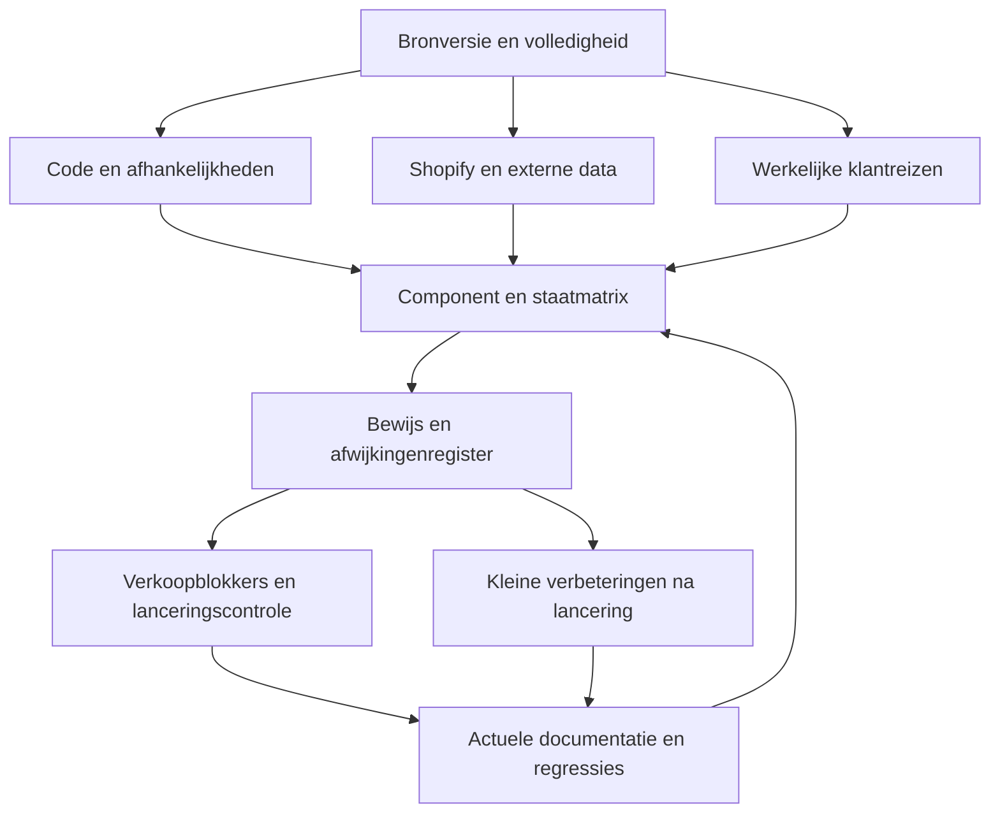

# Diep onderzoeks- en documentatieplan

**28 oktober 2026 · onderzoeksplan, geen volledige auditvrijgave.** Eigenaar kiest documentatie en eenheid als huidige taak. Eerdere uitvoeringsprioriteiten blijven geschiedenis of open werk; deze opdracht betekent geen toestemming voor publicatie, bulkdatawijzigingen of een herbouw van de winkel.

## 1. Het doel en de grens

We willen drie vragen betrouwbaar beantwoorden: wat gebruiken we, hoe hangt het samen en waar wijkt dezelfde functie onnodig af? Daarna kleine bewezen verbeteringen uitvoeren die lancering en onderhoud helpen.

“Diep” betekent iedere relevante afhankelijkheid volgen, inclusief Shopify Admin en externe systemen. Het betekent niet alle bestanden handmatig navertellen of alle mogelijke uitzonderingen vóór lancering verbouwen. Een herhaalbare inventaris dekt de breedte; functiegerichte uitleg en tests geven de diepte.

## 2. Onderzoeksboom: dezelfde afdaling voor ieder onderdeel

| Niveau | Vraag | Vast te leggen resultaat |
| --- | --- | --- |
| 0 — bronversie | Welke winkel, MAIN, branch, commit en snapshot worden onderzocht? | Bronregister, hashes, volledigheid en scope |
| 1 — systeem | Wie beheert dit: thema, Shopify Admin, app, importtool of VPS? | Eigenaarrol, systeemgrens, toegang en herstel |
| 2 — klantreis | Waar gebruikt een bezoeker dit en met welk doel? | URL/paginatype, productfamilie, desktop/mobiel, ingang/uitgang |
| 3 — component | Is dit bijvoorbeeld kleurkeuze, galerij, filter, kaart of modal? | Functie, semantiek en gedeeld componentcontract |
| 4 — codepad | Welke template, sectie, snippet en CSS/JS vormen het? | Exacte paden, regels, laadvolgorde, callers en afhankelijkheden |
| 5 — uitvoering/data | Welke instellingen, velden, events, opslag en netwerkverzoeken bepalen de staat? | Input/output, bronprioriteit, identiteit, async gedrag en fallback |
| 6 — alle toestanden | Wat gebeurt bij ontbrekende data, nul/één/veel opties, fout, traag netwerk, herhaling of toetsenbordbediening? | Staatmatrix en reproduceerbare scenario's |
| 7 — bewijs en besluit | Is de afwijking aangetoond, gewenst of nog onbekend? | Testresultaat, vergelijking, prioriteit, oplossing en terugzetpad |

Een bezoeker kan dezelfde functie via verschillende routes bereiken. De boom wordt daarom technisch een **graaf**: gedeelde nodes eenmaal beschrijven, alle gebruiksplaatsen linken. Bezochte node = bestandpad + inhoudshash + relevante uitvoeringscontext; stop herhaling bij dezelfde node. Dynamische/verbroken verwijzingen krijgen een expliciete unresolved-lijst met vervolgactie. Geen automatische conclusie dat zo'n pad ongebruikt is.

## 3. Hoofdtakken met concrete scanopdrachten

Iedere rij levert een zelfstandig afvinkbaar onderzoeksresultaat op. “Scannen” is eerst alleen-lezen. Een hulpmiddel produceert kandidaten; de genoemde controle bepaalt de bevinding.

### Tak 00 — bronstand, Git en documentatie

| ID | Dieper onderzoeken | Methode en resultaat |
| --- | --- | --- |
| 00.1 | MAIN, previews, actieve branch, main en mogelijke themakoppeling | Verse rollen + commits + deployconfig; geen oude ID als vaste bestemming |
| 00.2 | Alle live assets/templates/sections/snippets/config/locales | Gepagineerd manifest, bytegelijkheid van snapshot, afwijkingenregister |
| 00.3 | Git-root tegenover releasedossiers, patches en gegenereerde bronnen | Herkomst per recente feature, samenvoegroute voorstellen zonder root blind te vervangen |
| 00.4 | Startdocumenten, historische status, dubbele of strijdige instructies | Eén actuele ingang; archiveren met intacte bronverwijzingen |
| 00.5 | Docsdekking en vindbaarheid | Documenteigenaars, linkcontrole, verouderde datums, onbekenden en overnametest |

### Tak 01 — runtime, gereedschap en afhankelijkheden

| ID | Dieper onderzoeken | Methode en resultaat |
| --- | --- | --- |
| 01.1 | Dawn-basis versus maatwerk en vendorkopieën | Versies/licenties/provenance en lokaal aangepaste onderdelen vastleggen |
| 01.2 | Python-, Node-, CLI- en PowerShell-versies per tool | Werkelijke config/lockfile versus geïnstalleerde versie; geen stil upgradevoorstel |
| 01.3 | Assetloading, defer/module/dynamic import en Section Rendering | Laadvolgorde en init/teardown bij AJAX, Theme Editor en paginawissel |
| 01.4 | App embeds, app blocks, scripts, pixels en externe hosts | Admin + gerenderde pagina + netwerk; toegang, consent en uitvalimpact |

### Tak 02 — visuele basis en componenten

| ID | Dieper onderzoeken | Methode en resultaat |
| --- | --- | --- |
| 02.1 | Kleuren, lettertypen, spacing, hoeken, schaduwen en lagen | CSS-/Liquid-/settingsinventaris + computed-stylevergelijking; voorstel tokenregister |
| 02.2 | Knoppen, links, iconen en pijlen | Functieclassificatie: navigatie, disclosure, vorige/volgende, toevoegen, sluiten |
| 02.3 | Keuzemenu's, kleurstalen, checkboxen, hoeveelheid en filters | Vergelijking per gedeelde functie/staat; merkuitzondering benoemen |
| 02.4 | Modals, drawers, accordions, meldingen en foutlabels | Focus, Escape, achtergrond, scrolllock, grote inhoud en meldingsduur |
| 02.5 | CSS-cascade en dubbele implementaties | Specificiteit, globale selectors, !important, inline styles, dubbel laden en overrides traceren |
| 02.6 | Animaties en positieherstel | Begin/eindstaat, duur/easing, herhalen, annuleren, reduced motion en layoutverspringing |

### Tak 03 — homepage, navigatie en content

| ID | Dieper onderzoeken | Methode en resultaat |
| --- | --- | --- |
| 03.1 | Header, zoekbalk, megamenu, mobiele drawer, sticky gedrag | Menuboom → routes → toetsenbord/touch → compacte breedtes |
| 03.2 | Homepageblokken, categoriehubs en merk-/adviespagina's | Template + Theme Editor + werkelijke bestemmingen; placeholders onderscheiden |
| 03.3 | Breadcrumbs en categoriehiërarchie | Productlidmaatschap, menuouders, dubbelzinnige paden en structured data vergelijken |
| 03.4 | Footer, service en contact | Links, inhoudseigenaar en operationele afspraken; geen beloften uit code verzinnen |
| 03.5 | Admin HTML/CSS en theme-verwijdering ervan | Collectie/paginabody's werkelijk lezen; historische Badkamermeubels-patches versus actuele filtering |

### Tak 04 — productkaarten, lijsten, zoeken en filters

| ID | Dieper onderzoeken | Methode en resultaat |
| --- | --- | --- |
| 04.1 | Alle kaartrenderers op home, collectie, zoeken, mobiel, aanbevelingen en Sunshower | Routekaart naar Liquid of JS-renderer; gedeeld versus gekopieerd vaststellen |
| 04.2 | Afbeelding/hoverfoto/pijltjes, titel, SKU, kleur, prijs/btw, levertijd, hartje en CTA | Zelfde soort kaart naast elkaar vergelijken; afbeeldingactie en productnavigatie apart |
| 04.3 | Filters, ranges, tellers, sorteren, paginering en nulresultaten | Echte collectiedata + URL-staat + terugknop + combinatie/foutcases |
| 04.4 | Zoekterm, exact SKU, typfout, lange titel en nieuwe publicatie | Shopify/index/kaart/PDP-identiteit vergelijken; recente data en lege resultaten |
| 04.5 | Externe/native route en terugval | Activatieguard, API-uitval, timeout, races, dubbele requests en laden/verbergen |
| 04.6 | Mobiele en desktopimplementatie | Verschillende renderers controleren; één fix niet als sitebrede fix rapporteren |

### Tak 05 — productpagina en alle productkeuzes

| ID | Dieper onderzoeken | Methode en resultaat |
| --- | --- | --- |
| 05.1 | Algemene PDP, Sunshower en andere alternatieve templates | Werkelijke product-toewijzing en actieve secties; layout/specificaties/data per type |
| 05.2 | Foto's, thumbnails, vorige/volgende, swipe, zoom en viewer | Gelijke media-index, focusherstel, randstaten, één foto en falende afbeelding |
| 05.3 | Hotbath kleur/lengte/inbouwdeel en Wiesbaden kleuren | UI-structuur, exacte relaties, openblijven, geschiedenis, scroll en geselecteerde toestand |
| 05.4 | Sunshower configuratie/uitvoering en merkvergelijking | Vergelijk dezelfde keuzefunctie; productconfiguratieregels behouden |
| 05.5 | Prijs, optioneel onderdeel, aantal en cartpayload | Zelfde product/SKU/variant/relatie van selectie tot winkelwagen; nooit betaalde voorselectie |
| 05.6 | Specificaties, documenten, plus/min, sets en accessoires | Werkelijk gevulde velden, namespace, bronherkomst en compatibiliteit; ontbrekend is niet automatisch defect |
| 05.7 | Keuzedata-generator, router, revisies, cache en fallback | Bron → generator → afgeleide asset → loader → selectie; exactheid en versieconflicten |

### Tak 06 — winkelwagen en bestelroute

| ID | Dieper onderzoeken | Methode en resultaat |
| --- | --- | --- |
| 06.1 | Alle toevoegen-ingangen en badge/popup | PDP, kaart, wishlist, Sunshower, set/onderdeel; één of meerdere items en foutmelding |
| 06.2 | Popup, sluiten/heropenen en doorgaan | Vier sluitroutes, focusherstel, geen automatische verdwijning, mobiel en reduced motion |
| 06.3 | Cartaantallen, verwijderen, regels, kortingen en verzendindicatie | Bedragen/afgeronde eenheden, gelijktijdige acties, fout/herstel zonder dubbele POST |
| 06.4 | Opslaan, herstellen, offerte en verlanglijst | Apparaatopslag/privacy, verlopen varianten, lege/gevulde cart, consistente CTA |
| 06.5 | Checkout en bedrijfsafhandeling | Beschikbare merchantinstellingen en afgesproken testscenario; betaling/ordercommunicatie apart van thematest |

### Tak 07 — assortiment, datamodel en imports

| ID | Dieper onderzoeken | Methode en resultaat |
| --- | --- | --- |
| 07.1 | Productidentiteit, SKU, publicatie, collecties, varianten en eenheden | Actuele volledige telling/export binnen scope; steekproef is geen volledige dekking |
| 07.2 | Metafields/metaobjects en mapping | Definities én echte waarden; type, eenheid, taal, eigenaar, verbruiker en bronprioriteit |
| 07.3 | Per leverancier bron → normalisatie → import/verrijking → index | Tools/bronversies/batchstatus vinden; hervatbaarheid, idempotentie en uitzonderingen |
| 07.4 | Prijs/btw, voorraad en levertijden | Officiële leveranciersregel en Shopify-waarde; consistent op kaart/PDP/cart |
| 07.5 | Media, bijlagen en herkomst | Ontbrekende/beschadigde bestanden, gekozen foto, rechten en onderhoudsbron |
| 07.6 | Datakwaliteitsregels en quarantaine | Ongeldige velden, dubbele SKU's, conflicten en onbekende relaties apart melden; geen massafix |

### Tak 08 — backend, zoekindex en externe diensten

| ID | Dieper onderzoeken | Methode en resultaat |
| --- | --- | --- |
| 08.1 | VPS/backendcode, containers, router/proxy en API-contract | Eerst toegang en echte bronrepo vaststellen; historische frontend is geen backend |
| 08.2 | Typesense schema, profielen, uitsluitingen en actieve index | ID/SKU/prijs/collectie/filters vergelijken met Shopify en werkelijke publicatie |
| 08.3 | Verversing, planning, webhooks, foutafhandeling en monitoring | Werkelijke configuratie en laatste succesvolle run bewijzen; geen autosync aannemen |
| 08.4 | Back-up, herstel, staging en omschakeling | Veilig testplan; productieswitch vereist apart concrete opdracht/acceptatie |

### Tak 09 — toegankelijkheid, SEO en prestaties

| ID | Dieper onderzoeken | Methode en resultaat |
| --- | --- | --- |
| 09.1 | Semantiek, labels, contrast, focus en toetsenbord | Statische kandidaten + gerichte browser/a11ycontrole in alle belangrijke staten |
| 09.2 | Touch, zoom, sticky overlays en schermbreedtes | Voorstel 320/390/768/1024/1440px; echte iPhone/Safari apart, geen iframe gelijkstellen |
| 09.3 | H1, metadata, canonical, redirects, noindex, sitemap en JSON-LD | Gerenderde HTML + Admin-data + URL-varianten; GSC-verificatie apart |
| 09.4 | Assetgewicht, dubbele loads, afbeeldingformaten, lazy loading en netwerk | Eerst lokale/routebudgetten meten; gegenereerde data niet blind als JS tellen |
| 09.5 | LCP/CLS/INP en interactiesnelheid | Benoemde pagina/toestel/netwerk, lab tegenover velddata; geen score uit code afleiden |

### Tak 10 — betrouwbaarheid, privacy en onderhoud

| ID | Dieper onderzoeken | Methode en resultaat |
| --- | --- | --- |
| 10.1 | Uitvoer-escaping, DOM-injectie, API-input en openbaar gemaakte configuratie | Statische kandidaten handmatig volgen; securityscan kan aanvullend, geen volledige zekerheid |
| 10.2 | Consent, browseropslag, analytics en rechten | Werkelijke app/config/scriptstromen; geen klant-/orderdata in auditrepository |
| 10.3 | Dode-codekandidaten, exacte duplicaten en back-upassets | Referentie-/runtimeonderzoek; nooit automatisch verwijderen op basis van een regex |
| 10.4 | Testgezondheid, fixtures, versies en ontbrekende scenario's | Welke tests draaien werkelijk tegen welke bron? Stubbewijs niet als productie claimen |
| 10.5 | Uitrol, drift, rollback en overdracht | Repo/deployworkflow, snapshots, kleine patches, publicatie door eigenaar en readback |

## 4. Uitvoering in overzichtelijke fases

| Fase / taak | Resultaat | Klaar wanneer | Huidige status |
| --- | --- | --- | --- |
| **DOC-00 — nulmeting en plan** | Dit dossier, bronmanifest, root-scan en actuele steekproef | Bronnen en beperkingen expliciet; in Git teruggelezen | Vastgelegd op actieve branch en main (DOC-00) |
| **DOC-01 — volledige actuele bronkaart** | Read-only snapshot van 1.262 live bestanden plus Admin-toewijzingen binnen bereik | Manifest compleet, alle lokale hashes kloppen, rollen opnieuw gelezen; code-/data-/generated-/backupgroepen gescheiden | CAPTURED / OPEN: 1.262 ontvangen, 1.261 bytegelijk; settings_data.json-pariteit niet vrijgegeven; zie DOC01_SOURCE_MAP.md |
| **DOC-02 — klantreis- en componentmatrix** | Iedere actieve route gekoppeld aan renderer, data en componentcontract | Algemene PDP, Sunshower, Hotbath/Wiesbaden, lijst/zoek/home/cart en mobiel aantoonbaar toegewezen | DOC-02A SOURCE/HTML vastgelegd: routematrix + acht componentdossiers; DOC-02B interactieve/viewporttoewijzing NEXT |
| **DOC-03 — diepe functie-audit** | Onderbouwde bevindingen met staatmatrix en ontwerpafspraak | Alle lanceringkritieke takken behandeld; ontbrekende toegang als expliciete blokkade | PLANNED |
| **DOC-04 — kleine correcties** | Per wijziging één begrensde preview, relevante docs en regressie | Goed functionerend contract, review, rollback en exacte readback; geen ongemerkte bulkrefactor | PLANNED, pas na bevindingen/prioritering |
| **DOC-05 — lanceringstoets** | Concreet besluit over afgesproken assortiment en bestelroute | P0's gesloten, P1's beoordeeld, merchantcontroles en herstelpad bewezen | PLANNED |
| **DOC-06 — uitbreiden** | Kleine releases met doel en observatie | Nieuwe functie volgt componentafspraken, docs en passende test; bij scopegroei nieuwe datadekking | NA LANCERING |

DOC-01 is nu inhoudelijk vastgelegd; de volledige pariteitsvrijgave blijft open voor settings_data.json. De uitzondering is opnieuw gelezen/afgebakend maar zonder onafhankelijke exacte settingsbron niet opgelost. DOC-02A verdiept de andere geverifieerde bronnen; volgende handeling is DOC-02B met een read-only browservergelijking van mobiele kaarten/pijlen en de werkelijk actieve renderer. Geen pijlen verwijderen vóór functie-/staatclassificatie. Voor volledige Admin-/server-/Google-scans is mogelijk aanvullende toegang nodig. Werk dat bereikbaar is af; label ontbrekend bewijs zonder toegang te omzeilen of onbeperkt op alle externe systemen te wachten.

## 5. Hoe diep is voldoende?

Voor een afgerond onderdeel moeten deze zaken traceerbaar zijn: actieve route; alle relevante renderers; bronbestanden en hashes; instellingen/gegevens; events en async verzoeken; states en foutgevallen; huidige stijl; gewenste gedeelde afspraak; tests en tekortkomingen; eigenaar/onderhoud/rollback. Iedere actieve variant krijgt een contract of expliciete uitzondering.

We publiceren geen claim “alles gescand” zolang bronpaginering, dynamische verwijzingen, Admin-toewijzingen of backendtoegang ontbreken. Bij een gewijzigde hash heropenen we de geraakte component en zijn omgekeerde afhankelijkheden. Geen volledige hertest van de hele winkel na ieder tekstwijziginkje.

## 6. Voor lancering versus erna

**P0 / verkoopblokker:** aantoonbaar verkeerd artikel/bedrag, onbedoeld betaald onderdeel, kapotte kooproute, verlies van selectie/cart, ernstig onbruikbare kernbediening of een bevestigd beveiligings-/privacyprobleem. Onzekerheid in essentiële verkoopdata binnen de afgesproken lanceringsscope moet worden opgelost of bewust uit de vrijgave blijven.

**P1 / afwerking:** bewezen verwarrende verschillen in dezelfde keuze, onduidelijke iconen, slechte focus, hinderlijke beweging, onjuiste zichtbare levertijdweergave of ontbrekende noodzakelijke informatie. Prioriteren op klantimpact en betrokken routes.

**P2 / onderhoud en groei:** louter cosmetische verschillen, niet-gebruikte-codekandidaten zonder impact, hernoemen, bredere abstrahering en nieuwe functies. Niet als excuus gebruiken om eindeloos niet te lanceren.

Het lanceringsassortiment en commerciële afspraken blijven een expliciete eigenaarbeslissing. Dit plan verkleint eerdere assortimentdoelen niet stilzwijgend. Een schone codekaart, goede documentatie of een mooi thema is afzonderlijk geen bewijs dat bestellingen operationeel afgehandeld kunnen worden.
