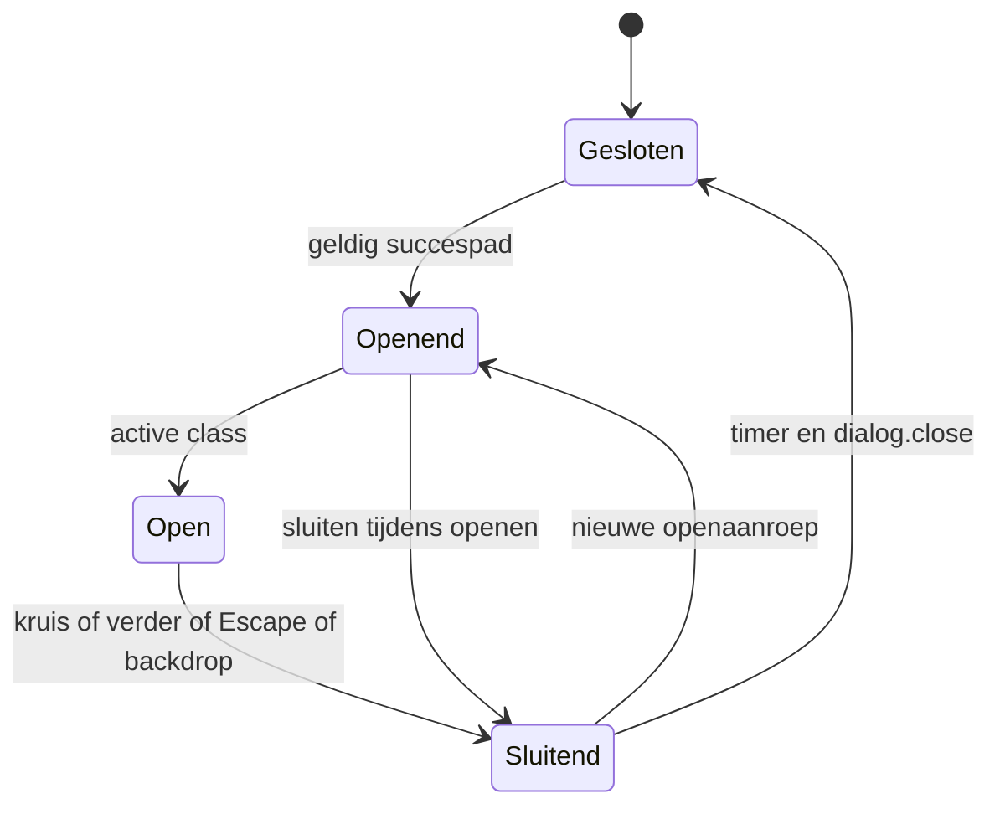

# Toevoegen, winkelwagenbevestiging en overlays

**Verdieping:** zie [de afzonderlijke inhouds-/lifecycleanalyse en CART-F01](micro/CART_NOTIFICATION.md). Het gedateerde bron-/HTML-bewijs hieronder blijft behouden; nieuwe replays zijn apart gelabeld.

**Klantdoel:** weten dat het juiste artikel is toegevoegd, eenvoudig verder winkelen of naar de cart gaan, en het venster voorspelbaar sluiten. **Eigenaarrol:** storefront; Shopify blijft autoriteit voor cartresultaat en prijzen. Bronstatus VERIFIED_THEME; dialogmarkup op acht routes VERIFIED_HTML. Geen add/change/update/checkout-request uitgevoerd.

## De ingang bepaalt de bevestiging

| Koopingang | Handler / payload | Huidige succesroute | Popupcontract bereikt? |
| --- | --- | --- | --- |
| Gewone algemene PDP | product-form.js; FormData + sections/sections_url | cart.renderContents, of cartnavigatie zonder cartcomponent | Ja bij notification/drawer aanwezig |
| Dawn quick-add | product-form in modal | Eerst quick-add sluiten, daarna cartcomponent renderen | Conditioneel op echte caller/instelling |
| Hotbath inbouw uit | Inbouwinterceptor retourneert false | Gewone product-form gaat door | Zoals normale PDP |
| Hotbath inbouw aan | bc-product-inbouw; exact twee items | Naar cart na result-/SKU-/hoeveelheidscontrole | Eigen directe cartnavigatie |
| Sunshower hoofdartikel | Gewoon product-formulier uit main-sunshower, zonder product-form wrapper | Browser-/Shopify-formulierroute | Geen custom notification-aanroep in gelezen paginacode |
| Sunshower set | bc-sunshower-page.js:355–378; hoofdhoeveelheid + gekozen extras elk 1 | Naar cart | Eigen directe cartnavigatie |
| Sunshower landing shopkaart | bc-sunshower-shop.js:228–269; één item + sectiondata | Inline succes + badge; drawer kan renderen | CART-NOTIFICATION wordt daar niet geopend |
| Externe lijstkaart | bc-external-filters.js:690–706; één item + sections | Kaartfeedback + conditionele cartcomponent | Ja wanneer aanwezig en render slaagt |
| Wishlist → add | bc-wishlist.js:365–401; geverifieerde variant of PDP-doorsturen | Naar cart | Eigen directe cartnavigatie |
| Productaccessoire | Eigen accessory-script en component | Afzonderlijk te volgen | Niet in deze ronde end-to-end uitgewerkt |

Dit is het concrete antwoord op “is de mooie popup overal hetzelfde?”: **nee, de code heeft meerdere bevestigingspaden**. Dat is een vastgestelde bronverschil; niet ieder verschil is automatisch fout. Meerdere artikelen direct naar de cart sturen kan een bewuste keuze zijn. Voor een uniforme bevestigingsregel eerst per ingang hetzelfde klantdoel en de gewenste vervolgactie bepalen. Voeg geen tweede globale submit-interceptor toe: die kan dubbele POST's veroorzaken.

## Notification: compositie en activering

header.liquid laadt cart-notification.js en component-cart-notification.css. Alleen bij settings.cart_type == notification rendert hij het snippet. Drawer is een afzonderlijk layoutpad. De ontvangen settingsbody noemt notification, maar heeft een open bytepariteitsuitzondering. Acht actuele publieke HTML-responses bevatten ook daadwerkelijk dialog#cart-notification met de bedoelde theme-ID; dat onderbouwt de markupactivatie onafhankelijk.

| Deel | Bron |
| --- | --- |
| Native dialog, titel, kruis, cartlink en Verder winkelen | snippets/cart-notification.liquid:6–23 |
| Lifecycle / inhoud / sluiting | assets/cart-notification.js:1–93 |
| Lay-out, overlay en beweging | assets/component-cart-notification.css |
| Toegevoegd artikel | sections/cart-notification-product.liquid |
| Cart-CTA en badge | sections/cart-notification-button.liquid, cart-icon-bubble.liquid |

renderContents kiest de itemkey uit response.key of items[0].key en vraagt drie sections: cart-notification-product, cart-notification-button, cart-icon-bubble. De productselector is gekoppeld aan die key. Ontbrekende/niet-string sectiondata wordt overgeslagen; ontbrekende productselectie maakt de bestaande productinhoud leeg. Daarna opent de dialog. Dit is geen garantie dat een deels ontbrekende sectionresponse altijd een complete bevestiging toont; dat blijft een belangrijk foutscenario.

## Toestand en sluiten

open annuleert een oude close-timer en open-frame, bewaart de oorspronkelijke document overflow/scrollbarGutter en gebruikt showModal. Op de volgende animationframe komt active. close is idempotent tijdens sluiten, verwijdert active en sluit na 230 ms; reduced motion kiest 0 ms. Heropenen kan de sluiting annuleren.

Vier sluitingangen zijn in de code verbonden: kruis, Verder winkelen, native cancel/Escape en buiten de dialog klikken. Backdrop sluiten vereist dat pointerdown én click buiten de dialog begonnen/eindigden; de boundingboxcontrole voorkomt dat klikken in lege dialogruimte als backdrop geldt. De cartlink navigeert en is geen aparte closehandler. Er is geen timer die een rustig open venster automatisch wegstuurt.

Het close-event herstelt de oorspronkelijke documentstijlen en focust de bewaarde opener als die nog verbonden is. De sluitknop heeft autofocus. Native dialog helpt met modalgedrag, maar de feitelijke browserfocus, schermlezeruitspraak, nested-overlayinteractie en iOS-scroll moeten nog worden gecontroleerd.

## Beweging en stijl

Desktop: rechtsboven, max 44rem breed, interne scroll en begrensde dynamische viewporthoogte. Mobiel tot 749px: onderaan met safe-area, breedte viewport minus zijruimte. Sluitknop heeft 4,4rem vlak; het icoon is kleiner. Bronwaarden zijn geen gemeten effectieve CSS-pixels of bewijs van alle touchgevallen.

Openen: opacity 280 ms ease, transform 380 ms cubic-bezier(.2,.8,.2,1). Sluiten: 220 ms voor opacity/transform, JS wacht 230 ms. Backdrop 220 ms. Bij reduced motion vervallen transitions/transforms en is de sluitvertraging nul. De popup gebruikt geen transitionend als enige manier om weer te kunnen sluiten. Zie [bewegingsregister](MOTION_AND_STYLES.md) voor de andere componenten.

## Formulierfout en onzekere koopactie

product-form blokkeert herhaalde submit, controleert quantity en laat een aanwezig inbouwcomponent eerst afhandelen. Een response.status publiceert cartError en toont de fout; een succesvolle response publiceert cartUpdate en rendert de component. Een transport-/parsefout meldt dat toevoegen niet bevestigd kon worden en verwijst naar controleren van de cart. Een time-out/afgebroken response kan niet bewijzen dat de server niets heeft toegevoegd; vermijd automatische retries.

Het inbouwpad behandelt dat expliciet als uncertain. Het Sunshower-setpad toont een fout plus cartcontrolelink en laat daarna weer een poging toe. De verschillen in fout-/retrycontract moeten bij harmonisatie worden beoordeeld. Een syntactische succesmelding in de UI is geen readback van het volledige cartsaldo.

## Cartpagina en opgeslagen cart

cart.json schakelt main-cart-items en main-cart-footer in; de aanvullende featured-collection is disabled. cart.js beheert de reguliere regel-/hoeveelheidsupdates; bc-cart-page.js de aanvullende paginafuncties, kortingen en presentatie; bc-cart-tools.js lokaal bewaren/offerte/herstellen. Deze ronde heeft alleen de **lege cart via GET** gelezen. Kortingen, transportkosten, restore en checkout zijn daarmee niet getest.

Opgeslagen cart gebruikt localStorage met versie/tijd/items, niet een serveraccount of bestellingsconcept. Herstellen is een echte add-mutatie en kan gevolgen hebben voor een al gevulde cart. Zie [opslag](NAVIGATION_AND_STORAGE.md). Documenteer geen nieuwe lever-/prijsbelofte op basis van alleen de opgeslagen browserdata.

## Acceptatie vóór een aanpassing

Per kooproute exact product/variant, aantal, inbegrepen versus betaalde extras, succes-/fout-/onzekere staat en gewenste vervolgactie vastleggen. Voor de popup vervolgens: open → direct sluiten; snel heropenen; alle vier sluitroutes; scrollen binnen grote inhoud; achtergrondlock en herstel; bewaarde focus; mobiel/safe-area; reduced motion; ontbrekende sectiondata; tweede succes terwijl sluiten loopt. Transportstubs moeten het werkelijke sections/key-contract volgen.

Deze ronde bewijst uitsluitend de beschreven bron en responsemarkup. Een toekomstige popupfix moet het bestaande concept-/review-/publicatiepad volgen en de exacte vorige bestanden bewaren. Een koopactie is geen geschikte stilzwijgende test tijdens een documentatieronde. Geen cart legen of bestaande regels overschrijven om een test te vereenvoudigen.

## Inbouw als samenhangende kooproute

[INBOUW_RECOVERY](micro/INBOUW_RECOVERY.md) bevestigt het returncontract naar product-form, vergrendelde herhaalsubmit en conservative uncertain-afhandeling, ook bij HTTP 422. De inbouwroute navigeert bij bevestiging; een latere popupwijziging vereist een eigen succes-/unlockcontract. Geen echte cartactie in deze verdieping.

## Wishlistkooproute verder begrensd

[WISHLIST_RENDER_AND_ADD](micro/WISHLIST_RENDER_AND_ADD.md) bevestigt met synthetisch transport de exacte variant-/source-/quantityguards, één POST bij dezelfde-buttondubbelklik, foutunlock en cartnavigatie. Succes verwijdert de favoriet niet. readProduct deelt een promise-cache zonder TTL; een helpercall is geen nieuwe serverread per add. Geen echte cart-/restoreactie of hercertificering van popup/browsergedrag.
