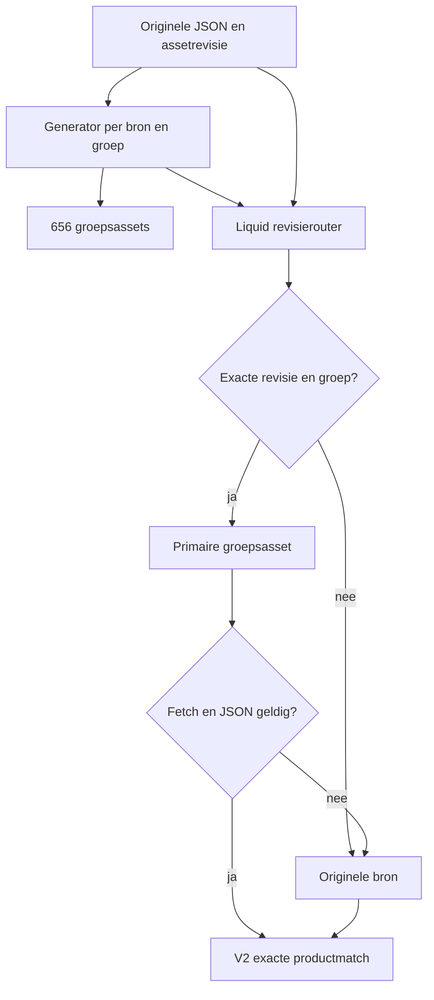

# Datapijplijnen — bron, afleiding, revisie en terugval

**Eigenaarrollen:** assortiment/leveranciersbron voor feitelijke productdata; importbeheer voor normalisatie; storefront voor presentatie; indexbeheer voor zoekdekking. De feitelijke personen/toegangen zijn niet in deze ronde vastgesteld. Bronstatus VERIFIED_THEME en private DOC-01-export; geen leverancier-/VPS-/importmutatie.

## Vier soorten bron niet verwisselen

| Laag | Voorbeeld | Autoriteit / beperking |
| --- | --- | --- |
| Shopify-product/variant/metafield | Prijs, SKU, publicatie, voorraad en beoordeelde specificaties | De gelezen winkelstand binnen het exportvenster; geen leveranciershistorie of atomair herstelpunt |
| Theme-brondata | product-switcher-data.json en Hotbath-menu-data; Sunshower-catalogus | Expliciete productrelaties voor de frontend; actualiteit apart controleren |
| Afgeleide keuzeasset | bc-choice-data-*.json | Uitsnede van een specifieke bron/revisie/groep; niet handmatig onderhouden |
| Externe zoekindex | API-lijst met facetten en prijs_cents | Afzonderlijke dienst; frontendguard en response verrijking vervangen geen indexaudit |

Een ontbrekende zichtbare eigenschap kan komen door een ontbrekende bronwaarde, verkeerde namespace/type, een scopeguard, een oude afleiding, een niet-actieve renderer of een CSS-regel. Volg die keten vóór een “dataprobleem” als ontbrekende import te behandelen.

## Productdata → consumenten

De private export heeft products.jsonl, SQLite, ruwe responses, definities en veldregister. [PRODUCT_DATA.md](../PRODUCT_DATA.md) is eigenaar van dat exportcontract. Deze pagina koppelt het aan de frontend. De [field-consumers](../evidence/2026-10-28-doc02/field-consumers.json) tonen letterlijke metafieldreferenties in de benoemde onderzoeksbestanden met bestandsregels en waargenomen veldtypen/aantallen, zonder waarden te publiceren.

Het regexregister is onvolledig voor dynamische consumers: custom[menu_field], product.metafields[namespace][field], specs-mappings uit lijsten en JSON-inhoud hebben nadere context nodig. “Geen literal consumer gevonden” betekent niet ongebruikt. Omgekeerd bewijst een definition niet dat er waarden zijn of dat het veld bij dit product wordt getoond. Boolean false en getal 0 blijven feiten; leeg of niet gevonden niet invullen.

## V2-keuzedata: generator en actuele browserbron

Generator: `docs/code-cleanup/2026-10-25/build-choice-data.py` op de actieve branch. Invoer: datasets/*.json + source-revisions.json. Uitvoer: assets/bc-choice-data-HASH.json, snippets/bc-choice-data-source.liquid en choice-data-manifest.json. De bestandsnaam gebruikt de eerste 16 hextekens van SHA-256(sourcefilename + '|' + group-id). De inhoud bewaart de overige brontoplevelvelden en precies één groep, compact UTF-8 JSON met afsluitende newline.

De Liquid-router vergelijkt de **publiek gerenderde asset_url-queryrevisie**, niet een zelf verzonnen bestandsdatum. Die revisie is iets anders dan checksumMd5. Een themakopie of nieuwe upload kan een andere URL-revisie opleveren zonder gewijzigde JSON-inhoud. Alleen bytes controleren is daarom niet genoeg om te bewijzen dat de browser de kleinere bron gebruikt.

### Verse controles

- De negen daadwerkelijke bronassets zijn opnieuw als input gebruikt voor een read-only reconstructie van de serialisatie. **656/656 verwachte groepsassets zijn exact bytegelijk**; geen dubbele group-ID's binnen de gecontroleerde bronnen. Zie [generated-data-validation.json](../evidence/2026-10-28-doc02/generated-data-validation.json).
- De onderzochte publieke Hotbath SDS1-HTML verwijst als primary én fallback naar product-switcher-data.json. De groep staat in de router, maar de actuele oorspronkelijke URL-revisie past niet bij de gegenereerde routervoorwaarde. Zie [choice-routing-observation.json](../evidence/2026-10-28-doc02/choice-routing-observation.json).
- Dat bewijst terugval voor **deze response**, geen datacorruptie, globaal uitgeschakelde optimalisatie of gemeten slechte laadtijd. De beschermende terugval werkt op bronselectieniveau; de browserfetch is hier niet uitgevoerd.

### Reproduceren zonder ontbrekende invoer te verbergen

De generator staat in Git, maar **datasets/ bevat op het onderzochte broncommit geen gevolgde invoerbestanden**. Het oude release-README beschrijft een benodigde invoermap; het is geen bewijs dat een nieuwe checkout die map bezit. De originele JSON-assets staan in het private productpakket onder theme-runtime-data/assets en kunnen opnieuw read-only uit het juiste thema worden opgehaald. Controleer eerst dat bronversie, hashes en rechten passen.

Veilige onderhoudsvolgorde: bepaal doelconcept en exacte oorspronkelijke bronbestanden → zet gecontroleerde invoer in een aparte werkmap → lees de actuele asset_url-revisies uit datzelfde doelconcept → valideer unieke groepen/productidentiteit → genereer in een aparte kopie → vergelijk alle bytes/schema's en oorspronkelijke fallback → plaats bij een geautoriseerde release eerst groepsassets en daarna router → controleer de gerenderde primary/fallback op representatieve routes. Het uitvoeren van de bestaande generator direct in een publieke checkout zonder invoer is geen geldige rebuild.

Verander geen gegenereerd groepsbestand op zichzelf en verwijder niet zomaar de grote fallback. Een geslaagde JSON-parse met verkeerde groep is een ander fouttype dan een fetchfout. V2 verbergt dan mogelijk de keuze; het netwerkfallbackmechanisme is geen algemene semantische validator.

## Hotbath-menuherkomst

main-product begint met custom.switch_group, kan via product-ID → bc-hotbath-menu-route → bc-hotbath-menu-source een groep/bronasset bepalen en kan expliciet geen menu toestaan. Daarna pas volgt de generieke groepsrouter. Deze twee routers hebben verschillende taken: **welke groep/bron hoort bij het product** tegenover **welke revisiegebonden uitsnede mag worden geladen**. Hun data mag niet op alleen een gelijkende SKU/titel worden gegokt.

Een nieuwe kleur-/lengtevariant kan wijzigingen vragen in oorspronkelijke productrelatie, menuvolgorde, expliciete route, Shopify-productgegevens, gegenereerde uitsnede én index. Een CSS-correctie vraagt die datamutaties meestal niet. Bestaande inbouw-/setrelaties blijven apart gevalideerd op exacte variant/SKU.

## Sunshower-keten

bc_sunshower.source verbindt bronidentiteit met het Shopify-product. configuration beschrijft fields/selected; bc-sunshower-products.json koppelt selection aan product-URL/variant. specifications, documents, components en accessories hebben elk een eigen JSON-structuur en consumer. In DOC-01 zijn er 104 records met source/specifications/documents/components, maar 72 met configuration/accessories. Een accessoire met sourcevelden is niet automatisch een hoofdconfiguratorproduct.

De Sunshower JS neemt de eerste volledige selection-match. Duplicaten moeten dus bij bronvalidatie worden uitgesloten. Op de pagina kunnen accessoireprijzen uit actuele all_products-varianten komen, met opgeslagen price_cents als terugval. Displayprijs, dataset.variant_id en echte cartvariant moeten hetzelfde artikel blijven beschrijven; alleen een mooie configurator is geen relatiebewijs. Bronbestanden, op de pagina berekende totalen en Shopify-cartprijzen zijn verschillende momenten in de keten.

## Index → lijst → Shopify-verrijking

De index levert zoekresultaten/facetten, de frontend bewaakt vorm/collectieaantal en Shopify section bc-card-data verrijkt de kaart. Die keten heeft minstens twee mogelijke versies van titel/prijs/beschikbaarheid. Een gelijke collection count kan verkeerde of verouderde individuele records niet uitsluiten. Index-ID/SKU, kanaalpublicatie, prijs, filters en verversing blijven een aparte read-only vergelijking met echte backendtoegang.

De publieke frontend bevat een endpointconfiguratie; dat is geen bewijs dat backendcode, actieve container, indexschema of synchronisatiesleutel hier volledig beschikbaar zijn. Historische import-/syncscripts en succesvolle oude runs blijven gedateerd. Geen nieuwe indexwrite of leveranciersherimport starten omdat een consument een veld niet toont.

## Herstel en onderhoudsbesluit

Een theme-/routerrollback gebruikt exacte vorige assets plus router als samenhangende set. Een productdataterugzet gebruikt oorspronkelijke private waarden met conflictcontrole. Een indexrollback gebruikt de door indexbeheer bewezen bron/versie; dat proces is hier niet opnieuw gecertificeerd. Een export-zip is geen universeel herstelcommando.

Prioriteit uit deze ronde: broninvoer/revisies navolgbaar maken en eerst de zichtbare gevolgen in de representatieve routes toetsen. Een bredere data-/namespace-migratie blijft buiten de documentatieopdracht.

## Index versus sectiondata op de kaart

[Kaartverrijking](micro/CARD_HYDRATION_AND_COLORS.md) legt de twee presentatiemomenten uit: indexkaart eerst, pas daarna actuele Shopify-sectiondata met ID-guard. Cacheduur, falende verrijking en kleurversie hebben eigen grenzen. [Typed controls](micro/FILTER_VALUES_AND_CONTROLS.md) documenteert de omzetting naar centen/raw eenheden en de niet één-op-één uitgevoerde UI-flags. Geen vervanging voor product-ID-/prijs-/publicatievergelijking op de server.
