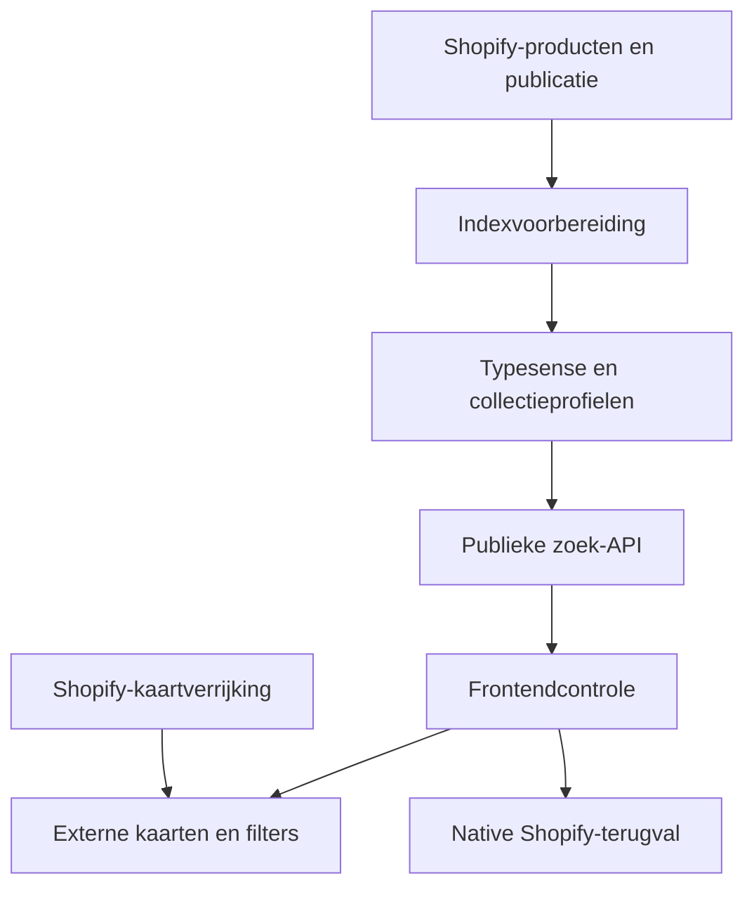

# Filters van Shopify-data tot zichtbare productlijst

Bronmoment **28 oktober 2026**. De [kaarten-/filterfrontend](PRODUCT_CARDS_AND_FILTERS.md) beschrijft de actuele code. Dit dossier verbindt die aan indexering, beheer, fouten en overdracht. De serverbron is nog niet vers uit een bevoegde VPS-sessie gelezen; historische serverkennis wordt hieronder expliciet zo aangeduid.

## Native route

`main-collection-product-grid` en `main-search` renderen serverkaarten en `facets`. Native facet-/range-/sort-/paginatieparameters horen bij Shopify. `assets/facets.js` haalt passende sectie-HTML op en vervangt de relevante delen; native inhoud bestaat ook vóór externe activatie. Search & Discovery-instellingen/filters zijn een platformbeheerbron, geen uit het thema gegenereerde database.

## Externe route: exact requestcontract

De actuele frontend probeert na DOM/contextguards `runSearch` automatisch. De opt-inbeschrijving met `bcfilters=1` uit oudere dossiers is historisch voor deze codehash. Er is geen nieuwe activatie door deze documentatieronde uitgevoerd.

`POST /verified/api/v1/search` is een **zoekread**, met JSON `collection`, `q`, `page`, `per_page`, `sort`, `filters` en `ranges`; geen Shopify/cartmutatie. CORS-mode, `credentials:omit`, JSON-contenttype en AbortController zijn expliciet. Collecties zoeken op `*`; productzoekresultaten gebruiken de huidige `q` en context `__all__`.

De response moet arrays `products`/`facets` en een niet-negatief geheel `found` hebben. Voor een collectie moet `collection.profile_products` exact aansluiten op het servergerenderde `collection.all_products_count`; zoekmodus vereist handle `__all__`. Filterbeleid kan kleurwaarde-aliases normaliseren. Dit bewaakt vorm/dekking, niet de juistheid van ieder prijs-/SKU-/voorraadrecord.

## Staat en herstel

| Gebeurtenis | Gedrag / grens |
| --- | --- |
| Nieuwe keuze | Vorige request abort; request-ID bewaakt nieuwste bedoeling |
| URL schrijven | `bcf_*`, `bcr_*_min/max`, `bcsort`, `bcpage`; popstate opnieuw verwerken |
| Geldige response | Filtergroepen, actieve selectie, kaarten, teller en paginering vernieuwen |
| Timeout na 12 seconden, netwerk of ongeldig schema/aantal | Externe mode uit, oorspronkelijke native nodes/display terug, uitleg tonen |
| Kaartdata ophalen | Shopify `sections=bc-card-data`, eigen timeout/cache; add begint disabled |
| Kleur kiezen | Exacte groep/variant, beeld, URL, prijs en wishlistidentiteit samen actualiseren |

Een teruggezette native lijst kan andere URL-parameters hebben dan de externe lijst. Daarom zijn filterselectie→fout→terugknop en nulresultaat verplichte praktijkscenario's. Een HTTP API-proef buiten de browser bewijst geen CORS-preflight of drawer/focusgedrag.

## Indexvoorbereiding in Git

Op de actieve branch staat [scripts/filter-sync](https://github.com/jlamping1997/badkamercity/tree/fix/product-cards-2026-10-14/scripts/filter-sync). `capture` leest actuele gepubliceerde Wiesbaden-producten; `prepare` combineert met de bestaande basis/indexschema/profielen; `stage` kan uitsluitend een nieuwe geïsoleerde Typesense-testcollectie maken. Het is geen bewezen live autosync, cron of webhook. De documentatieronde voert deze netwerk-/stageacties niet uit.

Bewaarregel: bestaande niet-Wiesbaden- en serviceclassificaties behouden; onbekende classificatie stopt. Geldige getypeerde `bc_filters`/filtermanifestwaarden worden gebruikt; geen specs uit titels raden. Consumentenprijzen worden exact naar centen omgezet, **geen extra btw**. Ontbrekende oude producten/velden, meervoudige varianten of afgekapt overzicht stoppen de voorbereiding.

Historische serverpaden, 13-okt-indexaantallen en 22-okt-douchefiltercorrecties staan in die README. Ze bewijzen niet de huidige indexinhoud, actuele processconfiguratie, backups of jobs. De verse Shopify-metingen en publieke API-metingen moeten daarom met de daar geregistreerde tijdstippen worden vergeleken.

## Verse publieke meting

Vier zoekreads beantwoorden met HTTP 200 en passende responsevorm. Wastafelkranen meldt 573 en Inloopdouches 305 profile_products, beide gelijk aan de verse Shopify-HTML-context. De Sunshower-zoekterm in __all__ geeft 104 resultaten; price_asc op Wastafelkranen wordt geaccepteerd. De response noemt voor __all__ 11.342 profile_products en 10.600 shopping_products. Dat verschil is geen bewezen fout zonder de expliciete service-/publicatiescope. Er zijn geen productrecords of prijzen per ID vergeleken en geen volledige sorteringscorrectheid uit vier resultaten afgeleid. De CORS Origin-responseheader past; browserpreflight blijft een aparte controle.

## Wat nog nodig is om dit systeem af te sluiten

Vers servermanifest/broncommit, huidig indexschema en alle profielen, product-ID/SKU/publicatie-/prijsvergelijking, exclusions, sync/deletebeleid, foutlogs zonder klantdata, CORS-preflight, combinaties/ranges/sortering, native fallback en mobiel, backup-/herstelbewijs. De huidige verbinding heeft geen bestaande bevoegde SSH-sessie aangetoond. Dit is een concrete bronblokkade, geen toestemming om een nieuwe serverroute of index te bouwen.

[Publieke meetresultaten en grenzen](../evidence/2026-10-28-complete/README.md) · [Data-pijplijnen](DATA_PIPELINES.md) · [Open dekking](../COVERAGE.md).

## Volledige frontendketen sinds DOC-03C

De [methodedossiers](micro/FILTER_STATE_AND_FALLBACK.md) voegen 41 lokale scenario’s toe, waaronder actuele externe/native bron samen. Gewone terugval werkt onder de gecontroleerde stimuli, maar FILTER-F01 reproduceert oude losse DOM-referenties wanneer native na fallback vervangt en extern daarna weer slaagt. Dit is een P1-kandidaat met gesimuleerde transporttiming, geen bewezen bezoekersfrequentie. [Typed controls](micro/FILTER_VALUES_AND_CONTROLS.md), [kaartverrijking](micro/CARD_HYDRATION_AND_COLORS.md), [mobiele bediening](micro/MOBILE_LISTING_AND_DRAWER.md) en [bewijs](../evidence/2026-10-28-filters/README.md).
