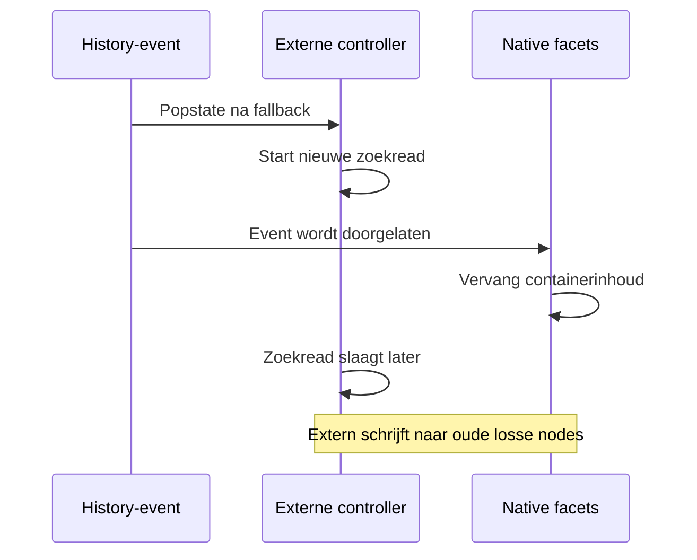

# Filters: URL, nieuwste request, history en native terugval

> **31 oktober 2026 — FIX-01, UNPUBLISHED195948839178:** FILTER-F01 hersteld: na eerste native fallback blijft externe controller uit op huidige pagina; geen externe popstate-search, stale DOMwrite of latere range-debounce. Echte native gridmethode opgenomen in geïsoleerde replay. [Actueel bewijs en rollback](../../../repairs/2026-10-31/README.md). De bronregels/hashes en defectreplays hieronder beschrijven de eerdere nulmeting.

**28 oktober 2026 · DOC-03C.** Hoofddossier: [filterengine](../FILTER_ENGINE.md). Actuele `bc-external-filters.js` en `facets.js` zijn opnieuw gelezen en gehasht. De volledige externe closure is uitgevoerd met synthetische antwoorden; FX-37 gebruikt ook de echte native popstate-handler en `renderProductGridContainer`, met nagebootste native requestafhandeling. Geen live index-, cart- of checkoutactie. [Bewijs](../../evidence/2026-10-28-filters/README.md).

## De eerste eigenaar: Shopify

De server levert native producten, filters, sortering, teller en paginering. De externe controller bewaart bij init referenties naar de bestaande native bedieningsnodes, hun inline displaywaarden en de **oorspronkelijke childnodes van het productgrid**. Hij vindt context via `BcExternalFilters`, een passende collection/search-root, layout en productcontainer/grid. Zonder die elementen stopt hij.

De huidige bron probeert daarna automatisch een zoekread, zonder `bcfilters=1`. Een zoekroute met expliciet type zonder `product` wordt overgeslagen; gemengd product/artikeltype wordt niet overgeslagen. Dit is bron-/replaybewijs voor deze hash, geen nieuwe activering in deze ronde.

## URL en verzoek zijn aparte objecten

| Externe parameter | Interne staat | Gedrag |
| --- | --- | --- |
| Herhaalde `bcf_<field>` | Array strings | Alle waarden overnemen |
| `bcr_<field>_min/max` | Numerieke bound | Alleen finite getallen bij URL-parse |
| `bcsort` | relevance/price_asc/price_desc | Andere waarden genegeerd |
| `bcpage` | Positief geheel getal | Geen bovengrens op basis van toekomstige found-telling |
| `q` / zoektype/context | Zoekterm / `__all__` | Behouden bij filteracties |

`syncUrl` verwijdert alleen de externe dialectkeys en schrijft de huidige staat terug met `history.pushState({}, '', next)`. Overige queryparameters en hash blijven behouden. Sorteren, een filter/range/chip wijzigen of Alles wissen zet page op 1; paginatie verandert page. Alles wissen bewaart **sortering**. `per_page` is intern 24 en wordt niet uit een willekeurige URL-key gelezen.

Native Shopify-parameters zoals `filter.p.vendor`, `sort_by` en `page` worden **niet vertaald** naar dit externe model. FX-24 bevestigt dat ze aanvankelijk geen overeenkomstige externe filters/sort/page opleveren en bij een externe keuze naast `bcf_*` kunnen blijven bestaan. De fixture bootst de oorspronkelijke serverfiltering niet na; dit is een aantoonbare dialectgrens, geen volledige live routefout. Het gewenste contract voor oude/gedeelde native filterlinks blijft een aparte onderhoudsbeslissing. [Shopify beschrijft zijn eigen URL-model hier](https://shopify.dev/docs/storefronts/themes/navigation-search/filtering/storefront-filtering).

## Nieuwste intentie wint

Iedere `runSearch` verhoogt requestId, abort de vorige controller, zet een eigen **12-seconden-timeout**, toont loading en verbergt de vorige fout. Het zoekrequest gebruikt POST/JSON, CORS en `credentials:omit`; het is een zoekread, geen datawijziging.

Na await worden verouderde responses en verouderde fouten genegeerd. Alleen het laatste request mag loading uitzetten. FX-18/19 laten een oude transportstub bewust abort negeren: een late response vervangt de nieuwste kaart niet en een late fout activeert geen fallback na nieuw succes.

De response moet products/facets-arrays en een niet-negatief geheel found hebben. In collectiemodus moet `profile_products` exact gelijk zijn aan de Shopify-contexttelling. In globale zoekmodus moet de responsehandle `__all__` zijn. **Collectiemodus vergelijkt de handle niet afzonderlijk**: FX-23 bevestigt dat een verkeerde handle met hetzelfde aantal wordt geaccepteerd. Dat bewijst geen huidige fout van de echte API, maar begrenst de beschermingsclaim van de countguard.

## Gewone foutafhandeling

Bij netwerk-, HTTP-, schema-, telling- of timeoutfout zet de bron externe mode uit, herstelt de bewaarde native displays en — wanneer externe mode eerder actief was — de oorspronkelijke gridnodes. De uitlegmelding wordt zichtbaar en de drawer sluit. Bij een fout tijdens de eerste poging blijven de oorspronkelijke nodes staan. FX-13…17/20/36 bevestigen deze afzonderlijke paden; een geldige nulresultaatresponse blijft juist in externe mode.

De CSS verlaagt tijdens loading de opacity van het grid en blokkeert pointer-events. Dit is geen algemene abort van lopende kooprequests en geen bewijs dat alle keyboardinteractie wordt geblokkeerd. De testharness voert CSS niet uit.

## FILTER-F01: na native DOM-vervanging blijven oude referenties bestaan

Terwijl externe mode actief is, onderschept de capture-popstate-handler het event met stopImmediatePropagation. Na fallback is dat niet meer zo: de native handler mag weer draaien. De externe handler blijft echter óók staan en start bij ieder popstate opnieuw een zoekread.

FX-37 reproduceert vervolgens deze keten met actuele broncode:

De native methode vervangt `ProductGridContainer.innerHTML`. Het nieuwe live grid is een andere node; de externe closure bewaart nog het oude grid, de oude toolbar/paginering en andere kindreferenties. Als de externe response daarna slaagt, kan hij de HTML-activeclass aanzetten terwijl het **live grid native blijft en de toolbar ontbreekt**. De replay bevestigt één native vervanging, gevolgd door externe successafhandeling, nul externe kaarten in het live grid en geen live externe toolbar.

**Status: VERIFIED_ISOLATED, P1-kandidaat.** Dit is geen waargenomen huidig bezoekersincident of serverfoutfrequentie. De native netwerk-/renderorkestratie is gecontroleerd vervangen, maar de popstate-handler en gridvervangingsmethode zijn echte broncode. De reguliere terugknoptests met alleen een native callbackteller zouden deze DOM-eigenaarschapsfout missen.

## Oplossingsrichtingen en acceptatie

Richting A: na fallback het eigenaarschap voor de rest van die pagina consequent aan native geven; een volgende volledige navigatie kan extern opnieuw proberen. Richting B: expliciete teardown/herinitialisatie met nieuwe nodeverwijzingen zodra native heeft vervangen, met steeds één eigenaar. Beide vragen een gekozen URL-dialectbeleid en controle van selecties/history. Dit is geen opdracht of bewijs voor een veilige éénregelfix.

Acceptatie voor een latere correctie: eerste fout, externe succes→fout, native wijziging na fout, backward/forward met native en externe state, native DOM-vervanging vóór/na extern antwoord, twee snelle requests, late fout, lege resultaten en sidebar/toolbar/count/grid uit dezelfde eigenaar. Geen globale native popstateblokkade toevoegen om één race te verbergen.
