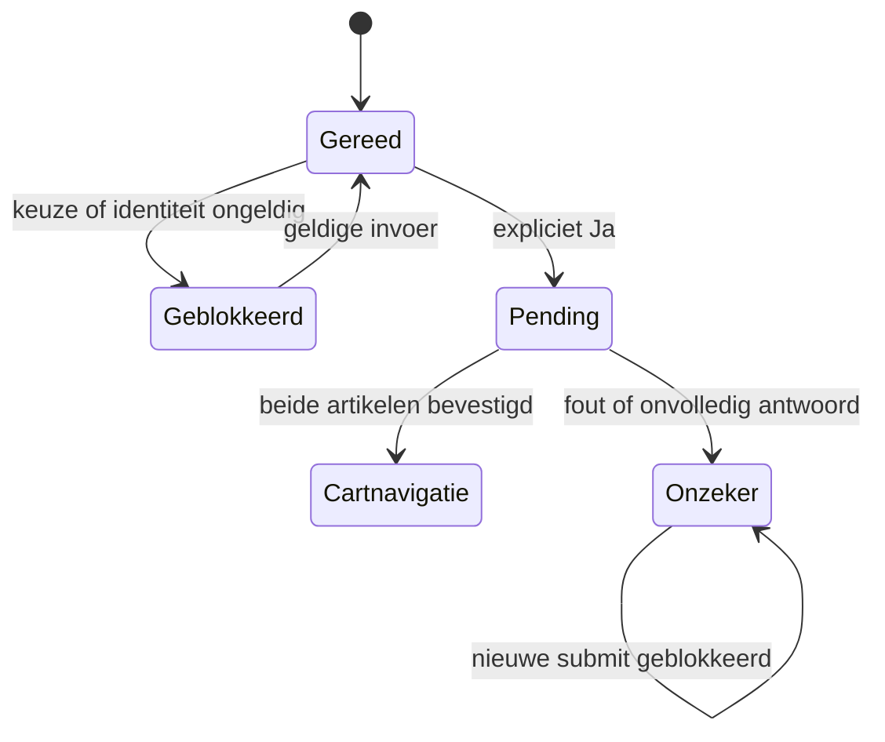

# Inbouwdeel: volledige formulier-, request- en herstelketen

**28 oktober 2026 · DOC-03B · VERIFIED_SOURCE + VERIFIED_ISOLATED.** Bronnen: `product-form.js`, `bc-product-inbouw.js`, `bc-product-inbouw.liquid` en `bc-product-inbouw-data.liquid`. Tien relevante bestanden zijn opnieuw uit MAIN 195818389770 gelezen en op bytes/grootte gecontroleerd. Geen echte winkelwagen, order of checkout aangeraakt. [Bewijs](../../evidence/2026-10-28-transitions/README.md).

## Van expliciete relatie naar koopbediening

De actuele gegenereerde routekaart bevat **715 unieke productcases en 715 unieke afbouwvariant-ID's**, gekoppeld aan **44 inbouwvarianten**. Iedere ontvangen regel heeft zes velden, verhouding 1, verschillende parent/body-ID en een consistente body-ID/handle/SKU-combinatie. Dit is een structurele controle van de mapping, geen nieuwe fabrikantcompatibiliteits-, publicatie-, prijs- of voorraadgarantie voor 715 artikelen.

Relatievelden: `parentVariant|parentSku|bodyHandle|bodySku|bodyVariant|quantity`. Het Liquid-snippet controleert actuele Shopify-objecten opnieuw: beide vendors Hotbath, exact parent-ID/SKU, exact body-ID/SKU, verhouding **precies 1**, positieve bodyprijs en geen `specs.met_inbouwdeel=true`. De client accepteert rekenkundig een positieve gehele verhouding, maar de actuele Liquid-validatie en alle 715 mappingregels begrenzen de werkelijk bedoelde bron tot 1. Een toekomstige andere verhouding vraagt dus ook aanpassing van het servercontract. Beschikbaarheid wordt apart vastgelegd. Een gegenereerde regel activeert dus niet blind een betaalde optie.

Bij een geldige relatie begint het fieldset verborgen/disabled totdat de controller klaar is. Een onbekend/ongeldig verband levert uitleg in plaats van een verzonnen body. De noscript-route toont de informatie en een aparte bodylink; geen automatische meebestelling. Historische pilotdossiers beschrijven oudere aantallen/implementatiefasen en mogen dit huidige contract niet vervangen.

## Wie bezit de submit?

`product-form.onSubmitHandler` voorkomt de gewone submit, controleert disabled/aria-disabled/navigatie en aantal en zoekt het inbouwcomponent binnen het formulier. Een aanwezig maar nog niet klaar component blokkeert kopen met een laadmelding. Daarna betekent de returnwaarde van `handleSubmit`:

| Return | Betekenis | Gevolg |
| --- | --- | --- |
| `true` | Component neemt afhandeling over óf blokkeert | De gewone product-form-request stopt |
| `false` | Geldige keuze Nee | Het bestaande product-form verstuurt het hoofdartikel |

`true` betekent dus **niet** “succesvol gekocht”. De handler blokkeert bij niet-ready, busy, uncertain, niet meer verbonden, verlaten pagina, productnavigatie, identiteit-/aantalfout, ontbrekende keuze en onbeschikbare body bij Ja. De isolatie voert de echte beide controllers samen uit; browserformulierconstraints en Shopify-responses zijn nog steeds nagebootst.

## Ja: payload en vergrendeling

Bij een geldige keuze Ja wordt één JSON-request met twee echte artikelen opgebouwd. Hoofdhoeveelheid × relatieverhouding bepaalt bodyhoeveelheid. String-properties uit `properties[...]` en een eventueel `selling_plan` gaan alleen mee met het hoofdartikel. Het testsellingplan bewijst die kopieerregel, geen huidige verkoopbaarheid van een abonnement op deze producten.

De bron zet `busy`, `aria-disabled`, `aria-busy`, spinner en keuze-disabled. De normale product-form respecteert die aria-guard; een tweede submit bereikt geen extra fetch. De HTML-button hoeft hiervoor niet native `disabled` te zijn. Een nieuw submitpad dat alleen `.disabled` controleert kan dit contract doorbreken.

Het aantalveld blijft in deze fixture veranderbaar tijdens pending. Het reeds verstuurde JSON blijft een **snapshot**: een later weergegeven aantal herschrijft de aanvraag niet. Dit is gedocumenteerd gedrag, geen bewezen verkeerde echte bestelling. Bij een onzekere uitkomst blijft controle van de werkelijke cart nodig.

## Bevestigd, afgewezen of onzeker

`addItems` heeft een eigen AbortController met **30 seconden timeout**. Na JSON-parse accepteert de bron alleen HTTP-ok, geen truthy `result.status`, een `items`-array en voor ieder gevraagd artikel een overeenkomend variant-ID, exacte SKU en een veilig geheel teruggegeven aantal **minstens** het gevraagde aantal. Een hoger aantal wordt geaccepteerd; dat modelleert mogelijke samenvoeging met aanwezige cartregels, maar de test bootst geen echte Shopify-samenvoeging na.

Alle catchgevallen gaan momenteel naar **uncertain**, ook een gesimuleerde expliciete HTTP 422-afwijzing. Dat is een conservatieve ontwerpkeuze; deze controller heeft geen aparte direct-herprobeerbare afwijzingsstaat. Geen request herhalen alleen omdat een foutmelding verscheen. Iedere afwijkende SKU, ontbrekend artikel, te laag aantal, JSON-fout, netwerkfout en timeout blijft in de replay zonder navigatie, met zichtbare cartcontrolelink en geblokkeerde retry.

Bij bevestigd succes navigeert hij alleen als het component nog verbonden is en de pagina niet wordt verlaten. `busy` wordt op dat succespad niet teruggezet: navigatie is het vervolg. Een navigatie-exception valt in de catch en wordt uncertain. Een latere wijziging naar popupfeedback moet daarom expliciet een nieuw succes-/unlockcontract ontwerpen.

## Vertrekken, terugkeren en loskoppelen

`pagehide` markeert vertrek. Een geldig antwoord na vertrek start geen nieuwe cartnavigatie. Een persisted `pageshow` met achtergebleven busy wordt uncertain. `disconnectedCallback` stopt componentlisteners/observer, maar **niet** de afzonderlijke fetch-AbortController. Een losgekoppeld component kan nog een serveractie hebben lopen; een bevestigd antwoord op de losgekoppelde fixture navigeert niet. DOM verwijderen is geen annulering van een koopactie.

Keuzehandoff via sessionStorage is maximaal 30 seconden geldig, met dezelfde keuzegroep/body, een andere bronroute en expliciete yes/no. Geldige JSON wordt eenmalig verwijderd vóór inhoudelijke controle. Verkeerde groep/body, dezelfde route, verlopen en toekomstige tijdstippen worden niet hersteld. **Ongeldige JSON blijft momenteel opgeslagen**, omdat de parse vóór verwijderen faalt; startup stopt niet, maar dezelfde beschadigde waarde kan opnieuw worden geprobeerd. Dit is een onderhoudsgrens, geen aangetoond live dataverlies.

In compacte checkboxmodus kan visueel standaard Nee gekozen worden zonder expliciete klantactie. Die impliciete Nee wordt niet meegedragen naar een volgende productroute; een expliciete keuze wel. De mobiele flag is in deze test synthetisch, geen mobiele browsercontrole.

## Onderhoudsgrens

IBX-01 t/m IBX-25 toetsen de volledige clientketen in een DOM-simulatie. De twee inbouwcodepaden, hun returncontract, onzekerheidsblokkade, SKU-/ID-/aantalchecks en eenmalige handoff vormen samen het onderhoudscontract. Een globale add-interceptor of gedeelde koopknop mag deze eigenaar niet dubbel activeren.

Nog open: echte browserformulierconstraints/keyboard/focus, werkelijke cart/voorraad, selling-plan-/propertiesgevallen, responsefrequentie, touch en pagina-/bfcachelevensduur op apparaten. Checkout is op verzoek buiten deze ronde gehouden. [Aantallen en identiteit](QUANTITY_AND_IDENTITY.md) · [Keuzes](../PRODUCT_CHOICES.md).
