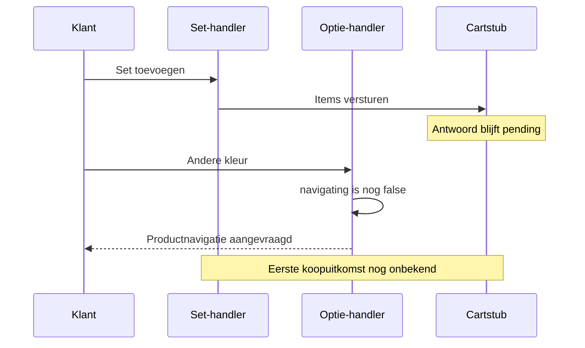

# Sunshower — keuze, kopen en verzoeken die elkaar kruisen

> **31 oktober 2026 — FIX-01, UNPUBLISHED195948839178:** SS-F01 hersteld: pending en onzekere uitkomst blokkeren wijzigende/duplicerende kooproutes, inclusief lokale andere formulieren en bfcache. Ook422 kan gedeeltelijk toevoegen; eerst cart controleren. Alleen gesimuleerde carttransporttests, geen echte koopactie. [Actueel bewijs en rollback](../../../repairs/2026-10-31/README.md). De bronregels/hashes en defectreplays hieronder beschrijven de eerdere nulmeting.

**Doel:** de getoonde configuratie, de actieve koopknoppen en het lopende request blijven bij dezelfde bedoeling van de klant horen. Hoofdcontracten: [keuzes](../PRODUCT_CHOICES.md) en [cart](../CART_AND_FEEDBACK.md). Bron assets/bc-sunshower-page.js; replay SS-01/SS-02. Geen echte koopactie uitgevoerd.

## Twee aparte vlaggen

| Pad | Guard bij ingang | Wat wordt geblokkeerd? | Uitgang |
| --- | --- | --- | --- |
| Optieklik, :70–96 | navigating of reeds geselecteerd | Alle opties plus submit/set/wishlistcontrols | Catalogusmatch → productnavigatie; fout → oorspronkelijke disabled-staten terug |
| Set toevoegen, :355–378 | adding of navigating, plus quantity.checkValidity | Alleen de setknop krijgt hier disabled | Succes → cartnavigatie; fout → cartcontrolelink en setknop weer vrij |
| Gewone hoofdartikel-submit | Native formulier uit main-sunshower | Geen adding-guard in deze paginahandler | Afzonderlijk browser-/Shopify-formulierpad |
| pageshow persisted, :344–353 | Alleen terugkeer uit bfcache en verbonden pagina | Herstelt opties/koopcontrols; reset bepaalde pending-staat | Geen readback van wat server eerder heeft toegevoegd |

De optiehandler kent navigating, maar controleert adding niet. De sethandler kent beide vlaggen. Dat is een asymmetrisch contract: kiezen blokkeert kopen, terwijl een lopende set-add kiezen niet op dezelfde manier blokkeert.

## SS-F01: productwissel tijdens pending set-add

De geïsoleerde replay voert de werkelijke paginacode uit met een kleine fictieve pagina en twee harde stubs: cart/add blijft bewust pending; de catalogus retourneert één andere kleur. Navigatie wordt alleen opgeschreven, niet uitgevoerd.

1. Klik Add set. Eén nagebootst POST-request wordt opgebouwd; de setknop is disabled.
2. De gewone submitknop en de niet-geselecteerde kleurknop blijven enabled.
3. Een tweede klik op de disabled setknop veroorzaakt geen tweede set-POST: die bescherming werkt.
4. Klik de andere kleur. De optiehandler haalt de catalogus en roept location.assign aan vóór de eerste setresponse is afgehandeld.

**DEFECT_REPRODUCED, SS-01.** De aangetoonde uitkomst is een configuratienavigatie tijdens een lopend setrequest. Het aantal echte winkelwagenregels, een dubbele bestelling of de uitkomst van een afgebroken serverrequest is niet getest. De gewone koopknop bleef aantoonbaar enabled; hij is niet op de echte site ingedrukt.

**Prioriteit: P1-kandidaat.** Bij trage/onderbroken requests kan de klant van uitvoering wisselen terwijl de vorige koopbedoeling nog onderweg is. Dat risico vraagt een besluit over het contract, niet een ongecontroleerde tweede koopactie om het te testen.

Kleinste voorstel: tijdens adding ook productkeuzes en relevante submitroutes begrenzen, met herstel van de oorspronkelijke disabled-staten. Maak expliciet wat bij transportonzekerheid versus een definitieve serverafwijzing mag worden hervat. Een globale nieuwe submitlistener of alle Sunshower-formulieren omzetten naar AJAX is hiervoor niet vanzelf nodig. Betaalde extras en bestaande productidentiteit blijven gelijk.

## Succes, fout en aantal zijn afzonderlijke zaken

De setpayload wordt één keer bij het klikken opgebouwd: parentQuantity voor het hoofdproduct, elke geselecteerde extra quantity 1. Latere UI-wijzigingen herschrijven dat al opgebouwde JSON-request niet. Dit voorkomt op zichzelf nog niet dat de getoonde selectie en de lopende bedoeling uit elkaar gaan lopen.

SS-02 bevestigt twee hoofdproducten plus één geselecteerde extra, en bij een nagebootste HTTP 422 een zichtbare cartcontrolelink en weer beschikbare setknop. Deze test bewijst niet dat opnieuw proberen veilig is bij een verbroken verbinding ná serveracceptatie. Het Hotbath-inbouwpad heeft juist een expliciete uncertain-blokkade. Zie [aantal/identiteit](QUANTITY_AND_IDENTITY.md) voor die verschillende contracten.

## Werkelijk in de desktopbrowser gecontroleerd

Op de genoemde Sunshower-PDP opent Maathulp een dialog met titel Uitvoering. Escape sluit het venster en geeft focus terug aan Maathulp. Eén galerijstap gaat na asynchrone afhandeling van index 1 naar 2. Een eerste observatie las nog de oude teller; de latere DOM-toestand toonde index 2 en de tweede slide actief. Dat is geen defect of gemeten animatieduur.

Deze browsercontroles raakten geen koopactie. Ze certificeren niet alle hulpvensters, foto-uitval, PhotoSwipe, touch, bfcache of mobiel. Viewport was 1363×936; de ondersteunde bediening bood geen viewportresize, dus de eerdere mobiele pijlvergelijking blijft open.
