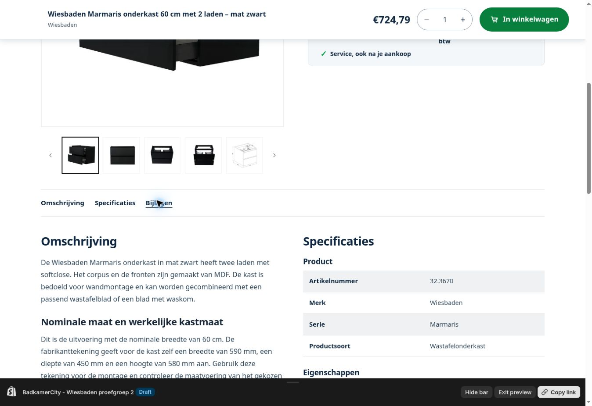

# Wiesbaden proefgroep 2 — 20 oktober 2026

**Status: APPLIED_ADMIN_VERIFIED / PREVIEW_READY / SEARCH_SYNC_BLOCKED.** De eigenaar heeft24.3710 op mobiel goedgekeurd en opdracht gegeven door te gaan. Zeven volgende producten zijn gecontroleerd verrijkt; twee andere zijn zonder writes apart gehouden. Dit dossier vervangt de eerdere “in uitvoering”-notitie. Het historische register van16oktober is geen actuele Admin-snapshot.

## Resultaat

| SKU | Product | Specificatieregels | Documentlinks | Status |
| --- | --- | ---: | ---: | --- |
| 20.3755 | Graffic inloopdouche80×200cm | 20 | 2 | Admin toegepast; concept gecontroleerd |
| 20.3756 | Graffic inloopdouche90×200cm | 20 | 2 | Admin toegepast; concept gecontroleerd |
| 32.3411 | Barco ovale waskom40×33cm | 35 | 1 | Admin toegepast; zoekindex nog oude titel |
| 32.3594 | Porta fonteinset met Metro kraan | 10 | 0 | Admin toegepast; exacte maten/bijlagen ontbreken bij fabrikant |
| 32.2510 | Vesta Tornado hangtoilet met Shade Slim zitting | 22 | 3 | Admin toegepast; concept gecontroleerd |
| 32.3670 | Marmaris onderkast nominale60cm, mat zwart | 21 | 3 | Admin toegepast; werkelijke kast590×450×580mm |
| 38.4125 | Ambi One LED-spiegel140×60cm met verwarming | 23 | 2 | Admin toegepast; concept gecontroleerd |
| 29.8007 | Dreams afbouwdeel mat zwart | — | — | Geen wijziging; fabrikanttekeningen spreken elkaar tegen |
| 41.3540 | Elara CV-radiator766×600 | — | — | Geen wijziging; onjuiste elektrische velden/onduidelijk vermogen |

Totaal151 specificatieregels en13 documentlinks over zes producten, naast de eerder goedgekeurde referentie24.3710. Geen nieuwe fabrikantdocumenten voor de fonteinset verzonnen.

## Wat werkelijk is geschreven

Zeven productUpdate-aanvragen wijzigen titel, eigen descriptionHtml en SEO. Daarnaast27 metafields via compareDigest: zevenmaal complete_specificaties, card_title en content_review, plus zesmaal technische_documenten. Bestaande definities hergebruikt, behalve nieuwe PRODUCT JSON-definitie `bc_data.content_review`, ID435276939530. Nul GraphQL-userErrors. De SEO-mutaties werken ook de bestaande global.title_tag/description_tag bij.

Een onafhankelijke volledige readback van alle tien betrokken producten bevestigt de zeven gewenste wijzigingen en drie exact ongewijzigde records (24.3710 plus beide geblokkeerde artikelen). Prijs, voorraad, variant-ID/SKU/barcode, collectielidmaatschap, media, vendor, handle, productType, templateSuffix en bestaande filtermanifesten zijn exact behouden. Alle negen prijzen passen bij bronadviesprijs exclusief BTW ×1,21. Dit bewijst geen andere prijsstrategie, inkoopmarge, actuele beschikbaarheid of toekomstige leverdatum.

Eigen teksten/titels/SEO en metavelden staan al in Shopify; dit zijn geen concept-productkopieën. De nieuwe weergaveregels staan alleen in het nieuwe conceptthema.

## Bronbeoordeling en weggelaten claims

Bestaande fabrikantbronrun19oktober hergebruikt; geen nieuwe volledige crawl. Zeven bronrecords op SKU/merk gekoppeld, SHA256 van oorspronkelijke gz-HTML geverifieerd.28 document-URL’s opgehaald,17 unieke geldige JPG/PDF-bestanden op basis van inhoud. Bronlinks, datum/checksum en relevante eigen feiten staan in [proposal.json](wiesbaden/proefgroep2/proposal.json); originele fabrikantproza/HTML/PDF-binaries niet in publieke Git opgeslagen.

- **32.3594:** bevestigde setinhoud: fontein, Metro-kraan, sifon, afvoer en stokschroeven. Flexibele aansluitslang apart nodig. Exacte maten ontbreken in bron; geen afmeting afgeleid uit een gelijkende set.
- **32.2510:** Wisa-onverenigbaarheid behouden. Tegenstrijdige ruwe tabelwaarden over bevestiging/coating niet overgenomen; eigen tekst volgt bevestigde uitvoering/handleiding.
- **32.3670:** nominale60cmmaat onderscheiden van590mm kastbreedte; tekening bevestigt450mm diep en580mm hoog. Oude46cmproza vervalt. MDF bevestigd, FSC niet zelfstandig bevestigd. Nieuwe tekst/specs claimen geen FSC; bestaande filterwaarde “FSC gekeurd MDF” is nog ongewijzigd en onbevestigd.
- **38.4125:** twee verwarmingsmatten25×35cm, geen belofte van direct een volledig condensvrije spiegel. Bevestigde touchbediening/dimmen/lichtkleur/uitschakeling na1uur; oude energielabelA/50.000uurclaim niet herhaald.
- **29.8007:** ruwe tabel noemt inbouwdeel/chroom, product is afbouwdeel mat zwart. Twee officiële tekeningen geven96/80 versus138/90mm rozetten. Correcte revisie eerst door fabrikant laten bevestigen.
- **41.3540:** elektrische eigenschappen passen niet bij deze CV-radiator.463W oud versus1555 bij75/65-20 en409 bij40/35-20 in handleidingtabel; eenheid/toepasbaarheid niet bevestigd. Geen waarde gokken.

## Thema en contract

MAIN **195488317706 — BadkamerCity - Productpagina smal desktop** blijft ongewijzigd. Nieuw concept **195491168522 — BadkamerCity - Wiesbaden proefgroep 2**, UNPUBLISHED, vóór511/511 bestanden checksum-identiek aan MAIN. Nu512 bestanden; drie bestaande snippets aangepast/één nieuwe, overige508 identiek. MAIN511/511 behouden.

Bestanden: bc-product-breadcrumbs, bc-product-documents, bc-wiesbaden-reviewed-specs en nieuw bc-wiesbaden-reviewed-scope. Router, hoofdsectie, CSS, vertalingen, cart/wishlist en Sunshowercode ongewijzigd. Volledige [Git-patch](../patches/BC-wiesbaden-proefgroep2-20261020.patch) is in een schone tijdelijke Git-context toegepast; alle vier resulterende MD5’s gelijk aan Shopify. Geen root-theme-push naar onbekende integratie.

[Metadatacontract](WIESBADEN_REVIEWED_CONTENT_CONTRACT.md): fabrikantnummer in specs en variant-SKU moeten passen; reviewmarker bindt SKU/product-ID/spec-sleutels aan expliciet gecontroleerde inhoud. Categoriepad gebruikt bestaande werkelijke collectieleden. Originele24.3710 blijft via de bestaande pilotroute werken. Toekomstige afzonderlijk gecontroleerde batches hebben geen nieuwe SKU-allowlist in Liquid nodig. Statusready is een weergavetoestemming voor deze getoetste feiten, geen verklaring dat iedere mogelijke eigenschap/commerciële instelling volledig is.

## Bewijs en grenzen

[verification.json](wiesbaden/proefgroep2/verification.json) bevat de gemeten resultaten en hashes.

| Controle | Uitkomst |
| --- | --- |
| Theme Check vier snippets met actuele templatecontext | 4/4 SUCCESS, geen bevindingen |
| Lokale Liquid-renders | 7 nieuwe cases, originele24.3710 en5 guardcases PASS |
| Echte Shopify-preview-HTML | 7/7, juiste rijenaantallen, één breadcrumb, verwachte bijlagen/anchors, geen Liquidfouten |
| Originele24.3710 in nieuwe preview | HTTP200,33 rijen, één breadcrumb, geen Liquidfouten |
| Admin-readback | 7 bedoelde updates; referentie en2 geblokkeerde artikelen ongewijzigd |
| Externe API exact SKU in eigen bladcollectie | 7/7 juist product |
| Actuele korte kaarttitel via bc-card-data | 7/7 juist product/titel |
| Serie-filtersteekproef Graffic en Ambi One | juiste selectie opgenomen, verkeerde selectie uitgesloten,4/4 |
| Gewone tekstzoekvragen met nieuwe bewoording | 3/4 product op pagina1; Barco ovale waskom0 resultaten |
| Native browser1363×936 | Marmaris21 rijen,1 breadcrumb,3 bijlagen;590/450/580mm in DOM; geen horizontale overloop/Liquidfout; zoek20.3755 toont nieuwe korte titel |
| Nieuwe fysieke mobiele review / hartje / winkelwagen / checkout | NOT_TESTED deze batch |
| VPS-mutatie of live tests van nieuwe indexscript | NOT_EXECUTED, SSH-netwerk onbereikbaar |

De screenshot toont de eigen omschrijving en het begin van specificaties. Maatregels/bijlagen zijn afzonderlijk in DOM/HTML gecontroleerd en staan buiten deze screenshotuitsnede.

## Zoekindex: nog uit te voeren

De zichtbare korte kaarttitels komen al actueel uit Shopify via de bestaande bc-card-data-koppeling. De externe index zelf heeft nog oude volledige titels. Daarom is alleen “korte titel zichtbaar” geen volledige tekstzoekvalidatie: “Barco ovale waskom” vindt de oude indextekst “Barco waskom ovaal” niet.

[INDEX_TITLES_RUN.md](wiesbaden/proefgroep2/INDEX_TITLES_RUN.md) bevat een gericht script voor uitsluitend `title` op de zeven bestaande indexdocumenten. Geen herimport, collectie-/filter-/prijswrite of schemawijziging. Eerst identiteit/schema/API/index en huidige staat controleren; private volledige backup vóór de eerste PATCH; iedere readback vergelijkt het hele document; herstel beschermt andere tussentijdse wijzigingen. Twaalf offline veiligheidstests PASS. Geen live uitvoering claimen: read-only SSH-proef gaf “Network is unreachable”, geen remote opdracht uitgevoerd.

**Volgende uitvoerhandeling:** laat de bestaande lokale Windows/SSH-omgeving de titelcorrectie uitvoeren en verifieer de echte output. Geef nooit het wachtwoord/sleutels door aan chat.

## Eigenaarreview en terugzetten

Open Shopify → Onlinewinkel → Thema’s → **BadkamerCity - Wiesbaden proefgroep 2** → **Voorbeeld**. Zoek20.3755,32.3411 en32.3670. Controleer op mobiel de categoriepadpositie, foto/koopblok, leesbare specs en beschikbare bijlagen. Controleer ook referentie24.3710 en een Sunshowerproduct. De eigenaar publiceert als het akkoord is; connector verbiedt MAIN-writes/publiceren. Nieuwe testuitkomsten en publicatie daarna opnieuw via Admin vaststellen.

Weergave terugzetten: huidige MAIN195488317706 behouden of opnieuw publiceren; de oorspronkelijke24.3710pilot blijft daarbij bestaan. Productdata terugzetten vereist de duurzaam bewaarde private herstelzip met negen originele Admin-records en een verse compareDigest/identiteitscontrole; alleen de gewijzigde velden herstellen. Oude records niet blind over een latere bewerking schrijven. Geen volledige originele descriptions in publieke repo. De herstelzip bevat geen VPS-backup; het indexscript maakt vóór een eventuele VPS-write zijn eigen private herstelkopie.
