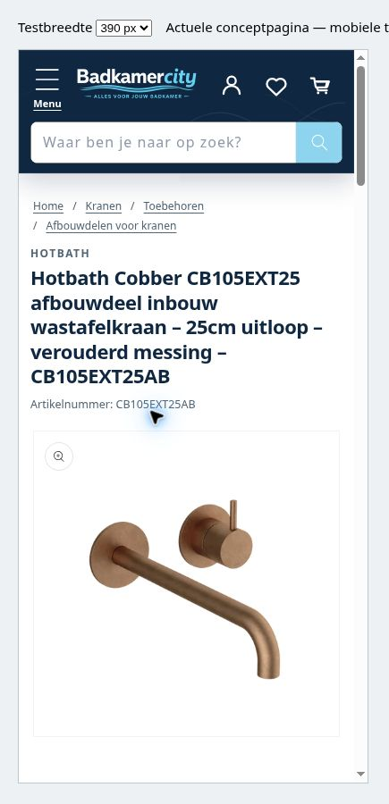

# Compacte productkop en breadcrumbs

## Compacte producttitel en breadcrumbs — 25 oktober 2026 (PREVIEW_READY / NIET_GEPUBLICEERD)

Eigenaar heeft de ronde kleurkeuze inmiddels gepubliceerd: actuele **MAIN195703472394 — BadkamerCity - ronde kleurkeuze A**. Vervolgwens uitgevoerd in **UNPUBLISHED195703996682 — BadkamerCity - compacte titel en kruimelpad**: Hotbath-introzin boven de keuzemenu's verwijderd; titel op mobiel22px, iets breder, desktop24–28px; breadcrumbs boven de titel. Bestaande omschrijving, productdata en koopfuncties behouden.

Breadcrumbs hergebruiken de bestaande Wiesbaden-route en gebruiken voor overige producten de werkelijke collectieleden plus de huidige hoofdmenustructuur. Bij onduidelijke dubbele paden alleen de zekere categorie, zonder gegokte ouder. VoorCB105EXT25AB is de bestaande catalogusroute **Home → Kranen → Toebehoren → Afbouwdelen voor kranen**; geen cataloguscategorieën gewijzigd. De volledige producttitel staat alleen voor schermlezers nog in het kruimelpad, zodat hij visueel niet dubbel ruimte inneemt.

**Bewijs:** vooraf553/553 bestanden identiek; finale readback553 bestanden, vier wijzigingen,549 behouden; MAIN553/553 ongewijzigd. Alle vier uploads inhoudelijk exact teruggelezen. Shopify-validator: geen fouten, dezelfde drie bestaande main-product-waarschuwingen als vóór de patch. Zes echte Liquid-renderproevenPASS. Browser390px en320px iframe: intro afwezig, breadcrumbs correct, kleuruitklapper werkt, geen horizontale overloop; desktop1348px eveneens gecontroleerd. Tijdelijke QA-aanpassing exact teruggezet. Geen fysieke telefoontest, volledige winkelwagen-/checkouttest of conversiemeting uitgevoerd.

[Scoped before/after, regressietest, screenshot en readback](https://github.com/jlamping1997/badkamercity/tree/fix/product-cards-2026-10-14/docs/product-page/2026-10-25/compact-header). Actieve branch blijft `fix/product-cards-2026-10-14`; main krijgt alleen documentatie. Geen root-theme-sync/merge of lokale Windows-controle.

**Exact volgende handeling:** eigenaar publiceert **195703996682 — BadkamerCity - compacte titel en kruimelpad** via Shopify → Webshop → Thema's; de connector blokkeert publiceren en MAIN-writes. Oudere preview/publicatiestatussen hieronder zijn geschiedenis.

## Implementatie en herstel

De vier bestanden onder `after/` zijn de volledige permanente patch. `before/` bevat de exacte vers gelezen bronbestanden uit MAIN. Het verwijderen van de korte intro gebeurt in Liquid, zonder verborgen HTML-rest of wijziging van metafields. De levertijdregel en de omschrijving verderop blijven staan. H1 blijft volledig intact; de compacte weergave is CSS. Alleen de header wordt op mobiel6px breder, zodat de mediagalerij zijn bestaande marge behoudt.

De breadcrumbs doorlopen uitsluitend de vaste drie niveaus van het bestaande hoofdmenu; geen volledige productcatalogusloop of extra JavaScript/netwerkrequest. Het diepste pad naar een daadwerkelijk gekoppelde collectie wordt gekozen. Bestaande gecontroleerde Wiesbaden-paden hebben voorrang. Bij een gedeelde onduidelijke route blijven alleen de zekere categorie en Home over.

## Controle herhalen

`npm install && npm test` in dit dossier. De test rendert de echte breadcrumb-Liquid met LiquidJS; alleen de bestaande Wiesbaden-scope-snippet is als expliciete fixture vervangen. Zes gevallen: werkelijke CB105-collecties/menu, gedeelde algemene categorie, collectie buiten menu, geen collectie, bestaande pilot, gecontroleerd pad met ongeldige categorie. De openbare bronfixture bevat geen klantgegevens.

Mobiel gecontroleerd via echte preview-HTML in een tijdelijk srcdoc-frame, nominaal390/320px (inhoud375/305px door scrollbar). Desktop op de normale productroute. Screenshot toont de390px-weergave. De tijdelijke QA-templatewijziging is exact hersteld naar de bestaande broninhoud, die al een oude iframehelper bevat; geen extra testtemplate opgeleverd. Betaal-/cartfuncties zijn niet gewijzigd en in deze cosmetische ronde niet opnieuw volledig getest.

Terugzetten: vóór publicatie de kandidaat ongepubliceerd houden; zo nodig de vier `before/`-bestanden terugzetten naar een gecontroleerde UNPUBLISHED kopie. Publicatie is de eigenaarshandeling. Dit dossier is een gerichte patch, geen volledige vervanging van de theme-root op Git.
