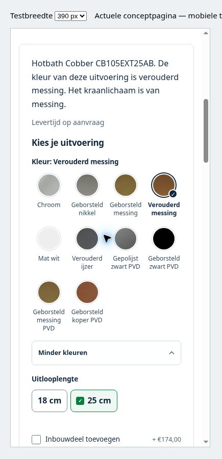

# Ronde Hotbath-kleurkeuze

Status: PREVIEW_READY, niet gepubliceerd. Datum: 25 oktober 2026.

## Hotbath ronde kleurkeuze — 25 oktober 2026 (PREVIEW_READY / NIET_GEPUBLICEERD)

Goedgekeurde richting uitgevoerd: kleine ronde finishstalen met volledige kleurnamen; aanvankelijk vier kleuren, geselecteerde kleur altijd zichtbaar. **Bekijk alle N kleuren** met **+N** opent de overige kleuren direct op dezelfde pagina; **Minder kleuren** klapt weer in. De bestaande bewaarfunctie houdt het paneel open na een kleurwissel. Vier vaste kolommen, onder360px drie; een onvolledige laatste rij blijft links uitgelijnd. De bestaande subtiele inbouwcheckbox is behouden.

**Actuele Shopify-bron:** MAIN **195702653194 — BadkamerCity - compactere kleurblokjes**. Nieuwe UNPUBLISHED kandidaat **195703472394 — BadkamerCity - ronde kleurkeuze A**. Vooraf553/553 bestanden checksum-identiek. Finale volledige Admin-readback: **553 bestanden, vijf gerichte wijzigingen,548 ongewijzigd; MAIN553/553 ongewijzigd**. De tijdelijk gebruikte bestaande QA-template is exact teruggezet naar zijn aangetroffen inhoud; die bevat al een oude iframehelper, geen nieuwe permanente QA-wijziging.

**Controle:** vijf gewijzigde bestanden Shopify-validatorPASS; tien groepen DOM-regressiesPASS, waaronder oneven aantallen, exacte productnavigatie, behouden open toestand en desktop/andere merken. Echte Shopify-preview in mobiele iframeweergave390px: ronde stalen, volledige namen,10 kleuren, selectie en inline uitklappen gecontroleerd;320px inklappen/+6 en leesbare bediening gecontroleerd. Geen fysieke telefoontest, nieuwe winkelwagen-/checkout-/betaaltest of conversiemeting. Geen product-/prijs-/voorraad-/metafieldwijzigingen.

[Dossier met before/after, reproduceerbare regressietest, screenshot en readback](https://github.com/jlamping1997/badkamercity/tree/fix/product-cards-2026-10-14/docs/product-switcher/hotbath/2026-10-25/round-colors). Actieve branch blijft `fix/product-cards-2026-10-14`; geen root-theme-sync of branchmerge. Main krijgt alleen deze statusaanvulling. Oudere preview-ID's hieronder zijn historische voortgang en niet de huidige kandidaat.

**Exact volgende handeling:** eigenaar publiceert **195703472394 — BadkamerCity - ronde kleurkeuze A** in Shopify → Webshop → Thema's. De Shopify-koppeling blokkeert MAIN-writes en publiceren; agent heeft niet gepubliceerd. Daarna huidige rollen en normale productroute opnieuw controleren.

## Bestanden

Vijf bestanden onder `after/` vormen de volledige patch. `before/` is de exacte vers uit Shopify gelezen terugzetbasis. Geen dataset- of productwijziging nodig. Originele40px Hotbath-finishbeelden worden binnen een ronde48px uitsnede getoond; er zijn geen nieuwe kleurfoto's verzonnen. Namen blijven ook zonder afbeelding leesbaar. De totale +N teller volgt werkelijk beschikbare menuwaarden.

## Tests herhalen

`npm install && npm test` in dit dossier. De fixture bevat alleen de openbare CB105EXT-menugegevens. De scriptfixture test de echte after-JavaScript; de gebruikte happy-dom-versie staat in package.json. De opgeslagen PASS-resultaten zijn van de lokale uitvoering vóór archivering. Shopify-validator vijf bestandenPASS; lokale datasetdependency was alleen voor validatie aanwezig en maakt geen onderdeel uit van de upload.

De browsercontrole gebruikte een tijdelijk aangepast bestaand alternate template met de echte preview-pagina in een390/320px srcdoc-frame. Directe storefront-iframes werden niet geladen. De tijdelijke wijziging is exact teruggezet; de553-bestandenreadback bewijst de vijf permanente verschillen. Browsernavigatie door kleuren is niet opnieuw als volledige telefoonroute getest; productroute en toestandsoverdracht zijn functioneel via DOM-tests gecontroleerd.

## Terugzetten

Vóór publicatie kan de kandidaat ongepubliceerd blijven. Voor herstel van deze patch de vijf `before/`-bestanden alleen naar de relevante UNPUBLISHED kopie terugzetten en controleren. Publiceren blijft een eigenaarshandeling. Dit dossier vervangt geen volledige themesnapshot; de bronkopie was553/553 identiek aan MAIN.
