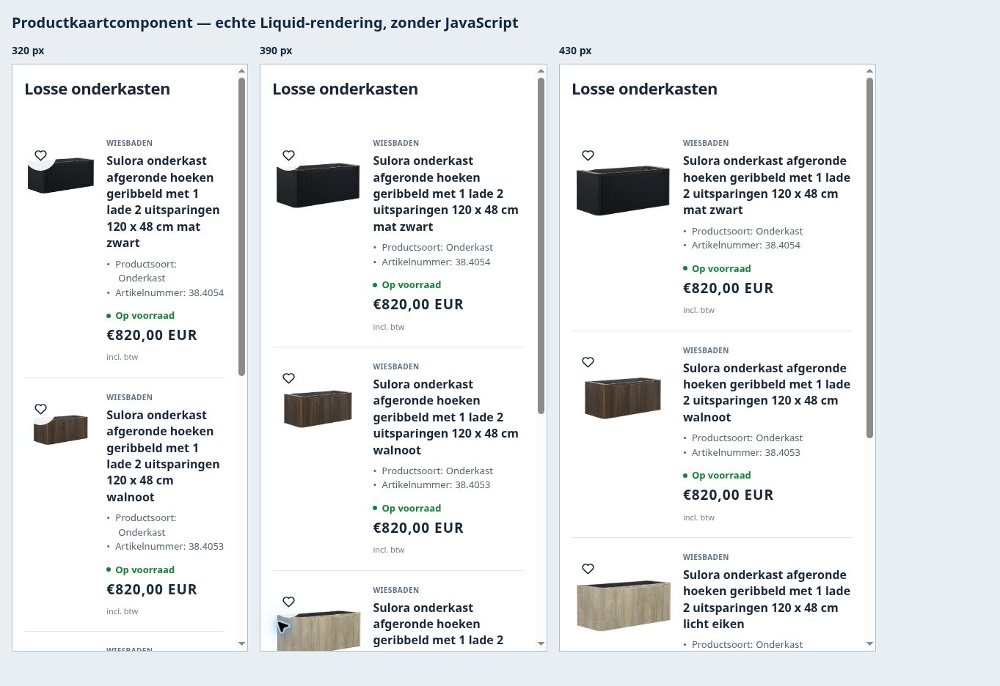

# Mobiele productlijst volgens het gekozen ontwerp

8 november 2026 · MOBILE-CARDS-01 · READY_FOR_OWNER_REVIEW · UNPUBLISHED

Eigenaar koos de open horizontale lijst: productbeeld links, titel en echte kenmerken rechts, voorraad-/leverlabel en prijs eronder; dunne scheidingslijnen, geen grote knoppen of kaartkaders. Alleen collectie-/zoekproductlijsten onder750px wijzigen. Desktop, homepagekaarten, related-products en Sunshowercomponenten behouden hun bestaande presentatie.

## Huidig reviewdoel

**196354474250 — BadkamerCity - Mobiele productlijst 8 nov**, UNPUBLISHED. **MAIN196368531722 — Klantenservice8nov blijft ongewijzigd.** Bekijk het concept via Shopify → Webshop → Thema’s, controleer op telefoon en publiceer daar bij akkoord. De verbinding staat geen automatische MAIN-filewrites of themapublicatie toe; er is niet geprobeerd dit te omzeilen.

Er is eerst een native duplicaat196381114634 gestart. Dat bleef tijdens voorbereiding verwerken en is niet als reviewdoel gebruikt; het heet nu **Reserve - kopie klantenservice 8 nov**, UNPUBLISHED. De eindread meldt processing=false/processingFailed=false; geen volledige manifestvergelijking of featurewrite op die reserve. Publiceer deze reserve niet voor dit ontwerp.

Voor het reviewdoel is het bestaande complete concept gebruikt:1387files,1381al gelijk aan MAIN, precies zes oudere files eerst gelijkgetrokken met MAIN. [Beginsituatie](reused-base-comparison.json). Het eindresultaat bevat1388files:1383gelijk aan MAIN, vier gewijzigde bestaande files en één nieuwe CSSfile; geen verwijderde bestanden. [Volledige MAIN](main-manifest.json), [volledig concept](draft-manifest.json), [pariteitscontrole](parity-check.json). Alle1387MAIN-checksums voor/na gelijk. De bestaande config/settings_data.json-API-bodyuitzondering blijft open; metadata is tussen thema’s gelijk en dit bestand is niet geschreven.

## Implementatie

| Bestand onder shopify/current/ | Gedrag |
| --- | --- |
| assets/bc-mobile-product-list.css | Max749px: één rij per product,36%beeldkolom, leesbare hele titels, echte kenmerken, dunne divider. Native interne Dawn-rand en schaduw ook verwijderd. Kleurstalen/directe koopacties maken mobiel plaats voor de bestaande productlink. |
| layout/theme.liquid | Nieuwe CSS alleen op collectie- en zoekroutes laden. |
| snippets/bc-card-specs.liquid | Bestaande HTML exact behouden; extra datamodus levert dezelfde maximaal twee geverifieerde waarden/veilige terugval als JSON. Geen nieuwe claims of catalogusvelden verzonnen. |
| sections/bc-card-data.liquid | Dezelfde kenmerken meesturen in kaartverrijking. Andere velden en koop-/identiteitsguards behouden. |
| assets/bc-external-filters.js | Mobiele kenmerkenlijst na geldige verrijking bijwerken via textContent; lege/ongeldige waarden verbergen. Product-/request-ID- en kleurversieguards behouden. |

[Vijf bronhashes](change-manifest.json) en [vijf exacte Admin-bodyreadbacks](feature-verification.json). De gewijzigde files zijn vanaf verse MAIN-bodies opgebouwd, niet blind vanuit oudere Git-bron. Daardoor blijven al bestaande live klik-/voorraad-/Cotto-aanpassingen binnen die files behouden. Geen andere Git/live-afwijkingen als gesloten claimen. Geen product-, prijs-, voorraad-, leverings-, policy- of publicatiewrite.

## Validatie

- [26 echte Liquid/JS-contractreplays](contract-results.json): bestaande HTML bytegelijk op zes relevante inputgevallen, JSON veilig inclusief scriptachtige tekst, SKU-guard en JEE-O-kleur behouden; volledige filter-JS op zoeken/collectie met lege/misvormde specs, verkeerde product-ID, mislukte verrijking en tegeldoos-/m²informatie. Synthetische netwerkantwoorden; geen live kooptest.
- [20 CSS-cascade/desktopcases](css-results.json): native/externe collectie- en zoekkaart bij320/390/430/750/1348px; oude styles expres ná de nieuwe geladen. Offline DOM/CSS, geen geometriebewijs.
- [Theme-check volledig](theme-check-r3.json) en [definitieve CSS](theme-check-r4.json): geen errors. Eén al bestaande scheme_classes-waarschuwing in layout op regel80; niet in deze taak herschreven. node --check PASS.
- [Echte browsercomponenten](browser-checks.json): native Liquid-rendering met actuele producten bij320/390/430px; afbeeldingen geladen, geen horizontale documentoverflow, geen kaartborder/radius, CTA verborgen. De componentpreview gebruikt expliciete basisfontvariabelen en geen JavaScript. Het oorspronkelijke iframe-experiment met volledige storefrontpagina’s werkte niet; dit is daarom nadrukkelijk een componentcheck, geen volledige mobiele storefrontvrijgave. Tijdelijk searchreviewtemplate exact teruggezet naar MD5f2040a16f6ade664773446ffee32bc53.
- Echte desktopconceptpagina: verlanglijst0→1→0, eerste kaart Mat zwart→Licht eiken, prijs€820, juiste PDP38.4052 en passende fototekst geopend. Geen winkelwagen-/koopwrite. Kleurstalen blijven op desktop beschikbaar; mobiel opent de productlink de uitvoering/keuzes.
- [Drie openbare MAIN-routes](public-checks.json) HTTP200, één H1, canonical en geen nieuwe concept-CSS. Alleen preview_theme_id zonder geverifieerde browsercontext gaf bij de aparte HTTP-probe geen bewezen concept; geen onterechte HTTP-preview-/Section Rendering-vrijgave claimen.

Fysieke telefoon, volledige mobiele externe filterdrawer/interactie, betaal-/purchase-/consentflow en Windows-werkruimte NOT_TESTED. Bestaande native-policy-, btw-, mail-, meet-, filter-, Cotto- en BRAUER-holds blijven apart open.

## Herstellen en opnieuw controleren

Voor publicatie: concept niet publiceren; MAIN is intact. Na publicatie zo nodig terug naar het dan vorige MAIN196368531722, na een verse vergelijking met latere wijzigingen. Gerichte rollback gebruikt uitsluitend de vier oude files in rollback/; de nieuwe CSS hoeft niet geladen te worden zodra de oude layout terugstaat. Geen blind volledige thema-/settingsupload en geen productmutaties.

De herhaalbare offline controles staan in contract-checks.mjs en css-checks.mjs. Gebruik de actieve codebranch, installeer de twee vastgepinde devDependencies uit package.json met npm install --ignore-scripts en voer npm test uit. De resultaten beschrijven de genoemde inputgrenzen. component-review-template.liquid is uitsluitend een gearchiveerde controlefixture, geen blijvende themefeature.

**Eén volgende handeling:** eigenaar beoordeelt dit huidige concept op telefoon en publiceert het via Shopify bij akkoord. Daarna verse MAIN/5-file/live nacontrole. Geen actieve schrijver na overdracht.
