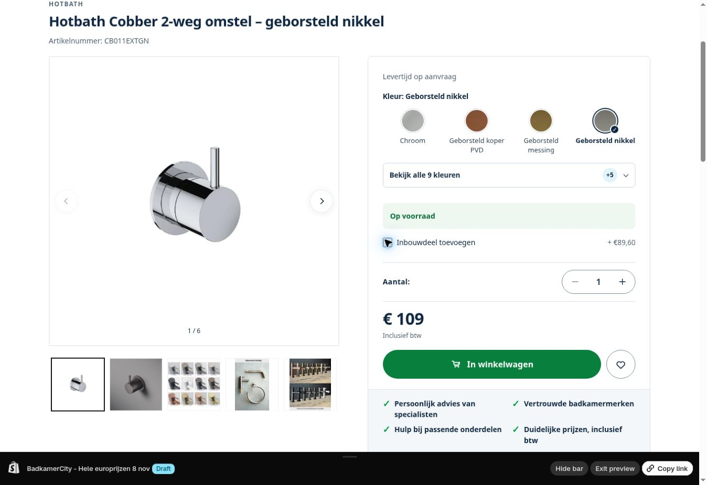

# Hele europrijzen en drie pictogramverwijzingen

> **Nacontrole 9 november — OWNER_PUBLISHED_VERIFIED:** eigenaar publiceerde 196368531722 en controleerde het beeld. Alle 1.390 MAIN-checksums zijn gelijk aan het laatst geteste eindconcept, inclusief de 24 oorspronkelijke prijspaden plus drie latere zoek-/LiquidDoc-paden. De eerder genoemde publicatieactie is hiermee afgehandeld. [Volledige nacontrole en bronreconciliatie](../../2026-11-09/published-source-sync/README.md). De oorspronkelijke 8-novembermetingen hieronder blijven behouden; geen herhaalde prijswrite.

> **Vervolg 9 november:** het bestaande concept is uitgebreid met prijsopmaak en Vanaf in zoeksuggesties, leesbare fotoloze rijen en een gecorrigeerd JEE-O-LiquidDoc-contract. De huidige release heeft 27 bedoelde paden. De 24-padenmetingen hieronder beschrijven de oorspronkelijke prijsronde van 8 november. Volg voor de huidige publicatiestap en nacontrole [het nieuwe dossier](../../2026-11-09/predictive-search-prices/README.md).

8 november 2026 · PRICE-ROUND-01 / BC-AUD-012 · ADMIN_APPLIED_VERIFIED / THEME_PREVIEW_VERIFIED

Codecheckpoint: [`12a98b15a711f656e897ea5afcd99c0e270fcadf`](https://github.com/jlamping1997/badkamercity/commit/12a98b15a711f656e897ea5afcd99c0e270fcadf).

De eigenaar koos normale afronding van verkoopprijzen boven €100. **3.335 prijzen zijn aangepast en volledig teruggelezen.** De presentatie zonder lege centen en de pictogramcorrectie staan in **UNPUBLISHED 196368531722 — BadkamerCity - Hele europrijzen 8 nov**. MAIN blijft **196354474250 — BadkamerCity - Mobiele productlijst 8 nov**, door de eigenaar gepubliceerd. Er is geen MAIN-filewrite of publicatie uitgevoerd.

## Prijsdata

| Groep | Uitvoeringen | Resultaat |
| --- | ---: | --- |
| Normaal omhoog afgerond | 1.222 | Verkoopprijs naar hele euro |
| Normaal omlaag afgerond | 2.113 | Verkoopprijs naar hele euro |
| Boven €100 en al heel | 8.635 | Behouden |
| Tot en met €100 | 1.995 | Behouden |
| m²-/doosgeprijsde tegels | 3.496 | Beide prijsbases/calculator behouden |
| Totaal | 17.461 | 15.897 ACTIVE + Online Store-producten |

Voor m²-tegels is geen keuze tussen m²- en doosafronding ontvangen; daarom zijn ze in deze ronde uitgesloten. Gewone verkoopprijzen volgen ROUND_HALF_UP, maximaal €0,50 verschil. Alleen variant-id en nieuwe verkoopprijs zijn naar productVariantsBulkUpdate verstuurd; adviesprijs, bronprijzen, voorraad, status, publicatie, identiteit en relevante eenheidsmetadata zijn behouden. Er waren geen adviesprijsconflicten of overgeslagen mutatieconflicten.

Eerst vijf echte proefartikelen, daarna 49 begrensde mutatiebatches. Iedere batch had een verse prijs-/identiteitscontrole en aparte readback. De onafhankelijke eindcontrole las alle 17.461 oorspronkelijke uitvoeringen in 88 nodes-queries terug: 3.335 nieuwe doelprijzen, 14.126 ongewijzigde prijzen en nul afwijkingen in gecontroleerde metadata. De mutatieplanning is bovendien vergeleken met het decimale plan. [Geaggregeerde eindcontrole](price-verification.json).

Een privéback-up is vóór de eerste mutatie opgeslagen; versie 1 bevat 57 bestanden met oorspronkelijke prijzen, exacte apply-/rollbackvariabelen, wijzigingslijst, proef- en batchlogs en eindcontrole. Geen volledige catalogus-/prijsdump in deze publieke repository. Een ongebruikte read-only bulkexport leverde geen bruikbaar resultaat; geblokkeerde getekende downloadlinks zijn niet opgehaald of omzeild. De gewone toegestane paginering/nodes-reads vormden het bewijs.

Het [prijscontract](../../../PRICING_POLICY.md) maakt onderscheid tussen werkelijke prijsafronding en geldopmaak. Echte centen worden nooit verborgen. De zes JS-consumenten zijn externe kaarten/filters, wishlist, Hotbath mobiel, inbouwdeel, accessoires en Sunshower-totalen. Native prijs-/zoekkaartmarkup, PDP, productregels in cart/drawer en bestaande product-/accessoirepartials gebruiken dezelfde Liquid-helper. Tegelcalculators, orderdata en checkout zijn niet herschreven.

## Thema en kleine patch

Het bestaande concept miste exact de vijf bestanden van het gepubliceerde mobiele ontwerp. Die zijn eerst vanuit bewezen MAIN-bytes gelijkgetrokken; daarna volledige 1.388/1.388 manifestpariteit. De 24 featurepaden zijn pas daarop toegepast. Twee oude Git-bodies, main-product en main-sunshower, zijn eerst uit MAIN teruggelezen; bestaande tijdelijke voorraadpresentatie is behouden. Dit sluit geen andere historische Git/live-verschillen.

Eindstand: MAIN 1.388 bestanden, alle checksums ongewijzigd; concept 1.390 bestanden, **exact 24 bedoelde featureverschillen**, nul onverwachte paden. De twee extra bestanden zijn de gedeelde geldhelpers. Alle 24 conceptchecksums komen exact overeen met lokale bronbytes. De settings_data.json-bodyuitzondering blijft zichtbaar; dit bestand is niet geschreven. [Pariteit](theme-parity.json), [featureverschillen](theme-differences.json), [24 readbacks](feature-verification.json), [MAIN](main-manifest.json), [concept](draft-manifest.json).

BC-AUD-012: één verwijzing naar icon-error in main-password-header en twee naar icon-3d-model in product-media hadden geen .svg-uitgang. Ze verwijzen nu naar de bestaande assets. Alle letterlijke inline_asset_content-afhankelijkheden opnieuw gecontroleerd: **drie ontbrekend vóór, nul na**. Dit is een bronfix in het concept; geen bewezen live password-error-/3D-klantfout claimen. [Afhankelijkheidscontrole](inline-asset-check.json).

## Controle en grenzen

- [31 prijscontroles](checks.json): daadwerkelijke Liquid-helper/native prijssnippet, 168 JS-valuta-/grenscombinaties en volledige externe JS met synthetische netwerkdata; hele bedragen, echte centen, Vanaf-label, adviesprijs, m²/doos en veilige fallback. Shopify money-filters in de offline Liquid-fixture zijn met Intl nagebootst.
- 26 bestaande mobiele kaartcontractcontroles opnieuw PASS; [officiële Shopify-validator](theme-check.json) zonder errors en JS-syntax PASS. Waarschuwingen staan volledig in het resultaat; geen algemene nul-waarschuwingenclaim.
- [Echte Chrome-preview](browser-checks.json): 24 externe onderkastkaarten zonder ,00; kleur Mat zwart → Licht eiken met passende productlink/€820; wishlist 0→1→0 en €820; CB011EXTGN €109, optioneel onderdeel €89,60, totaal €198,60 en na uitzetten terug €109. Geen cart-/orderwrite. Previewbalk bevestigde het juiste concept. Screenshot hieronder.
- [Volledige openbare prijsindexcontrole](index-price-check.json): 253 pagina’s, 15.155 unieke producten, nul verschillen met de actuele Shopify-minimumverkoopprijzen. Generatie bc_sync_20261108t230100_d4a460 vóór/na gelijk; 3.315 afgeronde producten in deze bestaande zoekscope, twintig daarbuiten. Die twintig hebben wel de bewezen juiste Shopify-prijs; geen automatische wijziging van hun zoekdekking. Geen serverwrite; een eerdere oude proefprijs is na de reguliere indexverversing correct.
- Google-feedovername, volledige fysieke telefoon-, checkout-, payment-, purchase-, consent-, mailbox- en echte 3D/password-errorproef blijven NOT_TESTED.

Herhalen: gebruik de bestaande actieve codebranch, open dit dossier en voer npm install --ignore-scripts en npm test uit met Node24. De testfixture gebruikt de bron onder shopify/current; een historische main-checkout is geen passende themabron.

## Documentatie en herstellen

MOBILE-CARDS-01 stond nog als UNPUBLISHED/te publiceren. Verse rollen en de vijf oorspronkelijke mobiele hashes bevestigen de eigenaarspublicatie; het mobiele dossier, componentcontract, naslagwerk en centrale ingangen zijn aangepast. Het oude MAIN 196368531722 is nu dit nieuwe prijsconcept en is dus geen onaangeroerd mobiel-rollbackdoel meer. Ook de beschreven filter-time-out is gecorrigeerd van twaalf naar de daadwerkelijk gelezen zes seconden.

Voor prijsherstel: gebruik de privérollbacklijst uitsluitend wanneer de actuele prijs nog de door deze ronde geschreven doelprijs is; sla latere handmatige wijzigingen over. Een thematerugzetting herstelt geen productprijzen. Voor de presentatie blijft het huidige MAIN intact zolang dit concept niet wordt gepubliceerd. Gerichte code-rollback staat onder rollback/ voor de 22 gewijzigde bestaande bestanden; layout terugzetten ontkoppelt de twee nieuwe helpers. Geen blinde settings- of volledige catalogusupload.

**Eén volgende handeling:** eigenaar beoordeelt en publiceert **BadkamerCity - Hele europrijzen 8 nov** via Shopify → Webshop → Thema’s. Daarna verse MAIN/24-file-nacontrole. De verkoopprijzen zelf zijn al live. Native-policy-/btw-/mail-/meet-/fysiekmobiel- en afzonderlijke BRAUER-/Cotto-/filterholds blijven behouden. Geen actieve schrijver na overdracht.
