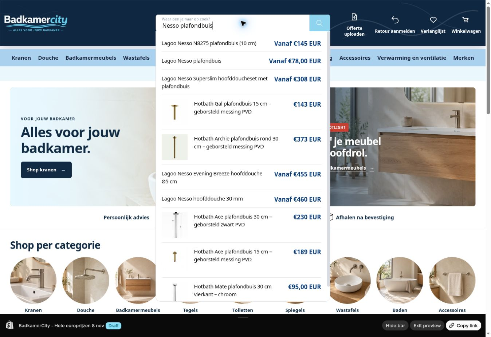

# Zoeksuggesties: duidelijke vanafprijs en leesbare titels

9 november 2026 · PREDICTIVE-PRICE-01 / DOC-SEARCH-01 · FIXED_UNPUBLISHED / PREVIEW_VERIFIED

Codecheckpoint: `4ad770d298506780957dc83f8e387c19f6a75964`.

De snelle zoeklijst gebruikte nog de prijs van de geselecteerde/eerste variant, zonder Vanaf-label en buiten de gedeelde geldopmaak. Daardoor bleef bijvoorbeeld €145,00 zichtbaar terwijl het bestaande prijsconcept elders €145 toont. Bij producten met verschillende uitvoeringsprijzen ontbrak de uitleg dat dit een vanafprijs is.

De suggesties gebruiken nu product.price_min en het bestaande vertaalde Vanaf-label wanneer product.price_varies waar is. De gedeelde bc-money-helper verzorgt de notatie: werkelijk hele EUR-bedragen vanaf €100 zonder lege decimalen; echte centen, bedragen onder €100 en andere valuta behouden hun bestaande precisie. Productprijzen, voorraad en publicaties zijn niet aangepast.

In dezelfde lijst kwam een titel zonder foto in de smalle eerste gridkolom terecht. De titel benut nu de ruimte van de lege foto- en tekstkolom samen; de prijs krijgt zijn eigen passende kolombreedte. Rijen met een foto behouden hun foto-/titel-/prijsvolgorde. Er zijn geen afbeeldingen toegevoegd, ook niet bij Lagoo.

## Bestaand concept behouden

**MAIN 196354474250 — Mobiele productlijst8nov** blijft volledig ongewijzigd: 1.388 bestanden. De aanpassing staat in het bestaande **UNPUBLISHED 196368531722 — BadkamerCity - Hele europrijzen 8 nov**. Er is geen nieuw thema gemaakt en niets gepubliceerd.

De volledige conceptmeting vóór de wijziging kwam overeen met alle 1.390 bestanden uit het vorige prijscheckpoint. Daarna zijn precies drie bestaande bestanden gewijzigd. Het concept heeft nog steeds 1.390 bestanden en nu **27 bedoelde verschillen met MAIN**: de 24 eerdere prijspaden plus deze drie. De mobiele lijst, bestaande prijswijzigingen en overige conceptinhoud zijn behouden. settings_data.json is niet geschreven.

| Bestand onder shopify/current | Aanpassing |
| --- | --- |
| sections/predictive-search.liquid | Minimumprijs, voorwaardelijk Vanaf-label en gedeelde geldopmaak |
| assets/component-predictive-search.css | Prijskolom past bij de tekst; titel zonder foto gebruikt twee kolommen |
| snippets/bc-jeeo-colors.liquid | Alleen LiquidDoc: section is vereist voor de PDP-switcher, niet voor card-modus |

[Volledige MAIN-basis](main-before.json), [volledige conceptbasis](draft-before.json), [eindpariteit en drie readbackchecksums](theme-parity.json). De drie opgeslagen bronbytes zijn exact tegen de laatste Admin-checksums gecontroleerd.

## Wat is gecontroleerd

- [17 gerichte controles](checks.json) voeren de echte Liquid-sectie en geldhelper uit. Onder meer een duurdere geselecteerde variant tegenover de minimumprijs, gelijke variantprijzen, Vanaf/From, EUR/GBP/USD, echte centen, €0, lege resultaten, veilige titels, unieke toetsenbord-ID’s en ongewijzigde markup buiten de prijs. De Shopify money-filters zijn in de offline fixture nagebootst met Intl.
- [Shopify-validatie](theme-check-r2.json): alle drie gewijzigde bestanden zonder fouten. De consument bc-card-product-search is meegecontroleerd; de onterechte waarschuwing over een ontbrekend section-argument is verdwenen. De bestaande has_specs-waarschuwing blijft zichtbaar en is niet herschreven.
- [Echte Chrome-preview](browser-checks.json): Nesso plafondbuis toont nu **Vanaf €78,00 EUR**; een actuele Admin-read bevestigt zestien varianten van €78 tot €215. Andere regels tonen onder meer Vanaf €145 EUR, €143 EUR en €95,00 EUR. Tien rijen met en zonder foto gecontroleerd: geen titel-/prijsoverlap, fotoloze titelbreedtes 280–295px, met foto 244–247px. ArrowDown selecteerde één optie met passend aria-activedescendant; Escape sloot de lijst. Geen cart- of productwrite.

Geen nieuwe fysieke telefoon-, checkout-, betaal-, mailbox-, GA4-purchase- of Google-feedcontrole. De CSS bevat de bestaande mobiele breakpointaanpassing; dit is geen fysieke mobiele vrijgave.

Herhalen: gebruik de actieve codebranch, voer in dit dossier npm install --ignore-scripts en npm test uit met Node24. De fixture gebruikt de bron onder shopify/current. De dependency kan voor een bestaande lokale installatie via BC_TEST_DEPENDENCIES worden aangewezen.

## Documentatie die is rechtgezet

De LiquidDoc van bc-jeeo-colors verklaarde section altijd verplicht, hoewel card-modus dit object helemaal niet gebruikt. Dat contract is nu voor beide modi correct; alle runtimebytes ná de LiquidDoc zijn gelijk gebleven.

De statische componentindex beschreef geen directe JSON-template-aanroep en liet daardoor de indruk open dat predictive-search niet actief was. De actuele route staat er nu bij: header → predictive-search.js → /search/suggest met section_id=predictive-search. De componentmatrix en het prijscontract noemen deze consument ook expliciet.

De oude auditmelding over vijftien Git/live-verschillen was een gedateerde telling. [De verse bronvergelijking](source-parity-summary.json) onderscheidt 25 bedoelde wijzigingen in gedeelde bestanden plus twee nieuwe helpers van **tien overige bestaande bronverschillen**. Deze tien blijven open voor gerichte reconciliatie. Negen bestanden bestaan alleen live; .shopifyignore en de settings_data-bodyuitzondering blijven beschermd. Het nieuwe dossier schrijft geen algemene deploy vanuit Git voor.

## Herstellen en vervolg

Gerichte rollback: de drie oorspronkelijke bestanden staan onder rollback/. Zet alleen die terug op het actuele UNPUBLISHED concept na controle op latere wijzigingen. Het bestaande prijsconcept en zijn geldhelper blijven samen één release; kopieer de nieuwe zoeksectie niet afzonderlijk naar een thema zonder die helper. Een thematerugzetting verandert geen productprijzen.

**Eén volgende handeling:** eigenaar beoordeelt en publiceert **BadkamerCity - Hele europrijzen 8 nov** via Shopify → Webshop → Thema’s. Daarna de actuele MAIN en de 27 bedoelde featurepaden opnieuw controleren. De tien overige bronverschillen en bestaande native-policy-/btw-/mail-/meet-/Cotto-/BRAUER-/filterholds blijven apart open. Geen actieve schrijver na overdracht.

Officiële context: [Liquid predictive_search](https://shopify.dev/docs/api/liquid/objects/predictive_search).
