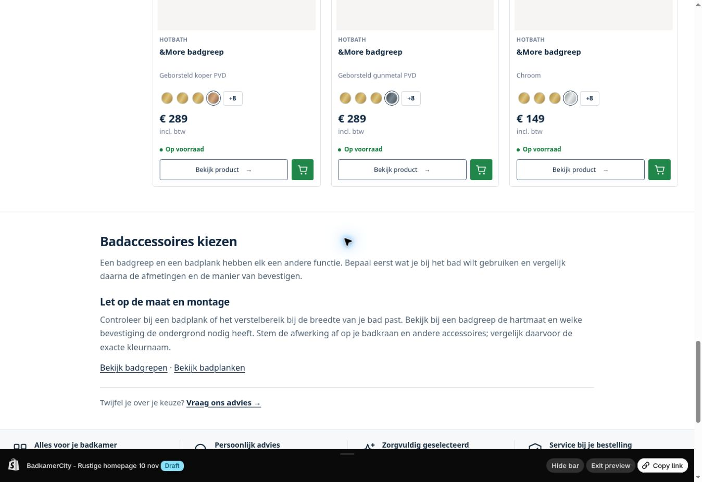

# Categorieverbeteringen — 10 november 2026

CATALOG-UX-01. Thema: **PREVIEW_VERIFIED / OWNER_PUBLICATION_PENDING**. Cinto-data: **ADMIN_APPLIED_VERIFIED / FILTER_INDEX_PENDING**. Gunmetal en nieuwe productvolgorde: **SERVER_PACKAGE_PREPARED / NOT_DEPLOYED**.

## Reviewdoel

Bestaand concept **196395073802 — BadkamerCity - Categorieverbeteringen 10 nov**. MAIN **196416504074 — BadkamerCity - Merkenbalk zonder pijlen** is behouden. Geen nieuwe themakopie, MAIN-filewrite, settings_data-bodyread/-write of publicatie.

Het eerdere rustige homepageconcept blijft in hetzelfde concept zitten. De eigenaar beoordeelt/publiceert dus één gecombineerde preview, met behoud van de merkenbalk en m²-prijsweergave.



## Themawijziging

- Tweede foto activeert op het beeldvlak; titel, prijs en kaartvlak activeren hem niet. Zowel externe collectiekaarten, native kaart-CSS als zoekkaarten aangepast. Beeldvlakken liggen boven de bestaande volledige kaartlink, zodat klikken en hover elkaar niet blokkeren. Coarse pointers krijgen geen sticky hover.
- De drie genummerde generieke adviezen en grote contactbanner zijn vervangen door één leesbare tekstkolom en een compacte advieslink. Bestaande onderste `[SPLIT]`-inhoud en extra beheertekst blijven behouden. De categoriehub rendert zijn eigen tekst eenmaal. Bestaande kranen-FAQ blijft behouden.
- Badaccessoires en Badgrepen hebben een korte relevante terugvaltekst, in NL/EN. Niet iedere lege categorie krijgt generieke vulling.
- Gunmetal heeft een eigen koele metaalgradient, ook bij spatie/koppelteken en PVD-afwerking. De afzonderlijke filterwaarde zelf wacht op de serverupdate.
- Alleen contact_address in footer-group gewijzigd naar Retouradres / Badkamercity / Zichtenburglaan 150 / 2544 EB Den Haag. Harry Suiker en de afspraakvoorwaarde staan niet meer bij dit retouradres. Andere footerinstellingen en retourbeleid niet gewijzigd.

Precies tien functiepaden:

```
assets/component-card.css
assets/bc-product-cards.css
assets/bc-external-filters.css
assets/bc-external-filters.js
assets/bc-collection.css
sections/bc-collection-advice.liquid
sections/main-search.liquid
sections/footer-group.json
locales/nl.json
locales/en.default.json
```

Bronbaseline Git `bbe6245a7bbbd41e9e5e417bcef30e9c398b270a`, branch fix/product-cards-2026-10-14, map shopify/current. Alle tien oorspronkelijke lokale bodies waren gelijk aan het concept bij aanvang. De eerste preview bevatte al vier bewuste homepageverschillen tegenover MAIN; die zijn behouden.

## Cinto-breedtes

Officiële Wiesbaden-bronnen bevestigen [38.4177 / 60 cm](https://www.wiesbaden.nl/cinto-spiegel-rond-met-band-led-dimbaar-en-spiegelverwarming-60-cm-mat-zwart-38-4177.html) en [38.4178 / 80 cm](https://www.wiesbaden.nl/cinto-spiegel-rond-met-band-led-dimbaar-en-spiegelverwarming-80-cm-mat-zwart-38-4178.html). De band is 3 cm breed. Die bandmaat stond onjuist in custom.breedte_mm en in het historische filtermanifest.

Vier gerichte metafieldwrites met digestcontrole: custom.breedte_mm en de bestaande beoordeelde bc_filters.breedte_mm-override per artikel naar respectievelijk 600 en 800 mm. Bestaande definities hergebruikt. Na write beide records en alle overige aanwezige metafields, producttitel, handle en SKU/variantidentiteit exact teruggelezen: alleen de bedoelde vier velden gewijzigd/toegevoegd. Prijs, keuzegroepen en complete_specificaties behouden.

Het oorspronkelijke bc_data.filter_manifest blijft als historische bron intact; de bestaande filterpipeline geeft bc_filters prioriteit. De oorspronkelijke manifesthashconventie kon niet onafhankelijk worden gereconstrueerd, daarom is geen nieuwe schijnbaar gecontroleerde manifesthash geschreven. De nieuwe serverrelease controleert de resulterende indexmaten en weigert activering bij 30 mm. Dit is nog geen bewezen livefiltercorrectie.

[Voorwaarden vóór wijziging](mirror-width-before.json), [exacte vier writes](mirror-width-change.json), [Admin-nacontrole](mirror-width-verification.json). Herstel: alleen de twee custom-waarden uit de herstelgegevens terugzetten en de door deze taak toegevoegde bc_filters-overrides verwijderen nadat hun huidige waarde/digest nog overeenkomt. Geen bestaande manifesten of andere keuzes overschrijven. Daarna opnieuw indexeren en controleren.

## Tests en bewijsgrenzen

- 14 nieuwe Liquid-/weergave-/locale-/footercontractchecks PASS.
- 31 bestaande kaartprijs-/foutterugvalchecks PASS.
- Shopify-validator: alle tien gewijzigde paden zonder fouten na revisies. Drie bestaande main-search-waarschuwingen over ongebruikte argumenten/variabele blijven zichtbaar; geen nieuwe vrijgave van die ongebruikte code. Officiële lokaal beschikbare schemas gebruikt nadat schema-ophalen terugviel.
- Nieuwe serverlogica: 25 geïsoleerde tests PASS, waaronder kleurvarianten, niet-Gunmetalpariteit, deterministische rang, afwisseling, paginering, beeld-/datacompleetheid, Cinto-gates, herstelbaarheid en ongewijzigde API-hash. 55 bestaande lifecycle-mocktests PASS. Geen echte nieuwe serverindex/-activering getest vanuit deze omgeving.
- Echte Chrome: kaarttekst-hover laat hoofdfoto staan; beeld-hover activeert de tweede foto; terug naar titel herstelt. Onderste inhoud rustig weergegeven. Kranenhub heeft de specifieke tekst eenmaal en drie bestaande FAQ’s. Footeradres zonder Harry Suiker gecontroleerd. Native fallback heeft 24 kaarten en geen overloop; alle bekeken native kaarten hadden hoogstens één afbeelding, dus geen tweede-foto-visuele proef daar.
- Fysieke telefoon/touch, checkout, mailbox en performance NOT_TESTED. Geen formulier of winkelwagen verstuurd.

[Thema-pariteit en tien exacte bodyreadbacks](theme-parity.json): beide thema’s 1.401 files; MAIN integraal ongewijzigd; 1.389 gelijk en exact 12 verschillen (tien functiepaden plus de behouden homepagewijzigingen, met overlap in locales). [Browsermetingen](browser-check.json).

## Server en volgende handeling

Eén voorbereid [serverpakket](../../../filters/gunmetal-2026-11-10/README.md) voor afzonderlijke Gunmetal-selectie, stabiele aanbevolen productmix en controle van de twee gecorrigeerde spiegelmaten. SSH vanuit deze omgeving geeft Network is unreachable; geen serverwrite uitgevoerd. De volledige staging-/indexreadback-/API-/activerings-/herstellifecycle van de bestaande release wordt hergebruikt. Nieuwe code wordt pas als geïnstalleerd gemarkeerd na alle echte serverchecks.

**Volgende handeling:** eigenaar voert het vastgepinde PowerShell-pakket uit en deelt de uitvoer voor de publieke nacontrole. Thema beoordelen/publiceren blijft daarna een afzonderlijke eigenaarshandeling.

## Terugzetten van alleen de themafeature

Haal de tien genoemde bestanden uit shopify/current op baselinecommit bbe6245 en upload alleen die paden naar hetzelfde UNPUBLISHED-concept, na controle dat geen latere wijziging wordt overschreven. Die baseline bevat het eerdere rustige homepageconcept; geen volledige oude reserve uploaden en geen settings_data-body gebruiken. Publicatie en productdata zijn afzonderlijke handelingen.

## Planning die bij deze opdracht hoort

[Categorieboom en samenvoegvoorstellen](../../../categorization/2026-11-10/PLAN.md), [titelbatches en twaalf echte voorbeelden](../../../product-content/2026-11-10/TITLE_PLAN.md), [merkpagina’s met vijf HTML-voorbeelden](../../../brands/2026-11-10/PLAN.md), [Mondiaz later toevoegen](../../../imports/mondiaz/PLAN.md). Geen categorie-/URL-/titel-/SEO-massamutatie uitgevoerd. De Wiesbaden-keuzedata en de andere SEO-werkstroom blijven behouden.
