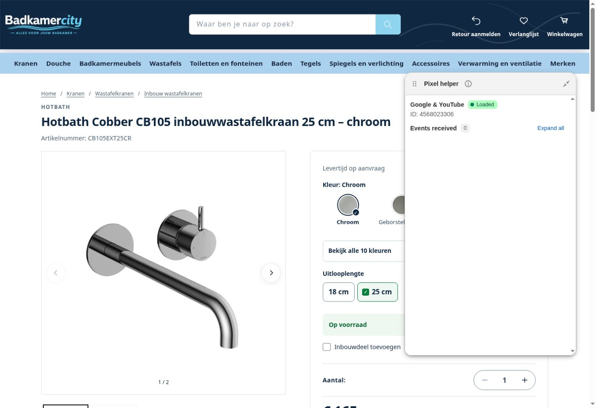

# Nacontrole na publicatie en bestaande Google Ads-tag

## 10 november 2026 — native instellingen en Pixel Helper gecontroleerd

Status: **NATIVE_SETTINGS_VERIFIED / MEASUREMENT_NOT_VERIFIED**. De eigenaar heeft de Shopify-aanmelding afgerond. Daarna zijn de bestaande instellingen read-only bekeken; er is niets opgeslagen of omgezet.

De officiële Google & YouTube-app toont Conversiemeting Aan en Verbeterde conversies Aan. Het Google-tagscherm koppelt GTM-TD8PCWDJ aan Ads-bestemming **AW-18563606782**; GA4 en Merchant Center hebben hun eigen bestaande native tags. Afrekenen afgerond staat op **Selecteren uit het gekoppelde account → Google Shopping App Purchase**. De optie voor een aangepaste conversie-ID/label staat uit. Ook begin checkout, add to cart, page view, view item, search en add payment info zijn aan hun bestaande Google Shopping App-acties gekoppeld. Alleen inspectie: de bewerkmodus is geannuleerd, niet opgeslagen.

Onder Klantgebeurtenissen is één Google & YouTube-apppixel aanwezig. Gegevenstoegang staat op Geoptimaliseerd en Toegang ingeschakeld. De privacy-instellingen tonen een geautomatiseerde cookiebanner voor Nederland. Geen privacyinstellingen aangepast, geen toestemming afgeleid uit alleen dit instellingenbeeld.

De officiële Shopify Pixel Helper is via Meer acties → Testen geopend. Voor pixel4568023306 staat **Loaded** met **Events received 0**. Dat is op de homepage, na doorklikken naar Kranen en op het bestaande Hotbath-CB105EXT25CR-product teruggelezen. De productpagina gaf isMerchantRequest:false in de openbare bootstrap, een aanwezige native pixelconfiguratie en privacy-bannerscript; er stond geen cookiebanner in die testsessie. Geen 'awaiting consent'-melding in de helper waargenomen. De precieze toestemmingstoestand en het uitblijven van gebeurtenissen zijn hiermee nog niet verklaard. Geen testbestelling of gefingeerde purchase verstuurd. Browserlog bevatte in de gecontroleerde laatste regels uitsluitend extensiemetadatafouten, geen bewezen Google-pixeloorzaak.

Dit is een beperkt runtimebewijs. **Loaded is geen bewijs dat Google Ads meetgegevens ontvangt.** Nul helpergebeurtenissen in deze sessie is evenmin voldoende om een algemene storing voor alle bezoekers of een specifieke consentfout vast te stellen.

Google Ads zelf gaf na de aanmeldflow een expliciete weigering voor AI-agenttoegang. Deze browserroute is gestopt en de blokkade is gemeld. Er zijn geen alternatieve Ads-routes of andere accounts geprobeerd. De details van de eigenaarsmelding **Setup measurement**, de geselecteerde campagneconversie en de privé-ontvangststatus blijven daardoor onbekend.

**Benodigde volgende input:** detailscherm onder Setup measurement, inclusief naam/bron/status van de bedoelde conversie. Een screenshot of exacte tekst volstaat. Pas daarna gericht de campagnebestemming, tagdiagnose en toestemming/ontvangst vergelijken; niet willekeurig een extra headtag plaatsen, de app opnieuw koppelen of privacybescherming verruimen.

Officiële uitleg voor de uitgevoerde test: https://help.shopify.com/en/manual/promoting-marketing/pixels/app-pixels . Browserbeperking: https://help.openai.com/articles/20001280-using-cloud-browser-in-chatgpt#when-a-website-blocks-the-task .

---

Datum: 10 november 2026. Bron: verse Shopify-/GitHub-reads en echte Chrome DOM-controle, zonder thema-preview.

## Resultaat

De vorige chat is veilig opgeslagen: codecheckpoint `7b7260fd613e9cc16e7e60efbab41ea4d4707fe1`, documentatiecheckpoint `ef0131d0d1cd0c105bcfeb568b632fa33a91a4e6`. MAIN is nu **196395073802 — BadkamerCity - Categorieverbeteringen 10 nov**; de voormalige MAIN196416504074 is UNPUBLISHED. Alle twaalf recente categorie-/homepagefiles hebben dezelfde checksums als het geteste concept. Er is voor die bestaande themawijzigingen niets meer te publiceren. Nieuwe themapublicatie noch winkelmutatie is door deze nacontrole uitgevoerd.

## Google-tag

De eigenaar leverde Ads-ID **AW-18563606782** en de standaard gtag.js-headsnippet. Rechtstreeks opnieuw toevoegen is niet gekozen, omdat de bestaande officiële Google & YouTube-koppeling dezelfde Ads-bestemming al bevat.

- Channelapp: Google & YouTube, app-ID1780363; dit is met aparte volledige CHANNEL-paginering gecontroleerd. De gewone appInstallations-lijst alleen sluit saleschannels niet in en mag hiervoor niet als afwezigheidsbewijs dienen.
- Live openbare apppixel:4568023306, typeAPP, apiClientId1780363; precies één vermelding per gecontroleerde pixelconfiguratie.
- Homepage: https://badkamercity.nl/ ; www.badkamercity.nl stuurt hierheen. Geen previewframe.
- Tweede pagina: https://badkamercity.nl/collections/bad-accessoires ; preview expliciet verlaten vóór de controle.
- Ads-bestemming AW-18563606782 en GA4G-H9YFB5TC6N aanwezig. De openbare native configuratie bevat onder andere page_view, view_item, add_to_cart, begin_checkout en purchase-koppelingen. De purchase-configuratie verwijst naar dezelfde Ads-ID.
- Geconfigureerde Google-tagcontainer-ID's: GTM-WPNHKXXR, GTM-TD8PCWDJ, GTM-TFTPNSTW. Deze native configuratie is behouden; geen willekeurige verwijdering of omzetting naar extra thematag.
- De theme-layout bevat geen aparte handmatige Google-tag. De native koppeling injecteert haar pixelconfiguratie via Shopify; zoeken naar uitsluitend een losse gtag.js-scriptnode is daardoor onvoldoende bewijs voor afwezigheid.

Dit bewijst **configuratie in de live storefront**, niet dat Google Ads een bezoek/conversie heeft ontvangen. Geen testbestelling, betalingsactie, ontvangstrapport, volledige netwerktrace of consentproef uitgevoerd. Geen claim dat de melding in Google Ads al is verdwenen. De rechtstreekse Admin-webPixel-read meldt ontbrekende read_pixels-scope; de appinstellingen in de browser vragen om Shopify-inloggen. Er is geen nieuw recht aangevraagd en geen accountwijziging gedaan. Google Ads-tagdiagnose en de bestaande koop-/consentproef blijven open.

Google adviseert de officiële Google & YouTube-route en het vermijden van dubbele tags:

- https://support.google.com/google-ads/answer/16030792?hl=en
- https://support.google.com/google-ads/answer/13494537?hl=en

## Filterserver en eerdere plannen

De publieke healthroute https://vps-7ffd625d.vps.ovh.net/verified/health gaf HTTP200, ok=true, versie0.4.0,227profielen en generatiebc_sync_20261110t000044_d72de7. Dit bewijst bereikbaarheid, niet de nieuwe release. Een losse zoekprobe zonder de geconfigureerde routeprefix gaf404 en is geen functionele filtertest. Gunmetalclassificatie, aanbevolen productmix en Cinto-indexcontrole blijven wachten op het vastgepinde [installatiepakket](../../../filters/gunmetal-2026-11-10/INSTALL.md). De twee Admin-spiegelbreedtes zijn in het eerdere dossier hersteld; nieuwe indexcorrectheid wordt pas na installatie geclaimd.

De [categorie-/titel-/merkenplannen](../../../categorization/2026-11-10/PLAN.md) en [Mondiaz-backlog](../../../imports/mondiaz/PLAN.md) zijn opgeslagen. Niet-opgestarte plannen zijn geen live aanpassing. Andere Wiesbaden-/SEO-werkstromen zijn niet gewijzigd.

## Vervolg

Eén volgende handeling voor de bestaande catalogusrelease: eigenaar voert het vastgepinde filterserverblok uit en deelt de uitvoer. Daarna publieke nacontrole. Voor Google blijft aanvullend ontvangstbewijs via Google Ads-tagdiagnose en een gecontroleerde echte purchase-/consentproef nodig; geen tweede headtag plaatsen zolang de native Ads-bestemming aanwezig is.
