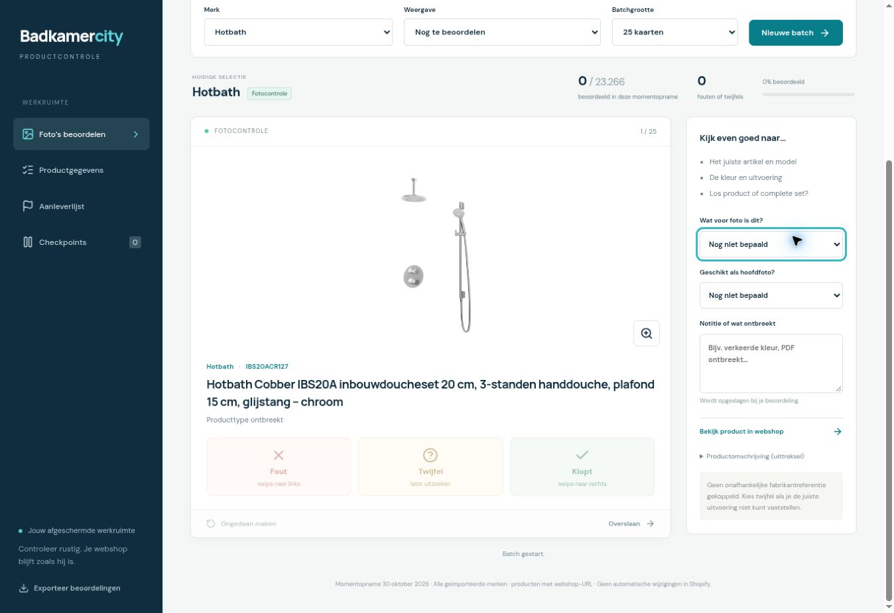

# QC-02 — mobiele productcontrole

30 oktober 2026 · **PRIVATE_DEPLOYED / CATALOGUE_VERIFIED / AUTHENTICATED_PHONE_REVIEW_PENDING**.

[Open de privétool](https://badkamercity-quality.jason015.chatgpt.site). Toegang staat uitsluitend op het bestaande eigenaarsaccount; geen uitnodigingen/groepen toegevoegd. Meld aan met ChatGPT. Geen Shopify-thema, product, prijs, voorraad, publicatie of sortering gewijzigd.

## Opgeleverd

- Per merk foto’s en productgegevens beoordelen; batches25/50; Cobber/Caral als eerste werkselectie op huidige titel, zonder kwaliteitsclaim of automatisch serieattribuut.
- Links/fout, rechts/klopt, twijfel, overslaan, undo, fotovergroting, fototype, hoofdfotogeschiktheid en notities. Knoppen bieden een alternatief voor gestures.
- Productchecklist identiteit, specificaties, PDF, omschrijving en onderdelen; geen volledige goedkeuring zonder complete checklist.
- Directe bevestigde D1-opslag per eigenaar, revisieconflicten, idempotente actie-ID’s en historie. Geen offline wachtrij; bij onbevestigde opslag blijft de kaart staan. Niet als opgeslagen presenteren vóór bevestiging.
- Named checkpoints bewaren merk, controletype, batch en positie. Hervatten is een bladwijzer, geen terugdraaiing van nieuwere oordelen. Op dit moment onopgeslagen kaartnotities vallen erbuiten.
- Aanleverlijst voor fout/twijfel/ongeschikte huidige hoofdfoto en ontbrekende foto; JSON-export van beoordelingen/checkpoints.

## Brondekking

Volledige gepagineerde active-inventaris: **11.679 producten / 34.713 afbeeldingen** met een huidige Shopify-webshop-URL. 8.236 Hotbath /23.266afbeeldingen, 2.451Wiesbaden/6.585,277THE MOSAIC FACTORY/1.084,273JEE-O/766,104Sunshower/358,337Porcelanosa/2.649,1bestaand BadkamerCity Test-artikel/5. Alle media-/variantverbindingen hebben hasNextPage=false. Geen ontbrekende pagina’s als 'klaar' behandeld.

**645 Hotbath-producten hebben geen foto**; automatisch op aanleverlijst, niet verstopt in de swipestapel. Geen automatische foutcorrectie of publicatiewijziging.

Gedateerde werkkopie, geen live synchronisatie, tweede masterregister of nieuwe fabrikantbron. Bestaande registers/verrijkingsresultaten blijven brononderzoek dragen. Geen onafhankelijke foto-/kleur-/setcontrole uitgevoerd. Geen fotorechten, PVD, materiaal, sterkte, compatibiliteit, beschikbaarheid of conversie bewezen. Webshop-URL’s niet allemaal individueel in browser geopend. SHA-256 van metadata/URL/datum is geen hash van de beeldbytes; gelijkblijvende URL/mediadatum met gewijzigde bytes blijft een open grens.

## Architectuur en opslag

Sites/Vinext-worker met private platformtoegang, ChatGPT-gebruiker en D1-tabellen qc_reviews en qc_checkpoints. Servercontrole op identiteit/eigenaar, same-origin POST, invoer, actuele items, revisions en dubbele aanvragen. Geen Admin-token of willekeurige connectorproxy in browser. Beoordelingen, notities, checkpoints en eventuele eigenaarsgegevens nooit naar publieke Git.

Complete deploymentbron inclusief gedateerde catalogus staat in private Sites-bronrepo; publieke reviewbare code onder review-app, met importoverzicht en herstelinstructies. Volledige productwerkkopie niet opnieuw als openbare mastercatalogus gecommit. Het ontbreken van data/catalogue.json in de publieke spiegel is expliciet gedocumenteerd; herstel de private bron of voer een nieuwe volledige read-only import uit vóór bouwen/testen van de momentopname.

Project appgprj_6ae3d58930e48191b4dea11d39180671. Definitieve Sites-broncommit **b0a2d9514443ed487e5d09580c04b1fffa2808b6**; versie3, deployment appgdep_6ae3db3bd2d88191b3403a7b3b22b78b **succeeded**, URL hierboven. Broncache SHA256 5d4bc24f411c68f4f32006068e9637cdf37da681a238b5ab065c01d53bd448e8.

## Controlebewijs en grenzen

- TypeScript geen fouten; productiebuild geslaagd.
- **13 betekenisvolle tests geslaagd**: echte SQLite met gegenereerde migraties plus echte API-handlerlogica, waaronder identiteit/eigenaar, origin, invoer, save/read, audit/undo, dubbele aanvraag, stale revision409, checklist, checkpoint/reread/dubbel en catalogusidentiteit/dekking. Geen mock-test als hosted login gepresenteerd.
- Lokale managed browser: echte productdata, batches, merk wisselen naar Wiesbaden/Caral, zoom/Escape. Auth ontbreekt in die preview; schrijven is zichtbaar uitgeschakeld.
- Echte app in tijdelijke lokale iframe op320/390px; geen horizontale overflow (inner303/373px wegens scrollbar). Compacte batch toont controles op ongeveer595–630px top bij framehoogte1000; geen fysieke iPhone-/touchgesturetest. Tijdelijke QA-route verwijderd en niet gepubliceerd.
- Hosted service-read via door Sites teruggegeven bestaande service-toegang: /api/catalogue HTTP200/7groepen; Wiesbaden HTTP200/2.451producten. /api/review zonder visitoridentiteit HTTP401 zoals bedoeld. Geen identiteitheaders geïmiteerd.
- Hosted D1-overview bevestigt DB met qc_reviews en qc_checkpoints; geen productieoordeel of testcheckpoint aangemaakt.
- Privé-gate toont correct ChatGPT-aanmelden. Browser kwam bij nieuwe aanmeldkeuze; geen credentials gevraagd/verwerkt. **Hosted visitor-login, visitor-write, echte telefoon, offline/reconnect en gelijktijdige apparaten niet end-to-end getest**. Versie3 bewaart bovendien dezelfde checkpoint-ID bij een geslaagde insert gevolgd door een mislukte verversing, zodat opnieuw proberen geen dubbele bladwijzer maakt. De update van versie2 bewaart de aanmeldmelding bij merkwissel en toont opnieuw aanmelden na een verlopen schrijfsessie; geen nieuwe server-/datastructuur.

## Volgende handeling

**Eigenaar opent de privélink op zijn telefoon, beoordeelt één echte batch en maakt/hervat een named checkpoint.** Daarna waargenomen telefoon-/opslagproblemen gericht oplossen vóór grotere werksessies. Fouten alleen signaleren; geen Shopify-correcties activeren.

Bestaande ASSORT/TAX/storefrontuitvoering niet overgenomen. Bestaande werkcheckout ongemoeid gelaten; geen branchwissel, reset of forcepush. Nieuwe QC-tak is expliciet door de eigenaar gevraagd. GitHub-spiegel via connector met expected_sha; main uitsluitend documentatie-ingang. Rollback: deze geïsoleerde Site terug naar een bestaande versie via Sites; beoordelingen/D1 behouden. Geen destructieve reset of schemarollback.

## Schermbewijs

Dit is de lokale managed preview: schrijfknoppen uitgeschakeld zolang visitoridentiteit ontbreekt. Geen screenshot van een succesvol ingelogde hosted sessie of fysiek toestel.

---

## Historische QC-01-afspraken

# BadkamerCity — Quality Control

30 oktober 2026 · QC-01 · eigen projecttak: `quality-control`.

## Status en opdracht

**FOUNDATION_DOCUMENTED / NO_PRODUCT_AUDIT_YET / MOBILE_APP_NOT_BUILT.**

De eigenaar vraagt expliciet een eigen Git-tak voor kwaliteitscontrole van online producten. Dit is de toegestane uitzondering op de algemene regel geen nieuwe branch per chat. De tak start vanaf main, commit d5dbc60eeea4029a84b7a88659d14a18084ee69c; het is een zelfstandig QC-project, geen actuele Shopify-deploysnapshot. De bestaande storefront-uitvoering/werkbranch blijft apart. Geen wijziging aan Shopify, sortering, productinhoud of afbeeldingen.

Deze eerste oplevering legt de werkwijze en projectstatus vast. Er is nog geen catalogus ingelezen, geen foto beoordeeld en geen werkende telefoonapp of automatische opslag aangesloten. De kwaliteitscontroles zijn dus niet fictief alvast ingevuld.

## Doel

De eigenaar kan in korte sessies op zijn telefoon foto's controleren en daarna zien welke productdata hij moet aanleveren. Dezelfde administratie ondersteunt later betrouwbare productverrijking en de aanbevolen productvolgorde.

Een foto bestaat is iets anders dan een juiste foto. Geïmporteerde/gescrapete gegevens en een producttitel zijn geen onafhankelijke referentie voor elkaar.

## Telefoonscherm — te bouwen

Per kaart:
- Grote, zoombare foto; teller binnen de batch en eenvoudige voortgang.
- Merk, serie, exact fabrikantartikelnummer/SKU, producttype en relevante uitvoering/kleur.
- Bijbehorende variant en rol van de foto: product, sfeer, detail, maatvoering of montage.
- Indien beschikbaar een onafhankelijke fabrikantreferentie/bron naast de winkelfoto. Ontbreekt die, dan is dat zichtbaar.
- Knoppen **Fout**, **Twijfel** en **Klopt**. Links swipen = Fout; rechts = Klopt. De knoppen blijven altijd beschikbaar.
- Na Fout of Twijfel een korte reden, bijvoorbeeld verkeerd product, verkeerde uitvoering, alleen sfeerbeeld, slechte uitsnede/kwaliteit of onvoldoende bewijs.
- Ongedaan maken, overslaan en later hervatten. Een swipe start niet wanneer iemand een foto zoomt of de pagina scrolt.

Een sfeerfoto kan bij het product horen zonder geschikt te zijn als hoofdfoto. Daarom worden deze twee vragen apart bewaard:
1. Hoort deze foto bij dit artikel/deze uitvoering?
2. Is deze foto geschikt voor de bedoelde plaats, zoals hoofdafbeelding?

## Batches en hervatten — contract

Begin met een proef van circa 25–50 foto's, geen verplichte beoordeling van een heel merk. Eerste prioriteit: Hotbath Cobber en Wiesbaden Caral bij kranen. Selecteer op echte artikel-/seriegegevens; een losse titelmatch is niet voldoende.

Elke beoordeling wordt direct duurzaam opgeslagen met bevestiging. Een openstaande opslag mag niet als voltooid meetellen. Een foutieve verbinding blijft zichtbaar; een lokaal wachtende actie moet later veilig kunnen synchroniseren zonder dubbele uitslag. Op een ander apparaat hervatten moet mogelijk zijn: uitsluitend localStorage is onvoldoende.

Bewaar batch-ID, bronmoment, reviewvolgorde, openstaande items en wijzigingenlog. Gebruik controle op gelijktijdige bewerking en een unieke actie-ID. Terugdraaien voegt een herstelactie toe; het wist het oude oordeel niet stil.

Een afgeronde batch betekent uitsluitend dat alle items een uitkomst hebben. Twijfel/fout kan dan nog open opvolgwerk bevatten. Een product is niet automatisch compleet als één foto is goedgekeurd.

## Wat de eigenaar moet kunnen terugzien

Een eenvoudig overzicht met filters op merk/serie en:
- Nog te beoordelen.
- Foto verkeerd: vervangende foto nodig.
- Foto niet geschikt als hoofdafbeelding.
- Twijfel: referentie of bevestiging nodig.
- Specificaties, documenten of productuitleg ontbreken.
- Visueel gecontroleerd; overige controles nog open.
- Alle toepasselijke controles afgerond, met datum.

Per artikel een concrete aanleverlijst: **wat ontbreekt, waarom, voor welk SKU/variant, welk bewijs nodig is en wat daarna opnieuw gecontroleerd wordt**. Lever liever aantoonbare fabrikantdata dan opgevulde velden.

## Controle van de rest van de productdata

| Onderdeel | Wat we controleren |
| --- | --- |
| Identiteit | Merk, exact fabrikantnummer, variant en producttype kloppen |
| Foto's | Juiste uitvoering en passende beeldrol; scherp en bruikbaar |
| Specificaties | Verplichte keuzegegevens voor dit producttype zijn bewezen |
| Documenten | Juiste handleiding, technische tekening/PDF waar toepasselijk |
| Uitleg | Toepassing, setinhoud, afwerking en benodigde onderdelen duidelijk |
| Verkoopgegevens | Juiste prijs-/eenheid en actuele, onderbouwde beschikbaarheidsinformatie |
| Relaties | Categorie en eventuele compatibele onderdelen gecontroleerd |

Gebruik per controle **nog te beoordelen / akkoord / fout / twijfel / niet van toepassing**, met bron en datum. 'Niet van toepassing' vraagt een reden per producttype. Een haakje hoeft niet hetzelfde documentenpakket te hebben als een inbouwkraan.

Een visuele goedkeuring bewijst geen materiaalsamenstelling, PVD-coating, technische compatibiliteit of gebruiksrecht. Die feiten hebben een aparte broncontrole nodig. Bij onvoldoende informatie geen schijnzekerheid of verzonnen kwaliteitsscore.

## Eén productadministratie, geen dubbel werk

Bestaande productregisters en verrijkingsresultaten blijven uitgangspunt. Gebruik de bestaande product-ID/variant-ID en voeg QC-controles/beeldbeoordelingen daaraan toe of koppel ernaar. De lege projectstatus is geen nieuwe kopie van de catalogus.

Zie [bestaand productplan](../docs/PRODUCT_CONTENT_PLAN.md), [vervolg productkwaliteit](../docs/FUTURE_CONTENT_AND_PRODUCT_PROJECTS.md) en [categorisatiecontract](../docs/CATEGORIZATION_AND_SEO_POLICY.md). Het oude Wiesbaden-pilotregister is niet automatisch een actuele online-publicatielijst; raadpleeg ook het [uitvoeringsresultaat](../docs/product-content/WIESBADEN_EXECUTION_RESULTS_2026-10-21.md).

Voor de eerste import de actuele Online Store-publicatie controleren. Alleen ACTIVE is geen bewijs dat een product online bereikbaar is. Neem ook ontbrekende foto's op als aanlevertaak, niet alleen bestaande media.

## Identiteit, geldigheid en opvolging

Een beeldoordeel koppelt aan shop/product-ID, variant-ID of expliciete productbrede scope, media-ID, bron-URL en inhoudsvingerafdruk. Bewaar de gecontroleerde verwachtingen: SKU, uitvoering/kleur, beeldrol en referentiebron.

Als foto, variantkoppeling of relevante artikelgegevens veranderen, vervalt het eerdere oordeel voor die combinatie en komt die opnieuw in de wachtrij. Dezelfde URL kan nieuwe inhoud krijgen; alleen een URL vergelijken is onvoldoende.

Geef een oordeel nooit automatisch aan alle kleurvarianten of producten met dezelfde foto. Een bronbeeld mag op inhoud worden hergebruikt, maar de match moet per artikel/uitvoering bevestigd blijven.

Een afkeuring markeert een probleem. Het verwijdert, verwisselt of verbergt niet automatisch winkelbeelden/producten. De correctiewachtrij en het toepassen in Shopify zijn afzonderlijke stappen, met controle op tussentijdse wijzigingen en terugleescontrole.

## Voorkeursmerken en rangschikking

De eigenaar wil Hotbath **Cobber** en Wiesbaden **Caral** bij kranen verkoopvoorrang geven. Dat is een commerciële voorkeur, geen automatisch kwaliteitskeurmerk. Ook deze artikelen doorlopen dezelfde controles.

Een latere sorteerproef combineert passendheid, geverifieerde kwaliteit, variatie en expliciete verkoopvoorkeur. Bezoek-/koopdata en een klantkeuze voor prijsvolgorde blijven afzonderlijke signalen. Geen sortering of ranking gebouwd/aangepast in QC-01.

## Opslag en toegang — te bouwen

Git bewaart regels, versies, contracten en veilige openbare productstatus/exporten. De telefooninterface krijgt duurzame, afgeschermde opslag voor dagelijkse beoordelingen; niet bij elke swipe een handmatige Git-commit.

Deze repository is openbaar: geen sleutels, klantgegevens, privé-leveranciersfeeds, inkoopvoorwaarden, privéfoto's of ongecontroleerde gekopieerde mediabestanden committen. Git is geen wachtwoordbeveiliging. De uiteindelijke reviewapp krijgt server-side toegangscontrole; geen Admin-token in browsercode.

Techniekkeuze voor de app/opslag volgt pas na controle van bestaande beschikbare beheer-/opslagvoorzieningen. Geen nieuw abonnement, infrastructuur of tracker aangemaakt.

## Eerste proef en acceptatie

1. Controleer bestaande registers en actuele publicatie; kies 25–50 echte beeld-artikelparen uit Cobber/Caral, inclusief varianten, sfeerbeelden en twijfelgevallen.
2. Bouw de mobiele kaart en duurzame beoordelingen; test op de telefoon van de eigenaar.
3. Controleer swipen/knoppen, zoom, reden, opslaan, undo, hervatten en verbindingverlies.
4. Bewijs dat verkeerde foto's, verwisselde kleuren, dubbele acties, tussentijds gewijzigde media en onbekende gevallen correct worden afgehandeld.
5. Controleer de gegenereerde aanleverlijst per SKU en vergelijk de eerste proef met de eigenaar.
6. Pas daarna opschalen. Geen automatische Shopify-correcties of sortering aan deze proef verbinden.

## Exact één volgende handeling

**Inventariseer de bestaande productregisters en beschikbare beheer-/opslagvoorzieningen voor één echte, read-only Cobber/Caral-proefbatch; bouw daarna de mobiele reviewproef binnen deze projecttak.**

QC-01-controle: documentatie en project-JSON opgeslagen en via GitHub teruggelezen. Niet getest: catalogusmatching, beeldinhoud, telefooninterface, synchronisatie, autorisatie, scoring of productcorrecties. Bestaande storefronttaken worden hiermee niet overgenomen.
